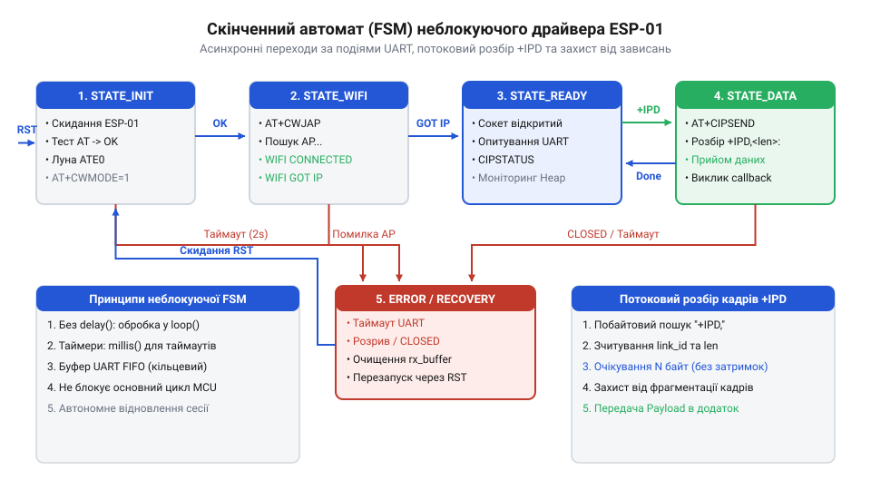
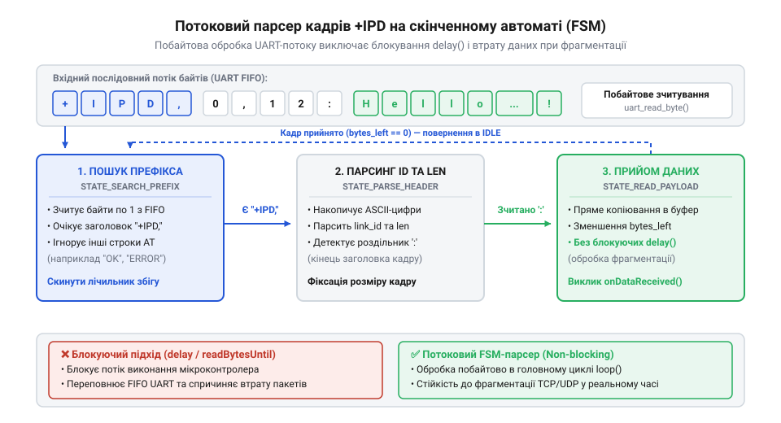

# Асинхронний FSM-драйвер TCP/UDP-сокетів для хост-мікроконтролера

<preknowlist>
- [ESP-01 (Wi-Fi, ESP8266)](root:cat-hw-boards/esp-01) — призначення виводів UART, схему живлення 3.3 В та обмеження апаратних ресурсів модуля
- [Огляд базової системи AT-команд мікроконтролера ESP8266](root:cat-hw-boards/esp8266-at-command-set-overview) — синтаксис системних команд AT, формат відповідей OK/ERROR та організація зв'язку через UART
- [Потоковий розбір асинхронних кадрів +IPD в AT-прошивці ESP8266](root:cat-hw-boards/esp8266-at-ipd-parser) — формат префікса +IPD, призначення полів довжини кадру та ID сокета при отриманні мережевих даних
- [Протокол двофазної передачі даних AT+CIPSEND в ESP8266](root:cat-hw-boards/esp8266-at-cipsend-handshake) — двокроковий механізм відправки даних та обробку підтвердження SEND OK
</preknowlist>

## Проблема блокування хоста в мережевих драйверах

Розробка мережевого драйвера для мікроконтролерів вимагає постійного обміну даними між головним процесором та зовнішнім трансивером. Коли [компактний Wi-Fi модуль](root:cat-hw-boards/esp-01) взаємодіє з керуючим пристроєм, `@@en|хост-мікроконтролер@@` (англ. *host*, від латинського *hospes* — той, хто приймає) надсилає командні стрічки та очікує підтвердження виконання через `@@en|UART-інтерфейс@@` (англ. *Universal Asynchronous Receiver-Transmitter*, від *asynchronous* — неузгоджений у часі). Найпростішим шляхом реалізації такого обміну є виклик підпрограм, у яких після відправлення команди програма зупиняється та чекає на відповідну відповідь у циклі. Проте використання таких методів, як `@@en|блокуюча затримка@@` (англ. *delay*, від старофранцузького *delayer* — відкладати), призводить до повної зупинки виконання головної програми мікропроцесора.

Основна небезпека синхронного очікування полягає в заморожуванні обчислювального потоку. Якщо [набір AT-команд ESP8266](root:cat-hw-boards/esp8266-at-command-set-overview) містить запит на з'єднання з бездротовою мережею або відкриття мережевого з'єднання, тривалість виконання операції на стороні трансивера може сягати кількох секунд. Упродовж цього часу `@@en|хост-мікроконтролер@@` виконує порожні цикли очікування, внаслідок чого припиняється опитування критичних датчиків, зупиняється оновлення користувацького інтерфейсу та пропускаються переривання від інших апаратних периферійних вузлів. Якщо в системі виникає затримка в мережі або тимчасова втрата пакетів, застосунок повністю втрачає реактивність і зависає.

Обчислимо сумарний час блокування головного потоку `T_total` при покроковому виконанні чотирьох ініціалізуючих команд із затримками очікування відповіді:

```
T_total = T_reset + T_mode + T_join + T_connect
= 2000 + 500 + 15000 + 5000    [сумування максимальних затримок у мілісекундах]
= 22500 мс                     [обчислення граничного часу замороження хоста]
```

У цьому виразі змінні `T_reset`, `T_mode`, `T_join` та `T_connect` позначають максимальні інтервали очікування відповідей на команди перезавантаження, вибору режиму, підключення до точки доступу та відкриття сокета відповідно. Результат показує, що хост залишається повністю недієздатним понад 22 секунди, втрачаючи можливість обробляти інші системні події.

Крім втрати процесорного часу, блокуюче опитування руйнує цілісність вхідного потоку даних. Коли пристрій ESP-01 отримує асинхронні сповіщення від мережі або вхідні текстові строки, трансивер надсилає їх у послідовну лінію без попередження. Якщо [архітектура прошивки Espressif AT](root:cat-hw-boards/esp8266-at-firmware-architecture) передає кадри в момент, коли `@@en|хост-мікроконтролер@@` заблокований усередині іншої затримки, апаратний `@@en|буфер@@` (англ. *buffer*, від давньофранцузького *buffe* — амортизатор) прийому `@@en|UART-інтерфейсу@@` швидко переповнюється. Переповнення буфера призводить до втрати символів, спотворення структури повідомлень та розсинхронізації протоколу обміну.

Спроби вирішити цю проблему шляхом збільшення розміру апаратного буфера або додавання коротких опитувань не усувають фундаментального недоліку. Виходом із цієї ситуації є перехід від синхронного очікування до асинхронної обробки подій. Для цього прийом даних із послідовного порту переноситься у переривання або фоновий [кільцевого буфера UART](root:sf-devices/uart-ring-buffer-architecture), а керування передачею команд доручається неблокуючій системі. Це створює чітку вимогу до побудови архітектури, у якій керуючий пристрій взаємодіє з модулем через `@@en|скінченний автомат@@` (англ. *finite state machine*, від *finite* — обмежений, *state* — стан, *machine* — механізм), звільняючи головний цикл для паралельного виконання інших задач. Практичні деталі налаштування обробника переривань та збереження вхідних байтів висвітлює [організація кільцевого буфера RX для асинхронного UART](root:sf-devices/uart-rx-ring-buffer-mcu).

## Архітектура та стани неблокуючого автомата

Асинхронний драйвер мережевого модуля будується на основі неблокуючого скінченного автомата, який розділяє складний процес ініціалізації та обміну даними на послідовність дискретних станів. Замість очікування відповіді на `@@en|AT-команду@@` (англ. *AT command*, від *attention* — увага) у циклі, `@@en|скінченний автомат@@` виконує один крок перевірки у кожному проході головного циклу програми. Якщо нові символи в буфері відсутні, обробник негайно повертає керування головній системі. Такий підхід гарантує, що `@@en|хост-мікроконтролер@@` витрачає на обслуговування мережевого інтерфейсу лише мікросекунди за один такт.

Життєвий цикл керуючого автомата охоплює декілька послідовних етапів від початкової подачі живлення до активного обміну через `@@en|сокет@@` (англ. *socket*, від старофранцузького *soc* — заглиблення, гніздо). Кожен стан відповідає за виконання чітко визначеної операції та контролює власний `@@en|таймаут@@` (англ. *timeout*, від *time* — час, *out* — вихід).


*Діаграма станів скінченного автомата драйвера ESP-01, яка показує алгоритм керування з урахуванням таймаутів та асинхронних відповідей.*

Логіка функціонування автомата розподіляється між основними внутрішніми станами:

1. `STATE_INIT_RESET`: `@@en|хост-мікроконтролер@@` скидає модуль апаратним сигналом або надсилає команду розвантаження, після чого переходить у стан очікування системного текстового маркера готовності `ready`.
2. `STATE_INIT_ATE0`: надсилається команда вимкнення луна-копіювання символів для спрощення подальшого розбору відповідей від прошивки.
3. `STATE_INIT_CWMODE`: встановлюється режим роботи бездротового адаптера як клієнтської станції.
4. `STATE_WIFI_CONNECT`: надсилаються параметри точки доступу. [Мережевий стек lwIP](root:cat-hw-boards/lwip-architecture-esp8266) виконує авторизацію в ефірі, а `@@en|скінченний автомат@@` очікує асинхронного сповіщення про отримання IP-адреси.
5. `STATE_CIPSTART`: ініціюється відкриття мережевого каналу TCP або UDP, після чого автомат відстежує підтвердження встановлення сесії.
6. `STATE_CONNECTED_IDLE`: робочий стан активного з'єднання, у якому здійснюється двосторонній передача кадрів та перевірка наявності вхідних даних.
7. `STATE_ERROR_RECOVERY`: аварійний стан, у який автомат переходить при виникненні помилок або вичерпанні ліміту часу, здійснюючи скидання параметрів та підготовку до повторної ініціалізації.

Перехід між станами здійснюється на основі аналізу відповідей, що надходять від трансивера. Оскільки текстові строки можуть фрагментуватися при передачі через `@@en|UART-інтерфейс@@`, парсер автомата накопичує символи у проміжному буфері до появи маркерів закінчення рядка. Отримання підтвердження `OK` переводить `@@en|скінченний автомат@@` у наступний робочий стан, тоді як відповідь `ERROR` або виявлення розриву з'єднання переводить систему у стан відновлення.

Для захисту від зависання при втраті відповідей кожен стан вимірює тривалість свого виконання. Час перебування у стані `T_elapsed` обчислюється як різниця між поточним значенням системного лічильника часу `T_current` та моментом входу в стан `T_entry`:

```
T_elapsed = T_current - T_entry
= 18500 - 12000             [різниця системного часу в мілісекундах]
= 6500 мс                   [обчислення поточного інтервалу перебування у стані]
```

У наведеному розрахунку значення `T_current` та `T_entry` отримуються від апаратного таймера системи. Якщо обчислений інтервал `T_elapsed` перевищує заданий поріг `T_timeout` для поточного стану, встановлюється `@@en|прапорець@@` (англ. *flag*, від давньоскандинавського *flagra* — розвіватися) помилки, і `@@en|скінченний автомат@@` примусово переходить у стан `STATE_ERROR_RECOVERY`.

Створений каркас переходів автомата забезпечує стійкість до затримок у мережі та асинхронних збоїв без блокування процесорного ядра. У робочому стані `STATE_CONNECTED_IDLE` цей автомат стає основою, на яку спирається подальший [розбір кадрів IPD](root:cat-hw-boards/esp8266-at-ipd-parser) та асинхронний [двофазний протокол CIPSEND](root:cat-hw-boards/esp8266-at-cipsend-handshake) для надійної передачі мережевих пакетів.

## Потоковий розбір фрагментованих кадрів IPD

Мережевий стек модуля [ESP-01 приймає дані](root:cat-hw-boards/esp-01) з бездротової мережі й передає їх хосту у вигляді асинхронного повідомлення `+IPD`. Коли хост-мікроконтролер отримує кадр (від фр. @@fr|cadre@@ — рамка) мережевого пакета, типовою помилкою є спроба накопичити весь його вміст у проміжному масиві перед обробкою. Оскільки максимальний розмір сегмента @@en|TCP@@ становить 1460 байтів, а обсяг оперативної пам'яті @@en|RAM@@ багатьох 8-бітових мікроконтролерів не перевищує 2 Кілобайти, збереження кадру повністю викликає переповнення буфера. Крім того, надходження байтів через @@en|UART@@ є фрагментованим (від лат. @@la|fragmentum@@ — уломок), оскільки інтервал між окремими символами залежить від стану мережевого каналу.

Для вирішення цієї проблеми застосовують потоковий розбір (від англ. @@en|stream parsing@@, від лат. @@la|pars@@ — частина), де аналіз виконується побайтово безпосередньо під час зчитування з послідовного порту. Виділяють префікс (від лат. @@la|praefixus@@ — прикріплений попереду) повідомлення, ідентифікатор сокета та довжину даних, після чого корисне навантаження (від англ. @@en|payload@@) відразу передається в цільовий обробник застосунку.

Скінченний автомат розбору кадрів перемикається між чотирма послідовними станами:
1. Пошук префікса `+IPD` — порівняння вхідних символів зі сталим шаблоном.
2. Вилучення ідентифікатора сокета — зчитування ASCII-цифр до розділової коми `,`.
3. Вилучення довжини кадру — зчитування ASCII-цифр до розділової двокрапки `:`.
4. Пряма трансляція корисного навантаження — перенаправлення `N` наступних байтів у лічильник без парсингу AT-команд.


*Попотоковий аналіз вхідних байтів UART дозволяє відокремити службові заголовочні дані від мережевого пакета без виділення пам'яті під весь кадр.*

У момент, коли автомат бачить роздільну двокрапку `:`, він дізнається точний обсяг вхідного пакета й фіксує його в лічильнику `bytes_remaining`. У цьому стані автомат ігнорує будь-які командні символи на кшталт `OK` чи `ERROR` і передає вхідні байти безпосередньо у вихідний кільцевий буфер або функцію зворотного виклику. Це гарантує, що якщо корисне навантаження містить символи, схожі на службові відповіді модуля, вони не порушать роботу [потокового розбору префікса](root:cat-hw-boards/esp8266-at-ipd-parser) та станів основного автомата.

Код нижче демонструє реалізацію потокового парсера кадрів `+IPD` у рамках загального автомата обробки послідовного порту:

:::tabs
:::code proj-esp01-async-socket-fsm/c/esp-idf/ipd-parser-init.c
:::code proj-esp01-async-socket-fsm/cpp/arduino/ipdstate.cpp
:::

Завдяки такій структурі внутрішній [мережевий стек lwIP](root:cat-hw-boards/lwip-architecture-esp8266) передає пакети на хост без затримок, а хост обробляє кадри будь-якого обсягу порціями по 1 байту в міру їх надходження з фізичної лінії.

## Двофазна передача даних та контроль квитування

Відправка вихідних даних через сокети модуля ESP-01 вимагає чіткого дотримання протоколу квитування (від лат. @@la|quietus@@ — спокійний, звільнений). Спроба відправити бінарне корисне навантаження в один крок разом із текстом AT-команди призводить до того, що прошивка сприймає бінарні байти як продовження тексту команди, що викликає помилку синтаксису чи спотворення пакетів. Щоб уникнути цього, реалізується двофазна передача (від грец. @@gr|δίς@@ — двічі та @@gr|φάσις@@ — поява).

Суть двофазного обміну полягає в розділенні транзакції (від лат. @@la|transactio@@ — угода, завершення) на два автономні кроки:

1. Надання оголошення довжини: Хост надсилає команду `AT+CIPSEND=<link_id>,<len>\r\n` і переходить у стан очікування запрошення.
2. Отримання запрошення передачі: Модуль виділяє внутрішній буфер і повертає символ запрошення `>` (від англ. @@en|prompt@@). Тільки після виявлення символу `>` хост передає точний масив з `<len>` байтів.

Після надсилання байтів модуль вихідного кадру чекає підтвердження від віддаленого вузла мережі та повертає хосту статус `SEND OK` або `SEND FAIL`. Скінченний автомат контролює весь цей процес за допомогою системного таймера, відстежуючи таймаути на кожному етапі.

Для забезпечення безпеки передачі хост-мікроконтролер повинен виконувати [протокол двофазної передачі](root:cat-hw-boards/esp8266-at-cipsend-handshake) без блокування основного циклу виконання. Якщо у відповідь на `AT+CIPSEND` не надходить символ `>` протягом відведеного часу (наприклад, 2000 мс), автомат скасовує транзакцію, переходить у стан обробки помилок і звільняє лінію передачі.

Особливою граничною ситуацією є одночасне надходження вхідних кадрів `+IPD` під час очікування відповіді `SEND OK`. Завдяки тому, що потоковий розбір працює асинхронно в тлі, вхідні дані не втрачаються, навіть коли автомат знаходиться в стані очікування квитування відправлення.

Нижче наведено приклад реалізації стану двофазного відправлення в автоматі керування:

:::tabs
:::code proj-esp01-async-socket-fsm/c/esp-idf/send-fsm-start.c
:::code proj-esp01-async-socket-fsm/cpp/arduino/sendstate.cpp
:::

Використовуючи довідковий [огляд AT-команд ESP8266](root:cat-hw-boards/esp8266-at-command-set-overview), розробник може налаштувати параметри ретрансляції кадрів та таймаутів для досягнення максимальної стійкості каналу зв'язку.

## Автономне відновлення сесії та обробка збоїв

У реальних умовах експлуатації бездротових пристроїв зв'язок неминуче переривається через завади в ефірі, перезавантаження роутера або тимчасову деградацію (від лат. @@la|degradatio@@ — зниження ступеня) сигналу. Модуль ESP-01 також може зависнути через імпульсні перешкоди по живленню чи внутрішні помилки стека. Надійний драйвер має володіти автономністю (від грец. @@gr|αὐτονομία@@ — самозаконність, незалежність) і здатністю самостійно відновлювати мережеву сесію без втручання оператора й без повного перезавантаження хост-мікроконтролера.

Для виявлення збоїв автомат керування використовує два основні джерела інформації:
1. Асинхронні повідомлення про зміну стану — текстові кадри `CLOSED`, `WIFI DISCONNECT` чи `FAIL`, що надходять з модуля у довільний момент.
2. Апаратні та програмні сторожові таймери (від англ. @@en|watchdog timer@@) — аналіз тривалості відсутності відповіді від модуля на контрольні запити.

Коли сокет закривається зі сторони сервера, модуль видає рядок `<link_id>,CLOSED`. Автомат перехоплює цей рядок, змінює статус відповідного сокета на `DISCONNECTED` і переходить до процедури повторного відкриття через `AT+CIPSTART`.

Якщо ж модуль повністю припиняє відповідати на UART-команди протягом заданого інтервалу (наприклад, 10 секунд), автомат переходить до драбини відновлення:
1. Софтверне скидання — надсилання команди `AT+RST` з очікуванням текстового рядка `ready`.
2. Апаратне скидання — короткочасне притиснення лінії `RST` модуля до нуля на 50 мс через GPIO хоста, коли модуль не реагує на послідовний порт.

При відновленні зв'язку автомат повертається до базового стану ініціалізації: вимикає ехо-режим `ATE0`, перевіряє підключення до точки доступу `AT+CWJAP?`, вмикає режим множинних з'єднань `AT+CIPMUX=1` та заново створює необхідні TCP чи UDP сокети.

Перевірити апаратні рівні та правильно підключити [виводи завантаження ESP8266](root:cat-hw-boards/esp8266-boot-modes) необхідно ще на етапі проектирования схеми, щоб апаратний `RST` не переводив модуль у режим прошивання.

Нижче наведено структуру FSM для автономного відновлення сесії та обробки критичних таймаутів:

:::tabs
:::code proj-esp01-async-socket-fsm/c/esp-idf/session-manager-init.c
:::code proj-esp01-async-socket-fsm/cpp/arduino/driverstate.cpp
:::

Детальне вивчення теми [оновлення прошивки ESP-01](root:cat-hw-boards/esp01-firmware-flashing) гарантує використання стабільної версії ESP-AT, де усунуто витоки пам'яті та спонтанні зависання при багаторазовому відновленні TCP-сесій.
