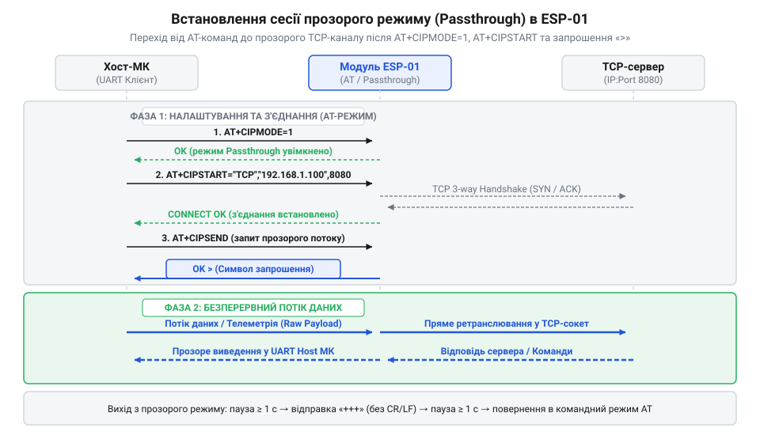
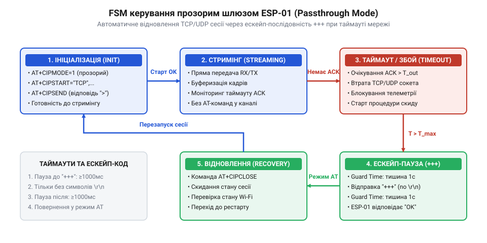

# Шлюз телеметрії в режимі наскрізної передачі даних (Passthrough Mode)

<preknowlist>
- [ESP-01 (Wi-Fi, ESP8266)](root:cat-hw-boards/esp-01) — розпіновка модуля, вимоги до джерела живлення 3.3 В та рівні послідовного інтерфейсу UART.
- [Огляд базового командного інтерфейсу ESP-AT](root:cat-hw-boards/esp-at-command-set-overview) — синтаксис AT-команд, правила обробки текстових відповідей модуля та налаштування послідовного порту.
- [Протокол двофазної передачі даних AT+CIPSEND в ESP8266](root:cat-hw-boards/esp8266-at-cipsend-handshake) — механізм відправки даних із вказанням довжини пакета та відмінності від прозорого стримінгу.
- [Потоковий розбір асинхронних кадрів +IPD в AT-прошивці ESP8266](root:cat-hw-boards/esp8266-at-ipd-parser) — формат прийнятих кадрів +IPD у командному режимі для порівняння з прозорим потоком.
</preknowlist>

## Проблема накладних витрат стандартних AT-команд

При розробці автономних систем збору телеметрії на базі керуючого хост-мікроконтролера та бездротового [модуля ESP-01](root:cat-hw-boards/esp-01) виникає задача безперервної трансляції вимірювальних даних на віддалений сервер у реальному часі. Телеметричні датчики — такі як акселерометри, цифровий осцилограф, аналізатори вібрації чи системи моніторингу електромережі — генерують невеликі кадри даних (по `32–128 байтів`) із високою частотою від `50` до `200 Гц`. При намаганні передати цей потік через класичну двофазну процедуру взаємодії розробник зіштовхується з критичним падінням пропускної здатності та неприпустимими затримками (від англ. @@en|latency@@; @@en|затримка передачі@@).

Двофазний механізм передачі даних описує класичний [протокол двофазної передачі даних](root:cat-hw-boards/esp8266-at-cipsend-handshake) за допомогою команди `AT+CIPSEND`. Для відправлення кожного окремого кадра хост-мікроконтролер змушений виконувати послідовність дій:
1. Зформувати та надіслати в послідовний порт текстову команду вказання довжини кадра: `AT+CIPSEND=64\r\n`.
2. Призупинити виконання коду та очікувати від трансивера відповіді з символом запрошення `>` (від англ. @@en|prompt symbol@@; @@en|символ запрошення@@).
3. Передати безпосередній масив байтів телеметрії через послідовний інтерфейс (від англ. @@en|Universal Asynchronous Receiver-Transmitter@@; @@en|UART@@).
4. Очікувати завершального текстового повідомлення підтвердження `\r\nSEND OK\r\n` або помилки `\r\nSEND FAIL\r\n`.

Паралельно з цим, при отриманні зворотних команд або підтверджень від віддаленого сервера, трансивер [архітектури SoC ESP8266](root:cat-hw-boards/esp8266-soc-architecture-overview) обгортає кожен вхідний мережевий пакет у текстовий заголовок `+IPD,<len>:`. Це змушує хост-мікроконтролер постійно виконувати ресурсномісткий [потоковий розбір кадрів +IPD](root:cat-hw-boards/esp8266-at-ipd-parser) у байтовому потоці RX.

Розглянемо часовий розрахунок накладних витрат для стандартної швидкості послідовного порту (від англ. @@en|baud rate@@; @@en|швидкість UART@@) у `115200 біт/с`. Передача одного байта (з урахуванням старт- і стоп-бітів) триває приблизно `86.8 мкс`.
- Команда `AT+CIPSEND=64\r\n` містить `16 байтів`, що займає `1.39 мс` лінії TX.
- Очікування та прийом символу `>\r\n` разом із внутрішньою затримкою обробки трансивера додає ще близько `0.8–1.2 мс`.
- Корисне навантаження кадра у `64 байти` передається за `5.56 мс`.
- Завершальна відповідь `\r\nSEND OK\r\n` містить `11 байтів` і займає `0.96 мс` лінії RX.

Сумарний час транзакції для відправлення всього `64 байтів` корисної телеметрії становить близько `9 мс`. За таких умов максимальна частота відправки не перевищує `110 пакетів/с`, причому понад `35%` часу послідовного каналу витрачається не на корисні дані датчиків, а на трансляцію та парсинг текстових службових команд (`AT+CIPSEND`, `\r\n`, `> `, `SEND OK`).

Коли частота генерації даних датчиками перевищує швидкість двофазного обміну, в системі виникає ефект роздування буферів (від англ. @@en|buffer bloat@@; @@en|накопичення буфера@@). Кільцевий буфер хост-мікроконтролера переповнюється, викликаючи втрату найновіших відліків або блокування основного циклу програмою. Для усунення цих накладних витрат необхідно відмовитися від кадрового командного опитування та перевести трансивер у режим безперервного потокового мосту.

## Конфігурація прозорого режиму та сокетного з'єднання

Прозорий режим передавання (від англ. @@en|Passthrough Mode@@ / @@en|Unvarnished Transmission@@; @@en|прозорий режим@@) перетворює бездротовий модуль на прямий послідовно-мережевий міст. При активації цього стану внутрішній інтерпретатор команд у [архітектурі прошивки Espressif AT](root:cat-hw-boards/esp8266-at-firmware-architecture) припиняє синтаксичний аналіз вхідних байтів UART RX. Усі байти, що надходять від хост-мікроконтролера, безпосередньо спрямовуються у відкритий мережевий сокет, а дані з мережі виводяться у лінію UART TX без кадрових обгорток `+IPD`.

Апаратна конфігурація прозорого режиму вимагає дотримання суворої послідовності ініціалізаційних команд:
1. `AT+CWMODE=1` — вибір режиму клієнта (станції) Wi-Fi.
2. `AT+CWJAP="AccessPoint","Password"` — підключення до бездротової мережі.
3. `AT+CIPMUX=0` — встановлення одиночного сокетного з'єднання (від англ. @@en|Single Connection Mode@@; @@en|одиночний режим@@). Слід враховувати жорстке правило: прозорий режим `AT+CIPMODE=1` підтримується виключно при `AT+CIPMUX=0`. Спроба активувати його у багатоканальному режимі `AT+CIPMUX=1` викликає апаратне відхилення з відповіддю `ERROR`.
4. `AT+CIPMODE=1` — увімкнення прапорця прозорої трансляції в оперативній пам'яті трансивера.
5. `AT+CIPSTART="TCP","192.168.1.100",8080` — відкриття сокета протоколу керування передачею (від англ. @@en|Transmission Control Protocol@@; @@en|TCP@@) або протоколу користувацьких датаграм (від англ. @@en|User Datagram Protocol@@; @@en|UDP@@).
6. `AT+CIPSEND` — запуск прозорого сеансу. На відміну від звичайного режиму, параметр довжини кадра не вказується. Трансивер повертає символ `>` і входить у стан потокової трансляції.

*Показано порядок ініціалізації сокета, увімкнення CIPMODE=1 та переходу трансивера у стан прозорого мосту.*

Вибір транспортного протоколу визначається характером телеметрії:
- З'єднання `TCP` гарантує цілісність, послідовність та недопущення втрат пакетів засобами [мережевого стека LwIP 2.x](root:cat-hw-boards/lwip-stack-architecture-in-embedded), що є критичним для систем аварійної сигналізації та комерційного обліку.
- З'єднання `UDP` мінімізує мережеві затримки за рахунок відсутності підтверджень доставки, що ідеально підходить для високочастотного стримінгу осцилограм та сигналів вібрації.

Для тимчасового або постійного виходу з прозорого режиму назад у командний стан використовується спеціальна ескейп-послідовність (від англ. @@en|escape sequence@@; @@en|ескейп-послідовність@@), що складається з трьох символів плюса `+++` (ASCII-коди `0x2B 0x2B 0x2B`). Виконання цієї операції накладає жорсткі часові обмеження на захисний інтервал (від англ. @@en|guard time@@; @@en|захисний паузовий інтервал@@):
- Перед передачею символів `+++` у лінії UART TX мусить витримуватися повна тиша тривалістю не менше `1000 мс`.
- Усі три символи `+++` мають бути передані впродовж часового вікна, що не перевищує `1000 мс`.
- Після передачі `+++` у лінії UART TX мусить витримуватися наступна пауза тиші тривалістю не менше `1000 мс`.

Якщо хост-мікроконтролер порушить захисний інтервал і надішле байти телеметрії безпосередньо перед або одразу після `+++`, трансивер сприйме три плюси як звичайне корисне навантаження і транпостує їх у мережевий сокет. При успішному переході модуль припиняє трансляцію байтів у сокет, що дозволяє відправляти команди `AT+CIPCLOSE` або `AT+CIPMODE=0`.

## Буферизація потоку та апаратні таймаути

Під час роботи у прозорому режимі бездротовий модуль не відправляє у радіоефір окремий кадр Wi-Fi на кожен поодинокий байт, що надходить від мікроконтролера. Це зруйнувало б ефективність радіоканалу. Замість цього [архітектура мережевого стека lwIP](root:cat-hw-boards/lwip-architecture-esp8266) накопичує байти у внутрішньому буфері оперативної пам'яті DRAM обсягом до `1460 байтів` (що відповідає максимальному розміру сегмента; від англ. @@en|Maximum Segment Size@@; @@en|MSS@@).

Відправка мережевого пакета в ефір ініціюється за однією з двох умов:
1. Заповнення буфера MSS: як тільки сумарна кількість прийнятих через UART байтів досягає `1460`, стек lwIP негайно формує та відправляє TCP-сегмент або UDP-датаграму.
2. Апаратний таймаут простою UART (від англ. @@en|UART RX Idle Timeout@@; @@en|таймаут простою лінії прийому@@): якщо хост-мікроконтролер передав невелику порцію даних (наприклад, `64 байти`) і призупинив передачу, внутрішній таймер ESP8266 (тривалістю `20 мс`) спрацьовує і примусово відправляє неповний пакет у мережу.

На боці хост-мікроконтролера для запобігання втраті даних при високих швидкостях UART необхідно реалізувати кільцевий буфер (від англ. @@en|circular buffer@@ / @@en|ring buffer@@; @@en|кільцевий буфер@@), що обслуговується перериваннями або прямим доступом до пам'яті (від англ. @@en|Direct Memory Access@@; @@en|DMA@@).

*Показано логіку переходу між станами ініціалізації, моніторингу прозорого каналу, виходу через ескейп-послідовність та автовідновлення з'єднання.*

Для забезпечення надійності шлюзу керуючий алгоритм мікроконтролера будується на основі кінцевого автомата (від англ. @@en|Finite State Machine@@; @@en|FSM@@; @@en|кінцевий автомат@@). При аварійному розриві мережевого з'єднання віддаленим сервером або виході з зони Wi-Fi трансивер виводить у лінію UART TX асинхронний текстовий маркер `CLOSED\r\n` або `WIFI DISCONNECT\r\n`. Хост-мікроконтролер мусить безперервно сканувати вхідний потік байтів на наявність цих підрядків навіть під час активної фази стримінгу.

При виявленні розриву конечний автомат виконує процедуру відновлення:
1. Переходить у стан аварійної витримки та витримує паузу `1000 мс`.
2. Відправляє ескейп-послідовність `+++` для гарантованого виходу з прозорого режиму.
3. Витримує паузу `1000 мс` і видає команду примусового закриття сокета `AT+CIPCLOSE`.
4. Перевіряє стан мережевого підключення та ініціює повторний цикл `AT+CIPMODE=1` -> `AT+CIPSTART` -> `AT+CIPSEND` без перезавантаження всієї системи.

:::tabs
:::code proj-esp01-passthrough-telemetry-gateway/c/esp-idf/esp01-exit-passthrough.c
:::code proj-esp01-passthrough-telemetry-gateway/cpp/arduino/sendatcommand.cpp
:::

## Вихід із прозорого режиму та ескейп-послідовність

Під час активного транзиту даних у режимі @@en|Passthrough Mode@@ бездротовий [трансивер SoC ESP8266](root:cat-hw-boards/esp8266-soc-architecture-overview) повністю відключає внутрішній синтаксичний інтерпретатор вхідних команд. Усі байти, які хост-мікроконтролер надсилає в лінію @@en|UART@@ RX, безпосередньо транслюються у відкритий сокет @@en|TCP@@ або @@en|UDP@@. Якщо виникає потреба призупинити телеметрію, змінити параметри мережевого сокета, відправити службовий запит або коректно закрити з'єднання, звичайна відправка текстової AT-команди (наприклад, `AT+CIPCLOSE\r\n`) зазнає невдачі: модуль не виконає команду, а просто відправить рядок `AT+CIPCLOSE\r\n` на віддалений сервер як корисне навантаження. Для повернення трансивера до обробки керуючих команд без примусового перезавантаження живлення необхідно застосувати спеціальний механізм перемикання станів.

Цим механізмом є ескейп-послідовність (з англ. @@en|escape sequence@@ — послідовність виходу) у вигляді трьох символів плюса `+++` (ASCII-коди `0x2B 0x2B 0x2B`). Оскільки в байтовому потоці телеметрії (наприклад, у бінарних кадрах від датчиків) три символи `0x2B` можуть зустрітися випадково, розробники [прошивки Espressif AT](root:cat-hw-boards/esp8266-at-firmware-architecture) впровадили суворий часовий критерій розпізнавання — захисний інтервал (з англ. @@en|guard time@@ — захисний інтервал часу). Модуль інтерпретує символи `+++` як команду виходу з прозорого режиму лише тоді, коли вони відокремлені від будь-яких інших даних інтервалами абсолютної тиші на лінії @@en|UART@@ RX.

Часові допуски виходу вимагають виконання трьох послідовних умов:
1. Захисна пауза до відправки (`T_guard >= 1000 мс`): протягом щонайменше 1000 мілісекунд у лінію @@en|UART@@ RX не повинно надходити жодного байта даних від хост-мікроконтролера.
2. Вікно передачі послідовності: три символи `+++` мусять бути передані поспіль, без затримок між байтами, що перевищують загальне вікно в 1000 мілісекунд. Передача будь-яких додаткових символів, включаючи символи переведення рядка `\r` або `\n`, категорично заборонена.
3. Захисна пауза після відправки (`T_guard >= 1000 мс`): після передачі третього символу `+` у лінії @@en|UART@@ RX має знову утримуватися абсолютна тиша протягом щонайменше 1000 мілісекунд.

Якщо хост-мікроконтролер порушить хоча б одну з цих умов — наприклад, надішле байт телеметрії за 500 мілісекунд до `+++` або одразу після третього плюса, — внутрішній таймер активності ESP8266 скинеться. Трансивер сприйме три плюси як звичайні байти даних і негайно переправить їх у мережевий буфер [мережевого стека lwIP](root:cat-hw-boards/lwip-architecture-esp8266). При успішному ж використанні послідовності модуль повертає текстову відповідь `OK\r\n` і зупиняє прозору трансляцію, повертаючись до звичайного командного режиму.

*Показано часові обмеження захисних інтервалів тиші перед і після трьох символів плюса для безаварійного повернення модуля в командний режим.*

Для гарантованого виконання виходу хост-мікроконтролер мусить повністю призупинити фонові задачі передачі @@en|UART@@ (наприклад, вимкнути переривання передавача або призупинити @@en|DMA@@-трансфер) на час витримання паузи в 1050 мілісекунд. Лише після отримання відповіді `OK` хост-контролер може безпечно відправляти команди `AT+CIPCLOSE` для закриття сокета або `AT+CIPMODE=0` для остаточного вимкнення прозорого режиму.

## Обробка мережевих збоїв та автоматичне відновлення

У реальних умовах експлуатації бездротові мережі схильні до тимчасових аномалій: розривів радіоканалу Wi-Fi через завади, перезавантаження маршрутизатора або закриття сокета за таймаутом з боку віддаленого сервера. Під час роботи шлюзу в режимі @@en|Passthrough Mode@@ хост-мікроконтролер не отримує стандартних підтверджень `SEND OK` на кожен відправлений пакет. Якщо сокет розривається, [модуль ESP-01](root:cat-hw-boards/esp-01) виводить у лінію @@en|UART@@ TX асинхронний сповіщувальний рядок `CLOSED\r\n` або `WIFI DISCONNECT\r\n` і припиняє передачу байтів у мережу. Якщо хост-мікроконтролер проігнорує цей сигнал і продовжить безперервно відправляти телеметрію в лінію @@en|UART@@ RX, нові байти будуть безповоротно втрачені, а пристрій опиниться у завислому стані без змоги самостійно відновити передачу.

Забезпечення відмовостійкості вимагає впровадження двокомпонентної системи виявлення збоїв. Перший компонент — це пасивний розбір вхідного потоку @@en|UART@@ TX. Попри те, що прозорий режим вимикає обгортки `+IPD`, асинхронні повідомлення про зміну стану сокета та Wi-Fi мережі продовжують виводитися в лінію @@en|UART@@ TX. Хост-мікроконтролер повинен аналізувати вхідний буфер прийому на наявність підрядків `CLOSED` та `WIFI DISCONNECT`. Другий компонент необхідний для виявлення прихованих розривів — напіввідкритих з'єднань (від англ. @@en|half-open connection@@ — напіввідкрите з'єднання), коли фізичний зв'язок втрачено, але модуль ще не зафіксував обрив. Для цього на рівні прикладного протоколу впроваджують пульсові кадри підтвердження (від англ. @@en|heartbeat@@ — серцебиття, періодичний пульсовий сигнал; від англ. *heart* — серце, *beat* — удар) або активують очікування зворотних ACK-повідомлень. Якщо сервер не відповідає протягом заданого таймауту, зв'язок вважається втраченим.

Для автоматичного повернення шлюзу в робочий стан розробляється кінцевий автомат (від англ. @@en|Finite State Machine@@; @@en|FSM@@). При виявленні мережевого збою @@en|FSM@@ переходить у стан аварійного відновлення за таким алгоритмом:
1. Блокування потоку телеметрії: хост-мікроконтролер призупиняє відправку даних у @@en|UART@@ і перенаправляє нові вимірювання датчиків у локальний кільцевий буфер оперативної пам'яті.
2. Примусове повернення в командний режим: контролер витримує захисний інтервал тиші `1050 мс`, надсилає ескейп-послідовність `+++` і чекає ще `1050 мс`.
3. Скидання та верифікація: надсилається команда `AT+CIPCLOSE`. Якщо модуль не відповідає на `AT`-команди протягом 2000 мілісекунд, контролер подає короткий імпульс низького рівня на апаратний вивід `RST` трансивера або надсилає команду `AT+RST`.
4. Перепідключення: використовуючи базовий [командний інтерфейс ESP-AT](root:cat-hw-boards/esp-at-command-set-overview), @@en|FSM@@ послідовно виконує перевизначення одиночного режиму `AT+CIPMUX=0`, увімкнення `AT+CIPMODE=1`, повторне відкриття сокета `AT+CIPSTART` та запуск стримінгу через `AT+CIPSEND`.
5. Відновлення потоку: після успішного переходу в @@en|Passthrough Mode@@ накопичені в буфері вимірювання передаються на сервер, що запобігає втраті часових рядів телеметрії.

:::tabs
:::code proj-esp01-passthrough-telemetry-gateway/c/esp-idf/esp01-safe-exit-passthrough.c
:::code proj-esp01-passthrough-telemetry-gateway/cpp/arduino/executeescapesequence.cpp
:::
