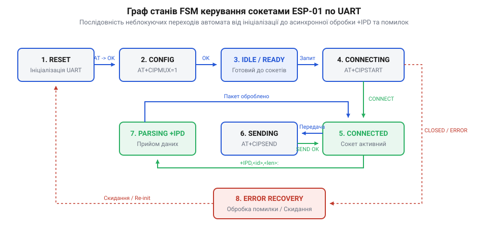
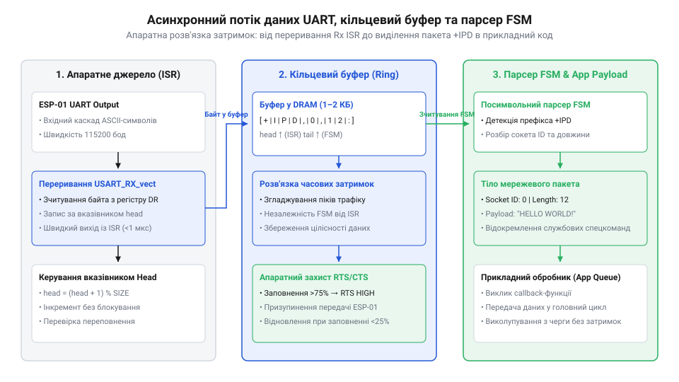

# Розробка асинхронного FSM-драйвера TCP/UDP сокетів ESP-01 для мікроконтролера

<preknowlist>
- [ESP-01 (Wi-Fi, ESP8266)](root:cat-hw-boards/esp-01) — цокольовка штирьового роз'єму 2x4, лінії UART TX/RX та живлення 3.3 В
- [Мережеві сокети TCP/UDP на модулі ESP-01](root:cat-hw-boards/esp01-tcp-udp-sockets) — базові AT-команди відкриття сокетів, режим тунелювання та формат +IPD
- [Огляд сімейства Wi-Fi модулів ESP-01 та ESP-01S](root:cat-hw-boards/esp-01-module-family-overview) — особливості апаратних інтерфейсів та підтяжок модулів
</preknowlist>

## Проблема блокуючого очікування сигналів UART

Під час побудови мережевих пристроїв на базі зовнішнього хост-мікроконтролера керування Wi-Fi модулем [ESP-01](root:cat-hw-boards/esp-01) здійснюється через послідовний порт UART (англ. @@en|Universal Asynchronous Receiver-Transmitter@@, від *universal* — універсальний, *asynchronous* — асинхронний, *receiver* — приймач та *transmitter* — передавач; @@en|послідовний порт UART@@) за допомогою AT-команд (англ. @@en|AT commands@@, від *attention* — увага та *command* — команда; @@en|AT-команди AT commands@@). Найпростіший підхід до розбору відповідей полягає у відправленні команди та лінійному очікуванні відповідного текстового рядка `OK` або `ERROR` у блокуючому циклі із застосуванням функції затримки `delay()`. Проте така реалізація спричиняє спонтанні збої мережевого обміну та повну втрату пакетів даних.

Головна причина нестабільності полягає в асинхронній природі мережевого протоколу. Вхідні дані від віддаленого вебсервера або сокетного клієнта надходять у вигляді системного префікса `+IPD` у довільний момент часу, незалежно від поточного стану виконання програми хост-процесора. При надходженні кожного кадру апаратний зсувний регістр @@en|UART@@ приймає біти й генерує апаратне переривання приймача (англ. @@en|receiver interrupt@@, від *receiver* — приймач та *interrupt* — переривання; @@en|переривання приймача receiver interrupt@@), сповіщаючи процесор про наявність байта у буфері прийому. Якщо в цей момент мікроконтролер виконує затримувальну функцію `delay()` або заблокований у лінійному очікуванні відповіді на іншу команду, апаратний вхідний буфер @@en|UART@@ швидко заповнюється. Невеликий обсяг апаратного @@en|FIFO@@-буфера базових мікроконтролерів (зазвичай від `N_fifo = 16` до 64 байтів) призводить до виникнення переповнення буфера (англ. @@en|buffer overflow@@, від *buffer* — буфер та *overflow* — переповнення; @@en|переповнення буфера buffer overflow@@). У разі переповнення апаратного буфера новий байт витискає або втрачає стоп-біт, що викликає апаратну помилку кадрування (англ. @@en|framing error@@, від *frame* — кадр та *error* — помилка; @@en|помилка кадрування framing error@@; `Frame Error`) та апаратне переповнення, спотворюючи весь наступний текстовий потік. При стандартній швидкості передачі (англ. @@en|baud rate@@, від прізвища інженера *Baudot* — Бодо та *rate* — швидкість; @@en|швидкість передачі baud rate@@) `B = 115200` бод у форматі 8N1 (10 бітів на кадр) кожен байт надходить кожні `t_byte = 10 / 115200 ≈ 86.8 мкс`. Гранично допустима затримка обробки переривання (англ. @@en|interrupt latency@@, від *interrupt* — переривання та *latency* — затримка; @@en|затримка обробки переривання interrupt latency@@) `t_max_delay` до моменту повного переповнення 16-байтового @@en|FIFO@@ розраховується за формулою:

    t_max_delay
    = N_fifo · (10 ÷ B)                         [формула максимального часу затримки до переповнення FIFO]
    = 16 · (10 ÷ 115200)                        [підстановка ємності 16 байтів та швидкості 115200 бод]
    = 16 · (86.805 × 10⁻⁶)                      [обчислення часу передачі одного кадру 8N1]
    = 1.38888 × 10⁻³                            [с]
    ≈ 1.39 мс                                   [гранично допустимий час затримки обробника]

Отримане значення `t_max_delay ≈ 1.39 мс` показує, що будь-яка функціональна затримка `delay()`, яка перевищує 1.4 мс, неминуче викликає втрату символів асинхронного потоку, структура AT-відповідей руйнується, а основний цикл пристрою втрачає можливість реагувати на зовнішні події та опитувати датчики. Для забезпечення надійного зв'язку необхідний перехід до неблокуючого вводу-виводу (англ. @@en|non-blocking I/O@@, від *non-blocking* — неблокуючий, *input/output* — ввід-вивід; @@en|неблокуючий ввід-вивід non-blocking I/O@@), який обробляє вхідний потік байт за байтом без зупинки основного циклу.

## Архітектура неблокуючого скінченного автомата FSM

Розв'язанням проблеми блокуючих затримок є побудова неблокуючого скінченного автомата (англ. @@en|Finite State Machine@@, від *finite* — скінченний, *state* — стан та *machine* — машина; @@en|скінченний автомат FSM@@). Замість накопичення всього рядка в пам'яті до появи символу переведення каретки `\r\n`, автомат аналізує кожен окремий символ безпосередньо в момент його надходження з послідовного порту.

*Граф станів неблокуючого FSM-автомата з переходами між очікуванням префікса, розбором системних відповідей та виділенням пакетів +IPD.*

Граф станів парсера розділено на чотири ключові фази обробки потоку. У базовому стані накопичення рядків автомат зчитує текстові відповіді модема. У цьому ж стані реалізовано алгоритм детектування асинхронних системних статусів `CONNECT` та `CLOSED`: під час формування чергового текстового рядка до символу `\n` парсер виконує пошук підрядків за допомогою функцій аналізу текстових кадрів, витягує числовий ідентифікатор сокета (наприклад, `0,CONNECT` або `0,CLOSED`) і миттєво змінює внутрішній стан відповідного з'єднання `SocketState` без блокування черги. Якщо зчитаний рядок збігається з підтвердженням `OK` або `ERROR`, @@en|FSM@@ викликає відповідні асинхронні функції зворотного виклику (колбеки) та скидає буфер. У разі виявлення у текстовому потоці послідовності `+IPD,` автомат негайно переключається у стан розбору ідентифікатора сокета, зчитує числове значення ID з'єднання до коми, переходить до зчитування довжини корисного навантаження і, досягнувши розділового двокрапки `:`, перемикається у стан прямого зчитування бінарного тіла пакета. Таке розгалуження дозволяє ізолювати прийом довільних бінарних даних від текстових @@en|AT@@-повідомлень, захищаючи систему від хибного спрацьовування на символи `\r` та `\n`, які можуть міститися всередині бінарного корисного навантаження. Для забезпечення завадостійкості в умовах апаратного шуму в автомат впроваджено механізм самовідновлення після виявлення пошкоджених символів чи збоїв формату: при потраплянні нечислових символів у станах розбору `AT_STATE_IPD_LINK_ID` або `AT_STATE_IPD_LENGTH`, а також у разі заповнення буфера до `AT_PARSER_LINE_BUF_SIZE - 1` без отримання `\n`, @@en|FSM@@ скидає індекс `line_idx = 0` і безпечно повертається у стан `AT_STATE_LINE_ACCUMULATE`. Таке скидання запобігає переповненню буфера та розсинхронізації станів, дозволяючи драйверу відновити коректну обробку з наступної межі рядка `\r\n` або префікса `+IPD`.

## Посимвольний розбір префіксів та буферизація

Для запобігання втраті символів під час виконання тривалих обчислень хост-процесором обробка апаратних переривань UART відокремлюється від логіки FSM за допомогою кільцевого буфера (англ. @@en|ring buffer@@, від *ring* — кільце та *buffer* — буфер; @@en|кільцевий буфер ring buffer@@), що працює за принципом першим прийшов — першим вийшов (англ. @@en|First-In, First-Out@@, від *first* — перший, *in* — вхід, *out* — вихід; @@en|FIFO@@).

*Схема потоку даних від переривання UART через кільцевий буфер до обробника FSM та виділення тіла сокетного пакета.*

Апаратне переривання @@en|UART@@ поміщає вхідні байти у кільцевий буфер за мінімальну кількість тактів процесора. Під час кожного проходу періодичного циклу `update()` @@en|FSM@@-обробник витягує накопичені байти з буфера та виконує посимвольний розбір префікса `+IPD,<link_id>,<len>:`. Перетворення десяткових символів у числові значення виконується на льоту за допомогою накопичувального множення `len = len * 10 + (ch - '0')`. Після зчитування двокрапки парсер фіксує очікувану довжину `ipd_expected_len` і копіює наступні байти безпосередньо в сокетний @@en|RX@@-буфер. Для розрахунку необхідного розміру кільцевого буфера враховують швидкість зв'язку 115200 бод і кадр `8N1` (10 біт на байт). Байтову швидкість прийому `R_byte` обчислюють діленням бодової швидкості на кількість біт у символі:

    R_byte = 115200 ÷ 10
           = 11520 байт/с
           = 11.52 байт/мс        [переведення у мілісекунди]

При максимальній інтервальності виклику циклу обробки `T_loop = 10` мс необхідна мінімальна ємність кільцевого буфера `N_min` визначається добутком швидкості та часу затримки:

    N_min = 11.52 × 10
          = 115.2 ≈ 128 байт      [округлення до найближчого степеня 2]

Отже, буфер обсягом 128 байтів дає запас часу обробки до `11.1` мс, що гарантує відсутність втрат при короткочасних блокуваннях процесора.

Нижче наведено повну асинхронну реалізацію FSM-драйвера сокетів мовами C та C++, яка утилізує статичні масиви без викликів динамічного виділення пам'яті `malloc`, що забезпечує абсолютну детермінованість і високу швидкість обробки на будь-яких мікроконтролерах.

:::tabs
@tab C
:::code proj-esp01-uart-fsm-tcp-client-server/c/at_parser.h
:::code proj-esp01-uart-fsm-tcp-client-server/c/at_parser.c
:::code proj-esp01-uart-fsm-tcp-client-server/c/main.c
@tab C++
:::code proj-esp01-uart-fsm-tcp-client-server/cpp/RingBuffer.hpp
:::code proj-esp01-uart-fsm-tcp-client-server/cpp/Esp01Socket.hpp
:::code proj-esp01-uart-fsm-tcp-client-server/cpp/Esp01Socket.cpp
:::code proj-esp01-uart-fsm-tcp-client-server/cpp/main.cpp
:::

ООП-реалізація мовою C++ огортає роботу з кільцевими буферами `RingBuffer` у клас `Esp01Socket`, надаючи зручний неблокуючий інтерфейс `write()`, `read()` та `available()`. Періодичний виклик `socket.update()` забезпечує фонову відправку вихідних даних порціями та асинхронний прийом вхідних пакетів, усуваючи ризик зависання системи при розриві з'єднання або затримках мережі. Зокрема, для передачі накопичених у вихідному буфері `m_txBuffer` байтів виклик `update()` використовує порційне сегментування: якщо кількість даних перевищує межу в 64 байти, метод обмежує розрахункову довжину порції `bytesToSend = 64`, після чого формує відповідний командувальний запит `AT+CIPSEND=<linkId>,<len>\r\n` і витягує з кільцевого буфера зафіксовану кількість байтів для прямої вигрузки в апаратний порт. Таке розбиття великих масивів на фіксовані фрагменти захищає апаратний буфер модема від переповнення та запобігає тривалим затримкам виконання при відправці великих обсягів мережевого навантаження.

## Автоматичне відновлення з'єднань та тайм-аути

У реальних умах бездротового зв'язку мережева сесія може обірватися у будь-який момент через збої маршрутизатора, просідання Wi-Fi сигналу або примусове закриття сокета віддаленим сервером. При апаратному розриві підключення прошивка модема надсилає в UART асинхронне сповіщення `0,CLOSED\r\n`. Скінченний автомат FSM розпізнає цей рядок і негайно переводить сокет у стан `SocketState::Disconnected`.

Однак при мовчазному обриві мережі (наприклад, при раптовій втраті живлення сервера або обриві кабелю) статус `CLOSED` може взагалі не надійти. Для запобігання нескінченному зависанню драйвера вбудована система задіює таймер тиші (англ. @@en|heartbeat timer@@, від *heartbeat* — серцебиття та *timer* — таймер; @@en|таймер тиші heartbeat timer@@) та механізм підтримання зв'язку (англ. @@en|keep-alive mechanism@@, від *keep* — тримати, *alive* — живий; @@en|механізм підтримання зв'язку keep-alive@@). Вибір інтервалу надсилання пакетів @@en|keep-alive@@ диктується тайм-аутами таблиць @@en|NAT@@ мережевих маршрутизаторів, які зазвичай скидають неактивні сокетні з'єднання через 30–60 секунд: вибір періоду опитування в межах 10–15 секунд гарантує збереження сесії та своєчасну перевірку лінії. Розрахунок граничного тайм-ауту тиші `T_silence` спирається на множення інтервалу зондування `T_keepalive` на допустиму кількість втрачених пакетів `N_retry` з додаванням запасу затримки мережі `T_margin`:

    T_silence = N_retry × T_keepalive + T_margin
              = 2 × 10 + 5
              = 25 с              [розрахунок тайм-ауту тиші для інтервалу 10 с]

Якщо протягом заданого часового вікна `T_silence` (наприклад, 25 секунд) сокет не отримує нових пакетів `+IPD` або підтверджень, хост-мікроконтролер надсилає тестовий командувальний запит або примусово виконує скидання стану. Додатково для контролю виконання самих @@en|AT@@-команд задіюється сторожовий таймер (англ. @@en|watchdog timer@@, від *watchdog* — вартовий собака та *timer* — таймер; @@en|сторожовий таймер watchdog timer@@): якщо після відправлення `AT+CIPSTART` відповідь `OK` або `CONNECT` не надходить протягом передбаченого тайм-ауту, @@en|FSM@@ скасовує транзакцію та ініціює повторну спробу підключення `connect()` без блокування основного циклу.

## Практична реалізація та інтеграція драйвера

Сформований асинхронний C/C++ драйвер сокетів є повністю автономним модулем, призначеним для інтеграції як у прості системи на прямому керуванні залізом (англ. @@en|Bare Metal@@, від *bare* — голий та *metal* — метал; @@en|Bare Metal@@), так і в багаторазові операційні системи реального часу (англ. @@en|Real-Time Operating System@@, від *real-time* — реальний час, *operating* — операційна, *system* — система; @@en|операційна система реального часу RTOS@@).

При інтеграції в архітектуру @@en|Bare Metal@@ вектор переривання приймача @@en|UART@@ напряму передає вхідні байти у метод `socket.onUartRxByte(byte)`, а головна функція обробки `socket.update()` викликається на кожній ітерації суперциклу `while(1)`. У середовищі @@en|RTOS@@ (наприклад, @@en|FreeRTOS@@) переривання поміщає байти у міжзадачну чергу, а виклик `socket.update()` виконується в окремій мережевій задачі з мінімальною затримкою. Оскільки переривання @@en|UART@@ виконується асинхронно щодо основного циклу, модифікація спільних покажчиків та лічильників кільцевого буфера (`m_head`, `m_tail`, `m_size`) створює ризик стану гонитви (англ. @@en|race condition@@, від *race* — гонитва та *condition* — умова; @@en|стан гонитви race condition@@): для захисту цілісності даних атомарні операції читання та модифікації покажчиків загортаються у критичні секції із тимчасовим вимкненням переривань `__disable_irq()` у @@en|Bare Metal@@ або викликами `taskENTER_CRITICAL()` у @@en|RTOS@@, що повністю унеможливлює пошкодження індексів при одночасному доступі. Оскільки драйвер утилізує виключно статичні кільцеві буфери без викликів динамічного виділення пам'яті `malloc` або `new`, він гарантує відсутність фрагментації оперативної пам'яті під час тривалої роботи [модулів ESP-01S](root:cat-hw-boards/esp-01s) у промислових контролерах та автономних датчиках.
