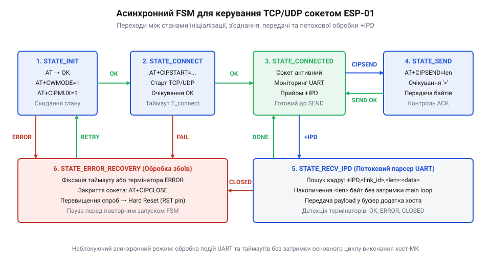
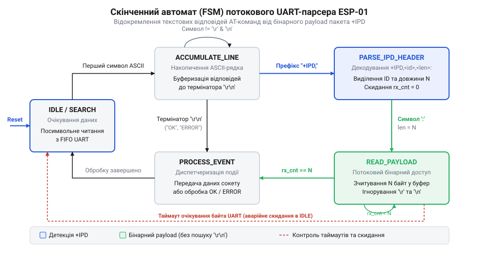

# Асинхронний FSM-драйвер сокетів ESP-01 для хост-мікроконтролера

<preknowlist>
- [ESP-01 (Wi-Fi, ESP8266)](root:cat-hw-boards/esp-01) — призначення виводів UART (TX/RX), електричні рівні інтерфейсу та основні можливості Wi-Fi модуля.
- [Керування GPIO виводами ESP8266 через AT-команди](root:cat-hw-boards/esp8266-at-gpio-control) — базову структуру AT-команд, формат текстових відповідей та правила підтвердження виконання дій.
</preknowlist>

## Проблема блокуючого обміну з ESP-01

Спроба побудувати мережевий обмін між хост-мікроконтролером та бездротовим [модулем ESP-01](root:cat-hw-boards/esp-01) через синхронні блокуючі виклики неминуче призводить до раптових зависань системи та втрати вхідних даних. Розробник підключає інтерфейс @@en|UART@@ (від англ. *Universal Asynchronous Receiver-Transmitter* — універсальний асинхронний приймач-передавач) і надсилає @@en|AT-команди@@ (від англ. *Attention* — увага) для відкриття @@en|TCP@@ (від англ. *Transmission Control Protocol* — протокол керування передачею) або @@en|UDP@@ (від англ. *User Datagram Protocol* — протокол користувацьких датаграм) [сокетів](root:cat-hw-boards/esp8266-at-gpio-control). Наївна реалізація зазвичай містить циклічне очікування текстової відповіді на кшталт `OK\r\n` або підтвердження надсилання `SEND OK\r\n`. У простій лабораторній схемі такий підхід може справляти враження робочого рішення. Проте в умовах реального бездротового ефіру мережеві затримки роблять синхронне очікування руйнівним для керуючої логіки.

Головна проблема полягає в асинхронній природі мережевого обміну та непередбачуваності часових інтервалів відгуку модулів [родини ESP-01](root:cat-hw-boards/esp-01-module-family-overview). Встановлення TCP-з'єднання, узгодження IP-адрес чи повторна передача втрачених пакетів Wi-Fi можуть тривати від десятків мілісекунд до кількох секунд. Якщо хост-мікроконтролер виконує активне @@en|polling@@ (від англ. *polling* — опитування) у блокуючому циклі `while(!uart_available())`, процесорне ядро повністю втрачає можливість виконувати суміжні задачі. Зупиняється опитування датчиків, порушуються розраховані тайминги цифрових протоколів, перестають оновлюватися елементи інтерфейсу користувача, а апаратний сторожовий таймер примусово перезавантажує мікроконтролер.

Другим критичним фактором є апаратне переповнення приймального буфера @@en|UART@@. Апаратний буфер @@en|FIFO@@ (від англ. *First In, First Out* — першим прийшов, першим вийшов) периферії @@en|UART@@ у більшості мікроконтролерів має обмежений розмір — від 16 до 64 байтів. Якщо модуль @@en|ESP-01@@ асинхронно отримує вхідний мережевий пакет або сповіщення про зміну стану сокета в той момент, коли хост-контролер зайнятий блокуючою обробкою іншої операції, вхідні байти стрімко заповнюють буфер. Після його переповнення нові байти безповоротно втрачаються, перекручуючи текстовий потік і унеможливлюючи подальший розбір відповідей.

Розв'язанням цієї проблеми є повне розділення низькорівневого збору байтів з @@en|UART@@ та вищої логіки керування мережевими сокетами. Замість очікування відповідей у циклі застосовують неблокуючий @@en|скінченний автомат@@ (від грец. *automatos* — той, що рухається сам; англ. *Finite State Machine*, @@en|FSM@@). Хост-мікроконтролер переводить @@en|FSM@@ у стан очікування, повертає керування в основний цикл і контролює @@en|таймаут@@ (від англ. *timeout* — вихід за часовий ліміт) за допомогою системного лічильника часу, не зупиняючи виконання інших задач.

*Блок-схема скінченного автомата керування сокетом ESP-01 для неблокуючого обміну.*

## Архітектура неблокуючого потокового парсера UART

Для забезпечення стійкої роботи неблокуючого @@en|скінченного автомата@@ керування сокетами потрібна архітектура, яка здатна фоново накопичувати вхідні байти з ліній @@en|UART@@ і перетворювати їх на очищені події для верхнього рівня. Прийом окремих символів реалізують через процедуру обробки переривання @@en|ISR@@ (від англ. *Interrupt Service Routine* — процедура обробки переривання) або контролер @@en|DMA@@ (від англ. *Direct Memory Access* — прямий доступ до пам'яті). Кожен отриманий байт негайно записується в програмний @@en|кільцевий буфер@@ (від англ. *ring buffer* — кільцевий буфер), що ізолює апаратну периферію від затримок виконання основної програми.

У кожній ітерації основного циклу мікроконтролер викликає @@en|потоковий парсер@@ (від лат. *pars* — частина), який зчитує накопичені байти з @@en|кільцевого буфера@@ без блокування. Архітектура потокового парсера базується на власному внутрішньому автоматі станів. У базовому стані парсер побайтово копіює символи в тимчасовий текстовий буфер рядка, відстежуючи символи термінаторів `\r\n` (англ. *Carriage Return / Line Feed*). Для запобігання переповненню пам'яті при отриманні некоректного потоку розмір буфера рядка жорстко обмежують (наприклад, 128 байтами). При перевищенні ліміту без отримання термінатора парсер скидає накопичений рядок та повертається в початковий стан.

Коли в потоці виявляється послідовність `\r\n`, парсер завершує рядок нульовим символом і виконує порівняння з еталонними відповідями @@en|AT-команд@@. Залежно від змісту рядка формується подія для верхнього рівня @@en|FSM@@:
- `OK\r\n` — успішне виконання команди;
- `ERROR\r\n` або `FAIL\r\n` — апаратний або синтаксичний збій;
- `SEND OK\r\n` — успішна передача буфера сокета в мережу;
- `ALREADY CONNECTED\r\n` — спроба повторного відкриття активного сокета.

*Діаграма станів потокового парсера UART з переходами між текстовим розбором і зчитуванням бінарних даних.*

На відміну від стандартних бібліотек обробки рядків, @@en|потоковий парсер@@ не чекає надходження повного повідомлення в блокуючому режимі. Він обробляє стільки байтів, скільки доступно в @@en|кільцевому буфері@@ на даний момент, і миттєво повертає керування. Це дозволяє поєднувати високу швидкість розбору текстових відповідей із нульовим впливом на час реакції основного циклу системи.

## Декодування асинхронних вхідних кадрів IPD

Головне ускладнення при обробці потоку даних від модуля @@en|ESP-01@@ полягає в тому, що мережеві дані надходять спонтанно, незалежно від поточного стану виконання @@en|AT-команд@@. Модуль сигналізує про прибуття пакетів із мережі за допомогою асинхронного префікса `@@en|+IPD@@`. Залежно від налаштувань режимів сокетів формат кадру має один із двох виглядів:
- `+IPD,<link_id>,<len>:data` — у режимі багаторазових з'єднань (`CIPMUX=1`), де `link_id` позначає номер сокета (від 0 до 4), а `len` — довжину бінарного блоку;
- `+IPD,<len>:data` — у режимі одиночного з'єднання (`CIPMUX=0`). Детальний синтаксис та крайові випадки обробки кадрів у різних режимах сокетів розкрито в матеріалі про [потоковий розбір асинхронних кадрів +IPD в AT-прошивці ESP8266](root:cat-hw-boards/esp8266-at-ipd-parser).

Основна пастка полягає в тому, що бінарне корисне навантаження `@@en|payload@@` (від англ. *payload* — корисне навантаження) може містити абсолютно довільні двійкові байти. Усередині пакету можуть зустрічатися символи `\r\n`, нульові байти `0x00` або текстові підрядки `"OK"`, `"ERROR"`, `"+IPD"`. Якщо @@en|потоковий парсер@@ залишатиметься в режимі текстового розбору під час читання двійкових даних, довільні символи `\r\n` усередині бінарного кадру спричинять хибне розбиття рядків, а випадковий текстовий фрагмент викличе помилкове спрацьовування @@en|FSM@@ сокета.

Для розв'язання цієї проблеми @@en|потоковий парсер@@ повинен підтримувати двохрежимну структуру з автоматичним перемиканням автомата станів:
1. **Текстовий режим накопичення рядка:** парсер шукає символи `\r\n` та перевіряє наявність префікса `+IPD,`. Щоб уникнути помилкових спрацьовувань, перевірка префікса виконується під час додавання кожного нового символу.
2. **Перехід у режим прочитання payload:** як тільки в рядку розпізнано префікс `+IPD,` та знайдено розділову двокрапку `:`, парсер декодує числа `link_id` і `len`. Одразу після двокрапки парсер запам'ятовує точну кількість очікуваних байтів `bytes_remaining = len` і перемикає свій стан на пряме зчитування двійкових даних.
3. **Бінарний режим:** у цьому стані парсер повністю вимикає пошук текстових термінаторів `\r\n`. Кожен наступний байт із @@en|кільцевого буфера@@ пересилається безпосередньо у буфер відповідного мережевого сокета або у функцію зворотного виклику. Лічильник `bytes_remaining` зменшується на 1.
4. **Повернення у текстовий режим:** коли лічильник `bytes_remaining` досягає 0, бінарний кадр вважається повністю прийнятим, і парсер повертається в стан текстового розбору.

При розробці високонавантажених систем, таких як [захищені SSL з'єднання](root:cat-hw-boards/esp8266-at-ssl-tls), точний потоковий розбір кадрів `@@en|+IPD@@` запобігає пошкодженню двійкових криптографічних пакетів.

Нижче наведено практичну реалізацію неблокуючого потокового парсера з підтримкою обробки кадрів `@@en|+IPD@@` та бінарного `@@en|payload@@` для хост-мікроконтролерів.

:::tabs
:::code proj-host-mcu-async-at-socket-fsm/c/bare-metal/ring-buffer-put.c
:::code proj-host-mcu-async-at-socket-fsm/cpp/arduino/espstreamparser.cpp
:::

## Скінченний автомат керування сокетними з'єднаннями

Після створення неблокуючого потокового парсера вхідних символів виникає потреба в організації вищого рівня логіки — @@en|скінченного автомата@@ (@@en|FSM@@), який керує життєвим циклом мережевих сокетів. Без чіткого автомата станів відправка чергової @@en|AT-команди@@ під час очікування відповіді на попередню або спроба передачі даних у невідкритий @@en|сокет@@ спричиняють хаос у каналі зв'язку. Хост-мікроконтролер повинен послідовно проводити модуль [ESP-01](root:cat-hw-boards/esp-01) через ланцюжок підтверджених станів: від первинного опитування до підтримки активного з'єднання та обміну пакетами.

Граф станів головного автомата керування сокетами будується на принципі суворої послідовності. Кожен крок надсилання конфігураційної команди очікує відповідну подію від парсера нижнього рівня:
1. `STATE_INIT_AT` — надсилання базової команди `AT`. Отримання події `EVENT_OK` переводить автомат у стан налаштування режиму Wi-Fi.
2. `STATE_SET_CWMODE` — передача `AT+CWMODE=1` для встановлення режиму клієнта (@@en|station@@). Після підтвердження `EVENT_OK` здійснюється перехід до вибору мультиплексування.
3. `STATE_SET_CIPMUX` — налаштування режиму багаторазових з'єднань через `AT+CIPMUX=1` (або `AT+CIPMUX=0` для одиночного сокета). Підтвердження `EVENT_OK` відкриває можливість встановлення мережевих сесій.
4. `STATE_CONNECTING` — відправка команди створення @@en|TCP@@ або @@en|UDP@@ з'єднання `AT+CIPSTART=0,"TCP","192.168.1.100",8080` (де першим параметром передається ідентифікатор сокета `link_id`). Перехід у стан `STATE_CONNECTED` відбувається лише після події `EVENT_OK` або сповіщення `CONNECT`.
5. `STATE_CONNECTED` — штатний режим, у якому сокет готовий до прийому даних `+IPD` та ініціалізації процедури відправки `@@en|AT+CIPSEND@@`.

*Діаграма станів скінченного автомата керування сокетами з відстеженням двофазної відправки даних.*

Найбільш відповідальним етапом роботи @@en|FSM@@ є реалізація двофазного протоколу @@en|handshake@@ (від англ. *handshake* — рукотискання) при надсиланні корисного навантаження. Модуль @@en|ESP-01@@ не приймає двійкові байти одразу разом із командою `@@en|AT+CIPSEND@@`. Спроба відправити @@en|payload@@ негайно після команди призведе до того, що модуль сприйме двійкові байти як синтаксичну помилку самої команди. Детальні часові діаграми та крайові випадки узгодження символу запрошення розглядає [протокол двофазної передачі даних AT+CIPSEND в ESP8266](root:cat-hw-boards/esp8266-at-cipsend-handshake).

Процедура відправки вимагає чіткого розбиття на два підстани:
- **Фаза 1 (`STATE_SEND_CMD`):** хост-мікроконтролер надсилає команду з вказуванням номера сокета та точного розміру пакету: `AT+CIPSEND=0,64\r\n`. Після цього @@en|FSM@@ переходить у стан `STATE_WAIT_PROMPT` і припиняє передачу будь-яких даних у @@en|UART@@.
- **Фаза 2 (`STATE_WAIT_PROMPT`):** модуль @@en|ESP-01@@ обробляє запит, виділяє внутрішні буфери й надсилає у відповідь одиночний символ-запрошення `> ` (без термінатора `\r\n`). Потоковий парсер мусить негайно виявити цей символ і згенерувати подію `EVENT_PROMPT`.
- **Фаза 3 (`STATE_SEND_PAYLOAD`):** отримавши `EVENT_PROMPT`, автомат перемикається у стан прямого вивантаження бінарних даних і передає в @@en|UART@@ рівно 64 байти корисного навантаження. Одразу після відправки останнього байта @@en|FSM@@ переходить у стан `STATE_WAIT_SEND_OK` і чекає від модуля підтвердження `SEND OK\r\n`.

Такий розподіл станів виключає взаємне накладання команд та забезпечує повний синхронізм між внутрішніми буферами модуля та передавачем мікроконтролера при [керуванні через AT-команди](root:cat-hw-boards/esp8266-at-gpio-control).

## Обробка таймаутів та відновлення сокетного з'єднання

У реальних бездротових мережах обмін даними схильний до зовнішніх завад, втрати Wi-Fi пакетів та раптових розривів з'єднання з боку сервера. Якщо модуль @@en|ESP-01@@ зависає під час виконання `AT+CIPSTART` або не повертає символ-запрошення `>` у відповідь на `@@en|AT+CIPSEND@@`, неблокуючий @@en|FSM@@ без контролю часу застрягне в проміжному стані назавжди. Для забезпечення автономної та безперебійної роботи драйвер повинен містити програмні таймери та багаторівневий механізм відновлення зв'язку.

Контроль часових інтервалів реалізують за допомогою системного лічильника мілісекунд (наприклад, `millis()` або системного тика `get_tick_ms()`). Під час кожного переходу в новий стан @@en|FSM@@ фіксує поточний час у змінній `state_timer`. У кожній ітерації основного циклу виконується перевірка різниці часу `(current_time - state_timer) > STATE_TIMEOUT_MS`. Для кожного стану визначають власний ліміт очікування:
- Для базових команд `AT` чи `AT+CWMODE` достатньо @@en|таймауту@@ в 1000–2000 мс.
- Для команд встановлення мережевого з'єднання `AT+CIPSTART` та очікування відповіді сервера встановлюють розширений @@en|таймаут@@ до 5000–10000 мс, враховуючи можливі затримки маршрутизації.
- Для отримання символу `>` після `@@en|AT+CIPSEND@@` та підтвердження `SEND OK` заклади від 2000 до 5000 мс.

Якщо часовий ліміт вичерпано до отримання очікуваного підтвердження, @@en|FSM@@ фіксує помилку та запускає процедуру повторних спроб за алгоритмом експоненційного затримання @@en|exponential backoff@@ (від англ. *exponential backoff* — експоненційне затримання). Драйвер збільшує лічильник спроб `retry_count`. Поки кількість спроб не перевищує порогове значення (наприклад, 3), автомат здійснює повторне надсилання останньої команди.

Коли кількість послідовних помилок досягає граничного ліміту або від модуля надходить асинхронне сповіщення `CLOSED\r\n`, драйвер ініціює процедуру скидання. Очищення стану відбувається за двома рівнями:
1. **Програмне відновлення (Soft Reset):** @@en|FSM@@ скасовує поточну операцію, скидає внутрішні буфери парсера та повертається у початковий стан `STATE_INIT_AT` для повторного виконання ланцюжка конфігурації.
2. **Апаратне відновлення (Hard Reset):** якщо модуль @@en|ESP-01@@ не відповідає на тестові команди `AT` протягом кількох циклів повторної ініціалізації (що свідчить про внутрішній збій мікроконтролера ESP8266 чи переповнення його стеків), хост-мікроконтролер формує низький рівень на цифровому виводі GPIO, підключеному до виводу `@@en|RST@@` модуля. Імпульс тривалістю 100 мс примусово перезавантажує модуль.

Впровадження автономного автомата відновлення гарантує, що будь-який мережевий збій чи апаратне зависання периферійного модуля опрацьовуються локально всередині драйвера. Основна програма хост-мікроконтролера продовжує безперервно виконувати свої задачі, зберігаючи цілісність системи при високих навантаженнях та використанні складних протоколів [архітектури SoC ESP8266](root:cat-hw-boards/esp8266-soc-architecture-overview).

Нижче наведено повну реалізацію неблокуючого скінченного автомата керування сокетами з контролем таймаутів та автоматичним апаратним відновленням для хост-мікроконтролерів.

:::tabs
:::code proj-host-mcu-async-at-socket-fsm/c/bare-metal/esp-driver-init.c
:::code proj-host-mcu-async-at-socket-fsm/cpp/arduino/driverstate.cpp
:::
