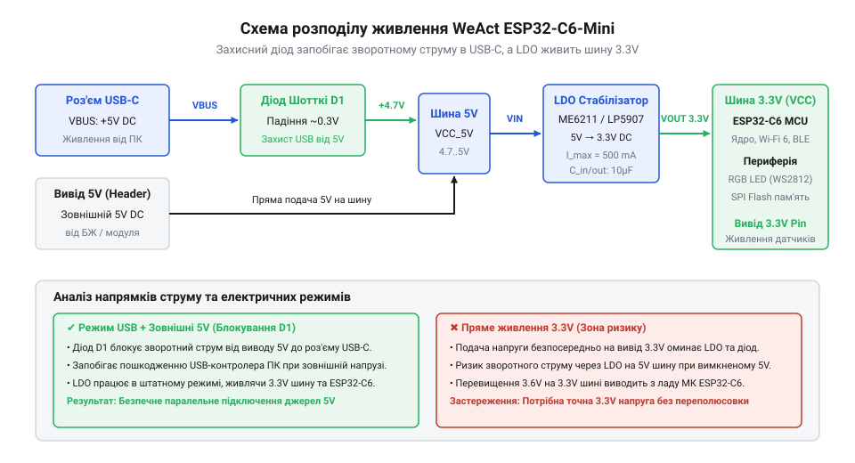
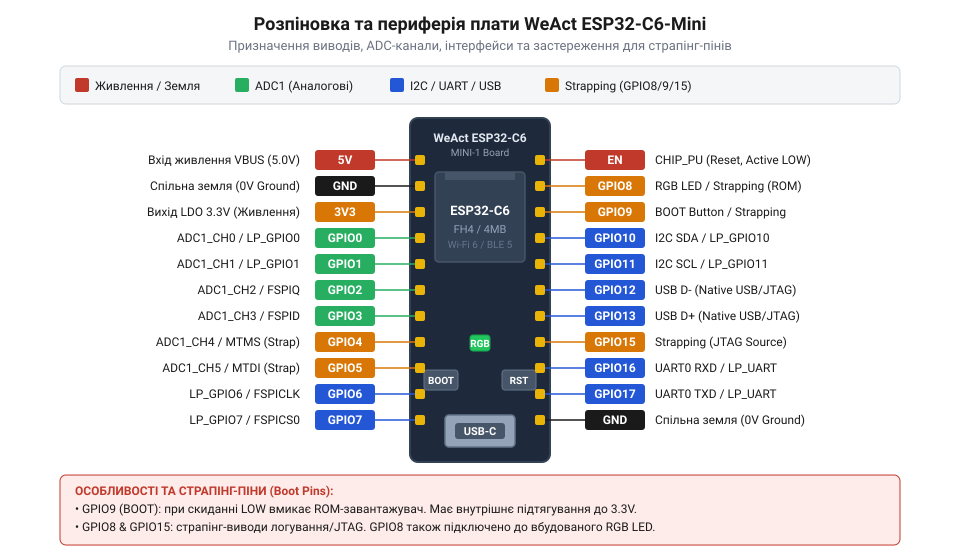

# Апаратна розводка та периферійний інтерфейс WeAct ESP32-C6-Mini

<preknowlist>
- [Waveshare ESP32-C6-Zero](root:cat-hw-boards/esp32-c6-zero) — Загальна архітектура чипа ESP32-C6, базові принципи функціонування ядра RISC-V та бездротових периферійних модулів.
</preknowlist>

## Збої завантаження та пошкодження периферії

Підключаючи нову компактну плату @@en|WeAct ESP32-C6-Mini@@ до робочого столу, розробник очікує негайного старту прошивки. Проте замість виконання програми мікроконтролер @@en|ESP32-C6@@ часто циклічно перезавантажується, зависає або самовільно переходить у режим завантаження коду. У найгірших випадках спроба одночасного живлення від кабелю @@en|USB-C@@ та зовнішнього лабораторного блоку призводить до виходу з ладу регулятора напруги чи портів комп'ютера.

Основна причина таких апаратних збоїв полягає у нехтуванні специфікою низькорівневої розводки модуля. Під час подачі живлення внутрішньокристальна логіка @@en|ESP32-C6@@ проводитиме зчитування електричних рівнів на спеціальних виводах — страпінг-пінах (від англ. @@en|strap@@ — фіксувати, прив'язувати). Якщо підключений зовнішній датчик чи підтягувальний резистор створює на цих лініях нерозрахований потенціал, мікроконтролер змінює джерело завантажувального коду або конфігурацію внутрішньої шини.

Неменшу небезпеку становить неправильне розмежування ліній живлення 5V та 3.3V. Приєднання зовнішніх периферійних модулів із власними джерелами напруги без вирівнювання потенціалів створює зворотні струми через внутрішні захисні діоди виводів @@en|GPIO@@ (від англ. @@en|General-Purpose Input/Output@@ — виводи загального призначення). Для оперативного усунення неполадок важливо розрізняти характерні ознаки двох типів несправностей. Апаратні збої живлення виявляють себе циклічними перезавантаженнями чи спонтанними скиданнями під час піків споживання струму, а в логах @@en|UART@@ з'являються повідомлення про @@en|Brownout Reset@@ або просідання напруги нижче допустимого порогу на лінії 3.3V. Натомість помилки завантаження через страпінг-піни проявляються детермінованим зависанням системи або автоматичним переходом у режим програмування: у консолі @@en|UART0@@ фіксується лог первинного завантажувача @@en|ROM-bootloader@@ із прапором @@en|Download Boot@@ замість запуску виконуваного коду з @@en|SPI Boot@@. Практична діагностика передбачає послідовну перевірку: спочатку через аналіз текстового логу зчитують причину скидання та вектор страпінг-виводів, далі осцилографом або мультиметром вимірюють рівні напруги на виводах @@en|GPIO8@@, @@en|GPIO9@@ та @@en|GPIO15@@ у момент відпускання лінії @@en|RESET@@, після чого контролюють відсутність просідань шини 3.3V під навантаженням. Щоб забезпечити стабільну роботу системи, необхідно чітко розбиратися в архітектурі живлення плати, логіці страпінг-виводів та правилах розподілу периферійних шин. Загальні принципи функціонування ядра @@en|RISC-V@@ розглянуто в огляді [плат архітектури ESP32-C6](root:cat-hw-boards/esp32-c6-zero).

## Архітектура живлення та електричні обмеження

Схемотехніка живлення плати @@en|WeAct ESP32-C6-Mini@@ розрахована на подачу напруги через роз'єм @@en|USB-C@@ або через фізичні виводи гребінки. Отримані від роз'єму 5V потрапляють на вхід лінійного стабілізатора @@en|LDO@@ (від англ. @@en|Low Dropout@@ — мале падіння напруги), який знижує потенціал до робочого рівня 3.3V, необхідного для живлення мікроконтролера, внутрішньої flash-пам'яті та вбудованих компонентів.

Для захисту зовнішнього порту комп'ютера від зворотного струму між шиною VBUS роз'єму @@en|USB-C@@ та виводом 5V встановлено захисний діод Шотткі (від англ. @@en|Schottky diode@@, названого на честь німецького фізика @@en|Walter Schottky@@). Діод пропускає струм від USB до плати, але блокує його проходження у зворотному напрямку, якщо зовнішній блок живлення підключено безпосередньо до гребінки 5V.


*Схема розподілу напруги на платі WeAct ESP32-C6-Mini, що ілюструє роботу захисного діода Шотткі та лінійного стабілізатора.*

Вибір джерела живлення визначає максимальний струмовий бюджет периферії. Вбудований стабілізатор @@en|LDO@@ розрахований на граничний струм 500 mA. Сам мікроконтролер @@en|ESP32-C6@@ під час пікових передач у бездротових мережах @@en|Wi-Fi 6@@ та @@en|Zigbee@@ споживає до 350 mA. Максимально припустимий струм навантаження для зовнішніх сенсорів, підключених до шини 3.3V, обчислюється як різниця між спроможністю стабілізатора та споживанням кристала:

```
I_ext = I_LDO - I_MCU
= 500 mA - 350 mA      [віднімання пікового споживання чипа]
= 150 mA               [доступний струмовий запас]
```

Перевищення цієї межі викликає просідання напруги 3.3V нижче допустимого порогу 3.0V, що призводить до спрацьовування системи @@en|Brownout Reset@@ та перезавантаження мікроконтролера. Для безпечного підключення потужної периферії — такої як сервоприводи, силові реле чи додаткові сенсори — напругу подають від окремого зовнішнього джерела або знижувального перетворювача (від англ. @@en|Step-Down converter@@ — знижувальний перетворювач), не перевантажуючи вбудований стабілізатор плати @@en|WeAct ESP32-C6-Mini@@. Ключовою вимогою такої схемотехніки є створення спільної землі (від англ. @@en|Ground@@ — земля, @@en|GND@@), для чого мінусові лінії зовнішнього джерела та плати з'єднують в єдиний контур. Спільна шина @@en|GND@@ забезпечує однаковий нульовий потенціал для всіх компонентів: без неї логічні рівні на виводах @@en|GPIO@@ втрачають опорну точку, спричиняючи хибні спрацьовування, проходження паразитних зворотних струмів через інтерфейсні кола та апаратне пошкодження чипа.

## Призначення страпінг-пінів та режимів завантаження

Режим старту мікроконтролера @@en|ESP32-C6@@ визначається рівнем напруги на трьох ключових страпінг-виводах під час зняття сигналу скидання на лінії @@en|EN@@ (@@en|RESET@@). Для плати @@en|WeAct ESP32-C6-Mini@@ критично важливими є виводи @@en|GPIO8@@, @@en|GPIO9@@ та @@en|GPIO15@@.

Вивід @@en|GPIO9@@ є головним селектором режиму завантаження. Якщо в момент подачі живлення на @@en|GPIO9@@ утримується високий логічний рівень (1), кристал запускає виконачу програму з внутрішньої flash-пам'яті у режимі @@en|SPI Boot@@. Низький рівень (0) на @@en|GPIO9@@ переводить пристрій у режим @@en|Download Boot@@ для запису прошивки через @@en|UART@@ або системний інтерфейс @@en|USB Serial/JTAG@@.

Виводи @@en|GPIO8@@ та @@en|GPIO15@@ задають додаткові параметри завантажувача. Вивід @@en|GPIO8@@ під час старту має перебувати у високому стані (1). Якщо в момент скидання @@en|GPIO9@@=0 і @@en|GPIO8@@=1, активується режим @@en|Joint Download Boot@@. Якщо ж @@en|GPIO8@@ примусово затягнути до землі (0), кристал переходить у зарезервований тестовий режим і не реагує на команди завантаження.

На платі встановлено дві кнопки: @@en|RESET@@ та @@en|BOOT@@. Кнопка @@en|RESET@@ комутує лінію @@en|EN@@ на землю. Для відсікання дребезгу та забезпечення автоматичного старту лінія @@en|EN@@ підтягнута до 3.3V через резистор 10 kΩ і з'єднана з конденсатором 1 μF, що утворює затримуючий @@en|RC-ланцюг@@ (від англ. @@en|Resistor-Capacitor@@). Кнопка @@en|BOOT@@ підключена до @@en|GPIO9@@. Натискання @@en|BOOT@@ під час перезавантаження затягує @@en|GPIO9@@ до землі, переводячи пристрій у режим прошивки. Зовнішня периферія на виводах @@en|GPIO8@@, @@en|GPIO9@@ та @@en|GPIO15@@ не повинна шунтувати ці лінії на землю при включенні.

## Прив'язка периферійних інтерфейсів та розпіновка

Плата @@en|WeAct ESP32-C6-Mini@@ виводить лінії мікроконтролера на дві дворядні гребінки. Більшість виводів є універсальними та підключені до внутрішньої матриці @@en|GPIO Matrix@@, яка дозволяє програмно комутувати цифрові інтерфейси @@en|SPI@@, @@en|I2C@@, @@en|UART@@ та шість каналів генератора @@en|PWM@@ (від англ. @@en|Pulse-Width Modulation@@ — широтно-імпульсна модуляція) на довільні виводи.


*Карта призначень фізичних виводів плати з виділенням страпінг-пінів та аналогових каналів.*

Аналогові функції підпорядковані суворій апаратній прив'язці. Вбудований 12-бітний аналогово-цифровий перетворювач @@en|ADC@@ (від англ. @@en|Analog-to-Digital Converter@@) доступний на виводах @@en|GPIO0@@–@@en|GPIO6@@ (блок @@en|ADC1@@). Ці лінії використовують для зчитування напруги з аналогових датчиків.

При виборі виводів для зовнішніх модулів слід враховувати апаратне розмежування:
- @@en|GPIO12@@ та @@en|GPIO13@@ задіяні для апаратного інтерфейсу @@en|USB Serial/JTAG@@ (лінії @@en|D-@@ та @@en|D+@@), тому їх використання для загального введення-виведення може порушити зв'язок з комп'ютером;
- @@en|GPIO8@@ апаратно з'єднаний із вбудованим адресованим світлодіодом;
- @@en|GPIO9@@ з'єднаний із кнопкою @@en|BOOT@@;
- Решта вільних ліній (@@en|GPIO0@@–@@en|GPIO7@@, @@en|GPIO18@@–@@en|GPIO23@@) підходять для підключення шин @@en|I2C@@ (за замовчуванням SDA на GPIO6, SCL на GPIO7) та @@en|SPI@@. Схожі принципи щільної розпіновки застосовуються у [надкомпактних платах SuperMini](root:cat-hw-boards/esp32-s3-supermini).

## Керування адресованим RGB-світлодіодом та кнопками

На платі @@en|WeAct ESP32-C6-Mini@@ розміщено вбудований адресований світлодіод @@en|RGB@@ (від англ. @@en|Red-Green-Blue@@) типу @@en|WS2812B@@, підключений до лінії @@en|GPIO8@@. Для передачі даних світлодіод використовує однопровідний протокол @@en|NRZ@@ (від англ. @@en|Non-Return-to-Zero@@ — без повернення до нуля), де тривалість високих та низьких імпульсів визначає значення бітів 0 та 1.

Формування високоточних часових інтервалів протоколу @@en|WS2812B@@ здійснюється за допомогою апаратного периферійного модуля @@en|RMT@@ (від англ. @@en|Remote Control Transceiver@@) мікроконтролера @@en|ESP32-C6@@, що звільняє процесорне ядро від розрахунку затримок. Оскільки вивід @@en|GPIO8@@ є страпінг-піном, високий вхідний опір лінії даних світлодіода @@en|WS2812B@@ не порушує рівень підтяжки при включенні, забезпечуючи коректний старт системи у режимі @@en|SPI Boot@@.

Вбудована кнопка @@en|BOOT@@ на виводі @@en|GPIO9@@ після завершення етапу завантаження прошивки стає доступною для використання в основній програмі. При відпущеній кнопці внутрішній або зовнішній резистор утримує на виводі високий рівень (1). Натискання кнопки закорочує лінію на землю (0). Обробка натискання реалізується шляхом програмного опитування стану @@en|GPIO9@@ або налаштування апаратного переривання по спадаючому фронту сигналу (@@en|falling edge@@). Це дозволяє використовувати єдину фізичну кнопку як для переведення плати у режим прошивки при включенні, так і для перемикання режимів пристрою під час його роботи.
