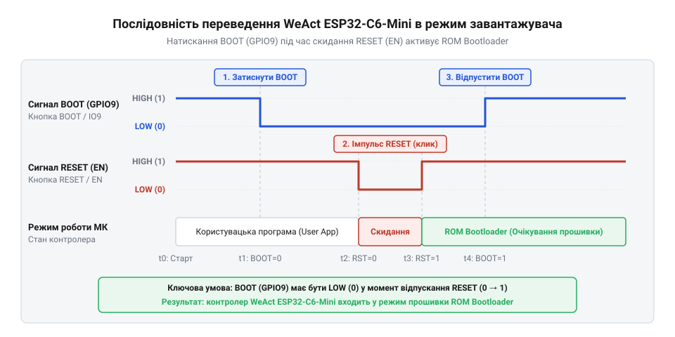
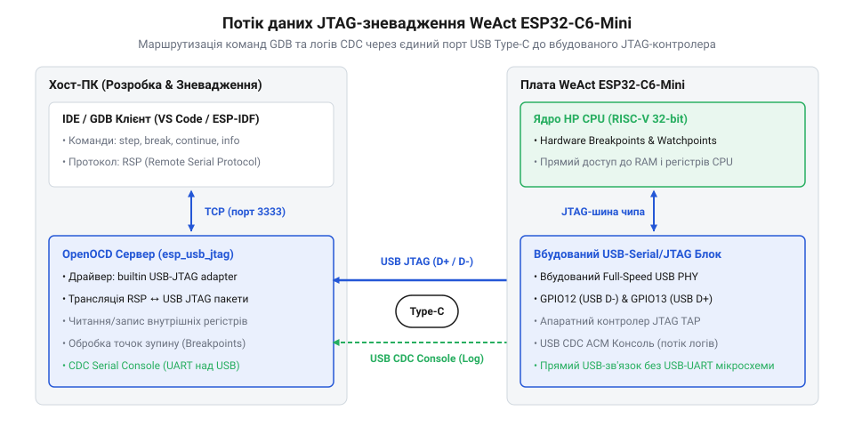

# Програмне налаштування, прошивка та зневадження WeAct ESP32-C6-Mini

<preknowlist>
- [Waveshare ESP32-C6-Zero](root:cat-hw-boards/esp32-c6-zero) — архітектурні особливості ядра RISC-V чипа ESP32-C6 та базову структуру периферійного USB CDC контролера.
</preknowlist>

## Конфлікти підключення та вибір режиму

Підключення плати @@en|WeAct ESP32-C6-Mini@@ до ПК через кабель @@en|USB-C@@ (англ. @@en|USB Type-C@@, від @@en|Universal Serial Bus@@ — універсальна послідовна шина) іноді супроводжується втратою віртуального ком-порту або відмовою середовища розробки розпізнати пристрій. На відміну від класичних відлагоджувальних плат, де інтерфейсний міст збирається на окремих мікросхемах на зразок @@en|CP2102@@ чи @@en|CH340@@, мікроконтролер @@en|ESP32-C6@@ містить у собі вбудований периферійний блок @@en|USB-Serial/JTAG@@. Фізичні лінії даних @@en|USB D-@@ та @@en|USB D+@@ підключені безпосередньо до виводів чипа @@en|GPIO12@@ і @@en|GPIO13@@.

Збої зв'язку виникають через те, що стеком пристрою @@en|USB CDC@@ (англ. @@en|USB CDC@@, від @@en|Communication Device Class@@ — клас пристроїв зв'язку) керує сама прошивка мікроконтролера. Якщо завантажена користувацька програма зависає, вимикає тактування периферії, переконфігуровує виводи @@en|GPIO12@@ або @@en|GPIO13@@, або входить у стан глибокого сну, операційна система ПК втрачає логічне з'єднання з портом. Під час переведення пристрою в режим @@en|ROM Bootloader@@ (англ. @@en|ROM bootloader@@, від @@en|Read-Only Memory@@ — постійний запам'ятовувач) вбудований контролер ініціалізує шину заново з первинними ідентифікаторами @@en|USB VID/PID@@ (англ. @@en|USB VID/PID@@, від @@en|Vendor ID / Product ID@@ — ідентифікатор виробника та пристрою). Зміна дескрипторів змушує драйвер операційної системи розірвати існуюче з'єднання, анулювати системні хендли відкритих ком-портів та зареєструвати новий послідовний пристрій.

Для відновлення контролю над платою необхідно примусово зупинити виконання збійної прошивки та перевести мікроконтролер у режим завантажувача @@en|ROM Bootloader@@ (англ. @@en|ROM bootloader@@, від @@en|Read-Only Memory@@ — постійний запам'ятовувач). Під час скидання апаратний стан виводу @@en|GPIO9@@ визначає джерело запуску: низький логічний рівень активує @@en|Bootloader@@ (англ. @@en|bootloader@@, від @@en|bootstrap loader@@ — початковий завантажувач), тоді як високий — запуск коду з пам'яті @@en|Flash@@ (англ. @@en|flash memory@@ — флеш-пам'ять).

Примусове переведення виконується фізичними кнопками:
1. Затиснути й утримувати кнопку @@en|BOOT@@ (притягує лінію @@en|GPIO9@@ до землі).
2. Натиснути та відпустити кнопку @@en|RESET@@ (замикає лінію @@en|EN@@ на землю для скидання процесора).
3. Відпустити кнопку @@en|BOOT@@.

Подібно до [базових планарних модулів](root:cat-hw-boards/esp32-c6-zero), вбудований периферійний модуль після такого скидання ініціалізує стійкий віртуальний ком-порт, готовий до прийому нових бінарних даних.


*Схема стану сигнальних ліній та послідовність натискання кнопок BOOT і RESET для примусового переведення WeAct ESP32-C6-Mini в режим завантажувача.*

## Конфігурування середовищ ESP-IDF та Arduino

Мікроконтролер @@en|ESP32-C6@@ побудований на 32-бітній архітектурі @@en|RISC-V@@ (англ. @@en|RISC-V@@, від @@en|Reduced Instruction Set Computer@@ — комп'ютер зі скороченим набором інструкцій). Робота з вбудованим блоком @@en|USB-Serial/JTAG@@ вимагає явного перенаправлення системних потоків введення-виведення у фреймворках розробки.

У середовищі @@en|ESP-IDF@@ (англ. @@en|ESP-IDF@@, від @@en|Espressif IoT Development Framework@@ — фреймворк розробки Espressif) цільову платформу задають командою `idf.py set-target esp32c6`. Конфігурація консолі виконується в меню @@en|menuconfig@@ (англ. @@en|menuconfig@@, від @@en|menu configuration@@ — меню конфігурації) за шляхом `Component config` -> `ESP System Settings` -> `Channel for console output`. Вибір пункту `USB CDC` активує макрос `CONFIG_ESP_CONSOLE_USB_CDC=y`. Це підключає стандартні функції `printf` та `ESP_LOGI` безпосередньо до віртуального порту замість фізичних трансиверів @@en|UART0@@.

У середовищі @@en|Arduino IDE@@ (англ. @@en|Arduino IDE@@, від @@en|Integrated Development Environment@@ — інтегроване середовище розробки) у меню `Tools` обирають плату `ESP32C6 Dev Module`. Ключовим параметром є `USB CDC On Boot`: його необхідно встановити в стан `Enabled`. Якщо залишити значення `Disabled`, об'єкт `Serial` надсилатиме дані на зовнішні виводи @@en|UART0@@, і консоль у моніторі порту залишиться порожньою.

На відміну від [багатоядерних чіпів серії](root:cat-hw-boards/esp32s3-microcontroller), конфігурація периферійних ліній вимагає чіткого призначення консольного каналу на етапі збірки, щоб уникнути конфліктів апаратних інтерфейсів.

Під час розробки виникає ситуація, коли пристрій зазнає збою на самому початку запуску, але монітор порту не показує жодного повідомлення. Це відбувається через те, що початковий завантажувач із @@en|ROM@@ (англ. @@en|ROM@@, від @@en|Read-Only Memory@@ — постійний запам'ятовувач) надсилає дані в апаратний буфер ще до завантаження основних драйверів. Для керування цією поведінкою у файлі @@en|sdkconfig@@ передбачено первинний та вторинний канали консолі. Первинна консоль перехоплює системні потоки @@en|stdout@@ та @@en|stderr@@ через шар віртуальної файлової системи (англ. @@en|VFS@@, від @@en|Virtual File System@@ — віртуальна файлова система). Драйвер @@en|VFS@@ приймає виклики `printf` і спрямовує байтовий потік у програмний буфер інтерфейсу @@en|USB CDC@@. Вторинна консоль працює в обхід файлової системи та виводить дані напряму через вбудований контролер @@en|USB-Serial/JTAG@@ або трансивер @@en|UART0@@. Такий механізм перехоплення гарантує отримання аварійних повідомлень навіть тоді, коли високорівневий стек @@en|USB CDC@@ ще не ініціалізований або заблокований після збою.

## Процес прошивки та налаштування консолі

Завантаження прошивки у пам'ять @@en|Flash@@ здійснюється утилітою @@en|esptool.py@@ (англ. @@en|esptool@@, від @@en|ESP utility tool@@ — утиліта обслуговування ESP). У штатному режимі автоскидання драйвер ПК маніпулює віртуальними сигналами @@en|DTR@@ (англ. @@en|DTR@@, від @@en|Data Terminal Ready@@ — готовність термінала даних) та @@en|RTS@@ (англ. @@en|RTS@@, від @@en|Request to Send@@ — запит на передачу). Вбудована транзисторна обв'язка плати @@en|WeAct ESP32-C6-Mini@@ перетворює ці сигнали на комбінацію імпульсів для ліній @@en|EN@@ та @@en|GPIO9@@, автоматично переводячи чип у режим @@en|Bootloader@@. Для надійного переходу у режим завантажувача утиліта витримує часові затримки тривалістю 50–100 мілісекунд між змінами рівнів @@en|DTR@@ та @@en|RTS@@. Надто короткі паузи не дозволяють розрядитися фільтрувальним конденсаторам на лініях @@en|EN@@ та @@en|GPIO9@@. У такому разі під час зняття скидання мікроконтролер фіксує високий рівень на лінії @@en|GPIO9@@ і замість завантажувача запускає прикладну програму. Інтенсивність передачі бінарних даних визначається налаштуванням швидкості (англ. @@en|baud rate@@, від прізвища Еміля Бодо — швидкість маніпуляції сигналом). Завдяки вбудованому контролеру @@en|USB-Serial/JTAG@@ фізичний обмін між ПК та платою завжди відбувається на повній швидкості шини @@en|USB Full-Speed@@ до 12 Мбіт/с. Встановлення значення швидкості утиліти на рівні 460800 або 921600 @@en|baud@@ ігнорується контролером @@en|USB-Serial/JTAG@@, оскільки фізичний обмін завжди відбувається на швидкості шини @@en|USB Full-Speed@@.

Після завершення прошивки мікроконтролер перезапускається, що спричиняє коротку повторну ініціалізацію пристрою @@en|USB CDC@@ в операційній системі. Якщо програма починає виводити логи негайно після старту, перші повідомлення втрачаються до моменту перепідключення монітора порту. Для збереження початкових логів у код додають затримку ініціалізації або перевірку готовності з'єднання.

:::tabs
```c|esp-idf
#include "esp_log.h"
#include "freertos/FreeRTOS.h"
#include "freertos/task.h"

static const char *TAG = "MAIN";

void app_main(void) {
    // Затримка для перепідключення USB CDC консолі в ПК
    vTaskDelay(pdMS_TO_TICKS(2000));
    ESP_LOGI(TAG, "Система успішно запущена через USB CDC консоль");
}
```

```cpp|arduino
#include <Arduino.h>

void setup() {
    Serial.begin(115200);
    // Очікування відкриття віртуального порту монітором послідовного інтерфейсу
    while (!Serial && millis() < 3000) {
        delay(10);
    }
    Serial.println("Система успішно запущена через USB CDC консоль");
}

void loop() {
}
```
:::

## Зневадження через вбудований JTAG відлагоджувач

Інтегрований у чип @@en|ESP32-C6@@ контролер @@en|USB-Serial/JTAG@@ підтримує апаратне відлагодження коду без використання зовнішніх програматорів на кшталт @@en|ESP-Prog@@. Сигнали стандарту @@en|JTAG@@ (англ. @@en|JTAG@@, від @@en|Joint Test Action Group@@ — об'єднана група з тестування) упаковуються в USB-пакети безпосередньо всередині мікроконтролера й передаються на відлагоджувальний модуль ядра @@en|RISC-V@@.

Для організації сесії використовується сервер @@en|OpenOCD@@ (англ. @@en|OpenOCD@@, від @@en|Open On-Chip Debugger@@ — відкритий зневаджувач на чипі) з конфігураційним файлом `board/esp32c6-builtin.cfg`. Сервер запускається в окремому терміналі командою:

```bash
openocd -f board/esp32c6-builtin.cfg
```

Після запуску @@en|OpenOCD@@ відкриває мережевий порт 3333, чекаючи на з'єднання від клієнта. Сервер транслює команди від зневаджувача @@en|GDB@@ (англ. @@en|GDB@@, від @@en|GNU Debugger@@ — зневаджувач GNU) у фізичні запити до апаратного блоку. Для підключення до запущеного сервера зневаджувач для архітектури @@en|RISC-V@@ викликається із зазначенням файлу прошивки у форматі @@en|ELF@@ (англ. @@en|ELF@@, від @@en|Executable and Linkable Format@@ — виконуваний та компонований формат) та аргументом приєднання до порту 3333:

```bash
riscv32-esp-elf-gdb -ex "target remote :3333" build/app.elf
```

У сесії @@en|GDB@@ розробник задає точку зупину на потрібну функцію (наприклад, `app_main`) та відновлює хід виконання програми:

```gdb
(gdb) break app_main
(gdb) continue
```

При отриманні команди `break` сервер @@en|OpenOCD@@ записує відповідну адресу в один із чотирьох порівняльних тригерних регістрів апаратного блоку зневадження ядра @@en|RISC-V@@. Це дозволяє встановлювати до чотирьох апаратних точок зупину, зчитувати стан регістрів процесора та покроково виконувати інструкції коду без модифікації вмісту пам'яті @@en|Flash@@.

За аналогією з [архітектурними рішеннями для](root:cat-hw-boards/esp32-s3-pico), вбудований відлагоджувальний модуль забезпечує повний доступ до системних шин через стандартний кабель роз'єму @@en|USB-C@@.


*Двонапрямковий потік даних між середовищем розробки GDB, сервером OpenOCD та вбудованим USB-JTAG блоком чипа ESP32-C6.*

## Енергозбереження та поведінка у крайніх станах

Перехід мікроконтролера в режими зниженого енергоспоживання змінює поведінку інтерфейсів зв'язку. У режимі @@en|Light Sleep@@ (англ. @@en|light sleep@@ — легкий сон) основні тактові частоти знижуються, але оперативна пам'ять зберігає стан. Якщо в налаштуваннях не збережено тактування периферійних шин, віртуальний ком-порт @@en|USB CDC@@ тимчасово відключається, а сесія @@en|JTAG@@ втрачає синхронізацію.

У режимі @@en|Deep Sleep@@ (англ. @@en|deep sleep@@ — глибокий сон) цифрове ядро та периферійний модуль @@en|USB-Serial/JTAG@@ повністю знеструмлюються. Пристрій зникає з шини USB комп'ютера, а відкриті сесії @@en|OpenOCD@@ та @@en|GDB@@ аварійно завершуються.

Якщо прошивка входить у @@en|Deep Sleep@@ одразу після запуску, ПК не встигає ініціалізувати порт для повторного прошивання. Щоб запобігти блокуванню плати, у код розробки завжди додають захисну затримку перед викликом функції сну.

:::tabs
```c|esp-idf
#include "esp_sleep.h"
#include "esp_log.h"
#include "freertos/FreeRTOS.h"
#include "freertos/task.h"

void app_main(void) {
    // Захисна пауза 5 секунд для гарантованої можливості прошивки
    vTaskDelay(pdMS_TO_TICKS(5000));
    
    ESP_LOGI("SLEEP", "Перехід у режим Deep Sleep");
    esp_deep_sleep(10 * 1000000ULL);
}
```

```cpp|arduino
#include <Arduino.h>

void setup() {
    Serial.begin(115200);
    // Захисна пауза 5 секунд для гарантованої можливості прошивки
    delay(5000);

    Serial.println("Перехід у режим Deep Sleep");
    esp_deep_sleep(10 * 1000000ULL);
}

void loop() {
}
```
:::
