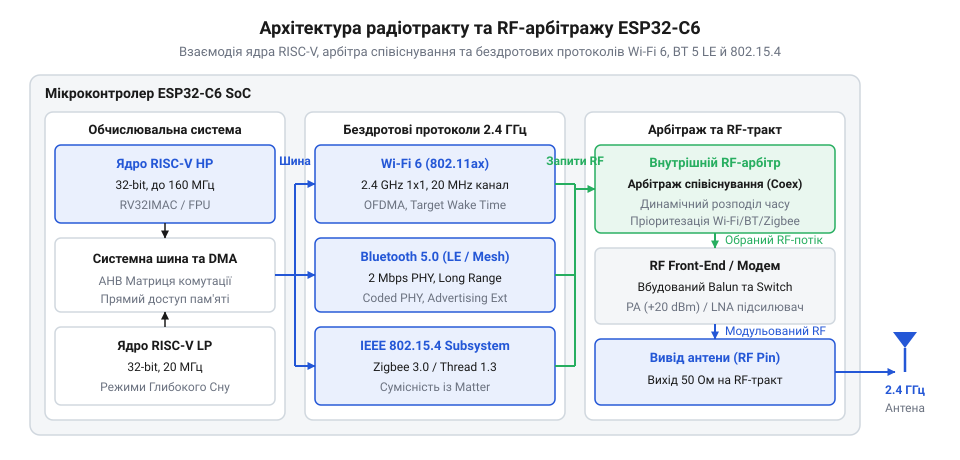
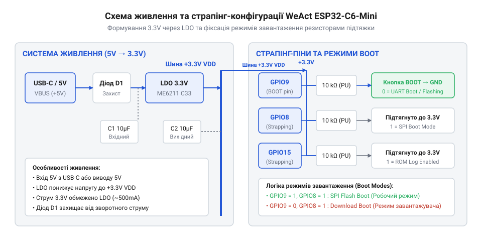

# WeAct ESP32-C6-Mini

<preknowlist>
- [Waveshare ESP32-C6-Zero](root:cat-hw-boards/esp32-c6-zero) — базова архітектура чіпа ESP32-C6 та принципи функціонування мультипротокольного радіомодуля
</preknowlist>

## Проблема автономних компактних вузлів IoT

Проєктування бездротових сенсорних вузлів для розумного дому — датчиків температури, протікання, відкриття дверей чи присутності — починається з двох протилежних вимог: максимальної автономності та мінімальних фізичних габаритів. Конструкція таких пристроїв мусить тривалий час функціонувати від одного дискового елемента живлення `CR2032` або невеликого літій-полімерного акумулятора, поміщаючись у компактний естетичний корпус. Проте при спробі побудувати подібний пристрій на базі традиційних платформ розробник одразу наштовхується на жорсткі апаратні обмеження.

Класичні мікроконтролерні плати, такі як орієнтовані на обчислювальні задачі [версії ESP32-S3 SuperMini](root:cat-hw-boards/esp32-s3-supermini) або [модулі ESP32-S3 Pico](root:cat-hw-boards/esp32-s3-pico), створювалися під високі швидкості передачі даних. Їхній радіотракт @@en|Wi-Fi 4@@ (від англ. @@en|Wireless Fidelity@@, від лат. *fidelitas* — відданість, точність) у пікові моменти передачі споживає струм від `100` до `240 mA`. Навіть при глибокому спині чип змушений регулярно виходити на зв'язок із роутером для підтримки сесії, що виснажує батарею за кілька тижнів. Крім того, топологія «зірка» в мережах @@en|Wi-Fi 4@@ вимагає прямої видимості точки доступу, що робить її непридатною для протяжних або закритих приміщень без встановлення додаткових репітерів.

Для вирішення проблеми покриття та енергоспоживання в сучасній автоматизації застосовують @@en|mesh-мережі@@ (від англ. @@en|mesh@@ — петля, чарунка) на базі протоколів @@en|Zigbee@@ (від англ. @@en|zig-zag@@ — зигзаг та @@en|bee@@ — бджола) та @@en|Thread@@ (від англ. @@en|thread@@ — нитка). У такій мережі кожен автономний вузол @@en|IoT@@ (від англ. @@en|Internet of Things@@, від лат. *inter* — між та англійського *thing* — річ) може ретранслювати пакети сусідів, створюючи самовідновлюване покриття. Однак класичні мікроконтролери родини ESP32 позбавлені апаратного трансивера стандарту @@en|IEEE 802.15.4@@ (від англ. @@en|Institute of Electrical and Electronics Engineers@@, від лат. *institutum* — установлення). Це змушує розробників додавати зовнішні радіомодулі, що збільшує габарити друкованої плати та вартість виробу. Навіть коли розмір вдається зменшити, як у [платах ESP32-S3 Zero](root:cat-hw-boards/esp32-s3-zero), відсутність енергоефективного радіопротоколу не дозволяє досягти багаторічної автономності.

Розв'язанням цієї інженерної суперечності є перехід на спеціалізоване однокристальне рішення з інтегрованим трирежимним трансивером та оптимізованим форм-фактором. Компактна плата WeAct ESP32-C6-Mini усуває бар'єр між енергоефективністю та габаритами: вона поєднує підтримку низькоспоживаючих мереж @@en|Thread@@ і @@en|Zigbee@@, новітній стандарт @@en|Wi-Fi 6@@ із функцією цільового часу пробудження, а також сумісність із єдиним стандартом @@en|Matter@@ (від англ. @@en|matter@@ — матерія, суть). Докладний [розрахунок енергобалансу та автономності](root:cat-hw-boards/esp32-c6-mini/math-esp32-c6-mini-power-budget.md) демонструє математичне обґрунтування вибору такого живлення. Практичну ж реалізацію такого підходу описує [проєкт бездротового сенсорного вузла](root:cat-hw-boards/esp32-c6-mini/proj-weact-c6-mini-smart-home-node.md), де плата розкриває свій потенціал у реальній мережі.

## Архітектурні особливості та радіопротоколи ESP32-C6

Потреба в створенні універсального вузла, здатного одночасно працювати у високошвидкісних IP-мережах та енергоефективних mesh-мережах, зумовила докорінну зміну внутрішньої архітектури мікроконтролера. На відміну від [чипів родини ESP32-S3](root:cat-hw-boards/esp32s3-microcontroller) з архітектурою Xtensa, системним серцем тут виступає [сучасний кристал ESP32-C6](root:hw-arch/esp32-c6-soc), побудований на відкритій командній системі @@en|RISC-V@@ (від англ. @@en|Reduced Instruction Set Computer@@, від лат. *reducere* — повертати, зводити). Основне одноядерне 32-розрядне ядро HP (англ. @@en|High Performance@@ — висока продуктивність) працює на тактовій частоті до `160 MHz`, забезпечуючи високу енергетичну ефективність на кожен виконаний такт. Для обробки сигналів у глибокому сні передбачено окреме @@en|LP-ядро@@ (від англ. @@en|Low Power@@ — низька потужність) з частотою `20 MHz`, яке опитує датчики без пробудження основного процесора.

Головною інновацією цього @@en|SoC@@ (від англ. @@en|System on Chip@@, від грецького *systema* — ціле, з'єднане з частин) є мультипротокольний бездротовий трансивер діапазону `2.4 GHz`. Він інтегрує три незалежні фізичні стеки радіозв'язку, що працюють через спільний високочастотний тракт:

1. **Модуль @@en|Wi-Fi 6@@ (стандарт IEEE 802.11ax)**. На відміну від попереднього покоління, @@en|Wi-Fi 6@@ підтримує технологію @@en|OFDMA@@ (від англ. @@en|Orthogonal Frequency Division Multiple Access@@, від грецького *orthogonios* — прямокутний), яка ділить радіоканал на окремі ресурсові одиниці @@en|Resource Unit@@ (скорочено @@en|RU@@; від англ. @@en|resource unit@@ — ресурсова одиниця). Це дозволяє роутеру одночасно опитувати десятки пристроїв без колізій. Ключовою перевагою для автономності є режим @@en|TWT@@ (від англ. @@en|Target Wake Time@@ — цільовий час пробудження): мікроконтролер заздалегідь узгоджує з точкою доступу точний час виходу на зв'язок, перебуваючи в режимі сну годинами чи днями, що недоступно для [платок серії S3-Zero](root:cat-hw-boards/esp32-s3-zero) попередньої конфігурації.
2. **Модуль @@en|Bluetooth 5 LE@@** (від англ. @@en|Bluetooth@@ — прізвисько короля Харальда та англійського @@en|Low Energy@@ — низька енергія). Бездротовий тракт підтримує режим розширеного радіуса дії @@en|Coded PHY@@ (від англ. @@en|coded physical layer@@ — кодований фізичний рівень, від грецького *physis* — природа) зі швидкістю `125` або `500 kbps`, що збільшує відстань зв'язку в кілька разів, а також високошвидкісний режим `2 Mbps`. Головне призначення Bluetooth LE в пристроях розширюваної автоматизації — первинна конфігурація та безпечне введення вузла в мережу.
3. **Модуль @@en|IEEE 802.15.4@@**. Фізичний рівень радіотракту використовує фазову модуляцію @@en|O-QPSK@@ (від англ. @@en|Offset Quadrature Phase Shift Keying@@, від лат. *quadratura* — надання квадратної форми) у діапазоні `2.4 GHz`. Саме цей трансивер забезпечує апаратну основу для запуску стека @@en|Zigbee 3.0@@ та IPv6-орієнтованого мережевого протоколу @@en|Thread@@.

*Структурна схема радіотракту ESP32-C6 показує взаємодію основного процесора RISC-V з арбітром співіснування та радіомодулями Wi-Fi 6, Bluetooth 5 LE та IEEE 802.15.4.*

Одночасне функціонування трьох протоколів на одній антені реалізовано за допомогою внутрішнього апаратного блоку — @@en|RF-арбітра@@ (від англ. @@en|Radio Frequency Arbiter@@, від лат. *arbiter* — третейський суддя), що працює за принципом часового мультиплексування @@en|TDM@@ (від англ. @@en|Time-Division Multiplexing@@, від лат. *multiplex* — багатократний). Арбітр динамічно розподіляє кванти ефірного часу за пріоритетами пакетів: коли вузол передає критичний кадр мережі @@en|Thread@@, трансляція @@en|Bluetooth 5 LE@@ або @@en|Wi-Fi 6@@ тимчасово призупиняється або синхронізується з вікнами @@en|TWT@@. При одночасному надходженні запитів на доступ до ефіру апаратний логічний модуль порівнює їхні статичні та динамічні рівні пріоритету, визначені типом кадру. Найвищий привілей отримують кадри підтвердження @@en|ACK@@ (від англ. @@en|acknowledgement@@ — підтвердження) та сервісні сигнали синхронізації, для яких затримка означає розрив сесії. Якщо рівні пріоритетів однакові, арбітр зберігає канал за поточним пакетом до завершення передачі символу або застосовує циклічне чергування @@en|round-robin@@ (від англ. @@en|round-robin@@ — коловий турнір, від фр. *ruban* — стрічка). Коли ж надходить терміновий пакет від @@en|Thread@@ чи @@en|Bluetooth 5 LE@@, фонова передача @@en|Wi-Fi 6@@ негайно переривається, а її стек переводить відкладений кадр у чергу повторного відправлення за алгоритмом @@en|CSMA/CA@@ (від англ. @@en|Carrier Sense Multiple Access with Collision Avoidance@@ — множинний доступ із контролем несучої та запобіганням колізіям). Таке вирішення конфліктів усуває накладання сигналів у межах єдиного трансивера, проте при інтенсивному трафіку @@en|Wi-Fi 6@@ коштує додаткових затримок для @@en|mesh@@-вузлів, що вимагає гнучкого перерозподілу пріоритетів на рівні драйвера.

Така трирежимна архітектура робить кристал ESP32-C6 ідеальною основою для екосистеми @@en|Matter@@. У цій екосистемі каналом зв'язку для сенсорів із живленням від батареї виступає @@en|Thread@@, високошвидкісні магістральні пристрої працюють через @@en|Wi-Fi 6@@, а @@en|Bluetooth 5 LE@@ використовується для швидкої прив'язки нових аксесуарів. Вузол на базі WeAct ESP32-C6-Mini може виконувати роль як кінцевого пристрою (англ. @@en|End Device@@ — кінцевий пристрій), так і ретранслятора (англ. @@en|Thread Router@@) або шлюзу @@en|Border Router@@ (від англ. @@en|border router@@ — прикордонний маршрутизатор), об'єднуючи різнорідні сегменти розумного дому в єдину захищену мережу.

## Апаратна компоновка та живлення WeAct Mini

При підключенні потужних бездротових периферійних модулів або зовнішніх сенсорів до мініатюрних розробницьких плат розробники часто стикаються зі спонтанними перезавантаженнями мікроконтролера в момент активації передавача. Причина полягає в імпульсних сплесках струму, які просідають на недостатньо потужній лінії живлення або викликають збій на виводах конфігурації завантаження.

Апаратна плата @@en|WeAct ESP32-C6-Mini@@ виконана у надкомпактному дворядному форм-факторі @@en|DIP@@ (англ. @@en|Dual In-line Package@@, від @@en|dual@@ — подвійний, @@en|line@@ — лінія) з кроком 2.54 мм та зубчастими контактами (англ. @@en|castellated holes@@), що дозволяє запаювати її безпосередньо на материнську плату як модуль. Головним елементом плати є мікросхема [базового мікроконтролера ESP32-C6](root:hw-arch/esp32-c6-soc), яка інтегрує 4 МБ @@en|Flash@@-пам'яті безпосередньо всередині корпусу.

Живлення пристрою подається через роз'єм @@en|USB Type-C@@ або через окремий контакт `5V`. Для пониження напруги до робочого рівня 3.3 В використано лінійний регулятор @@en|LDO@@ (англ. @@en|Low-Dropout Regulator@@, від @@en|drop@@ — падіння) серії ME6211 з малим струмом власного споживання (близько 40 мкА). Вхідне коло первинного живлення містить захисний діод Шотткі, який запобігає зустрічному протіканню струму при одночасному підключенні шини USB та зовнішнього джерела на контакт `5V`.

Блоки бездротового радіомодуля під час передачі сигналів @@en|Wi-Fi 6@@ та @@en|IEEE 802.15.4@@ утворюють короткі пікові кидки струму до 350–400 мА. Якщо номінальний струм регулятора @@en|LDO@@ становить 500 мА, то при підключенні зовнішнього навантаження по шині 3.3 В вище 100–150 мА виникає падіння напруги нижче допустимого порогу 3.0 В. Це спричиняє спрацьовування внутрішньої схеми скидання за зниженою напругою (англ. @@en|Brownout Detector@@, від @@en|brownout@@ — просідання). При бажанні живити плату від стабілізованого акумулятора напругою 3.3 В лінію @@en|LDO@@ обходять і подають напругу напряму на контакт `3.3V`, уникаючи додаткових втрат на регуляторі.

Окрему увагу при конфігуруванні зовнішніх схем вимагають виводи завантажувальної конфігурації — @@en|strapping@@ піни (англ. @@en|strapping pin@@, від @@en|strap@@ — фіксатор). У мікроконтролері @@en|ESP32-C6@@ критичними є виводи `GPIO8`, `GPIO9` та `GPIO15`. Їхній логічний стан фіксується внутрішньою схемою зчитування в момент зняття сигналу скидання `EN` (перехід з низького рівня на високий).

Стан виводу `GPIO9` визначає режим старту пристрою: високий логічний рівень (підтяжка до 3.3 В) запускає виконання програми з внутрішньої Flash-пам'яті, а низький рівень (притиснення до землі) переводить системний завантажувач @@en|Bootloader@@ (англ. @@en|bootloader@@, від @@en|bootstrap@@ — завантажувальна петля) у режим приймання прошивки через послідовний порт. На платі WeAct лінія `GPIO9` з'єднана з кнопкою `BOOT` та резистором підтяжки 10 кОм. Вивід `GPIO8` відповідає за конфігурацію виводу системних логів та діагностики; під час завантаження він має перебувати у високому стані. Оскільки до `GPIO8` на платі підключено адресований світлодіод WS2812B, зовнішнє підключення низькоомних датчиків чи резисторів до цього контакту може заблокувати нормальний старт системи. Третім конфігураційним виводом є `GPIO15`, який під час скидання відповідає за вибір джерела сигналів апаратного зневадження @@en|JTAG@@ (англ. @@en|Joint Test Action Group@@, від @@en|joint@@ — спільний, @@en|group@@ — група). Для нормального функціонування вбудованого інтерфейсу @@en|USB-Serial/JTAG@@ на `GPIO15` під час розпуску скидання має утримуватися високий логічний рівень; якщо ж зовнішня схема притисне цей вивід до землі, мікроконтролер перенаправить лінії зневадження на зовнішні виводи `GPIO4`–`GPIO7` і заблокує доступ до налагодження через порт @@en|USB Type-C@@.

*Схема розподілу шини живлення 3.3V та апаратних підтяжок страпінг-виводів.*

Порівняно з більшими модулями, такими як [розробницька плата Pico](root:cat-hw-boards/esp32-s3-pico) або [альтернативна плата C6-Zero](root:cat-hw-boards/esp32-c6-zero), розводка WeAct Mini забезпечує високу щільність компонування. Вичерпні параметри електричних рівнів, призначення кожного контакту та [детальну карту периферійних виводів](root:cat-hw-boards/esp32-c6-mini/api-hw-weact-esp32-c6-mini.md) згруповано в апаратному довіднику плати.

При монтуванні модуля @@en|WeAct ESP32-C6-Mini@@ на материнську плату через поверхневе розпаювання зубчастих контактів розробники нерідко стикаються з різким падінням дальності радіозв'язку. Причина полягає у розміщенні суцільного мідного полігону заземлення безпосередньо під вбудованою антеною плати. Високочастотне електромагнітне випромінювання на частоті 2.4 ГГц потребує вільного середовища для поширення, а близьке сусідство металевого провідника змінює хвильовий опір антени та екранує сигнал. Як і під час компонування [модулів ESP32-S3 SuperMini](root:cat-hw-boards/esp32-s3-supermini), для збереження стабільності мереж @@en|Wi-Fi 6@@ та @@en|IEEE 802.15.4@@ під антенним блоком у дизайні несучої плати передбачають зону відчуження — @@en|keepout zone@@ (англ. @@en|keepout zone@@, від @@en|keep out@@ — тримати осторонь), повністю вільну від мідних шарів.

## Вбудоване зневадження та режими енергозбереження

Під час налагодження бездротових автономних пристроїв розробники часто потрапляють у глухий кут: відсутність додаткового зовнішнього адаптера заважає зчитувати відлагоджувальні логи в реальному часі, а в автономному режимі пристрій за лічені дні розряджає батарею через неоптимізоване енергоспоживання.

Апаратне забезпечення плати WeAct вирішує проблему зневадження завдяки вбудованому в чип контролеру @@en|USB-Serial/JTAG@@ (англ. @@en|USB Serial/JTAG Controller@@, від @@en|serial@@ — послідовний). Лінії даних роз'єму @@en|USB Type-C@@ (сигнали `D-` та `D+`) підключені безпосередньо до виводів `GPIO12` та `GPIO13`. Контролер апаратно емулює два пристрої: віртуальний послідовний порт @@en|CDC@@ (англ. @@en|Communication Device Class@@) для виведення логів `printf` та апаратний адаптер @@en|JTAG@@ для зв'язку з зневаджувачем @@en|OpenOCD@@. Завдяки цьому прошивка та покрокове виконання коду із зупинкою на точках переривання (англ. @@en|breakpoints@@) здійснюються через один кабель без використання зовнішніх мікросхем конвертерів. Детальні принципи підключення апаратного відлагоджувача та створення конфігурацій висвітлює окремий матеріал про [зневадження мікроконтролерів ESP32 через OpenOCD та JTAG](root:sys-ide/openocd-esp32-jtag).

При виникненні помилок у коді, коли пристрій потрапляє у циклічне перезавантаження (англ. @@en|boot loop@@), переведення плати у режим завантажувача виконується вручну. Для цього затискають кнопку `BOOT`, короткочасно натискають кнопку `RESET` (`EN`), а потім відпускають `BOOT`. Системний завантажувач переходить у стан очікування команд від утиліти `esptool.py`. Покрокові інструкції з налаштування середовища ESP-IDF, виклику OpenOCD та [конфігурування консолі зневадження](root:cat-hw-boards/esp32-c6-mini/api-sw-weact-esp32-c6-mini-flashing-debug.md) винесено в окрему програмну специфікацію.

Для забезпечення тривалої автономної роботи від акумуляторів мікроконтролер підтримує кілька режимів сну: @@en|Modem Sleep@@, @@en|Light Sleep@@ та @@en|Deep Sleep@@ (англ. @@en|Deep Sleep@@, від @@en|sleep@@ — сон). У режимі глибокого сну @@en|Deep Sleep@@ високопродуктивне ядро RISC-V, радіомодуль та основна оперативна пам'ять повністю знеструмлюються. Працювати лишаються тільки таймер зворотного відліку @@en|RTC@@ та низькоспоживаюче ядро @@en|LP@@ (англ. @@en|Low-Power@@, від @@en|power@@ — потужність).

Струм споживання сам по собі в режимі @@en|Deep Sleep@@ складає близько 7–12 мкА для мікроконтролера, а разом із власне струмом витоку регулятора @@en|LDO@@ та обв'язки плати WeAct Mini загальне споживання становить приблизно 25–40 мкА. Для точного розрахунку часу тривалості роботи від акумуляторних комірок застосовують [математичні формули балансу живлення](root:cat-hw-boards/esp32-c6-mini/math-esp32-c6-mini-power-budget.md), які сумують струми споживання під час радіообміну та сну.

Нижче наведено приклад налаштування таймера пробудження з режиму @@en|Deep Sleep@@ на 10 секунд із відправкою повідомлення у послідовну консоль.

:::tabs
:::code esp32-c6-mini-d/c/esp-idf/app-main.c
:::code esp32-c6-mini-d/cpp/arduino/setup.cpp
:::

Практичну побудову автономного вимірювального вузла [для мереж Thread та Zigbee](root:cat-hw-boards/esp32-c6-mini/proj-weact-c6-mini-smart-home-node.md) із циклічним пробудженням продемонстровано у відповідному практичному проєкті.
