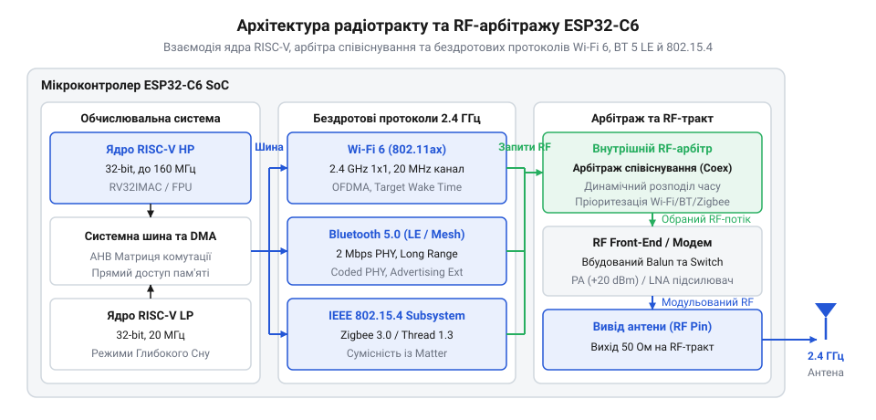
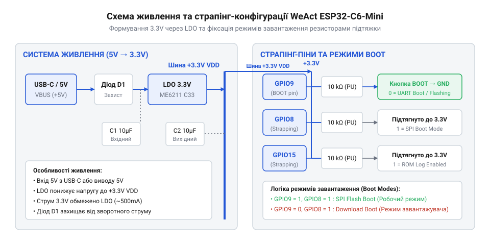

# WeAct ESP32-C6-Mini

<preknowlist>
- [Waveshare ESP32-C6-Zero](root:cat-hw-boards/esp32-c6-zero) — базова архітектура чіпа ESP32-C6 та принципи функціонування мультипротокольного радіомодуля
</preknowlist>

## Проблема автономних компактних вузлів IoT

Автономні бездротові сенсори потребують тривалої роботи від акумулятора, проте [класичні плати ESP32-S3](root:cat-hw-boards/esp32s3-microcontroller) швидко виснажують джерело живлення через високе споживання струму у режимі очікування. Для організації розширених бездротових мереж доводиться додавати окремі радіомодулі, що збільшує габарити пристрою. Плата @@en|WeAct ESP32-C6-Mini@@ усуває ці обмеження завдяки інтеграції трирежимного трансивера у бездротовий чип @@en|ESP32-C6@@, забезпечуючи багаторічну автономність та компактність без додаткових обв'язок.

## Архітектурні особливості та радіопротоколи ESP32-C6

Мікроконтролер @@en|ESP32-C6@@ побудовано на основному 32-розрядному ядрі @@en|RISC-V@@ (англ. @@en|Reduced Instruction Set Computer@@, комп'ютер зі скороченим набором інструкцій) із частотою 160 МГц та низькоспоживаючому ядрі @@en|LP-RISC-V@@ (англ. @@en|Low-Power RISC-V@@, низькоспоживаючий RISC-V) на 20 МГц. Бездротовий трансивер підтримує три стеки зв'язку: @@en|Wi-Fi 6@@ із функцією @@en|TWT@@ (англ. @@en|Target Wake Time@@, цільовий час пробудження) для узгодження сеансів передачі, @@en|Bluetooth 5 LE@@ (англ. @@en|Low Energy@@, низька енергія) для локального налаштування та @@en|IEEE 802.15.4@@ для mesh-мереж @@en|Zigbee@@ й @@en|Thread@@.


*Структурна схема бездротового тракту ESP32-C6 з арбітражем ефірного часу між Wi-Fi 6, Bluetooth 5 LE та IEEE 802.15.4.*

Сумісне функціонування трьох протоколів на спільній антені забезпечує апаратний @@en|RF-арбітр@@ (англ. @@en|Radio Frequency Arbiter@@, арбітр радіочастот). Він мультиплексує ефірний час за пріоритетами пакетів, що необхідно для роботи універсальної екосистеми @@en|Matter@@.

## Апаратна компоновка та живлення WeAct Mini

Плата @@en|WeAct ESP32-C6-Mini@@ містить лінійний регулятор @@en|LDO@@ (англ. @@en|Low Dropout@@, низьке падіння напруги) для живлення від 5 В через порт @@en|USB-C@@. При живленні від акумулятора напругу доцільно подавати безпосередньо на шину 3.3 В, щоб уникнути падіння напруги на регуляторі та просідань під час пікових струмів передавача. Порівняно з [платою Waveshare ESP32-C6-Zero](root:cat-hw-boards/esp32-c6-zero), ця модель має класичне розташування виводів для безпайкових планок.


*Схема розподілу напруги 3.3 В та конфігураційних рівнів на виводах GPIO8, GPIO9 і GPIO15.*

Для завантаження системи служать @@en|strapping pins@@ (англ. @@en|strapping pins@@, конфігураційні виводи): @@en|GPIO9@@ визначає завантаження з пам'яті @@en|SPI Flash@@, @@en|GPIO9@@ переключає чип у режим прошивки @@en|ROM bootloader@@ (англ. @@en|Read-Only Memory bootloader@@, завантажувач з постійної пам'яті), а @@en|GPIO15@@ контролює роботу інтерфейсу @@en|JTAG@@ (англ. @@en|Joint Test Action Group@@, стандарт зневадження). Зовнішня периферія не повинна змінювати рівні цих виводів при скиданні. Зона під антеною плати має залишатися вільною від міді та металу для збереження дальності зв'язку.

## Вбудоване зневадження та режими енергозбереження

У кристалі реалізовано вбудований контролер @@en|USB-Serial/JTAG@@, який дозволяє завантажувати код та виконувати покрокове зневадження без зовнішніх адаптерів. Основним режимом автономної роботи є глибокий сон @@en|Deep Sleep@@ (англ. @@en|Deep Sleep@@, глибокий сон), де відключаються ядро @@en|RISC-V@@ та пам'ять.

Увімкненим залишається модуль @@en|RTC@@ (англ. @@en|Real-Time Clock@@, годинник реального часу) з таймером. Загальний струм у режимі сну `I_sleep` складається зі струму блоку `I_RTC` та струму витоку `I_leak`:

```
I_sleep
= I_RTC + I_leak         [сумування струму активного RTC та струму витоку]
```

Оскільки струм `I_RTC` становить близько 5 мкА, а `I_leak` — до 2 мкА, загальне споживання залишається близько 7 мкА, що дає змогу працювати роками від однієї батареї.
