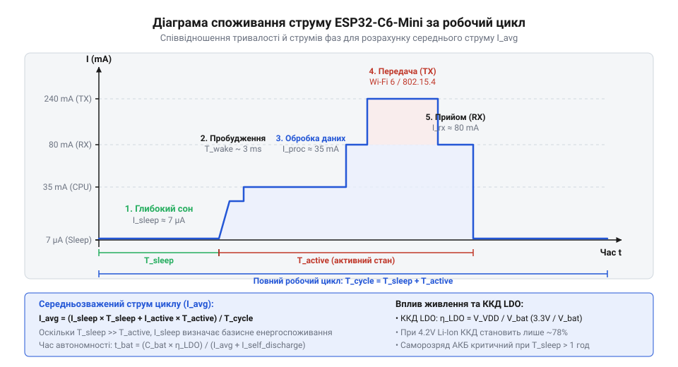

# Розрахунок енергоспоживання та автономності WeAct ESP32-C6-Mini

<preknowlist>
- [Waveshare ESP32-C6-Zero](root:cat-hw-boards/esp32-c6-zero) — специфіку архітектури ESP32-C6, його підтримувані радіопротоколи (Wi-Fi 6, IEEE 802.15.4) та базові режими енергозбереження SoC
</preknowlist>

## Непередбачений розряд автономного IoT-вузла

Автономний @@en|IoT-вузол@@ (англ. *Internet of Things* — інтернет речей) на базі плати WeAct ESP32-C6-Mini, заживлений від акумулятора ємністю 1000 мА·год, у реальних умовах нерідко вимикається вже за пару тижнів замість розрахованого року автономності. Причиною такого розходження є спрощений підхід до розрахунку живлення. Якщо поділити номінальну ємність батареї на паспортний струм споживання мікроконтролера у режимі очікування, отримане число створює ілюзію майже нескінченної роботи.

Спрощена формула ділення ємності на постійний струм припускає, що пристрій споживає енергію рівномірно. Проте бездротовий @@en|SoC@@ (англ. *System on Chip* — система на кристалі) ESP32-C6 працює в імпульсному режимі. Короткі спалахи активності під час передачі даних через @@en|Wi-Fi 6@@ або @@en|IEEE 802.15.4@@ супроводжуються стрибками струму до 150–300 мА, тоді як у режимі @@en|Deep Sleep@@ (англ. *deep* — глибокий, *sleep* — сон) споживання падає до мікроамперів. Якщо [порівняти з іншим компактним модулем](root:cat-hw-boards/esp32-c6-zero), обидві моделі демонструють подібну динаміку імпульсного навантаження на коло живлення. При такому розрахунку криється математична різниця між електричним зарядом та запасеною енергією. Електрична ємність акумулятора `Q` вимірюється в мА·год й описує лише сумарний заряд `Q = ∫ I(t) dt`, переданий у коло незалежно від напруги. Натомість корисна енергія `E` вимірюється в мВт·год і враховує миттєву напругу джерела `V_bat(t)` через інтеграл потужності `E = ∫ V_bat(t) · I(t) dt`. Коли напругу знижує вбудований @@en|LDO-стабілізатор@@ (англ. *low dropout* — низький поріг падіння напруги), вхідний струм практично дорівнює вихідному струму навантаження. Заряд у мА·год витрачається однаково при будь-якій напрузі батареї, але надлишок напруги `V_bat - V_out` лінійно перетворюється на тепло. При повній зарядці Li-Ion акумулятора до 4.2 В і вихідній напрузі `V_out = 3.3 В` понад 21% енергії втрачається на стабілізаторі, тому оцінка автономності лише за ємністю в мА·год створює суттєву похибку.

Додатково ситуацію ускладнює вбудований @@en|LDO-стабілізатор@@ (англ. *low dropout* — низький поріг падіння напруги). Перетворюючи вищу напругу акумулятора на фіксовані 3.3 В, стабілізатор перетворює надлишок напруги на теплову енергію. Разом із саморозрядом хімічного джерела живлення ці чинники суттєво зменшують корисний запас ємності. Для точного прогнозування часу роботи необхідна цілісна математична модель енергобалансу, яка враховує часовий профіль струму, втрати перетворення та часові зміни параметрів акумулятора.

Без детального обчислення кожного стану @@en|IoT-вузол@@ ризикує передчасно вимкнутися у найвідповідальніший момент. Спрощені оцінки створюють похибку в сотні відсотків через ігнорування імпульсного споживання та втрат стабілізації. Послідовний розрахунок тривалості активних фаз і періодів у режимі @@en|Deep Sleep@@ дає змогу обчислити точний заряд за один цикл. Таке моделювання перетворює вибір джерела живлення зі здогадів на точний інженерний розрахунок автономності.

## Циклічний профіль струму бездротового вузла

Струм споживання циклічного пристрою змінюється в часі, тому робочий цикл розділяють на окремі фази: глибокий сон тривалістю `t_sleep` зі струмом `I_sleep`, обробка даних та опитування датчиків тривалістю `t_proc` зі струмом `I_proc`, а також радіопередача тривалістю `t_tx` зі струмом `I_tx`. Загальний період циклу `T_cycle` дорівнює сумі тривалості всіх трьох фаз.

Енергетична вартість одного циклу описується через електричний заряд `Q_cycle`, який обчислюється як сума добутків струму на час для кожної фази. Середньозважений струм циклу `I_avg` визначає рівномірний струм, еквівалентний за спожитим зарядом за той самий час `T_cycle`.

```
Q_cycle = (I_sleep · t_sleep) + (I_proc · t_proc) + (I_tx · t_tx)
= I_avg · T_cycle      [визначення еквівалентного середньозваженого струму за цикл]
```

```
I_avg = Q_cycle ÷ T_cycle
= ((I_sleep · t_sleep) + (I_proc · t_proc) + (I_tx · t_tx)) ÷ T_cycle      [підстановка складових заряду в розрахунок середнього струму]
```


*Часова діаграма споживання струму протягом одного циклу з виділенням фаз глибокого сну, пробудження, обробки даних та піків радіопередачі.*

**Розрахунок на прикладі:** Бездротовий датчик на WeAct ESP32-C6-Mini надсилає вимірювання за протоколом @@en|Wi-Fi 6@@ кожні 60 секунд (`T_cycle = 60` с). Тривалість фази @@en|Deep Sleep@@ становить `t_sleep = 59.2` с при струмі `I_sleep = 0.02` мА. Пробудження та зчитування даних датчика триває `t_proc = 0.5` с при струмі `I_proc = 25` мА. Активна сесія передачі даних триває `t_tx = 0.3` с при струмі `I_tx = 180` мА.

```
Q_cycle = (0.02 · 59.2) + (25 · 0.5) + (180 · 0.3)
= 1.184 + 12.5 + 54      [перемножування струму та тривалості для кожної фази в мА·с]
= 67.684 мА·с            [сумування електричних зарядів окремих фаз]
```

```
I_avg = 67.684 ÷ 60
= 1.128 мА               [ділення загального заряду циклу на його повний період]
```

Отриманий електричний заряд однієї сесії `Q_cycle = 67.684` мА·с та середній струм `I_avg = 1.128` мА показують, що понад 79% усього заряду споживається під час короткої фази радіопередачі. Якщо замість @@en|Wi-Fi 6@@ використати протокол @@en|IEEE 802.15.4@@ (наприклад, @@en|Zigbee@@ або @@en|Thread@@), струм передачі `I_tx` та час `t_tx` скорочуються, що пропорційно знижує `Q_cycle`.

## Вплив LDO та напруги акумулятора

Середньозважений струм `I_avg` характеризує споживання самого мікроконтролера при стабільній напрузі живлення `V_reg = 3.3` В. Проте плата WeAct ESP32-C6-Mini живиться від літієвого акумулятора через вбудований @@en|LDO-стабілізатор@@. Лінійний регулятор не змінює струм у колі: струм, що відбирається від акумулятора `I_bat`, дорівнює струму навантаження `I_avg` плюс власний струм спокою стабілізатора `I_q`.

Напруга повністю зарядженого літій-іонного (@@en|Li-Ion@@) акумулятора `V_bat` становить 4.2 В, а в процесі розряджання вона знижується до робочої межі 3.3 В. Коефіцієнт корисної дії лінійного стабілізатора `η_ldo` залежить від поточної напруги батареї `V_bat` і фіксованого значення вихідної напруги `V_reg`.

```
η_ldo = V_reg ÷ V_bat
= 3.3 ÷ V_bat            [відношення вихідної напруги стабілізатора до вхідної]
```

Для розрахунку середнього ККД стабілізації `η_avg` протягом усього циклу розряджання використовують середню робочу напругу акумулятора `V_bat_avg ≈ 3.7` В.

```
η_avg = 3.3 ÷ 3.7
= 0.892                  [обчислення середнього ККД лінійного конвертера]
```

Оскільки лінійний регулятор розсіює різницю напруг `V_bat - V_reg` у вигляді тепла, середня споживана потужність від акумулятора `P_bat` перевищує корисну потужність схеми `P_circuit = V_reg · I_avg`. Енергія `E_cycle`, що відбирається від акумулятора за один цикл, визначається через потужність та тривалість циклу `T_cycle`.

```
P_bat = (V_reg · I_avg) ÷ η_avg
= (3.3 · I_avg) ÷ 0.892   [обчислення повної потужності з урахуванням втрат LDO]
```

```
E_cycle = P_bat · T_cycle
= ((3.3 · I_avg) ÷ 0.892) · T_cycle      [переведення потужності акумулятора у спожиту енергію за цикл]
```

Використовуючи значення `I_avg = 1.128` мА та `T_cycle = 60` с із попереднього розрахунку, обчислимо енергію за один цикл:

```
E_cycle = ((3.3 · 0.001128) ÷ 0.892) · 60
= (0.0037224 ÷ 0.892) · 60      [розрахунок середньої потужності в ватах]
= 0.004173 · 60                 [потужність, що відбирається від акумулятора]
= 0.2504 Дж                     [підсумкова енергія циклу у джоулях]
```

Втрати на нагрів у стабілізаторі знижують ефективну енерговіддачу джерела живлення майже на 11%. На відміну від схем із високоефективними імпульсними перетворювачами, якими оснащені деякі більші модулі на кшталт [Waveshare ESP32-S3-Pico](root:cat-hw-boards/esp32-s3-pico), використання @@en|LDO-стабілізатора@@ вимагає прямого врахування середнього ККД `η_avg` при оцінюванні реального енергоспоживання. Детальніше порівняння енергетичних втрат лінійних і крок-понижувальних стабілізаторів у мікроконтролерних системах наведено в матеріалі про [порівняння ККД LDO та імпульсних конвертерів у IoT](root:hw-power/ldo-vs-buck-efficiency).

## Врахування саморозряду та корисного діапазону

Розрахована енергетична ємність акумулятора не може бути повністю віддана в навантаження. По-перше, @@en|LDO-стабілізатор@@ припиняє нормальну стабілізацію напруги 3.3 В, коли вхідна напруга падає нижче мінімального порогу відсічки `V_cutoff ≈ 3.3` В плюс напруга насичення самого стабілізатора `V_drop ≈ 0.1` В. Через це частина хімічного заряду акумулятора залишається недоступною. Частка доступної ємності характеризується коефіцієнтом корисного діапазону розряду `k_use`, який для типових літієвих елементів становить 0.85–0.90 (85–90%).

По-друге, хімічні джерела живлення втрачають заряд самочинно навіть за відсутності зовнішнього навантаження. Процес саморозряду описується коефіцієнтом річного саморозряду `σ_self`, який вимірюється у частках від номінальної ємності за рік (для @@en|Li-Ion@@ акумуляторів `σ_self ≈ 0.03 ... 0.05` на рік). Детальніше про хімічні механізми втрати заряду батарей під час тривалого зберігання та експлуатації читайте в матеріалі про [саморозряд та корисну ємність літієвих акумуляторів](root:hw-power/li-ion-self-discharge).

Корисна ємність акумулятора `C_avail` з урахуванням номінальної ємності `C_nom`, коефіцієнта корисного діапазону `k_use`, коефіцієнта саморозряду `σ_self` та запланованого строку експлуатації `t_years` обчислюється за формулою:

```
C_avail = C_nom · k_use · (1 - (σ_self · t_years))
```

**Приклад розрахунку:** Акумулятор має номінальну ємність `C_nom = 1000` мА·год. Коефіцієнт корисного використання становить `k_use = 0.88`, коефіцієнт річного саморозряду `σ_self = 0.04` (4% на рік), а розрахунковий час роботи пристрою складає `t_years = 2` роки.

```
C_avail = 1000 · 0.88 · (1 - (0.04 · 2))
= 880 · (1 - 0.08)       [застосування коефіцієнта корисного діапазону ємності]
= 880 · 0.92             [врахування втрат від саморозряду за 2 роки]
= 809.6 мА·год           [обчислення підсумкової доступної ємності]
```

У результаті обмеження за напругою відсічки та дворічний саморозряд зменшують реальну доступну ємність акумулятора з 1000 мА·год до 809.6 мА·год. Для ультракомпактних плат, таких як [ESP32-S3 SuperMini](root:cat-hw-boards/esp32-s3-supermini), подібні втрати доступної ємності є критичними через обмежені габарити підключаємих батарей.

## Розрахунок підсумкової автономності та компроміси

Маючи розраховану доступну ємність джерела живлення `C_avail` та середньозважений струм споживання `I_avg`, підсумковий час автономної роботи пристрою `T_hours` у годинах обчислюється як відношення доступної ємності до середнього струму. Для переведення часу в дні значення ділять на 24.

```
T_hours = C_avail ÷ I_avg
```

```
T_days = C_avail ÷ (24 · I_avg)
= T_hours ÷ 24           [переведення тривалості автономної роботи з годин у дні]
```

**Обчислення автономності для базового сценарію:** Використовуючи скориговану ємність `C_avail = 809.6` мА·год та середній струм `I_avg = 1.128` мА (при інтервалі зв'язку 60 секунд), проведемо покроковий розрахунок:

```
T_hours = 809.6 ÷ 1.128
= 717.73 години          [ділення доступної ємності на середньозважений струм]
```

```
T_days = 717.73 ÷ 24
= 29.91 днів             [перерахунок годин у повні доби автономності]
```

Замість очікуваного року автономної роботи пристрій пропрацює лише 30 днів. Головним важелем впливу на час автономності є інженерний компроміс між частотою виходу в ефір та тривалістю фази сну. Якщо збільшити період циклу `T_cycle` з 60 секунд до 600 секунд (10 хвилин), тривалість сну стане `t_sleep = 599.2` с. Перерахуємо новий середньозважений струм `I_avg_new`:

```
Q_cycle_new = (0.02 · 599.2) + (25 · 0.5) + (180 · 0.3)
= 11.984 + 12.5 + 54     [обчислення заряду нової тривалості сну та активних фаз]
= 78.484 мА·с            [сумарний заряд за 10 хвилин]
```

```
I_avg_new = 78.484 ÷ 600
= 0.1308 мА              [обчислення нового середньозваженого струму]
```

Підставивши `I_avg_new = 0.1308` мА у формулу автономності (з новою доступною ємністю `C_avail ≈ 844.8` мА·год для трьох років сну), отримуємо `T_days ≈ 269` днів. Таким чином, оптимізація частоти передачі даних дозволяє збільшити тривалість служби автономного вузла на WeAct ESP32-C6-Mini у 9 разів без зміни елементів живлення.
