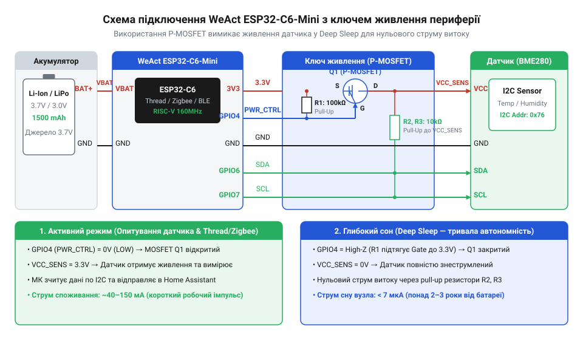
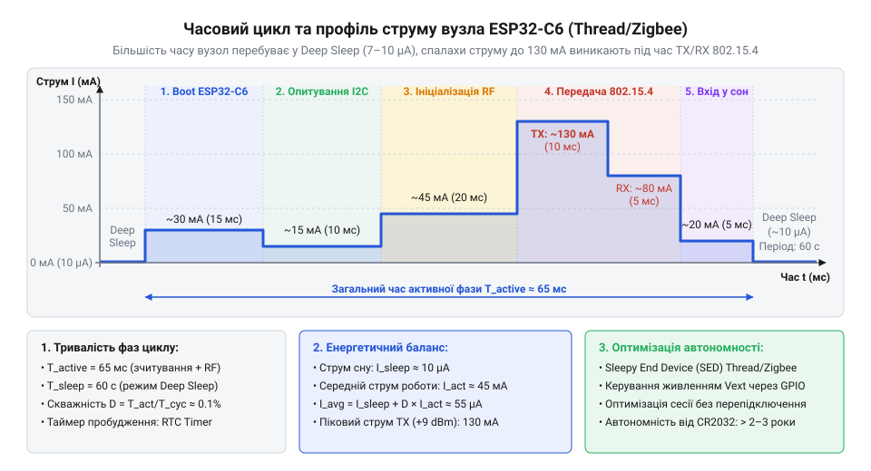

# Автономний вузол розумного дому на Thread/Zigbee

<preknowlist>
- [Waveshare ESP32-C6-Zero](root:cat-hw-boards/esp32-c6-zero) — специфіка апаратної периферії архітектури ESP32-C6 та призначення радіомодуля IEEE 802.15.4
</preknowlist>

## Чому звичайний Wi-Fi нищить автономність

Автономний сенсор розумного дому має працювати від одного заряду акумулятора роками, але спроба реалізувати його на стандартному протоколі @@en|Wi-Fi@@ призводить до розряду батареї за кілька днів. Головна проблема полягає в тому, що протокол @@en|Wi-Fi@@ розроблявся для передачі великих обсягів даних із високою швидкістю, а не для періодичного надсилання кількох байтів телеметрії. Під час встановлення зв’язку мікроконтролер витрачає від 1 до 3 секунд на сканування ефіру, авторизацію WPA, отримання IP-адреси через DHCP та узгодження TCP-з’єднання. У цей активний період бездротовий модуль споживає піковий струм 200–300 мА, виснажуючи компактний акумулятор ще до того, як датчик встигне відправити показники температури.

Енергоефективність автономного пристрою визначається його робочим циклом @@en|Duty Cycle@@ (англ. *duty cycle* — робочий цикл), тобто співвідношенням часу активної роботи та загальної тривалості циклу. Середній струм споживання `I_avg` обчислюється на основі активного струму `I_active`, часу активності `t_active`, струму глибокого сну `I_sleep` та часу сну `t_sleep`:

```
I_avg
= (I_active × t_active + I_sleep × t_sleep) ÷ (t_active + t_sleep)      [обчислення середнього струму споживання]
```

Оскільки в мережі @@en|Wi-Fi@@ тривалість активного стану `t_active` складає кілька секунд при струмі `I_active` понад 200 мА, середнє споживання `I_avg` залишається занадто високим навіть за умови тривалого сну. Альтернативним розв’язанням є перехід на протоколи стандарту IEEE 802.15.4 — @@en|Thread@@ (англ. *thread* — нитка) та @@en|Zigbee@@ (англ. *zig-zag* + *bee* — зиґзаґоподібний політ бджоли). Ці бездротові мережі працюють без громіздкого стеків TCP/IP та тривалого узгодження сесії: пристрій прокидається, передає готовий радіокадр безпосередньо у закріпленому каналі за 10–15 мілісекунд при піковому струмі 30–40 мА і миттєво повертається у сон.

Для побудови такого автономного вузла чудово підходить плата @@en|WeAct ESP32-C6-Mini@@ на базі мікроконтролера ESP32-C6 із вбудованим трансивером IEEE 802.15.4. Вона поєднує низьке споживання в режимі @@en|Deep Sleep@@ (англ. *deep sleep* — глибокий сон) до 7 мкА та підтримку енергоефективного радіостеку. Можна також детальніше вивчити [модулі ESP32-C6-Zero](root:cat-hw-boards/esp32-c6-zero), щоб оцінити периферійні можливості архітектури ESP32-C6. Завдяки цьому сенсор опитує довкілля, надсилає дані на [пограничний маршрутизатор OpenThread](root:com-transport/openthread-border-router) у систему @@en|Home Assistant@@ і зберігає автономність роками від однієї LiFePO4 батареї.

## Схема живлення та підключення сенсорів

Фізична побудова енергоефективного вузла вимагає не лише переходу мікроконтролера в режим @@en|Deep Sleep@@, а й повного знеструмлення зовнішньої периферії. Якщо підключити датчик температури чи вологості по шині @@en|I2C@@ (англ. *inter-integrated circuit* — міжмікросхемна шина) безпосередньо до лінії живлення 3.3 В, він продовжуватиме споживати статичний струм витоку від 100 мкА до 1 мА навіть тоді, коли ESP32-C6 спить. За кілька місяців такий прихований витік повністю розрядить акумулятор.

Для розв’язання цієї проблеми застосовують апаратне ключування живлення периферії за допомогою P-канального польового транзистора @@en|MOSFET@@ (англ. *metal-oxide-semiconductor field-effect transistor* — польовий транзистор метал-оксид-напівпровідник) або керуючого виводу @@en|GPIO@@ (англ. *general-purpose input/output* — виводи загального призначення). Коли мікроконтролер прокидається, він подає низький рівень на затвор транзистора, вмикаючи шину живлення датчика, виконує вимірювання й одразу знімає напругу перед поверненням у сон. Додатково цифровим виводам @@en|I2C@@ та АЦП в режимі сну задають високоімпедансний стан (High-Z), щоб виключити витік струму через внутрішні підтягувальні резистори.


*Принципова схема підключення автономного вузла ESP32-C6-Mini до акумуляторного живлення та розв'язка витоків струму периферії.*

Для вимірювання залишкового заряду акумулятора використовується високоомний дільник напруги, підключений до аналогово-цифрового перетворювача (АЦП). Програмне забезпечення ініціалізує шину @@en|I2C@@, зчитує показники та вимірює напругу батареї через драйвер ESP-IDF:

:::tabs
@tab C
:::code proj-weact-c6-mini-smart-home-node/c/main/main.c 77-147
:::

@tab C++
:::code proj-weact-c6-mini-smart-home-node/cpp/main/sensor_node.hpp 13-70
:::code proj-weact-c6-mini-smart-home-node/cpp/main/sensor_node.cpp 77-129
:::
:::

Дотримання цієї схеми комутації дає змогу знизити загальний струм споживання всієї плати @@en|WeAct ESP32-C6-Mini@@ разом із сенсорами у режимі сну до мінімальних 7–10 мкА.

## Налаштування Deep Sleep та таймерів пробудження

Після оптимізації апаратного підключення необхідно реалізувати програмний цикл керування енергозбереженням. У середовищі ESP-IDF мікроконтролер ESP32-C6 керує станами сну за допомогою блоку @@en|RTC@@ (англ. *Real-Time Clock* — годинник реального часу). Під час входу в режим @@en|Deep Sleep@@ процесорне ядро, внутрішня пам'ять RAM та більшість периферійних блоків вимикаються, а функціонувати залишаються лише таймер @@en|RTC@@ та спеціальна область пам'яті RTC RAM, яка зберігає змінні між циклами пробудження (наприклад, лічильник запусків `s_boot_count`).

Алгоритм активної фази складається з послідовних кроків: визначення причини пробудження, ініціалізація енергонезалежної пам'яті NVS для калібрування радіотрансивера, швидке зчитування датчиків, формування компактного кадру IEEE 802.15.4 та його відправка в ефір. Відразу після отримання підтвердження (ACK) або вичерпання таймауту радіомодуль деактивується, драйвери периферії видаляються з пам'яті, а таймер @@en|RTC@@ налаштовується на заданий інтервал пробудження.


*Діаграма часових інтервалів та споживання струму на кожному етапі активного циклу автономного вузла.*

Налаштування збірки проєкту для платформ C та C++ описується у конфігураційних файлах @@en|CMake@@ (від англ. *Cross-Platform Make* — кросплатформний генератор сценаріїв збірки), де через директиву `idf_component_register` у виразі `REQUIRES` явно вказуються всі модульні залежності прошивки. Для функціонування вузла підключаються компоненти `nvs_flash` для зчитування калібрувальних даних радіомодуля з енергонезалежного сховища @@en|NVS@@, `driver` для керування периферійною шиною I2C, `ieee802154` для прямого формування кадрів бездротового зв'язку, `esp_hw_support` для доступу до функцій енергозбереження, `esp_adc` для вимірювання напруги живлення та `esp_timer` для відліку інтервалу пробудження. Окрім конфігурації збірки, прошивка визначає розподіл пам'яті для зберігання стану між сеансами сну, що для плат на базі [архітектури ESP32-C6](root:cat-hw-boards/esp32-c6-zero) є критичним через повне знеструмлення основної оперативної пам'яті @@en|SRAM@@ (від англ. *Static Random-Access Memory* — статична оперативна пам'ять) у режимі @@en|Deep Sleep@@. Щоб зберегти значення лічильника запусків `s_boot_count` без зношування флешпам'яті, змінну позначають макросом `RTC_DATA_ATTR`, який примушує лінкер розміщувати її у спеціальній секції `.rtc.data`. Під час глибокого сну малопотужний внутрішній регулятор підтримує напругу на блоці @@en|RTC SRAM@@, тому розміщені там дані залишаються цілісними, а системний стартовий код після виходу з автономного режиму оминає обнулення цієї області й зберігає накопичений стан до моменту повного знеструмлення пристрою @@en|Power-On Reset@@ (від англ. *Power-On Reset* — скидання при ввімкненні живлення).

:::tabs
@tab C CMakeLists
:::code proj-weact-c6-mini-smart-home-node/c/CMakeLists.txt 1-4
:::code proj-weact-c6-mini-smart-home-node/c/main/CMakeLists.txt 1-5
:::

@tab C++ CMakeLists
:::code proj-weact-c6-mini-smart-home-node/cpp/CMakeLists.txt 1-7
:::
:::

Модуль відправки кадру по бездротовому інтерфейсу IEEE 802.15.4 для мереж @@en|Thread@@ та @@en|Zigbee@@ конфігурує канал, PAN ID та коротку мережеву адресу:

:::tabs
@tab C
:::code proj-weact-c6-mini-smart-home-node/c/main/main.c 152-218
:::

@tab C++
:::code proj-weact-c6-mini-smart-home-node/cpp/main/network_node.hpp 11-47
:::code proj-weact-c6-mini-smart-home-node/cpp/main/network_node.cpp 41-60
:::
:::

Головна точка входу прошивки реалізує перевірку причини пробудження `esp_sleep_get_wakeup_cause()`, опитування периферії, передачу пакету та виклики `esp_sleep_enable_timer_wakeup()` й `esp_deep_sleep_start()`:

:::tabs
@tab C
:::code proj-weact-c6-mini-smart-home-node/c/main/main.c 223-282
:::

@tab C++
:::code proj-weact-c6-mini-smart-home-node/cpp/main/main.cpp 19-84
:::
:::

Завдяки такій програмній організації мікроконтролер перебуває в активному стані менше 50 мілісекунд за один цикл, що забезпечує стабільну автономну роботу сенсорного вузла у системі @@en|Home Assistant@@ протягом багатьох років.

## Передача телеметрії через Thread та Zigbee

Щоб забезпечити автономну роботу сенсорного вузла протягом років від одного акумулятора, бездротовий зв'язок не повинен утримувати постійне з'єднання. На відміну від протоколу @@en|Wi-Fi@@, де хендшейк сесії триває секунди й витрачає сотні міліампер, стек канального рівня @@en|IEEE 802.15.4@@ (англ. *IEEE* — інститут інженерів з електротехніки та електроніки) дозволяє відправити пакет телеметрії за кілька мілісекунд. Мікроконтролер на платі WeAct ESP32-C6-Mini, як і інші модулі серії на кшталт [модуля ESP32-C6-Zero](root:cat-hw-boards/esp32-c6-zero), містить апаратний радіотрансивер 2.4 ГГц з підтримкою протоколів @@en|Thread@@ (англ. *thread* — нитка, зв'язок) та @@en|Zigbee@@.

Передача даних починається з ініціалізації апаратного трансивера @@en|PHY@@ (англ. *Physical Layer* — фізичний рівень) та @@en|MAC@@ (англ. *Media Access Control* — управління доступом до середовища). Вузол налаштовує частотний канал, унікальний ідентифікатор мережі @@en|PAN ID@@ (англ. *Personal Area Network Identifier*) та коротку мережеву адресу пристрою. Щоб зменшити споживання струму у простої, приймач @@en|RX@@ вимикають, а радіомодуль активують лише на час відправки.


*Структура кадру IEEE 802.15.4 із закованим полем вимірювань та послідовність відправки з миттєвим вимкненням трансивера.*

Телеметричний пакет формується у вигляді компактної упакованої бінарної структури. Замість текстових форматів на кшталт @@en|JSON@@ (англ. *JavaScript Object Notation*), які витрачають десятки байтів на назви полів і текстове кодування, фізичні показники масштабуються в цілі числа та пакуються у фіксовану структуру даних. Директиви впорядкування пам'яті на кшталт `#pragma pack(push, 1)` або атрибута `__attribute__((packed))` примусово видаляють байти вирівнювання, які компілятор зазвичай вставляє між полями різного розміру, зводячи обсяг корисного навантаження до мінімуму. Заголовок @@en|MAC@@ містить поле контролю кадру @@en|FCF@@ (англ. *Frame Control Field*), номер послідовності, @@en|PAN ID@@, а також адреси відправника й отримувача. Тіло кадру містить виміряні значення температури, вологості й напруги живлення. Така бінарна упаковка мінімізує енерговитрати на передачу, проте вимагає суворого узгодження порядку полів та порядку байтів між вузлом і приймачем. Для запобігання колізіям в ефірі трансивер виконує автоматичну перевірку вільного каналу @@en|CCA@@ (англ. *Clear Channel Assessment*). Якщо канал зайнятий або виникає радіозавада, апаратний модуль фіксує помилку відправки. Під час успішного виходу в ефір мікроконтролер очікує на апаратне підтвердження @@en|ACK@@ (англ. *Acknowledgment*) із чітко обмеженим таймаутом. Якщо підтвердження не отримано або виникла помилка передачі, система не витрачає заряд акумулятора на нескінченні повторні спроби у ввімкненому стані, а перериває процес. Після завершення сеансу або обробки помилки радіомодуль негайно деактивується через функцію `esp_ieee802154_disable()`, що дозволяє пристрою без затримок увійти в режим @@en|Deep Sleep@@ (англ. *deep* — глибокий, *sleep* — сон).

Для програмного керування бездротовим радіостеком у фреймворку @@en|ESP-IDF@@ застосовують драйвер `esp_ieee802154`. Нижче наведено приклад реалізації ініціалізації трансивера, збирання кадру та відправки телеметрії мовами C та C++:

:::tabs
@tab C
:::code proj-weact-c6-mini-smart-home-node/c/main/main.c 152-218

@tab C++
:::code proj-weact-c6-mini-smart-home-node/cpp/main/network_node.hpp 1-47
:::code proj-weact-c6-mini-smart-home-node/cpp/main/network_node.cpp 41-127
:::

Реалізація мовою @@en|C++@@ у класі `iot::NetworkNode` запобігає витокам струму за допомогою концепції @@en|RAII@@ (англ. *Resource Acquisition Is Initialization* — отримання ресурсу є ініціалізацією). Якщо під час формування кадру або передачі виникає збій, деструктор об'єкта автоматично викликає метод `disable_radio()` і знеструмлює трансивер перед переходом у режим @@en|Deep Sleep@@. Формування кадру @@en|IEEE 802.15.4@@ відбувається у буфері `std::array<uint8_t, 127>`, розташованому на стеку. Відмова від виділення пам'яті у динамічній купі @@en|heap@@ (англ. *heap* — купа) усуває небезпеку фрагментації @@en|RAM@@ (англ. *Random Access Memory* — пам'ять з довільним доступом) та позбавляє зайвих затримок. Передача структури вимірювань через представлення `std::span` дозволяє пакувати дані без копіювання байтів за принципом @@en|zero-copy@@ (англ. *zero-copy* — без копіювання), після чого сформований кадр із заголовком @@en|MAC@@ та резервом під контрольне поле @@en|FCS@@ (англ. *Frame Check Sequence* — послідовність перевірки кадру) передається драйвером у бездротовий ефір.

## Інтеграція з Home Assistant і розгортання

Надіслані автономним вузлом пакети @@en|IEEE 802.15.4@@ мають бути прийняті центральною системою автоматизації. У мережі @@en|Thread@@ роль сполучної ланки між бездротовими пристроями та локальною мережею виконує [маршрутизатор границі мережі](root:com-transport/openthread-border-router) @@en|Border Router@@ (англ. *border* — межа, *router* — маршрутизатор). Шлюз транслює пакети у протокол @@en|Matter@@ або пересилає сирі дані в службу @@en|MQTT@@ (англ. *Message Queuing Telemetry Transport*). При використанні стека @@en|Zigbee@@ координатор мережі передає отримані кадри мосту @@en|Zigbee2MQTT@@.

Центральний сервер @@en|Home Assistant@@ обробляє отримані байтові пакети за допомогою конфігурації автоматичного виявлення @@en|MQTT Discovery@@. Сирий байтовий масив телеметрії розпаковується за допомогою шаблонів @@en|Jinja2@@ або внутрішніх декодерів @@en|Zigbee2MQTT@@, перетворюючи розраховані соті частки градусів і відсотків у чисельні сенсори температури, вологості та напруги батареї.

Повний цикл роботи автономного вузла складається з послідовних кроків: ініціалізація енергонезалежної пам'яті @@en|NVS@@ (англ. *Non-Volatile Storage*), опитування сенсорної периферії шиною @@en|I2C@@ та вимірювання напруги живлення через @@en|ADC@@, формування й відправка кадру в ефір, деактивація периферійних шин і включення таймера пробудження @@en|RTC@@ (англ. *Real-Time Clock*). Конфігурація проєкту та головний цикл прошивки `app_main` подані нижче:

:::tabs
@tab C
:::code proj-weact-c6-mini-smart-home-node/c/CMakeLists.txt 1-4
:::code proj-weact-c6-mini-smart-home-node/c/main/CMakeLists.txt 1-5
:::code proj-weact-c6-mini-smart-home-node/c/main/main.c 223-281

@tab C++
:::code proj-weact-c6-mini-smart-home-node/cpp/CMakeLists.txt 1-7
:::code proj-weact-c6-mini-smart-home-node/cpp/main/sensor_node.hpp 1-70
:::code proj-weact-c6-mini-smart-home-node/cpp/main/sensor_node.cpp 213-224
:::code proj-weact-c6-mini-smart-home-node/cpp/main/main.cpp 1-83
:::

Для розгортання пристрою у реальних умовах плату WeAct ESP32-C6-Mini живлять від літій-залізо-фосфатного акумулятора (LiFePO4) із номінальною напругою 3.2 В безпосередньо через вивід 3V3, що усуває втрати на лінійному стабілізаторі напруги. Налаштування інтервалу глибокого сну на 30–60 секунд забезпечує баланс між оперативністю оновлення показників у @@en|Home Assistant@@ та роками автономної роботи пристрою.
