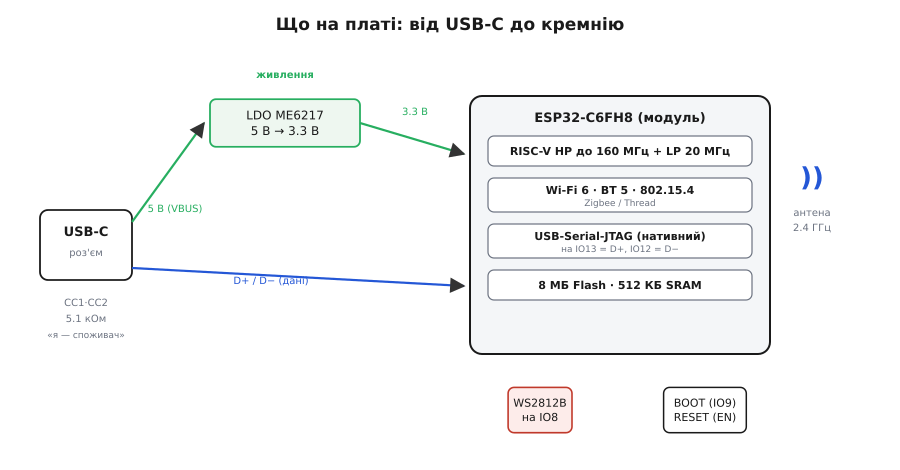
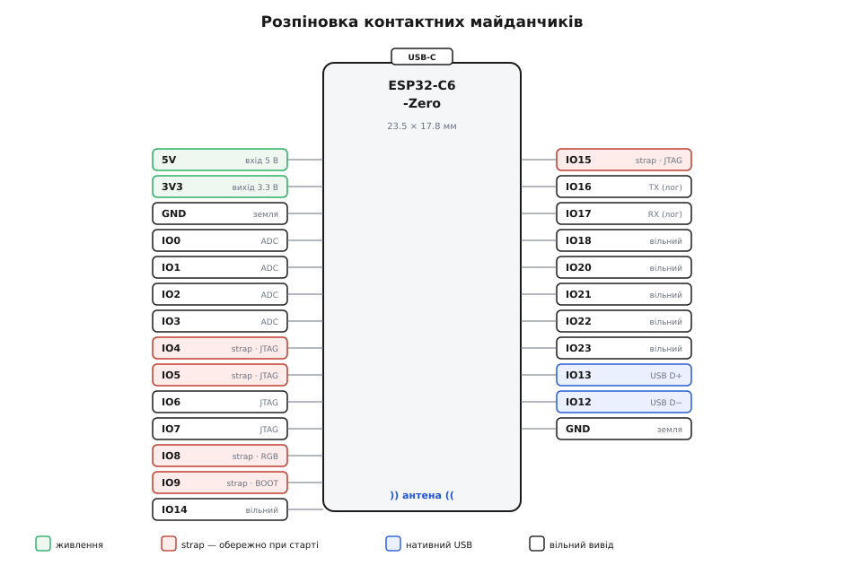

# Waveshare ESP32-C6-Zero

<preknowlist>
- [ESP32-S3 SuperMini](root:cat-hw-boards/esp32-s3-supermini) — розуміння компактних форм-факторів плат розробки Espressif.
</preknowlist>

## Форм-фактор Zero та потрійне радио

Waveshare ESP32-C6-Zero — це компактний радіомодуль, створений для прямого впаювання у власні плати. Його краї мають зубчасту форму (@@en|castellated@@) — це металізовані напівкруглі вирізи, через які плата з'єднується з іншою. Під час монтажу модуль кладуть поверх базової плати, і припій заповнює ці вирізи, утворюючи міцну галтель між контактами обох плат, незалежно від того, чи це ручне паяння паяльником, чи автоматичне оплавлення в печі. Завдяки цьому модуль працює і як самостійна плата для макетування, і як готовий компонент для поверхневого монтажу. Серцем пристрою є чип ESP32-C6 з архітектурою RISC-V, який замість одного стандарту зв'язку підтримує одразу три. Він працює з сучасним Wi-Fi 6, енергоефективним BLE 5 та стандартом 802.15.4, на якому будуються мережі Zigbee і Thread. Завдяки такій комбінації плата підходить для створення вузлів розумного дому, які одночасно підключаються до інтернету через роутер та спілкуються із сенсорами безпосередньо. Формат плати перегукується з іншими рішеннями, як-от [ESP32-S3-Zero](root:cat-hw-boards/esp32-s3-zero).

## Кремній та нативний USB-C

Для живлення та обміну даними на платі встановлено порт USB Type-C. На відміну від багатьох плат, де потрібен окремий перетворювач інтерфейсу, чип ESP32-C6 має нативний USB-контролер. Лінії даних порту йдуть безпосередньо в мікроконтролер, що дозволяє системі розпізнавати його як стандартний USB-пристрій для прошивання. На платі також розпаяні підтягувальні резистори на лініях @@en|CC@@, завдяки яким джерело живлення коректно подає напругу при підключенні будь-яким кабелем, зокрема Type-C на Type-C. Напруга 5 В із порту перетворюється лінійним стабілізатором ME6217, який живить кремній.

*Блок-схема показує шлях напруги від порту USB-C через стабілізатор до мікроконтролера та пряме з'єднання ліній даних.*

## Особливості розпіновки та strapping-піни

Усі виводи мікроконтролера працюють у домені напруги 3.3 В. Подача 5 В на будь-який контакт даних неминуче спалить порт чи сам чип. Деякі виводи на платі, крім загального призначення, діють як @@en|strapping@@-піни. Це контакти IO4, IO5, IO8, IO9 та IO15, стан яких у момент подачі живлення або перезавантаження визначає, як мікроконтролер стартуватиме. Наприклад, рівень на IO9 вирішує, чи піде чип виконувати код із пам'яті, чи чекатиме на прошивку. Підключаючи зовнішню периферію до цих пінів, варто стежити, щоб вона не притягувала їх до небажаного рівня під час запуску. Два виводи, IO12 та IO13, жорстко прив'язані до нативного USB-контролера і працюють як лінії D- та D+.

*Схема розпіновки демонструє розміщення виводів 3.3 В, ліній нативного USB та strapping-пінів по контуру плати.*

## Способи живлення та прошивання

Модуль можна живити трьома шляхами: через роз'єм USB-C напругою 5 В, через вивід 5 В, або подаючи стабільні 3.3 В на відповідний вивід плати. У другому випадку живлення подається в обхід стабілізатора, тому напруга має бути точною. Щоб залити код, плату підключають до комп'ютера кабелем USB. Зазвичай чип автоматично переходить у режим завантаження завдяки нативному USB-контролеру. Якщо автоматика не спрацьовує, режим викликають вручну кнопками на платі: треба затиснути кнопку BOOT, натиснути RESET, і після відпускання BOOT чип зупиниться в очікуванні нової прошивки, зчитавши стан IO9.
