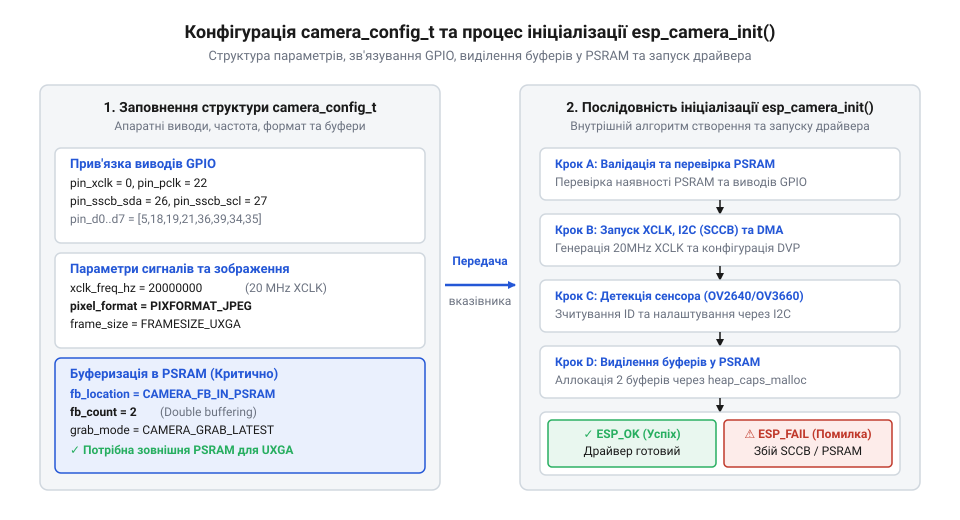
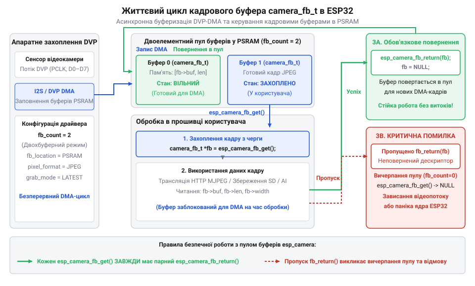

# Довідник програмного інтерфейсу драйвера esp32-camera SDK

<preknowlist>
- [ESP32-CAM (OV2640 + microSD)](root:cat-hw-boards/esp32-cam) — схемотехнічне розведення виводів камери DVP, роз'єму FPC та підключення зовнішньої PSRAM
- [Мікроконтролер ESP32-S3](root:cat-hw-boards/esp32s3-microcontroller) — принципи роботи з зовнішньою оперативною пам'яттю PSRAM та підсистемою DMA
</preknowlist>

## Архітектура відеотракту та ініціалізація драйвера

Спроба прямого зчитування цифрових сигналів з камери через звичайні виводи @@en|GPIO@@ (англ. @@en|General-Purpose Input/Output@@ — входи-виходи загального призначення) призводить до втрати байтів даних та хаотичних падінь системи. Оскільки передача відеопотоку вимагає високої пропускної здатності, драйвер бібліотеки `esp_camera` організує апаратне захоплення через шину паралельного інтерфейсу @@en|DVP@@ (англ. @@en|Digital Video Port@@ — цифровий відеопорт) з прямою передачею блоків у пам'ять за допомогою контролера @@en|DMA@@ (англ. @@en|Direct Memory Access@@ — прямий доступ до пам'яті). Драйвер бере на себе тактування сенсора, налаштування шини керування та виділення кадрових буферів у зовнішній оперативній пам'яті @@en|PSRAM@@ (англ. @@en|Pseudo Static RAM@@ — псевдостатична оперативна пам'ять). Додатково в структурі конфігурації передбачено поле `conv_mode`, яке відповідає за налаштування апаратного кодека (англ. `@@en|codec@@`, скорочення від *coder-decoder* — кодувальник-декодувальник) перетворення колірних форматів. Встановлення відповідного режиму в полі `conv_mode` інструктує апаратний акселератор здійснювати автоматичну конвертацію вхідного піксельного потоку (зокрема з `YUV422` у `RGB565` чи `GRAYSCALE`) безпосередньо під час `DMA`-транспортування, що повністю усуває навантаження на процесорні ядра при первинній підготовці графічних даних.

Конфігурація усього відеотракту перед запуском задається через структуру `camera_config_t`. Вона містить прип'язки фізичних ніжок, параметри генератора тактового сигналу `XCLK`, бажану роздільність кадру та режим буферизації.

Для генерації опорного частотного сигналу `XCLK` драйвер бібліотеки використовує апаратні таймери периферійного модуля @@en|LEDC@@ (англ. @@en|LEDC@@, від *LED Control* — керування світлодіодами). Поля `ledc_timer` та `ledc_channel` у структурі `camera_config_t` задають вибір апаратного каналу широтно-імпульсної модуляції @@en|PWM@@, який формує стабільну меандрову хвилю частотою 10 або 20 МГц на виводі `pin_xclk`. Оскільки внутрішній генератор сенсора зображення та його системний процесор розкладання кольорів повністю залежать від цього зовнішнього тактування, будь-який збій або конфлікт призначення таймера LEDC у коді програми зупиняє апаратний відеотракт та унеможливлює зчитування кадрових буферів.


*Схема заповнення конфігурації camera_config_t та запуск драйвера камери.*

У таблиці нижче наведено ключові поля структури `camera_config_t`, їхнє призначення та типові значення для [платформи ESP32-CAM](root:cat-hw-boards/esp32-cam):

| Поле структури | Тип даних | Призначення та опис |
| :--- | :--- | :--- |
| `pin_pwdn` / `pin_reset` | `int` | Номери виводів керування живленням (англ. @@en|power down@@) та апаратного скидання. Якщо не задіяно — ставлять `-1`. |
| `pin_xclk` | `int` | Вивід генерації опорного тактового сигналу `XCLK` для сенсора камери. |
| `pin_sscb_sda` / `pin_sscb_scl` | `int` | Лінії шини шифрування та конфігурації @@en|SCCB@@ (англ. @@en|Serial Camera Control Bus@@) для керування регістрами камери. |
| `pin_d0` ... `pin_d7` | `int` | 8-бітна паралельна шина даних `DVP` для передачі піксельних байтів. |
| `pin_vsync` / `pin_href` / `pin_pclk` | `int` | Лінії кадровій (`VSYNC`), рядковій (`HREF`) та піксельній (`PCLK`) синхронізації. |
| `xclk_freq_hz` | `int` | Частота сигналу `XCLK` у Герцах (зазвичай `20000000` Гц або `10000000` Гц). |
| `pixel_format` | `pixformat_t` | Формат даних зображення: `PIXFORMAT_JPEG`, `PIXFORMAT_YUV422`, `PIXFORMAT_RGB565` або `PIXFORMAT_GRAYSCALE`. |
| `frame_size` | `framesize_t` | Роздільна здатність кадру (`FRAMESIZE_UXGA`, `FRAMESIZE_SVGA`, `FRAMESIZE_VGA`, `FRAMESIZE_QVGA`). |
| `jpeg_quality` | `int` | Якість стиснення @@en|JPEG@@ (від `1` — найвища якість до `63` — найнижча). |
| `fb_count` | `int` | Кількість кадрових буферів у пам'яті (1 для одиночного захоплення, 2 для подвійного `ping-pong`). |
| `fb_location` | `camera_fb_location_t` | Розміщення кадрових буферів: `CAMERA_FB_IN_PSRAM` або `CAMERA_FB_IN_DRAM`. |
| `grab_mode` | `camera_grab_mode_t` | Режим захоплення: `CAMERA_GRAB_WHEN_EMPTY` (чекати порожній буфер) або `CAMERA_GRAB_LATEST` (завжди найновіший кадр). |

Ініціалізація драйвера здійснюється функцією `esp_camera_init()`. При цьому критично важливо коректно обрати периферійні ресурси для генерації тактового сигналу `XCLK`: поля `ledc_timer` та `ledc_channel` виділяють апаратний таймер модуля @@en|LEDC@@, який формує вихідний меандр частотою 10–20 МГц. Якщо у системному коді інші компоненти — зокрема драйвери двигунів або контролери ШІМ-підсвічування — повторно використають той самий таймер чи канал, це перевизначить прескейлер і збиє опорну частоту `XCLK`. Зазначений конфлікт спричиняє розсинхронізацію шини @@en|DVP@@, зупинку системного процесора зображення та фатальну помилку `ESP_ERR_NOT_FOUND`. Щоб запобігти збоям відеотракту, таймер `LEDC` для `XCLK` призначають монопольно, ізолюючи його від будь-яких зовнішніх приводів та джерел підсвічування. Нижче наведено приклади заповнення конфігурації та запуску відеотракту для [модуля ESP32-CAM з камерою OV3640](root:cat-hw-boards/esp32-cam-ov3640) або OV2640:

:::tabs
@tab ESP-IDF (C)
:::code api-esp-camera-sdk/c/esp-idf/init-camera.c

@tab Arduino (C++)
:::code api-esp-camera-sdk/cpp/arduino/setupcamera.cpp
:::

Функція `esp_camera_init()` повертає код типу `esp_err_t`. При виборі високої роздільності або подвійної буферизації обов'язково перевіряють наявність чипа `PSRAM` на борту, як-от у [модулях Waveshare ESP32-S3R2](root:cat-hw-boards/esp32-s3r2-waveshare). Помилка `ESP_ERR_NO_MEM` вказує на брак пам'яті для буферів, а `ESP_ERR_NOT_FOUND` — на неправильні виводи `SCCB` або відсутність тактування `XCLK`.

## Життєвий цикл захоплення кадрів камери

Після успішної ініціалізації драйвер камери безперервно заповнює апаратні буфери в оперативній пам'яті через контролер `DMA`. Для доступу до готового кадру застосунок запитує вказівник на структуру `camera_fb_t` за допомогою функції `esp_camera_fb_get()`. У внутрішній реалізації драйвера ця функція є блокуючим викликом: вона очікує на надходження події від переривання `DMA` через внутрішню чергу (англ. `@@en|queue@@`, від франц. *queue* — черга, від лат. *cauda* — хвіст) операційної системи `@@en|FreeRTOS@@` (від англ. @@en|Free Real-Time Operating System@@ — вільна операційна система реального часу) з визначеним тайм-аутом блокування (за замовчуванням до 5000 мс). Якщо декілька паралельних задач операційної системи одночасно викликають `esp_camera_fb_get()`, вони вступають у конкуренцію за обмежений пул буферів `fb_count`. Оскільки драйвер не реалізує внутрішнього захисту від реентрабельності, задача з нижчим пріоритетом або при затримці повернення буферів через `esp_camera_fb_return()` вичерпує ліміт очікування тайм-ауту та отримує `NULL`. Щоб уникнути взаємних блокувань та витоків пам'яті в багатозадачному середовищі, доступ до захоплення кадрів вимагає синхронізації через прикладний м'ютекс (англ. `@@en|mutex@@`, від англ. @@en|mutual exclusion@@ — взаємне вилучення, від *mutual* — взаємний та *exclusion* — вилучення) або виділення єдиної задачі-розпорядника.

Структура `camera_fb_t` представляє зріз отриманого кадру та містить такі поля:

| Поле структури | Тип даних | Опис вмісту |
| :--- | :--- | :--- |
| `buf` | `uint8_t *` | Вказівник на масив байтів зображення в `PSRAM` або `DRAM`. |
| `len` | `size_t` | Довжина даного кадрового буфера у байтах. |
| `width` | `size_t` | Ширина отриманого зображення у пікселях. |
| `height` | `size_t` | Висота отриманого зображення у пікселях. |
| `format` | `pixformat_t` | Формат збережених даних (`PIXFORMAT_JPEG`, `PIXFORMAT_RGB565` тощо). |
| `timestamp` | `struct timeval` | Часова позначка фіксації каду системою. |

Критичним правилом роботи з `esp32-camera` є суворе дотримання життєвого циклу кадрового буфера. Після завершення обробки зображення (передачі по мережі або збереження на носій) розробник зобов'язаний повернути буфер драйверу викликавши `esp_camera_fb_return()`.

Поведінка вибірки даних з апаратної черги контролера @@en|DMA@@ регулюється параметром `grab_mode` у конфігурації драйвера. В режимі `CAMERA_GRAB_WHEN_EMPTY` функція `esp_camera_fb_get()` послідовно вичитує буфери за принципом черги; якщо застосунок обробляє зображення повільніше за швидкість зйомки сенсора, в апаратному кільцевому буфері (англ. @@en|ring buffer@@, від англ. @@en|ring buffer@@ — кільцевий буфер) накопичуються застарілі кадри, викликаючи затримку відеопотоку. Особливо гостро це проявляється при виконанні обробки в окремому завданні операційної системи @@en|FreeRTOS@@ (від англ. @@en|Free Real-Time Operating System@@ — вільна операційна система реального часу) за умов масивного мережевого навантаження: коли затримки відправлення через сокет @@en|Wi-Fi@@ сповільнюють фонову таску, режим `CAMERA_GRAB_WHEN_EMPTY` накопичує чергу кадрів, збільшуючи затримку трансляції до кількох секунд. Натомість у режимі `CAMERA_GRAB_LATEST` драйвер під час виклику `esp_camera_fb_get()` миттєво скидає всі накопичені незчитані кадри з пам'яті та повертає лише найостанніше зняте зображення. Це усуває ефект роздування буферів (англ. @@en|buffer bloat@@, від англ. @@en|buffer bloat@@ — роздування буферів) при мережевих затримках і гарантує мінімальну затримку відгуку в завданнях потокового відео або розпізнавання об'єктів.


*Покрокова схема життєвого циклу кадрового буфера camera_fb_t.*

Якщо не викликати `esp_camera_fb_return()`, виділений кадровій буфер залишається заблокованим. За кілька ітерацій усі доступні буфери `fb_count` вичерпуються, `esp_camera_fb_get()` починає повертати `NULL`, і відеотракт повністю зупиняється через витік пам'яті.

Нижче наведено приклад організації стійкого циклу обробки кадрів для [мікроконтролера ESP32-S3](root:cat-hw-boards/esp32s3-microcontroller) або класичних плат розробки:

:::tabs
@tab ESP-IDF (C)
:::code api-esp-camera-sdk/c/esp-idf/camera-process-task.c

@tab Arduino (C++)
:::code api-esp-camera-sdk/cpp/arduino/captureandprocessframe.cpp
:::

У разі роботи з кількома буферами (`fb_count > 1`) драйвер дозволяє отримувати наступний кадр у той час, поки попередній ще обробляється. Проте кількість одночасно утримуваних вказівників `camera_fb_t*` ніколи не повинна перевищувати значення `fb_count`.

## Динамічне керування параметрами сенсора зображення

Після успішної ініціалізації відеотракту розробник часто стикається з потребою коригувати параметри зйомки без перезапуску драйвера — наприклад, змінити оптичну роздільність, підлаштувати яскравість чи компенсувати дзеркальне монтування модуля. Для прямого маніпулювання апаратними реєстрами матриці камери під час виконання програми бібліотека надає вказівник на структуру `sensor_t` (англ. @@en|sensor@@, від лат. *sentire* — відчувати). Окрім базових геометричних та колірних налаштувань, інтерфейс `sensor_t` містить розширені функції цифрової обробки сигналу в апаратному обробнику матриці (@@en|DSP@@, від англ. @@en|Digital Signal Processor@@ — цифровий сигнальний процесор). Зокрема, функція `set_raw_gma(s, enable)` вмикає або вимикає апаратну гамма-корекцію (англ. @@en|gamma correction@@, від грец. @@en|gamma@@ — літера гамма та лат. @@en|correctio@@ — виправлення) сирого сигналу, що покращує передачу градацій півтонів у затемнених або висококонтрастних ділянках кадру. Водночас виклик `set_bpc(s, enable)` активує алгоритм автоматичної компенсації дефектних пікселів (англ. @@en|bad pixel correction@@, скорочено @@en|BPC@@): вбудований у сенсор контролер виявляє дефектні біти на @@en|CMOS@@-матриці (від англ. @@en|Complementary Metal-Oxide-Semiconductor@@ — комплементарна структура метал-оксид-напівпровідник) й прозоро заміщує їхні значення інтерполяцією з сусідніх пікселів до формування підсумкового кадру.

Отримання вказівника на об'єкт керування здійснюється через виклик функції `esp_camera_sensor_get()`. Ця структура містить таблицю вказівників на внутрішні функції-обробники, які перетворюють високорівневі методи на низькорівневі транзакції шини @@en|SCCB@@.

При виклику методів модифікації регістрів через вказівник `sensor_t` запис даних відбувається по шині @@en|SCCB@@ негайно, проте апаратна матриця сенсора застосовує нові конфігураційні параметри лише під час інтервалу кадрового гашення @@en|VSYNC@@ (англ. @@en|Vertical Synchronization@@, від *vertical* — вертикальний та *synchronization* — синхронізація) між послідовними кадрами. Через цей фізичний запізнювальний механізм зміни експозиції, підсилення чи балансу білого відображаються у кадровому буфері не миттєво, а з затримкою в один-два кадри. У випадку динамічного виклику `set_framesize()` зміна геометричних розмірів матриці додатково вимагає перезапуску внутрішнього конвеєра @@en|DMA@@ та виконання примусового скидання накопичених кадрових буферів (англ. @@en|buffer flushing@@, від *flush* — промивати, очищати). Оскільки драйвер переконфігуровує довжину дескрипторів пам'яті під нову роздільність, залишкові кадри попереднього розміру в апаратному кільцевому буфері (англ. @@en|ring buffer@@, від *ring* — кільце та *buffer* — буфер) вивільняються вручну, а очікування імпульсу @@en|VSYNC@@ блокує генерацію нових валідних даних на час до двох кадрових періодів. Тому для запобігання збоям розгортки на [модулях ESP32-CAM](root:cat-hw-boards/esp32-cam) програма зобов'язана зчитати й відкинути через `esp_camera_fb_return()` перші два-три транзитні кадри після зміни роздільності до відновлення стабільного відеотоку.


*Ієрархічна структура вказівника sensor_t із викликами функцій коригування експозиції, балансу білого та роздільності.*

Основними функціями маніпулювання сенсором через структуру `sensor_t` є:
- `set_framesize(s, framesize)` — динамічна зміна роздільності кадру (англ. @@en|frame size@@, від *frame* — кадр та *size* — розмір) від `FRAMESIZE_QQVGA` (160×120) до `FRAMESIZE_UXGA` (1600×1200);
- `set_hmirror(s, enable)` та `set_vflip(s, enable)` — горизонтальне та вертикальне дзеркалювання зображення для корекції орієнтації [модулів ESP32-CAM](root:cat-hw-boards/esp32-cam);
- `set_aec2(s, enable)` та `set_ae_level(s, level)` — увімкнення розширеної автоекспозиції @@en|AEC@@ (англ. @@en|Auto Exposure Control@@) та вибір рівня компенсації експозиції від -2 до 2;
- `set_agc(s, enable)` та `set_gain_ceiling(s, ceiling)` — керування автопідсиленням @@en|AGC@@ (англ. @@en|Auto Gain Control@@) із встановленням верхньої межі `GAINCEILING_2X`–`GAINCEILING_128X`;
- `set_wb_mode(s, mode)` — налаштування балансу білого @@en|AWB@@ (англ. @@en|Auto White Balance@@) під типи освітлення.

Нижче наведено приклад динамічної переконфігурації сенсора під час виконання програми:

:::tabs
@tab C|esp-idf
:::code api-esp-camera-sdk/c/esp-idf/reconfigure-camera-sensor.c
@tab C++|arduino
```cpp|arduino
// Налаштування параметрів сенсора в середовищі Arduino IDE
#include "esp_camera.h"

void setupCameraSensor() {
    sensor_t *s = esp_camera_sensor_get();
    if (s != nullptr) {
        // Зміна роздільності на QVGA (320x240)
        s->set_framesize(s, FRAMESIZE_QVGA);
        // Вертикальний переворот зображення
        s->set_vflip(s, 1);
        // Увімкнення автоматичного балансу білого
        s->set_whitebal(s, 1);
    }
}
```
:::

## Формати пікселів та специфікація буфера

Вибір формату пікселів у полі `pixel_format` структури `camera_config_t` визначає не лише спосіб кодування графічних даних, а й обсяг оперативної пам'яті, необхідний для збереження кожного кадру. Для подальшої математичної обробки кадрів у задачах комп'ютерного зору на [мікроконтролерах ESP32-S3](root:cat-hw-boards/esp32s3-microcontroller) стиснені або смуговані дані потребують декодування (англ. @@en|decoding@@, від лат. *de-* — зняття та *codex* — книга, кодекс) у звичні несмуговані масиви. Драйвер надає допоміжну функцію `fmt2rgb888()`, яка перетворює вхідні кадри форматів `PIXFORMAT_JPEG`, `PIXFORMAT_YUV422` або `PIXFORMAT_RGB565` у 24-бітовий колірний простір RGB888 з 3 байтами на піксель, створюючи вирівняний масив для прямої передачі у нейромережеві тензори чи фільтри виділення контурів ціною триразового збільшення обсягу буфера у пам'яті. Для збереження результатів аналізу на накопичувач або передавання через мережу використовують функцію `fmt2bmp()`, що обгортає стиснений або несмугований кадровий буфер у формат растрового зображення @@en|bitmap@@ (англ. *bitmap*, від *bit* — біт та *map* — карта; далі @@en|BMP@@) із формуванням специфічних заголовків `BITMAPFILEHEADER` і `BITMAPINFOHEADER`, вимагаючи виділення додаткового динамічного буфера відповідного обсягу під підготовлений файл.

В апаратному драйвері переліком `pixformat_t` підтримуються такі основні формати:
- `PIXFORMAT_JPEG` — стиснений потік даних. Апаратний модуль стиснення сенсора формує готовий файл @@en|JPEG@@, що суттєво зменшує розмір буфера кадру і робить цей режим ідеальним для мережевої трансляції через @@en|Wi-Fi@@;
- `PIXFORMAT_RGB565` — несмугований 16-бітовий колірний простір (5 бітів червоного, 6 бітів зеленого, 5 бітів синього). Займає рівно 2 байти на один піксель і застосовується для виводу картинки на дисплеї;
- `PIXFORMAT_YUV422` — 16-бітовий колірний простір яскравісно-хроматичного розкладу @@en|YUV@@ (у середньому 2 байти на піксель), зручний для первинного оброблення відеопотоку;
- `PIXFORMAT_GRAYSCALE` — 8-бітовий монохромний градаційний режим (англ. @@en|grayscale@@, від *gray* — сірий та *scale* — шкала) з 1 байтом на піксель, призначений для задач алгоритмів комп'ютерного зору на [мікроконтролерах ESP32-S3](root:cat-hw-boards/esp32s3-microcontroller).

Обсяг оперативної пам'яті `M_raw` у байтах для збереження одного несмугованого кадру обчислюється за формулою `M_raw = W × H × B`. У випадках, коли підключений сенсор зображення не підтримує апаратне стиснення зображення, бібліотека `esp_camera` реалізує програмне стиснення (англ. @@en|software compression@@, від лат. *compressio* — стиснення) нестиснених форматів `PIXFORMAT_YUV422` та `PIXFORMAT_RGB565` у потік `PIXFORMAT_JPEG` безпосередньо у пам'яті мікроконтролера за допомогою функції `fmt2jpg()`. Така програмна конвертація форматів (англ. @@en|format conversion@@, від лат. *conversio* — перетворення) дозволяє формувати `JPEG`-потік для компактного мережевого передавання навіть з простих сенсорів, проте вимагає суттєвих ресурсів процесорного ядра та додатково виділеної оперативної пам'яті для тимчасового нестисненого буфера зйомки перед його кодуванням.

На відміну від нестиснених масивів, розмір стисненого кадру `M_jpeg` у форматі `PIXFORMAT_JPEG` залежить від колірної насиченості сцени та налаштованого у `camera_config_t` коефіцієнта якості `jpeg_quality` (значення від 1 до 63, де менше число відповідає вищій якості). При виборі значення `jpeg_quality = 12` для роздільності VGA (640×480) середній коефіцієнт стиснення `K_comp` становить близько 15:1, що дає орієнтовний обсяг стисненого буфера:

        M_jpeg = M_raw ÷ K_comp
        = 614400 ÷ 15           [оцінка розміру кадру JPEG при jpeg_quality = 12]
        = 40960                 [розмір стисненого кадру в байтах (~40 КБ)]

Такий обсяг кадру (~40 КБ) легко розміщується у внутрішній @@en|SRAM@@ без залучення @@en|PSRAM@@, проте при збільшенні якості до `jpeg_quality = 5` розмір кадру зростає до 80–100 КБ, що при роботі з подвійною буферизацією вимагає обачності щодо лімітів оперативної пам'яті.

        M_raw = W × H × B
        = 640 × 480 × 2         [обчислення розміру кадру RGB565 роздільності VGA]
        = 614400                [необхідний обсяг пам'яті в байтах (~600 КБ)]

Отримане значення 614400 байтів перевищує доступну внутрішню @@en|SRAM@@ мікроконтролера, тому використання несмугованих форматів високої роздільності вимагає обов'язкової наявності зовнішньої пам'яті @@en|PSRAM@@, як на [модулях Waveshare ESP32-S3R2](root:cat-hw-boards/esp32-s3r2-waveshare). Для пристроїв без @@en|PSRAM@@ слід застосовувати формат `PIXFORMAT_JPEG`, у якому кадровий буфер стискається у 10–20 разів.

У таблиці нижче наведено порівняльний аналіз форматів пікселів за витратою пам'яті та сферою застосування:

| Формат пікселів | Байт на піксель | Потреба в PSRAM | Основне призначення |
| :--- | :--- | :--- | :--- |
| `PIXFORMAT_JPEG` | Змінна (стиснення) | Ні (при низькій роздільності) | Мережевий відеострімінг, фотофіксація |
| `PIXFORMAT_RGB565` | 2 байти | Так (для VGA і вище) | Прямий вивід на TFT-дисплеї |
| `PIXFORMAT_YUV422` | 2 байти | Так (для VGA і вище) | Обробка колірних каналів, конвертація |
| `PIXFORMAT_GRAYSCALE` | 1 байт | Бажано | Детекція контурів, розпізнавання образів |

## Діагностика помилок та оптимізація відеотракту

При безперервній зйомці відеотракт піддається ризику збоїв живлення, просідання швидкості шини пам'яті та апаратних розсинхронізацій. Без обробки помилок запуск системи може завершитися критичним падінням (англ. @@en|crash@@, від нім. *krachen* — тріщати).

Функція ініціалізації повертає стандартний код (англ. @@en|error code@@, від лат. *errare* — блукати) типу `esp_err_t`. Код `ESP_ERR_NOT_FOUND` означає відсутність відповіді сенсора по шині @@en|SCCB@@ — найчастіше це викликано поганим контактом у роз'ємі @@en|FPC@@ або відсутністю частоти @@en|XCLK@@. Помилка `ESP_ERR_NO_MEM` виникає при виділенні кадрових буферів через брак пам'яті у зовнішній @@en|PSRAM@@. Значення `ESP_ERR_INVALID_ARG` вказує на вихід частоти `xclk_freq_hz` за допустимі межі або розбіжність між обраною роздільністю та форматом пікселів.

Спотворення кадрів і горизонтальні смуги з'являються через порушення цілісності сигналу тактування. Занадто висока частота `xclk_freq_hz` (понад 20 МГц) викликає наводки на лініях @@en|DVP@@, а низька — збої внутрішнього генератора сенсора. Переповнення буфера @@en|DMA@@ (англ. @@en|overrun@@) виникає, коли шина пам'яті не встигає зберігати потік даних.

Для усунення просідання пропускної здатності шини @@en|PSRAM@@ під час одночасної роботи активного модуля @@en|Wi-Fi@@ застосовують декілька системних оптимізацій. Головною причиною артефактів та втрат кадрів є арбітражний конфлікт на спільній шині пам'яті між транзакціями передавача @@en|Wi-Fi@@ та прямим доступом @@en|DMA@@ камери. Для мінімізації навантаження на шину первинні транзитні буфери @@en|DMA@@ розміщують виключно у швидкій внутрішній @@en|SRAM@@, виділяючи у @@en|PSRAM@@ лише підсумкові кадрові буфери. Додатково вимикають режим збереження енергії бездротового модуля викликом `esp_wifi_set_ps(WIFI_PS_NONE)`, розносять обробку стека @@en|TCP/IP@@ та захоплення кадрів по різних ядрах процесора на [мікроконтролерах ESP32-S3](root:cat-hw-boards/esp32s3-microcontroller), а також переводять зйомку у формат `PIXFORMAT_JPEG`, що зменшує трафік по шині пам'яті в десятки разів.

Для стабільної цілодобової роботи на [модулях ESP32-CAM](root:cat-hw-boards/esp32-cam) слід перевіряти залишок пам'яті та гарантовано повертати кожен отриманий буфер кадру.

:::tabs
:::code api-esp-camera-sdk/c/esp-idf/init-and-capture.c
:::code api-esp-camera-sdk/cpp/arduino/initandcapture.cpp
:::

Використання чипів на [мікроконтролерах ESP32-S3](root:cat-hw-boards/esp32s3-microcontroller) забезпечує високу пропускну здатність шини @@en|PSRAM@@, знижуючи ризик втрати кадрів.
