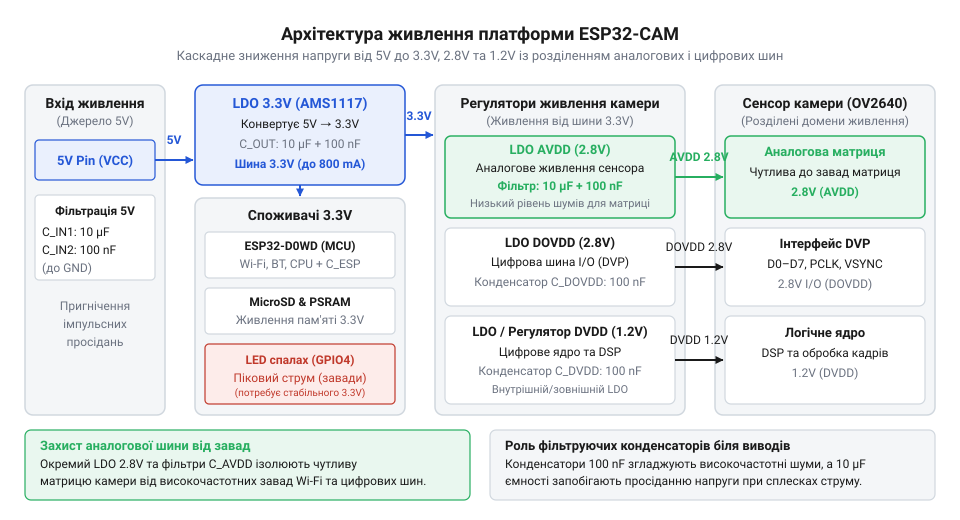
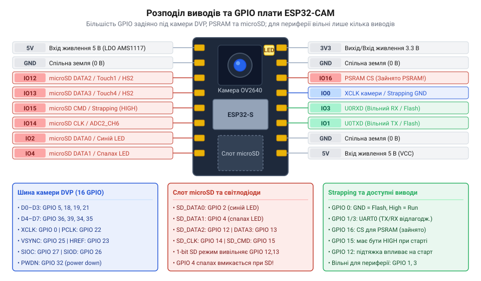

# Апаратний інтерфейс, цокольовка та схемотехніка плат сімейства ESP32-CAM

<preknowlist>
- [ESP32-CAM (OV2640 + microSD)](root:cat-hw-boards/esp32-cam) — базові функціональні можливості плати AI-Thinker, призначення камери OV2640 та призначення слота microSD
</preknowlist>

## Проблеми підключення та апаратних конфліктів

Спроба підключити до плати AI-Thinker звичайний цифровий датчик чи дисплей за аналогією з класичними платами розробки часто завершується раптовим блокуванням завантаження мікроконтролера, відмовою камери або спотворенням даних на карті пам'яті. Розробник під'єднує зовнішній модуль до перших ліпших вільних контактів, але замість зображення отримує помилку ініціалізації пристрою або циклічний перезапуск системи. Джерело цієї проблеми полягає не в програмному коді, а в гранично щільному апаратному мультиплексуванні обмеженої кількості фізичних виводів чіпа ESP32.

Компактний модуль [базового модуля ESP32-CAM](root:cat-hw-boards/esp32-cam) містить на одній друкованій платі сам мікроконтролер, сенсор камери OV2640, слот для карт пам'яті microSD, зовнішню псевдостатичну оперативну пам'ять `@@en|PSRAM@@` (від англ. *Pseudo Static RAM*, псевдостатична оперативна пам'ять) та силовий світлодіод підсвічування. Для зв'язку з матрицею камери використовується паралельний інтерфейс `@@en|DVP@@` (від англ. *Digital Video Port*, цифровий відеопорт), який захоплює одразу 15 ліній `@@en|GPIO@@`. Ця шина вимагає суворого дотримання часових інтервалів: тактова частота пікселів `PCLK`, сигнали кадрової `VSYNC` і рядкової `HREF` синхронізації, а також 8 паралельних ліній даних `D0–D7` опитуються високошвидкісним контролером прямого доступу до пам'яті (DMA). Пропуск або спотворення бодай одного тактового імпульсу викликає розсинхронізацію всієї структури кадру.

Паралельно із цим слот microSD у повнофункціональному чотирибітовому режимі `@@en|SDIO@@` (від англ. *Secure Digital Input Output*, розширене введення-виведення для карток пам'яті) займає ще 6 ліній зв'язку. Додатково дві лінії SPI (GPIO16 та GPIO17) віддані під постійну адресацію мікросхеми `@@en|PSRAM@@`, без якої неможливо виділити буфер кадрів високої роздільності в форматі JPEG або YUV.

У результаті з 34 фізичних виводів кристала ESP32 на зовнішні роз'єми плати виведено лише незначну частину, більшість з яких уже фізично з'єднані з внутрішніми компонентами. Спроба використати лінію, що одночасно належить шині `@@en|DVP@@` або `@@en|SDIO@@`, створює прямий конфлікт сигналів. Наприклад, спроба подати високий логічний рівень від зовнішнього датчика на лінію шини даних камери під час знімання кадру викликає викривлення байтів зображення або апаратне зависання периферійного контролера.

Ще критичнішим є те, що частина виводів мікроконтролера виконує функцію `@@en|strapping@@-виводів` (від англ. *strap* — прив'язка, ремінь). Спеціальна внутрішня логіка мікроконтролера зчитує їхній стан у перші мікросекунди подачі живлення для вибору режиму завантаження системи. Якщо підключений зовнішній пристрій чи підтягувальний резистор змінює напругу на такому виводі під час скидання, ESP32 переходить у режим прошивки замість виконання програми з `@@en|SPI Flash@@` (від англ. *Serial Peripheral Interface Flash*, послідовна флеш-пам'ять) або помилково змінює напругу живлення внутрішньої пам'яті. Щоб уникнути подібних апаратних заклинювань, необхідно чітко орієнтуватися у схемотехніці плати та аналізувати фізичний `@@en|pinout@@` (від англ. *pin* — вивід, *out* — назовні) перед проектуванням власного пристрою.

## Архітектура живлення та регулювання напруги

Раптові перезапуски мікроконтролера зі сповіщенням про спрацювання детектора зниження напруги `@@en|brownout detector@@` (від англ. *brownout* — просідання напруги, *detector* — виявник) найчастіше трапляються в момент захоплення кадру чи старту передачі даних через Wi-Fi. У стаціонарному режимі очікування плата споживає порівняно невеликий струм у межах 80–100 мА. Проте під час активації сенсора камери, зчитування блоку даних у `@@en|PSRAM@@` та одночасної роботи радіопередавача споживання струму стрибкоподібно зростає до 600–800 мА з тривалістю імпульсів у декілька мікросекунд.

Основою системи живлення плати є вхідний лінійний стабілізатор з низьким падінням напруги `@@en|LDO@@` (від англ. *Low Dropout*, низький перепад напруги), який знижує вхідну напругу 5 В до системного рівня 3.3 В. При використанні класичних стабілізаторів серії AMS1117 критичною характеристикою є мінімальна різниця напруг між входом і виходом, яка може досягати 1.1–1.3 В під максимальним навантаженням. Коли зовнішній блок живлення або тонкий дріт USB дає осідання напруги до 4.5 В, вихідна напруга лінійного регулятора падає нижче безпечної межі 3.1 В, що викликає апаратне спрацювання детектора `@@en|brownout detector@@` та негайне скидання ядра ESP32.

Теплову потужність, яка розсіюється на корпус стабілізатора `@@en|LDO@@`, визначають за формулою:

```
P_diss = (V_in - V_out) × I_max
       = (5.0 - 3.3) × 0.8       [множення перепаду напруги на піковий струм]
       = 1.36 Вт                 [розсіювана теплова потужність]
```

Окремою вимогою сенсора камери OV2640 є наявність трьох ізольованих ліній живлення з різними номіналами напруг та вимогами до чистоти від високочастотних завад:

1. **Аналогове живлення `@@en|AVDD@@` (2.8 В)** — живить матрицю пікселів та аналогово-цифрові перетворювачі сенсора. Високочастотні імпульси від каскадів підсилювача потужності Wi-Fi на цій лінії проявляються у вигляді кольорового шуму та вертикальних смуг на зображенні.
2. **Цифрове живлення ядра `@@en|DVDD@@` (1.2 В)** — забезпечує роботу внутрішнього цифрового сигнального процесора сенсора (DSP).
3. **Периферійне живлення `@@en|DOVDD@@` (2.8 В або 3.3 В)** — живить цифрові буфери ліній введення-виведення інтерфейсу `@@en|DVP@@`.


*Структура регулювання живлення ESP32-CAM із виділеними малошумними лініями AVDD, DOVDD і DVDD для камери OV2640.*

Щоб відфільтрувати високочастотні імпульсні завади, у ланцюгах `@@en|AVDD@@` та `@@en|DOVDD@@` обов'язково застосовують додаткові малошумні мікросхеми `@@en|LDO@@` та керамічні `@@en|декаплінг@@-конденсатори` (від англ. *decouple* — розв'язувати) номіналом 0.1 мкФ у паралель із керамічними чи танталовими накопичувачами на 10 мкФ безпосередньо біля виводів живлення модуля камери.

## Цокольовка та розподіл GPIO-виводів

Щоб правильно визначити доступні ресурси мікроконтролера, слід проаналізувати фізичний розподіл ліній між внутрішніми периферійними блоками модуля. На зовнішні роз'єми AI-Thinker ESP32-CAM виведено 16 контактів, однак абсолютна більшість з них жорстко задіяні внутрішніми шинами.


*Фізична розводка виводів плати AI-Thinker ESP32-CAM та розподіл GPIO між периферійними шинами.*

Шина камери `@@en|DVP@@` займає наступну конфігурацію виводів: DVP@@` займає наступну | Детальніше про низькорівневу конфігурацію регістрів та порядок ініціалізації матриці через цю шину читайте в матеріалі про [інтерфейс SCCB та регістри камери OV2640](root:com-devices/ov2640-sccb-interface-registers).

- `SIOC` (тактування лінії керування I2C/SCCB) — **GPIO27**
- `SIOD` (дані лінії керування I2C/SCCB) — **GPIO26**
- `VSYNC` (кадрова синхронізація) — **GPIO25**
- `HREF` (рядкова синхронізація) — **GPIO23**
- `PCLK` (тактування пікселів) — **GPIO22**
- `XCLK` (головна тактова частота сенсора 10–20 МГц) — **GPIO0**
- Паралельні лінії даних `D0–D7` — **GPIO5, GPIO18, GPIO19, GPIO21, GPIO36, GPIO39, GPIO34, GPIO35**.

Важливо враховувати, що виводи **GPIO36** (VP), **GPIO39** (VN), **GPIO34** та **GPIO35** належать до категорії пристроїв, які працюють виключно на вхід (input-only). Вони підключені до внутрішніх аналогових підсилювачів АЦП, не мають внутрішніх програмних підтягувальних резисторів i не спроможні генерувати вихідні цифрові сигнали чи ШІМ.

Зчитувач карток пам'яті microSD використовує паралельну шину `@@en|SDIO@@`:

- `CLK` (тактування) — **GPIO14**
- `CMD` (команди) — **GPIO15**
- `D0` (лінія даних 0) — **GPIO2**
- `D1` (лінія даних 1) — **GPIO4** (паралельно підключена до затвора силового транзистора підсвічування)
- `D2` (лінія даних 2) — **GPIO12**
- `D3` (лінія даних 3) — **GPIO13**

Внутрішній модуль `@@en|PSRAM@@` розпаяний безпосередньо під металевим екраном та підключений до шини SPI через виводи **GPIO16** та **GPIO17**. Усі спроби використати ці два виводи у власних схемах призводять до миттєвого пошкодження даних в оперативній пам’яті. На відміну від новішої розробки [родини плат на ESP32-S3](root:cat-hw-boards/esp32-s3-boards-family-overview) або потужного [мікроконтролера ESP32-S3](root:cat-hw-boards/esp32s3-microcontroller), де периферійне мультиплексування гнучкіше, класична плата ESP32-CAM вимагає суворого дотримання призначення кожного виводу.

## Режими завантаження та strapping-виводи

При подачі живлення або натисканні кнопки скидання апаратний завантажувач `@@en|bootloader@@` (від англ. *boot* — завантаження, *loader* — завантажувач), зашитий у ПЗУ мікроконтролера, фіксує цифровий стан п'яти ключових конфігураційних ліній: **GPIO0**, **GPIO2**, **GPIO4**, **GPIO5** та **GPIO12**. На основі цих рівнів система обирає джерело завантаження та налаштовує параметри внутрішньої периферії.

Вивод **GPIO0** є головним перемикачем режиму роботи:

- Якщо під час скидання на **GPIO0** присутній високий логічний рівень (3.3 В), мікроконтролер розпочинає звичайне виконання користувацького коду з пам'яті `@@en|SPI Flash@@`.
- Якщо **GPIO0** примусово заземлено (низький рівень 0 В), ESP32 переходить у режим завантаження через послідовний порт UART для оновлення прошивки.

Оскільки **GPIO0** одночасно подає тактовий сигнал `XCLK` на камеру, зовнішні схеми підключення не повинні створювати низькоомного навантаження на землю під час старту. 

Не менш критичним є вивод **GPIO12** (сигнал MTDI), який визначає рівень живлення `VDD_SDIO` для мікросхем `@@en|SPI Flash@@` та `@@en|PSRAM@@`:

- Низький логічний рівень на **GPIO12** під час скидання встановлює напругу `VDD_SDIO` рівною 3.3 В (нормальний режим для ESP32-CAM).
- Якщо зовнішній пристрій підтягує **GPIO12** до високого рівня, внутрішній регулятор перемикається на 1.8 В. Це позбавляє пам'ять живлення і робить завантаження системи неможливим.

Виводи **GPIO2** та **GPIO15** контролюють поведінку налагоджувального порту UART та стан завантаження з картки пам'яті. Щоб гарантувати стабільний старт, зовнішні кола повинні мати розрахункові резистори підтяжки догори `@@en|pull-up@@` (від англ. *pull* — тягнути, *up* — догори) або підтяжки донизу `@@en|pull-down@@` (від англ. *pull* — тягнути, *down* — донизу), які не порушують початковий стан `@@en|strapping@@-виводів`.

## Безпечне підключення периферії та діагностика

Для безпечної інтеграції зовнішніх датчиків та виконавчих пристроїв у плату ESP32-CAM рекомендується використовувати виводи **GPIO34**, **GPIO35**, **GPIO36** та **GPIO39**. Оскільки ці лінії працюють виключно на вхід і не задіяні у виборі режимів `@@en|bootloader@@`, вони ідеально підходять для зчитування аналогових сигналів від датчиків або приймання цифрових даних за наявності зовнішнього підтягувального резистора.

Якщо для проекту необхідні додаткові виходи керування чи цифровий інтерфейс I2C/SPI, можна вивільнити лінії картридера, перевівши програму-драйвер із 4-бітового режиму `@@en|SDIO@@` у 1-бітовий режим. У цьому разі шина пам'яті використовує лише лінії `CLK`, `CMD` та `D0`, звільняючи виводи **GPIO4** (силовий світлодіод) та **GPIO13** для загального використання.

Нижче наведено приклад ініціалізації драйвера камери та картки пам'яті у 1-бітовому режимі для вивільнення ресурсів:

:::tabs
@tab C (ESP-IDF)
:::code api-esp32-cam-hardware-interface/c/esp-idf/init-sd-card-1bit.c
@tab C++ (Arduino)
:::code api-esp32-cam-hardware-interface/cpp/arduino/initsdcard1bit.cpp
:::

Діагностика типових апаратних несправностей здійснюється за характерними симптомами:

- Помилка `ESP_ERR_CAMERA_NOT_DETECTED` вказує на відсутність напруги `@@en|AVDD@@` (2.8 В), обрив лінії `XCLK` на **GPIO0** або наявність завад на шині I2C (`SIOC`/`SIOD`).
- Циклічні перезапуски з повідомленням `rst:0x10 (RTCWDT_RTC_RESET)` при подачі живлення виникають через зовнішню підтяжку **GPIO12** до високого рівня, що знижує напругу `@@en|SPI Flash@@` до 1.8 В.
- Просідання яскравості світлодіода підсвічування під час запису на карту свідчить про перевищення омичного опору джерела живлення 5 В.

За умов дотримання правил розподілу сигналів плата ESP32-CAM демонструє високу надійність і може бути порівняна з новішими рішеннями на кшталт [модуля з камерою OV3640](root:cat-hw-boards/esp32-cam-ov3640) чи платами серії [Waveshare ESP32-S3 Touch LCD](root:cat-hw-boards/waveshare-esp32-s3-touch-lcd-1-28).
