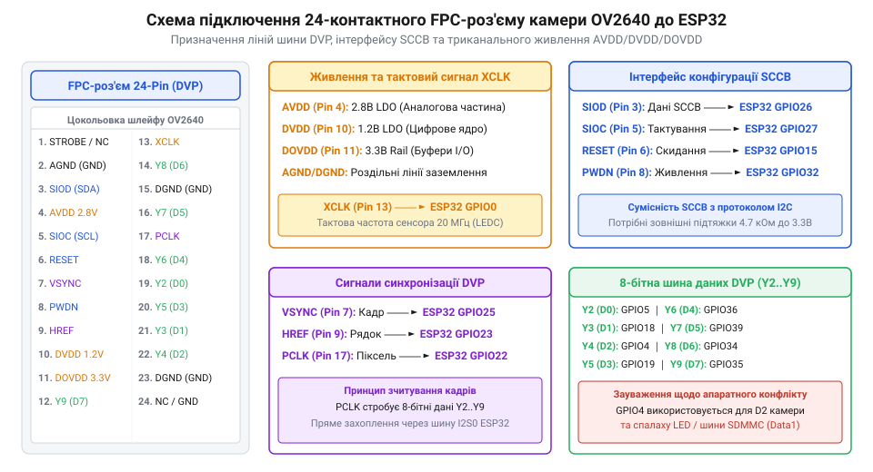
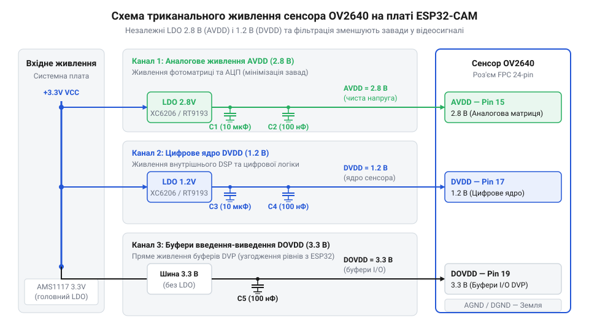

# Апаратна розпіновка FPC-роз'єму, шини DVP та триканальна схема живлення ESP32-CAM

<preknowlist>
- [ESP32-CAM (OV2640 + microSD)](root:cat-hw-boards/esp32-cam) — Базове компонування та принципи роботи відеомодуля ESP32-CAM.
- [Мікроконтролер ESP32-S3](root:cat-hw-boards/esp32s3-microcontroller) — Принципи розпіновки та конфігурування GPIO периферії ESP32.
</preknowlist>

## Розпіновка 24-контактного FPC-роз'єму й DVP

Підключення компактних фотосенсорів (зокрема OmniVision @@en|OV2640@@ або @@en|OV3640@@) до плати [ESP32-CAM (OV2640 + microSD)](root:cat-hw-boards/esp32-cam) здійснюється через 24-контактний роз'єм гнучкого друкованого кабелю (англ. *Flexible Printed Circuit*; @@en|FPC-роз'єм@@) з кроком виводів 0.5 міліметра. Цей інтерфейс об'єднує 8-бітну паралельну шину цифрового відеопорту (англ. *Digital Video Port*; @@en|DVP-інтерфейс@@), двопровідну послідовну шину конфігурування регістрів сенсора (англ. *Serial Camera Control Bus*; @@en|SCCB-шина@@), сигнальні лінії тактування та три незалежні шини електроживлення. Для забезпечення завадостійкості й чіткого мапування сигналів кожен контакт роз'єму має суворе призначення відповідно до апаратної схемотехніки плати:

| Вивід FPC | Сигнал сенсора | Вивід ESP32 | Функціональне призначення |
|---|---|---|---|
| 1 | NC | — | Не підключено (вільний контакт) |
| 2 | AGND | AGND | Аналогове заземлення сенсора |
| 3 | SIOD | GPIO26 | Двонаправлена лінія даних шини SCCB |
| 4 | AVDD | 2.8V LDO | Аналогове живлення матриці 2.8 В |
| 5 | SIOC | GPIO27 | Тактова лінія шини SCCB |
| 6 | RESET | GPIO15 | Апаратне скидання сенсора (активний 0) |
| 7 | VSYNC | GPIO25 | Сигнал кадрової синхронізації DVP |
| 8 | PWDN | GPIO32 | Керування вимкненням живлення (активна 1) |
| 9 | HREF | GPIO23 | Сигнал рядкової синхронізації DVP |
| 10 | DVDD | 1.2V LDO | Живлення цифрового ядра сенсора 1.2 В |
| 11 | DOVDD | 3.3V | Живлення цифрових буферів В/В 3.3 В |
| 12 | Y9 (D7) | GPIO4 | Старший біт 8-бітної шини даних DVP |
| 13 | XCLK | GPIO0 | Опорна тактова частота від мікроконтролера |
| 14 | Y8 (D6) | GPIO5 | 6-й біт шини даних DVP |
| 15 | GND | GND | Загальне цифрове заземлення |
| 16 | Y7 (D5) | GPIO18 | 5-й біт шини даних DVP |
| 17 | PCLK | GPIO22 | Піксельна тактова частота від сенсора |
| 18 | Y6 (D4) | GPIO19 | 4-й біт шини даних DVP |
| 19 | Y5 (D3) | GPIO36 | 3-й біт шини даних DVP (вхід SENSOR_VP) |
| 20 | Y4 (D2) | GPIO39 | 2-й біт шини даних DVP (вхід SENSOR_VN) |
| 21 | Y3 (D1) | GPIO34 | 1-й біт шини даних DVP (вхід VDET_1) |
| 22 | Y2 (D0) | GPIO35 | Молодший біт 8-бітного режиму DVP |
| 23 | Y1 | GND | Заземлений 1-й біт 10-бітного АЦП |
| 24 | Y0 | GND | Заземлений 0-й біт 10-бітного АЦП |

*Принципова розпіновка 24-контактного FPC-роз'єму та прив'язка ліній DVP і SCCB до виводів GPIO мікроконтролера ESP32.*

Розподіл 8-бітної шини даних DVP між фотосенсором та мікроконтролером ESP32 виконано на виводах `Y2`–`Y9`, які підключені відповідно до ліній `GPIO35`, `GPIO34`, `GPIO39`, `GPIO36`, `GPIO19`, `GPIO18`, `GPIO5` та `GPIO4`. Молодші біти `Y0` та `Y1` 10-бітної матриці сенсора заземлені у 8-бітному режимі зчитування. Налаштування матриці й режимів експозиції відбувається через @@en|SCCB-шина@@, де лінія тактування `SIOC` виведена на `GPIO27`, а двонаправлена лінія даних `SIOD` — на `GPIO26`. Електрична специфіка паралельної передачі по розрядній сітці `Y2`–`Y9` полягає в синхронній передачі високочастотних цифрових байти-масивів з логічними рівнями 3.3 вольта, де будь-яка часова розбіжність фронтів (англ. *clock skew*; @@en|перекіс тактування@@) через різницю довжин провідників друкованого кабелю може призвести до спотворення молодших розрядів. Апаратне заземлення виводів `Y0` та `Y1` безпосередньо на платі обумовлено тим, що при 8-бітному виведенні стисненого потоку JPEG чи форматів YUV/RGB сенсор використовує лише вісім старших розрядів внутрішнього 10-бітного АЦП. Фізичне підтягування ліній `Y0` та `Y1` до заземлювального полігону (англ. *Ground Plane*; @@en|заземлювальний полігон@@) запобігає виникненню висячих високоімпедансних станів (англ. *high impedance*; @@en|Z-стан@@) у CMOS-буферах матриці, усуває перехресні ємнісні завади й позбавляє потреби витрачати два додаткові виводи GPIO мікроконтролера.

Для апаратного керування станом фотосенсора використовуються лінії `RESET` (вивід `GPIO15`) та `PWDN` (англ. *Power Down*; @@en|лінія PWDN@@ на `GPIO32`). Подача логічної одиниці на вивід `PWDN` повністю вимикає внутрішній тактовий генератор камери та переводить її у режим глибокого енергозбереження, зменшуючи струм споживання до декількох мікроамперів.

## Тактування XCLK, PCLK та кадрова синхронізація

Передача відеопотоку через @@en|DVP-інтерфейс@@ вимагає чіткої часової узгодженості між генератором мікроконтролера та внутрішньою матрицею фотосенсора. Головним опорним сигналом є зовнішня тактова частота (англ. *External Clock*; @@en|сигнал XCLK@@), що подається з виводу `GPIO0` мікроконтролера ESP32 на 24-контактний роз'єм камери. Типова частота `XCLK` становить від 10 до 20 мегагерців і генерується внутрішнім модулем системного тактування (англ. *Pulse-Width Modulation*; @@en|LEDC-периферія@@).

На основі частоти `XCLK` сенсор генерує вихідний піксельний тактовий сигнал (англ. *Pixel Clock*; @@en|сигнал PCLK@@), який виведений на `GPIO22`. Кожен спадний або наростаючий фронт `PCLK` сигналізує мікроконтролеру про наявність стабільного байта даних на шині `Y2`–`Y9`. Контролер прямого доступу до пам'яті (англ. *Direct Memory Access*; @@en|DMA-модуль@@) ESP32 фіксує значення шини саме за фронтом `PCLK`, завантажуючи їх безпосередньо у статичне ОЗП. Частота `PCLK` розраховується через внутрішні подільники матриці відносно `XCLK`, і її допустиме відхилення від частоти зчитування DMA не повинно перевищувати ±5%. Якщо частота `PCLK` перевищує граничні 24 мегагерци або демонструє джитер (англ. *jitter*; @@en|фазовий джитер@@) через неправильне налаштування регістрів системного дільника, швидкість надходження піксельних байтів випереджає цикли вибірки DMA-контролера. Це призводить до миттєвого переповнення внутрішнього 1-кілобайтного буфера першої черги (англ. *First In, First Out*; @@en|внутрішній FIFO-буфер@@) фотосенсора. Наслідком переповнення є втрата структурних маркерів кадру JPEG (зокрема маркерів кінця каду `0xFFD9`), виникнення чорних смуг розсинхронізації та аварійне скидання поточного кадру в кодері камери.

Часова структура кадру задається двома стробовими сигналами: кадровою синхронізацією (англ. *Vertical Synchronization*; @@en|сигнал VSYNC@@ на `GPIO25`) та рядковою синхронізацією (англ. *Horizontal Reference*; @@en|сигнал HREF@@ на `GPIO23`). Високий рівень `VSYNC` позначає початок нового кадру, а пульсація `HREF` активна виключно під час передачі значущих пікселів поточного рядка матриці. Помилки тактування `XCLK` або наведення на лінії `PCLK` призводять до розсинхронізації DMA-буфера й артефактів зміщення зображення.

Взаєморозміщення сигналів у часі базується на суворій ієрархії: глобальний імпульс `@@en|сигнал VSYNC@@` визначає межі суцільного кадру, в межах якого строб `@@en|сигнал HREF@@` формує рамки кожного окремого рядка. Під час трансляції рядка `@@en|сигнал HREF@@` переходить у високий логічний рівень, і з кожним спадним фронтом тактового `@@en|сигнал PCLK@@` контролер приймає один піксельний байт із шини даних. По завершенні рядка `@@en|сигнал HREF@@` спадає в нуль на час інтервалу рядкового гасіння (англ. *horizontal blanking*; `@@en|рядкове гасіння@@`), зауважуючи апаратурі про паузу перед наступною серією пікселів. Аналогічно, після передавання останньої строчки кадру `@@en|сигнал VSYNC@@` переходить у пасивний стан на період кадрового гасіння (англ. *vertical blanking*; `@@en|кадрове гасіння@@`), що дозволяє блоку DMA перегрупувати дескриптори кадрового буфера в оперативній пам'яті до початку наступного відеоциклу.

## Триканальна схема живлення AVDD, DVDD, DOVDD

Схемотехніка живлення фотосенсора OV2640 вимагає суворого розділення трьох незалежних напруг для захисту чутливого аналогового пиксельного масиву від високочастотних цифрових завад. На платі ESP32-CAM реалізовано триканальну схему живлення, що подається на FPC-роз'єм: аналогове живлення `AVDD` (2.8 В), живлення цифрового ядра `DVDD` (1.2 В) та живлення буферів введення-виведення `DOVDD` (3.3 В).

*Схемотехнічна організація трьох ліній живлення AVDD, DVDD та DOVDD із роздільними фільтрувальними керамічними конденсаторами.*

Аналогова напруга `AVDD` рівнем 2.8 вольта формується окремим малошумлячим лінійним регулятором (англ. *Low-Dropout*; @@en|LDO-регулятор@@) та живить матрицю світлочутливих фотодіодів і аналогово-цифрові перетворювачі (англ. *Analog-to-Digital Converter*; @@en|АЦП-матрицю@@). Пульсації на лінії `AVDD` безпосередньо проявляються у вигляді кольорового шуму та смуг на зображенні, тому лінія шунтується керамічними конденсаторами ємністю 0.1 та 10 мікрофарад у безпосередній близькості до роз'єму. Для надійного пригнічення високочастотних завад від Wi-Fi передавача мікроконтролера та імпульсних джерел живлення вибір регулятора для `AVDD` вимагає високого коефіцієнта пригнічення пульсацій живлення (англ. *Power Supply Rejection Ratio*; @@en|коефіцієнт PSRR@@), який має становити не менше 60–70 децибелів на частотах від 100 кілогерців до 1 мегагерца (типово для спеціалізованих мікросхем на кшталт ME6211 або LP5907). Застосування звичайних загальнопромислових LDO з низьким PSRR призводить до того, що високочастотні пульсації проникають у підсилювачі зчитування матриці, утворюючи фліккер-шум (англ. *flicker noise*; @@en|фліккер-шум@@) та паразитну сітку на темних ділянках кадру.

Цифрове ядро сенсора живиться напругою `DVDD` 1.2 вольта від внутрішнього або винесеного LDO, відповідаючи за роботу сигнального процесора (англ. *Digital Signal Processor*; @@en|DSP-ядро@@) та апаратного кодера JPEG. Канал `DOVDD` використовує системну напругу 3.3 вольта для узгодження логічних рівнів шини DVP із виводами GPIO мікроконтролера ESP32. Недотримання послідовності подачі напруг при включенні може викликати засувку (англ. *latch-up*; @@en|ефект Latch-Up@@) внутрішніх паразитних структур сенсора.

## Конфлікти GPIO між SDMMC та камерою

Через обмежену кількість виводів у корпусі ESP32 розробники платформи застосували агресивне мультиплексування виводів між камерою, роз'ємом карток пам'яті (англ. *Secure Digital Memory Card*; @@en|SDMMC-інтерфейс@@) та бортовою периферією. Це створило низку жорстких апаратних конфліктів, які необхідно враховувати при розробці систем.

Найкритичнішим є конфлікт на виводі `GPIO4`. Ця лінія одночасно розведена на молодший біт даних камери `Y9`, лінію даних `DATA1` шини SDMMC у 4-бітному режимі та потужний бортовий світлодіод спалаху через транзисторний ключ. Під час ініціалізації SD-карти або зчитування кадру спалах короткочасно підмигує, а підключення карт пам'яті у 4-бітному режимі викликає викривлення молодшого біта відеоданих. Для усунення конфлікту шину SDMMC переводять у 1-бітний режим або застосовують винесені мікроконтролери на кшталт [сучасного мікроконтролера ESP32-S3](root:cat-hw-boards/esp32s3-microcontroller).

Другим конфліктним вузлом є вивід `GPIO0`. Він відповідає за подачу опорного тактового сигналу `XCLK` на камеру, але під час апаратного скидання ESP32 той самий `GPIO0` визначає режим завантаження кристала (англ. *Boot Mode*; @@en|режим Boot Mode@@). Якщо лінія `GPIO0` підтягнута до землі через внутрішню ємність камери в момент скидання, мікроконтролер не зможе запустити основну програму з флешпам'яті, зависаючи в режимі програмування. Додаткові апаратні колізії виникають на виводах `GPIO12` та `GPIO13` при переведенні шини SDMMC у 4-бітний режим, де вони задіюються як лінії даних `HS2_DATA2` та `HS2_DATA3`. Вивід `GPIO12` є службовим підтягувальним піном (англ. *Strapping Pin*; @@en|службовий пін Strapping Pin@@), який під час скидання визначає робочу напругу живильного LDO флешпам'яті (1.8 В або 3.3 В). Якщо зовнішній підтягувальний резистор лінії `HS2_DATA2` утримує високий рівень на `GPIO12` у момент запускного імпульсу, мікроконтролер перемикає живлення флешпам'яті на 1.8 вольта, що викликає негайне аварійне скидання ядра. Зі свого боку `GPIO13` (`HS2_DATA3`) перетинається з лінією керування камери, тому використання шини SDMMC у 1-бітному режимі є єдиним способом гарантувати стабільне завантаження без схемотехнічних блокувань.
