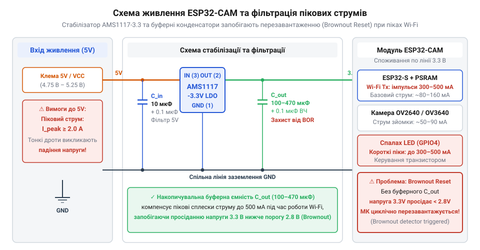
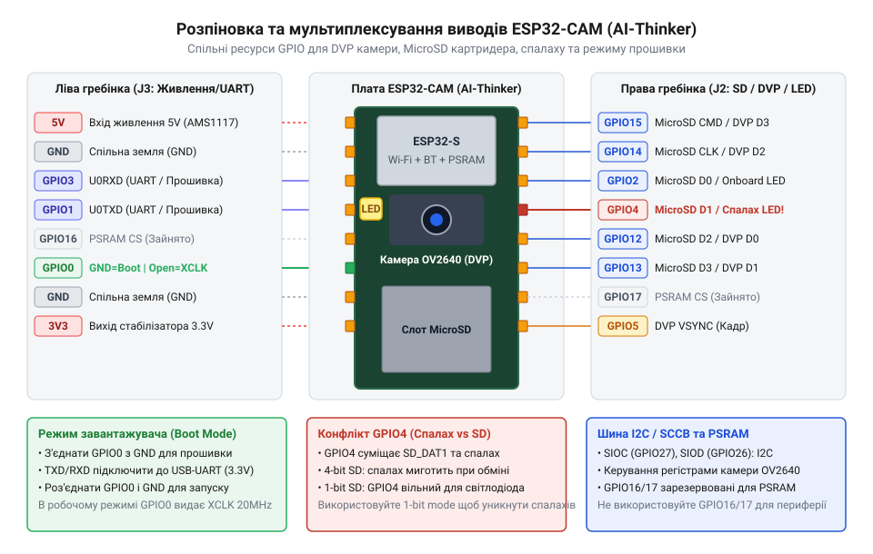

# Специфікація розпіновки, схеми живлення та залізних інтерфейсів ESP32-CAM

<preknowlist>
- [ESP32-CAM (OV2640 + microSD)](root:cat-hw-boards/esp32-cam) — конструктивні особливості та загальний огляд плати AI-Thinker ESP32-CAM
- [Мікроконтролер ESP32-S3](root:cat-hw-boards/esp32s3-microcontroller) — базові архітектурні особливості та організація периферійних шин чипів ESP32
</preknowlist>

## Апаратні виклики та критичні збої ESP32-CAM

Спроба запустити плату @@en|ESP32-CAM@@ без урахування її схемотехнічних особливостей дуже часто завершується циклічним перезавантаженням мікроконтролера в момент ініціалізації фотосенсора або під час передачі першого мережевого кадру. На відміну від повнорозмірних плат розробки, цей компактний модуль позбавлений вбудованого перетворювача інтерфейсів @@en|USB-to-UART@@ та захисних кіл живлення. Коли процесор розгортає мережевий стек @@en|Wi-Fi@@, радіопередавач створює коротке, але сильне пікове споживання струму до `500` міліампер. Якщо плата підключена через тонкі лабораторні дроти або від слабкого порту комп'ютера, внутрішній опір лінії спричиняє миттєве просідання напруги живлення.

У системі-на-кристалі @@en|ESP32@@ вбудовано апаратний детектор просідання живлення (англ. @@en|brownout detector@@, від @@en|brownout@@ — просідання напруги та @@en|detector@@ — виявник). Якщо напруга на внутрішній шині `3.3 V` падає нижче критичного порогу `2.43 V`, виявник негайно генерує апаратний сигнал скидання @@en|brownout reset@@ (від англ. @@en|reset@@ — скидання). Проблема посилюється тим, що на платі [модуля ESP32-CAM](root:cat-hw-boards/esp32-cam) встановлено потужний світлодіодний спалах. Увімкнення спалаху одночасно з роботою Wi-Fi викликає сумарний кидок струму, що виходить за межі можливостей стандартних джерел живлення та спричиняє миттєве заклинювання відеотракту. У фреймворку @@en|ESP-IDF@@ детектор просідання можна програмно конфігурувати або повністю вимкнути через налаштування конфігуратора `sdkconfig` (опція `CONFIG_ESP_BROWNOUT_DET`), що дозволяє обійти перезавантаження при короткочасних просіданнях. Проте таке програмне придушення захисту створює критичні апаратні ризики: якщо під час просідання напруги мікроконтролер виконує запис у внутрішню пам'ять @@en|Flash@@ чи енергонезалежне сховище @@en|NVS@@, падіння живильного рівня нижче допустимого мінімуму призводить до пошкодження таблиці розділів, втрати файлової системи або повного псування прошивки.

У конфігураторі `sdkconfig` розробник має можливість не лише вимкнути захист, а й гнучко налаштувати поріг його спрацьовування за допомогою опції `CONFIG_ESP_BROWNOUT_DET_LVL_SEL` від рівнів `LVL0` (~2.43 В) до `LVL7` (~3.10 В). Зниження порогу спрацьовування запобігає хибним перезавантаженням при імпульсному струмі радіомодуля, однак залишає вузьке вікно напруг, у якому процесор продовжує виконувати тактові інструкції при дефіциті живлення. Якщо в цей момент прошивка здійснює сесію запису у внутрішню пам'ять @@en|NOR Flash@@ або оновлює блоки енергонезалежного сховища @@en|NVS@@ (англ. @@en|NVS@@, від *Non-Volatile Storage* — енергонезалежне сховище), зниження потенціалу шини нижче допустимого порогу програмування чипа призводить до незавершених бітових транзакцій. Це неминуче руйнує структури даних файлових систем, викликає пошкодження таблиці розділів та робить подальше завантаження мікроконтролера неможливим без повторного повного прошивання через послідовний порт.

## Схема живлення та стабілізація напруги

Для забезпечення стабільної роботи модуля на друкованій платі розводять лінійний стабілізатор напруги з низьким падінням (англ. @@en|low dropout@@, скорочено @@en|LDO@@) серії @@en|AMS1117-3.3@@. Цей стабілізатор перетворює вхідну напругу з виводу `5V` у фіксовані `3.3 V` для живлення мікроконтролера, зовнішньої псевдостатичної оперативної пам'яті @@en|PSRAM@@ та сенсора зображення. Падіння напруги на самому стабілізаторі @@en|AMS1117@@ становить від `1.1 V` до `1.3 V`, тому для надійної вихідної напруги `3.3 V` на вхід `5V` необхідно подавати не менше `4.5 V`–`5.0 V`.

*Принципова схема кола живлення плати ESP32-CAM на базі лінійного стабілізатора AMS1117-3.3 із керамічними та електролітичними конденсаторами.*

Спроба заживлювати модуль напряму через вивід `3V3` оминає стабілізатор, однак вимагає зовнішнього джерела з високою точністю та низьким імпедансом. Будь-яка затримка реакції зовнішнього джерела під час радіовипромінювання призводить до негайного спрацьовування @@en|brownout reset@@. Щоб компенсувати пікові кидки струму, паралельно шині живлення обов'язково встановлюють накопичувальний електролітичний або танталовий конденсатор ємністю від `100` до `470` мікрофарад, а також керамічний конденсатор на `100` нанофарад для придушення високочастотних завад. Критичним параметром накопичувального конденсатора є його еквівалентний послідовний опір (англ. @@en|equivalent series resistance@@, скорочено @@en|ESR@@): звичайні електролітичні конденсатори з високим @@en|ESR@@ не встигають віддавати заряд під час мікросекундних піків споживання @@en|Wi-Fi@@, тому перевагу надають танталовим або низькоімпедансним (англ. @@en|low ESR@@) компонентам. Окрім того, керамічні розв'язувальні конденсатори мають бути розташовані фізично якомога ближче до виводів живлення мікроконтролера та сенсора, оскільки паразитна індуктивність навіть кількох міліметрів друкованих доріжок блокує високочастотну фільтрацію та спричиняє імпульсні наводки.

## Розпіновка та мультиплексування виводів GPIO

Плата @@en|ESP32-CAM@@ має всього `16` фізичних виводів на двох бічних роз'ємах, однак всередині неї комутується масштабна система периферійних пристроїв. Для підключення сенсора зображення @@en|OV2640@@ використовується паралельний цифровий відеопорт (англ. @@en|digital video port@@, скорочено @@en|DVP@@), який займає більшість вільних ліній загального призначення @@en|GPIO@@ (від англ. @@en|general-purpose input/output@@ — вводи-виводи загального призначення).

*Карта розпіновки та функціонального мультиплексування виводів плати AI-Thinker ESP32-CAM між шинами DVP, MicroSD, I2C та лініями GPIO.*

Паралельна шина даних `D0`–`D7` підключена до ліній `GPIO5`, `18`, `19`, `21`, `36`, `39`, `34` та `35`. Важливо враховувати, що виводи `GPIO36`, `39`, `34` і `35` у мікроконтролерах [родини ESP32](root:cat-hw-boards/esp32s3-microcontroller) працюють лише на вхід (англ. @@en|input-only@@) і не мають внутрішніх підтягувальних резисторів. Синхронізація кадру @@en|VSYNC@@ прив'язана до `GPIO25`, строб рядків @@en|HREF@@ — до `GPIO23`, а тактовий сигнал пікселів @@en|PCLK@@ — до `GPIO22`. Головна тактова частота сенсора @@en|XCLK@@ генератором @@en|LEDC@@ подається через `GPIO0`. Для конфігурації регістрів камери використовується двохпровідна шина керування @@en|SCCB@@ (від англ. @@en|serial camera control bus@@ — шина керування послідовною камерою), лінії якої `SIOC` (тактування) та `SIOD` (дані) підключені відповідно до `GPIO27` та `GPIO26`. Окремим схемотехнічним ризиком є суміщення ліній камери зі конфігураційними виводами запуску (англ. @@en|strapping pins@@, від @@en|strap@@ — підтягувати рівень): тактовій лінії `GPIO0` та лінії `GPIO12`. Під час включення або апаратного скидання рівень на `GPIO0` визначає режим завантаження, а `GPIO12` задає робочу напругу внутрішнього стабілізатора @@en|Flash@@-пам'яті; тому зовнішні підтяжки або плаваючі потенціали на шині @@en|DVP@@ можуть випадково заблокувати запуск МК або перевести його у режим прошивання.

## Конфлікт шини MicroSD та потужного спалаху

Підключення накопичувача @@en|MicroSD@@ здійснюється через апаратний контролер @@en|SDMMC@@ (від англ. @@en|secure digital multi-media card@@ — розширювана карта пам'яті). У 4-бітовому режимі шина займає шість ліній: `GPIO2` (лінія даних `DATA0`), `GPIO4` (`DATA1`), `GPIO12` (`DATA2`), `GPIO13` (`DATA3`), `GPIO14` (тактування `CLK`) та `GPIO15` (команди `CMD`).

Головна схемотехнічна пастка плати @@en|AI-Thinker@@ полягає у тому, що вивід `GPIO4` одночасно керує силовим транзисторним ключем білого світлодіода спалаху та лінією даних `DATA1` карти пам'яті. Коли програма виконує запис файлу на карту у 4-бітовому режимі @@en|SDMMC@@, високочастотні імпульси даних на `GPIO4` викликають яскраве тріпотіння та блимання спалаху. Для усунення цього конфлікту контролер переводять у 1-бітовий режим @@en|SDMMC@@, при якому використовуються лише `GPIO2`, `GPIO14` та `GPIO15`. Це звільняє `GPIO4`, `GPIO12` та `GPIO13` під інші задачі та дозволяє вимкнути спалах, програмно утримуючи `GPIO4` у низькому логічному рівні. Однак платою за вивільнення виводів є чотирикратне падіння теоретичної пропускної здатності шини обміну з накопичувачем @@en|MicroSD@@ (з 4 бітів до 1 біта за такт). На практиці швидкість збереження зменшується з ~4 МБ/с до ~1 МБ/с, що збільшує час запису одного кадру високої роздільності @@en|UXGA@@ формату @@en|JPEG@@ з 40 мс до 160 мс і відповідно знижує граничну частоту серійної фотофіксації (англ. @@en|FPS@@, від *Frames Per Second* — кадрів за секунду).

## Програмування, режим завантажувача та комутація

Відсутність вбудованого моста @@en|USB-to-UART@@ вимагає підключення зовнішнього програматора. Для обміну даними використовується перший послідовний порт @@en|UART0@@: вивід `U0T` (`GPIO1`) підключається до лінії `RXD` програматора, а `U0R` (`GPIO3`) — до лінії `TXD`. Зіставляння ліній здійснюється навхрест, а земля `GND` обох пристроїв має бути суворо об'єднана.

Вибір режиму роботи мікроконтролера здійснюється під час подачі живлення або апаратного скидання через конфігураційний вивід `GPIO0`. Якщо під час підняття напруги лінія `GPIO0` підключена до землі `GND`, кристал переходить у режим завантажувача (англ. @@en|download mode@@ — режим завантаження прошивки). Якщо ж `GPIO0` залишається вільною або підтягнутою до `3.3 V`, мікроконтролер розпочинає виконання коду з пам'яті @@en|Flash@@. У [розширеному сімействі плат ESP32](root:cat-hw-boards/esp32-s3-boards-family-overview) спеціалізовані плати розширення використовують лінії `DTR` (англ. @@en|Data Terminal Ready@@, скорочено @@en|DTR@@ — готовність термінала) та `RTS` (англ. @@en|Request To Send@@, скорочено @@en|RTS@@ — запит на передачу) послідовного порту для автоматичного перемикання `GPIO0` та лінії скидання `EN/RESET`, що усуває потребу в ручному встановленні перемичок. В основі цієї схемотехніки автозавантаження (англ. @@en|auto-reset circuit@@) лежить зустрічно-перехресне каскадне включення двох біполярних @@en|NPN@@-транзисторів. Коли утиліта прошивання встановлює сигнал `RTS` у низький логічний рівень, а `DTR` — у високий, перший транзистор відкривається і замикає вивід `EN/RESET` на землю, викликаючи перезавантаження МК. При зворотному комбінуванні сигналів (`DTR` в низькому рівні, `RTS` у високому) відкривається другий транзистор, притягуючи `GPIO0` до землі без скидання живлення, що гарантує надійний вхід у режим завантажувача перед підняттям лінії `EN/RESET`. Одночасне ж встановлення однакових рівнів на `DTR` та `RTS` блокує обидва транзистори, запобігаючи хибним спрацьовуванням під час звичайного обміну даними по @@en|UART@@.
