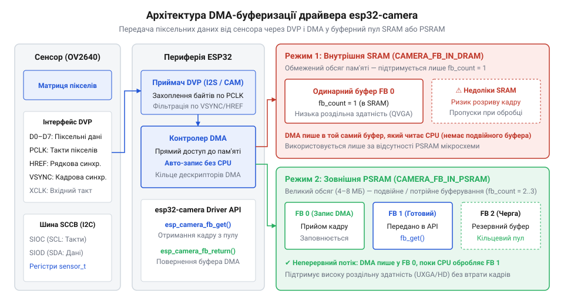
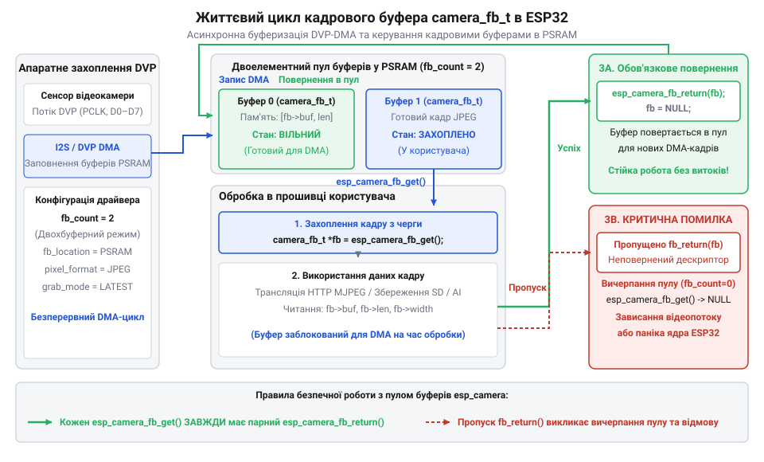

# Програмний інтерфейс драйвера камери esp32-camera

<preknowlist>
- [ESP32-CAM (OV2640 + microSD)](root:cat-hw-boards/esp32-cam) — Схемотехніка плат серії ESP32-CAM, призначення GPIO-виводів паралельної шини DVP та особливості живлення камери.
</preknowlist>

## Необхідність апаратного драйвера камери ESP32

Обробка відеопотоку від оптичної матриці камери на мікроконтролері потребує захоплення мільйонів пікселів на секунду через паралельний інтерфейс @@en|Digital Video Port@@ (англ. *digital video port*, від *digital* — цифровий, *video* — відео, *port* — порт, скорочено @@en|DVP@@). Оптична матриця генерує піксельні дані з високою тактовою частотою @@en|Pixel Clock@@ (англ. *pixel clock*, від *pixel* — елемент зображення, *clock* — тактовий сигнал, скорочено @@en|PCLK@@), яка зазвичай становить від 10 до 24 МГц. За цієї частоти кожен байт зображення з'являється на 8-бітній паралельній шині даних за лічені наносекунди, супроводжуючись сигналами стробування рядка @@en|HREF@@ та кадру @@en|VSYNC@@. Якщо спробувати зчитувати ці виводи програмно в циклі за опитуванням станів GPIO, процесор мікроконтролера виявиться повністю заблокованим обробкою входів. Будь-яке переривання — від обробки Wi-Fi-стеку чи операційної системи реального часу — призводить до пропуску хоча б одного такту @@en|PCLK@@, що негайно руйнує вирівнювання кадрів та призводить до спотворення зображення. Детальний опис апаратного розведення ліній синхронізації та даних викладено у матеріалі про [паралельний інтерфейс камери DVP в ESP32](root:com-devices/dvp-parallel-video-interface).

Вихід із цієї проблеми полягає у винесенні завдання зчитування даних на апаратний рівень периферійного контролера @@en|Direct Memory Access@@ (англ. *direct memory access*, від *direct* — прямий, *memory* — пам'ять, *access* — доступ, скорочено @@en|DMA@@). В архітектурі ESP32 апаратний модуль I2S або розширений периферійний контролер LCD перехоплює сигнали шини @@en|DVP@@ і вивантажує піксельні байти безпосередньо в оперативну пам'ять без участі процесорних ядер. Проте сама по собі апаратна передача DMA не розв'язує завдань керування матрицею: потрібно ініціалізувати оптичний датчик, налаштувати шину керування @@en|Serial Camera Control Bus@@ (англ. *serial camera control bus*, від *serial* — послідовний, *camera* — камера, *control* — керування, *bus* — шина, скорочено @@en|SCCB@@), узгодити розбиття кадрового масиву на окремі DMA-дескриптори та організувати проміжне буферизаційне кільце.

Саме для вирішення цього комплексу завдань створено спеціалізований компонент @@en|esp32-camera@@. Драйвер об'єднує низькорівневу конфігурацію периферійних модулів мікроконтролера, апаратне управління DMA-буферами та високорівневу абстракцію над реєстрами сенсора. Для плати [ESP32-CAM (OV2640 + microSD)](root:cat-hw-boards/esp32-cam) використання драйвера @@en|esp32-camera@@ є єдиним способом забезпечити фонове захоплення кадрів із збереженням обчислювальних ресурсів CPU для виконання завдань бездротової мережі та обробки даних.

## Налаштування конфігурації через camera_config_t

Прив'язка фізичних виводів мікроконтролера до кадрового тракту камери та налаштування режимів її роботи виконується через структуру конфігурації `camera_config_t`. Ця структура є вхідним параметром для ініціалізації драйвера і задає три ключові групи налаштувань: фізичне підключення шини @@en|DVP@@, тактування й шину @@en|SCCB@@, а також параметри відеобуфера.

У групі фізичних виводів структура задає номери GPIO для 8-бітної шини даних (`pin_d0` ... `pin_d7`), сигналів керування тактуванням (`pin_xclk`, `pin_pclk`), кадрової та рядкової синхронізації (`pin_vsync`, `pin_href`), а також лінії системного скидання (`pin_reset`) та вимкнення живлення (`pin_pwdn`). Окремо налаштовуються виводи `pin_sccb_sda` та `pin_sccb_scl`, які формують інтерфейс @@en|SCCB@@ — аналог I2C для програмного запису й читання регістрів матриці.

Тактування камери задається полем `xclk_freq_hz`. Мікроконтролер генерує базовий тактовий сигнал @@en|XCLK@@ за допомогою внутрішнього таймера LEDC. Типова частота @@en|XCLK@@ становить 20000000 Гц (20 МГц) або 10000000 Гц (10 МГц). Зниження частоти @@en|XCLK@@ зменшує швидкість передачі даних шиною @@en|DVP@@, що спрощує роботу DMA за наявності довгих провідників чи нестабільного живлення.

Вибір роздільної здатності зображення визначається переліком `framesize_t` (від надкомпактного `FRAMESIZE_QQVGA` 160×120 пікселів до високого `FRAMESIZE_UXGA` 1600×1200 пікселів). Формат вихідних даних задається полем `pixformat_t`. Драйвер підтримує нестиснуті формати `PIXFORMAT_RGB565`, `PIXFORMAT_YUV422`, `PIXFORMAT_GRAYSCALE` та стиснутий формат `PIXFORMAT_JPEG`.

Для розуміння навантаження на оперативну пам'ять розрахуємо обсяг пам'яті M, необхідний для утримання одного нестиснутого кадру роздільної здатності SVGA (800×600 пікселів) у форматі `PIXFORMAT_RGB565`. Позначимо ширину кадру як W, висоту як H, а кількість байтів на один піксель як B. Оскільки формат `PIXFORMAT_RGB565` кодує кожен піксель двома байтами (B = 2), обчислення здійснюється за формулою:

```
M = W × H × B
= 800 × 600 × 2          [множення ширини, висоти та байтизації на піксель]
= 960000                 [підсумковий розмір буфера кадру в байтах]
```

Результат становить 960 000 байтів (близько 937.5 КБ). Внутрішня статична пам'ять @@en|SRAM@@ (англ. *static RAM*, від *static* — статичний, *random access memory* — оперативна пам'ять) мікроконтролера ESP32 має загальний обсяг доступної оперативної пам'яті близько 300 КБ, тому розмістити такий буфер у внутрішній пам'яті фізично неможливо. Для обробки високих роздільних здатностей чи нестиснутого відео необхідна зовнішня псевдостатична пам'ять @@en|PSRAM@@ (англ. *pseudo static RAM*, від *pseudo* — несправжній, *static* — статичний, скорочено @@en|PSRAM@@), яку мають такі рішення, як плата [Waveshare ESP32-S3R2 (16 МБ Flash, 2 МБ PSRAM)](root:cat-hw-boards/esp32-s3r2-waveshare). При використанні стиснутого формату `PIXFORMAT_JPEG` коефіцієнт стиснення досягає 1:10–1:20, завдяки чому кадровий буфер зменшується до 50–100 КБ і може розміщуватись у внутрішній пам'яті @@en|SRAM@@.

Розподіл буферів @@en|DMA@@ задається параметрами `fb_count` (кількість буферів у пулі, зазвичай 1 або 2) та `fb_location` (`CAMERA_FB_IN_DRAM` або `CAMERA_FB_IN_PSRAM`). Поле `jpeg_quality` встановлює рівень стиснення JPEG у діапазоні від 1 до 63 (менші значення відповідають вищій якості та більшому розміру файлу).


*Архітектура DMA-буферизації демонструє шлях піксельних даних від паралельної шини DVP через контролер DMA до внутрішньої оперативної пам'яті SRAM чи зовнішньої PSRAM.*

Нижче наведено приклад опису структури `camera_config_t` для модуля [ESP32-CAM (OV2640 + microSD)](root:cat-hw-boards/esp32-cam):

:::tabs
:::code api-esp32-camera-driver-api/c/esp-idf/snippet-1.c
:::code api-esp32-camera-driver-api/cpp/arduino/setup-camera-config.cpp
:::

## Життєвий цикл відеобуфера камери

Управління пам'яттю під час захоплення відеопотоку побудовано на чіткому життєвому циклі кадрового буфера `camera_fb_t`. Цей цикл охоплює чотири ключові етапи: ініціалізація драйвера, запит покажчика на кадр, обробка даних та обов'язкове повернення буфера назад у кільцевий пул драйвера.

Робота починається з виклику `esp_camera_init(&config)`. Функція виділяє необхідну кількість кадрових буферів `fb_count` в пам'яті @@en|SRAM@@ або @@en|PSRAM@@, створює дескриптори @@en|DMA@@ та налаштовує переривання завершення кадру. Після успішної ініціалізації фоновий процесор @@en|DMA@@ починає безперервно заповнювати вільні буфери даних з камери.

Для отримання готового кадру прикладна програма викликає функцію `esp_camera_fb_get()`. Вона повертає покажчик на структуру `camera_fb_t`, яка містить наступні важливі поля:
- `buf`: покажчик на масив байтів піксельного зображення у пам'яті;
- `len`: загальний розмір отриманого кадру в байтах;
- `width` та `height`: роздільна здатність зображення в пікселях;
- `format`: кодований тип формату пікселів (`pixformat_t`);
- `timestamp`: часова мітка захоплення кадру.

Критично важливою умовою надійності системи є виклик парної функції `esp_camera_fb_return(fb)` одразу після завершення обробки або відправки кадру. Контролер @@en|DMA@@ використовує кільцевий пул обмеженого розміру. Якщо програма отримує покажчик через `esp_camera_fb_get()`, але забуває викликати `esp_camera_fb_return()`, драйвер втрачає цей буфер зі свого розпорядження. Коли всі буфери з пулу `fb_count` виявляються заблокованими, наступні виклики `esp_camera_fb_get()` починають повертати покажчик `NULL` або блокувати виконання таска, що призводить до витоку пам'яті та аварійної зупинки захоплення.


*Життєвий цикл кадрового буфера визначає послідовність отримання покажчика на дані та обов'язкового його повернення драйверу для повторного використання у кільцевому пулі DMA.*

Завершення роботи з камерою та вивільнення всіх виділених ресурсів @@en|DMA@@ і пам'яті здійснюється викликом `esp_camera_deinit()`.

Нижче наведено приклад коректної реалізації циклу захоплення кадру у середовищах ESP-IDF та Arduino IDE:

:::tabs
:::code api-esp32-camera-driver-api/c/esp-idf/capture-and-process-frame.c
:::code api-esp32-camera-driver-api/cpp/arduino/capture-and-process-frame-arduino.cpp
:::

## Оперативне налаштування сенсора через sensor_t

Статична конфігурація `camera_config_t` задає початкові параметри кадрового тракту, але під час роботи пристрою виникає потреба динамічно підлаштовувати освітленість, колірну гаму чи орієнтацію зображення. Драйвер @@en|esp32-camera@@ надає прямий доступ до карти викликів керування сенсором через структуру `sensor_t`.

Для отримання покажчика на об'єкт керування оптичною матрицею використовується функція `esp_camera_sensor_get()`. Вона повертає покажчик `sensor_t*`, який містить набір функціональних покажчиків на методи безпосереднього модифікування внутрішніх регістрів матриці (наприклад, OV2640 чи OV3640 на модулях [ESP32-CAM з камерою OV3640 (2 МП)](root:cat-hw-boards/esp32-cam-ov3640)).

Через структуру `sensor_t` можна виконувати такі ключові оперативні коригування:
- Зміна яскравості та контрасту: `s->set_brightness(s, level)` та `s->set_contrast(s, level)` у діапазоні від -2 до 2;
- Керування підсиленням @@en|Gain@@ (англ. *gain* — підсилення): `s->set_gain_ctrl(s, enable)` та `s->set_agc_gain(s, gain)`;
- Керування експозицією: `s->set_exposure_ctrl(s, enable)` для автоекспозиції або `s->set_aec_value(s, value)` для ручного вибору витримки;
- Баланс білого: `s->set_whitebal(s, enable)` та вибір профілю освітлення `s->set_wb_mode(s, mode)` (приміщення, сонце, хмарність);
- Програмний переворот зображення: `s->set_vflip(s, enable)` для вертикального віддзеркалення та `s->set_hmirror(s, enable)` для горизонтального відображення.

Перевага використання `sensor_t` полягає у відсутності потреби перезапускати кадровий тракт чи перевиділяти пам'ять @@en|DMA@@. Драйвер генерує команди шини @@en|SCCB@@, які змінюють фізичні параметри фотодіодної матриці в паузі між кадрами, не порушуючи передачу поточної структури `camera_fb_t`. Сучасний [мікроконтролер ESP32-S3](root:cat-hw-boards/esp32s3-microcontroller) дозволяє виконувати ці виклики паралельно з обробкою відеопотоку у фонових завданнях FreeRTOS. Особливості часових діаграм та регістрового обміну при керуванні сенсором розкриває [протокол шини SCCB для керування сенсорами](root:com-devices/sccb-bus-protocol-camera-control).

Приклад оперативного коригування параметрів сенсора у середовищах ESP-IDF та Arduino IDE:

:::tabs
:::code api-esp32-camera-driver-api/c/esp-idf/adjust-sensor-settings.c
:::code api-esp32-camera-driver-api/cpp/arduino/adjust-sensor-settings-arduino.cpp
:::

## Граничні режими та обробка помилок

Складність апаратного тракту захоплення відео на ESP32 створює ризики виникнення граничних режимів та системних збоїв. Найпоширенішими причинами відмови драйвера @@en|esp32-camera@@ є вичерпання пам'яті, збої шини @@en|SCCB@@ та таймаути прийому даних @@en|DMA@@.

При виклику `esp_camera_init()` драйвер повертає код помилки типу `esp_err_t`. Тлумачення основних кодів повернення:
- `ESP_ERR_NO_MEM`: виникає при спробі виділити кадрові буфери великого розміру в @@en|SRAM@@ за відсутності зовнішньої @@en|PSRAM@@. Для усунення слід зменшити `framesize_t`, перейти на стиснутий формат `PIXFORMAT_JPEG` або знизити `fb_count`.
- `ESP_ERR_NOT_FOUND` або `ESP_ERR_CAMERA_NOT_DETECTED`: свідчить про відсутність відповіді від сенсора шиною @@en|SCCB@@. Причинами можуть бути неправильно призначені виводи `pin_sccb_sda`/`pin_sccb_scl`, відсутність тактування @@en|XCLK@@, проблеми живлення камери або поганий контакт шлейфа.
- `ESP_ERR_TIMEOUT`: виникає під час роботи `esp_camera_fb_get()`, коли контролер @@en|DMA@@ не отримує кадровий імпульс @@en|VSYNC@@ або необхідну кількість тактових імпульсів @@en|PCLK@@ протягом заданого інтервалу. Це вказує на апаратні наводки на шині @@en|DVP@@ або збій синхронізації оптичної матриці.

Алгоритм відновлення при стійких збоях полягає у виконанні перезапуску камери. Якщо `esp_camera_fb_get()` тричі поспіль повертає `NULL`, програма повинна виконати `esp_camera_deinit()`, подати високий рівень на вивід `pin_pwdn` для апаратного скидання живлення матриці, почекати 100 мс, повернути `pin_pwdn` у низький стан і повторно викликати `esp_camera_init()`.

Крім того, необхідно враховувати обмеження пропускної здатності шини. При частоті @@en|PCLK@@ 20 МГц максимальна фізична швидкість становить 20 МБ/с. Передача нестиснутого зображення UXGA (1600×1200) у форматі `PIXFORMAT_RGB565` потребує 3.84 МБ на кадр, що дає теоретичну межу лише 5 кадрів на секунду та створює пікове навантаження на шину @@en|PSRAM@@. Перехід на формат `PIXFORMAT_JPEG` зменшує обсяг переданих даних до ~150 КБ на кадр, що дозволяє досягти частоти 15–20 кадрів на секунду навіть при високій роздільній здатності. Новий [мікроконтролер ESP32-P4](root:cat-hw-boards/esp32-p4-microcontroller) додатково розширює ці межі завдяки апаратному інтерфейсу MIPI-CSI, однак для серії ESP32 та ESP32-S3 оптимальне балансування між якістю та швидкістю залишається критичним завданням конфігурації.

Приклад обробки граничних станів та реініціалізації камери у середовищах ESP-IDF та Arduino IDE:

:::tabs
:::code api-esp32-camera-driver-api/c/esp-idf/safe-camera-init.c
:::code api-esp32-camera-driver-api/cpp/arduino/safe-camera-init-arduino.cpp
:::
