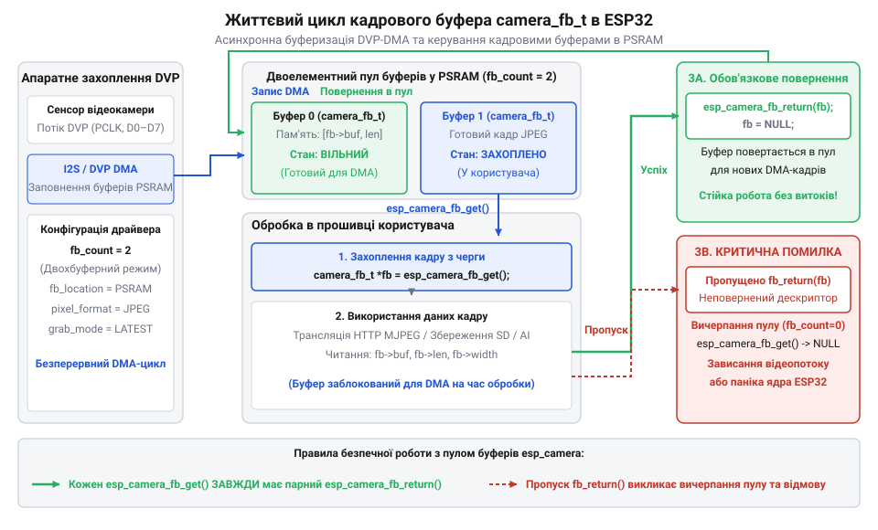

# Програмний інтерфейс драйвера esp32-camera: конфігурація, керування та коди помилок

<preknowlist>
- [ESP32-CAM (OV2640 + microSD)](root:cat-hw-boards/esp32-cam) — схемотехніка та топологія виводів DVP на платі AI-Thinker
- [Мікроконтролер ESP32-S3](root:cat-hw-boards/esp32s3-microcontroller) — апаратний периферійний модуль LCD_CAM та арбітраж PSRAM
</preknowlist>

## Проблема узгодження відеопотоку та DVP

Підключення оптичних CMOS-сенсорів зображення до мікроконтролера вимагає обробки безперервного потоку високочастотних даних через паралельну шину @@en|DVP@@ (від англ. *@@en|Digital Video Port@@* — цифровий відеопорт). Передача відеопотоку високої роздільної здатності (наприклад, кадру SVGA 800×600 пікселів у форматі RGB565) з глибиною 2 байти на піксель формує кадровий буфер обсягом `800 × 600 × 2 = 960000` байт (близько 937.5 КБ). За тактування шини сигналом пікселів @@en|PCLK@@ (від англ. *@@en|Pixel Clock@@* — тактовий сигнал пікселів) на частоті 20 МГц кожен такт передає один байт даних, що створює пікову пропускну здатність шини `20 × 10⁶` байт/с (20 МБ/с або 160 Мбіт/с). Для передачі одного кадру SVGA RGB565 шині потрібно `960000 ÷ 20000000 = 0.048` секунди, що забезпечує граничну швидкість до 20.8 @@en|FPS@@ (від англ. *@@en|Frames Per Second@@* — кадрів на секунду) без урахування службових інтервалів синхронізації @@en|VSYNC@@ (від англ. *@@en|Vertical Synchronization@@* — вертикальна синхронізація) та @@en|HREF@@ (від англ. *@@en|Horizontal Reference@@* — горизонтальна синхронізація). Під час спаду сигналу @@en|VSYNC@@ контролер генерує високопріоритетне апаратне переривання, яке скидає лічильники пікселів і перемикає дескриптор контролера @@en|DMA@@ (від англ. *@@en|Direct Memory Access@@* — прямий доступ до пам'яті) на наступний кадровий буфер. Проте прямому пересиланню даних заважає апаратний арбітраж шини зовнішньої пам'яті @@en|PSRAM@@: оскільки вона ділить загальний канал між опитуванням кешу ядер та транзакціями DMA, затримки доступу під час пропуску кешу викликають переповнення внутрішньої черги @@en|FIFO@@ (від англ. *@@en|First In, First Out@@* — першим зайшов, першим вийшов). Оскільки обсяг доступної внутрішньої оперативної пам'яті плати [мікроконтролера ESP32-S3](root:cat-hw-boards/esp32s3-microcontroller) становить лише 300–500 КБ, збереження навіть одного нестисненого кадру у внутрішній купі є фізично неможливим, що робить стабільність шинного арбітражу критичною для збереження цілісності відеопотоку.

Пряма обробка сигналів DVP програмним опитуванням пинів призводить до пропущення тактів `PCLK`, пошкодження байтів та втрати кадрової синхронізації через переривання операційної системи. Крім цього, часові затримки на провідниках шлейфа та нестабільність генератора master-такту `XCLK` викликають фазовий зсув сигналів. Для розв'язання цієї проблеми розроблено нативний системний драйвер `esp32-camera`. Він абстрагує низькорівневу периферію, задіює апаратний шинний контролер @@en|LCD_CAM@@ та проміжні DMA-буфери у зовнішній пам'яті @@en|PSRAM@@, гарантуючи стабільний захват відеопотоку без навантаження процесорних ядер.

Архітектурно драйвер `esp32-camera` працює як високорівнева проміжна обгортка над низькорівневими периферійними модулями фреймворку @@en|ESP-IDF@@. Він розділяє керування на два незалежні канали: послідовну шину @@en|SCCB@@ (від англ. *@@en|Serial Camera Control Bus@@* — послідовна шина керування камерою, сумісна з @@en|I2C@@) для зчитування й запису регістрів сенсора та апаратний периферійний блок (@@en|LCD_CAM@@ або @@en|I2S@@) для прийому паралельного кадрового потоку. Під час зйомки обробник переривань кадрової синхронізації автоматично перемикає кольорові кадри між DMA-буферами (від англ. *@@en|Direct Memory Access@@* — прямий доступ до пам'яті) в @@en|PSRAM@@ за принципом подвійної буферизації. Сформований кадр упаковується у дескриптор `camera_fb_t` та передається у кільцеву чергу задач операційної системи @@en|FreeRTOS@@ (від англ. *@@en|Free Real-Time Operating System@@* — вільна операційна система реального часу). Завдяки цьому прикладний код отримує готовий вказівник на область пам'яті кадру без затримки обчислювальних ядер на очікування чергового пікселя або копіювання масивів.

## Структура конфігурації camera_config_t

Для ініціалізації апаратного конвеєра драйвер `esp32-camera` використовує структуру конфігурації `camera_config_t`. Вона задає точну карту підключення виводів DVP, параметри тактування та режим виділення буферів пам'яті. Усі сигнальні лінії прив'язуються до фізичних GPIO модуля [ESP32-CAM (OV2640 + microSD)](root:cat-hw-boards/esp32-cam).

Головними параметрами тактування є `xclk_freq_hz` (зазвичай 10000000 або 20000000 Гц) та призначення таймера @@en|PWM@@ (від англ. *@@en|Pulse-Width Modulation@@* — широтно-імпульсна модуляція) через поля `ledc_timer` й `ledc_channel`. Поле `pixel_format` визначає вихідний формат даних: `PIXFORMAT_JPEG` для стиснених зображень, `PIXFORMAT_YUV422` для обробки відео або `PIXFORMAT_RGB565` для алгоритмів комп'ютерного зору. При виборі `PIXFORMAT_JPEG` ключовим параметром є `jpeg_quality` (шкала від 0 до 63, де менше число означає вищу якість). Значення `jpeg_quality` в межах `10..12` забезпечує високу чіткість із помірним розміром кадру (близько 30–80 КБ для VGA), тоді як зменшення параметра до `4..6` збільшує обсяг кадру до 150–250 КБ, пропорційно підвищуючи вимоги до розміру буферів. Збільшення ж числа до `30..43` стискає кадр до 10–15 КБ ціною появи артефактів квантування. Поле `frame_size` встановлює роздільну здатність кадру від `FRAMESIZE_QVGA` (320×240) до `FRAMESIZE_UXGA` (1600×1200). Режим виділення пам'яті регулюється полями `fb_count` (кількість кадрових буферів у кільцевій черзі, зазвичай 1 або 2) та `fb_location` (`CAMERA_FB_IN_PSRAM` для зберігання у зовнішній @@en|PSRAM@@ або `CAMERA_FB_IN_DRAM` для внутрішньої @@en|DRAM@@).

:::tabs
:::code api-esp32-camera-driver-config-and-controls/c/esp-idf/snippet-1.c
:::code api-esp32-camera-driver-config-and-controls/cpp/arduino/setupcameraconfig.cpp
:::

## Захоплення та звільнення кадрових дескрипторів

Життєвий цикл роботи з відеопотоком починається з виклику `esp_camera_init(&config)`. Після успішної конфігурації периферійний модуль DMA починає фоново наповнювати кільцеві буфери у пам'яті PSRAM. Для отримання готового кадру застосунок викликає функцію `esp_camera_fb_get()`. Вона повертає вказівник на структуру дескриптора `camera_fb_t`, яка містить вказівник на масив пікселів `buf`, довжину в байтах `len`, ширину `width`, висоту `height`, формат `format` та часову позначку `timestamp`.


*Схема життєвого циклу кадрового буфера camera_fb_t від захоплення через DMA до повернення в кільцеву чергу.*

Після завершення обробки кадру (передачі по мережі @@en|HTTP@@/@@en|MQTT@@ або збереження на карту пам'яті) розробник зобов'язаний повернути дескриптор назад у драйвер викликом `esp_camera_fb_return(fb)`. Пропущення цього виклику є критичною помилкою: дескриптор залишається заблокованим, конвеєр @@en|DMA@@ (від англ. *@@en|Direct Memory Access@@* — прямий доступ до пам'яті) вичерпує вільні буфери у кільцевій черзі, і подальші виклики `esp_camera_fb_get()` повертають `NULL` або блокують програму. Динаміка наповнення кільцевого буфера залежить від параметра `grab_mode`. У режимі `CAMERA_GRAB_WHEN_EMPTY` драйвер очікує повного звільнення буфера перед захопленням наступного кадру, що може призводити до зчитування застарілих кадрів при повільній обробці. У режимі `CAMERA_GRAB_LATEST` драйвер постійно оновлює буфери в черзі найсвіжішими даними з камери, скидаючи пропущені кадри, що гарантує отримання найактуальнішого зображення на момент виклику `esp_camera_fb_get()`.

:::tabs
:::code api-esp32-camera-driver-config-and-controls/c/esp-idf/capture-and-process-frame.c
```cpp|arduino
#include "esp_camera.h"

void captureFrameArduino() {
    camera_fb_t *fb = esp_camera_fb_get();
    if (!fb) {
        Serial.println("Помилка захоплення кадру");
        return;
    }

    Serial.printf("Кадр: %u B, format: %d\n", fb->len, fb->format);

    // Звільнення буфера кадру
    esp_camera_fb_return(fb);
}
```
:::

## Керування параметрами матриці через sensor_t

Драйвер `esp32-camera` дає змогу динамічно змінювати оптичні та електронні параметри CMOS-матриці під час роботи прошивки без перезапуску драйвера. Для цього використовується структура покажчиків на функціональні процедури `sensor_t`, отримати яку можна за допомогою виклику `esp_camera_sensor_get()`.


*Ієрархічна структура покажчиків на функції регулювання оптичної матриці в драйвері.*

Через члени структури `sensor_t` керують автоматичним регулюванням підсилення @@en|AGC@@ (від англ. *@@en|Automatic Gain Control@@* — автоматичне регулювання підсилення), автоматичним балансом білого @@en|AWB@@ (від англ. *@@en|Automatic White Balance@@* — автоматичний баланс білого) та автоматичною витримкою @@en|AEC@@ (від англ. *@@en|Automatic Exposure Control@@* — автоматична витримка). Крім базової автоматики, драйвер дає змогу коригувати передачу кольору через функції `s->set_contrast(s, val)` (контрастність від -2 до 2), `s->set_brightness(s, val)` (яскравість від -2 до 2) та `s->set_saturation(s, val)` (насиченість від -2 до 2). Апаратний блок @@en|DSP@@ (від англ. *@@en|Digital Signal Processor@@* — цифровий процесор сигналів) сенсора OV2640 також підтримує накладання цифрових спецефектів викликом `s->set_special_effect(s, val)`: від звичайного режиму (0) до інверсії Negative (1), відтінків сірого Grayscale (2), червоного/зеленого/синього фільтрів (3–5) та ефекту сепії Sepia (6) без залучення обчислювальних ресурсів мікроконтролера. Викликом `s->set_framesize(s, FRAMESIZE_VGA)` можна на льоту змінювати роздільну здатність кадру, а викликом `s->set_vflip(s, 1)` та `s->set_hmirror(s, 1)` — дзеркально повертати зображення при фізично перевернутому монтажі модуля.

:::tabs
```c|esp-idf
#include "esp_camera.h"

void configure_sensor_settings(void) {
    sensor_t *s = esp_camera_sensor_get();
    if (!s) return;

    s->set_brightness(s, 1);     // Яскравість: -2..2
    s->set_contrast(s, 0);       // Контраст: -2..2
    s->set_vflip(s, 1);          // Вертикальний розворот
    s->set_hmirror(s, 1);        // Горизонтальне віддзеркалення
    s->set_whitebal(s, 1);       // Увімкнути AWB
    s->set_exposure_ctrl(s, 1);  // Увімкнути AEC
}
```
```cpp|arduino
#include "esp_camera.h"

void updateSensorArduino() {
    sensor_t *s = esp_camera_sensor_get();
    if (s != nullptr) {
        s->set_framesize(s, FRAMESIZE_SVGA);
        s->set_quality(s, 12);
        s->set_colorbar(s, 0);
    }
}
```
:::

## Діагностика помилок та інтеграція FreeRTOS

Під час ініціалізації та роботи драйвера виклик `esp_camera_init()` повертає системний код статусу `esp_err_t`. Основними апаратними й програмними збоями є `ESP_ERR_NOT_FOUND`, який свідчить про відсутність зв'язку з оптичним сенсором по шині I2C/SCCB (через поганий контакт у FPC-роз'ємі або просідання напруги AVDD), та `ESP_ERR_NO_MEM`, який виникає при вичерпанні пам'яті PSRAM під підготовку кадрових буферів. Якщо вхідні сигнали `PCLK` або `VSYNC` зникають під час зчитування, драйвер генерує таймаут зчитування кадру.

У багатозадачному середовищі операційної системи реального часу @@en|FreeRTOS@@ захват відеопотоку слід виносити в окрему задачу з достатнім розміром стека (не менше 4 КБ) та пріоритетом. Оскільки функціональний шар `sensor_t` та виклики `esp_camera_fb_get()` не є потокобезпечними (англ. @@en|thread-safe@@), одночасний доступ до драйвера з кількох паралельних задач вимагає захисту через м'ютекс @@en|FreeRTOS@@ або семафор. При передачі кадрових дескрипторів між задачами рекомендується надсилати лише покажчик `camera_fb_t*` через чергу задач `QueueHandle_t`, після чого задача-отримувач здійснює обробку та викликає `esp_camera_fb_return(fb)`. Захист доступу до налаштувань оптичного сенсора за допомогою м'ютекса дозволяє уникнути колізій при зміні конфігурації кадру з кількох паралельних задач [модуля ESP32-CAM](root:cat-hw-boards/esp32-cam):

:::tabs
:::code api-esp32-camera-driver-config-and-controls/c/esp-idf/init-camera-mutex.c
:::code api-esp32-camera-driver-config-and-controls/cpp/arduino/init-camera-mutex.cpp
:::

Виклик `xSemaphoreTake` блокує м'ютекс перед викликом `esp_camera_sensor_get()`, що захищає покажчик `sensor_t` і гарантує атомарність модифікації налаштувань сенсора аж до вивільнення ресурсу функцією `xSemaphoreGive`.
