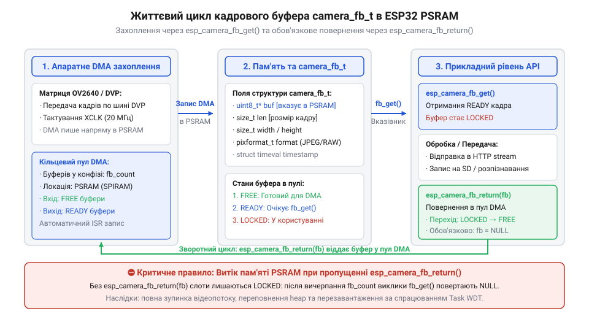

# Програмний API фреймворку esp_camera та конфігураційні параметри драйвера

<preknowlist>
- [ESP32-CAM (OV2640 + microSD)](root:cat-hw-boards/esp32-cam) — Апаратне розведення шини DVP та особливості живлення сенсора камери.
- [ESP32-CAM з камерою OV3640 (2 МП)](root:cat-hw-boards/esp32-cam-ov3640) — Схемотехнічні особливості підключення DVP-сенсорів та параметри тактування.
</preknowlist>

## Призначення та архітектура драйвера esp_camera

Прямий доступ до розрядів периферійних контролерів відеовведення `I2S` або `LCD_CAM` у мікроконтролерах `ESP32` вимагає складного низькорівневого налаштування тактових генераторів `LEDC`, прямих каналів доступу до пам'яті (від англ. @@en|Direct Memory Access@@ — прямий доступ до пам'яті; @@en|DMA@@) та транзисторних інтерфейсів. Намагання розробника керувати апаратурними регістрами вручну призводить до зсуву піксельних байтів, десинхронізації імпульсів кадру та небезпечних витоків ресурсів у системній пам'яті `DRAM`. Для ізоляції прикладного коду від схемотехнічних нюансів розроблено спеціалізований фреймворк (англ. *esp_camera*, від позначень *ESP* — сімейства мікроконтролерів та англ. *camera* — відеокамера; @@en|esp_camera@@) у середовищі (англ. *ESP-IDF*, від *ESP* та *IoT Development Framework* — фреймворк розробки інтернету речей; @@en|ESP-IDF@@).

Архітектура драйвера виконує роль високоадаптивного містка між апаратним паралельним цифровим відеопортом (від англ. @@en|Digital Video Port@@ — цифровий відеопорт; @@en|DVP@@) фотосенсора та оперативною пам'яттю системи. Оскільки внутрішня статична пам'ять `SRAM` мікроконтролера має суворо обмежений обсяг, фреймворк організує потокове переміщення даних через контролер `DMA` у зовнішню псевдостатичну оперативну пам'яті (від англ. @@en|Pseudo-static RAM@@ — псевдостатична оперативна пам'ять; @@en|PSRAM@@). Завдяки підтримуваній схемі подвійної або потрійної буферизації драйвер дозволяє одночасно захоплювати новий кадр з матриці камери та обробляти попередній у прикладній задачі, розв'язуючи шинні заторні конфлікти, які описуються в описі [модуля ESP32-CAM](root:cat-hw-boards/esp32-cam-camera-module-family).

На апаратному рівні передавання починається із тактування периферійного арбітра `@@en|I2S@@` або `@@en|LCD_CAM@@` сигналом `PCLK` від матриці, після чого контролер `@@en|DMA@@` вибірково заповнює зв'язані кільцеві дескриптори (від англ. *descriptor*, від лат. *describere* — описувати; @@en|дескриптори@@) кадрових блоків. Периферійний арбітр апаратно фільтрує піксельний потік за сигналами стробування `HREF` та `VSYNC`, спрямовуючи транзакції безпосередньо в зовнішню шину `@@en|PSRAM@@` через внутрішні транзитні буфери FIFO (від англ. @@en|First In, First Out@@ — першим зайшов, першим вийшов; @@en|FIFO@@). Це звільняє обчислювальні ядра процесора від побайтового копіювання масивів, гарантуючи безперервний відеопотік у пристроях на базі [мікроконтролера ESP32-S3](root:cat-hw-boards/esp32s3-microcontroller) без пропуску кадрів.

Коли контролер `@@en|DMA@@` завершує заповнення чергового кадрового дескриптора, апаратний блок генерує сигнал переривання `@@en|in_suc_eof@@` (від англ. *in success end-of-frame* — успішне закінчення кадру вхідного потоку; `@@en|in_suc_eof@@`), який негайно передає керування спеціалізованій процедурі обслуговування переривань (від англ. *Interrupt Service Routine*; `@@en|ISR@@`). Отримавши сигнал завершення кадру, процедура `@@en|ISR@@` зчитує статусні прапорці апаратних регістрів, атомарно оновлює покажчики кільцевого буфера кадру та надсилає повідомлення про готовність даних у чергу подій (від англ. *queue*, від лат. *cauda* — хвіст; `@@en|xQueue@@`) операційної системи `@@en|FreeRTOS@@`. Такий порядок обробки дозволяє миттєво вивільнити завершений дескриптор для наступних циклів запису та сповістити фонову задачу обробки без затримки обчислювальних ядер або блокування системних шин.

## Структура конфігурації camera_config_t

Ініціалізація периферії камери починається із заповнення повнорозмірної структури конфігурації (англ. *camera_config_t*, від англ. *camera* — камера, *config* — конфігурація та *t* — тип; @@en|camera_config_t@@). Ця структура описує фізичну розпіновку, тактову частоту, розміри кадрових масивів та режими розміщення буферів у пам'яті.

Поля структури розподіляються за Основними функціональними групами:

| Поле структури `camera_config_t` | Тип даних | Функціональне призначення та діапазон |
| :--- | :--- | :--- |
| `pin_pwdn` / `pin_reset` | `int` | Номери `GPIO`-виводів керування живленням (`PWDN`) та апаратним скидом (`RESET`) |
| `pin_xclk` | `int` | Вивід генератора опорного тактування `XCLK` від внутрішнього ШІМ-блоку `LEDC` |
| `pin_sscb_sda` / `pin_sscb_scl` | `int` | Інтерфейсні лінії шини керування регістрами `SCCB` (`SIOD` / `SIOC`) |
| `pin_d0` – `pin_d7` | `int` | 8-бітний шинний масив паралельних сигнальних ліній даних `DVP` |
| `pin_pclk` / `pin_vsync` / `pin_href` | `int` | Лінії стробування пікселів (`PCLK`), кадрів (`VSYNC`) та рядків (`HREF`) |
| `xclk_freq_hz` | `int` | Опорна частота тактування камери (зазвичай `10000000` або `20000000` Гц) |
| `ledc_timer` / `ledc_channel` | `ledc_timer_t` / `ledc_channel_t` | Апаратний таймер та канал ШІМ-периферії для формування такту `XCLK` |
| `pixel_format` | `pixformat_t` | Формат пікселів (`PIXFORMAT_JPEG`, `PIXFORMAT_YUV422`, `PIXFORMAT_RGB565`) |
| `frame_size` | `framesize_t` | Графічна роздільність кадру (`FRAMESIZE_QVGA`, `FRAMESIZE_VGA`, `FRAMESIZE_UXGA`) |
| `jpeg_quality` | `int` | Якість стиснення (діапазон `0–63`, де менше значення означає вищу якість) |
| `fb_count` | `size_t` | Кількість виділюваних кадрових буферів (від `1` до `3`) |
| `fb_location` | `camera_fb_location_t` | Локація буферів (`CAMERA_FB_IN_PSRAM` або `CAMERA_FB_IN_DRAM`) |
| `grab_mode` | `camera_grab_mode_t` | Захоплення кадрів (`CAMERA_GRAB_LATEST` або `CAMERA_GRAB_WHEN_EMPTY`) |

Для роботи з високими роздільностями, такими як у [сенсорі OV3640](root:cat-hw-boards/esp32-cam-ov3640), обов'язково обирають піксельний формат `PIXFORMAT_JPEG` та розміщують буфери `fb_location = CAMERA_FB_IN_PSRAM`. Налаштування `grab_mode = CAMERA_GRAB_LATEST` гарантує, що прикладний додаток завжди отримуватиме найновіший захоплений кадр без затримок у черзі.

Значний вплив на стабільність захвату має опорна частота `xclk_freq_hz`. Встановлення значення `20000000` Гц удвічі прискорює внутрішній тактовий генератор сенсора та скорочує тривалість піксельних імпульсів `PCLK`, звужуючи часові допуски (від англ. *margin* — запас, допуск; @@en|часові допуски@@) встановлення та утримання сигналів `VSYNC` і `HREF`. На довгому або непідготовленому гнучкому шлейфі висока частота викликає джитер (від англ. *jitter* — тремтіння; @@en|джитер@@) фази стробування та десинхронізацію рядків, тоді як зниження частоти до `10000000` Гц розширює часові вікна зйому даних і стабілізує передачу кадрів на [модулі ESP32-CAM](root:cat-hw-boards/esp32-cam) за рахунок зменшення максимальної частоти кадрів.

Вибір локації виділення пам'яті визначає баланс між роздільною здатністю та затримкою шини. Режим `CAMERA_FB_IN_DRAM` використовує внутрішню оперативну пам'ять `@@en|DRAM@@`, забезпечуючи нульову затримку та максимальну швидкість обміну з контролером `@@en|DMA@@`, але через суворе обмеження вільної купи (близько 150–200 КБ) цей варіант придатний лише для низьких роздільностей `QVGA` або невеликих кадрових масивів. Натомість режим `CAMERA_FB_IN_PSRAM` переносить буфери у зовнішню пам'ять `@@en|PSRAM@@`, звільняючи внутрішню оперативну пам'яті та відкриваючи можливість захоплювати високодеталізовані кадри `UXGA` або `VGA` у декількох кадрових буферах, однак вимагає врахування додаткових шинних затримок при зчитуванні через зовнішню шину в платах на базі [Waveshare ESP32-S3R2](root:cat-hw-boards/esp32-s3r2-waveshare).

Приклад ініціалізаційного коду конфігурації зображено у вкладинках нижче:

:::tabs
@tab C (ESP-IDF)
:::code api-esp32-camera-driver-core-config/c/esp-idf/snippet-1.c
@tab C++ (Arduino)
:::code api-esp32-camera-driver-core-config/cpp/arduino/setup-camera-config.cpp
:::

## Життєвий цикл захоплення кадрів та функції API

Життєвий цикл роботи з камерою контролюється серією послідовних системних викликів. Запуск апаратури виконується функцією `esp_camera_init(&camera_config)`, яка повертає код стану `esp_err_t`. При успішному поверненні `ESP_OK` драйвер виділяє дескриптори `DMA` та конфігурує внутрішній арбітр `PSRAM`.


*Схема життєвого циклу захоплення кадрового буфера camera_fb_t через esp_camera_fb_get() та вивільнення ресурсів через esp_camera_fb_return() у пам'яті PSRAM.*

Для отримання готового кадрового буфера використовують функцію `esp_camera_fb_get()`. Вона повертає вказівник на структуру кадрового буфера (англ. *camera_fb_t*, від *frame buffer* — кадровий буфер; @@en|camera_fb_t@@), яка містить такі ключові поля:
- `buf` — прямий покажчик на байтовий масив зображення в пам'яті;
- `len` — розмір кадру в байтах;
- `width` та `height` — ширинні та висотні виміри кадру в пікселях;
- `format` — поточний піксельний формат даних;
- `timestamp` — мітка часу захоплення кадру.

Критично важливим інваріантом роботи з `@@en|esp_camera@@` є суворе дотримання парності викликів. Після завершення обробки або відправки зображення розробник зобов'язаний повернути буфер у драйвер за допомогою виклику `esp_camera_fb_return(fb)`. Якщо програміст забуває викликати функцію повернення, апаратний кільцевий буфер драйвера миттєво вичерпується, що викликає блокування задач, витік пам'яті в `@@en|PSRAM@@` та спрацьовування сторожового таймера (англ. *watchdog timer*, від англ. *watchdog* — сторожовий пес та *timer* — таймер; @@en|Watchdog@@).

Вибір кількості кадрових буферів у конфігурації `fb_count` визначить пропускну здатність та поведінку драйвера під навантаженням. У разі виділення одного буфера (`fb_count = 1`) виклик `esp_camera_fb_get()` блокує подальше захоплення кадрів до моменту виклику `esp_camera_fb_return()`, що мінімізує витрати `@@en|PSRAM@@`, але падає кадрова частота (від англ. *frame rate*, *frames per second*; @@en|FPS@@). Значення `fb_count = 2` вмикає подвійне буферизування, дозволяючи `@@en|DMA@@` паралельно заповнювати наступний буфер під час обробки поточного процесором. Виділення трьох буферів (`fb_count = 3`) створює додаткову чергу для згладжування затримок (від англ. *latency* — затримка; @@en|затримка@@) мережевого стримінгу, запобігаючи втраті кадрів на [платах ESP32-S3](root:cat-hw-boards/esp32-s3-boards-family-overview) ціною підвищеного споживання оперативної пам'яті.

У разі переповнення кільцевого буфера або апаратного таймауту (від англ. *timeout*; @@en|таймаут@@) захоплення кадру функція `esp_camera_fb_get()` повертає нульовий вказівник `NULL`. Прикладний код зобов'язаний виконувати обов'язкову перевірку `if (!fb)` перед розіменуванням покажчиків, запобігаючи аварійному перезавантаженню системи через розіменування нульового вказівника (від англ. *Null Pointer Dereference*; @@en|розіменування нульового вказівника@@). Якщо виклик повторно повертає `NULL`, програміст має передбачити паузу для завершення фонових сесій або перезапуск драйвера через `esp_camera_deinit()`, що відновлює апаратні дескриптори `@@en|DMA@@` на платах типу [ESP32-CAM (OV2640 + microSD)](root:cat-hw-boards/esp32-cam).

:::tabs
@tab C (ESP-IDF)
```c|esp-idf
esp_err_t err = esp_camera_init(&camera_config);
if (err != ESP_OK) {
    return err;
}

camera_fb_t *fb = esp_camera_fb_get();
if (!fb) {
    return ESP_FAIL;
}

// Використання даних fb->buf обсягом fb->len байтів

esp_camera_fb_return(fb);
```
@tab C++ (Arduino)
:::code api-esp32-camera-driver-core-config/cpp/arduino/snippet-3.cpp
:::

## Динамічне налаштування сенсора та діагностика помилок

Після успішної ініціалізації фреймворк надає доступ до об'єкта керування оптичною матрицею `sensor_t`, покажчик на який отримують викликом `esp_camera_sensor_get()`. Об'єкт `sensor_t` містить таблицю функціональних покажчиків для зміни параметрів експозиції та кольору в реальному часі без перезапуску камери.

До основних методів об'єкта `sensor_t` належать:
- `s->set_quality(s, val)` — динамічна зміна коефіцієнта стиснення (англ. *JPEG*, від *Joint Photographic Experts Group*; @@en|JPEG@@);
- `s->set_brightness(s, val)` / `s->set_contrast(s, val)` — налаштування яскравості та контрастності (діапазон `-2` до `2`);
- `s->set_gain_ctrl(s, enable)` / `s->set_exposure_ctrl(s, enable)` — керування автоматичним підсиленням (`AGC`) та автоматичною експозицією (`AEC`);
- `s->set_hmirror(s, enable)` / `s->set_vflip(s, enable)` — дзеркальне та вертикальне перевертання кадру.

У разі виникнення апаратних або програмних збоїв функції драйвера повертають стандартні коди помилок `esp_err_t`:
- `ESP_ERR_NOT_FOUND` — фотосенсор не відповідає по шині `SCCB` (перевірте живлення та контакти роз'єму);
- `ESP_ERR_NO_MEM` — недостатньо оперативної пам'яті для виділення кадрових буферів (перевірте ініціалізацію `@@en|PSRAM@@`);
- `ESP_ERR_INVALID_ARG` — некоректна конфігурація частоти `xclk_freq_hz` або несумісний піксельний формат.

Апаратне надсилання команд коригування підсистем `@@en|AEC@@` та `@@en|AGC@@` виконується через двопровідний послідовний інтерфейс `@@en|SCCB@@`, який є сумісним із протоколом `@@en|I2C@@` (від англ. *Inter-Integrated Circuit*; @@en|I2C@@). Під час виклику методів структура `sensor_t` формує трибайтову транзакцію, що складається з адреси веденого пристрою матриці, ідентифікатора регістра керування та підготовленого байта конфігурації. Внутрішній процесор обробки сигналів зображення (від англ. *Image Signal Processor*; @@en|ISP@@) сенсора застосовує нові коефіцієнти експозиції та аналогового підсилення строго під час кадрового гасячого імпульсу `VSYNC`, що запобігає появі візуальних артефактів на підключеному [сенсорі OV3640](root:cat-hw-boards/esp32-cam-ov3640).

Гнучке керування через `sensor_t` дозволяє адаптувати камери на базі плат з [мікроконтролерами ESP32-S3](root:cat-hw-boards/esp32s3-microcontroller) до будь-яких умов освітлення, як це деталізовано в [огляді сімейства плат ESP32-S3](root:cat-hw-boards/esp32-s3-boards-family-overview).
