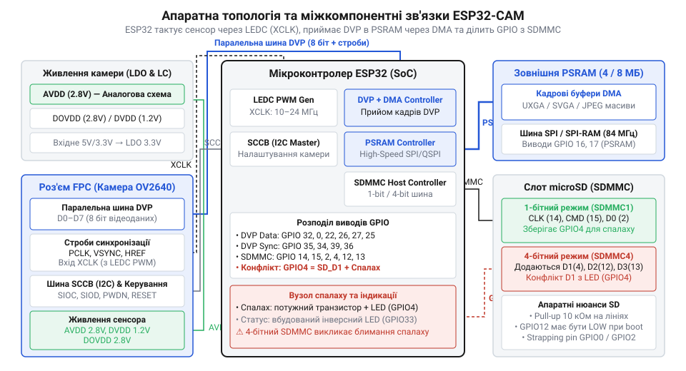
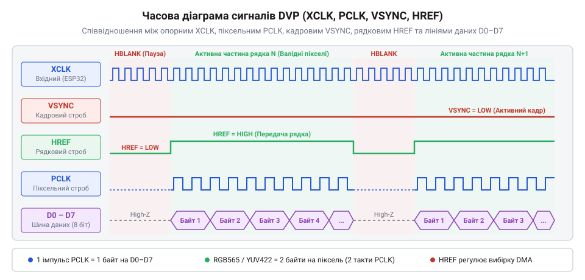
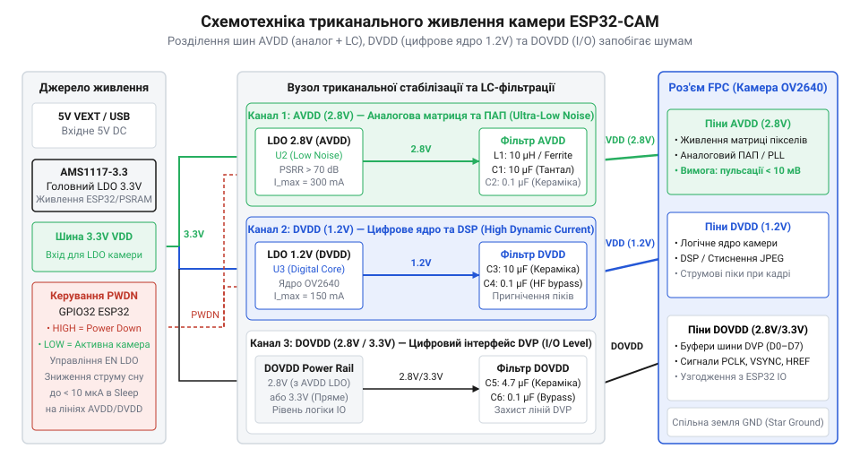

# Модуль ESP32-CAM: огляд архітектури, периферії та сімейства плат

<preknowlist>
- [ESP32-CAM (OV2640 + microSD)](root:cat-hw-boards/esp32-cam) — Апаратна організація плати ESP32-CAM, призначення ніжок та особливості живлення модуля камери.
- [Мікроконтролер ESP32-S3](root:cat-hw-boards/esp32s3-microcontroller) — Архітектура ядра Xtensa LX7, внутрішня пам'ять та апаратні периферійні контролери.
- [Родина плат і модулів на ESP32-S3](root:cat-hw-boards/esp32-s3-boards-family-overview) — Конструктивні варіанти плат з підтримкою відеоінтерфейсів та зовнішньої пам'яті PSRAM.
</preknowlist>

## Загальна апаратно-структурна схема модуля ESP32-CAM

Спроба прямого підключення фотосенсорів високої роздільності до стандартних мікроконтролерів без апаратної підтримки паралельних шин викликає швидке переповнення внутрішньої пам'яті. Необхідність обробки нестиснених кадрових масивів обсягом у сотні кілобайтів чи мегабайти вимагає інтеграції обчислювального ядра, швидкісної оперативної пам'яті та портів захоплення відеопотоку на єдиній друкованій платі. Проте використання зовнішньої псевдостатичної пам'яті (від @@en|Pseudo-Static RAM@@ — псевдостатична оперативна пам'ять; @@en|PSRAM@@) створює критичне апаратне обмеження через спільну чотирипотокову шину @@en|QSPI@@ (від @@en|Quad Serial Peripheral Interface@@ — чотирипотоковий послідовний периферійний інтерфейс; @@en|QSPI@@), яку контролер ділить між чипом оперативної пам'яті та енергонезалежною флешпам'яттю (від @@en|Serial Peripheral Interface Flash Memory@@ — послідовна флешпам'ять; @@en|SPI Flash@@). При одночасному зчитуванні машинного коду та фоновому записі відеокадрів у пам'ять @@en|PSRAM@@ виникає апаратне змагання за шину: промахи кешу інструкцій затримують транзакції прямого доступу. Для запобігання втраті відеоданих критичні процедури обробника переривань виносять у внутрішнє ядро пам'яті інструкцій (від @@en|Instruction RAM@@ — оперативна пам'ять інструкцій; @@en|IRAM@@), забезпечуючи пріоритет кадрового потоку на [модулях ESP32-CAM](root:cat-hw-boards/esp32-cam).

*Показано топологію апаратних зв'язків між периферійними блоками модуля ESP32-CAM.*

Модуль @@en|ESP32-CAM@@ об'єднує [мікроконтролер ESP32-S3](root:cat-hw-boards/esp32s3-microcontroller) (або двоядерний чип першого покоління ESP32), зовнішній чип псевдостатичної пам'яті (від @@en|Pseudo-Static RAM@@ — псевдостатична оперативна пам'ять; @@en|PSRAM@@) обсягом `4–8 МБ`, 24-контактний роз'єм для гнучкого шлейфу (від @@en|Flexible Printed Circuit@@ — гнучка друкована плата; @@en|FPC@@) та слот для карт пам'яті @@en|microSD@@. Фізична взаємодія між кристалом мікроконтролера та чипом @@en|PSRAM@@ організована через високошвидкісну чотирипотокову послідовну шину (від @@en|Quad Serial Peripheral Interface@@ — чотирипотоковий послідовний периферійний інтерфейс; @@en|QSPI@@). Високі тактові частоти шини `80 МГц` вимагають суворого топологічного узгодження довжини провідників (від @@en|Timing Skew@@ — часовий зсув сигналів; @@en|часовий зсув сигналів@@) на друкованій платі: різниця у довжинах шинних ліній `CLK` та `SD0–SD3` звужує часові маржі зчитування даних і спричиняє помилки пам'яті. Для захисту від високочастотних перехресних завад траси шини @@en|QSPI@@ розводять над суцільним екранним шаром землі з контролем хвильового опору. Контролер пам'яті задіює лінії шини @@en|SPI@@ разом із фіксованими керуючими виводами вибору мікросхеми та тактування, зокрема `GPIO16` і `GPIO17` у класичній схемотехніці. Таке жорстке апаратне виділення внутрішніх шинних ліній унеможливлює використання цих ніжок як вільних виводів загального призначення (від @@en|General-Purpose Input/Output@@ — виводи загального призначення; @@en|GPIO@@), що звужує доступне периферійне оснащення друкованої плати. Докладніше про апаратні модифікації плат розповідає окремий [опис ESP32-CAM](root:cat-hw-boards/esp32-cam) та огляд [версій з сенсором OV3640](root:cat-hw-boards/esp32-cam-ov3640). Порівняти схеми пам'яті допомагає загальний [огляд плат ESP32-S3](root:cat-hw-boards/esp32-s3-boards-family-overview), а дослідження [еволюції сенсорів OV2640](root:cat-hw-boards/esp32-cam-ov2640-sensor-evolution) показує, як розробники пройшли шлях від базових планок AI-Thinker до високоінтегрованих модулів.

Обмін даними між процесором та камерою розбігається на дві незалежні шини: послідовну шину конфігурації для налаштування внутрішніх регістрів матриці та 8-бітну паралельну шину для передачі пікселів. Налаштування сенсора реалізовано за послідовним протоколом (від @@en|Serial Camera Control Bus@@ — послідовна шина управління камерою; @@en|SCCB@@), сумісним із шиною @@en|I2C@@ на тактовій частоті `100–400 кГц`. Кадрові параметри програмно програмуються передачею трьохфазних пакетів даних: адреси пристрою на шині, суб-адреси цільового регістру та значення конфігураційного байта. Через шину @@en|SCCB@@ хост-контролер керує експозицією, підсиленням, колірною гамою та форматом вихідного відеопотоку перед запуском паралельного інтерфейсу. Детальні схеми комутації та розпіновку описує загальний [опис ESP32-CAM](root:cat-hw-boards/esp32-cam), а особливості підтримки старших матриць подано в огляді [версій з сенсором OV3640](root:cat-hw-boards/esp32-cam-ov3640).

Висока щільність монтажу на компактній платі породжує додаткове схемотехнічне обмеження: паразитна ємність друкованих трас (від @@en|Parasitic Trace Capacitance@@ — паразитна ємність друкованих трас; @@en|паразитна ємність трас@@) шини @@en|QSPI@@ у поєднанні з вихідним опором буферів створює паразитний RC-фільтр, що завалює фронти тактового сигналу та ліній даних. На граничній частоті тактування `80 МГц` додаткова ємність усього у `5–10 пФ` затягує тривалість наростання фронтів імпульсів, стискаючи допустимі інтервали встановлення й утримання сигналів для надійного зчитування комірок пам'яті @@en|PSRAM@@. У разі недотримання строгих топологічних норм розробникам доводиться знижувати робочу частоту шини до `40 МГц`, що вдвічі зменшує пропускну здатність оперативного буфера та обмежує граничну частоту виведення кадрів високої роздільності на [платах ESP32-CAM](root:cat-hw-boards/esp32-cam).

## Фізичний відеоінтерфейс DVP та строби синхронізації

Захоплення потокового відео вимагає суворої фазової узгодженості тактових сигналів, щоб обчислювальне ядро чітко розрізняло межі окремих рядків, пікселів та кадрів. Відсутність чіткої синхронізації призводить до зміщення кольорових каналів або смугастих артефактів на підсумковому зображенні.

*Показано часову діаграму сигналів тактування та синхронізації шини DVP під час зчитування піксельних даних.*

Передача кадрових масивів здійснюється через паралельний цифровий відеопорт (від @@en|Digital Video Port@@ — цифровий відеопорт; @@en|DVP@@). Тактування починається зі створення базової опорної частоти `XCLK` (від @@en|External Clock@@ — зовнішня тактова частота; @@en|XCLK@@) величиною `10–20 МГц`, яку апаратний генератор ШІМ-контролера світлодіодів (від @@en|LED PWM Controller@@ — контролер ШІМ світлодіодів; @@en|LEDC@@) формує шляхом ділення опорної системної шини `80 МГц`. Використання швидкісних таймерів @@en|LEDC@@ забезпечує апаратну генерацію `XCLK` без навантаження обчислювальних ядер [мікроконтролера ESP32-S3](root:cat-hw-boards/esp32s3-microcontroller). Усередині сенсора внутрішній множник частоти (від @@en|Phase-Locked Loop@@ — фазово-замкнена автопідстройка частоти; @@en|PLL@@) помножує `XCLK` для забезпечення внутрішнього оброблення та генерує стробувальний сигнал `PCLK` (від @@en|Pixel Clock@@ — піксельний тактовий сигнал; @@en|PCLK@@). Застосування некратних коефіцієнтів ділення викликає джиттер (від @@en|Phase Jitter@@ — фазове тремтіння сигналу; @@en|джиттер@@) опорного сигналу `XCLK`, що розгойдує контур зворотного зв'язку внутрішнього множника @@en|PLL@@ сенсора. Переданий на частоту `PCLK` джиттер змінює тривалість періоду тактування від імпульсу до імпульсу, звужуючи допустимі часові інтервали встановлення та утримання даних (від @@en|Setup and Hold Time Margins@@ — інтервали встановлення та утримання; @@en|інтервали встановлення та утримання@@) на 8-бітній шині `D0–D7`. За наростаючим фронтом узгодженого `PCLK` контролер мікроконтролера зчитує байти з шини, а при фазовому зсуві виникає спотворення байтів, що призводить до горизонтальних кольорових артефактів та зсуву пікселів.

Синхронізація кадрів тримається на двох сигнальних стробах:
- `VSYNC` (від @@en|Vertical Synchronization@@ — вертикальна синхронізація; @@en|VSYNC@@) — імпульс, що сповіщає про завершення поточного кадру та початок нового. Під час інтервалу вертикального гасіння (від @@en|Vertical Blanking Interval@@ — інтервал вертикального гасіння; @@en|VBI@@) сигнал `VSYNC` активується на період формування `10–30` порожніх рядків, протягом яких `HREF` утримується в низькому стані для перезапуску внутрішніх лічильників матриці, обчислення коефіцієнтів цифрового підсилення та стабілізації алгоритмів автоматичного балансу білого (від @@en|Automatic White Balance@@ — автоматичний баланс білого; @@en|АВБ@@) і автоекспозиції перед початком накопичення заряду наступного кадру;
- `HREF` (від @@en|Horizontal Reference@@ — горизонтальне посилання / синхронізація; @@en|HREF@@) — активний високий рівень, що вказує на передачу дійсних піксельних даних поточного рядка між паузами горизонтального гасіння на [платах ESP32-CAM](root:cat-hw-boards/esp32-cam).

Аналітичний розрахунок затримок та оцінку швидкості розкриває [розрахунок пропускної здатності](root:cat-hw-boards/esp32-cam-camera-module-family/math-esp32-cam-memory-bandwidth.md), де критичну роль відіграє інтервал горизонтального гасіння (від @@en|Horizontal Blanking Interval@@ — інтервал горизонтального гасіння; @@en|HBI@@). Під час паузи `HBI`, коли сигнал `HREF` опускається в низький рівень між рядками кадру, зчитування пікселів припиняється на `10–20` тактових імпульсів `PCLK`. Ця часова пауза необхідна для того, щоб блок прямого доступу встиг повністю вивантажити накопичені байти з проміжного апаратного буфера (від @@en|First-In, First-Out@@ — буфер FIFO; @@en|буфер FIFO@@) у зовнішнє оперативне сховище. Занадто короткий інтервал `HBI` не залишає часу для опустошення накопичувача, що спричиняє переповнення шинних регістрів і втрату початкових пікселів наступного рядка, а тонке керування цими сигнальними таймінгами визначають [параметри драйвера esp_camera](root:cat-hw-boards/esp32-cam-camera-module-family/api-esp32-camera-driver-core-config.md).

## Схемотехніка триканального живлення та фільтрація шумів

Живлення матриць зображення від спільних шин мікроконтролера без фільтрації викликає виражені апаратні спотворення на знімках. Високочастотні завади від перемикання ядер процесора та сплесків передавача @@en|Wi-Fi@@ проникають у фоточутливі піксельні осередки, формуючи кольорові смуги, кольоровий шум та падіння контрасту. Традиційні лінійні регулятори (від @@en|Low Dropout Regulator@@ — лінійний регулятор напруги з низьким падінням; @@en|LDO@@) мають високий коефіцієнт приглушення пульсацій живлення (від @@en|Power Supply Rejection Ratio@@ — коефіцієнт приглушення пульсацій живлення; @@en|PSRR@@) до `60–80 дБ` на низьких частотах, однак на частоті випромінювання @@en|Wi-Fi@@ в `2.4 ГГц` смуга пропускання їхнього контуру зворотного зв'язку вичерпується, а показник @@en|PSRR@@ деградує практично до `0 дБ`. Саме тому для захисту аналогового живлення вибирають регулятори @@en|LDO@@ з підвищеним високочастотним приглушенням або доповнюють їх пасивними фільтрами, які пригнічують радіочастотну обвідну імпульсних завад.

*Показано принципову схему триканального живлення сенсора камери з низькошумними LDO та LC-фільтрами.*

Сенсори сімейства @@en|ESP32-CAM@@ вимагають суворого розділення схемотехніки на три незалежні лінії живлення:
- `AVDD` (`2.8 В`) — аналогове живлення фотодіодної матриці, підсилювачів та АЦП. Вимагає живлення від окремого низькошумного лінійного регулятора (від @@en|Low Dropout Regulator@@ — лінійний регулятор напруги з низьким падінням; @@en|LDO@@) з пасивною фільтрацією ланцюгом з індуктивних феритових елементів (від @@en|Ferrite Bead@@ — феритова намистина; @@en|FB@@) та керамічних конденсаторів. Амплітудно-частотна характеристика (від @@en|Amplitude-Frequency Characteristic@@ — амплітудно-частотна характеристика; @@en|AFC@@) такого LC-фільтра розраховується на приглушення високочастотних завад шини. Під час пікового споживання на етапі зчитування кадрів виникають стрімкі перехідні процеси: якщо добротність LC-кола не приглушена, на лінійному графіку @@en|AFC@@ утворюється паразитна резонансний пік, що викликає просідання напруги `AVDD` та появу смугастих артефактів на зображенні плат [ESP32-CAM (OV2640 + microSD)](root:cat-hw-boards/esp32-cam);
- `DVDD` (`1.2–1.5 В`) — живлення внутрішнього цифрового ядра матриці та обробника зображень;
- `DOVDD` (`2.8–3.3 В`) — живлення буферів вихідного цифрового відеоінтерфейсу @@en|DVP@@ для узгодження логічних рівнів із виводами мікроконтролера. При високошвидкісній передачі пікселів виникає шум одночасного перемикання (від @@en|Simultaneous Switching Noise@@ — шум одночасного перемикання; @@en|SSN-шум@@), що спричиняє імпульсні пульсації на цій лінії; якщо ці просідання опускають вихідну напругу логічної одиниці камери нижче порогового рівня спрацьовування вхідного буфера мікроконтролера `2.45 В`, виникають помилки зчитування байтів та кольорові спотворення на знімках.

Спільна робота регуляторів та фільтрів гарантує стабільну відсутність фонового шуму при зйомці в умовах слабкого освітлення. Для аналогової лінії `AVDD` розрахунок пасивного ланцюга фільтрації базується на виборі частоти зрізу (від @@en|Cut-off Frequency@@ — частота зрізу; @@en|частота зрізу@@) `f_c`, яка має лежати суттєво нижче за частоту високочастотних пульсацій процесорних ядер:

f_c = 1 / (2 · π · √(L · C))      [формула резонансної частоти LC-фільтра]

При виборі індуктивності феритового елемента `L = 10 мкГн` та ємності керамічних конденсаторів `C = 10 мкФ` частота зрізу становить близько `15.9 кГц`, що дає приглушення завад понад `40 дБ` у діапазоні МГц. Окремої уваги вимагає стабілізація напруги `DOVDD`: імпульсні пульсації на цій лінії порушують порогові рівні спрацьовування цифрово-аналогових буферів. Оскільки цифрові виходи камери працюють за логічними рівнями `2.8 В`, а виводи мікроконтролера задіюють стандарт `3.3 В`, схемотехнічне узгодження досягається за рахунок того, що мінімальний рівень логічної одиниці мікроконтролера становить `2.45 В`. Придушення високочастотних дзвінів та фазового зсуву фронтів вимагає розміщення послідовних демпфуючих резисторів на паралельній шині. Детальний опис схемотехніки живильних ланцюгів розгортає загальний [опис ESP32-CAM](root:cat-hw-boards/esp32-cam).

## Апаратна буферизація кадрів та DMA в PSRAM

На високих частотах тактування відеопорту передача даних відбувається зі швидкістю у десятки мегабайтів за секунду. Програмна обробка кожного байта процесорним ядром призвела б до 100% завантаження CPU та втрати вхідних кадрів через неможливість вчасно звільнити шинні буфери.

Транспортування кадрового потоку реалізовано через блок прямого доступу до пам'яті (від @@en|Direct Memory Access@@ — прямий доступ до пам'яті; @@en|DMA@@). Периферійний модуль зчитує байти з шини @@en|DVP@@ у внутрішній кільцевий апаратний буфер (від @@en|First-In, First-Out@@ — «першим прийшов — першим пішов»; @@en|FIFO@@), звідки контролер @@en|DMA@@ фоново записує їх у пам'ять без залучення обчислювальних ядер [мікроконтролера ESP32-S3](root:cat-hw-boards/esp32s3-microcontroller). Для депакетизації та складання кадру контролер розгортає зв'язаний список апаратних дескрипторів @@en|DMA@@ (від @@en|DMA Descriptor@@ — дескриптор прямого доступу; @@en|дескриптор DMA@@), кожен з яких описується 32-бітними полями адреси пам'яті, розміру блоку до `4092 байти`, прапорця власника (від @@en|Owner Bit@@ — прапорець власника буфера; @@en|прапорець власника@@) та прапорця кінця кадру (від @@en|End of Frame Flag@@ — прапорець кінця кадру; @@en|прапорець кінця кадру@@). Оскільки розмір одного кадру високої роздільності перевищує обсяг внутрішньої оперативної пам'яті (від @@en|Static RAM@@ — статична оперативна пам'ять; @@en|SRAM@@), дескриптори перенаправляють потік безпосередньо у зовнішню псевдостатичну пам'ять (від @@en|Pseudo-Static RAM@@ — псевдостатична оперативна пам'ять; @@en|PSRAM@@) обсягом `4–8 МБ`. Затримки доступу до шини @@en|PSRAM@@ викликають переповнення апаратного буфера (від @@en|Buffer Overflow@@ — переповнення буфера; @@en|переповнення буфера FIFO@@), під час якого контролер @@en|DMA@@ виставляє прапорець помилки переповнення, скидає прапорець власника в дескрипторі та відкидає поточний зіпсований кадр, відновлюючи фазову синхронізацію покажчиків лише з наступним імпульсом `VSYNC` для запобігання передачі розірваного зображення.

Для виключення артефактів розриву кадру драйвер підтримує подвійну та потрійну буферизацію: поки периферійний блок @@en|DMA@@ записує новий кадр у перший буфер, застосунок обробляє або надсилає через мережу попередній кадр з другого буфера. У режимі потрійної буферизації драйвер виділяє у зовнішній пам'яті @@en|PSRAM@@ три незалежні кадрові масиви — для апаратного запису @@en|DMA@@, для обробки процесором та для очікування черги. По завершенні стробу `VSYNC` в обробнику переривань (від @@en|Interrupt Service Routine@@ — обробник переривань; @@en|ISR@@) відбувається атомарна заміна дескрипторів @@en|DMA@@: замість ресурсомісткого копіювання мегабайтних масивів обробник за один тактовий цикл підміняє вказувальні адреси буферів у початковій ланці зв'язаного списку дескрипторів. Завдяки цій заміні контролер @@en|DMA@@ беззупиново переспрямовує вхідний потік пікселів у вільний буфер пам'яті без ризику виникнення стану гонитви (від @@en|Race Condition@@ — стан гонитви; @@en|стан гонитви@@) між обчислювальними ядрами та периферією. Якщо тривалість мережевого кодування перевищує період кадру, контролер @@en|DMA@@ захоплює третій вільний буфер, що повністю виключає накладання даних та розрив кадрового зображення. Практичну реалізацію потокової передачі та доступ до буферів демонструє [плата ESP32-CAM](root:cat-hw-boards/esp32-cam), а для високонавантажених нейромережевих обробників застосовують продуктивні варіанти з [огляду плат ESP32-S3](root:cat-hw-boards/esp32-s3-boards-family-overview).

## Розподіл GPIO та усунення апаратних конфліктів

Підключення зовнішніх датчиків та виконавчих механізмів до плат @@en|ESP32-CAM@@ часто супроводжується непередбачуваними збоями або блокуванням завантаження мікроконтролера. Причиною є екстремальний дефіцит вільних виводів загального призначення (від @@en|General-Purpose Input/Output@@ — виводи загального призначення; @@en|GPIO@@), оскільки більшість з них паралельно задіяні шиною камери, картридером та трансиверами пам'яті. Для обходу цього обмеження застосовують розширювачі виводів на базі шини @@en|I2C@@ (від @@en|Inter-Integrated Circuit@@ — міжмікросхемна шина; @@en|I2C@@), такі як мікросхеми @@en|PCF8574@@ чи @@en|MCP23008@@, які дозволяють керувати дискретними лініями лише через два виводи. Оскільки ці самі виводи задіяні під протокол @@en|SCCB@@ (від @@en|Serial Camera Control Bus@@ — послідовна шина керування камерою; @@en|SCCB@@) для конфігурації сенсора, організовують спільне використання шини за допомогою повторного виклику периферії та апаратних м'ютексів (від @@en|Mutual Exclusion@@ — взаємне виключення; @@en|м'ютекс@@), що дає змогу безпечно опитувати давачі без накладання сигналів під час зйомки, як зазначає [опис ESP32-CAM](root:cat-hw-boards/esp32-cam).

На класичній платі AI-Thinker виводи розбалансовані між декількома периферійними блоками:
- Шина DVP та управління сенсором займають 10 системних ліній;
- Картридер контролера карт пам'яті (від @@en|Secure Digital Multiple Media Card@@ — картридер SD/MMC; @@en|SDMMC@@) у повному 4-бітному режимі використовує лінії `GPIO2`, `GPIO4`, `GPIO12`, `GPIO13`, `GPIO14`, `GPIO15`;
- Потужний світлодіодний спалах апаратно приєднаний до лінії `GPIO4`;
- Альтернативне використання системних виводів конфігурації завантаження (від @@en|Strapping Pins@@ — виводи конфігурації завантаження; @@en|strapping-піни@@) `GPIO0`, `GPIO2` та `GPIO12` для підключення зовнішніх розширювачів @@en|I2C@@ вимагає суворого узгодження підтягувальних резисторів, оскільки високий рівень на `GPIO12` під час скидання при ввімкненні (від @@en|Power-On Reset@@ — скидання при ввімкненні живлення; @@en|Power-On Reset@@) помилково перемикає внутрішній регулятор живлення флешпам'яті на `1.8 В`, викликаючи апаратне блокування процесора на [модулях ESP32-CAM](root:cat-hw-boards/esp32-cam).

Окрему складність становлять системні виводи конфігурації завантаження (від @@en|Strapping Pins@@ — виводи конфігурації завантаження; @@en|strapping-піни@@) `GPIO0` та `GPIO2`, які фіксують режим запуску процесора при скиданні. Вивід `GPIO0` визначає завантаження з флешпам'яті чи режим прошивки, а `GPIO2` вимагає високого логічного рівня під час стартапу. Зовнішні підтягувальні резистори чи підключена периферія на цих виводах зміщують пороговий рівень напруги, що блокує запуск системи або примусово переводить її у режим завантаження коду на платах [ESP32-CAM (OV2640 + microSD)](root:cat-hw-boards/esp32-cam).

Головна пастка виникає при одночасному зчитуванні кадру та записі файлу на картку пам'яті: лінія `GPIO4` активує світлодіод спалаху під час кожного імпульсу на шині даних @@en|SDMMC@@, викликаючи короткочасне сліпуче миготіння та просідання напруги живлення. Крім того, виводи `GPIO0` та `GPIO2` виступають системними лініями конфігурації завантаження (від @@en|Strapping Pins@@ — системні виводи конфігурації завантаження; @@en|strapping-піни@@): `GPIO0` визначає режим прошивки при замиканні на землю, а `GPIO2` підключений до лінії даних картридера `DAT0` і при зовнішньому підтягуванні під час увімкнення блокує запуск процесора. Для усунення апаратного конфлікту картридер переводять у 1-бітний режим @@en|SDMMC@@, що вивільняє лінії `GPIO4` та `GPIO12` для зовнішніх датчиків. Для схемотехнічного розв'язування виводу `GPIO4` у кола затвора силового транзисторного ключа (від @@en|Transistor Switch@@ — транзисторний ключ; @@en|транзисторний ключ@@) вбудовують інтегрувальний ланцюг із підтягувальним резистором та конденсатором, затримка якого відфільтровує швидкі високочастотні імпульси шини пам'яті, реагуючи лише на тривалий постійний рівень сигналу спалаху. У простих проєктах застосовують також програмне примусове зниження рівня або фізичне відпаювання керуючого транзистора. Докладну картографію з'єднань розкриває [опис ESP32-CAM](root:cat-hw-boards/esp32-cam).

## Різновиди плат ESP32-CAM та критерії вибору

Різноманіття прикладних завдань комп'ютерного зору — від автономних фотопасток до мережевих IP-камер розпізнавання облич — вимагає обґрунтованого підбору модифікації платформи. Використання базового модуля там, де необхідна висока обчислювальна потужність, призводить до просідання частоти кадрів та перегріву регуляторів.

Сучасне сімейство плат поділяється на три основні категорії:
- Базові модулі AI-Thinker [ESP32-CAM (OV2640 + microSD)](root:cat-hw-boards/esp32-cam) — бюджетне рішення для простих систем потокового мовлення роздільністю VGA/SVGA. Під час безперервного стримінгу через Wi-Fi модуль споживає `180–250 мА`, що викликає нагрів регулятора напруги та плати до `50–65 °C` і збільшує тепловий шум матриці, а в режимі глибокого сну (від @@en|Deep Sleep Mode@@ — режим глибокого сну; @@en|Deep Sleep@@) вимагає `1.2–3 мА` через постійно підживлюваний чип псевдостатичної пам'яті;
- Автономні модулі M5Stack TimerCam — оснащені годинником реального часу (від @@en|Real-Time Clock@@ — годинник реального часу; @@en|RTC@@) та мікросхемою управління живленням (від @@en|Power Management IC@@ — мікросхема управління живленням; @@en|PMIC@@), що дає змогу повністю знеструмлювати мікроконтролер і сенсор між знімками, знижуючи струм у режимі @@en|Deep Sleep@@ до менше ніж `10 мкА` для роботи від акумулятора роками;
- Продуктивні модулі ESP32-S3-CAM — побудовані на базі [мікроконтролера ESP32-S3](root:cat-hw-boards/esp32s3-microcontroller), мають 8 МБ Octal PSRAM та апаратні векторні інструкції для прискорення нейромереж. Завдяки ефективним лінійним регуляторам вони зберігають помірний температурний режим під підключенням високороздільних матриць на кшталт [ESP32-CAM з камерою OV3640](root:cat-hw-boards/esp32-cam-ov3640).

Ефективність тепловідведення та струмоспоживання суттєво залежать від обраного сенсора. Використання більш роздільних сенсорів на кшталт OV3640 збільшує загальний струм системи до `300–380 мА`. На платах із лінійними регуляторами це розсіює у вигляді теплової потужності до `0.65 Вт`, прогріваючи плату до `70 °C` та провокуючи темновий шум (від @@en|Dark Current Noise@@ — темновий шум фотодіодів; @@en|темновий шум@@) у пікселях, тоді як платформи з імпульсними перетворювачами напруги зберігають робочу температуру в межах `35–45 °C`.

Детальний аналіз конструктивних відмінностей представлено в [огляді плат ESP32-S3](root:cat-hw-boards/esp32-s3-boards-family-overview), а історичні передумови розвитку висвітлює [еволюція сенсорів OV2640](root:cat-hw-boards/esp32-cam-ov2640-sensor-evolution). Важливим аспектом апаратного монтажу для виносного використання плат є підключення зовнішньої антени @@en|Wi-Fi@@ через мікрокоаксіальний роз'єм @@en|IPEX@@ (від @@en|IPEX/u.FL Connector@@ — мікрокоаксіальний роз'єм; @@en|IPEX@@). За замовчуванням радіочастотний тракт під'єднано до вбудованої друкованої антени плати через перемичку (від @@en|Zero-Ohm Resistor Jumper@@ — перемичка нульового опору; @@en|SMD-перемичка нульового опору@@). При винесенні плати у герметичний або металевий корпус вбудована антена екранується і втрачає зв'язок; для переведення сигналу на зовнішній роз'єм @@en|IPEX@@ необхідно перепаяти резистор опором 0 Ом на сусідню контактну площадку. При монтажі антени застосовують екранований коаксіальний кабель (від @@en|Coaxial Cable@@ — коаксіальний кабель; @@en|коаксіальний кабель@@) з високою щільністю обплетення, оскільки тонкі пігтейли довжиною понад `10–15 см` вводять відчутні внесені втрати (від @@en|Insertion Loss@@ — внесені втрати; @@en|внесені втрати@@) до `1–2 дБ` на частоті `2.4 ГГц`, а механічний натяг кабелю без фіксації може відірвати поверхневий роз'єм @@en|IPEX@@ від друкованої плати. Запуск радіомодуля з перепаяною перемичкою без підключеної штирьової антени спричиняє високий коефіцієнт стоячої хвилі (від @@en|Voltage Standing Wave Ratio@@ — коефіцієнт стоячої хвилі; @@en|VSWR@@) та деградацію вихідного підсилювача передавача.
