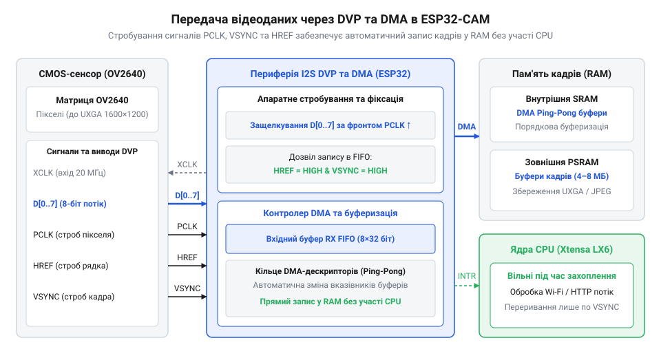
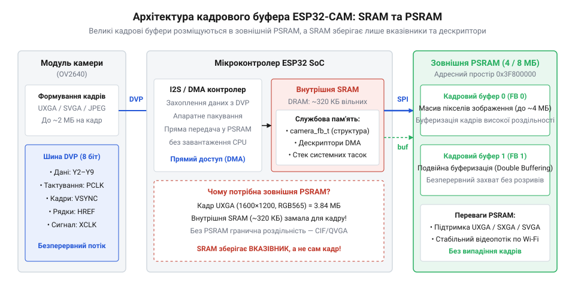
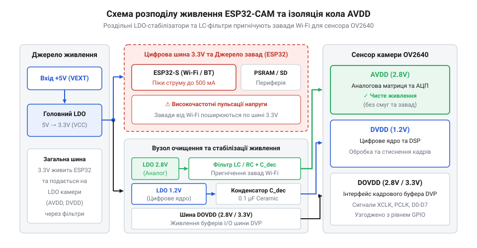
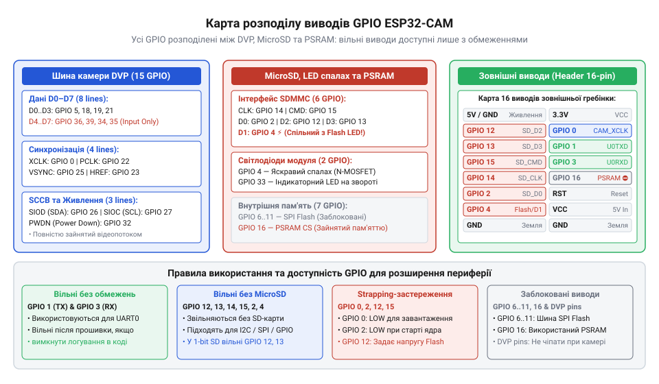

# Модуль ESP32-CAM: огляд архітектури, периферії та сімейства плат

<preknowlist>
- [ESP32-CAM (OV2640 + microSD)](root:cat-hw-boards/esp32-cam) — Базові специфікації плати, принципи підключення сенсора OV2640 та інтерфейс карт пам'яті microSD.
- [Мікроконтролер ESP32-S3](root:cat-hw-boards/esp32s3-microcontroller) — Архітектурні відмінності процесорного ядра, підтримка векторних інструкцій AI та вдосконалений контролер камери.
- [Waveshare ESP32-S3R2 (16 МБ Flash, 2 МБ PSRAM)](root:cat-hw-boards/esp32-s3r2-waveshare) — Принципи організації зовнішньої пам'яті PSRAM, її тактування та адресація кадрових масивів.
</preknowlist>

## Обмеження мікроконтролерів у завданнях відеозахоплення

Спроба перетворити класичний мікроконтролер на пристрій для захоплення та передачі відеопотоку моментально впирається в жорсткі фізичні обмеження його обчислювального ядра та внутрішньої пам'яті. У типових сценаріях вбудованої електроніки чип @@en|ESP32@@ чудово справляється з опитуванням сенсорів, виведенням графіки на текстові дисплеї чи обробкою команд через бездротову мережу. Проте відеодані принципово відрізняються від дискретних вимірювань температури чи вологості: вони являють собою безперервний масив високої щільності, який потребує величезної пропускної здатності шини та значних обсягів оперативної пам'яті.

Апаратна архітектура @@en|ESP32@@ містить 520 КБ внутрішньої @@en|SRAM@@ (від англ. *static random-access memory* — статична оперативна пам'ять із довільним доступом). Однак цей простір не є суцільним масивом, доступним для програмних буферів. Пам'ять розділена на декілька фізичних блоків: частину зайнято системним кодом та стеком операційної системи @@en|FreeRTOS@@, частину резервує стек бездротового зв'язку @@en|Wi-Fi@@ та @@en|Bluetooth@@, а для динамічного розподілу пам'яті (@@en|DRAM@@, від англ. *dynamic random-access memory*) залишається лише близько 320 КБ. Найбільший суцільний блок, який можна виділити за допомогою системи розподілу ресурсів, рідко перевищує 160–200 КБ.

Розглянемо обсяг одного нестиснутого кадру базової роздільності @@en|VGA@@ (640×480 пікселів) у кольоровому форматі @@en|RGB565@@ (від англ. *red green blue 565* — 16-бітний колір). Позначимо обсяг кадру `V_frame`, кількість пікселів за шириною `W`, за висотою `H`, а розмір одного пікселя в байтах `bpp_byte`. У форматі @@en|RGB565@@ кожен піксель займає 2 байти. Формула обчислення розміру масиву кадру має вигляд:

```
V_frame = W × H × bpp_byte
```

Виконаємо покроковий розрахунок необхідного обсягу пам'яті для кадру роздільності @@en|VGA@@:

```
V_frame = 640 × 480 × 2
        = 614400 байт           [множення кількості пікселів на розмір пікселя]
        = 600 КБ                [переведення у кілобайти: 614400 ÷ 1024]
```

Як видно з розрахунку, один нестиснутий кадр @@en|VGA@@ обсягом 600 КБ фізично не може поміститися в доступні 320 КБ внутрішньої @@en|SRAM@@. Навіть якщо зменшити роздільність до @@en|QVGA@@ (320×240 пікселів), розмір кадру становитиме 153.6 КБ, що займе майже всю вільну пам'ять мікроконтролера. У такому стані в системи не залишається ресурсів для створення другого буфера або розміщення мережевих пакетів.

Якщо мікроконтролер намагається зчитувати пікселі з камери вручну через звичайні виводи вводу-виводу (побайтовим опитуванням прапорців або перериваннями на кожний такт), центральний процесор потрапляє у пастку 100% завантаження. За частоти 30 кадрів на секунду та роздільності @@en|QVGA@@ потік даних становить понад 4.6 МБ/с. Процесорні ядра @@en|Xtensa LX6@@ змушені виконувати мільйони переривань на секунду, блокуючи виконання будь-яких інших задач.

У цей момент ламається робота бездротового стека @@en|Wi-Fi@@. Протоколи @@en|TCP/IP@@ вимагають чіткої витримки тайм-аутів та своєчасної обробки мережевих дескрипторів. Коли процесор заблокований зчитуванням камери, мережеві таймери вичерпуються, виникає переповнення внутрішніх буферів зв'язку, що призводить до втрати @@en|Wi-Fi@@-з'єднання, фатальної помилки ядра (@@en|kernel panic@@) або перезавантаження чипа сторожовим таймером (@@en|watchdog timer@@).

Саме тому для побудови працездатної системи відеозахоплення потрібна спеціалізована апаратна конфігурація. Вона повинна включати апаратний компресор зображення (модуль @@en|JPEG@@ безпосередньо в CMOS-сенсорі), який зменшує розмір кадру в 10–15 разів, периферійний контролер прямого доступу до пам'яті (@@en|DMA@@, від англ. *direct memory access*), що передає пікселі в оперативну пам'ять без залучення ядер процесора, та зовнішню розширену оперативну пам'ять (@@en|PSRAM@@, від англ. *pseudo-static random-access memory*), здатну вміщати кілька кадрів високої роздільності одночасно.

Історія виникнення доступних плат відеозахоплення розпочалася з випуску модуля @@en|AI-Thinker ESP32-CAM@@, у якому інженери вперше об'єднали мікроконтролер @@en|ESP32-D0WDQ6@@, компактний слот для карт пам'яті @@en|microSD@@, роз'єм для CMOS-сенсора @@en|OV2640@@ та 4 МБ зовнішньої пам'яті @@en|PSRAM@@ в єдиній компактній платі. Цей модуль довів можливість створення бюджетного пристрою комп'ютерного зору вартістю в кілька доларів. Надалі сімейство еволюціонувало: з'явилися платформи @@en|TTGO T-Journal@@ з інтегрованим дисплеєм, автономні модулі @@en|M5Stack Timer Camera@@ із вбудованим акумулятором та контролером живлення, а також спеціалізовані адаптери @@en|ESP32-CAM-MB@@ для зручного прошивання через @@en|USB@@. Сучасним етапом розвитку стали плати на базі [мікроконтролерів ESP32-S3](root:cat-hw-boards/esp32s3-microcontroller), які пропонують апаратну підтримку векторних інструкцій штучного інтелекту та розширені шини зв'язку з кадровими сенсорами.

Для ознайомлення з розводкою виводів та живленням розробники можуть вивчити [характеристики апаратного інтерфейсу](root:cat-hw-boards/esp32-cam-camera-module-family/api-esp32-cam-hardware-interface.md) даної платформи.

## Організація відеотракту DVP та DMA

Розв'язання проблеми високошвидкісного зчитування відеопотоку без перевантаження процесорних ядер полягає в розділенні функцій керування та передачі даних. У системах на базі @@en|ESP32-CAM@@ взаємодія між мікроконтролером та CMOS-матрицею (найчастіше [сенсором зображення OV2640](root:hw-sensing/ov2640-cmos-image-sensor)) відбувається через два незалежні інтерфейси: послідовну шину налаштування @@en|SCCB@@ (від англ. *serial camera control bus* — послідовна шина керування камерою) та паралельну шину передачі даних @@en|DVP@@ (від англ. *digital video port* — цифровий відеопорт).

Шина @@en|SCCB@@ розроблена компанією @@en|OmniVision@@ і є функціональним аналогом шини @@en|I2C@@. Вона використовує дві сигнальні лінії: тактову @@en|SIO_C@@ та двонаправлену лінію даних @@en|SIO_D@@. Через цей інтерфейс мікроконтролер записує значення у внутрішні регістри камери під час ініціалізації. За допомогою @@en|SCCB@@ задаються роздільність кадру (від @@en|QQVGA@@ 160×120 до @@en|UXGA@@ 1600×1200), формат вихідних даних (@@en|RGB565@@, @@en|YUV422@@ або стиснутий @@en|JPEG@@), коефіцієнти підсилення, баланс білого, експозиція та рівень стиснення. Після завершення конфігурування шина @@en|SCCB@@ перебуває в стані очікування й не бере участі в передачі пікселів. Детальні аспекти специфікації викладає [протокол шини SCCB](root:com-devices/sccb-bus-protocol-architecture).

Передача самих пікселів відбувається через [паралельної шини DVP](root:com-devices/dvp-parallel-video-interface), яка складається з 8 паралельних ліній даних (`D0`–`D7`) та чотирьох керуючих ліній синхронізації:

1. @@en|XCLK@@ (від англ. *external clock* — зовнішній тактовий сигнал): подається від мікроконтролера @@en|ESP32@@ на камеру. Для його генерації використовується апаратний генератор @@en|LEDC PWM@@, який формує меандр із частотою від 10 до 20 МГц. Цей сигнал є тактовою основою сенсора, від якої працює його внутрішня матриця та перетворювачі.
2. @@en|PCLK@@ (від англ. *pixel clock* — тактовий сигнал пікселів): генерується сенсором камери. На кожній перехідній межі @@en|PCLK@@ на 8 лініях даних `D0`–`D7` виставляється стабільний байт піксельної інформації.
3. @@en|VSYNC@@ (від англ. *vertical synchronization* — вертикальна синхронізація): сигнал регулює початок та завершення передачі цілого кадру. Імпульс на цій лінії сповіщає мікроконтролер про початок формування нового кадру.
4. @@en|HREF@@ (від англ. *horizontal reference* — горизонтальний опорний сигнал): перебуває у високому логічному стані протягом усього часу, поки сенсор передає дійсні пікселі одного горизонтального рядка зображення.

Для прийому даних @@en|DVP@@ у мікроконтролері @@en|ESP32@@ задіюється периферийний модуль @@en|I2S0@@, переведений у паралельний режим камери. Вхідні лінії `D0`–`D7` підключаються до шини @@en|I2S@@, а строб @@en|PCLK@@ виконує роль зовнішнього тактового сигналу зчитування. Головна перевага цієї схеми полягає у залученні контролера @@en|DMA@@. Коли лінії @@en|HREF@@ та @@en|PCLK@@ активні, контролер @@en|DMA@@ автоматично захоплює байти з шини `D0`–`D7` та записує їх у заздалегідь виділені кільцеві буфери пам'яті без залучення процесора.


*Структурна схема передачі піксельних даних від CMOS-сенсора через шину DVP та сигнальні лінії синхронізації (XCLK, PCLK, VSYNC, HREF) у контролер DMA.*

Контролер @@en|DMA@@ оперує зв'язаним списком дескрипторів `lldesc_t`. Кожен дескриптор вказує на блок пам'яті розміром від 1024 до 4096 байт. Коли контролер заповнює один блок, він генерує переривання та автоматично переходить до наступного дескриптора в ланцюжку. Це реалізує подвійне або кільцеве буферизування: поки @@en|DMA@@ записує нові байти кадру в перший буфер, прикладний код або мережевий стек може читати вже сформований попередній кадр із другого буфера.

Робота з кадровим трактом на програмному рівні реалізується за допомогою викликів [драйвера камери esp32-camera](root:cat-hw-boards/esp32-cam-camera-module-family/api-esp32-camera-driver-api.md), який налаштовує дескриптори @@en|DMA@@ та обробляє переривання кадрової синхронізації.

## Буферизація кадрів у зовнішній PSRAM

Хоча контролер @@en|DMA@@ повністю знімає з процесора навантаження по захопленню байтів з шини @@en|DVP@@, залишається фундаментальне питання: куди саме @@en|DMA@@ має записувати ці байти. Якщо передавати кадр високої роздільності @@en|UXGA@@ (1600×1200) без стиснення у форматі @@en|RGB565@@, розмір масиву сягає 3.84 МБ. Навіть при використанні стиснення @@en|JPEG@@ розмір кадру зі складними детальними сценами може становити від 150 до 400 КБ. Оскільки внутрішня доступна @@en|SRAM@@ мікроконтролера обмежена 320 КБ (і поділена на дрібні фрагменти), спроба виділити буфер навіть для одного кадру @@en|JPEG@@ високої якості призводить до помилки відсутності пам'яті (@@en|out of memory panic@@).

Для вирішення цієї проблеми на платах сімейства @@en|ESP32-CAM@@ встановлюють зовнішню псевдостатичну оперативну пам'ять (@@en|PSRAM@@, від англ. *pseudo-static random-access memory*). Пам'ять @@en|PSRAM@@ об'єднує високу щільність динамічних осередків пам'яті (@@en|DRAM@@) із простим статичним інтерфейсом керування, що містить апаратну схему авторегенерації заряду.

Модуль @@en|PSRAM@@ обсягом 4 МБ або 8 МБ підключається до мікроконтролера через високошвидкісну чотирибітну послідовну шину @@en|QSPI@@ (від англ. *quad serial peripheral interface*). Завдяки підсистемі керування пам'яттю @@en|MMU@@ (від англ. *memory management unit*) мікроконтролера @@en|ESP32@@, зовнішня пам'ять мапується безпосередньо в загальний адресовий простір процесора (віконна адресація в діапазоні `0x3F800000`–`0x3FC00000`). Для прикладного коду звернення до @@en|PSRAM@@ виглядає як робота зі ззвичайним вказівником оперативної пам'яті. Деталі побудови та принципи тактування описує специфікація [зовнішньої пам'яті PSRAM](root:hw-arch/spiram-psram).


*Схема організації пам'яті модуля ESP32-CAM із розділенням внутрішньої SRAM та зовнішньої PSRAM, підключеної через SPI.*

Обсяг необхідної пам'яті для кадрових буферів розраховується на основі роздільності матриці, глибини кодування пікселів та кількості буферів. Позначимо обсяг одного нестиснутого кадру `V_raw`, сумарний обсяг пам'яті для зберігання кадрів `V_buf`, ширину кадру `W`, висоту кадру `H`, глибину кольору в бітах `bpp`, а кількість кадрових буферів `N`.

Загальний обсяг нестиснутого кадру та сумарного кадрового резерву визначається за формулами:

```
V_raw = W × H × (bpp ÷ 8)
V_buf = V_raw × N
```

Проведемо розрахунок необхідного обсягу пам'яті при подвійному буферизуванні (`N = 2`) кадру роздільності @@en|UXGA@@ (1600×1200) у форматі @@en|RGB565@@ (`bpp = 16` біт = 2 байти):

```
V_raw = 1600 × 1200 × 2
      = 3840000 байт           [множення роздільності на 2 байти пікселя]
      = 3750 КБ               [переведення в кілобайти: 3840000 ÷ 1024]
V_buf = 3750 × 2
      = 7500 КБ               [подвійне буферизування для 2 кадрів]
      ≈ 7.32 МБ               [переведення у мегабайти: 7500 ÷ 1024]
```

Якщо ж кадр стискається апаратною матрицею @@en|OV2640@@ у формат @@en|JPEG@@ із середнім коефіцієнтом стиснення `C_ratio ≈ 10`, розмір одного кадру `V_jpeg` та сумарного буфера `V_buf_jpeg` розраховується наступним чином:

```
V_jpeg = 3840000 ÷ 10
       = 384000 байт          [застосування коефіцієнта стиснення камери]
       = 375 КБ               [розмір одного кадру JPEG]
V_buf_jpeg = 375 × 2
           = 750 КБ           [сумарний резерв пам'яті під 2 буфери]
```

Практичні обчислення часових затримок та пропускної здатності шини наведено у матеріалі з [розрахунками кадрових буферів](root:cat-hw-boards/esp32-cam-camera-module-family/math-esp32-cam-frame-buffer-bandwidth.md).

Незважаючи на високу ємність, шина @@en|QSPI@@ має пропускну здатність, нижчу за внутрішню @@en|SRAM@@. За тактової частоти шини 80 МГц та 4-бітній ширині даних теоретична пікова швидкість становить 40 МБ/с, тоді як внутрішня 32-бітна шина @@en|SRAM@@ працює на частоті ядра 240 МГц і досягає пропускної здатності понад 960 МБ/с. Крім того, кожен виклик читання або запису у @@en|PSRAM@@ вимагає додаткових тактів для трансляції адреси через кєш @@en|MMU@@.

Через це контролер @@en|DMA@@ налаштовують на використання комбінованої схеми: невеликі проміжні дескриптори @@en|DMA@@ розміщуються у швидкій внутрішній @@en|SRAM@@, а самі великі кадрові масиви виділяються у зовнішній @@en|PSRAM@@. Це дозволяє уникнути випадіння байтів під час пікових навантажень процесора. На практиці така організація пам'яті застосовується у [проєкті автономного відеострімера](root:cat-hw-boards/esp32-cam-camera-module-family/proj-esp32-cam-mjpeg-rtsp-streamer.md), де подвійне буферизування кадрів гарантує плавне виведення @@en|MJPEG@@-потоку.

## Роздільне живлення та пригнічення завад

Камера вбудованої системи створює зображення непридатного рівня якості або взагалі перезавантажує мікроконтролер @@en|ESP32@@, якщо її апаратний відеотракт підключено до нестабільної лінії живлення. Сенсор зображення @@en|OV2640@@ має у своєму складі як надчутливу аналогову матрицю пікселів, так і високошвидкісні цифрові блоки обробки та передачі даних. Під час активної передачі пакетів @@en|Wi-Fi@@-передавачем струм споживання модуля @@en|ESP32-CAM@@ зростає імпульсно на сотні міліампер за частки мікросекунди. Без чіткого схемотехнічного розподілу та фільтрації напруг ці сплески спричиняють деградацію світлочутливих осередків, створюючи кольорові смуги на знімках або викликаючи спрацьовування апаратної системи захисту від просадок (від @@en|Brown-out Detect@@ — скидання МК при просадці живлення).

Для ізоляції завад схемотехніка модуля розділяє живлення камери на три незалежні лінії:
1. `AVDD` (від @@en|Analog VDD@@ — аналогова напруга живлення, 2.8 В): подається на матрицю світлочутливих фотодіодів, схеми вибірки-зберігання та аналогово-цифрові перетворювачі (від @@en|ADC@@ — аналогово-цифровий перетворювач). Пульсації амплітудою навіть у 10–20 мВ на цій шині перетворюються на високочастотний шум та горизонтальні смуги на кадровому буфері.
2. `DVDD` (від @@en|Digital VDD@@ — цифрова напруга ядра, 1.2 В): живить цифрове ядро сенсора, інтерфейс @@en|DVP@@ та вбудований процесор обробки сигналів зображення (від @@en|ISP@@ — процесор обробки сигналів зображення).
3. `DOVDD` (від @@en|Digital I/O VDD@@ — напруга вхідно-вихідних буферів, 3.3 В): живить вихідні драйвери шини камери для узгодження логічних рівнів із виводами @@en|ESP32@@ та пам'яті @@en|PSRAM@@.

Використання імпульсних перетворювачів напруги для живлення аналогової матриці недопустиме через їхній власний високочастотний шум перемикання. Тому на платі встановлюють окремі лінійні регулятори з низьким падінням напруги (від @@en|LDO@@, @@en|Low Dropout@@ — стабілізатор з низьким падінням напруги), такі як @@en|ME6211@@ або @@en|RT9013@@. Вони мають високий коефіціент пригнічення завад живлення (від @@en|PSRR@@, @@en|Power Supply Rejection Ratio@@ — коефіцієнт знешкодження пульсацій), що ізолює аналогову лінію від пульсацій цифрових шин. Для додаткового знешкодження високочастотних завад застосовують багатошарові керамічні конденсатори (від @@en|MLCC@@, @@en|Multi-Layer Ceramic Capacitor@@) ємністю 0.1 мкФ, розміщені безпосередньо біля контактів камери, та накопичувальні конденсатори ємністю 10 мкФ з низьким еквівалентним послідовним опором (від @@en|ESR@@, @@en|Equivalent Series Resistance@@). У кола `AVDD` послідовно додають феритові чип-дроселі для пригнічення високочастотних гармонік.

Розрахунок загального пікового струму живлення та необхідної накопичувальної ємності під час імпульсу @@en|Wi-Fi@@ виконується за формулою:

    I_peak = I_esp32_tx + I_cam_active + I_psram
    = 350 mA + 60 mA + 30 mA             [сумування максимальних струмів вузлів]
    = 440 mA                             [пікове споживання модуля ESP32-CAM]

При допустимому падінні напруги `ΔV = 0.2 V` під час імпульсу тривалістю `Δt = 50 µs` розраховують мінімальну ємність фільтра:

    C_min = I_peak × Δt ÷ ΔV
    = 0.44 A × 0.00005 s ÷ 0.2 V         [підстановка параметрів імпульсу]
    = 11 µF                              [мінімальна ємність фільтра живлення]


*Розділення аналогової та цифрових шин живлення камери OV2640 за допомогою окремих LDO-стабілізаторів та фільтруючих керамічних конденсаторів.*

Комплексна [специфікація модуля ESP32-CAM](root:cat-hw-boards/esp32-cam) містить детальні значення електричних параметрів. Внутрішню структуру матриці та енергоспоживання описує [архітектура сенсора OV2640](root:hw-sensing/ov2640-cmos-image-sensor). Для детальнішого ознайомлення з розрахунками струмів перегляньте [аналіз енергоспоживання модуля](root:cat-hw-boards/esp32-cam-camera-module-family/math-esp32-cam-frame-buffer-bandwidth.md) у відповідній вставці. Повні параметри напруг наведено у [довіднику схемотехніки модуля](root:cat-hw-boards/esp32-cam-camera-module-family/api-esp32-cam-hardware-interface.md).

## Мультиплексування та апаратні обмеження GPIO

Розробник, який намагається підключити зовнішній датчик до вільного контакту @@en|ESP32-CAM@@, нерідко стикається з тим, що плата раптово перестає завантажуватися або модуль пам'яті @@en|microSD@@ втрачає зв'язок під час запису. Причина полягає у жорсткому дефіциті виводів загального призначення (від @@en|GPIO@@, @@en|General-Purpose Input/Output@@) мікроконтролера @@en|ESP32@@, через що більшість пінів виконують одразу по дві або три апаратні функції.

Для забезпечення функціонування 8-бітної паралельної шини камери @@en|DVP@@, послідовного інтерфейсу керування @@en|SCCB@@, пам'яті @@en|PSRAM@@, карти пам'яті @@en|microSD@@ та світлодіодного підсвічування задіяно майже всі наявні виводи мікроконтролера. Шина камери @@en|DVP@@ займає 14 виводів: `Y2`–`Y9` (8 ліній даних), `XCLK` (тактовий сигнал), `PCLK` (піксельний тактовий сигнал), `VSYNC` (кадрова синхронізація), `HREF` (рядкова синхронізація), `SIOC` та `SIOD` (шина @@en|SCCB@@). Зовнішня пам'ять @@en|PSRAM@@ підключена до шини @@en|QSPI@@ і використовує виводи `GPIO16` та `GPIO17`. Слот @@en|microSD@@ працює через апаратний контролер @@en|SDMMC@@ у 4-бітному режимі, який займає 6 виводів: `GPIO14` (головний тактовий сигнал @@en|CLK@@), `GPIO15` (команда @@en|CMD@@), `GPIO2` (лінія даних `D0`), `GPIO4` (лінія даних `D1`), `GPIO12` (лінія даних `D2`) та `GPIO13` (лінія даних `D3`).

Критичною особливістю @@en|ESP32@@ є наявність конфігураційних виводів завантаження (від @@en|strapping pins@@ — піни вибору режиму запуску МК), стан яких зчитується апаратно в момент подачі живлення або скидання:
1. `GPIO0`: Визначає режим завантаження (низький рівень — режим прошивки через @@en|UART@@; високий рівень або підтяжка вгору — нормальне виконання програми з @@en|SPI Flash@@). На платі @@en|ESP32-CAM@@ цей вивід мультиплексовано із сигналом `XCLK` камери. Якщо зовнішня схема притягує `GPIO0` до землі під час увімкнення, мікроконтролер переходить у режим завантажувача прошивки й не запускає основний код.
2. `GPIO2`: Мультиплексовано з лінією `D0` слота @@en|microSD@@ та синім індикаторним світлодіодом на платі. Під час скидання цей вивід повинен мати низький рівень (або залишатися непідтягнутим), щоб МК увійшов у режим завантаження з @@en|SPI Flash@@. Наявність карти пам'яті із зовнішніми резисторами підтяжки може заблокувати запуск.
3. `GPIO12`: Визначає робочу напругу шини живлення пам'яті @@en|VDD_SDIO@@ (низький рівень — 3.3 В; високий рівень — 1.8 В). Вивід з'єднаний з лінією `D2` карти @@en|microSD@@. Якщо при завантаженні на `GPIO12` опиняється високий рівень, напруга живлення внутрішньої пам'яті флеш знижується до 1.8 В, що призводить до миттєвого зависання ядра (від @@en|Core Dump@@ — аварійний зупин ядра).
4. `GPIO15`: Визначає виведення налагоджувальних логів @@en|UART0@@ (високий рівень — логування увімкнено). Вивід підключено до лінії `CMD` карти @@en|microSD@@.

Силово-сигнальний світлодіод підсвічування високої яскравості підключено через польовий транзистор (від @@en|MOSFET@@ — польовий транзистор з ізольованим затвором) до виводу `GPIO4`. Проте `GPIO4` одночасно є лінією даних `D1` апаратного слота @@en|microSD@@ у 4-бітному режимі @@en|SDMMC@@. Коли програма здійснює читання або запис на карту пам'яті в 4-бітному режимі, швидке перемикання стану `GPIO4` викликає хаотичне та сліпуче миготіння потужного світлодіода. Щоб вирішити цей конфлікт та вивільнити виводи, розробники переводять контролер @@en|SDMMC@@ у 1-бітний режим (використовуються лише `CLK`, `CMD` та `D0`). При цьому шина передає дані по одній лінії, вивільняючи `GPIO4`, `GPIO12` та `GPIO13` для безпечного підключення зовнішніх датчиків.

Програмне конфігурування драйвера та переведення карти пам'яті в 1-бітний режим для уникнення конфліктів `GPIO4`:

:::tabs
@tab C (ESP-IDF)
:::code esp32-cam-camera-module-family-d/c/esp-idf/init-sd-card-1bit.c
@tab C++ (Arduino)
```cpp|arduino
#include "SD_MMC.h"
#include "esp_camera.h"

// Ініціалізація microSD у 1-бітному режимі в середовищі Arduino
bool initSDCard1Bit() {
    // Передаємо параметр mode1bit = true
    if (!SD_MMC.begin("/sdcard", true)) {
        return false;
    }
    uint8_t cardType = SD_MMC.cardType();
    return (cardType != CARD_NONE);
}
```
:::


*Розподіл ліній GPIO мікроконтролера ESP32 між кадровим трактом DVP, карти пам'яті та світлодіодом підсвічування.*

Повний список виводів наведено у [довіднику апаратних інтерфейсів](root:cat-hw-boards/esp32-cam-camera-module-family/api-esp32-cam-hardware-interface.md). Деталі роботи з карткою в автономних системах викладено у [практиці збереження кадра](root:cat-hw-boards/esp32-cam-camera-module-family/proj-esp32-cam-low-power-timelapse.md). Приклад конфігурації потоку можна переглянути у [практичній реалізації стрімера](root:cat-hw-boards/esp32-cam-camera-module-family/proj-esp32-cam-mjpeg-rtsp-streamer.md). Програмне призначення виводів структури описано у [довіднику драйвера камери](root:cat-hw-boards/esp32-cam-camera-module-family/api-esp32-camera-driver-api.md). Для зручного прошивання через виводи `GPIO0` та `UART` використовується [допоміжна плата програмування](root:cat-hw-boards/esp32-cam-programmer). У сучасних розробках обмеження виводів вирішено в [новій серії плат ESP32-S3](root:cat-hw-boards/esp32-s3-cam-boards-overview).

## Різновиди плат сімейства ESP32-CAM

Озброєний знаннями про апаратні обмеження та мультиплексування виводів, інженер стикається з необхідністю вибору конкретного модуля для власного проєкту. Хоча термін @@en|ESP32-CAM@@ найчастіше асоціюється з класичною платою від компанії @@en|AI-Thinker@@, ринок пропонує широкий спектр альтернативних рішень. Ці плати суттєво відрізняються схемотехнікою живлення, типом вбудованої оперативної пам'яті, конструкцією антени, наявністю вбудованого програматора та оптичними характеристиками CMOS-сенсорів (від @@en|CMOS@@, @@en|Complementary Metal-Oxide-Semiconductor@@ — комплементарна структура метал-оксид-напівпровідник).

Базовий модуль @@en|AI-Thinker ESP32-CAM@@ залишається наймасовішою платформою завдяки своїй низькій вартості. Він побудований на двоядерному мікроконтролері @@en|ESP32-D0WD@@, оснащений 4 МБ @@en|SPI Flash@@ та 8 МБ зовнішньої пам'яті @@en|PSRAM@@. Проте через обмеження адресового простору MMU контролера пам'яті @@en|ESP32@@ користувачеві апаратно доступні лише перші 4 МБ @@en|PSRAM@@. Головним конструктивним недоліком платформи є відсутність вбудованої мікросхеми конвертера @@en|USB-to-UART@@ (таких як @@en|CP2102@@ чи @@en|CH340@@). Для її прошивання необхідно використовувати зовнішній @@en|FTDI@@-адаптер або підключати [допоміжну плату ESP32-CAM-MB](root:cat-hw-boards/esp32-cam-programmer), яка додає роз'єм @@en|microUSB@@ та автоматичну схему скидання на транзисторах. Модуль містить друковану антену на платі (від @@en|PCB@@, @@en|Printed Circuit Board@@ — друкована плата) та роз'єм @@en|IPEX@@ (від @@en|IPEX/U.FL Connector@@ — мікрокоаксіальний високочастотний роз'єм). Перемикання між внутрішньою та зовнішньою антеною здійснюється перепаюванням SMD-резистора 0 Ом біля RF-виходу.

Для завдань, що вимагають високої деталізації зображення, розроблені варіанти плат із сенсорами вищої роздільної здатності, такими як [камера OV3640](root:cat-hw-boards/esp32-cam-ov3640) (3.2 МП) або @@en|OV5640@@ (5 МП). Ці модулі підключаються через уніфікований 24-піновий гнучкий шлейф (від @@en|FPC@@, @@en|Flexible Printed Circuit@@ — гнучкий шлейф друкованої плати). Використання 5-мегапіксельного сенсора @@en|OV5640@@ дозволяє задіяти апаратний автофокус та отримати широкий кут огляду (до 160°). Проте передача нестиснутих кадрів високої роздільності створює екстремальне навантаження на [паралельний інтерфейс DVP](root:com-devices/dvp-parallel-video-interface) та вимагає збільшення розміру кадрового буфера в @@en|PSRAM@@, що примушує знижувати частоту тактування @@en|XCLK@@ для запобігання втраті синхронізації.

Принциповим еволюційним кроком став перехід на [мікроконтролер ESP32-S3](root:cat-hw-boards/esp32s3-microcontroller). Нова родина платформа, представлена модулями серії [ESP32-S3-CAM](root:cat-hw-boards/esp32-s3-cam-boards-overview), повністю усуває ключові апаратні обмеження першого покоління:
1. Апаратний інтерфейс @@en|USB OTG@@ (від @@en|USB On-The-Go@@ — технологія прямого підключення периферійних пристроїв USB): дозволяє прошивати МК та отримувати логи через нативний порт @@en|Type-C@@ без зовнішніх програматорів та маніпуляцій із виводом `GPIO0`.
2. Підтримка високошвидкісної пам'яті @@en|Octal SPI@@ (від @@en|Octal Serial Peripheral Interface@@, @@en|OPI@@ — восьмибітна послідовна периферійна шина): шина пам'яті передає 8 біт за такт замість 4 біт у @@en|QSPI@@. Плати на кшталт [модуля Waveshare ESP32-S3R2](root:cat-hw-boards/esp32-s3r2-waveshare) забезпечують удвічі вищу пропускну здатність читання й запису кадрових масивів, уможливлюючи потокову передачу знімків у роздільності @@en|VGA@@ без випадіння кадрів.
3. Розширений масив виводів I/O: кристали @@en|ESP32-S3@@ мають достатньо вільних виводів для одночасної роботи слота @@en|microSD@@ у повноцінному 4-бітному режимі @@en|SDMMC@@, шини камери @@en|DVP@@ та підключення додаткових датчиків по шинах @@en|I2C@@/@@en|SPI@@ без ризику блокування завантаження.
4. Векторні інструкції (від @@en|Vector Instructions@@ — векторні розширення команд процесора): ядро @@en|Xtensa LX7@@ у @@en|ESP32-S3@@ містить апаратний прискорювач для векторних та матричних обчислень. Це перетворює плату на повноцінний вузол для [програм вбудованого комп'ютерного зору](root:cat-hw-boards/esp32-s3-boards-family-overview) та алгоритмів штучного інтелекту на крайніх пристроях (від @@en|Edge AI@@, @@en|Edge Artificial Intelligence@@ — штучний інтелект на крайових пристроях), таких як розпізнавання облич або класифікація об'єктів за допомогою @@en|TensorFlow Lite for Microcontrollers@@ (@@en|Person Detection@@).

Підбір оптимальної плати базується на специфіці цільового сценарію:
- Для автономних фотореєстраторів із низьким споживанням (режим @@en|Deep Sleep@@): оптимальним є класичний модуль @@en|AI-Thinker ESP32-CAM@@ з [автономною системою фотофіксації](root:cat-hw-boards/esp32-cam-camera-module-family/proj-esp32-cam-low-power-timelapse.md), де ключову роль відіграє схема відключення живлення камери через @@en|MOSFET@@-ключ.
- Для потокового відеовеб-сервера (потоки @@en|MJPEG@@/@@en|RTSP@@): вимагається висока швидкість шини пам'яті та стабільне живлення, тому кращим вибором є плата на @@en|ESP32-S3@@ з пам'яттю @@en|OPI PSRAM@@, розкрита в [практичній реалізації стрімера](root:cat-hw-boards/esp32-cam-camera-module-family/proj-esp32-cam-mjpeg-rtsp-streamer.md).
- Для складних вимірювальних систем та локального аналізу даних: вибирають плати на @@en|ESP32-S3@@ з 8 МБ @@en|PSRAM@@ та підключеним сенсором @@en|OV5640@@.

Формули оцінки пропускної здатності кадрових буферів наведено у [розрахунках кадрових буферів](root:cat-hw-boards/esp32-cam-camera-module-family/math-esp32-cam-frame-buffer-bandwidth.md). Базові параметри плат містить [специфікація модуля ESP32-CAM](root:cat-hw-boards/esp32-cam). Детальний аналіз електричних схем та цокольовки доступний у [довіднику схемотехніки плат](root:cat-hw-boards/esp32-cam-camera-module-family/api-esp32-cam-hardware-interface.md), а програмні виклики керування розкрито у [довіднику драйвера камери](root:cat-hw-boards/esp32-cam-camera-module-family/api-esp32-camera-driver-api.md).

## Надійність та запобігання апаратним збоям

Навіть ідеально вибрана плата та правильно написаний код не гарантують стабільної роботи пристрою, якщо не враховано фізичні деструктивні чинники під час тривалої експлуатації. Вбудовані системи відеозахоплення на базі @@en|ESP32-CAM@@ функціонують на межі апаратних можливостей мікроконтролера. Безперервне захоплення кадрів у поєднанні з високочастотним випромінюванням @@en|Wi-Fi@@ створює комплексні проблеми, що призводять до спотворення кадрових буферів, зависання драйвера або циклічного перезавантаження МК.

Першою та найпоширенішою причиною раптових перезавантажень пристрою є просадки напруги живлення. Під час передачі пакетів радіомодулем @@en|Wi-Fi@@ струм споживання плати зростає до пікових 440 мА за частки мікросекунди. Якщо джерело живлення має високий внутрішній опір або підключене через довгий тонкий кабель @@en|USB@@, напруга на шині 5V або 3.3V миттєво просідає нижче допустимого порогу. Внутрішній апаратний детектор просадки живлення (від @@en|Brown-out Detect@@, @@en|Brown-out Reset@@ — система апаратного скидання МК при падінні напруги) фіксує це падіння та примусово перезавантажує мікроконтролер. Для усунення цієї проблеми в безпосередній близькості до контактів живлення плати встановлюють накопичувальний электролітичний або танталовий конденсатор ємністю 100–470 мкФ з низьким опором (від @@en|ESR@@, @@en|Equivalent Series Resistance@@ — еквівалентний послідовний опір), який компенсує імпульсні кидки струму.

Другою критичною проблемою є випадіння кадрів (від @@en|Frame Drop@@ — випадіння та втрата кадрових даних) та тайм-аути буферів апаратного контролера прямого доступу до пам'яті (від @@en|DMA FIFO@@ — буфер прямого доступу до пам'яті за принципом «першим прийшов, першим вийшов»). Збій виникає у випадку, коли тактова частота камери `XCLK` встановлена занадто високою (наприклад, 20 МГц), а шина пам'яті @@en|PSRAM@@ не встигає приймати потік даних через конкуруючі операції ядра МК чи файлової системи слота @@en|microSD@@. При цьому дескриптори @@en|DMA@@ переповнюються, викликаючи помилку драйвера `cam_hal: EV-VSYNC-OVF` та появу зелених смуг на знімку. Для досягнення апаратної стабільності частоту `XCLK` знижують до безпечних 10–16 МГц, виділяють два кадрові буфери в @@en|PSRAM@@ для подвійного буферизування та прив'язують завдання опитування камери до окремого ядра операційної системи @@en|FreeRTOS@@.

Третім чинником є тепловий деструктивний вплив. При безперервній потоковій передачі відео ядро @@en|ESP32@@ та кристал сенсора [сенсор зображення OV2640](root:hw-sensing/ov2640-cmos-image-sensor) нагріваються до 60–70 °C. Нагрівання фотодіодної матриці різко збільшує її темновий струм витоку (від @@en|Dark Current@@ — струм фотодіода за відсутності освітлення). Це призводить до накопичення паразитного заряду в пікселях, що виглядає як кольоровий шум («сніг») та спотворення кольоропередачі на знімках. Крім того, тривалий перегрів мікроконтролера викликає спрацьовування захисних механізмів зниження частоти (від @@en|Thermal Throttling@@ — тепловий самозахист та зниження робочої частоти). Для запобігання перегріву в проміжках між зйомками кадрів сенсор переводять у сплячий режим (від @@en|Standby@@ або @@en|PowerDown@@ — режими зниженого енергоспоживання камери), а плату оснащують тепловідвідними мідними полігонами на друкованій платі.

Четвертою причиною збоїв є електромагнітні завади (від @@en|EMI@@, @@en|Electromagnetic Interference@@ — електромагнітні завади). Гнучкий 24-піновий шлейф @@en|FPC@@, яким камери підключаються до плати, діє як антена, уловлюючи високочастотні імпульси від випромінювальної антени @@en|Wi-Fi@@. Ці завади наводять фазове тремтіння на сигнальних лініях `PCLK` та `HREF`, руйнуючи структури кадру. Захист забезпечується фізичним рознесенням антени @@en|Wi-Fi@@ та шлейфа камери, а також екрануванням шлейфа заземленою фольгою (від @@en|GND@@, @@en|Ground@@ — шина заземлення).

Для забезпечення безперервної роботи пристрою в автономному режимі використовують програмну архітектуру самовідновлення на основі сторожового таймера задач (від @@en|Watchdog Timer@@, @@en|TWDT@@ — сторожовий таймер задач). Якщо апаратна шина камери зависає й не генерує переривань @@en|VSYNC@@ протягом заданого тайм-ауту, сторожовий таймер перезапускає драйвер або виконує системний скид мікроконтролера.

Реалізація стійкого до збоїв циклу захоплення кадрів з автоматичним відновленням драйвера камери та скиданням сторожового таймера:

:::tabs
@tab C (ESP-IDF)
:::code esp32-cam-camera-module-family-d/c/esp-idf/camera-capture-task.c
@tab C++ (Arduino)
:::code esp32-cam-camera-module-family-d/cpp/arduino/captureframewithrecovery.cpp
:::

Практичний опис усунення тайм-аутів у мережевому середовищі викладено в [практичній реалізації стрімера](root:cat-hw-boards/esp32-cam-camera-module-family/proj-esp32-cam-mjpeg-rtsp-streamer.md). Механізми енергозбереження та контролю живлення камери у сплячих режимах розкрито в [автономній системі фотофіксації](root:cat-hw-boards/esp32-cam-camera-module-family/proj-esp32-cam-low-power-timelapse.md). Сигнальну часову діаграму лінії `VSYNC` наведено в описі [паралельного інтерфейсу DVP](root:com-devices/dvp-parallel-video-interface), а часові затримки при роботі з зовнішньою пам'яттю описує [зовнішня оперативна пам'ять PSRAM](root:hw-arch/spiram-psram). Повні значення критичних напруг та струмів зведено у [довідник схемотехніки плат](root:cat-hw-boards/esp32-cam-camera-module-family/api-esp32-cam-hardware-interface.md), а специфіку конфігурування буферів описує [довідник драйвера камери](root:cat-hw-boards/esp32-cam-camera-module-family/api-esp32-camera-driver-api.md).
