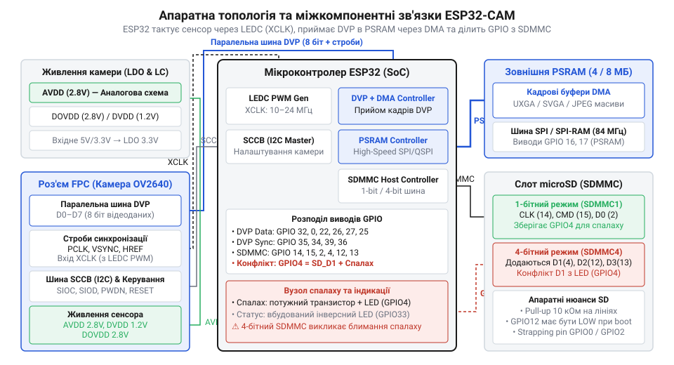
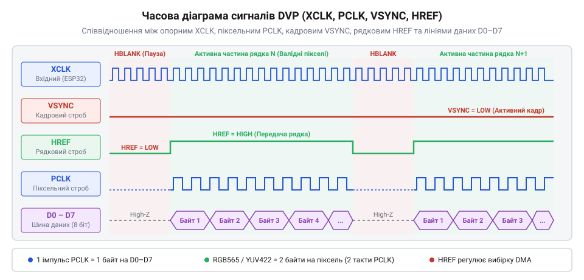
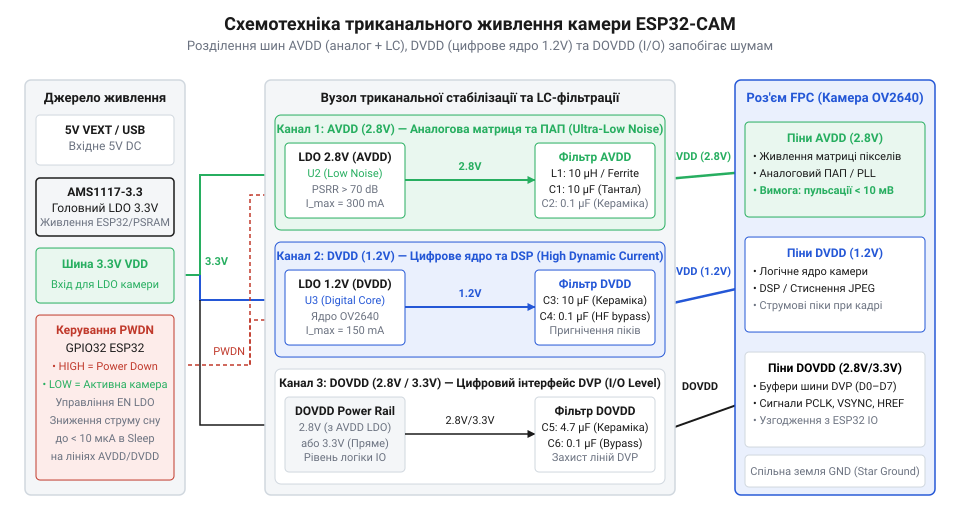

# Модуль ESP32-CAM: огляд архітектури, периферії та сімейства плат

<preknowlist>
- [ESP32-CAM (OV2640 + microSD)](root:cat-hw-boards/esp32-cam) — Апаратна організація плати ESP32-CAM, призначення ніжок та особливості живлення модуля камери.
- [Мікроконтролер ESP32-S3](root:cat-hw-boards/esp32s3-microcontroller) — Архітектура ядра Xtensa LX7, внутрішня пам'ять та апаратні периферійні контролери.
- [Родина плат і модулів на ESP32-S3](root:cat-hw-boards/esp32-s3-boards-family-overview) — Конструктивні варіанти плат з підтримкою відеоінтерфейсів та зовнішньої пам'яті PSRAM.
</preknowlist>

## Апаратно-структурна схема та шина QSPI

Захоплення відеовимогливих кадрів переповнює статичну оперативну пам'ять (від @@en|Static RAM@@ — статична оперативна пам'ять; @@en|SRAM@@), вимагаючи зовнішньої псевдостатичної пам'яті (від @@en|Pseudo-Static RAM@@ — псевдостатична оперативна пам'ять; @@en|PSRAM@@).

*Показано структурну схему взаємозв'язку контролера ESP32, зовнішньої PSRAM та камери.*

На [модулях ESP32-CAM](root:cat-hw-boards/esp32-cam) контролер ділить шину (від @@en|Quad Serial Peripheral Interface@@ — чотирипотоковий послідовний периферійний інтерфейс; @@en|QSPI@@) між @@en|PSRAM@@ та флешпам'яттю (від @@en|Serial Peripheral Interface Flash Memory@@ — послідовна флешпам'ять; @@en|SPI Flash@@). Затримки від змагання за шину усувають розміщенням обробників переривань у пам'яті інструкцій (від @@en|Instruction RAM@@ — оперативна пам'ять інструкцій; @@en|IRAM@@).

## Відеоінтерфейс DVP та строби синхронізації

Налаштування матриці виконує послідовна шина (від @@en|Serial Camera Control Bus@@ — послідовна шина управління камерою; @@en|SCCB@@), а передачу пікселів — паралельний цифровий відеопорт (від @@en|Digital Video Port@@ — цифровий відеопорт; @@en|DVP@@).

*Показано часові співвідношення сигналів тактування XCLK, PCLK та стробів синхронізації.*

Таймери ШІМ-контролера (від @@en|LED PWM Controller@@ — контролер ШІМ світлодіодів; @@en|LEDC@@) подають опорну частоту (від @@en|External Clock@@ — зовнішня тактова частота; @@en|XCLK@@), яку контур автопідстройки (від @@en|Phase-Locked Loop@@ — фазово-замкнена автопідстройка частоти; @@en|PLL@@) перетворює у такти пікселів (від @@en|Pixel Clock@@ — піксельний тактовий сигнал; @@en|PCLK@@). Межі кадрів і рядків задають строби (від @@en|Vertical Synchronization@@ — вертикальна синхронізація; @@en|VSYNC@@) та (від @@en|Horizontal Reference@@ — горизонтальне посилання; @@en|HREF@@), а пауза горизонтального гасіння (від @@en|Horizontal Blanking Interval@@ — інтервал горизонтального гасіння; @@en|HBI@@) вивільняє буфери.

## Триканальне живлення та фільтрація завад

Перемикання цифрових ядер та @@en|Wi-Fi@@ створює шум на знімках.

*Показано принципову схему трьох ліній живлення сенсора з фільтруючими елементами.*

Живлення розділяють на аналогове `AVDD` (`2.8 В`), цифрове `DVDD` (`1.2–1.5 В`) та буфери `DOVDD` (`2.8–3.3 В`). Через падіння ефективності регуляторів (від @@en|Low Dropout Regulator@@ — лінійний регулятор напруги з низьким падінням; @@en|LDO@@) на високих частотах, лінію `AVDD` додатково фільтрують LC-колами з феритовими намистинами (від @@en|Ferrite Bead@@ — феритова намистина; @@en|FB@@).

## Апаратна буферизація кадрів та DMA

Захоплення відеовимогливого потоку реалізує модуль прямого доступу (від @@en|Direct Memory Access@@ — прямий доступ до пам'яті; @@en|DMA@@).

З шини @@en|DVP@@ байти потрапляють у буфер (від @@en|First-In, First-Out@@ — «першим прийшов — першим пішов»; @@en|буфер FIFO@@), звідки @@en|DMA@@ вивантажує їх у @@en|PSRAM@@. Багатобуферність запобігає стану гонитви (від @@en|Race Condition@@ — стан гонитви; @@en|стан гонитви@@) через атомарну підміну дескрипторів за стробом `VSYNC`.

## Розподіл GPIO та усунення конфліктів

Шини камери та картридера вичерпують виводи загального призначення (від @@en|General-Purpose Input/Output@@ — виводи загального призначення; @@en|GPIO@@).

Зміщення рівня на системних виводах (від @@en|Strapping Pins@@ — виводи конфігурації завантаження; @@en|strapping-піни@@) `GPIO0`, `GPIO2`, `GPIO12` блокує запуск процесора. Конфлікт спалаху на `GPIO4` із картридером (від @@en|Secure Digital Multiple Media Card@@ — картридер SD/MMC; @@en|SDMMC@@) усувають 1-бітним режимом або RC-колами ключа (від @@en|Transistor Switch@@ — транзисторний ключ; @@en|транзисторний ключ@@).

## Різновиди плат та критерії вибору

Базові плати AI-Thinker на [версіях ESP32-CAM](root:cat-hw-boards/esp32-cam) гріються, підсилюючи темновий шум (від @@en|Dark Current Noise@@ — темновий шум фотодіодів; @@en|темновий шум@@).

Для автономної роботи використовують M5Stack TimerCam із годинником (від @@en|Real-Time Clock@@ — годинник реального часу; @@en|RTC@@) та мікросхемою живлення (від @@en|Power Management IC@@ — мікросхема управління живленням; @@en|PMIC@@). Для штучного інтелекту беруть модулі на [мікроконтролері ESP32-S3](root:cat-hw-boards/esp32s3-microcontroller), описані в [огляді плат ESP32-S3](root:cat-hw-boards/esp32-s3-boards-family-overview). Зовнішня антена вимагає перепаювання перемички (від @@en|Zero-Ohm Resistor Jumper@@ — перемичка нульового опору; @@en|SMD-перемичка нульового опору@@) на роз'єм @@en|IPEX@@.
