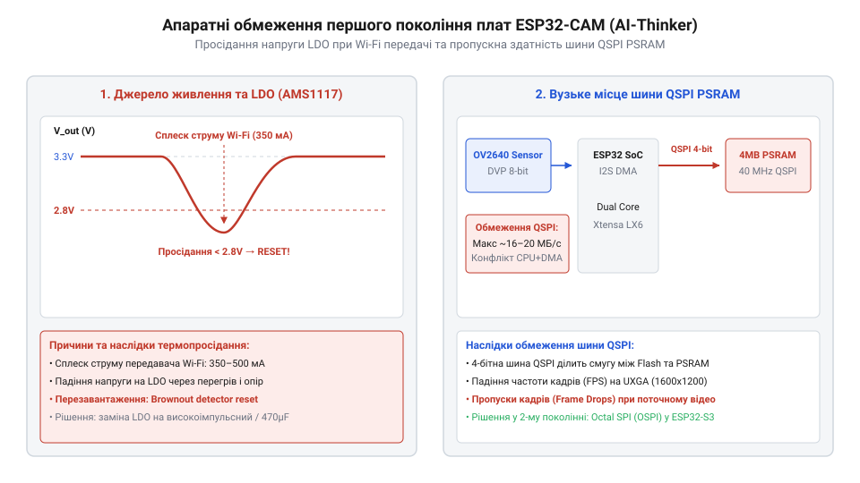
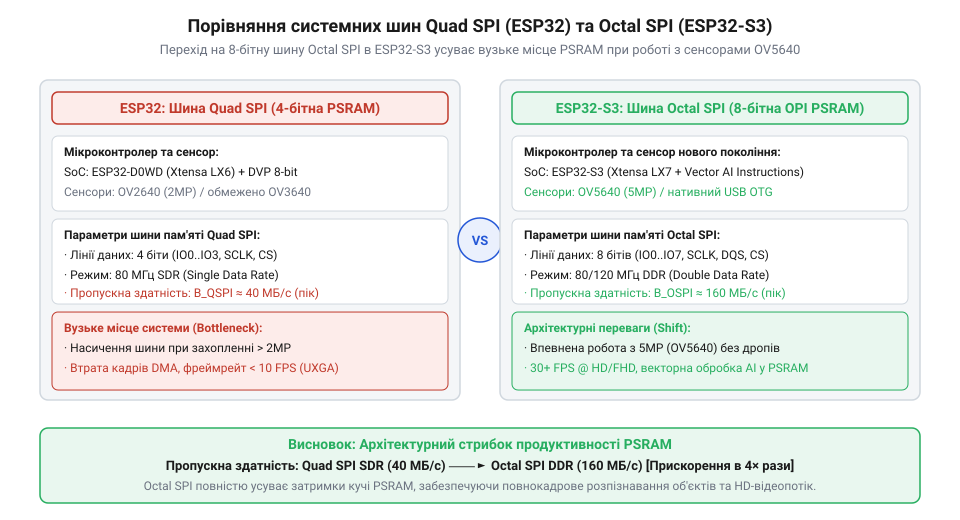

# Еволюція сімейства плат ESP32-CAM та перехід від OV2640 до сучасних сенсорів

<preknowlist>
- [ESP32-CAM (OV2640 + microSD)](root:cat-hw-boards/esp32-cam) — Базове компонування та розпіновка першої масової плати ESP32-CAM.
- [ESP32-CAM з камерою OV3640 (2 МП)](root:cat-hw-boards/esp32-cam-ov3640) — Специфіка підключення сенсорів вищої роздільності OV3640.
- [Мікроконтролер ESP32-S3](root:cat-hw-boards/esp32s3-microcontroller) — Апаратна архітектура ядра ESP32-S3, підтримка USB OTG та Octal SPI.
</preknowlist>

## Поява AI-Thinker ESP32-CAM та компроміси OV2640

У 2018 році китайська компанія AI-Thinker випустила плату [ESP32-CAM (OV2640 + microSD)](root:cat-hw-boards/esp32-cam), створивши переломний момент у ніші бюджетного відеофіксування для пристроїв інтернету речей (від англ. @@en|IoT@@). До цього моменту передача й обробка живого відеопотоку вимагала дорогого одноплатного комп'ютера або спеціалізованих сигнальних процесорів. Спроба отримати зображення на звичайному мікроконтролері впиралася у брак оперативної пам'яті: один кадр у роздільності VGA (640×480 пікселів) у нестисненому форматі RGB565 займав понад 600 кілобайтів, що перевищувало весь обсяг внутрішнього статичного ОЗП (англ. *Static RAM*; @@en|SRAM-пам'ять@@) кристала ESP32.

Розв'язанням цієї проблеми стало поєднання трьох апаратних елементів: двоядерного процесора ESP32, зовнішньої мікросхеми псевдостатичної пам'яті (англ. *Pseudo Static RAM*, від грец. *pseudēs* — несправжній, та англ. *static* — статичний; @@en|PSRAM-пам'ять@@) обсягом 4 мегабайти та фотосенсора OmniVision @@en|OV2640@@. Ключовий прорив полягав у тому, що сенсор містив вбудований кристалічний кодер (від англ. @@en|апаратний JPEG-кодер@@). Замість передачі важких нестиснених масивів сенсор самостійно стискав кадр у формат JPEG безпосередньо під час зчитування з матриці й передавав уже стиснений потік через 8-бітну паралельну шину цифрового відеопорту (англ. *Digital Video Port*; @@en|DVP-інтерфейс@@). Для надійної передачі байтів схемотехніка вимагала суворого узгодження тактування: контролер генерував для камери зовнішній опорний сигнал (англ. *External Clock*; @@en|опорний клок XCLK@@) частотою `10–20 МГц`, з якого внутрішній помножувач сенсора формував синхронний піксельний сигнал (англ. *Pixel Clock*; @@en|сигнал PCLK@@). Вихідний `PCLK` стробував передачу кожного байта на шині `D0`–`D7` строго у межах активного стану стробу горизонтальної синхронізації (англ. *Horizontal Reference*; @@en|строб HREF@@). Точне узгодження дільників частоти `PCLK` з інверсією фази зчитування периферійним вузлом I2S мікроконтролера запобігало розсинхронізації шини, усуваючи ризик випадання байтів та спотворення меж `HREF` під час нерівномірного видавання стисненого JPEG-потоку.

Завдяки цьому розмір одного кадру зменшувався з 600 кілобайтів до 20–50 кілобайтів. Модуль прямого доступу до пам'яті (англ. *Direct Memory Access*; @@en|DMA-контролер@@) мікроконтролера ESP32 зчитував стиснені байтові пакети з DVP-шини та зберігав їх у зовнішній @@en|PSRAM-пам'ять@@ через 4-бітну шину Quad SPI без залучення процесорних ядер. Це дозволило транслювати відеопотік зі швидкістю до 15–20 кадрів на секунду через Wi-Fi за ціни модуля менше за 10 доларів.

Однак заради мінімальних габаритів та наднизької собівартості виробник пішов на суттєві схемотехнічні компроміси. Плата позбулася бортового перетворювача (від англ. @@en|USB-UART адаптер@@), через що первинне прошивання вимагало зовнішнього конвертера, ручного замикання піна GPIO0 на землю під час скидання та суворого контролю напруги живлення.

## Апаратні обмеження, живлення та спростування міфів

Масова експлуатація першої ревізії AI-Thinker виявила критичні слабкі місця в системі електроживлення. Під час активної передачі кадрів через Wi-Fi передавач мікроконтролера споживав короткочасні імпульсні струми амплітудою до 300–500 міліамперів. Встановлений на платі лінійний регулятор зі зниженим падінням напруги (англ. *Low-Dropout*, від англ. *linear* — лінійний, та *drop out* — випадати; @@en|LDO-регулятор@@) серії AMS1117-3.3 не встигав згладжувати ці сплески при живленні від неякісних USB-портів чи довгих дротів. Для усунення перехідного падіння напруги схемотехнічним розв'язанням стало встановлення додаткового резервного джерела енергії — прямо біля виводів живлення LDO впаювали шунтуючий електролітичний накопичувач (англ. *decoupling capacitor*, від англ. *decouple* — розв'язувати, та лат. *condensare* — ущільнювати; @@en|шунтуючий конденсатор@@) ємністю `100–470 мкФ`. Цей буферний накопичувач миттєво віддавав накопичений заряд у момент сплеску споживання Wi-Fi каскаду, розвантажуючи лінійний регулятор і підтримуючи стабільну напругу `3.3 В` без просідань.

*Падіння напруги живлення LDO-регулятора під час сплесків струму Wi-Fi та обмеження шини Quad SPI в першій ревізії AI-Thinker ESP32-CAM.*

Просідання системної напруги нижче за поріг 3.0 вольта викликало перезавантаження за детектором зниження напруги (англ. *brownout detector*; @@en|схема Brownout Detector@@) або призводило до збоїв тактування сенсора. Це проявлялося у вигляді зелених смуг, зміщення кольорів та втрати кадрів. Додатковим вузьким місцем стала пропускна здатність шини Quad SPI, яка використовувалася одночасно для зчитування виконаного коду з флешпам'яті та запису кадрів у @@en|PSRAM-пам'ять@@. При спробі підключити винесене рішення [ESP32-CAM з камерою OV3640](root:cat-hw-boards/esp32-cam-ov3640) роздільністю 2 мегапікселі або сенсори OV5640 пропускна здатність Quad SPI ставала критичним бар'єром, що падав до поодиноких кадрів на секунду.

У спільноті розробників виникла низка хибних уявлень щодо принципів роботи платформи. Найпоширенішим міфом стало твердження, ніби мікроконтролер ESP32 виконує програмне стиснення відеопотоку власними ядрами. Насправді кристал позбавлений векторних інструкцій та апаратних медіаприскорювачів, а програмний розрахунок косинусних перетворень для JPEG на частоті 240 мегагерц знижував би частоту кадрів до 1–2 на секунду. Опрацювання відео можливе виключно завдяки апаратному кодеру всередині самого сенсора @@en|OV2640@@.

Інший міф стверджував про повну програмну сумісність бінарних прошивок між першим поколінням ESP32-CAM та новими платформами. Сучасний [мікроконтролер ESP32-S3](root:cat-hw-boards/esp32s3-microcontroller) має кардинально змінену периферію: він підтримує 8-бітну шину Octal SPI з удвічі більшою пропускною здатністю, містить нативний контролер USB OTG та інші призначені піни для DVP-камери.

*Архітектурні відмінності пропускної здатності шин Quad SPI в ESP32 та Octal SPI у новішому ESP32-S3.*

Еволюційний перехід на [родину плат на ESP32-S3](root:cat-hw-boards/esp32-s3-boards-family-overview) та компактні модулі на кшталт [ESP32-S3-Zero (Type-C, 4 МБ)](root:cat-hw-boards/esp32-s3-zero) остаточно розв'язав проблеми першого покоління, забезпечивши стабільне живлення та високу швидкість обміну з пам'яттю.

## Перехід на ESP32-S3 і сенсори OV5640

Стрімкий розвиток систем комп'ютерного зору на межі 2020 та 2021 років створив гострий дефіцит пропускної здатності шини та обчислювальної потужності першого покоління плат на чипі `ESP32`. Спроби підключення 3.1-мегапіксельних сенсорів `@@en|OV3640@@` та 5-мегапіксельних `@@en|OV5640@@` до класичних планарних плат наштовхнулися на бар'єр 4-бітної шини `@@en|Quad SPI@@` оперативної пам'яті `@@en|PSRAM@@`: вивантаження нестисненого або високодеталізованого кадру з роздільністю `@@en|QSXGA@@` (`2592 × 1944`) спричиняло систематичні переповнення апаратного буфера `@@en|FIFO@@` шини `@@en|DVP@@`. Ситуація ускладнювалася відсутністю нативного `USB`-контролера, через що передача відеопотоку через зовнішній перетворювач `USB-UART` на швидкостях понад `3 Мбод` призводила до випадіння кадрів.

Переломним етапом у 2021 році став випуск мікроконтролера `@@en|ESP32-S3@@` від компанії `Espressif Systems`. Нова архітектура ядра `Xtensa LX7` із тактовою частотою `240 МГц` одержала 8-бітну шину `@@en|Octal SPI@@` (англ. @@en|Octal Peripheral Interface@@, @@en|OPI@@), яка подвоїла ширину каналу обміну з пам'яттю `@@en|PSRAM@@` та підняла пропускну здатність до `80`–`160 МБ/с`. Для досягнення максимальної швидкості `160 МБ/с` у середовищі `@@en|ESP-IDF@@` конфігурують режим подвійної передачі даних за такт `@@en|DDR@@` (англ. *Double Data Rate*, від *double* — подвійний, *data* — дані та *rate* — швидкість; @@en|режим подвійної швидкості DDR@@) на тактовій частоті `80 МГц`. У конфігураторі `sdkconfig` це вимагає активації опції `CONFIG_SPIRAM_MODE_OCT`, вибору частоти `80 МГц` та налаштування ліній стробування `DQS`, оскільки зчитування й запис виконуються по обох фронтах тактового імпульсу `PCLK`. Інтеграція апаратного контролера `@@en|USB OTG@@` (англ. @@en|USB On-The-Go@@) дозволила підключати плату безпосередньо до комп'ютера по шині `USB 1.1 Full-Speed` на швидкості `12 Мбіт/с`, усунувши потребу в проміжних чипах мостів `CP2102` або `CH340`. Завдяки розширеній пам'яті та прямій передачі даних у [мікроконтролері ESP32-S3](root:cat-hw-boards/esp32s3-microcontroller) розробники отримали можливість захоплювати кадри з сенсора `@@en|OV5640@@` у режимі апаратного кодування `@@en|JPEG@@` без втрати синхронізації рядків `@@en|HREF@@`.

Крім шинної адаптації, кристал `@@en|ESP32-S3@@` збагатився векторами обчислень `@@en|SIMD@@` (англ. @@en|Single Instruction, Multiple Data@@ — одна інструкція, багато даних) у складі розширення `@@en|Vector Extension@@`. Векторні інструкції дали змогу паралельно обробляти 16-бітні піксельні відліки без залучення основного циклу програвача. Це дозволило виконувати первинну фільтрацію зображення, бінаризацію та виявлення контурів безпосередньо в процесі прийому даних `@@en|DMA@@` до передачі кадру в мережу `Wi-Fi`, як деталізовано в загальній [родині плат на ESP32-S3](root:cat-hw-boards/esp32-s3-boards-family-overview). Застосування сенсора `@@en|OV3640@@` у поєднанні з новими платами розкрито в [ESP32-CAM з камерою OV3640](root:cat-hw-boards/esp32-cam-ov3640).

## Еволюція сучасних платформ та критерії вибору

Вихід чипа `@@en|ESP32-S3@@` спровокував другу хвилю схемотехнічних інновацій у 2022–2024 роках, перетворивши кустарні модулі з роз'ємами `Pin Header` на високоінтегровані планарні пристрої. Першою ключовою зміною стала відмова від гарячих лінійних регуляторів `@@en|LDO@@` `AMS1117` на користь високоефективних імпульсних `@@en|DC-DC@@` перетворювачів (англ. @@en|Direct Current to Direct Current Converter@@). Заміна `LDO` на керовані `DC-DC` степ-даун конвертери з ККД понад 90% приборкала теплове розсіювання, припинила нагрів фотоматриці від плати та усунула небезпечні просідання напруги живлення під час пікових сплесків передавача `Wi-Fi`.

Другим конструктивним проривом став перехід від 18-пінових роз'ємів типу `DVP Socket` із механічними засувками на надкомпактні 24-пінові гнучкі шлейфові конектори `@@en|FPC@@` (англ. @@en|Flexible Printed Circuit@@ — гнучка друкована плата). Це дозволило розвести додаткові сигнальні лінії автофокуса `@@en|AF@@` (англ. @@en|Auto Focus@@) та імпульсного керування спалахом `@@en|LED@@`. Одночасно інженери перейшли від 2-шарових плат до 4-шарового друкованого трасування, де внутрішні шари виділили під суцільні площини землі та живлення, а високошвидкісні лінії шини `@@en|DVP@@` розвели з копланарним земляним екрануванням. Прокладання заземлених трас обабіч лінії тактування `PCLK` та ліній даних `D0`–`D7` із частим кроком перехідних отворів узгоджує хвильовий імпеданс і усуває перехресні наведення (англ. *crosstalk*, від *cross* — перехресний та *talk* — розмова; @@en|перехресні наведення crosstalk@@), запобігаючи фазовому тремтінню пікселів при зніманні на високих частотах. Форм-фактори модулів розділилися на кілька спеціалізованих лінійок:

Модулі серії `@@en|Waveshare@@`, такі як [Waveshare ESP32-S3R2](root:cat-hw-boards/esp32-s3r2-waveshare), орієнтовані на промислові вузли з підвищеними вимогами до передачі даних, оскільки використовують 16 МБ `Flash` та 2 МБ `@@en|PSRAM@@` із вбудованою 3D-антеною. Для компактних пристроїв та носимої електроніки розроблено плату [ESP32-S3 SuperMini](root:cat-hw-boards/esp32-s3-supermini), де мініатюрні габарити поєднуються з вбудованим роз'ємом `USB Type-C`. У завданнях, що вимагають граничної економії площі друкованої плати, застосовують [ESP32-S3-Zero](root:cat-hw-boards/esp32-s3-zero) або компактний модуль [Waveshare ESP32-S3-Pico](root:cat-hw-boards/esp32-s3-pico).

Вибір оптимальної конфігурації для задач комп'ютерного зору спирається на три критерії: роздільну здатність кадру, необхідність локального аналізу та умови освітлення. Для простих відеострімерів розпізнавання облич достатньо класичної [плати ESP32-CAM](root:cat-hw-boards/esp32-cam) із сенсором `@@en|OV2640@@`. Якщо завдання вимагає високої деталізації (розпізнавання текстів чи зчитування штрихкодів) та локального виконання нейромережевих моделей, вибір робиться на користь `@@en|ESP32-S3@@` з `@@en|Octal SPI PSRAM@@` та сенсором `@@en|OV5640@@`, що забезпечує стабільну роботу системи без пропуску кадрів.
