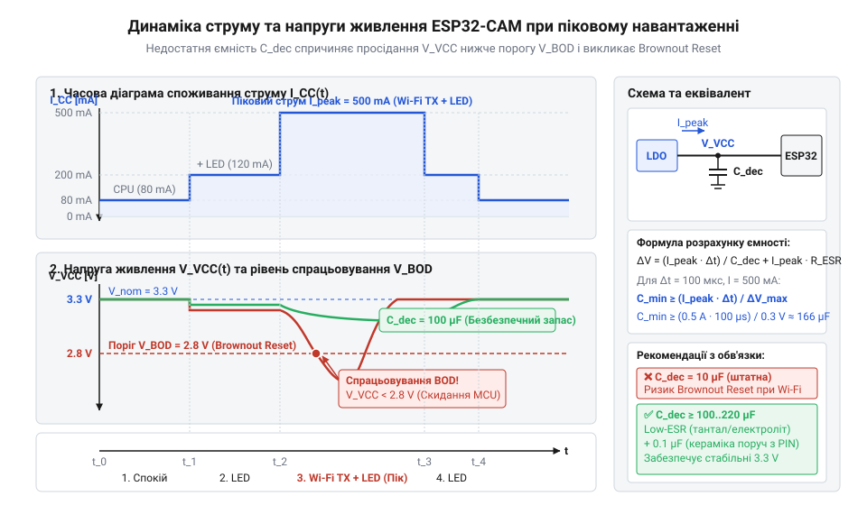
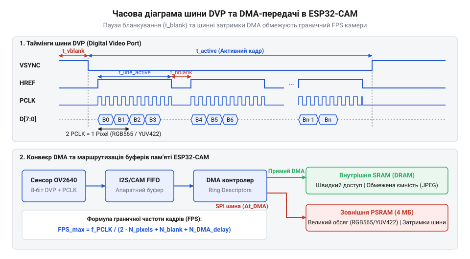
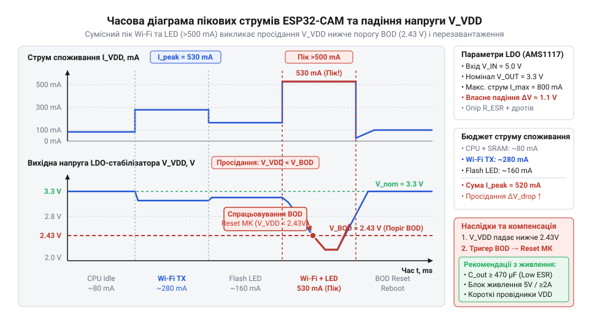

# Математичний розрахунок кадрових буферів, пропускної здатності DVP та енергоспоживання ESP32-CAM

<preknowlist>
- [ESP32-CAM (OV2640 + microSD)](root:cat-hw-boards/esp32-cam) — Апаратне влаштування плати ESP32-CAM, розпінування шини DVP, принципи роботи з камерою OV2640 та наявність зовнішньої PSRAM.
</preknowlist>

## Причини збоїв потокового відео ESP32-CAM

Спроба організувати безперервну трансляцію відеопотоку за допомогою поширеного модуля [ESP32-CAM](root:cat-hw-boards/esp32-cam) (від англ. @@en|camera@@ — камера, з лат. @@la|camera@@ — склепінчаста кімната) без попереднього апаратного та математичного розрахунку майже завжди призводить до виникнення хаотичних перезавантажень пристрою, падіння частоти кадрів або раптового зупинення прошивки з помилкою вичерпання пам'яті. Головна причина нестабільності полягає в тому, що обробка відеосигналу висуває екстремальні вимоги одночасно до двох критичних ресурсів мікроконтролера — системи живлення та оперативної пам'яті.

Фізична природа апаратних збоїв криється у високій піковій динаміці споживання струму. В момент, коли двоядерний процесор `@@en|ESP32@@` здійснює захоплення кадру та його програмне оброблення, передавач `@@en|Wi-Fi@@` генерує радіочастотні імпульси (`@@en|TX burst@@`), споживаючи у піках від 350 до 500 мА. Якщо паралельно активовано світлодіодний спалах на `@@en|GPIO4@@` (струм споживання близько 100–150 мА) та сенсор `@@en|OV2640@@` (40–100 мА), сумарне пікове навантаження на лінію 3.3 В короткочасно перевищує 800 мА.

Супровідна схемотехніка платформами початкового рівня зазвичай оснащується компактними лінійними стабілізаторами напруги зі звичайним падінням напруги (`@@en|LDO@@`, англ. @@en|Low Dropout@@ — низьке падіння напруги, від англ. @@en|drop@@ — падіння, @@en|out@@ — вихід), такими як `@@en|AMS1117-3.3@@` або `@@en|ME6211@@`. При зростанні струму на власному внутрішньому опорі стабілізатора та підвідних провідниках виникає падіння напруги. Якщо вхідне живлення 5 В просідає через тонкий `@@en|USB@@`-кабель чи дріт `@@en|DuPont@@`, різниця між входом і виходом стає меншою за мінімальну межу роботи стабілізатора (`V_dropout ≈ 1.1 В` для `@@en|AMS1117@@`), що спричиняє глибоку просадку напруги на лінії 3.3 В.


*Підпис: Часова діаграма пікових струмів живлення ESP32-CAM та відповідного падіння напруги на LDO-стабілізаторі нижче порога спрацьовування детектора brownout.*

Коли напруга на шині 3.3 В падає нижче критичної позначки близько 2.8 В, спрацьовує апаратний детектор просідання живлення `@@en|BOD@@` (від англ. @@en|brownout detector@@ — детектор зниження напруги, де @@en|brownout@@ — просідання живлення, від @@en|brown@@ — затемнення, @@en|out@@ — згасання), який моментально скидає мікроконтролер у перезавантаження з виведенням у лог повідомлення `@@en|Brownout detector was triggered@@`. Принципи роботи внутрішніх схем скидання контролера при падінні напруги живлення розкрито у матеріалі про [виявник просідання напруги Brownout Detector в ESP32](root:hw-arch/brown-out-reset-detector).

Для компенсації короткочасних піків споживання струму в коло живлення необхідно встановлювати фільтруючі та резервуарні конденсатори відповідної ємності. Мінімально необхідна ємність конденсатора `C_min` для утримання напруги протягом тривалості імпульсу `Δt` обчислюється за базовим физичним співвідношенням накопичення заряду:

C_min = (ΔI × Δt) ÷ ΔV
= (0.5 × 100 × 10⁻⁶) ÷ 0.3 [струм × час ÷ допустиме падіння напруги]
= 1.667 × 10⁻⁶ Ф         [обчислена ємність у фарадах]
= 166.7 μФ                 [мінімально необхідна розв'язувальна ємність]

Отже, встановлення електролітичного або тантал-полімерного конденсатора ємністю від 220 μФ до 470 μФ паралельно керамічному на 0.1 μФ безпосередньо біля виводів живлення модуля повністю нівелює ризик критичного просідання напруги під час радіовипромінювання.

З програмного боку головною причиною збоїв є фатальний дефіцит внутрішньої статичної оперативної пам'яті `@@en|SRAM@@`. Загальний обсяг `@@en|SRAM@@` у кристалі `@@en|ESP32@@` становить 520 КБ, з яких після ініціалізації операційної системи та стека `@@en|Wi-Fi@@` під динамічну купу залишається менш ніж 300 КБ. Якщо розробник намагається виділити безпосередньо в внутрішній `@@en|SRAM@@` один `@@en|кадровий буфер@@` (від англ. @@en|buffer@@ — проміжне сховище, з давньофр. @@fr|bouffard@@ — щось, що пом'якшує поштовх) неспрямованого відео для високої роздільної здатності, системний розподільник пам'яті звертається із помилкою `@@en|Out of Memory@@`, або виникає виняткова ситуація `@@en|Guru Meditation Error@@`.

Перехід на більш потужні мікроконтролери, які демонструє сучасна [родина ESP32-S3](root:cat-hw-boards/esp32-s3-boards-family-overview), вирішує частину обчислювальних обмежень, однак базові математичні закони розподілу пам'яті та часових затримок шини передачі даних залишаються однаковими для всіх мікроконтролерних систем із кадровим захопленням.

## Розрахунок обсягу кадрових буферів RAM

Розмір кадрового буфера залежить від геометричної роздільної здатності матриці, колірного формату пікселів та способу організації буферної черги.

У форматах без стиснення кожен піксель кодується фіксованою кількістю бітів. Формат `@@en|RGB565@@` використовує 16 бітів (2 байти) на піксель: 5 бітів на червоний, 6 на зелений і 5 на синій. Простір `@@en|YUV422@@` також вимагає 2 байти на піксель через субдискретизацію колірності. Обчислення нестисненого обсягу пам'яті `S_raw` для кадру `UXGA` (1600 × 1200 пікселів) здійснюється так:

N_pixels = W × H
= 1600 × 1200             [кількість пікселів у матриці UXGA]
= 1920000 пікселів        [загальне число елементів зображення]

S_raw = N_pixels × BPP
= 1920000 × 2             [2 байти на піксель для форматів RGB565 чи YUV422]
= 3840000 байт            [загальний обсяг одного кадру в байтах]
= 3.662 МБ                [3840000 ÷ (1024 × 1024)]

Значення 3.662 МБ перевищує обсяг внутрішньої `@@en|SRAM@@` (520 КБ). Тому збереження нестисненого кадру `UXGA` чи `SVGA` (800 × 600, 960 КБ) принципово неможливе без зовнішньої псевдостатичної пам'яті `@@en|PSRAM@@` (4 або 8 МБ).

Альтернативою є апаратне стиснення у формат `@@en|JPEG@@` всередині сенсора `@@en|OV2640@@`. Розмір кадру зменшується в `K_jpg` разів залежно від налаштування якості `@@en|jpeg_quality@@` (від 1 до 63, де менше число означає вищу якість):

S_jpeg = S_raw ÷ K_jpg
= 960 ÷ 15                [нестиснений кадр SVGA 960 КБ ÷ коефіцієнт стиснення 15]
= 64 КБ                   [підсумковий обсяг стисненого кадру JPEG]

Кадр `@@en|JPEG@@` обсягом 64 КБ розміщується у внутрішній `@@en|SRAM@@`, що дозволяє транслювати відео навіть на платах без `@@en|PSRAM@@`.

Для високої частоти кадрів без розривів застосовують подвійну буферизацію (`@@en|double buffering@@`, параметр `@@en|fb_count@@` = 2). За одиночного буфера (`@@en|single buffer@@`) модуль `@@en|DMA@@` (англ. @@en|Direct Memory Access@@ — прямий доступ до пам'яті, від лат. @@la|directus@@ — прямий, та @@la|memoria@@ — пам'ять) заповнює пам'ять, поки процесор очікує передачі. При подвійній буферизації `@@en|DMA@@` записує новий кадр N+1 у Буфер А, поки процесор паралельно передає по `@@en|Wi-Fi@@` кадр N із Буфера Б.

Сумарна пам'ять `S_total` з урахуванням системних дескрипторів `@@en|DMA@@` (`@@en|lldesc_t@@`, від лат. @@la|descriptor@@ — той, що описує) обчислюється так:

S_total = (S_frame × N_buffers) + (N_desc × 12)

Контролер `@@en|DMA@@` розбиває масив пам'яті на блоки до 4092 байтів. Кожен дескриптор займає 12 байтів у `@@en|SRAM@@`. Для кадру `@@en|JPEG@@` розміром 64 КБ кількість дескрипторів становить `N_desc = ⌈65536 ÷ 4092⌉ = 16`, що вимагає 192 байти службової пам'яті.

Налаштування кадрових буферів для подвійної буферизації:

:::tabs
@tab C (ESP-IDF)
:::code math-esp32-cam-frame-buffer-bandwidth/c/esp-idf/snippet-1.c
@tab C++ (Arduino)
:::code math-esp32-cam-frame-buffer-bandwidth/cpp/arduino/snippet-2.cpp
:::

Плата [Waveshare ESP32-S3R2](root:cat-hw-boards/esp32-s3r2-waveshare) зі швидкісною `@@en|PSRAM@@` спрощує розміщення подвійних буферів, тоді як модуль [ESP32-CAM](root:cat-hw-boards/esp32-cam) вимагає дотримання розрахованих лімітів.

## Пропускна здатність DVP та FPS

Гранична швидкість відеознімання (частота кадрів `@@en|FPS@@`, англ. @@en|Frames Per Second@@ — кадрів на секунду) визначається пропускною здатністю 8-бітної шини `@@en|DVP@@` (англ. @@en|Digital Video Port@@ — цифровий відеопорт, від лат. @@la|portus@@ — гавань, вхід) і тактовою частотою `@@en|PCLK@@` (англ. @@en|Pixel Clock@@ — тактова частота пікселів, від грец. @@grc|пíξел@@ / англ. @@en|pixel@@ — елемент зображення, та англ. @@en|clock@@ — годинник).

Шина `@@en|DVP@@` містить 8 ліній даних D0–D7, сигнали `@@en|HREF@@`, `@@en|VSYNC@@` та `@@en|PCLK@@`, за висхідним фронтом якого сенсор `@@en|OV2640@@` передає кожен байт.


*Підпис: Часова діаграма сигналів шини DVP та процес каскадного заповнення дескрипторів DMA під час захоплення кадру.*

Пропускна здатність шини `B_bus` при `@@en|PCLK@@` = 20 МГц обчислюється так:

B_bus = PCLK × Bus_width
= 20000000 × 1            [20 МГц × 1 байт на такт PCLK]
= 20000000 байт/с         [максимальна сира швидкість шини 20 МБ/с]

У форматах `@@en|RGB565@@` чи `@@en|YUV422@@` кожен піксель вимагає 2 байти (2 такти `@@en|PCLK@@`). З урахуванням інтервалів горизонтального й вертикального гасіння коефіцієнт часового накладу становить `K_blank ≈ 1.3`.

Максимально досяжна частота `@@en|FPS@@` для роздільної здатності `SVGA` (800 × 600) при кодуванні `@@en|YUV422@@` та `@@en|PCLK@@` = 20 МГц обчислюється так:

N_cycles_frame = W × H × Cycles_per_pixel × K_blank
= 800 × 600 × 2 × 1.3    [800 × 600 пікселів × 2 такти/піксель × 1.3 коефіцієнт гасіння]
= 1248000 тактів         [загальне число тактів PCLK на один кадр]

FPS_max = PCLK ÷ N_cycles_frame
= 20000000 ÷ 1248000     [20 МГц ÷ 1248000 тактів на кадр]
= 16.026 кадр/с          [гранична теоретична частота кадрів]

У режимі `@@en|JPEG@@` сенсор зчитує матрицю з фіксованою розгорткою, але його `@@en|FIFO@@`-буфер видає стиснений потік з меншою щільністю. Внутрішній `@@en|DSP@@` сенсора `@@en|OV2640@@` обмежує частоту кадрів до 15 `@@en|FPS@@` для `UXGA` (1600 × 1200), 30 `@@en|FPS@@` для `SVGA` та 60 `@@en|FPS@@` для `VGA`. JPEG@@ сенсор зчитує | Детальніше про функціонування внутрішнього DSP та налаштування масиву пікселів читайте в матеріалі про [архітектуру та внутрішні реєстри сенсора OV2640](root:cat-hw-sensors/ov2640-sensor-architecture).

Вузьким місцем є й шина пам'яті `@@en|PSRAM@@`: запис даних із `@@en|DVP@@` через `@@en|SPI@@`/`@@en|QSPI@@` (40/80 МГц) змагається з доступом процесора. При її насиченні приймач `@@en|DMA@@` втрачає байти, спричиняючи горизонтальні смуги або збій `@@en|Camera capture failed@@`. Детальний розбір функціонування шини SPI/QSPI та її арбітражу з DMA викладено у статті про [схемотехніку та затримки шини PSRAM в ESP32](root:hw-arch/spiram-psram).

Шини `@@en|MIPI-CSI@@` у [мікроконтролері ESP32-P4](root:cat-hw-boards/esp32-p4-microcontroller) усувають обмеження `@@en|DVP@@`, тоді як для [ESP32-CAM](root:cat-hw-boards/esp32-cam) точне узгодження частоти `@@en|PCLK@@` і роздільної здатності є обов'язковим.

## Енергобюджет та падіння напруги LDO

Під час одночасного захоплення відеопотоку та передачі даних мережею @@en|Wi-Fi@@ споживання струму модулем @@en|ESP32-CAM@@ набуває імпульсного характеру. Короткочасні сплески струму спричиняють перезавантаження мікроконтролера, навіть коли середнє споживання не перевищує спроможностей джерела живлення.

Імпульсні навантаження формуються сумою споживань усіх активних вузлів: два ядра @@en|Xtensa LX6@@ на частоті `240 МГц` під час обробки @@en|DMA@@ (від англ. @@en|Direct Memory Access@@ — прямий доступ до пам'яті) вимагають `200 мА`, передавач @@en|Wi-Fi TX@@ додає до `450 мА`, @@en|LED-спалах@@ на виводі @@en|GPIO4@@ — `120 мА`, сенсор @@en|OV2640@@ — `40 мА`, а чип @@en|PSRAM@@ (від англ. @@en|Pseudo Static RAM@@ — псевдостатична оперативна пам'яті) — `30 мА`.

Сумарний піковий струм `I_peak` у найгіршому сценарії є сумою струмів обчислювальних ядер `I_CPU`, передавача `I_WiFi`, спалаху `I_LED`, сенсора `I_CAM` та пам'яті `I_PSRAM`:

```
I_peak
= I_CPU + I_WiFi + I_LED + I_CAM + I_PSRAM      [сумування струмів споживання]
= 200 + 450 + 120 + 40 + 30                      [підстановка пікових значень, мА]
= 840 мА                                         [підсумковий піковий струм]
```

Для пониження вхідної напруги `5 В` до робочих `3.3 В` використовується @@en|LDO-стабілізатор@@ @@en|AMS1117-3.3@@ із мінімальним падінням напруги `V_dropout = 1.1 В` при струмі `800 мА`. При живленні через провідники з опором `R_wire = 0.5 Ом` падіння напруги `V_drop_wire` обчислюється за законом Ома:

```
V_drop_wire
= I_peak × R_wire                                [закон Ома для опору провідника]
= 0.84 А × 0.5 Ом                                [підстановка струму й опору]
= 0.42 В                                         [падіння напруги на дротах]
```

При вхідній напрузі `V_in = 5.0 В` на вхід стабілізатора надходить лише `4.58 В`. Якщо струм зростає, напруга лінії `3.3 В` просідає нижче порогу `V_BOD ≈ 2.43–2.8 В` детектора @@en|Brownout Detector@@, що викликає @@en|brownout reset@@ і перезавантаження пристрою.


_Динаміка споживання струму під час передачі даних по Wi-Fi та спрацьовування спалаху LED, що призводить до просідання VDD нижче порогу Brownout Detector._

Імпульсні сплески струму `I_burst` тривалістю `Δt = 1 мс` під час передачі пакета компенсують паралельні @@en|декаплінг-конденсатори@@ (від англ. @@en|decoupling@@ — розв'язування кіл). Вони віддають накопичений заряд `ΔQ`, обмежуючи просідання напруги до допустимих `ΔV_max = 0.2 В`. Без урахування опору @@en|ESR@@ (від англ. @@en|Equivalent Series Resistance@@ — еквівалентний послідовний опір) мінімальна ємність `C_min` обчислюється з рівняння збереження заряду:

```
C_min
= (I_burst × Δt) ÷ ΔV_max                        [рівняння збереження заряду]
= (0.50 А × 0.001 с) ÷ 0.2 В                     [підстановка струму сплеску, часу та ΔV]
= 0.0005 ÷ 0.2                                   [проміжний розрахунок]
= 0.0025 Ф                                       [значення в фарадах]
= 2500 мкФ                                       [переведення у мікрофаради]
```

Опір `R_ESR = 0.05 Ом` викликає додаткове падіння напруги `V_ESR = I_burst × R_ESR = 0.025 В`, зменшуючи ефективний запас до `ΔV_effective = ΔV_max - V_ESR = 0.175 В` та збільшуючи ємність до `2857 мкФ`. Тому для [плати ESP32-CAM](root:cat-hw-boards/esp32-cam) на лінію `5 В` встановлюють танталовий або електролітичний конденсатор на `470–1000 мкФ` разом із керамічним на `10 мкФ`.

## Проєктування оптимальної конфігурації ESP32-CAM

Проєктування стабільної системи на базі @@en|ESP32-CAM@@ вимагає узгодження трьох математичних обмежень: обсягу @@en|кадрового буфера@@ (від англ. @@en|frame buffer@@) у пам'яті @@en|SRAM@@ або @@en|PSRAM@@, пропускної здатності 8-бітної шини @@en|DVP@@ (від англ. @@en|Digital Video Port@@ — цифровий відеопорт) та пікового енергобюджету. Нехтування бодай одним із цих факторів призводить або до вичерпання оперативної пам'яті, або до викривлення кадрів через втрату @@en|DMA-дескрипторів@@ @@en|lldesc_t@@, або до перезавантажень від @@en|Brownout Detector@@.

Методологія проєктування складається з трьох послідовних розрахункових кроків:

1. Розрахунок пам'яті та вибір буферизації: Внутрішня пам'ять @@en|SRAM@@ (доступно близько `300 КБ` під @@en|heap@@) здатна вмістити подвійну буферизацію @@en|double buffering@@ лише для роздільної здатності @@en|QVGA@@ (`320 × 240` пікселів, `2 × 153.6 КБ = 307.2 КБ` — на межі вичерпання). Для вищих роздільних здатностей (@@en|VGA@@, @@en|SVGA@@, @@en|UXGA@@) обов'язковим є використання зовнішньої @@en|PSRAM@@ або перехід на стиснення @@en|JPEG@@ безпосередньо у сенсорі @@en|OV2640@@.

2. Обчислення тактування DVP та граничного FPS: Частота піксельного тактування @@en|PCLK@@ визначає швидкість передачі байтів по шині @@en|DVP@@. Максимальна частота кадрів @@en|FPS@@ обчислюється з урахуванням коефіцієнта інтервалів гасіння `K_blank ≈ 1.2–1.35`. Для роздільної здатності @@en|VGA@@ (`640 × 480`), формату @@en|RGB565@@ (`2 байти/піксель`), `K_blank = 1.25` та частоти `PCLK = 20 МГц` маємо:

```
FPS_max
= f_PCLK ÷ (W × H × K_blank × B_pixel)           [формула частоти кадрів DVP]
= 20000000 ÷ (640 × 480 × 1.25 × 2)              [підстановка параметрів шини DVP]
= 26.04 кадр/с                                   [гранична частота кадрів]
```

Якщо передавальний канал @@en|Wi-Fi@@ не здатний пропустити такий потік (`26 × 614.4 КБ ≈ 16 МБ/с = 128 Мбіт/с`), виникає деградація кадрового потоку та перевиповнення буферів.

3. Балансування енергобюджету та теплового стану LDO: Середня споживана потужність `P_d` на @@en|LDO-стабілізаторі@@ викликає його нагрівання. Теплова потужність розсіювання обчислюється за формулою:

```
P_d
= (V_in - V_out) × I_avg                         [формула теплових втрат LDO]
= (5.0 В - 3.3 В) × 0.35 А                       [підстановка середнього струму під час стрімінгу]
= 0.595 Вт                                       [розсіювана теплова потужність]
```

При тепловому опорі корпусу @@en|SOT-223@@ `θ_JA = 90 °C/Вт`, перегрів стабілізатора над температурою навколишнього середовища `T_amb = 25 °C` становить `ΔT = P_d × θ_JA = 0.595 × 90 = 53.55 °C`, що розігріває кристал до `78.55 °C`. Додавання @@en|LED-спалаху@@ збільшує `I_avg` до `0.5 А`, підвищуючи температуру до `101.5 °C`, що наближається до межі теплового відключення `125 °C`.


_Граф рішень для вибору роздільної здатності, стиснення, частоти кадрів та схем живлення ESP32-CAM на основі обмежень RAM, DVP та енергобюджету._

На основі виведеної методології виділяються три базові конфігурації для [модуля ESP32-CAM](root:cat-hw-boards/esp32-cam):

* Режим комп'ютерного зору низької затримки: @@en|QVGA@@ (`320 × 240`), формат @@en|RGB565@@, 2 кадрових буфери в @@en|SRAM@@, `PCLK = 10 МГц`, `FPS = 15`. Низький струм `I_avg ≈ 180 мА`, PSRAM не використовується, відсутні затримки шини @@en|SPI@@.
* Режим високої чіткості MJPEG стрімінгу: @@en|SVGA@@ (`800 × 600`), формат @@en|JPEG@@ (коефіцієнт стиснення `1:10`), 2 буфери у @@en|PSRAM@@, `PCLK = 20 МГц`, `FPS = 25`. Споживання `I_avg ≈ 320 мА`, піки `800 мА`. Вимагає обов'язкового встановлення фільтруючого конденсатора `470 мкФ`.
* Автономний знімок вищої якості (Snapshot): @@en|UXGA@@ (`1600 × 1200`), формат @@en|JPEG@@ з увімкненням @@en|LED-спалаху@@ на `100 мс`. Робота в циклі @@en|Deep Sleep@@. Піковий струм `850 мА`, високе теплове навантаження під час спалаху.

При потребі масштабування обчислень до складніших нейромережевих моделей або обробки декількох потоків доцільно розглядати перехід на потужніші платформи на кшталт [мікроконтролера ESP32-S3](root:cat-hw-boards/esp32s3-microcontroller) або новіші рішення на [мікроконтролері ESP32-P4](root:cat-hw-boards/esp32-p4-microcontroller), які мають апаратне прискорення vector-інструкцій та розширений @@en|MIPI CSI@@ інтерфейс.

Для забезпечення надійної ініціалізації в коді прошивки виконують динамічну перевірку наявності @@en|PSRAM@@ та корекцію параметрів захоплення:

```tabs
:::tab C (ESP-IDF)
```c|esp-idf
#include "esp_camera.h"
#include "esp_system.h"
#include "esp_psram.h"

static camera_config_t camera_config = {
    .pin_pwdn     = 32,
    .pin_reset    = -1,
    .pin_xclk     = 0,
    .pin_sccb_sda = 26,
    .pin_sccb_scl = 27,
    // піни даних DVP (d0-d7)
    .pin_vsync    = 25,
    .pin_href     = 23,
    .pin_pclk     = 22,
    .xclk_freq_hz = 20000000,
    .ledc_timer   = LEDC_TIMER_0,
    .ledc_channel = LEDC_CHANNEL_0,
    .pixel_format = PIXFORMAT_JPEG,
    .frame_size   = FRAMESIZE_SVGA,
    .jpeg_quality = 12,
    .fb_count     = 1
};

esp_err_t init_camera_safe(void) {
    if (esp_psram_is_initialized()) {
        camera_config.frame_size = FRAMESIZE_SVGA;
        camera_config.fb_count = 2;
        camera_config.fb_location = CAMERA_FB_IN_PSRAM;
    } else {
        camera_config.frame_size = FRAMESIZE_QVGA;
        camera_config.pixel_format = PIXFORMAT_RGB565;
        camera_config.fb_count = 1;
        camera_config.fb_location = CAMERA_FB_IN_DRAM;
    }
    return esp_camera_init(&camera_config);
}
```
:::
:::tab C++ (Arduino)
:::code math-esp32-cam-frame-buffer-bandwidth/cpp/arduino/setupcamera.cpp
:::
:::

```