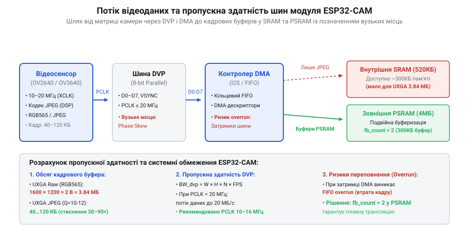

# Розрахунок обсягу кадрових буферів та пропускної здатності шин ESP32-CAM

<preknowlist>
- [ESP32-CAM (OV2640 + microSD)](root:cat-hw-boards/esp32-cam) — Апаратна конфігурація модуля ESP32-CAM та організація PSRAM і DVP-інтерфейсу
- [ESP32-CAM з камерою OV3640 (2 МП)](root:cat-hw-boards/esp32-cam-ov3640) — Робота з сенсорами високої роздільності та особливості підтримки кадрових буферів
</preknowlist>

## Дефіцит пам'яті та виклики кадрового буфера

При розробці систем комп'ютерного зору та потокового відео на мікроконтролерах головним обмеженням виступає доступний обсяг оперативної пам'яті для розміщення кадрового буфера (англ. @@en|framebuffer@@ — кадровий буфер). Кадровий буфер являє собою неперервний масив у пам'яті, де зберігаються цифрові значення пікселів зображення, отримані від матриці камери перед їх подальшою обробкою чи передачею в мережу.

Внутрішня статична оперативна пам'ять (англ. @@en|SRAM@@ — статична оперативна пам'ять) мікроконтролера ESP32 має загальний обсяг `520 кБ`, однак через системні потреби, розміщення стеку операційної системи FreeRTOS та фрагментацію пам'яті максимальний неперервний блок доступної DRAM рідко перевищує `160`–`200 кБ`. Спроба виділити в цій зоні кадровий буфер для несжиманого зображення високої роздільності завершується помилкою брак пам'яті. Для подолання цього бар'єра модулі [ESP32-CAM](root:cat-hw-boards/esp32-cam) оснащуються зовнішньою псевдостатичною оперативною пам'яттю (англ. @@en|PSRAM@@ — псевдостатична оперативна пам'ять) обсягом `4 МБ`, яка підключається через високошвидкісну шину SPI та дозволяє утримувати кілька повнорозмірних кадрових буферів.

Основними параметрами, що визначають розмір кадрового буфера `S_frame`, є ширина кадру в пікселях `W`, висота кадру в пікселях `H` та кількість байтів на один піксель `N_b`.

Під час виклику функції отримання кадру `esp_camera_fb_get()` операційна система через драйвер камери запитує виділення неперервного блоку пам'яті за допомогою системного розподілювача купи `heap_caps_malloc()`. Для масивів високої роздільності драйвер намагається виділити буфер у зовнішній PSRAM із вимогою атрибута `MALLOC_CAP_SPIRAM`. Якщо ж виділення виконується у внутрішній динамічній пам'яті DRAM (англ. @@en|heap@@ — купа пам'яті), багаторазові динамічні виклики створення та звільнення буферів у поєднанні з роботою стека FreeRTOS та Wi-Fi драйвера спричиняють фрагментацію купи (англ. @@en|heap fragmentation@@ — фрагментація купи). При фрагментації сумарний обсяг вільної DRAM може залишатися достатнім, однак розмір найбільшого суцільного фрагмента виявляється меншим за розраховану величину `S_frame`, через що виклик `esp_camera_fb_get()` зазнає невдачі й повертає порожній вказівник `NULL`.

Для запобігання артефактам розриву зображення (англ. @@en|tearing@@ — розрив кадру) при одночасній зйомці та передачі відеопотоку використовують механізм подвійної буферизації (англ. @@en|double buffering@@ — подвійна буферизація), що налаштовується параметром `fb_count = 2`. При використанні єдиного буфера (`fb_count = 1`) контролер @@en|DMA@@ починає записувати наступний піксельний кадр у той самий неперервний масив пам'яті, з якого прикладний стек у цей же момент зчитує дані для надсилання в мережу, що призводить до відображення гібридного кадру з двох різних моментів часу. Налаштування `fb_count = 2` виділяє у зовнішній @@en|PSRAM@@ два незалежних буфери сумарним обсягом `S_total = 2 × S_frame`: доки контролер @@en|DMA@@ апаратно заповнює один буфер новими даними від камери, передавач Wi-Fi або обробник кадрів монопольно зчитує повністю сформований другий буфер, що усуває розриви кадрів і підвищує частоту кадрів (FPS) ціною подвоєння витрат оперативної пам'яті.

## Розрахунок обсягу нестиснених і JPEG-кадрів

Точний розмір кадрового буфера для нестиснених форматиів кодування обчислюється шляхом прямого множення геометричної роздільності кадру на байтову щільність пікселя:

```
S_frame = W × H × N_b
```

У форматі RGB565 (англ. @@en|RGB565@@ — 16-бітове кодування кольору) на один піксель припадає 5 бітів червоного, 6 бітів зеленого та 5 бітів синього кольору, що становить `N_b = 2 Б`. У форматі YUV422 (англ. @@en|YUV422@@ — кодування з яскравосною та колірнорізницевою компонентами) два сусідніх пікселі описуються чотирма байтами, що також дає середню щільність `N_b = 2 Б`.

Проведемо розрахунок необхідного обсягу пам'яті для нестисненого кадру роздільності SVGA (`800 × 600` пікселів) у форматі RGB565:

```
S_SVGA = W × H × N_b
       = 800 × 600 × 2 Б           [множення роздільності на глибину кольору]
       = 960 000 Б                  [розмір у байтах]
       ≈ 937.5 кБ                   [ділення на 1024]
```

Порівняння отриманого значення `937.5 кБ` із лімітом внутрішньої @@en|SRAM@@ (`~160 кБ`) показує неможливість збереження сирого кадру SVGA у внутрішній пам'яті, що робить наявність @@en|PSRAM@@ критичною умовою.

Для зменшення вимог до пам'яті застосовують стиснення JPEG (англ. @@en|JPEG compression@@ — стиснення JPEG). Обсяг стисненого кадру `S_jpeg` є статистичною величиною, яка залежить від коефіцієнта стиснення `K_jpeg` (типово від `1:10` до `1:25`) та фактора якості (англ. @@en|quality factor@@):

```
S_jpeg ≈ (W × H × N_b) ÷ K_jpeg
```

Розрахуємо середній обсяг кадру UXGA (`1600 × 1200` пікселів) при стисненні з коефіцієнтом `K_jpeg = 20`:

```
S_UXGA_JPEG = (1600 × 1200 × 2 Б) ÷ 20  [ділення несжиманого обсягу на коефіцієнт стиснення]
            = 3 840 000 Б ÷ 20          [обчислення несжиманого розміру]
            = 192 000 Б                 [середній розмір JPEG-кадру]
            ≈ 187.5 кБ                  [переведення у кілобайти]
```

Для запобігання переповненню буфера під час передачі складних високодеталізованих сцен при роботі з [камерою OV3640](root:cat-hw-boards/esp32-cam-ov3640) розрахований обсяг стисненого кадру множать на коефіцієнт резервування `M_jpeg ≈ 1.25`. Порівняльний розрахунок кадрових буферів для різних стандартів геометричної роздільності показує чітку межу між можливістю роботи у внутрішній пам'яті та неминучістю залучення зовнішньої PSRAM: для мінімальної роздільності QQVGA (`160 × 120`) сирий буфер RGB565 вимагає `160 × 120 × 2 Б = 38 400 Б ≈ 37.5 кБ`, що легко вміщується у внутрішню @@en|SRAM@@ навіть без стиснення; стандартна роздільність VGA (`640 × 480`) потребує `640 × 480 × 2 Б = 614 400 Б ≈ 600 кБ` нестиснених даних, що перебільшує внутрішній ліміт DRAM і вимагає либо стиснення в JPEG (яке скорочує буфер до `~30 кБ`), либо розміщення у PSRAM; а висока роздільність HD (`1280 × 720`) для несжиманого масиву виділяє `1280 × 720 × 2 Б = 1 843 200 Б ≈ 1.76 МБ`, роблячи використання зовнішньої пам'яті обов'язковою умовою функціонування модуля.

## Пропускна здатність DVP та шини PSRAM

Передача даних від сенсора камери до мікроконтролера здійснюється через паралельний цифровий відеопорт (англ. @@en|Digital Video Port@@ — цифровий відеопорт, DVP). Шина DVP містить 8 паралельних ліній даних, стробованих тактовим сигналом пікселів (англ. @@en|Pixel Clock@@ — піксельний тактовий сигнал, PCLK). За один такт PCLK передається один байт даних.

Теоретична пропускна здатність шини DVP `B_DVP` визначається частотою `f_PCLK` та шириною шини `N_bus = 1 Б`:

```
B_DVP = f_PCLK × N_bus
      = 20 000 000 Гц × 1 Б        [множення тактової частоти PCLK на ширину шини]
      = 20 000 000 Б/с             [теоретична пропускна здатність DVP]
      = 20 МБ/с                    [переведення у мегабайти за секунду]
```

Отриманий потік піксельних даних спрямовується до кадрового буфера в @@en|PSRAM@@. Пропускна здатність шини @@en|PSRAM@@ `B_PSRAM` при роботі в режимі Quad-SPI на частоті `80 МГц` із урахуванням накладних витрат на рефреш та мультиплексування адрес становить близько `40 МБ/с`.


*Шлях проходження піксельного потоку від матриці камери через паралельну шину DVP та контролер DMA до кадрових буферів у пам'яті.*

Умовою відсутності втрати пікселів під час зйомки є дотримання балансу пропускної здатності: пропускна здатність шини пам'яті повинна перевищувати вхідний потік з інтерфейсу DVP (`B_PSRAM > B_DVP`).

Джерелом для формування вихідної частоти PCLK є опорний тактовий сигнал камери (англ. @@en|External Clock@@ — зовнішній тактовий сигнал, XCLK), який ESP32 генерує на одному з виводів GPIO (найчастіше за допомогою модуля LEDC на частоті 10–20 МГц). Усередині сенсора отриманий сигнал XCLK проходить через вбудовану систему фазового автопідлаштування частоти (англ. @@en|Phase-Locked Loop@@ — фазове автопідлаштування частоти, PLL) та дільники регістрів керування тактуванням, які помножують або ділять опорну частоту для створення підсумкової `f_PCLK`. Пряма залежність `f_PCLK` від XCLK означає, що зниження частоти XCLK дає змогу зменшити вхідний потік `B_DVP` та стабілізувати захоплення відео при обмеженій швидкодії шини @@en|PSRAM@@, тоді як підвищення XCLK збільшує частоту кадрів (FPS), але створює ризик переповнення системних буферів.

## Моделювання швидкості DMA та частоти кадрів

Для звільнення процесорних ядер Tensilica від попіксельного зчитування шини DVP використовується контролер прямого доступу до пам'яті (англ. @@en|Direct Memory Access@@ — прямий доступ до пам'яті, DMA). Контролер @@en|DMA@@ автоматично записує вхідні байти в кільцевий буфер системних дескрипторів.

Час передачі одного кадру `T_frame` складається з часу активної передачі пікселів `T_active` та часових інтервалів гасіння (кадрового VBLANK та рядкового HBLANK). Накладні витрати на гасіння описуються коефіцієнтом `η ≈ 1.2`.

Розрахуємо граничну частоту кадрів (англ. @@en|frame rate@@, FPS) для роздільності QVGA (`320 × 240` пікселів) у форматі RGB565 (`S_frame = 153 600 Б`) при частоті тактування `f_PCLK = 20 МГц` (`B_DVP = 20 МБ/с`):

```
T_active = S_frame ÷ B_DVP
         = 153 600 Б ÷ 20 000 000 Б/с  [обчислення активного часу передачі кадру]
         = 7.68 мс                     [часовий інтервал у мілісекундах]

T_frame = 1.2 × 7.68 мс                [врахування гасильних інтервалів VBLANK та HBLANK]
        = 9.216 мс                     [повна тривалість кадру]

FPS_max = 1 ÷ 0.009216 с
        ≈ 108.5 кадр/с                 [теоретична гранична частота кадрів]
```

У реальних пристроях, таких як плата [ESP32-S3R2](root:cat-hw-boards/esp32-s3r2-waveshare), реальна частота кадрів обмежується часом обробки переривань та затримками шини. Оскільки прямий запис у зовнішню PSRAM періодично призупиняється через арбітраж шини та промахи L1-кешу процесора, підсистема @@en|DMA@@ (від англ. @@en|Direct Memory Access@@ — прямий доступ до пам'яті) вимагає проміжного внутрішнього кільцевого буфера @@en|FIFO@@ (від англ. @@en|First In, First Out@@ — першим зайшов, першим вийшов) в оперативній пам'яті SRAM. Необхідний мінімальний обсяг цього буфера `S_FIFO` обчислюється як добуток швидкості надходження даних з камери `B_DVP` на максимальну тривалість затримки шини `t_stall`: `S_FIFO = B_DVP × t_stall`. При швидкості потоку `20 МБ/с` і піковій затримці доступу до PSRAM у `5 мкс`, буфер мусить утримувати щонайменше `100 байтів`. Для надійного компенсаційного запасу драйвер виділяє у внутрішній SRAM від 2 до 4 дескрипторних блоків розміром по 1024 байти (загалом `2–4 кБ`), що повністю поглинає сплески латентності шини та запобігає втраті пакетів пікселів під час передавання.
