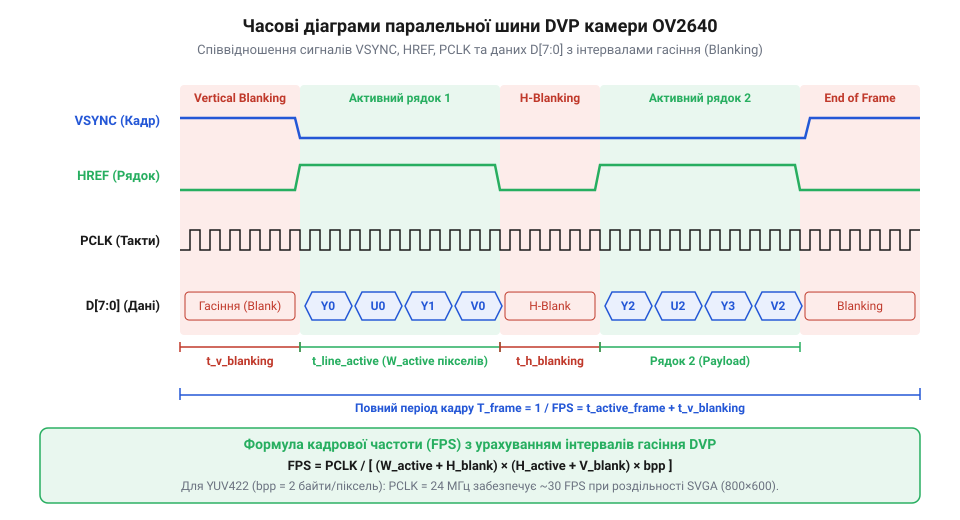
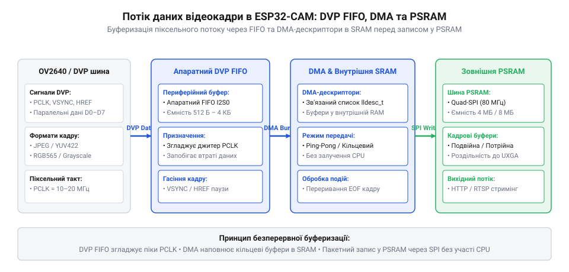

# Розрахунок пропускної здатності шини камери та буферизації кадрів у PSRAM

<preknowlist>
- [ESP32-CAM (OV2640 + microSD)](root:cat-hw-boards/esp32-cam) — базова апаратна схема плат ESP32-CAM та підключення зовнішньої пам'яті PSRAM
- [ESP32-CAM з камерою OV3640 (2 МП)](root:cat-hw-boards/esp32-cam-ov3640) — параметри паралельного цифрового відеопорту DVP та кодування JPEG
- [Мікроконтролер ESP32-S3](root:cat-hw-boards/esp32s3-microcontroller) — архітектура периферійних шин DMA та взаємодія із зовнішньою пам'яттю PSRAM
</preknowlist>

## Пропускна здатність DVP та частота PCLK

Захоплення та обробка відеопотоку у реальному часі на мікроконтролерних системах спирається на безперервне передавання цифрових даних від фотоматриці до оперативної пам'яті. Паралельний цифровий відеопорт @@en|DVP@@ (англ. @@en|Digital Video Port@@, від *digital* — цифровий, *video* — відео та *port* — порт) транслює пікселі через 8 паралельних ліній даних `D0`–`D7`. Головним синхронізуючим сигналом цього інтерфейсу є тактова частота пікселів @@en|PCLK@@ (англ. @@en|Pixel Clock@@, від *pixel* — піксель та *clock* — тактовий сигнал). Кожен тактовий імпульс або перехідний фронт сигналу `PCLK` супроводжує передавання одного байта даних.

Обсяг кадрових даних залежить від геометрії матриці — ширини `W` та висоти `H` у пікселях — а також від колірного формату. У нестисненому форматі @@en|RGB565@@ (англ. @@en|RGB565@@, від *Red-Green-Blue* — червоно-зелено-синій 5-6-5 колірний формат) кожен піксель кодується 2 байтами (`b_pixel = 2`), розподіленими на 5 бітів червоного, 6 бітів зеленого та 5 бітів синього кольору. У форматі @@en|YUV422@@ (англ. @@en|YUV422@@, від *Y-Luminance, UV-Chrominance* — формат яскравості та колірності 4:2:2) кожні два сусідніх пікселі передають повнорозмірну яскравість `Y` для кожного пікселя та усереднені колірні компоненти `U` і `V`, що дає сумарно 4 байти на дует пікселів. Порівняльний розрахунок обсягу кадру `V_frame` для однакової роздільності `W × H` демонструє математичну рівність обсягів нестиснених кадрів `V_RGB565` та `V_YUV422`:

```
V_RGB565 = W × H × 2 B              [кодування кожного пікселя 16 бітами (2 байти)]

V_YUV422 = W × H × (1 B_Y + 0.5 B_U + 0.5 B_V)
         = W × H × 2 B              [сумування субдискретизації 4:2:2 (4 байти на 2 пікселі)]
         = V_RGB565                 [математична тотожність обсягів двох колірних форматів]
```

Попри однаковий обсяг нестисненого кадру в 2 байти на піксель, режим @@en|YUV422@@ надає перевагу при подальшій цифровій обробці зображення, оскільки виділений канал яскравості `Y` дозволяє аналізувати контури без витрат на дерастріризацію. При використанні апаратного стиснення @@en|JPEG@@ (англ. @@en|Joint Photographic Experts Group@@, від *joint* — об'єднаний, *photographic* — фотографічний, *experts* — експерти та *group* — група) розмір кадру зменшується у `CR` разів, де `CR` — коефіцієнт стиснення (зазвичай від 10 до 50).

Піковий потік байтів `R_peak` без урахування паузових інтервалів визначається як добуток кількості пікселів кадру, обсягу одного пікселя `b_pixel` та бажаної кадрової частоти `F_fps`:

```
N_pixels = W × H      [загальна кількість пікселів у кадрі]
V_frame = N_pixels × b_pixel      [обсяг нестисненого кадру в байтах]
R_peak = V_frame × F_fps      [пікова пропускна здатність у байтах за секунду]
```

Для кадру роздільності @@en|VGA@@ (`640 × 480` пікселів) у кодуванні @@en|RGB565@@ та частоті `F_fps = 30` кадрів/с обчислення пікового потоку має вигляд:

```
N_pixels = 640 × 480
= 307200      [обчислення кількості пікселів кадру VGA]

V_frame = 307200 × 2
= 614400 байтів      [обсяг одного кадру VGA в RGB565]

R_peak = 614400 × 30
= 18432000 байтів/с
≈ 17.58 МіБ/с      [переведення пікової швидкості у мебібайти за секунду]
```

Оскільки паралельна шина @@en|DVP@@ передає по 1 байту за один такт `PCLK`, теоретична мінімальна частота стробування `PCLK_min` без урахування паузових інтервалів повинна дорівнювати піковій швидкості у байтах за секунду. Для забезпечення роботи `VGA` при 30 кадр/с частота `PCLK` має становити не менше 18.43 МГц.

При переході до високої роздільності @@en|UXGA@@ (`1600 × 1200` пікселів) на [платах ESP32-CAM](root:cat-hw-boards/esp32-cam) та модулях [ESP32-CAM з камерою OV3640](root:cat-hw-boards/esp32-cam-ov3640) нестиснений потік `RGB565` створює критичне шинне навантаження:

```
N_pixels = 1600 × 1200
= 1920000      [кількість пікселів кадру UXGA]

V_frame = 1920000 × 2
= 3840000 байтів      [обсяг нестисненого кадру UXGA]

R_peak = 3840000 × 15
= 57600000 байтів/с
≈ 54.93 МіБ/с      [піковий потік при 15 кадрах/с]
```

Оскільки гранична частота шини @@en|DVP@@ у мікроконтролері обмежена значенням 20 МГц (що відповідає пропускній здатності 20 МБ/с), передати нестиснений відеопотік `UXGA` фізично неможливо. Застосування апаратного стиснення @@en|JPEG@@ з коефіцієнтом `CR = 20` зменшує обсяг кадру до `V_jpeg = 3840000 ÷ 20 = 192000` байтів (192 КіБ), знижуючи потрібну швидкість до `2880000` байтів/с (2.75 МіБ/с), що легко вміщується у часові межі тактування `PCLK`.

## Інтервали гасіння та кадрова частота

Фізичний процес зчитування фотоматриці вимагає часових пауз між передачею окремих рядків та кадрів. Ці паузи називаються інтервалами гасіння @@en|blanking intervals@@ (англ. @@en|blanking intervals@@, від *blanking* — гасіння та *interval* — інтервал). Упродовж горизонтального інтервалу гасіння `HBLANK` сенсор готує рядкові підсилювачі та скидає накопичений заряд, а сигнал горизонтальної синхронізації @@en|HREF@@ (англ. @@en|Horizontal Reference@@, від *horizontal* — горизонтальний та *reference* — опорний сигнал) перебуває в неактивному стані. Упродовж вертикального інтервалу гасіння `VBLANK` матриця виконує кадрове скидання, а сигнал кадрової синхронізації @@en|VSYNC@@ (англ. @@en|Vertical Sync@@, від *vertical* — вертикальний та *sync* — синхронізація) позначає межу кадру. Щоб апаратний периферійний вузол [мікроконтролера ESP32-S3](root:cat-hw-boards/esp32s3-microcontroller) та його контролер прямого доступу до пам'яті @@en|DMA@@ (англ. @@en|Direct Memory Access@@, від *direct* — прямий, *memory* — пам'ять та *access* — доступ) встигли розпізнати активну фазу рядка, зафіксувати фронт і розпочати приймання байтів без зсуву перших пікселів, мінімально допустима тривалість активного стробу `HREF` (`T_href_min`) повинна задовольняти математичну нерівність, яка враховує час передачі даних кадру та апаратний час синхронізації шинних доменів `T_synch_guard`:

```
T_href_min = (W × b_pixel ÷ PCLK) + T_synch_guard      [мінімальна тривалість активного стробу HREF]
```

тут `W` — ширина кадру в пікселях, `b_pixel` — кількість байтів на піксель, `PCLK` — тактова частота пікселів у Гц, а `T_synch_guard` — час апаратної затримки на захоплення шинного фронту (зазвичай 2–4 такти системної шини). Якщо робоча тривалість `T_href` стає меншою за `T_href_min`, контролер `DMA` пропускає початкові байти рядка, викликаючи спотворення колірного балансу та розрив сітки пікселів.


*Підпис: Часова діаграма сигналів PCLK, HREF та VSYNC, що ілюструє співвідношення між активною передачею даних та інтервалами гасіння HBLANK і VBLANK.*

Наявність інтервалів гасіння збільшує загальну кількість тактових імпульсів `PCLK`, необхідних для формування одного кадру. Тривалість одного рядка в тактах `PCLK` складається з активних піксельних байтів та додаткових тактів гасіння `H_blank`:

```
T_line_clocks = W × b_pixel + H_blank      [тривалість рядка у тактах PCLK]
```

Аналогічно, повний кадровий період у рядках включає активні рядки `H` та інтервал вертикального гасіння у рядкових еквівалентах `V_blank`:

```
T_frame_lines = H + V_blank      [тривалість кадру в рядкових періодах]
```

Загальна кількість тактових імпульсів `N_total_clocks`, витрачених на один повний кадр, дорівнює добутку цих двох величин:

```
N_total_clocks = T_line_clocks × T_frame_lines
= (W × b_pixel + H_blank) × (H + V_blank)      [повна кількість тактових імпульсів PCLK на кадр]
```

Реальна кадрова частота `F_fps` обчислюється як відношення робочої тактової частоти `PCLK` до загальної кількості тактових імпульсів кадру:

```
F_fps = PCLK ÷ N_total_clocks      [розрахунок реальної кадрової частоти]
```

Розрахуємо реальну кадрову частоту для сенсора OV2640 у режимі `SVGA` (`800 × 600` пікселів, `b_pixel = 2`) при тактовій частоті `PCLK = 20 МГц` (20 000 000 Гц), якщо `H_blank = 320` тактових імпульсів, а `V_blank = 25` рядків:

```
T_line_clocks = 800 × 2 + 320
= 1600 + 320
= 1920 такти      [тривалість одного рядка в тактах PCLK]

T_frame_lines = 600 + 25
= 625 рядків      [тривалість кадру у рядках]

N_total_clocks = 1920 × 625
= 1200000 такти      [загальна кількість тактових імпульсів на кадр]

F_fps = 20000000 ÷ 1200000
≈ 16.67 Гц      [реальна кадрова частота у кадрах за секунду]
```

Без урахування гасіння теоретична частота становила б `20000000 ÷ 960000 = 20.83` Гц. Інтервали гасіння знижують реальну кадрову частоту на ~20%, що необхідно враховувати при розрахунку шинного балансу.

## Розрахунок кадрових буферів у PSRAM

Безперервне зчитування відеопотоку вимагає асинхронного узгодження між роботою контролера прямого доступу до пам'яті @@en|DMA@@ (англ. @@en|Direct Memory Access@@, від *direct* — прямий, *memory* — пам'ять та *access* — доступ) і обчислювальними ядрами процесора. Внутрішня статична оперативна пам'ять @@en|SRAM@@ (англ. @@en|Static Random-Access Memory@@, від *static* — статичний, *random-access* — з довільним доступом та *memory* — пам'ять) обсягом 512 КіБ у [мікроконтролерах ESP32-S3](root:cat-hw-boards/esp32s3-microcontroller) вміщує лише кільцеві дескриптори DMA. Суцільні кадрові буфери розміщуються у зовнішній псевдостатичній оперативній пам'яті @@en|PSRAM@@ (англ. @@en|Pseudo-Static RAM@@, від *pseudo* — псевдо, *static* — статичний та *RAM* — оперативна пам'ять), присутній, зокрема, на [модулях Waveshare ESP32-S3R2](root:cat-hw-boards/esp32-s3r2-waveshare) та інших платах [родини плат на ESP32-S3](root:cat-hw-boards/esp32-s3-boards-family-overview).


*Підпис: Структурна схема передачі відеопотоку через апаратне FIFO, дескриптори DMA у внутрішній SRAM та кадрові буфери в зовнішній пам'яті PSRAM.*

Обсяг оперативної пам'яті `V_psram_total`, необхідний для кадрової буферизації, залежить від кількості буферів `N_buf` та максимального розміру стисненого або нестисненого кадру `V_frame`:

```
V_psram_total = N_buf × V_frame      [загальний обсяг кадрової пам'яті в PSRAM]
```

При однобуферній схемі (`N_buf = 1`) процесор змушений чекати повного закінчення вивантаження кадру в єдиний масив. Якщо час обробки кадру процесором `T_proc` перевищує тривалість вертикального інтервалу гасіння `T_vblank = V_blank × T_line`, контролер `DMA` починає перезаписувати той самий буфер новим кадром, викликаючи спотворення зображення (артефакт розриву кадру).

При подвійній буферизації (`N_buf = 2`) у `PSRAM` виділяються два масиви `FB0` та `FB1`. Поки `DMA` заповнює `FB0`, процесор обробляє `FB1`. По завершенню кадру в перериванні `VSYNC` вказівники міняються місцями. Цю операцію виконує обробник переривання @@en|ISR@@ (англ. @@en|Interrupt Service Routine@@, від *interrupt* — переривання, *service* — обслуговування та *routine* — процедура; @@en|обробник переривання ISR@@), який вносить додаткову затримку латентності `T_isr = T_lat + T_sw`, де `T_lat` — апаратний час входу в переривання та збереження контексту регістрів, а `T_sw` — тривалість програмного перемикання дескрипторів `DMA` й сповіщення задачі. Сумарна латентність `T_isr` зменшує часове вікно, доступне процесору, з `T_frame` до `T_frame - T_isr`, а також вимагає виконання умови `T_isr ≤ T_vblank`, щоб нові вказівники сформувалися до початку активної частини наступного кадру під час кадрового інтервалу гасіння `T_vblank`. Умова відсутності випадіння кадрів з урахуванням затримки `T_isr` вимагає:

```
T_proc ≤ T_frame
= 1 ÷ F_fps      [умова стабільності подвійної буферизації]
```

Якщо процес обробки чи мережева трансляція зазнає часових затримок (джитер `T_jitter > T_frame`), використовують потрійну буферизацію (`N_buf = 3`). У цьому режимі перший буфер заповнюється `DMA`, другий містить останній повністю сформований кадр, а третій утримується процесором. Потрійна буферизація повністю розв'язує часову залежність між зчитуванням камери та мережевими затримками.

Для запобігання втраті піксельних даних при шинних збоях вхідне апаратне буферизаційне @@en|FIFO@@ (англ. @@en|First In, First Out@@, від *first* — перший, *in* — зайшов, *out* — вийшов) повинно компенсувати різницю між швидкістю надходження даних із шини `DVP` (`R_dvp = PCLK × 1` байт/с) та швидкістю запису у `PSRAM` через послідовний інтерфейс `SPI` (`R_psram = f_spi × N_lanes ÷ 8`).

Якщо `R_dvp > R_psram`, мінімально необхідна ємність апаратного буфера `FIFO` обчислюється за час активності рядка `T_active_line = W × b_pixel ÷ PCLK`:

```
ΔR = R_dvp - R_psram      [різниця швидкостей входу та виходу]
V_fifo_min = ΔR × T_active_line      [найменша ємність буфера FIFO]
```

Обчислимо мінімальний обсяг `FIFO` при `PCLK = 20 МГц` (`R_dvp = 20 МБ/с`), ширині рядка `W = 1600` пікселів (`RGB565`, `b_pixel = 2`), якщо `Quad SPI PSRAM` працює на частоті 40 МГц із 4 лініями даних (`R_psram = 40 × 4 ÷ 8 = 20 МБ/с`):

```
ΔR = 20000000 - 20000000
= 0 байтів/с      [баланс швидкостей досягнуто]
```

Якщо ж `SPI PSRAM` перемикається на частоту 20 МГц (`R_psram = 10 МБ/с`), виникає дефіцит пропускної здатності `ΔR = 10 МБ/с`:

```
T_active_line = (1600 × 2) ÷ 20000000
= 3200 ÷ 20000000
= 0.00016 с      [тривалість активної частини рядка 160 мкс]

V_fifo_min = 10000000 × 0.00016
= 1600 байтів      [мінімальний обсяг буфера FIFO]
```

Отже, апаратне `FIFO` обсягом не менше 1600 байтів упереджує переповнення вхідної черги під час активного рядка кадру.

## Баланс швидкостей DVP та шини PSRAM

Надійне вивантаження відеокадрів у зовнішню оперативну пам'ять вимагає суворого узгодження між швидкістю надходження даних через паралельний цифровий відеопорт @@en|DVP@@ та пропускною здатністю послідовного інтерфейсу пам'яті @@en|PSRAM@@. Сенсор камери транслює піксельні байти із жорстким часовим тактуванням @@en|PCLK@@, яке неможливо призупинити під час активної частини рядка. Натомість послідовна шина Quad SPI @@en|QSPI@@ (англ. @@en|Quad Serial Peripheral Interface@@, від *quad* — чотирикратний та *SPI* — послідовний периферійний інтерфейс) або Octal SPI @@en|OPI@@ (англ. @@en|Octal Peripheral Interface@@, від *octal* — восьмикратний та *interface* — інтерфейс) зовнішньої пам'яті @@en|PSRAM@@ на [платах ESP32-S3](root:cat-hw-boards/esp32s3-microcontroller) зазнає періодичних часових затримок.

Ефективна пропускна здатність шини пам'яті `R_psram_eff` завжди менша за її теоретичну пікову швидкість через сумарний коефіцієнт накладних витрат `P_overhead`, який математично розкладається на три складові часових втрат: `P_overhead = P_cmd_addr + P_refresh + P_arbitration`. Перша складова `P_cmd_addr ≈ 0.06` (6%) припадає на фази передавання командних байтів та адресації перед кожною транзакцією у відкриту сторінку; друга складова `P_refresh ≈ 0.04` (4%) зумовлена регулярними паузами регенерації осередків dynamic RAM (англ. @@en|Dynamic RAM@@, @@en|DRAM@@) для збереження заряду конденсаторів; третя складова `P_arbitration ≈ 0.05` (5%) виникає через шинний арбітраж прямого доступу до пам'яті @@en|DMA@@ при одночасному доступі ядер процесора та периферії до контролера зовнішньої псевдостатичної пам'яті @@en|PSRAM@@. Сумарне додавання цих трьох чинників утворює типове падіння продуктивності шини на `P_overhead ≈ 0.15` (15%).

```
R_psram_eff = (f_spi × N_lanes ÷ 8) × (1 - P_overhead)      [ефективна швидкість шини PSRAM]
```

тут `f_spi` — робоча тактова частота шини SPI у Гц, `N_lanes` — кількість ліній даних (4 для QSPI, 8 для OPI), а `P_overhead` — сумарна частка накладних витрат та шинних затримок (зазвичай `P_overhead ≈ 0.15`, тобто 15%).

Умова безперервної передачі відеопотоку без накопичення некомпенсованого залишку байтів вимагає, щоб пікова швидкість надходження з шини @@en|DVP@@ (`R_dvp = PCLK × 1` байт/с) не перевищувала ефективну пропускну здатність шини пам'яті:

```
R_dvp ≤ R_psram_eff
PCLK ≤ (f_spi × N_lanes ÷ 8) × (1 - P_overhead)      [умова шинного балансу DVP та PSRAM]
```

Гранично допустима частота стробування `PCLK_max` обчислюється шляхом підстановки параметрів шини пам'яті:

```
PCLK_max = (f_spi × N_lanes ÷ 8) × (1 - P_overhead)      [максимальна робоча частота PCLK]
```

Розрахуємо граничну частоту `PCLK_max` для [модулів Waveshare ESP32-S3R2](root:cat-hw-boards/esp32-s3r2-waveshare), де `Quad SPI PSRAM` працює на частоті `f_spi = 40 МГц` (`40 000 000` Гц, `N_lanes = 4`) при накладних витратах `P_overhead = 0.15`:

```
R_psram_peak = (40000000 × 4) ÷ 8
= 160000000 ÷ 8
= 20000000 байтів/с (20 МБ/с)      [теоретична пікова швидкість QSPI]

R_psram_eff = 20000000 × (1 - 0.15)
= 20000000 × 0.85
= 17000000 байтів/с (17 МБ/с)      [ефективна пропускна здатність PSRAM]

PCLK_max = 17000000 Гц
= 17 МГц      [максимальна частота PCLK для стабільної роботи]
```

Якщо частота `PCLK` становить 20 МГц, вхідна швидкість `20 МБ/с` перевищує вихідну спроможність `17 МБ/с`. Виникає некомпенсований дефіцит у `3 МБ/с`, який під час активного рядка мусить поглинатися внутрішніми апаратними чергами.

## Критична ємність FIFO та захист переповнення

Коли вхідний потік байтів з шини @@en|DVP@@ тимчасово перевищує вихідну пропускну здатність пам'яті @@en|PSRAM@@, або коли системна шина зазнає мікрозатримок через фазовий джитер @@en|jitter@@ (англ. @@en|jitter@@ — фазове тремтіння тактового фронту) чи арбітраж переривань, надлишкові байти накопичуються в апаратному буфері @@en|FIFO@@ (англ. @@en|First In, First Out@@, від *first* — перший, *in* — зайшов, *out* — вийшов).

Накопичений обсяг байтів `V_accum` за час активного рядка `T_line_active = W × b_pixel ÷ PCLK` обчислюється через різницю вхідної та вихідної швидкостей:

```
ΔR = R_dvp - R_psram_eff      [швидкість накопичення залишку в FIFO]
V_fifo_crit = ΔR × T_line_active
= (R_dvp - R_psram_eff) × (W × b_pixel ÷ PCLK)      [критичний обсяг буфера FIFO]
```

Обчислимо критичну ємність `V_fifo_crit` для кадру `UXGA` (`W = 1600` пікселів, `b_pixel = 2`), якщо `PCLK = 20 МГц` (`R_dvp = 20 МБ/с`), а ефективна швидкість `PSRAM` становить `R_psram_eff = 17 МБ/с` (`ΔR = 3 МБ/с`):

```
T_line_active = (1600 × 2) ÷ 20000000
= 3200 ÷ 20000000
= 0.00016 с      [тривалість активної частини рядка 160 мкс]

V_fifo_crit = 3000000 × 0.00016
= 480 байтів      [критична ємність апаратного FIFO]
```

Для перенесення накопичених даних з апаратного `FIFO` у внутрішню пам'ять @@en|SRAM@@ (англ. @@en|Static Random-Access Memory@@, від *static* — статичний, *random-access* — з довільним доступом та *memory* — пам'ять) контролер @@en|DMA@@ використовує кільцевий список низькорівневих дескрипторів @@en|lldesc_t@@, де кожен дескриптор описує суцільний блок SRAM максимальним обсягом `S_desc` (зазвичай `S_desc = 4092` байти). Щоб запобігти переповненню черги під час найгіршої часової затримки обробки переривань ISR (англ. @@en|Interrupt Service Routine@@, від *interrupt* — переривання, *service* — обслуговування та *routine* — процедура; `t_lat_isr_worst`), кількість страхувальних дескрипторів `N_guard` розраховується за формулою `N_guard = ⌈ (R_dvp × t_lat_isr_worst) ÷ S_desc ⌉`, де `R_dvp` — пікова вхідна швидкість відеопотоку. Наприклад, при затримці `t_lat_isr_worst = 300 мкс` та швидкості `R_dvp = 20 МБ/с` обсяг запізнення становить `6000` байтів, що вимагає саме `N_guard = ⌈ 6000 ÷ 4092 ⌉ = 2` додаткових дескриптори.

Мінімально необхідна кількість дескрипторів `N_desc` для забезпечення приймання одного кадру обсягом `V_frame` розраховується як округлення до більшого цілого з додаванням страхувального запасу `N_guard`:

```
N_desc = ⌈ V_frame ÷ S_desc ⌉ + N_guard      [кількість DMA-дескрипторів у SRAM]
```

Розрахуємо кількість дескрипторів для нестисненого кадру `SVGA` (`800 × 600` пікселів, `b_pixel = 2`, `V_frame = 960000` байтів) при `S_desc = 4092` байтів та страхувальному запасі `N_guard = 2`:

```
N_desc_raw = 960000 ÷ 4092
≈ 234.604      [обчислення частки блоків пам'яті]

N_desc_ceil = 235      [округлення до більшого цілого]

N_desc = 235 + 2
= 237 дескрипторів      [загальна кількість дескрипторів у кільці]
```

Кожен дескриптор займає 12 байтів у внутрішній пам'яті `SRAM`. Загальний обсяг пам'яті під дескрипторне кільце становить `237 × 12 = 2844` байти. Додавання страхувальних дескрипторів `N_guard = 2` упереджує переповнення черги при затримках обробки апаратних переривань `VSYNC` ядрами процесора, забезпечуючи детерміноване захоплення відеопотоку без втрати кадрів.
