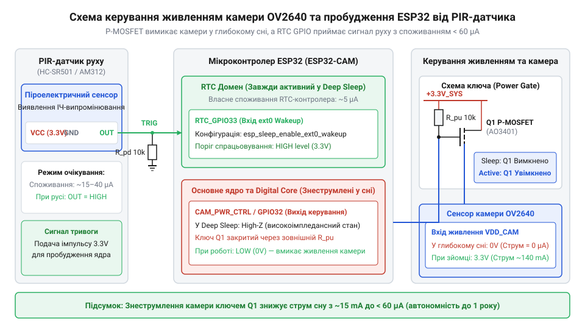
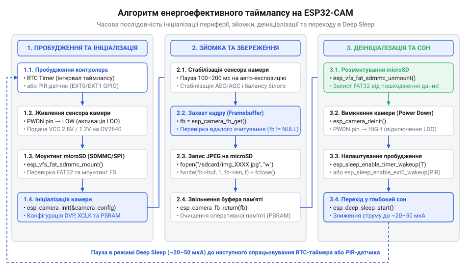

# Проєктування енергоефективної системи фотофіксації із записом на microSD та детекцією руху

<preknowlist>
- [ESP32-CAM (OV2640 + microSD)](root:cat-hw-boards/esp32-cam) — схемотехніка розпіновки модуля ESP32-CAM, підключення камери OV2640 та інтерфейсу картки microSD
</preknowlist>

## Проблема швидкого розряду автономної камери

При спробі розгорнути автономну систему фотофіксації у польових умовах — наприклад, для спостереження за дикою природою або створення довготривалого `@@en|таймлапсу@@` (англ. *time-lapse* — сповільнена зйомка) будівельного майданчика — розробник одразу стикається з жорстким обмеженням енергоємності батарейного живлення. Типовий літій-іонний акумулятор формату 18650 має номінальну ємність близько 2500 мА·год. Якщо підключити до нього плату [модуля ESP32-CAM](root:cat-hw-boards/esp32-cam) у стандартному режимі роботи без застосування спеціальних заходів з енергозбереження, система виснажить батарею менш ніж за один день.

Причина такого швидкого розряду полягає у сумарному струмі споживання всіх активних вузлів платформи. Основний двоядерний процесор мікроконтролера `@@en|ESP32@@` у робочому стані з активним тактуванням на частоті 240 МГц споживає від 160 до 240 мА. Матриця камери `@@en|OV2640@@`, навіть коли вона не виконує безпосереднє захоплення кадру, перебуває у стані готовності й додатково виділяє тепло, споживаючи близько 120–140 мА. Додайте сюди постійний струм споживання псевдостатичної пам'яті `@@en|PSRAM@@` (англ. *Pseudo Static RAM* — псевдостатична оперативна пам'ять), вбудованого `@@en|LDO-регулятора@@` (англ. *Low Dropout* — регулятор напруги з малою різницею вхід-вихід) серії `AMS1117` та світлодіода індикації, і загальний струм пристрою впевнено сягне позначки 350 мА.

Час автономної роботи пристрою `T_active` від акумулятора розраховується через відношення корисної ємності `Q_battery` до сумарного струму навантаження `I_total`:

```
T_active = Q_battery ÷ I_total
= 2500 мА·год ÷ 350 мА      [розподіл ємності батареї на струм активного стану]
= 7.14 год                   [підсумковий час автономної роботи в годинах]
```

Отриманий результат показує, що безперервно активна система здатна пропрацювати трохи більше ніж 7 годин. Для автономного фотореєстратора, який має функціонувати тижнями або місяцями, такий режим є абсолютно неприйнятним.

Проте аналіз практичного сценарію використання показує, що пристрою не потрібно працювати безперервно. Якщо задача полягає у робленні одного знімка щогодини, а процес зчитування матриці, формування `JPEG`-кадру та його запису на картку пам'яті займає близько 2 секунд, то активна фаза складає лише крихітну частку загального часу. Коефіцієнт активного навантаження системи `D` обчислюється як відношення часу зйомки `t_active` до періоду таймлапсу `t_period`:

```
D = t_active ÷ t_period
= 2 с ÷ 3600 с               [відношення тривалості зйомки до інтервалу в 1 годину]
= 0.000555                   [частка часу, коли пристрій виконує корисну роботу]
```

Це означає, що 99.945% свого існування камера просто марнує енергію, очікуючи настання наступного моменту зйомки. Єдиним шляхом кардинального подовження автономності є повне знеструмлення обчислювальних ядер та периферії на час паузи між кадрами.

Для цього мікроконтролер переводять у режим `@@en|Deep Sleep@@` (англ. *deep sleep* — глибокий сон). У цьому стані повністю вимикаються процесорні ядра `Xtensa`, бездротові модулі `Wi-Fi` й `Bluetooth`, а також основна оперативна пам'ять `SRAM`. Енергію отримує лише енергонезалежний `@@en|RTC-контролер@@` (англ. *Real-Time Clock* — годинник реального часу) та його мала пам'ять `RTC_SLOW_MEM`, а власне споживання кристала `ESP32` знижується до 10–15 мкА.

Однак переведення самого лише мікроконтролера в `@@en|Deep Sleep@@` не вирішує проблему повністю. Якщо периферійні вузли платформи — матриця камери, світлодіодний спалах та підтягувальні резистори — залишаються підключеними до джерела живлення, вони продовжують споживати міліампери струму. Щоб досягти справді мікроамперного рівня споживання усієї системи, необхідний комплексний апаратний підхід до керування силовими доменами.

## Апаратне керування живленням камери та світлодіода

Навіть після зупинки процесорних ядер `ESP32` сенсор `@@en|OV2640@@` продовжує споживати струм через свої вбудовані аналогові та цифрові кола живлення (1.2 В та 2.8 В), якщо на нього подано напругу 3.3 В. У такому напівактивному стані матриця може марно розсіювати від 15 до 30 мА. Для зниження цього споживання в архітектурі сенсора передбачено спеціальний керуючий сигнал `@@en|PWDN@@` (англ. *Power Down* — сигнал вимкнення живлення). Подача високого логічного рівня на цей вивід переводить внутрішні схеми сенсора в режим пониженого споживання, зменшуючи струм приблизно до 15 мкА.

Хоча 1 мА суттєво менше за 30 мА, для автономного пристрою це все одно надто велика величина: 1000 мкА швидко виснажать акумулятор за кілька тижнів сну. Тому для побудови високоефективного фотореєстратора застосовують апаратне ключування живлення — `@@en|Power Gating@@` (англ. *power gating* — ключування живлення). Живлення 3.3 В подається на сенсор не напряму від силової шини, а через p-канальний `@@en|MOSFET-транзистор@@` (англ. *Metal-Oxide-Semiconductor Field-Effect Transistor* — польовий транзистор із ізольованим затвором) або спеціалізований `@@en|LDO-регулятор@@` із виводом дозволу роботи `EN` (`Enable`).


*Принципова схема керування живленням камери OV2640 та підключення PIR-датчика руху до RTC GPIO.*

При повному знеструмленні силового домену камери виникає підступне явище — виток струму через сигнальні лінії `@@en|GPIO Leakage@@` (англ. *GPIO leakage* — виток струму через лінії вводу-виводу). Якщо виводи мікроконтролера `ESP32` (тактові лінії `XCLK`, `PCLK`, лінії даних `D0`–`D7` та шина керування `SCCB`) у режимі `@@en|Deep Sleep@@` залишаються в стані високого логічного рівня (3.3 В), струм починає протікати через вбудовані захисні `@@en|ESD-діоди@@` (англ. *Electrostatic Discharge* — діод захисту від електростатичного розряду) знеструмленої мікросхеми `OV2640` на її внутрішню шину заземлення `GND`. Сумарний паразитичний виток через усі лінії шини камери може досягати від 2 до 8 мА, зводячи нанівець усю користь від вимкнення силового ключа.

Для усунення витоків струму перед зануренням мікроконтролера в сон необхідно виконати процедуру [ізоляції ліній GPIO](root:hw-arch/esp32-rtc-gpio-isolation). За допомогою системних функцій `ESP-IDF` всі шинні виводи камери переводяться у стан високого імпедансу (`Input Floating`), а внутрішні підтягувальні резистори вимикаються. Крім того, виводи підсистеми `RTC` фіксуються за допомогою спеціальних регістрових засувок `hold`, що гарантує збереження безпечного рівня на затворі силового `MOSFET`-ключа протягом усього періоду сну.

Окремої уваги вимагає потужний світлодіодний спалах, який на платі `ESP32-CAM` підключено до виводу `GPIO4`. Цей же вивід паралельно використовується лінією даних `D2` інтерфейсу картки `microSD`. Якщо під час занурення у сон на `GPIO4` випадково залишиться високий рівень або вивід опиниться в невизначеному стані, світлодіод почне тьмяно світитися чи підтікати струмом до 50 мА. Щоб уникнути цього, перед зануренням у сон `GPIO4` примусово підтягують до землі `GND` та відключають від нього силові драйвери. Такий комплексний підхід до знеструмлення сенсора та ізоляції сигнальних ліній дає змогу знизити загальний струм споживання плати у режимі сну до рекордних 15–20 мкА. При використанні сучасних рішень на [мікроконтролері ESP32-S3](root:cat-hw-boards/esp32s3-microcontroller) керування силовими доменами камери стає ще гнучкішим завдяки наявності окремих внутрішніх RTC-доменів живлення.

## Налаштування пробудження RTC та зовнішнього PIR-датчика

Після того як апаратна частина підготовлена до мінімізації струму, необхідно запрограмувати контролер `@@en|RTC@@` на автоматичне виведення мікроконтролера зі стану `@@en|Deep Sleep@@` при настанні визначених подій. У задачах автономної фотофіксації застосовують два основні джерела пробудження: внутрішній `@@en|RTC-таймер@@` для періодичних знімків та зовнішній сигнал `@@en|ext0 Wakeup@@` (англ. *external 0 wakeup* — зовнішнє джерело пробудження 0) від [інтеграції PIR-сенсорів](root:hw-sensing/pir-sensors-esp32-integration) руху.

`@@en|RTC Timer Wakeup@@` (англ. *RTC timer wakeup* — пробудження за таймером годинника реального часу) використовує низькочастотний внутрішній осцилятор `RTC` (частотою близько 150 кГц) або зовнішній кварцовий резонатор 32.768 кГц. Розробник вказує часовий інтервал у мікросекундах через функцію `esp_sleep_enable_timer_wakeup()`. По закінченню відліку таймер ґенерує внутрішнє переривання, яке повертає живлення на процесорні ядра. Це ідеальне рішення для класичного інтервального `@@en|таймлапсу@@`.

Джерело `@@en|ext0@@` дозволяє перетворити камеру на інтелектуальну фотопастку, яка пробуджується лише при появі об'єкта в зоні спостереження. До одного з виводів `RTC GPIO` (наприклад, `GPIO13` або `GPIO33`) підключається `@@en|PIR-датчик@@` (англ. *Passive Infrared* — пасивний інфрачервоний датчик руху). Коли датчик фіксує переміщення теплового об'єкта, його вихідний сигнал змінює логічний рівень з низького на високий (3.3 В). Контролер `RTC` відстежує цей фронт навіть у глибокому сні, споживаючи менше ніж 5 мкА на роботу цифрового компаратора.

При виході з `@@en|Deep Sleep@@` мікроконтролер `ESP32` не продовжує виконання коду з місця зупинки, а виконує повне перезавантаження системи, починаючи з точки входу `app_main()` або `setup()`. Тому першим кроком після подачі живлення є аналіз причини пробудження за допомогою функції `esp_sleep_get_wakeup_cause()`. Залежно від повернутого значення програма обирає відповідний сценарій дій.


*Блок-схема показує часову послідовність дій від моменту пробудження по RTC або PIR до зчитування кадру, збереження його на microSD та переходу в Deep Sleep.*

Практична конфігурація комбінованого пробудження за таймером та тригером руху реалізується наступним кодом:

:::tabs
:::code proj-esp32-cam-low-power-timelapse/c/esp-idf/app-main.c
:::code proj-esp32-cam-low-power-timelapse/cpp/arduino/setup.cpp
:::

Завдяки збереженню конфігурації регістрів `RTC` у спеціальній енергонезалежній пам'яті, мікроконтролер залишається у стані наднизького споживання до моменту спрацьовування таймера чи PIR-датчика. Це забезпечує надійне розгортання автономних систем спостереження на базі новітньої [родини плат ESP32-S3](root:cat-hw-boards/esp32-s3-boards-family-overview) з терміном служби від одного заряду акумулятора до кількох місяців.

## Надійний запис кадрів на microSD через SDMMC

Після виходу з режиму глибокого сну та первинної обробки тригера пробудження перед системою постає завдання захоплення зображення та його збереження у довготривалу пам'ять. Використання зовнішнього накопичувача `@@en|microSD@@` є оптимальним рішенням для автономного фотореєстратора, однак спосіб підключення картки безпосередньо впливає на енергоефективність пристрою. У традиційних мікроконтролерних системах накопичувачі часто підключають через інтерфейс `@@en|SPI@@` (англ. @@en|Serial Peripheral Interface@@ — послідовний периферійний інтерфейс). Однак максимальна швидкість запису у режимі `@@en|SPI@@` для `ESP32` обмежена 1–2 МБ/с, через що збереження одного кадру розміром 100 КБ триває понаднормово довго, утримуючи процесор у високозатратному активному стані.

Для мінімізації тривалості активної фази у [модулі ESP32-CAM](root:cat-hw-boards/esp32-cam) застосовують апаратний контролер `@@en|SDMMC@@` (англ. @@en|Secure Digital MultiMediaCard@@ — мультимедійна картка безпечного цифрового формату). Шина `@@en|SDMMC@@` може працювати у 4-бітовому або 1-бітовому режимах на тактовій частоті до 40 МГц. Завдяки цьому швидкість передачі даних досягає 10–20 МБ/с, що скорочує час фізичного запису файлу на картку до 15–20 мс. Проте пряме використання 4-бітового режиму на платі `ESP32-CAM` створює схемотехнічний конфлікт: лінія даних `D1` об'єднана з силовим транзистором яскравого світлодіода спалаху на виводі `GPIO4`, а лінія `D2` підключена до `GPIO12`, який є системним виводом вибору напруги завантаження `ESP32`. Під час активного обміну даними по 4-бітовій шині світлодіод починає хаотично блимати, а напруга на `GPIO12` може спричинити циклічне перезавантаження мікроконтролера.

Оптимальним розв'язанням цієї проблеми є переведення периферійного контролера `@@en|SDMMC@@` у 1-бітовий режим роботи. У цьому режимі використовуються лише виводи тактування `CLK` (`GPIO14`), команд `CMD` (`GPIO15`) та однієї лінії даних `D0` (`GPIO2`). Це повністю звільняє `GPIO4` та `GPIO12` від файлового трафіку, зберігаючи при цьому високу швидкість обміну (до 6–8 МБ/с), що в рази перевищує показники шини `@@en|SPI@@`. Детальніше про апаратне налаштування шини з одним виводом даних для запобігання конфліктам із периферією йдеться у керівництві про [конфігурування та схемотехніку 1-бітового режиму SDMMC в ESP32](root:com-devices/sdmmc-1bit-mode-esp32).

Захоплення кадру розпочинається з ініціалізації сенсора `@@en|OV2640@@` через функції системного драйвера `esp_camera_init()`. Оскільки формуваний `@@en|JPEG@@`-кадр (англ. @@en|Joint Photographic Experts Group@@ — об'єднана група експертів у галузі фотографії) високої роздільності (наприклад, `UXGA` 1600×1200) займає в пам'яті від 50 до 120 КБ, буфер кадрів `camera_fb_t` розміщується у зовнішній операційній пам'яті `@@en|PSRAM@@`. Після подачі живлення на сенсор його аналогові кола автоматичного регулювання підсилення `@@en|AGC@@` (англ. @@en|Auto Gain Control@@ — автоматичне регулювання підсилення) та автоматичного керування експозицією `@@en|AEC@@` (англ. @@en|Auto Exposure Control@@ — автоматичне керування експозицією) вимагають певного часу на стабілізацію. Якщо зробити знімок миттєво після ввімкнення, зображення вийде повністю затемненим або засвіченим. Тому перед фіксацією підсумкового кадру програма мусить зробити 1–2 технічні захоплення ("холості кадри") та повернути їхні буфери системі.

Збереження отриманого буфера у файлову систему `@@en|FAT32@@` (англ. @@en|File Allocation Table 32@@ — таблиця розміщення файлів 32 біти) здійснюється через шар віртуальної файлової системи `@@en|VFS@@` (англ. @@en|Virtual File System@@, від лат. *virtualis* — можливий, уявний, та *systema* — ціле з частин). Головною загрозою для автономних пристроїв є пошкодження структури файлової системи при раптовому вимкненні живлення або передчасному переході в `@@en|Deep Sleep@@` (від англ. *deep sleep* — глибокий сон). Щоб забезпечити стовідсоткову цілісність даних, запис виконують за суворою послідовною процедурою:

```
[Ініціалізація VFS та мотування SDMMC] -> [Відкриття файла `fopen()`] 
  -> [Запис буфера JPEG `fwrite()`] -> [Примусове скидання кешу `fflush()`] 
  -> [Закриття файла `fclose()`] -> [Демонтування картки `esp_vfs_fat_sdcard_unmount()`]
```

Примусовий виклик функції `fflush()` записує всі проміжні кешовані сектори оперативної пам'яті безпосередньо у фізичні осередки флеш-пам'яті картки `@@en|microSD@@`, а `fclose()` оновлює розмір файлу та записи в таблиці файлового розподілу `@@en|FAT@@`. Лише після повного демонтування файлової системи через `esp_vfs_fat_sdcard_unmount()` або `SD_MMC.end()` шину `@@en|SDMMC@@` можна безпечно знеструмлювати та переводити виводи мікроконтролера у стан сну. Порівняно з більш вибагливими варіантами на кшталт [модулів з камерою OV3640](root:cat-hw-boards/esp32-cam-ov3640), зв'язка `OV2640` та 1-бітового `@@en|SDMMC@@` демонструє найвищу стабільність збереження кадрів при низьких енергетичних витратах.

## Інтеграція таймлапс-алгоритму та оптимізація енергоспоживання

Побудова цілісної автономної камери вимагає об'єднання апаратних ключів живлення, процедур зчитування матриці, збереження на `@@en|microSD@@` та налаштувань режиму `@@en|Deep Sleep@@` у єдину енергооптимізовану послідовність. Головна алгоритмічна ідея полягає у тому, щоб звести тривалість активного стану системи до абсолютно необхідного мінімуму, виконуючи всі підготовчі та фінальні операції з найменшими часовими затримками.

Для збереження між циклами перезавантаження лічильника кадрів та поточного стану системи використовують спеціальний атрибут пам'яті `RTC_DATA_ATTR`. Змінні, оголошені з цим модифікатором, розміщуються в енергонезалежному блоці `RTC_SLOW_MEM`. На відміну від стандартної оперативної пам'яті `SRAM`, вміст цієї області не втрачається при зануренні в `@@en|Deep Sleep@@` і не вимагає ресурсоємного запису у флеш-пам'ять.

Нижче наведено повний виробничий приклад коду автономної фотокамери з підтримкою подвійного джерела пробудження (`@@en|RTC-таймер@@` та `@@en|PIR-датчик@@` руху), 1-бітовим записом через `@@en|SDMMC@@` та примусовою ізоляцією виводів:

:::tabs
:::code proj-esp32-cam-low-power-timelapse/c/esp-idf/capture-and-save-frame.c
:::code proj-esp32-cam-low-power-timelapse/cpp/arduino/setup-2.cpp
:::

Для оцінки підсумкової енергоефективності побудуємо математичну модель добового балансу енергії. Введемо позначення величин: струм активного стану `I_active` = 200 мА, тривалість активної фази `t_active` = 1.5 с, струм у глибокому сні `I_sleep` = 0.015 мА (15 мкА), кількість знімків на добу `N_shots` = 144 (фіксація кожні 10 хвилин) та ємність акумулятора 18650 `Q_battery` = 2500 мА·год.

Розрахунок витрат енергії `E_shot` на виконання одного кадру у міліампер-годинах:

```
E_shot = I_active × t_active
= 200 мА × 1.5 с              [визначення заряду активного стану в міліампер-секундах]
= 300 мА·с                    [добуток струму на тривалість активної фази]
= 300 ÷ 3600                  [переведення значення у міліампер-години]
= 0.0833 мА·год                [енергія, що витрачається на один знімок]
```

Розрахунок загального добового споживання системи `Q_daily`:

```
Q_daily = (N_shots × E_shot) + (I_sleep × t_day)
= (144 × 0.0833 мА·год) + (0.015 мА × 24 год)  [сумування витрат активного стану та фонового сну]
= 12.0 мА·год + 0.36 мА·год                   [складові зйомки кадрів та 24 годин сну]
= 12.36 мА·год                                 [сумарний добовий розряд батареї]
```

Тривалість автономної роботи пристрою `T_days` у днях та місяцях:

```
T_days = Q_battery ÷ Q_daily
= 2500 мА·год ÷ 12.36 мА·год  [ділення ємності акумулятора на добове споживання]
= 202.26 днів                  [підсумковий час автономності системи]
```

Отримане значення 202 дні (понад 6.5 місяців) доводить високу ефективність запропонованого комплексу рішень. При проєктуванні системи важливо враховувати крайовий випадок: деякі бюджетні картки `@@en|microSD@@` без надійного знеструмлення силової шини можуть самостійно споживати до 1–2 мА у стані простою, знижуючи автономність у рази. Для новіших розробок доцільно розглядати застосування [плат серії ESP32-S3 SuperMini](root:cat-hw-boards/esp32-s3-supermini) або [компактних SiP-модулів ESP32-S3-MINI-1](root:cat-hw-boards/esp32-s3-mini-sip-modules), які мають вбудовані контролери заряду та вдосконалені виводи `@@en|RTC GPIO@@`.
