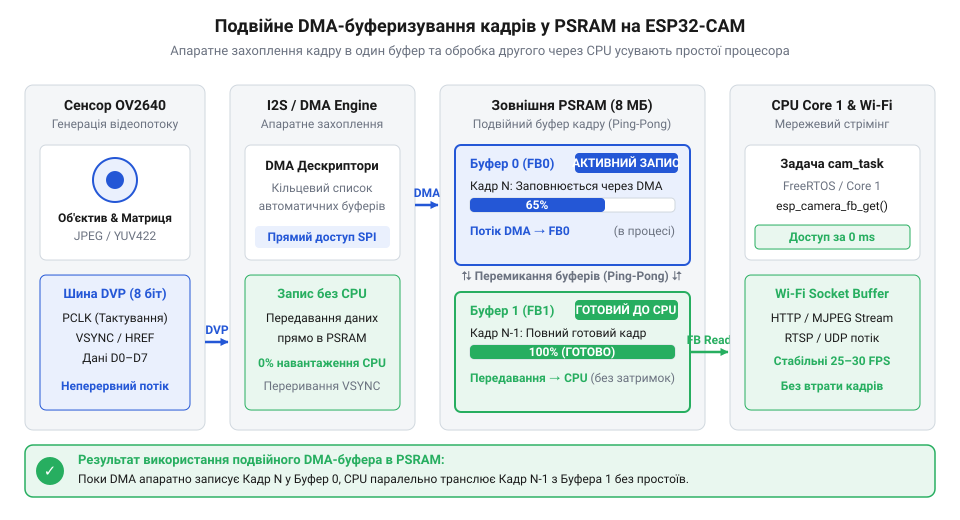
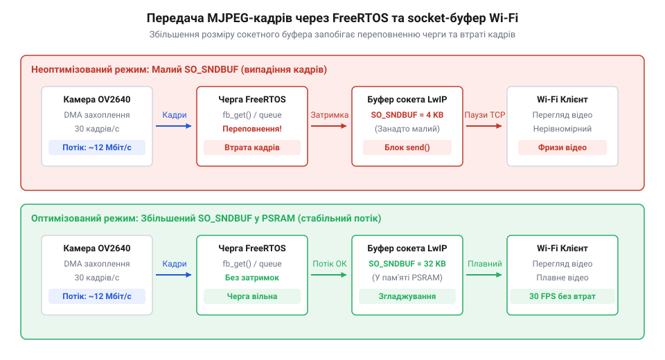

# Практична реалізація автономного Wi-Fi відеострімера з подвійним DMA-буферизуванням у PSRAM

<preknowlist>
- [ESP32-CAM (OV2640 + microSD)](root:cat-hw-boards/esp32-cam) — Апаратне розпінування плати, відсутність вбудованого USB-UART перетворювача та організацію живлення.
</preknowlist>

## Підключення ESP32-CAM та проблема пам'яті

Спроба запустити відеотрансляцію з високою роздільністю на пристроях без спеціалізованої зовнішньої пам'яті практично завжди призводить до вичерпання системних ресурсів або падіння частоти кадрів до критичного мінімуму. Головна причина полягає у фізичному обмеженні внутрішньої оперативної пам’яті `@@en|SRAM@@` (англ. *Static Random Access Memory*, від лат. *staticus* — сталий). Хоча базовий кристал мікроконтролера містить 520 КБ системної пам’яті, після ініціалізації ядра операційної системи `@@en|FreeRTOS@@` (англ. *Free Real-Time Operating System*), системного стека `@@en|Wi-Fi@@` та службових структур для динамічного виділення `@@en|DRAM@@` (англ. *Dynamic Random Access Memory*, від грец. *dynamikos* — рухомий) доступним для застосунку лишається лише близько 300 КБ.

Один нестиснений кадр роздільної здатності VGA (640×480 пікселів) у форматі RGB565 вимагає 614.4 КБ пам’яті, що одразу перевищує весь доступний обсяг внутрішнього кристала. Навіть при застосуванні стиснення `@@en|MJPEG@@` (англ. *Motion Joint Photographic Experts Group*) розмір одного кадра коливається від 30 до 80 КБ залежно від динаміки сцени. Спроба розмістити кадрові буфери у внутрішній пам'яті `@@en|DRAM@@` не залишає місця для мережевих `@@en|socket-буферів@@` (англ. *socket*, від старофранц. *soc* — гніздо) стека `@@en|LwIP@@` (англ. *Lightweight IP*), спричиняючи помилку `ESP_ERR_NO_MEM` та постійні аварійні перезавантаження.

Для подолання цього бар'єра на [платі ESP32-CAM](root:cat-hw-boards/esp32-cam) встановлюють зовнішню мікросхему `@@en|PSRAM@@` (англ. *Pseudo Static Random Access Memory*, від грец. *pseudēs* — несправжній та лат. *staticus* — нерухомий) обсягом 4 МБ. Через шину SPI/QSPI вона виділяє розширене адресоване поле, куди переносяться кадрові буфери `CAMERA_FB_IN_PSRAM`. Це розвантажує внутрішню `@@en|DRAM@@` і залишає її виключно для високошвидкісних задач обміну даними. На відміну від новіших рішень на [мікроконтролерах ESP32-S3](root:cat-hw-boards/esp32s3-microcontroller) чи [чіпах ESP32-P4](root:cat-hw-boards/esp32-p4-microcontroller), модуль ESP32-CAM вимагає точного налаштування пам'яті на самому початку ініціалізації.

Оскільки на [платі ESP32-CAM](root:cat-hw-boards/esp32-cam) відсутній вбудований USB-UART перетворювач, прошивка та зчитування діагностичних повідомлень виконуються через зовнішній `@@en|UART@@` (англ. *Universal Asynchronous Receiver-Transmitter*, від лат. *universalis* — загальний та *asynchronos* — неузгоджений у часі) адаптер. Підключення здійснюється за перехресною схемою: лінія `TX` адаптера з'єднується з виводом `U0R` (GPIO3), а `RX` — з виводом `U0T` (GPIO1). Під час апаратного скидання мікроконтролера через подачу імпульсу на вивід `EN` (Reset) внутрішній завантажувач у перші такти фіксує логічний рівень на виводі `GPIO0`. Якщо в момент відновлення високого рівня на `EN` лінію `GPIO0` притягнуто до шини `GND`, пристрій переходить у режим завантаження коду через послідовний порт на швидкості `@@en|baud rate@@` 115200 біт/с. Для ручної прошивки дотримуються чіткої послідовності дій: спершу замикають `GPIO0` на `GND`, після чого натискають кнопку Reset (або повторно подають живлення), щоб мікроконтролер перезавантажився із зафіксованим низьким рівнем, і лише тоді запускають програму запису. После завершення прошивки перемичку між `GPIO0` та `GND` обов'язково демонтують і знову натискають кнопку Reset, адже залишення низького рівня на `GPIO0` блокує запуск програми з внутрішньої флешпам'яті й залишає модуль у режимі завантажувача. Повнорозмірні плати позбавлені такої ручної процедури завдяки апаратній схемі автоматичного скидання на двох NPN-транзисторах, керованих сигнальними лініями `@@en|RTS@@` (англ. *Request to Send*, від англ. *request* — запит та *send* — надсилати) та `@@en|DTR@@` (англ. *Data Terminal Ready*, від англ. *data* — дані та *terminal* — термінал) USB-UART адаптера. На початку прошивки утиліта програмно зсуває фази сигналів `RTS` і `DTR`, що примусово заземлює `GPIO0` і генерує короткий імпульс скидання на `EN`. На платі ESP32-CAM цю схему вилучено задля здешевлення та економії місця, тому будь-яка розсинхронізація маніпуляцій із кнопкою Reset або відсутність контакту перемички призводять до помилки зв'язку `Failed to connect to ESP32` і вимагають повного повторення процедури.

*Апаратне з'єднання модуля ESP32-CAM з USB-UART адаптером із розмиканням сигнальної лінії GPIO0 для переходу з режиму прошивки у режим виконання.*

Окрему увагу слід приділити стабільності живлення 5V. Під час радіопередачі в мережі `@@en|Wi-Fi@@` високочастотний підсилювач модуля створює короткочасні імпульсні споживання струму до 500 мА. У поєднанні зі споживанням [сенсора OV2640](root:cat-hw-boards/esp32-cam) це спричиняє падіння напруги живлення. Спроба заживити модуль від слабких виводів 3.3V або довгих тонких дротів активує схему контролю `@@en|brownout detector@@` (англ. *brownout detector*), що призводить до циклічних перезавантажень пристрою. Джерело живлення 5V повинно забезпечувати струм не менше 1 А з обов'язковим розміщенням фільтруючих конденсаторів безпосередньо біля силого виводу плати.

## Конфігурація PSRAM та подвійного DMA-буфера

Передавання відеопотоку в реальному часі вимагає паралельної організації захоплення кадрів та їхньої мережевої трансляції. Для усунення простоїв центрального процесора захоплення даних із камери реалізовано за допомогою апаратного механізму `@@en|DMA@@` (англ. *Direct Memory Access*, від лат. *directus* — прямий). Контролер `@@en|DMA@@` зчитує байти зображення з [паралельного DVP-інтерфейсу](root:com-devices/dvp-parallel-video-interface) сенсора безпосередньо в оперативну пам'ять, не залучаючи ядра CPU до обробки кожного окремого пікселя.

При використанні одного буфера (`fb_count = 1`) виникає пауза: поки пристрій передає знімок клієнту, сенсор чекає звільнення пам'яті. Застосування подвійного буферизування (`fb_count = 2`) ліквідує цей простій. Поки один буфер обробляється програмою та відправляється в мережу, другий буфер паралельно заповнюється новим кадром від `@@en|DMA@@`-контролера. Після завершення зйомки буфери миттєво міняються ролями.

*Конвеєрне переміщення кадрових даних через апаратний DMA-контролер у паралельні буфери PSRAM забезпечує трансляцію без простоїв CPU.*

Конфігурування драйвера камери здійснюється через структуру `camera_config_t`. При виявленні `@@en|PSRAM@@` за допомогою функції `psramFound()` виділення пам'яті переключається на зовнішню мікросхему `CAMERA_FB_IN_PSRAM`, а кількість буферів встановлюється у значення 2. Режим `CAMERA_GRAB_LATEST` гарантує, що застосунок завжди отримує найостанніший сформований кадр:

:::code proj-esp32-cam-mjpeg-rtsp-streamer/cpp/PsramFrameBuffer.hpp 134-176

Гарантія безпечного вивільнення ресурсів `@@en|PSRAM@@` покладається на `@@en|RAII@@` (англ. *Resource Acquisition Is Initialization*) обгортку `Frame`. Вона забезпечує автоматичне повернення покажчика кадра `camera_fb_t*` у драйвер через виклик `esp_camera_fb_return()` при виході з області видимості, що запобігає витокам пам'яті при обривах з'єднання:

:::code proj-esp32-cam-mjpeg-rtsp-streamer/cpp/PsramFrameBuffer.hpp 17-83

## Оптимізація Wi-Fi та мережевих сокетів

Безперервна трансляція `@@en|MJPEG@@`-відеопотоку з роздільністю VGA створює мережеве навантаження від 600 КБ до 1.5 МБ за секунду. При неадекватному розмірі `@@en|socket-буфера@@` у мережевому стеку `@@en|LwIP@@` черговий виклик відправки даних `httpd_resp_send_chunk()` блокує задачу вебсервера. Це призводить до наростання затримок, випадіння кадрів та розриву `@@en|TCP@@` (англ. *Transmission Control Protocol*) з'єднання клієнтом.

Для забезпечення високої пропускної здатності задача HTTP-сервера створюється з підвищеним пріоритетом у `@@en|FreeRTOS@@` (`config.task_priority = tskIDLE_PRIORITY + 5`) та розміром стека 8192 байти. Це дає змогу швидко формувати мережеві пакети та обробляти транспортні заголовки:

:::code proj-esp32-cam-mjpeg-rtsp-streamer/cpp/MjpegAsyncServer.hpp 41-53

*Проходження відеокадрів крізь черги FreeRTOS та TCP-сокети стека LwIP з узгодженими таймінгами передачі.*

Передача кадрових даних виконується у безблокувальному циклі `handleStreamRequest`. Кожен кадр із `@@en|PSRAM@@` загортається в об'єкт `Frame`, відправляється із заголовком `Content-Length`, після чого викликається `vTaskDelay(pdMS_TO_TICKS(30))`. Ця пауза вивільняє ресурси процесора для роботи нижнього рівня драйвера `@@en|Wi-Fi@@` та очищення мережевих `@@en|socket-буферів@@`:

:::code proj-esp32-cam-mjpeg-rtsp-streamer/cpp/MjpegAsyncServer.hpp 159-196

У головному модулі прошивки `main.cpp` виконання основного циклу `loop()` не блокує процес трансляції. Завдяки фоновому виконанню задач у `@@en|FreeRTOS@@` функція `loop()` здійснює лише виклики телеметрії та віддає такти процесора іншим потокам:

:::code proj-esp32-cam-mjpeg-rtsp-streamer/cpp/main.cpp 12-60

## Безпечне керування світлодіодом спалаху

Спроба увімкнути яскраве підсвічування під час трансляції відео або виклику запису на карту пам'яті часто призводить до хаотичного зависання прошивки або пошкодження файлової системи. Причина полягає в апаратному розпінуванні периферії: на [популярній платі ESP32-CAM](root:cat-hw-boards/esp32-cam) сильний білий світлодіод та лінія `@@en|DAT1@@` (сигнал `@@en|HS2_DATA1@@`) слот-конектора `@@en|microSD@@` підключені до одного фізичного виводу `@@en|GPIO4@@`. Якщо карта пам'яті працює в повнофункціональному чотирибітному режимі `@@en|SDMMC@@`, передача даних викликає високочастотне дратівливе мерехтіння світлодіода. І навпаки: примусове подання постійного високого рівня для освітлення блокує шину даних `@@en|SDIO@@`, унеможливлюючи читання та запис файлів. Детальніше про апаратні особливості сумісного використання шини SDMMC та загальних виводів периферії йдеться у матеріалі про [конфлікти мультиплексування шини SDIO та GPIO в ESP32](root:hw-arch/esp32-sdio-gpio-multiplexing).

Для розв'язання цього конфлікту систему переводять у однобітний режим шини або розділяють час доступу до периферійних модулів. Проте навіть за відсутності карти пам'яті пряме цифрове перемикання силового транзистора через `@@en|digitalWrite()@@` створює різкі стрибки струму споживання, викликаючи просідання живлення та візуальні смуги на зображенні через інтерференцію з роботою матриці `@@en|OV2640@@` (явище `@@en|rolling shutter@@`, від англ. @@en|roll@@ — котити та @@en|shutter@@ — затвор; скочувальний затвор). Щоб забезпечити плавну регуляцію яскравості без створення мережевих та кадрових завад, керування підсвічуванням реалізують за допомогою апаратного модуля `@@en|LEDC@@` (англ. @@en|LED Control@@, від англ. @@en|light-emitting diode@@ — світлодіод).

Модуль `@@en|LEDC@@` використовує генератор сигналів `@@en|PWM@@` (англ. @@en|Pulse-Width Modulation@@, від лат. @@la|pulsus@@ — поштовх та лат. @@la|modulatio@@ — розміреність; широтно-імпульсна модуляція). Завдяки зміні коефіцієнта заповнення імпульсів (англ. @@en|duty cycle@@, від англ. @@en|duty@@ — навантаження та грец. @@el|kyklos@@ — коло) досягається точне регулювання інтенсивності світла. Вибір робочої частоти 5 кГц гарантує відсутність мерехтіння на відеозаписі, оскільки ця частота значно перевищує частоту зчитування рядків фотоматриці камери.

Програмна ізоляція та керування яскравістю світлодіода винесені у спеціалізований клас `FlashPwmController`:

:::code proj-esp32-cam-mjpeg-rtsp-streamer/cpp/FlashPwmController.hpp 15-148

Метод `begin()` ініціалізує конфігураційні структури `ledc_timer_config_t` та `ledc_channel_config_t` з бібліотеки `@@en|ESP-IDF@@`. Використання 8-бітної роздільної здатності `LEDC_TIMER_8_BIT` дає змогу встановлювати скважність у діапазоні від 0 (повне вимкнення) до 255 (максимальна яскравість). Метод `setBrightnessPercent()` безпечно обчислює необхідну скважність на основі відсоткового значення (0..100%) та оновлює регістри ШІМ за допомогою функцій `ledc_set_duty()` і `ledc_update_duty()`. Оскільки зміна регістрів відбувається апаратно у фоновому режимі, процес підсвічування не блокує обчислювальні ядра процесора та не викликає затримок у роботі мережевих сокетів `@@en|FreeRTOS@@`. Деструктор класу гарантує безпечне вимкнення світлодіода при завершенні життєвого циклу об'єкта, захищаючи кристали плати від перегріву.

## Збірка та налагодження відеострімера

Навіть правильно написані окремі модулі захоплення кадру, `@@en|Wi-Fi@@`-підключення та підсвічування можуть викликати критичні помилки системи при їхній спільній роботі. Одночасний доступ до оперативної пам'яті `@@en|PSRAM@@`, генерація ШІМ-сигналу та потокова передача даних через мережевий стек `@@en|LwIP@@` вимагають суворого дотримання послідовності ініціалізації. Найменше порушення порядку запуску периферійних модулів призводить до неконтрольованих витоків пам'яті, переповнення стека задач `@@en|FreeRTOS@@` та аварійного перезавантаження мікроконтролера.

Центральним елементом архітектури є клас-оркестратор `CameraStreamer`, який об'єднує керування подвійними DMA-буферами камери, ШІМ-підсвічуванням та асинхронним HTTP-сервером в єдину цілісну систему:

:::code proj-esp32-cam-mjpeg-rtsp-streamer/cpp/CameraStreamer.hpp 15-133

Сервер `MjpegAsyncServer` обробляє запити від веб-клієнтів у контексті окремої високопріоритетної задачі. Отримання кадрів з оперативної пам'яті виконується без блокування основного циклу завдяки `@@en|RAII@@`-обгортці `Frame`:

:::code proj-esp32-cam-mjpeg-rtsp-streamer/cpp/MjpegAsyncServer.hpp 156-196

Головний файл прошивки `main.cpp` відповідає за первинне налаштування послідовного порту `@@en|UART@@`, встановлення з'єднання з бездротовою мережею та запуск оркестратора:

:::code proj-esp32-cam-mjpeg-rtsp-streamer/cpp/main.cpp 1-60

Налагодження готового відеострімера здійснюють шляхом аналізу текстових логів через послідовний порт `@@en|UART@@` на швидкості 115200 `@@en|baud rate@@`. Головним індикатором успішного старту є підтвердження ініціалізації зовнішньої пам'яті `@@en|PSRAM@@`. Якщо в консолі виводиться статус про відсутність `@@en|PSRAM@@`, драйвер камери автоматично знижує роздільну здатність до `@@en|SVGA@@` та переходить на один буфер у `@@en|DRAM@@` (`CAMERA_FB_IN_DRAM`). Це призводить до різкого падіння частоти кадрів та розривів зображення. Для виправлення помилки необхідно перевірити конфігурацію збірки у середовищі розробки — параметр `@@en|PSRAM@@` має бути обов'язково переведений у стан `@@en|Enabled@@`.

Явище випадіння кадрів (англ. @@en|frame drop@@) та високих затримок трансляції зазвичай спричинене нестабільним з'єднанням `@@en|Wi-Fi@@` або недостатнім розміром сокетних буферів `@@en|TCP@@`. При повільному вичитуванні даних клієнтом функція `httpd_resp_send_chunk()` повертає помилку `@@en|ESP_FAIL@@`, перериваючи трансляцію потоку. Періодичний виклик `printDiagnostics()` виводить у консоль поточний обсяг вільної оперативної пам'яті `@@en|ESP.getFreeHeap()@@` та стан буферів `@@en|PSRAM@@`, дозволяючи швидко виявити витоки ресурсів під час довготривалої роботи.

Окремою критичною пасткою автономних відеострімерів є спонтанне скидання процесора з повідомленням у логах `@@en|Brownout detector was triggered@@` (від англ. @@en|brownout@@ — просідання напруги). Ця помилка виникає при одночасному піковому споживанні струму Wi-Fi-передавачем та світлодіодом спалаху під час роботи на повній потужності. Провідники та вбудовані лінійні регулятори бюджетних `@@en|USB-UART@@` адаптерів не здатні забезпечити імпульсний струм понад 800 мА. Для стабілізації роботи систему слід живити від окремого джерела 5V потужністю не менше 1.5 А, а також встановити електролітичний конденсатор ємністю 470..1000 мкФ безпосередньо між виводами 5V та GND плати.
