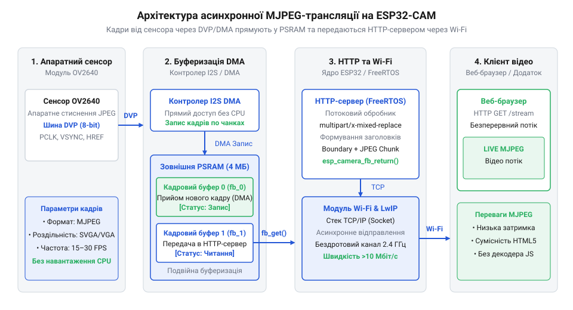

# Проєкт автономного відеосервера потокового мовлення на платі ESP32-CAM

<preknowlist>
- [ESP32-CAM (OV2640 + microSD)](root:cat-hw-boards/esp32-cam) — Базова апаратна розпіновка плат ESP32-CAM та організація живлення.
- [ESP32-CAM з камерою OV3640 (2 МП)](root:cat-hw-boards/esp32-cam-ov3640) — Схемотехнічні особливості підключення DVP-сенсорів та параметри тактування.
</preknowlist>

## Проблема переривання відеопотоку та брак пам'яті

Передача потокового відео високої роздільності в реальному часі є однією з найважчих задач для мікроконтролерів. Під час спроби транслювати нестиснений відеопотік або один кадр високої роздільності `VGA` (`640×480` пікселів у кодуванні `RGB565`) один фрейм займає понад `614 кБ` оперативної пам'яті. Внутрішній статичний оперативний запам'ятовувальний пристрій @@en|SRAM@@ (від англ. *Static Random-Access Memory* — статична пам'ять із довільним доступом) плати [ESP32-CAM](root:cat-hw-boards/esp32-cam) має лише `520 кБ` загального обсягу, з яких користувачеві доступно менше ніж `300 кБ` неперервного залишку. Спроба виділити один нестиснений кадр у внутрішній пам'яті @@en|DRAM@@ (від англ. *Dynamic Random-Access Memory* — динамічна оперативна пам'ять) призводить до негайного вичерпання ресурсів системної купи @@en|heap@@ (від англ. *heap* — купа, динамічний простір пам'яті) та аварійного перезавантаження за сторожовим таймером @@en|Watchdog Reset@@ (від англ. *Watchdog Reset* — скидання сторожовим таймером).

Стиснення кадрів у формат @@en|JPEG@@ (від англ. *Joint Photographic Experts Group* — об'єднана група експертів у галузі фотографії) зменшує обсяг одного кадру до `20–60 кБ`, але при використанні єдиного буфера виникає апаратна затримка. Поки контролер прямого доступу до пам'яті @@en|DMA@@ (від англ. *Direct Memory Access* — прямий доступ до пам'яті) зчитує новий кадр із шини @@en|DVP@@ (від англ. *Digital Video Port* — цифровий відеопорт), мережевий стек `Wi-Fi` не може надсилати попередні байти. Це знижує частоту кадрів @@en|FPS@@ (від англ. *Frames Per Second* — кадрів на секунду) та викликає розриви картинки. Для стабільного мовлення потрібна зовнішня псевдостатична оперативна пам'ять @@en|PSRAM@@ (від англ. *Pseudo-Static Random-Access Memory* — псевдостатична оперативна пам'ять) обсягом `4 МБ` та техніка подвійної буферизації (англ. @@en|double buffering@@; @@en|подвійна буферизація double buffering@@), що дозволяє асинхронно захоплювати наступний кадр під час відправки поточного.

Обмеження продуктивності насамперед диктуються фізичною пропускною здатністю 8-бітної паралельної шини `DVP`. При генерації опорної частоти `XCLK = 20 МГц` внутрішній дескриптор сенсора виводить дані за допомогою тактового сигналу пікселів `PCLK` (від англ. *Pixel Clock* — піксельна тактова частота) на частоті `20 МГц`. Оскільки кожен такт `PCLK` передає `1 байт` інформації по лініях даних `D0–D7`, теоретична пікова швидкість надходження байтів у DMA-контролер обчислюється так:

```
B_DVP = PCLK · 1 байт
= (20·10⁶ Гц) · 1 байт                 [множення частоти піксельного тактування на розмір шини]
= 20·10⁶ байт/с                        [20 МБ/с = 160 Мбіт/с]

t_frame_VGA = (N_pixels · 1.2) / B_DVP
= (640 · 480 · 1.2) / (20·10⁶)          [урахування 20% часових інтервалів бланкування VSYNC та HREF]
= 368640 / 20·10⁶                       [байт / (байт/с)]
≈ 0.0184                                [с = 18.4 мс]
```

Тривалість зчитування одного кадру `18.4 мс` теоретично дозволяє отримати швидкість понад `54 FPS` на рівні сенсора. Проте за відсутності `PSRAM` контролер `DMA` змушений змагатися за шину пам'яті з мережевим стек-контролером `Wi-Fi` у спільній `DRAM`, що створює каскадні паузи й знижує реальну частоту мовлення до `10–12 FPS`.

## Конфігурування камери та ініціалізація PSRAM

Ініціалізація відеопериферії починається з заповнення конфігураційної структури `camera_config_t` драйвера @@en|esp-camera@@. Спеціальна функція генератора опорної тактової частоти `XCLK` (від англ. *External Clock* — зовнішнє тактування) задає частоту `20 МГц` на каналі `LEDC_CHANNEL_0`. Для апаратного стиснення обирають формат `PIXFORMAT_JPEG`, а при виявленні зовнішньої пам'яті `PSRAM` через функцію `esp_psram_is_initialized()` або `psramFound()` виділяють два фреймбуфери (`fb_count = 2`) прямо в `PSRAM` зі зсувом фокусу захоплення `CAMERA_FB_IN_PSRAM`.


*_Схема асинхронного потоку даних від DVP-сенсора через буфери PSRAM до мережевого сокета Wi-Fi._*

Код конфігурування камери та вибору буферів представлено нижче для середовищ `ESP-IDF` та `Arduino IDE`:

:::tabs
@tab c|esp-idf
:::code proj-esp32-cam-mjpeg-video-server/c/main/app_camera.c 9-52
@tab cpp|arduino
:::code proj-esp32-cam-mjpeg-video-server/cpp/CameraConfig.hpp 28-65
:::

Якщо пам'ять `PSRAM` відсутня або пошкоджена, драйвер автоматично знижує роздільну здатність до `QVGA` (`320×240`) та обмежується єдиним буфером у внутрішній `DRAM`, запобігаючи краху системи під час старт-апу. Різниця в продуктивності між цими режимами є критичною для якості відеопотоку. У режимі роботи з внутрішньою `DRAM` єдиний фреймбуфер `fb_count = 1` змушує ядро чекати повного завершення мережевої відправки кадру по `Wi-Fi` перед тим, як дозволити `DMA`-контролеру захопити новий кадр із шини `DVP`. Це знижує підсумкову частоту мовлення до `6–10 FPS` у роздільності `QVGA`. Натомість активація `PSRAM` із подвійною буферизацією `fb_count = 2` усуває взаємне блокування збору та відправки даних: поки один буфер передається через мережевий сокет, другий асинхронно заповнюється новими пікселями від камери. Це піднімає частоту трансляції до стабільних `25–30 FPS` навіть у вищій роздільності `VGA` (`640×480`) чи `SVGA` (`800×600`). Більш потужні модулі з вбудованим контролером описує [огляд мікроконтролера ESP32-S3](root:cat-hw-boards/esp32s3-microcontroller), а особливості альтернативних сенсорів наведено у розділі про [плату з камери OV3640](root:cat-hw-boards/esp32-cam-ov3640).

## Реалізація HTTP-сервера та потоку multipart/x-mixed-replace

Трансляція безперервного відеопотоку у веббраузер реалізується через спеціальний стандарт `HTTP`-відповіді `multipart/x-mixed-replace` (від англ. *multipart* — баготочковий, *mixed* — змішаний, *replace* — замінювати). Сервер відкриває один сокет і не закриває `HTTP`-з'єднання після відправки першого кадру, а замість цього передає унікальний роздільник межі кадру @@en|boundary@@ (від англ. *boundary* — межа, роздільник кадру). Браузер, отримавши новий шматок даних із заголовком `Content-Type: image/jpeg`, миттєво замінює поточне зображення на екрані новим кадром, створюючи плавний відеопотік.

Реалізація обробника `/stream` на `C` для `ESP-IDF` та на `C++` для `Arduino IDE` використовує функції надсилання фрагментів даних `httpd_resp_send_chunk()`:

:::tabs
@tab c|esp-idf
:::code proj-esp32-cam-mjpeg-video-server/c/main/app_httpd.c 16-67
@tab cpp|arduino
:::code proj-esp32-cam-mjpeg-video-server/cpp/MjpegStreamServer.cpp 60-101
:::

Під час надсилання кадру критично важливо контролювати повернення коду `res`. Якщо клієнт закриває вкладку браузера, зворотне відправлення `httpd_resp_send_chunk()` повертає помилку, що є сигналом для негайного виходу з нескінченного циклу трансляції та виклику функції звільнення буфера `esp_camera_fb_return()`.

При падінні швидкості @@en|Wi-Fi@@-з'єднання або затримках у приймача вихідний буфер передачі @@en|TCP@@ (від англ. *Transmission Control Protocol* — протокол керування передачею) мережевого стека @@en|LwIP@@ (від англ. *Lightweight IP* — легковаговий протокол Інтернету) миттєво переповнюється бінарними даними кадру. Якщо викликати `httpd_resp_send_chunk()` у разі переповненого сокета без таймауту, задача сервера повністю блокується в очікуванні вільного місця в буфері, що спричиняє утримання фреймбуфера камери, накопичення застарілих кадрів і перезавантаження системи через @@en|Watchdog Reset@@ (від англ. *watchdog* — сторожовий таймер, *reset* — скидання). Для запобігання блокуванню компонент `esp_http_server` конфігурують із часовим лімітом надсилання сокета `SO_SNDTIMEO`, завдяки чому під час заторів у мережі операція передачі переривається з помилкою, дозволяючи серверу негайно повернути буфер камери через `esp_camera_fb_return()`, пропустити запізнілий кадр та зберегти синхронізацію відеопотоку у реальному часі.

## Асинхронне захоплення кадрів та оптимізація FreeRTOS

Для підтримки високої частоти кадрів захоплення кадру з сенсора та його передача в мережу виконуються у фоновій задачі операційної системи реального часу @@en|FreeRTOS@@ (від англ. *Free Real-Time Operating System* — безкоштовна операційна система реального часу). Життєвий цикл кожного кадру регулюється функцією захоплення `esp_camera_fb_get()`, яка повертає вказівник на структуру `camera_fb_t`. Після завершення передачі бінарного масиву `fb->buf` через мережевий сокет цей буфер обов'язково повертають драйверу через `esp_camera_fb_return()`. Пропускання виклику цієї функції призводить до миттєвого витоку пам'яті (англ. @@en|memory leak@@; @@en|витік пам'яті memory leak@@) і вичерпання пулу `fb_count`.

У C++ реалізації для гарантування повернення буфера застосовують шаблонний клас `FrameBuffer`, розроблений за концепцією @@en|RAII@@ (від англ. *Resource Acquisition Is Initialization* — отримання ресурсу є ініціалізацією). Його деструктор автоматично викликає `esp_camera_fb_return()`, виключаючи витоки навіть при виникненні виняткових ситуацій. Нижче наведено вихідний код ініціалізації та запуску системи:

:::tabs
@tab c|esp-idf
:::code proj-esp32-cam-mjpeg-video-server/c/main/main.c 54-82
@tab cpp|arduino
:::code proj-esp32-cam-mjpeg-video-server/cpp/MjpegStreamServer.hpp 10-41
:::

Оптимізація якості стиснення `jpeg_quality` (значення від `10` до `12`) забезпечує компроміс між пропускною здатністю бездротового каналу `Wi-Fi` та чіткістю картинки, досягаючи стабільних `25–30 FPS` на платах [серії ESP32-CAM](root:cat-hw-boards/esp32-cam). Проте висока частота кадрів створює інтенсивне навантаження на процесорні ядра, що вимагає точного резервування пам'яті під стек асинхронної задачі @@en|FreeRTOS@@: занадто малий розмір викликає катастрофічне переповнення стека (англ. @@en|stack overflow@@; від англ. *stack* — стек, *overflow* — переповнення), а надмірне виділення вичерпує оперативну пам'ять для мережевих сокетів. Додатково, якщо фоновий цикл захоплення й надсилання кадрів тривало монополізує процесорний час без передачі управління іншим потокам чи виклику `vTaskDelay()`, фонова @@en|IDLE-задача@@ системи не встигає скидати сторожовий таймер, що призводить до негайного спрацьовування @@en|Task Watchdog Timer@@ (від англ. *task* — завдання, *watchdog* — сторожовий таймер) і вимушеного перезавантаження мікроконтролера через @@en|Watchdog Reset@@.
