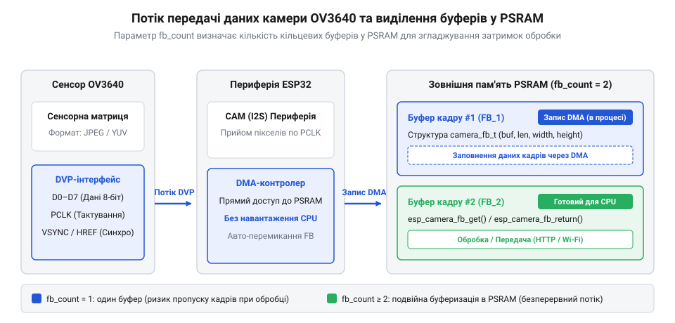
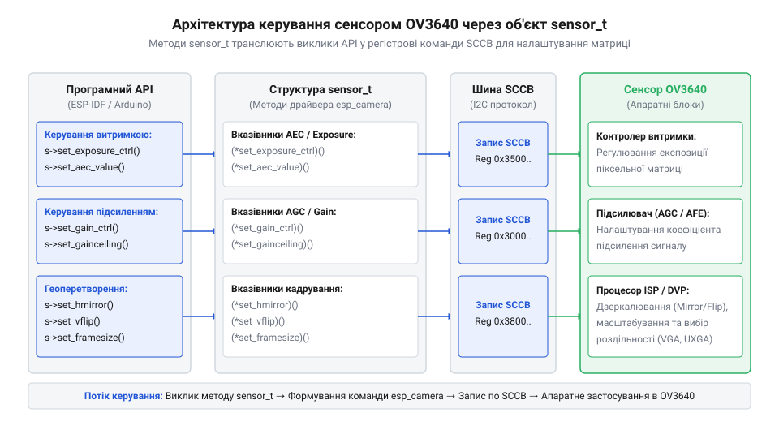

# Програмний інтерфейс драйвера esp_camera для конфігурації сенсора OV3640

<preknowlist>
- [ESP32-CAM (OV2640 + microSD)](root:cat-hw-boards/esp32-cam) — схему апаратного розведення DVP-шини та призначення виводів живлення сенсора
- [Модуль ESP32-CAM: огляд архітектури, периферії та сімейства плат](root:cat-hw-boards/esp32-cam-camera-module-family) — архітектуру взаємодії мікроконтролера ESP32 з оптичними сенсорами через інтерфейси DVP та SCCB
</preknowlist>

## Спроба захоплення кадру без ініціалізації

Спроба отримати відеокадр безпосередньо після подачі живлення на мікроконтролер здається найпростішим шляхом для швидкого перевірочного запуску. Розробник викликає функцію захоплення кадру `esp_camera_fb_get()`, очікуючи отримати готовий масив пікселів від оптичного сенсора OV3640, який фізично вже підпаяний до друкованої плати. Проте замість цифрового зображення система миттєво зупиняється, ґенеруючи критичний збій ядра (англ. @@en|panic@@, від грец. @@el|panikos@@ — викликаний богом Паном острах) та виводячи помилку доступу до пам'яті `Guru Meditation Error: Core 0 panic'ed (LoadProhibited)`.

Ця аварійна зупинка стається тому, що фізична наявність мікросхеми на виводах плати не означає її програмної готовності. До моменту виконання первинного налаштування периферійні блоки мікроконтролера ESP32 перебувають у знеструмленому або скинутому стані. Внутрішній генератор тактового сигналу не подає опорну частоту на сенсор, паралельний цифровий порт відеозахоплення @@en|DVP@@ (@@en|Digital Video Port@@, від лат. @@la|digitus@@ — палець та лат. @@la|videre@@ — бачити) позбавлений тактування, а контролер прямого доступу до пам'яті @@en|DMA@@ (@@en|Direct Memory Access@@, від англ. @@en|direct@@ — прямий та лат. @@la|memoria@@ — пам'ять) не має виділених дескрипторів та вказівників на буфери в оперативній пам'яті.

Без попереднього узгодження модального стану звернення до функцій драйвера призводить до розіменування нульових вказівників. Драйвер намагається зчитати дані з незаповненої внутрішньої структури кадрового буфера, що й зумовлює апаратний виняток процесорного ядра. Навіть якщо обійти аварійне завершення перевіркою вказівника на null, заблокована периферія ESP32 переходить у стан нескінченного очікування сигналів вертикальної синхронізації від камери, які ніколи не надійдуть без попереднього запуску керуючої шини @@en|SCCB@@ (@@en|Serial Camera Control Bus@@, від лат. @@la|series@@ — ряд).

Для усунення цієї неминучої пастки розроблено спеціалізований драйвер `esp_camera`. Він бере на себе роль програмного мосту між високорівневою логікою застосунку та низькорівневою периферією мікроконтролера. Драйвер послідовно активує подачу живлення, подає генерацію тактової частоти, конфігурує паралельні лінії даних і виділяє кадрові буфери. Тільки після завершення цього ланцюжка апаратних маніпуляцій захоплення кадрів стає можливим і безпечним. Для вивчення фізичної топології підключення сенсорів корисно переглянути [огляд архітектури плат ESP32-CAM](root:cat-hw-boards/esp32-cam-camera-module-family).

## Прив'язка виводів та вибір частоти

Конфігурування драйвера починається із заповнення структури `camera_config_t`, яка визначає фізичну прив'язку виводів мікроконтролера до інтерфейсних сигналів сенсора OV3640. Апаратний зв'язок між ESP32 та матрицею здійснюється через 8-бітну паралельну шину DVP, керуючу послідовну шину SCCB та лінії тактування й синхронізації. Кожен вивід периферії @@en|GPIO@@ (@@en|General Purpose Input Output@@, від англ. @@en|general@@ — загальний та лат. @@la|propositum@@ — намір) має бути чітко призначений у відповідних полях структури.

Шина даних описується масивом полів від `pin_d0` до `pin_d7`, через які передаються молодші та старші байти кожного пікселя. За узгодження часу передачі відповідають тактові сигнали: опорна частота `pin_xclk` (@@en|XCLK@@, @@en|External Clock@@, від грец. @@el|ex@@ — зовні та англ. @@en|clock@@ — годинник), яку мікроконтролер ґенерує для внутрішньої тактової системи OV3640, та строб `pin_pclk` (@@en|PCLK@@, @@en|Pixel Clock@@, від англ. @@en|pixel@@ — елемент зображення), який сенсор видає на кожен дійсний байт даних. Лінії кадровій синхронізації `pin_vsync` та рядкової синхронізації `pin_href` вказують контролеру DMA на початок нового кадру та межі активних рядків зображення. Керування параметрами сенсора виконується через послідовні лінії `pin_sscb_sda` та `pin_sscb_scl`, а апаратний скид і керування живленням — через `pin_reset` і `pin_pwdn`.

Критичним параметром для стабільної роботи є поле `xclk_freq_hz`, яке задає опорну частоту тактування камери у герцах (зазвичай 10000000 Hz або 20000000 Hz). Опорна частота XCLK використовується внутрішнім помножувачем сенсора для формування внутрішніх тактових імпульсів та шини PCLK. Якщо встановити надто високе значення (наприклад, понад 20 МГц) на платах із довгими або неекранованими провідниками, виникають наводки й спотворення сигналів, що призводить до втрати синхронізації та артефактів на зображенні. З іншого боку, зниження частоти нижче 6 МГц робить передачу відеопотоку надто повільною й може викликати збій у роботі внутрішніх фазових автопідстройок частоти матриці OV3640.

Приклад ініціалізації структури конфігурації виводів для [серійного модуля ESP32-CAM](root:cat-hw-boards/esp32-cam):

:::tabs
@tab ESP-IDF (C)
:::code api-esp-camera-driver-configuration/c/esp-idf/snippet-1.c
@tab Arduino (C++)
:::code api-esp-camera-driver-configuration/cpp/arduino/setupcameraconfig.cpp
:::

Правильно сформована прив'язка GPIO та вибір частоти створюють фізичний фундамент для передачі цифрового потоку, після чого виникає завдання організації проміжної оперативної пам'яті для зберігання кадрів.

## Буферизація кадрів та виділення PSRAM

Обробка цифрового зображення високої роздільності вимагає значних обсягів оперативної пам'яті. Матриця OV3640 здатна формувати кадри аж до роздільності UXGA (`1600 × 1200` пікселів). Якщо обрати нестиснений колірний формат `PIXFORMAT_RGB565`, де на кожен піксель припадає 2 байти, розмір одного кадру становить:

    1600 × 1200 × 2 = 3840000 байт ≈ 3.66 МБ

$$1600 \times 1200 \times 2 = 3840000 \text{ байт} \approx 3.66 \text{ МБ}$$

Внутрішня статична оперативна пам'ять мікроконтролера ESP32 обмежена обсягом приблизно 520 КБ, з яких для потреб драйвера доступна лише невелика частка. Тому збереження масивних кадрів у внутрішній пам'яті технічно неможливе. Розв'язанням цієї проблеми є використання зовнішньої псевдостатичної пам'яті @@en|PSRAM@@ (@@en|Pseudo Static Random Access Memory@@, від грец. @@el|pseudos@@ — несправжній та лат. @@la|staticus@@ — нерухомий), яка підключається через високошвидкісний шинний інтерфейс. Використовуючи [плату Waveshare ESP32-S3R2 з PSRAM](root:cat-hw-boards/esp32-s3r2-waveshare) або [потужні чіпи ESP32-S3](root:cat-hw-boards/esp32s3-microcontroller), драйвер отримує доступ до мегабайтів додаткового простору.

Обсяг і спосіб виділення пам'яті у структурі `camera_config_t` задаються трьома основними параметрами: `pixel_format`, `frame_size` та `fb_count`.
1. `pixel_format`: визначає колірне кодування. При виборі `PIXFORMAT_JPEG` апаратний компресор усередині OV3640 стискає кадр безпосередньо під час зчитування. Це зменшує обсяг кадру з мегабайтів до $50 \text{--} 200 \text{ КБ}$, що дозволяє зберігати кадри високої роздільності у PSRAM та навіть у внутрішній SRAM при малих роздільностях (наприклад, QQVGA або VGA). Інші формати (`PIXFORMAT_YUV422`, `PIXFORMAT_RGB565`, `PIXFORMAT_GRAYSCALE`) передають нестиснені пікселі й вимагають обов'язкової наявності PSRAM для високих роздільностей.
2. `frame_size`: встановлює роздільність кадру — від `FRAMESIZE_QQVGA` ($160 \times 120$) до `FRAMESIZE_UXGA` ($1600 \times 1200$).
3. `fb_count`: вказує кількість кадрових буферів у пам'яті. Якщо `fb_count = 1`, драйвер виділяє єдиний буфер. Під час захоплення нового кадру периферія DMA перезаписує цей буфер, тому застосунок повинен призупинити обробку. Якщо встановити `fb_count = 2` (подвійна буферизація), драйвер створює два буфери. Поки DMA заповнює один буфер даними з DVP-шини, процесор може паралельно зчитувати й передавати по мережі попередній кадр із другого буфера, що усуває розриви зображення й підвищує частоту кадрів.


*Схема показує послідовну передачу піксельних даних від сенсора через паралельну шину DVP та прямий доступ до пам'яті DMA в кільцеві буфери зовнішньої пам'яті PSRAM.*

Параметр `jpeg_quality` регулює коефіцієнт стиснення JPEG у діапазоні від 1 до 63 (менше число відповідає вищій якості та більшому розміру файла). При відсутності PSRAM вибір високої роздільності або низького коефіцієнта `jpeg_quality` призводить до вичерпання внутрішньої пам'яті під час спроби запуску драйвера.

## Запуск драйвера та діагностика помилок

Після повного формування конфігураційної структури здійснюється безпосередній запуск апаратно-програмного комплексу за допомогою функції `esp_camera_init(&config)`. Вона повертає статусний код типу `esp_err_t`, який дозволяє точно діагностувати стан системи та вчасно обробити межові чи нештатні ситуації.

Алгоритм роботи функції `esp_camera_init()` складається з кількох послідовних етапів:
1. Валідація параметрів структури конфігурації та перевірка доступності вказаних GPIO.
2. Конфігурація таймера LEDC для ґнерації опорної частоти XCLK та активація відповідного виводу.
3. Подача живлення на матрицю OV3640 шляхом перемикання рівнів на виводах `PWDN` та `RESET`.
4. Ініціалізація шини SCCB та виконання зчитування ідентифікаційних регістрів сенсора (`0x300A` та `0x300B`). Драйвер очікує отримати апаратний ідентифікатор `0x3640`.
5. Виділення пам'яті під дескриптори DMA та кадрові буфери `fb_count` у PSRAM або внутрішній SRAM.
6. Завантаження через шину SCCB внутрішніх таблиць регістрів OV3640 для налаштування обраної роздільності `frame_size` та колірного формату `pixel_format`.
7. Запуск фонового завдання DMA для прийому кадрових синхроімпульсів.

У разі виникнення помилок функція `esp_camera_init()` повертає відповідні коди:
- `ESP_OK`: драйвер успішно ініціалізовано, система готова до захоплення кадрів.
- `ESP_ERR_NO_MEM`: виникає, коли в системі недостатньо вільної пам'яті для виділення кадрових буферів або дескрипторів DMA. Причиною зазвичай є вибір роздільності UXGA чи подвійної буферизації `fb_count = 2` на платах без підключеної PSRAM.
- `ESP_ERR_NOT_FOUND`: вказує на відсутність відгуку від сенсора по шині SCCB. Це свідчить про неправильне призначення виводів `pin_sscb_sda` / `pin_sscb_scl`, відсутність підтягуючих резисторів, проблеми з живленням або фізичне пошкодження модуля OV3640.
- `ESP_ERR_INVALID_ARG`: означає некоректну комбінацію конфігураційних параметрів (наприклад, недопустима частота XCLK або несумісний формат даних).
- `ESP_ERR_INVALID_STATE`: виникає при повторному виклику `esp_camera_init()` без попереднього деініціалізування драйвера за допомогою `esp_camera_deinit()`.

Приклад обробки результату запуску драйвера в системному коді:

:::tabs
@tab ESP-IDF (C)
```c|esp-idf
esp_err_t err = esp_camera_init(&camera_config);
if (err != ESP_OK) {
    if (err == ESP_ERR_NO_MEM) {
        ESP_LOGE("CAMERA", "Помилка: Недостатньо пам'яті PSRAM для кадрових буферів");
    } else if (err == ESP_ERR_NOT_FOUND) {
        ESP_LOGE("CAMERA", "Помилка: Сенсор OV3640 не знайдено на шині SCCB");
    } else {
        ESP_LOGE("CAMERA", "Помилка ініціалізації драйвера: 0x%x", err);
    }
    return err;
}
ESP_LOGI("CAMERA", "Драйвер камери успішно запущено");
```
@tab Arduino (C++)
```cpp|arduino
esp_err_t err = esp_camera_init(&config);
if (err != ESP_OK) {
    if (err == ESP_ERR_NO_MEM) {
        Serial.println("Помилка: Недостатньо пам'яті PSRAM для кадрових буферів");
    } else if (err == ESP_ERR_NOT_FOUND) {
        Serial.println("Помилка: Сенсор OV3640 не знайдено на шині SCCB");
    } else {
        Serial.printf("Помилка ініціалізації драйвера: 0x%x\n", err);
    }
    return;
}
Serial.println("Драйвер камери успішно запущено");
```
:::

Після успішного завершення ініціалізації драйвер надає інтерфейс для динамічного підстроювання параметрів оптичної матриці під час роботи.

## Налаштування матриці через структуру sensor_t

Після успішного виклику `esp_camera_init()` розробник отримує можливість динамічно змінювати оптичні та цифрові параметри сенсора OV3640 без перезапуску всієї системи. Керування здійснюється через вказівник на структуру `sensor_t`, який отримують за допомогою функції `esp_camera_sensor_get()`. Ця структура містить набір функціональних покажчиків на методи, що надсилають відповідні команди запису в регістри сенсора через шину SCCB.

За допомогою об'єкта `sensor_t` виконується налаштування трьох основних груп параметрів зображення:
1. Експозиція та підсилення: автоматичне регулювання експозиції передається через `s->set_exposure_ctrl(s, 1)`, а ручний час накопичення заряду задається функцією `s->set_aec_value(s, val)`. Аналогічно керування підсиленням сигналу матриці реалізується через `s->set_gain_ctrl(s, 1)` та `s->set_agc_gain(s, gain)`.
2. Баланс білого: функція `s->set_whitebal(s, 1)` вмикає автоматичну корекцію колірної температури, а `s->set_wb_mode(s, mode)` дозволяє обрати встановлені пресети (наприклад, сонячне світло, хмарність або офісне освітлення).
3. Геометричні перетворення та якість: для виправлення орієнтації кадру при фізичній перевернутості сенсора використовуються функції дзеркалювання `s->set_hmirror(s, 1)` та вертикального перевороту `s->set_vflip(s, 1)`. Зміна якості стиснення JPEG "на льоту" виконується методом `s->set_quality(s, quality)`, а зміна роздільності — `s->set_framesize(s, FRAMESIZE_VGA)`.


*Структурна діаграма описує архітектуру об'єкта sensor_t та його методи прямого впливу на оптичний блок OV3640 через інтерфейс SCCB.*

Приклад програмної адаптації режимів сенсора у реальному часі:

:::tabs
@tab ESP-IDF (C)
```c|esp-idf
sensor_t *s = esp_camera_sensor_get();
if (s != NULL) {
    // Вмикаємо вертикальний переворот та горизонтальне дзеркалювання
    s->set_vflip(s, 1);
    s->set_hmirror(s, 1);

    // Оптимізуємо параметри експозиції та автоматичного балансу білого
    s->set_whitebal(s, 1);
    s->set_exposure_ctrl(s, 1);
    s->set_gain_ctrl(s, 1);

    // Динамічно змінюємо роздільність на VGA для підвищення швидкості
    s->set_framesize(s, FRAMESIZE_VGA);
}
```
@tab Arduino (C++)
```cpp|arduino
sensor_t *s = esp_camera_sensor_get();
if (s != NULL) {
    // Вмикаємо вертикальний переворот та горизонтальне дзеркалювання
    s->set_vflip(s, 1);
    s->set_hmirror(s, 1);

    // Оптимізуємо параметри експозиції та автоматичного балансу білого
    s->set_whitebal(s, 1);
    s->set_exposure_ctrl(s, 1);
    s->set_gain_ctrl(s, 1);

    // Динамічно змінюємо роздільність на VGA для підвищення швидкості
    s->set_framesize(s, FRAMESIZE_VGA);
}
```
:::

Завдяки гнучкому інтерфейсу `sensor_t` розробник отримує повний контроль над оптичною системою, забезпечуючи адаптацію відеопотоку під мінливі умови освітлення та вимоги обробки даних.
