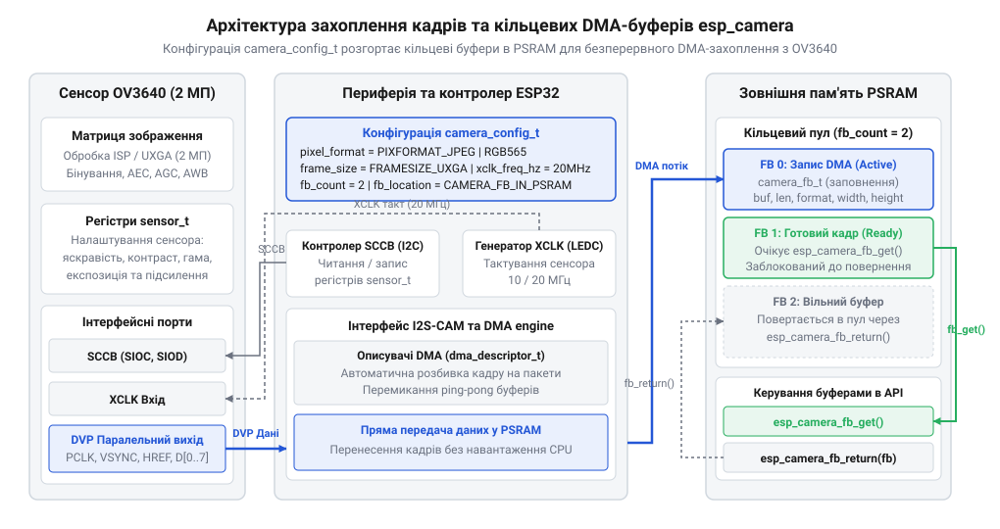
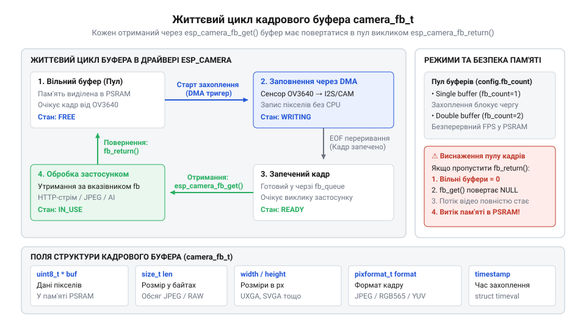

# Програмний API драйвера esp_camera: конфігурація camera_config_t, виклики захоплення та керування сенсором OV3640

<preknowlist>
- [ESP32-CAM (OV2640 + microSD)](root:cat-hw-boards/esp32-cam) — апаратне розпінування шини DVP, підключення тактового сигналу XCLK та особливості розведення зовнішньої PSRAM на платі
- [Модуль ESP32-CAM: огляд архітектури, периферії та сімейства плат](root:cat-hw-boards/esp32-cam-camera-module-family) — принципи фізичної взаємодії ESP32 із сенсорами камери через паралельний інтерфейс DVP та командну шину SCCB
</preknowlist>

## Неможливість ручного захоплення паралельного відеопотоку

При спробі побудувати відеосистему на [популярній платі ESP32-CAM](root:cat-hw-boards/esp32-cam) або аналогічних мікроконтролерних модулях першою думкою розробника часто є пряме зчитування станів цифрових входів `@@en|GPIO@@` у програмованому циклі. Проте спроба програмного опитування (англ. *bit-banging*) високочастотного паралельного інтерфейсу `@@en|Digital Video Port@@` (англ. *digital* — цифровий, *video* — відео, *port* — порт, скорочено `@@en|DVP@@`) сенсора `@@en|OV3640@@` неминуче призводить до катастрофічного перевантаження центрального процесора та повної втрати кадрів.

Сенсор `@@en|OV3640@@` у режимі формування відеопотоку генерує синхронний тактовий сигнал `@@en|Pixel Clock@@` (англ. *pixel* — піксель, *clock* — тактовий сигнал, `@@en|PCLK@@`) із частотою від 10 до 24 МГц. На кожному спадному або зростаючому фронті `@@en|PCLK@@` на 8 паралельних лініях даних `@@en|D0@@`–`@@en|D7@@` з'являється новий байт піксельної інформації, що супроводжується сигналами стробування рядка `@@en|Horizontal Reference@@` (англ. *horizontal* — горизонтальний, *reference* — орієнтир, `@@en|HREF@@`) та кадру `@@en|Vertical Synchronization@@` (англ. *vertical* — вертикальний, *synchronization* — синхронізація, `@@en|VSYNC@@`). За частоти `@@en|PCLK@@` у 20 МГц між двома сусідніми байтами проходить лише 50 наносекунд. Процесор `@@en|ESP32@@`, працюючи на максимальній тактовій частоті 240 МГц, має у своєму розпорядженні всього 12 тактів ядра на обробку одного байта. Оскільки зчитування шини `@@en|GPIO@@`, перевірка прапорців синхронізації та збереження байта в пам'яті вимагають значно більше інструкцій, процесор опиняється в стані 100% завантаження, але все одно пропускає тактові імпульси `@@en|PCLK@@`. У результаті зсуваються межі рядків, руйнується структура кадрів, а обробка будь-яких інших завдань у системі повністю блокується.

Єдиним працездатним розв'язком цієї проблеми є використання апаратного периферійного модуля `@@en|Inter-IC Sound@@` (англ. *inter-IC* — міжмікросхемний, *sound* — звук, `@@en|I2S@@`) у паралельному режимі (або модуля `@@en|LCD_CAM@@` у новіших чипах), який працює в зв'язці з контролером `@@en|Direct Memory Access@@` (англ. *direct* — прямий, *memory* — пам'ять, *access* — доступ, `@@en|DMA@@`). Апаратний шинний інтерфейс забирає байти з ліній `@@en|D0@@`–`@@en|D7@@` суворо за фронтом `@@en|PCLK@@` без участі ядра процесора і пересилає їх безпосередньо в оперативну пам'яті через описувачі `@@en|DMA@@`.

*Апаратна архітектура з'єднання сенсора OV3640 з периферією ESP32 та буферизацією кадрів у зовнішній PSRAM.*

Організацію цього складного апаратного конвеєра бере на себе спеціалізована бібліотека `@@en|esp_camera@@`. Вона виконує роль проміжного програмного шару (англ. *middleware*), який абстрагує низькорівневі регістри `@@en|I2S@@`/`@@en|DMA@@`, налаштовує таймер генерації тактування `@@en|XCLK@@`, забезпечує первинне конфігурування сенсора через шину `@@en|Serial Camera Control Bus@@` (англ. *serial* — послідовний, *camera* — камера, *control* — керування, *bus* — шина, `@@en|SCCB@@`) та надає високорівневий інтерфейс для отримання готових кадрів. Вивчення детальної [архітектури ESP32-CAM плат](root:cat-hw-boards/esp32-cam-camera-module-family) дає змогу краще зрозуміти апаратне розведення шини `@@en|DVP@@` між мікроконтролером і відеосенсором.

## Конфігурація шини й пам'яті camera_config_t

Для успішного запуску драйвера `@@en|esp_camera@@` необхідно сформувати та передати у функцію ініціалізації структуру `@@en|camera_config_t@@`. Вона визначає фізичну прив'язку виводів `@@en|GPIO@@`, генерацію тактового сигналу `@@en|XCLK@@`, формат пікселів, роздільну здатність кадру та порядок виділення кадрових буферів у оперативній пам'яті.

Тактовий сигнал `@@en|XCLK@@` (англ. *external clock* — зовнішнє тактування) є необхідною умовою функціонування внутрішньої цифрової логіки `@@en|OV3640@@`. Драйвер генерує цей сигнал за допомогою периферійного таймера `@@en|LEDC@@` мікроконтролера. Зазвичай для `@@en|OV3640@@` задають частоту `@@en|xclk_freq_hz@@` на рівні 10000000 Гц (10 МГц) або 20000000 Гц (20 МГц). Занадто висока частота може призвести до збоїв передачі через довготу треків на друкованій платі, а занадто низька — зменшить максимальну частоту кадрів.

Вибір відповідного формату пікселів `@@en|pixel_format@@` визначає обсяг пам'яті під один кадр та обчислювальне навантаження на мікроконтролер:

*   `@@en|PIXFORMAT_JPEG@@` — сенсор `@@en|OV3640@@` самостійно виконує апаратне стиснення зображення за алгоритмом `@@en|Joint Photographic Experts Group@@` (англ. *joint photographic experts group* — об'єднана група експертів із фотографії, `@@en|JPEG@@`). Вихідний буфер містить кодований потік байтів, обсяг якого у 10–20 разів менший за сирий масив пікселів. Це дозволяє працювати з високими роздільностями кадру `@@en|framesize_t@@` (наприклад, `@@en|FRAMESIZE_UXGA@@` 1600×1200 або `@@en|FRAMESIZE_QXGA@@` 2048×1536) навіть за обмеженого розміру ОЗП.
*   `@@en|PIXFORMAT_RGB565@@` або `@@en|PIXFORMAT_YUV422@@` — невикривлений масив пікселів, де кожен піксель займає 2 байти. Для кадру з роздільністю `@@en|UXGA@@` розмір неприхованого масиву становить `1600 × 1200 × 2 = 3840000` байтів (приблизно 3.66 МБ).

Внутрішня оперативна пам'ять `@@en|DRAM@@` мікроконтролера `@@en|ESP32@@` має доступний для користувача обсяг близько 300 КБ, чого недостатньо для розміщення неспрямованих кадрів високої роздільності або кількох кільцевих `@@en|JPEG@@`-буферів. Тому для повноцінної роботи відеосистеми необхідна зовнішня псевдостатична пам'ять `@@en|Pseudo Static Random Access Memory@@` (англ. *pseudo* — псевдо, *static* — статичний, *random access memory* — оперативна пам'ять, `@@en|PSRAM@@`). На відміну від потужнішого [мікроконтролера ESP32-S3](root:cat-hw-boards/esp32s3-microcontroller), стандартні плати на базі `@@en|ESP32@@` потребують явного вказання прапорця `@@en|fb_location = CAMERA_FB_IN_PSRAM@@` та вибору кількості кадрових буферів `@@en|fb_count@@` (зазвичай 2 або 3 для забезпечення подвійної буферизації без пропуску кадрів).

Під час виклику `@@en|esp_camera_init(&config)@@` драйвер автоматично розраховує ланцюжок описувачів `@@en|DMA@@`. Оскільки кожен окремий описувач `@@en|DMA@@` в архітектурі `@@en|ESP32@@` може адресувати не більше 4095 байтів непреривної пам'яті, драйвер розбиває виділений у `@@en|PSRAM@@` кадровий буфер на серію пов'язаних блоків.

:::tabs
@tab ESP-IDF (C)
:::code api-esp-camera-driver-ov3640/c/esp-idf/init-camera-ov3640.c
@tab Arduino (C++)
:::code api-esp-camera-driver-ov3640/cpp/arduino/setupcameraov3640.cpp
:::

## Керування відеобуферами через esp_camera_fb_get

Після успішного запуску драйвера захоплення кожного кадру здійснюється через механізм запиту та повернення відеобуферів. Одиницею обміну даними між драйвером `@@en|esp_camera@@` та прикладним кодом є структура `@@en|camera_fb_t@@`.

Вона містить відкритий вказівник на масив даних `@@en|buf@@`, довжину збереженого кадру `@@en|len@@` у байтах, геометричні параметри `@@en|width@@` та `@@en|height@@`, використовуваний формат пікселів `@@en|format@@`, а також часову позначку формування кадру `@@en|timestamp@@`.

Драйвер функціонує за принципом кільцевого пулу буферів (англ. *ring buffer pool*). Під час надходження сигналу `@@en|VSYNC@@` контролер `@@en|DMA@@` автоматично заповнює один із вільних буферів у пам'яті `@@en|PSRAM@@`. Після завершення кадру драйвер вміщує готовий об'єкт у внутрішню чергу готових кадрів. Прикладний код отримує вказівник на кадровий буфер шляхом виклику функції `@@en|esp_camera_fb_get()@@`.

*Діаграма станів кадрового буфера під час передачі між драйвером та користувацьким кодом.*

Фундаментальним правилом безпечної роботи з пам'яттю є обов'язкове повернення кожного отриманого буфера назад драйверу за допомогою виклику `@@en|esp_camera_fb_return(fb)@@`. Поки вказівник утримується користувацьким кодом, відповідний буфер вважається зайнятим і контролер `@@en|DMA@@` не може використовувати його для запису нових кадрів із камери. Якщо програма опитує кадри функцією `@@en|esp_camera_fb_get()@@`, але забуває викликати `@@en|esp_camera_fb_return()@@`, пул буферів миттєво виснажується. За конфігурації `@@en|fb_count = 2@@` вже третій виклик `@@en|esp_camera_fb_get()@@` заблокує виконання або поверне значення `NULL`, зупинивши обробку відеопотоку.

:::tabs
@tab ESP-IDF (C)
:::code api-esp-camera-driver-ov3640/c/esp-idf/process-video-frame.c
@tab Arduino (C++)
:::code api-esp-camera-driver-ov3640/cpp/arduino/captureandprocessframe.cpp
:::

## Керування параметрами OV3640 через sensor_t

Налаштування оптичних та колірних характеристик зображення здійснюється безпосередньо у внутрішніх регістрах сенсора `@@en|OV3640@@` через спеціальний апаратний вказівник на структуру `@@en|sensor_t@@`. Отримати цей вказівник можна після успішної ініціалізації драйвера за допомогою виклику `@@en|sensor_t *s = esp_camera_sensor_get();@@`.

Структура `@@en|sensor_t@@` являє собою таблицю вказівників на функції, які транслюють програмні команди користувача у низькорівневі транзакції за допомогою шини `@@en|SCCB@@`. Це дозволяє динамічно змінювати параметри експозиції, підсилення та балансу білого в реальному часі без необхідності зупинки відеопотоку чи перезапуску драйвера `@@en|esp_camera@@`.

Основні групи функцій керування сенсором `@@en|OV3640@@`:

*   **Автоматична й ручна експозиція (`@@en|AEC@@`):** `s->set_exposure_ctrl(s, 1)` вмикає автоматичне регулювання часу витримки (англ. `@@en|Automatic Exposure Control@@`, `@@en|AEC@@`). Для примусового вибору витримки автоматику вимикають (`set_exposure_ctrl(s, 0)`) та задають значення регістру через `s->set_aec_value(s, val)`.
*   **Підсилення сигналу (`@@en|AGC@@`):** `s->set_gain_ctrl(s, 1)` активує автоматичне підсилення (англ. `@@en|Automatic Gain Control@@`, `@@en|AGC@@`). Максимальний поріг шуму обмежують функцією `s->set_gainceiling(s, GAINCEILING_2X)` (доступні рівні від 2X до 128X).
*   **Баланс білого (`@@en|AWB@@`):** `s->set_whitebal(s, 1)` вмикає автоматичний баланс білого (англ. `@@en|Automatic White Balance@@`, `@@en|AWB@@`). Додатково можна встановити пресети колірної температури через `s->set_wb_mode(s, mode)` (сонячно, хмарно, приміщення).
*   **Апаратне бінування й орієнтація:** сенсор `@@en|OV3640@@` підтримує функцію апаратного бінування (англ. *pixel binning*), коли заряди сусідніх фотодіодів об'єднуються на матриці до зчитування. Це суттєво підвищує світлочутливість сенсора в умовах слабкого освітлення при пропорційному зменшенні роздільності. Зміна орієнтації кадру виконується функціями `s->set_hmirror(s, 1)` (дзеркальне відображення по горизонталі) та `s->set_vflip(s, 1)` (перевертання по вертикалі).

:::tabs
@tab ESP-IDF (C)
:::code api-esp-camera-driver-ov3640/c/esp-idf/configure-ov3640-low-light.c
@tab Arduino (C++)
:::code api-esp-camera-driver-ov3640/cpp/arduino/applysensorsettings.cpp
:::

## Діагностика помилок та граничні режими

Робота з відеосенсорами на мікроконтролерах `@@en|ESP32@@` пов'язана з ризиком виникнення апаратних та програмних збоїв. Створення відмовостійкої системи вимагає обробки критичних помилок на етапах ініціалізації, захоплення та живлення.

Найчастіші помилки під час виконання `@@en|esp_camera_init()@@`:

1.  `@@en|ESP_ERR_NOT_FOUND@@` (код `0x105`) — драйвер не може зчитати ідентифікатор сенсора `@@en|OV3640@@` через шину `@@en|SCCB@@`. Причинами є помилково вказані виводи `@@en|pin_sscb_sda@@` або `@@en|pin_sscb_scl@@`, відсутність підтягувальних резисторів 4.7 кОм на лініях `@@en|I2C@@`, або ненадійний фізичний контакт у роз'ємі модуля камери.
2.  `@@en|ESP_ERR_NO_MEM@@` (код `0x101`) — брак оперативної пам'яті для виділення кадрових буферів. Якщо в системі відсутня або не працює зовнішня пам'ять `@@en|PSRAM@@`, виділення великих буферів завершується збоєм.

Для нейтралізації відсутності `@@en|PSRAM@@` застосовують режим запеклої економії пам'яті (англ. *fallback mode*): динамічно перевіряють працездатність `@@en|PSRAM@@`, зменшують роздільність до `@@en|FRAMESIZE_QVGA@@` (320×240), встановлюють `@@en|fb_count = 1@@` та переключають розміщення буфера у внутрішню пам'ять `@@en|CAMERA_FB_IN_DRAM@@`.

Під час захоплення кадрів виклик `@@en|esp_camera_fb_get()@@` може повертати вказівник `NULL`. Це відбувається при таймауті очікування кадрів, коли переривання `@@en|VSYNC@@` не надходить протягом заданого інтервалу. Причиною зазвичай є обрив лінії `@@en|PCLK@@` або `@@en|VSYNC@@`, імпульсні перешкоди на лінії `@@en|XCLK@@` або збій внутрішнього автомата станів сенсора.

Окремим граничним фактором є сплески споживання струму. В момент ініціалізації матриці `@@en|OV3640@@` та старту генерації `@@en|XCLK@@` споживання модуля зростає на 250–300 мА за частки мікросекунди. Якщо джерело живлення має високий внутрішній опір або підведено тонкими провідниками, на шині 3.3 В виникає короткочасне просідання напруги, що викликає спрацьовування апаратного захисту `@@en|Brownout Detector@@` мікроконтролера та циклічне перезавантаження системи (`@@en|TG0WDT_SYS_RESET@@`). Для нейтралізації цього явища біля виводів живлення модуля камери встановлюють згладжувальні конденсатори (електролітичний 10 мкФ та керамічний 0.1 мкФ).

При виникненні непереборного збою захоплення реалізують відновлення роботи камери через програмне перезапускування:

:::tabs
@tab ESP-IDF (C)
:::code api-esp-camera-driver-ov3640/c/esp-idf/recover-camera-subsystem.c
@tab Arduino (C++)
:::code api-esp-camera-driver-ov3640/cpp/arduino/recovercamera.cpp
:::
