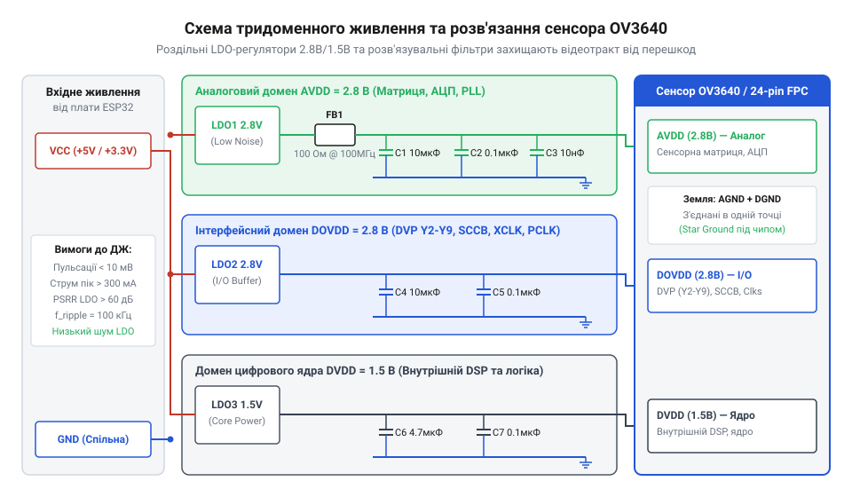
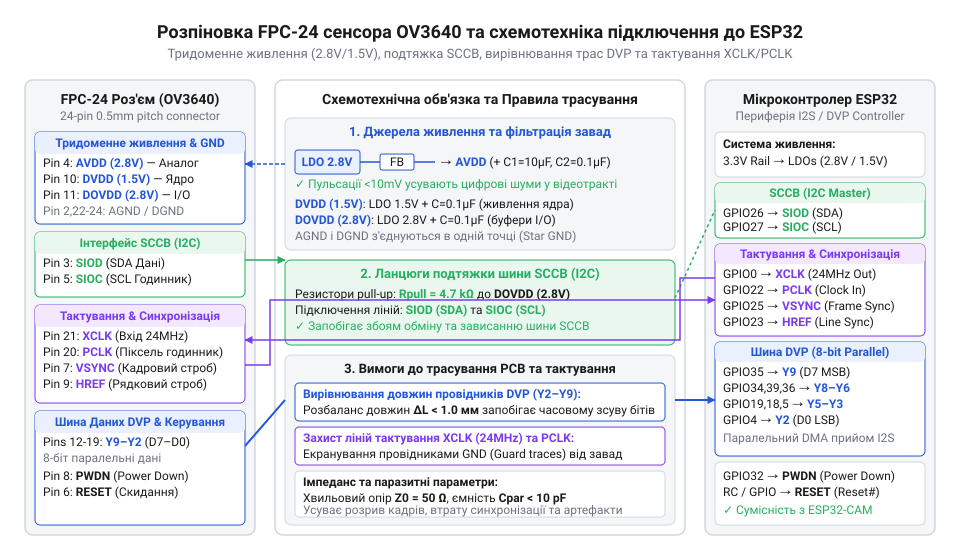
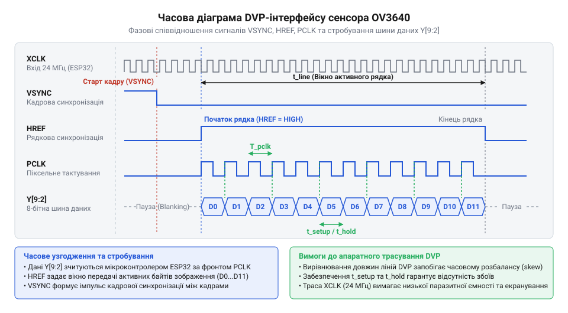

# Залізний інтерфейс ESP32-CAM: розводка шини DVP, ліній тактування та схемотехніка живлення OV3640

<preknowlist>
- [ESP32-CAM (OV2640 + microSD)](root:cat-hw-boards/esp32-cam) — Конструктивне виконання плат серії ESP32-CAM, базову розводку GPIO для підключення камер та принципи роботи з зовнішньою PSRAM для збереження кадрів.
- [Модуль ESP32-CAM: огляд архітектури, периферії та сімейства плат](root:cat-hw-boards/esp32-cam-camera-module-family) — Апаратну архітектуру модуля ESP32-CAM, призначення вбудованої периферії, підключення камер через паралельний порт та обмеження використання GPIO.
</preknowlist>

## Спотворення зображення через неекранований відеотракт

Пряме підключення сенсора зображення @@en|OV3640@@ до мікроконтролера @@en|ESP32@@ некросованими провідниками деградує відеопоток. Через частоти тактування @@en|XCLK@@ (до 24 МГц) і піксельного @@en|PCLK@@ (до 80 МГц) із фронтами менше за 2 нс траси поводяться як лінії з розподіленими параметрами. Неузгодженість імпедансу викликає відбиття сигналу (англ. @@en|signal reflection@@) та перехресні завади (англ. @@en|crosstalk@@) на 10-бітній шині цифрового відеопорту (англ. @@en|Digital Video Port@@, @@en|DVP@@).

Наводки на строби @@en|VSYNC@@ та @@en|HREF@@ збивають лічильник пікселів @@en|ESP32@@, розриваючи кадри. Паразитна ємність порушує інтервали встановлення даних Y2–Y9 відносно активного фронту @@en|PCLK@@, створюючи артефакти. Завади на лініях @@en|SIOC@@/@@en|SIOD@@ шини послідовного керування камерою (англ. @@en|Serial Camera Control Bus@@, @@en|SCCB@@) викликають помилки @@en|NACK@@, блокуючи ініціалізацію регістрів @@en|OV3640@@.

На відміну від готових плат у [модулі ESP32-CAM](root:cat-hw-boards/esp32-cam-camera-module-family), підключення вимагає узгодження роз'єму гнучкої друкованої плати (англ. @@en|flexible printed circuit@@, @@en|FPC@@), тридоменного живлення та трасування ліній.

## Схемотехніка тридоменного живлення сенсора OV3640

Сенсор зображення @@en|OV3640@@ поєднує на одному кристалі аналогову матрицю @@en|CMOS@@ (від англ. @@en|complementary metal-oxide-semiconductor@@ — комплементарна структура метал-оксид-напівпровідник), перетворювачі @@en|ADC@@ (від англ. @@en|analog-to-digital converter@@ — аналогово-цифровий перетворювач), процесор @@en|DSP@@ (від англ. @@en|digital signal processor@@ — цифровий сигнальний процесор) та буфери шини @@en|DVP@@. Перемикання транзисторів цифрового ядра на такті @@en|PCLK@@ створює кидки струму. Живлення вузлів від одного джерела спричиняє проникнення шумів в аналогову частину, що викликає горизонтальні смуги та шум структури кадру.

Для ізоляції завад у @@en|OV3640@@ передбачено три окремі домени живлення:

Домен аналогового живлення @@en|AVDD@@ з напругою 2.8 В (діапазон 2.6–3.0 В) живить пікселі, підсилювачі зчитування та блоки @@en|ADC@@. Пульсації напруги понад 5 мВ викривляють рівень чорного та спричиняють кольоровий шум.

Домен живлення цифрового ядра @@en|DVDD@@ з напругою 1.5 В (діапазон 1.4–1.6 В) забезпечує роботу логіки, тактування та системи @@en|PLL@@ (від англ. @@en|phase-locked loop@@ — система фазового автопідлаштування частоти). Низька напруга знижує тепловиділення й споживання ядра.

Домен живлення вихідних буферів @@en|DOVDD@@ з напругою 2.8 В (діапазон 1.7–3.0 В) визначає логічні рівні сигналів шини @@en|DVP@@ та інтерфейсу @@en|SCCB@@. Для узгодження з @@en|ESP32@@ напругу вибирають 2.8 В або 3.3 В.


*Структура тридоменного живлення сенсора OV3640 з окремими низькошумними LDO-регуляторами та фільтрами.*

Схемотехніка вимагає окремих регуляторів @@en|LDO@@ (від англ. @@en|low-dropout regulator@@ — регулятор напруги з малим падінням). Для @@en|AVDD@@ застосовують низькошумний @@en|LDO@@ із пригніченням пульсацій @@en|PSRR@@ (від англ. @@en|power supply rejection ratio@@ — коефіцієнт пригнічення пульсацій живлення) від 70 дБ на 1 кГц. Живлення @@en|DVDD@@ формує окремий @@en|LDO@@ на 1.5 В. Спільне живлення @@en|DOVDD@@ та @@en|AVDD@@ від шини 2.8 В припустиме лише за апаратної розв'язки через феритовий фільтр @@en|FB@@ (від англ. @@en|ferrite bead@@ — феритова намистина) з опором менше 0.5 Ом та імпедансом 600 Ом на 100 МГц.

Біля виходу кожного @@en|LDO@@ ставлять згладжувальний конденсатор 10 мкФ (танталовий або керамічний @@en|X7R@@ з низьким еквівалентним послідовним опором @@en|ESR@@ — від англ. @@en|equivalent series resistance@@). Безпосередньо біля виводів живлення 24-контактного @@en|FPC@@ роз'єму підключають паралельну пару керамічних конденсаторів: 0.1 мкФ для фільтрації середньочастотних завад та 10 нФ (або 100 пФ) для пригнічення високочастотних гармонік @@en|PCLK@@. Виводи заземлення підводять найкоротшими трасами до суцільного шару землі. Топологія зовнішніх фільтрів для @@en|OV3640@@ є обов'язковою, на відміну від вбудованого захисту [мікроконтролера ESP32-S3](root:cat-hw-boards/esp32s3-microcontroller).

## Розводка 24-пінового FPC-роз'єму та шини DVP

Фізичне з'єднання між сенсором @@en|OV3640@@ та мікроконтролером @@en|ESP32@@ реалізується через 24-контактний @@en|FPC@@-роз'єм із кроком 0.5 мм. Чіткий розподіл функцій між пінами роз'єму запобігає наводкам та забезпечує стабільне передавання даних паралельною шиною @@en|DVP@@. Сигнальні лінії поділено на функціональні групи, а провідники заземлення між ними мінімізують взаємну індуктивну наводку.

8-бітна шина @@en|DVP@@ (Y2–Y9) передає старші біти даних на виводи @@en|GPIO@@ @@en|ESP32@@ через [інтерфейс I2S/LCD-CAM](root:hw-arch/esp32-i2s-lcd-cam-interface). Тактування й синхронізацію забезпечують вхідний опорний сигнал @@en|XCLK@@ (10–24 МГц від генератора @@en|LEDC@@ або @@en|I2S@@), вихідний піксельний клок @@en|PCLK@@ та строби @@en|VSYNC@@ і @@en|HREF@@.

Двопровідна шина @@en|SCCB@@ (лінії @@en|SIOC@@ та @@en|SIOD@@) з відкритим стоком вимагає зовнішніх підтягувальних резисторів 2.2–4.7 кОм до @@en|DOVDD@@ (2.8 В), оскільки внутрішні підтяжки @@en|ESP32@@ (~45 кОм) затягують фронти імпульсів. Сигнал @@en|PWDN@@ (активний 1) переводить сенсор у режим вимкнення, а @@en|RESETB@@ (активний 0) відновлює початковий стан через [архітектуру регістрів OV3640](root:hw-sensing/ov3640-register-architecture).

| Номер піна FPC | Назва сигналу | Напрямок сигналу | Опис та підключення до ESP32 |
| :--- | :--- | :--- | :--- |
| 1 | @@en|DGND@@ | Живлення | Цифрова земля (підключається до суцільного шару GND) |
| 2 | @@en|Y2@@ | Вихід з OV3640 | Біт D0 шини DVP -> GPIO ESP32 |
| 3 | @@en|Y3@@ | Вихід з OV3640 | Біт D1 шини DVP -> GPIO ESP32 |
| 4 | @@en|Y4@@ | Вихід з OV3640 | Біт D2 шини DVP -> GPIO ESP32 |
| 5 | @@en|Y5@@ | Вихід з OV3640 | Біт D3 шини DVP -> GPIO ESP32 |
| 6 | @@en|Y6@@ | Вихід з OV3640 | Біт D4 шини DVP -> GPIO ESP32 |
| 7 | @@en|Y7@@ | Вихід з OV3640 | Біт D5 шини DVP -> GPIO ESP32 |
| 8 | @@en|Y8@@ | Вихід з OV3640 | Біт D6 шини DVP -> GPIO ESP32 |
| 9 | @@en|Y9@@ | Вихід з OV3640 | Біт D7 шини DVP -> GPIO ESP32 |
| 10 | @@en|DOVDD@@ | Живлення | Живлення буферів I/O (2.8 В) |
| 11 | @@en|DVDD@@ | Живлення | Живлення цифрового ядра (1.5 В від LDO) |
| 12 | @@en|VSYNC@@ | Вихід з OV3640 | Строб кадрової синхронізації -> GPIO ESP32 |
| 13 | @@en|HREF@@ | Вихід з OV3640 | Строб рядкової синхронізації -> GPIO ESP32 |
| 14 | @@en|PCLK@@ | Вихід з OV3640 | Піксельний тактовий сигнал -> GPIO ESP32 (I2S_PCLK) |
| 15 | @@en|XCLK@@ | Вхід в OV3640 | Опорне тактування <- GPIO ESP32 (LEDC/CLK) |
| 16 | @@en|SIOC@@ | Вхід в OV3640 | Тактування SCCB <- GPIO ESP32 (з підтяжкою 2.2 кОм) |
| 17 | @@en|SIOD@@ | Двонаправлений | Дані SCCB <-> GPIO ESP32 (з підтяжкою 2.2 кОм) |
| 18 | @@en|RESETB@@ | Вхід в OV3640 | Скидання (активний 0) <- GPIO ESP32 |
| 19 | @@en|PWDN@@ | Вхід в OV3640 | Вимкнення живлення (активний 1) <- GPIO ESP32 |
| 20 | @@en|AVDD@@ | Живлення | Аналогове живлення (2.8 В від низькошумного LDO) |
| 21 | @@en|AGND@@ | Живлення | Аналогова земля (з'єднується з DGND в одній точці) |
| 22 | @@en|NC@@ | — | Не підключається |
| 23 | @@en|STROBE@@ | Вихід з OV3640 | Сигнал спалаху (опціонально) |
| 24 | @@en|DGND@@ | Живлення | Цифрова земля |

Такий розподіл сигналів аналогічний до стандартів, які використовує [родина плат ESP32-S3](root:cat-hw-boards/esp32-s3-boards-family-overview).


*Схема розпіновки 24-контактного FPC-роз'єму сенсора OV3640 ілюструє призначення виводів шин DVP і SCCB та тридоменного живлення для підключення до мікроконтролера ESP32.*

## Часове узгодження ліній тактування й синхронізації

Порушення фазових співвідношень між тактами й стробами шини @@en|DVP@@ спричиняє спотворення даних і втрату кадрів. Для стабільного захоплення відеопотоку мікроконтролером @@en|ESP32@@ сенсор @@en|OV3640@@ має узгоджувати піксельний такт @@en|PCLK@@ із даними Y2–Y9 та стробами @@en|VSYNC@@ і @@en|HREF@@.

Тактування починається з подачі опорного сигналу @@en|XCLK@@ від @@en|ESP32@@. Внутрішній блок @@en|PLL@@ (від англ. @@en|phase-locked loop@@ — петля фазового автопідлаштування) сенсора множить і ділить його для формування вихідного такту `f_PCLK`:

```
f_PCLK = (f_XCLK × M) ÷ (N × P)
```
де `f_XCLK` — опорна частота, `M` — множник @@en|PLL@@, `N` — дільник преддільника, `P` — дільник піксельного такту. Вираз визначає підсумкову швидкість видачі кадрів.


*Часові співвідношення тактових сигналів, стробів синхронізації та вибірки даних шини DVP.*

Фронт @@en|VSYNC@@ задає початок кадру, а високий рівень @@en|HREF@@ — активні рядки з дійсними даними Y2–Y9. Вибірка байта за фронтом @@en|PCLK@@ вимагає двох умов:

- Час установлення `t_SU` (від англ. @@en|setup time@@ — час встановлення): стабілізація даних за 15 нс *до* фронту @@en|PCLK@@.
- Час утримання `t_H` (від англ. @@en|hold time@@ — час утримання): утримання даних 8 нс *після* фронту @@en|PCLK@@.

Фазовий зсув між @@en|PCLK@@ та лініями даних понад 3–5 нс звужує вікно зчитування, спричиняючи захоплення метастабільних значень та втрату синхронізації, як і на [мікроконтролері ESP32-P4](root:cat-hw-boards/esp32-p4-microcontroller).

## Правила трасування друкованої плати відеотракту

Високі частоти @@en|PCLK@@ (до 80 МГц) і круті фронти сигналів створюють вимоги до друкованої плати @@en|PCB@@ (від англ. @@en|printed circuit board@@ — друкована плата). Затримка хвилі у провіднику на склотекстоліті @@en|FR-4@@ (від англ. @@en|flame retardant 4@@) становить 6.8 пс/мм. Різниця довжин трас шини @@en|DVP@@ викликає часовий розбаланс, що викривляє співвідношення між @@en|PCLK@@ та бітами даних.

1. **Вирівнювання довжин провідників (фазове узгодження):** Довжини 8 ліній даних (Y2–Y9), @@en|HREF@@ та @@en|VSYNC@@ вирівнюють відносно @@en|PCLK@@. Максимальна розбіжність не перевищує 1.5 мм (до 10 пс розсогласування). Короткі траси вирівнюють меандровими вигинами з амплітудою від 3 товщин провідника.

2. **Контроль імпедансу та суцільний екран:** Одиночні траси шини @@en|DVP@@ розраховують на хвильовий імпеданс 50 Ом. Під ними прокладають суцільний шар цифрового заземлення @@en|DGND@@ без вирізів: розрив землі створює петлю зворотного струму, викликаючи сплеск індуктивності та паразитного випромінювання.

3. **Екранування ліній тактування:** Траси @@en|XCLK@@ та @@en|PCLK@@ є основними джерелами завад. Їх трасують за правилом @@en|3W@@ (відстань між центрами трас не менше потрійної ширини провідника) й оточують заземлювальними екранами, з'єднаними з землею перехідними отворами через кожні 3–5 мм.

4. **Встановлення демпфувальних резисторів:** Для пригнічення відбиттів сигналу та дзвінка на фронтах у розрив ліній @@en|XCLK@@ (біля виходу @@en|ESP32@@) та @@en|PCLK@@ (біля роз'єму @@en|OV3640@@) послідовно впаюють резистори номіналом 22–33 Ом. Подібне рішення застосовують у [модулях ESP32-S3-MINI-1](root:cat-hw-boards/esp32-s3-mini-sip-modules).

## Діагностика та усунення апаратних збоїв

1. **Перевірка доменів живлення:** Осцилографом у режимі закритого входу (від англ. @@en|AC coupling@@ — зв'язок за змінним струмом) перевіряють напруги на контактах @@en|FPC@@-роз'єму: @@en|AVDD@@ (2.8 В), @@en|DVDD@@ (1.5 В) та @@en|DOVDD@@ (2.8 В). Пульсації @@en|AVDD@@ понад 10 мВ усувають заміною регулятора @@en|LDO@@ (від англ. @@en|low-dropout regulator@@ — регулятор напруги з низьким падінням) або керамічним конденсатором 10 нФ на роз'ємі.

2. **Діагностика шини SCCB:** Помилка ініціалізації @@en|ESP_ERR_NOT_FOUND@@ вказує на збій шини @@en|SCCB@@ (від англ. @@en|Serial Camera Control Bus@@ — послідовна шина керування камерою). Контролюють логічні рівні на лініях @@en|PWDN@@ (0 В) та @@en|RESETB@@ (2.8 В). Похилий фронт на @@en|SIOD@@ усувають зменшенням опору підтяжки з 10 кОм до 2.2 кОм.

3. **Аналіз тактування XCLK та PCLK:** Перевіряють меандр @@en|XCLK@@ на виході @@en|ESP32@@ (від 2.4 В) та вихідний такт @@en|PCLK@@ сенсора @@en|OV3640@@. Викиди й «дзвін» на фронтах @@en|PCLK@@ пригнічують демпфувальним резистором 22–47 Ом.

4. **Усунення розбалансу шини DVP:** Кольорові артефакти або зсув рядків свідчать про порушення часу встановлення `t_SU` (від англ. @@en|setup time@@ — час встановлення) між @@en|PCLK@@ та Y2–Y9. Проблему усувають інверсією фронту @@en|PCLK@@ у регістрах @@en|ESP32@@ або вирівнюванням трас за вимогами [платформи ESP32-CAM](root:cat-hw-boards/esp32-cam).
