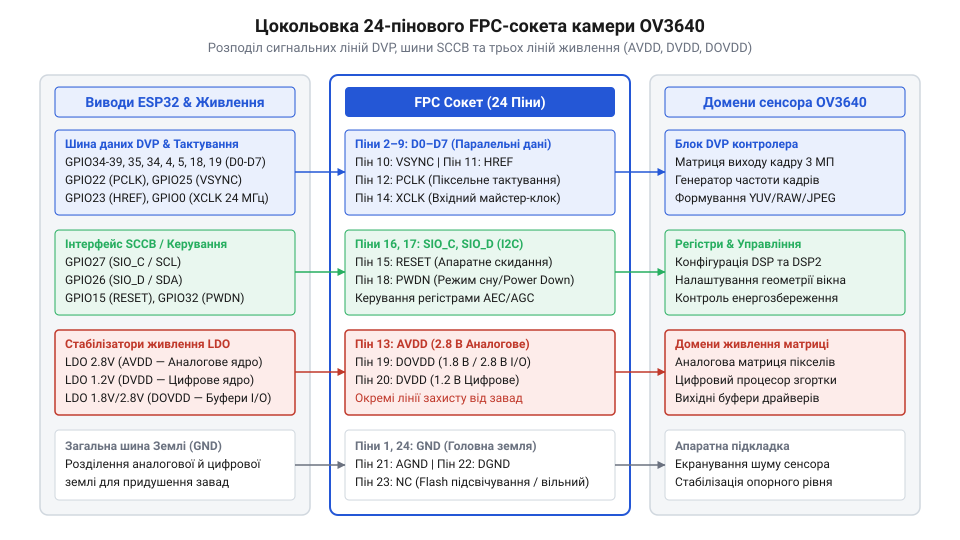

# Апаратний довідник розпіновки, живлення та регістрів OV3640 на ESP32-CAM

<preknowlist>
- [ESP32-CAM (OV2640 + microSD)](root:cat-hw-boards/esp32-cam) — базове розуміння принципової схеми модуля ESP32-CAM, сокета камери та інтерфейсу карти пам'яті
- [Модуль ESP32-CAM: огляд архітектури, периферії та сімейства плат](root:cat-hw-boards/esp32-cam-camera-module-family) — розуміння архітектурних особливостей та обмежень плат серії ESP32-CAM
</preknowlist>

## Апаратна інтерфейсна пастка розпіновки OV3640

Спроба підвищити роздільну здатність відеосистеми шляхом прямого витягування штатного модуля камери й встановлення більш продуктивного сенсора часто закінчується апаратною аварією. На більшості серійних плат [ESP32-CAM](root:cat-hw-boards/esp32-cam) розроблено 24-контактний роз'єм типу @@en|FPC@@ (від англ. flexible printed circuit — гнучка друкована плата) з кроком виводів `0.5 мм`. Цей сокет розводять під популярну 2-мегапіксельну матрицю @@en|OV2640@@. Коли розробник підключає сюди 3-мегапіксельний модуль @@en|OV3640@@, сподіваючись на повну фізичну сумісність однакового 24-пінового шлейфа, система взагалі не запускається, стабілізатори живлення @@en|LDO@@ (від англ. low dropout — стабілізатор з низьким падінням напруги) миттєво перегріваються, або мікроконтролер отримує суцільне сміття замість відеокадру.

Причина цієї проблеми полягає у відсутності єдиного стандарту цокольовки для 24-пінових шлейфів усередині лінійки сенсорів @@en|OmniVision@@. Хоча обидва модулі використовують однаковий механічний роз'єм, розташування живильних і сигнальних контактів у них суттєво відрізняється. На платах, де орієнтуються на [сімейство модулів ESP32-CAM](root:cat-hw-boards/esp32-cam-camera-module-family), перші чотири контакти сокета зазвичай відводять під загальний дріт `@@en|GND@@`, аналогове живлення `@@en|AVDD@@` (`2.8 В`) та шину цифрового вводу-виводу `@@en|DOVDD@@` (`2.8 В` або `3.3 В`). У той же час модуль @@en|OV3640@@ має інше призначення виводів: на місці силових ліній у ньому розташовані чутливі входи шини даних або входи тактування.

*Принципова схема розпіновки 24-пінового сокета камери OV3640, що ілюструє неспівпадіння ліній живлення та сигналів DVP порівняно зі стандартом OV2640.*

Помилкове підключення призводить до двох критичних наслідків. По-перше, виходи внутрішнього стабілізатора цифрового ядра `@@en|DVDD@@` (`1.2 В`) сенсора @@en|OV3640@@ опиняються підтягнутими до шини `@@en|DOVDD@@` з напругою `2.8 В` або `3.3 В`, що викликає електричний пробій кристала камери. По-друге, заземлені контакти шлейфа @@en|OV3640@@ замикають виходи регуляторів живлення на платі безпосередньо на «землю». Щоб запобігти виходу з ладу обладнання, перед встановленням нового модуля необхідно звірити принципову схему плати-носія з документацією конкретної ревізії @@en|FPC@@-шлейфа @@en|OV3640@@ та застосувати схемотехнічний адаптер розпіновки. У структурі такого адаптера реалізують захисний діодний місток на основі швидкісних діодів Шотткі @@en|Schottky diodes@@ (названо на честь німецького фізика Вальтера Шотткі) з малим прямим падінням напруги та супресорів @@en|TVS@@ (від англ. transient voltage suppressor — супресор перехідних напруг). Ця діодна схема блокує зворотний витік струму між шинами `@@en|AVDD@@` та `@@en|DOVDD@@`, відсікає перенапруги на лініях `@@en|DVDD@@` та шунтує коротке замикання силових кіл до вирівнювання потенціалів, не спотворюючи високочастотні імпульси тактування. Розрахунок допустимого прямого імпульсного струму діодів Шотткі `I_F_max` виконують на основі питомого струму короткого замикання стабілізатора `I_LDO_max` із коефіцієнтом технологічного запасу `k_margin`: Детальний розрахунок схемотехніки та принципів розведення описують [апаратні адаптери сокетів сенсорів](root:cat-hw-boards/ov3640-fpc-pinout-adapter).

    I_F_max = I_LDO_max × k_margin       [струм вирівнювання з урахуванням запасу]
    = 500 мА × 1.5                       [підстановка граничного струму LDO та коефіцієнта 1.5]
    = 750 мА                             [мінімальний допустимий прямий імпульсний струм діода]

Знак «×» позначає операцію множення. Отримане значення `750 мА` гарантує, що напівпровідниковий кристал діода Шотткі не руйнується до моменту спрацьовування внутрішнього теплового захисту джерела живлення. Для захисту крихкого цифрового ядра камери час реагування @@en|TVS@@-супресора при гасінні сплесків напруги на лініях `@@en|DVDD@@` має не перевищувати `1 нс`, оскільки авангардні кремнієві p-n переходи супресорів спрацьовують на рівні `1 пс`. Оскільки незворотний електричний пробій тонкого підзатворного оксиду КМОН-транзисторів ядра при підйомі потенціалу понад `1.4 В` розгортається за `5 нс`, цей субнаносекундний бар'єр встигає зрізати амплітуду перехідного сплеску до безпечного рівня фіксації `1.35 В`, зберігаючи працездатність матриці.

## Специфікація сигнальних ліній DVP та SCCB

Обмін даними та керування параметрами матриці @@en|OV3640@@ здійснюються через дві фізично й функціонально розділені шини: паралельний цифровий відеопорт @@en|DVP@@ (від англ. digital video port — цифровий відеопорт) та двопровідний послідовний інтерфейс керування @@en|SCCB@@ (від англ. serial camera control bus — послідовна шина керування камерою). Для успішного захоплення кадру мікроконтролером, будь то базовий чи потужніший [мікроконтролер ESP32-S3](root:cat-hw-boards/esp32s3-microcontroller), необхідно забезпечити строге узгодження часових інтервалів і електричних рівнів обох шин.

Шина @@en|DVP@@ складається з 8 паралельних ліній даних `@@en|D0@@`–`@@en|D7@@` та 4 синхронізаційних сигналів. Зовнішня тактова частота `@@en|XCLK@@` (від англ. external clock — зовнішній тактовий сигнал) генерується периферією @@en|ESP32@@ у діапазоні від `10 МГц` до `24 МГц` і подається на вхід сенсора для роботи внутрішнього генератора @@en|PLL@@ (від англ. phase-locked loop — фазове автопідлаштування частоти). У відповідь сенсор формує вихідний піксельний тактовий сигнал `@@en|PCLK@@` (від англ. pixel clock — тактовий сигнал пікселів). За кожним спадаючим або наростаючим фронтом `@@en|PCLK@@` контролер зчитує 8-бітний байт із шини `@@en|D0@@`–`@@en|D7@@`.

Синхронізація кадру забезпечується двома стробувальними лініями: імпульс `@@en|VSYNC@@` (від англ. vertical synchronization — вертикальна синхронізація) позначає початок і завершення кожного нового кадру, а сигнал `@@en|HREF@@` (від англ. horizontal reference — горизонтальна опорна синхронізація) залишається у високому логічному рівні протягом передачі активних пікселів одного рядка.

*Часова діаграма сигналів шини DVP, яка показує фазову синхронізацію імпульсів PCLK, HREF та VSYNC під час зчитування потоку пікселів.*

Шина керування @@en|SCCB@@ використовує дві лінії: тактову `@@en|SIO_C@@` (від англ. serial input/output clock — тактова лінія послідовного вводу-виводу) та лінію даних `@@en|SIO_D@@` (від англ. serial input/output data — лінія даних послідовного вводу-виводу). Хоча її протокол схожий на @@en|I2C@@, виводи `@@en|SIO_C@@` та `@@en|SIO_D@@` мають схему з відкритим стоком і вимагають обов'язкових підтягувальних резисторів з опором від `2.2 кОм` до `4.7 кОм`. Критичною вимогою є підтяжка цих ліній саме до шини живлення вводу-виводу `@@en|DOVDD@@` (`1.8 В` або `2.8 В`), а не до шини `3.3 В` мікроконтролера. Підтяжка до вищої напруги викликає струмовий перевантаж буферів @@en|OV3640@@ та збої під час запису конфігураційних регістрів.

Під час трасування друкованої плати розробники повинні дотримуватися рівності довжин провідників шини `D0`–`D7` та `PCLK` для запобігання фазовому зсуву сигналів, а також екранувати лінію `XCLK` заземленими провідниками задля зменшення електромагнітних завад @@en|EMI@@ (від англ. @@en|Electromagnetic Interference@@ — електромагнітні перешкоди). При тактовій частоті `PCLK` до `24 МГц` допустиме розфазування (англ. @@en|skew@@) між піксельним тактовим сигналом `PCLK` і паралельними лініями даних `D0`–`D7` не повинно перевищувати `500`–`1000 пікосекунд`. Математично часова затримка поширення сигналу обчислюється як добуток геометричної різниці довжин провідників на питому затримку матеріалу: при питомій затримці текстоліту @@en|FR-4@@ близько `6.7 пікосекунд` на міліметр (`6.7 ps/mm`) різниця довжин трас `6 мм` створює фазовий зсув `40.2 ps`. Для запобігання відбиттям високочастотних гармонік та наводкам @@en|EMI@@ траси `PCLK` і `D0`–`D7` узгоджують за хвильовим імпедансом `50 Ом` (англ. @@en|characteristic impedance@@) із послідовним включенням демпфуючих резисторів опором від `22 Ом` до `33 Ом` безпосередньо біля виводів джерела сигналу. На стандартному матеріалі @@en|FR-4@@ таке часове вікно відповідає граничному розходженню довжин друкованих трас у межах `5`–`8 мм`. Перевищення цього допуску спричиняє попадання фронту `PCLK` у зони перехідних процесів на шині даних, що призводить до зчитування нестабільних логічних рівнів і виникнення артефактів або спотворення кольорів у вихідному відеопотоці.

## Схемотехніка трьохканального живлення сенсора

Стабільність роботи 3-мегапіксельного оптичного сенсора @@en|OV3640@@ критично залежить від якості та чистоти ліній живлення. На відміну від простих цифрових мікросхем, світлочутлива матриця поєднує високочутливі аналогові підсилювачі фотодіодів, швидкі аналогово-цифрові перетворювачі та високочастотні цифрові блоки обробки сигналу. Для запобігання взаємним завадам схема живлення розділена на три незалежні електричні домени: аналогове ядро @@en|AVDD@@ з напругою `2.8 В`, цифрове ядро @@en|DVDD@@ з напругою `1.2 В` та домен периферійних буферів вводу-виводу @@en|DOVDD@@ з напругою `1.8 В` або `2.8 В`.

Найбільш вразливою до високочастотних пульсацій є аналогова шина @@en|AVDD@@. Будь-які пульсації напруги від імпульсних стабілізаторів або цифрових шин мікроконтролера створюють на сформованому зображенні горизонтальні шумові смуги, кольорові муари та зернистість у темних ділянках кадру. Для живлення шини @@en|AVDD@@ застосовують виключно малошумні лінійні стабілізатори (англ. @@en|Low Dropout Regulator@@, @@en|LDO@@) із високим коефіцієнтом пригнічення нестабільності живлення (англ. @@en|Power Supply Rejection Ratio@@, @@en|PSRR@@ > 60 dB на частоті 10 кГц). На вході стабілізатора встановлюють феритовий фільтр (англ. @@en|ferrite bead@@) з високим опором на високочастотних завадах, а вихід шунтують паралельним з'єднанням керамічного конденсатора ємністю `10 мкФ` для компенсації низькочастотних просідань та керамічного чип-конденсатора `0.1 мкФ` (100 нФ) з низьким еквівалентним послідовним опором, розташованого безпосередньо біля виводу FPC-роз'єму.

Цифрове ядро @@en|DVDD@@ живить внутрішню логіку обробки зображень та блок стиснення @@en|JPEG@@. Напруга `1.2 В` може подаватися від зовнішнього LDO-стабілізатора або формуватися внутрішнім регулятором чипа. Для шини вводу-виводу @@en|DOVDD@@ рівень напруги підбирають відповідно до логічних рівнів виводів головного мікроконтролера: використання напруги `2.8 В` забезпечує пряме узгодження сигнатур із платами типу [ESP32-CAM (OV2640 + microSD)](root:cat-hw-boards/esp32-cam), мінімізуючи спотворення фронтів на паралельній шині даних.

*Принципова схема трьохканального джерела живлення AVDD, DVDD та DOVDD з LDO-стабілізаторами та LC-фільтрами.*

У схемотехніці плат серії [Модуль ESP32-CAM: огляд архітектури, периферії та сімейства плат](root:cat-hw-boards/esp32-cam-camera-module-family) нехтування окремою фільтрацією шини @@en|AVDD@@ призводить до незворотного погіршення динамічного діапазону сенсора. Застосування спільних LDO для цифрових і аналогових ліній викликає просідання напруги під час пікового споживання процесорного ядра, що проявляється як мерехтіння яскравості кадру під час передачі даних по бездротовому каналу.

Вибір типів конденсаторів для шунтування кіл живлення прямо визначає спектральну ефективність пригнічення пульсацій. Керамічні чип-конденсатори з діелектриком @@en|X7R@@ володіють ультранизьким еквівалентним послідовним опором (англ. @@en|Equivalent Series Resistance@@, @@en|ESR@@, від *equivalent* — еквівалентний, *series* — послідовний, *resistance* — опір) та індуктивністю (англ. @@en|Equivalent Series Inductance@@, @@en|ESL@@), що дозволяє їм ефективно відводити високочастотні завади в діапазоні від `100 кГц` до десятків мегагерців. Еквівалентний індуктивний опір феритового фільтра обчислюється за формулою `X_L = 2 · π · f · L`, завдяки чому при індуктивності `L = 2.2 мкГн` на частоті цифрових завад `10 МГц` реактивний опір сягає `138.2 Ом` (а на частоті `100 МГц` імпеданс досягає номінальних `600 Ом`), ефективно затримуючи шум без втрат постійної напруги. Резонансна частота утвореного фільтруючого LC-контуру розраховується як `f_res = 1 / (2 · π · √(L · C))`, що при ємності `C = 10 мкФ` дає резонанс `f_res ≈ 33.9 кГц` — це лежить значно нижче від робочих частот тактування шини `DVP`, запобігаючи виникненню паразитного резонансного підсилення завад. Однак кераміка піддається ефекту падіння ємності під дією постійної напруги (англ. @@en|DC bias effect@@, від *direct current* — постійний струм, *bias* — зміщення), втрачаючи до `30%` номіналу при робочому потенціалі `2.8 В`. На противагу їм, об'ємні танталові буферні конденсатори (англ. @@en|tantalum capacitors@@) не втрачають ємності під напругою та зберігають великий заряд для компенсації низькочастотних просідань струму при зміні режимів роботи сенсора, але через вищий @@en|ESR@@ пропускають високочастотний шум. Через це найвищу чистоту лінії @@en|AVDD@@ забезпечує їх спільне паралельне підключення: танталовий елемент виконує роль енергетичного буфера, а керамічний конденсатор @@en|X7R@@ відфільтровує високочастотні завади безпосередньо біля виводів камери.

## Регістрова карта конфігурації матриці OV3640

Конфігурування оптичної матриці @@en|OV3640@@ здійснюється через послідовну шину @@en|SCCB@@ (англ. @@en|Serial Camera Control Bus@@) шляхом запису та зчитування 8-бітних значень у 16-бітному адресовому просторі регістрів. На відміну від молодших сенсорів із 8-бітною адресацією, адресація в @@en|OV3640@@ розбита на 16-бітні байти (високий та низький байти адреси `0xXXXX`), що дозволяє гнучко керувати розширеним набором внутрішніх блоків обробки. За замовчуванням пристрій відповідає на 7-бітну адресу шини `0x3C` (байт запису `0x78`, байт зчитування `0x79`).

Регістровий простір матриці розділений на декілька функціональних блоків. Системний блок керування та живлення (адреси `0x3000`–`0x300F`) відповідає за апаратне скидання, режими енергозбереження (англ. @@en|Power Down@@, @@en|PWDN@@) та множники внутрішньої системи фазового автопідстроювання частоти (англ. @@en|Phase-Locked Loop@@, @@en|PLL@@). Запис одиниці в біт `7` регістра `0x3012` ініціює програмне скидання всіх регістрів до заводських значень.

*Структурна схема регістрової карти OV3640 та послідовності записаних байтів по шині SCCB.*

Блок налаштування розміру вікна зйомки (адреси `0x3400`–`0x3427`) дає змогу вибирати роздільну здатність матриці: від повнокадрового режиму @@en|QXGA@@ (2048×1536 пікселів) до скальованих форматів @@en|UXGA@@ (1600×1200), @@en|SVGA@@ (800×600) та @@en|CIF@@ (352×288). Зміна розміру виконується шляхом зміни початкових і кінцевих координат вікна кадрування та вибору коефіцієнтів пропуску або об'єднання пікселів (англ. @@en|binning@@). Для вибору формату вихідних даних використовуються регістри блоку @@en|DSP@@ (`0x3600`–`0x3630`), які перемикають режим між нестиснутими форматами RGB565 / YUV422 та вбудованим апаратним кодеком @@en|JPEG@@.

За автоматичну адаптацію кадру до умов освітлення відповідають регістри авторегулювання: автоматичне вимірювання та регулювання експозиції (англ. @@en|Automatic Exposure Control@@, @@en|AEC@@, регістри `0x3500`–`0x3503`), автоматичне регулювання підсилення (англ. @@en|Automatic Gain Control@@, @@en|AGC@@, регістри `0x350A`–`0x350B`) та автобаланс білого (англ. @@en|Automatic White Balance@@, @@en|AWB@@). Запис значень у багатобайтне значення експозиції `0x3500`–`0x3502`, аналогові коефіцієнти підсилення @@en|AGC@@ та канальні множники кольорів @@en|AWB@@ вимагає дотримання алгоритму атомарного фіксування тіньових регістрів (від англ. @@en|shadow registers@@ — тіньові регістри). Для цього у керуючому регістрі `0x3503` встановлюють прапорець блокування, після чого нові байти записуються у буферні теневі комірки без прямого впливу на поточний кадр. Завершення запису та скидання прапорця в `0x3503` дає команду блоку @@en|DSP@@ одночасно перенести весь комплект коефіцієнтів підсилення та експозиції з теневих регістрів в активний обробний тракт строго в паузі вертикального гасіння @@en|VSYNC@@. Такий атомарний перенос запобігає розривам зображення (від англ. @@en|image tearing@@ — розрив кадру), артефактам кольорових смуг та мерехтінню яскравості посеред кадру. Послідовність ініціалізації вимагає спочатку подачі стабільної опорної частоти @@en|XCLK@@, розблокування лінії `PWDN` (переведення в логічний нуль), імпульсу низького рівня на лінії `RESET_N` тривалістю не менше 10 мс, а потім завантаження базової таблиці конфігураційних регістрів через шину @@en|SCCB@@.

## Конфлікти GPIO із периферією ESP32-CAM

Розведення друкованих плат серії @@en|ESP32-CAM@@ спирається на жорсткий компроміс через обмежену кількість виводів загального призначення у базовому чипі. Оскільки 8-бітна шина @@en|DVP@@ разом із шиною @@en|SCCB@@ задействують 15 контактів, лінії зв'язку фотомодуля @@en|OV3640@@ перехрещуються з периферійними блоками картридера @@en|microSD@@ та вбудованим світлодіодом підсвічування спалаху.

*Схема перехресних зв'язків виводів GPIO між сокетом камери, слотом microSD та Flash-світлодіодом.*

Найбільш критичний апаратний конфлікт виникає на виводі `GPIO4`. Ця лінія одночасно керує силовим транзистором яскравого світлодіода підсвічування та виконує роль шини даних `HS2_DATA0` інтерфейсу @@en|SD_MMC@@ у 1-бітному та 4-бітному режимах. Будь-яке увімкнення спалаху під час запису кадру на картку пам'яті створює апаратне накладання сигналів на шині, що призводить до збоїв файлової системи або виключення карти.

Крім того, виводи `GPIO2`, `GPIO12`, `GPIO13`, `GPIO14` та `GPIO15` розподілені між стробувальними сигналами камери `PCLK`, `HREF`, `VSYNC` та шиною `HS2_CLK`/`HS2_CMD`. Щоб запобігти апаратним блокуванням, розробник повинен реалізувати строго часове розподілення периферійних шин (англ. @@en|time-division multiplexing@@ — часове мультиплексування). У момент активного відеозахоплення виводи шини картридера переводяться у високоімпедансний стан (англ. @@en|High-Z@@ — стан високого опору з вимкненими вихідними драйверами). Натомість під час збереження кадру на картку пам'яті тактування `XCLK` камери тимчасово зупиняється. Після завершення процедури зчитування чи запису секторів шиною @@en|SD_MMC@@ та відновлення подачі частоти `XCLK` потрібна обов'язкова технологічна затримка від `10` до `20 мс`. Цей часовий інтервал необхідний для перезапуску та стабілізації внутрішнього генератора @@en|PLL@@ сенсора @@en|OV3640@@, а також завершення поточного неповного кадрового імпульсу `VSYNC`, після чого можна безпечно поновлювати захоплення нового відеокадру без загрози зсуву буфера пікселів.

Уникнути перехресних конфліктів шин дозволяє перехід на сучасні одноплатники з розширеною кількістю контактів, такі як [плата Waveshare ESP32-S3R2](root:cat-hw-boards/esp32-s3r2-waveshare) або розробки на базі [мікроконтролера ESP32-S3](root:cat-hw-boards/esp32s3-microcontroller). Детальний огляд розпіновки та блокувань наведено у довіднику з [архітектури сімейства ESP32-CAM](root:cat-hw-boards/esp32-cam-camera-module-family).

При переведенні виводів мікроконтролера у високоімпедансний стан (від англ. @@en|High-Z@@ — стан високого опору) схемотехнічна стабільність спільних ліній @@en|SD_MMC@@ спирається на зовнішні підтягувальні резистори. Безпідставне залишення провідників `HS2_CMD` та `HS2_CLK` без підтяжки під час активного захоплення кадру камери перетворює ці лінії на плаваючі антени (від англ. @@en|floating inputs@@ — плаваючі входи), які наводять паразитичні високочастотні наводки від піксельного тактування @@en|PCLK@@ на контролер картки пам'яті. Для усунення цього ефекту на лінію команд `HS2_CMD` встановлюють зовнішній резистор підтяжки @@en|pull-up@@ номіналом `10 кОм` до шини `3.3 В`, що утримує лінію у пасивному логічному стані одиниці, поки вивід чипа перебуває в @@en|High-Z@@. Натомість лінію тактування `HS2_CLK` оснащують зовнішньою підтяжкою до землі або до лінії живлення залежно від специфікації слота, що запобігає появі хибних тактових імпульсів (від англ. @@en|clock glitches@@ — тактові збої) та усуває апаратні помилки таймауту або збої контрольної суми @@en|CRC@@ (від англ. @@en|Cyclic Redundancy Check@@ — циклічний надлишковий код) при відновленні обміну з карткою @@en|microSD@@.
