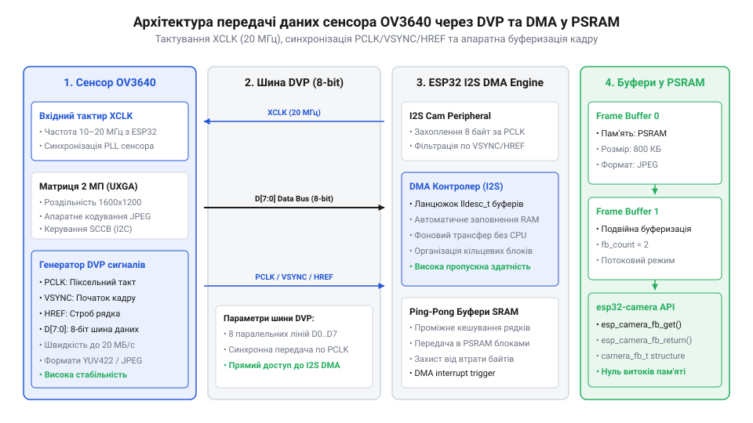
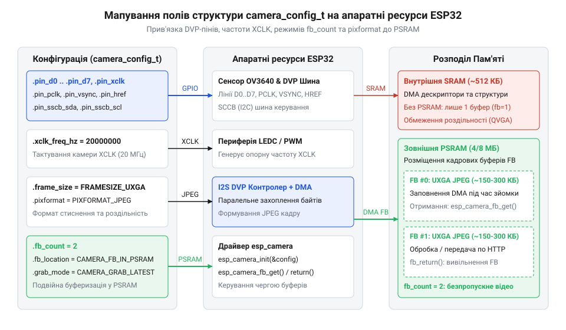
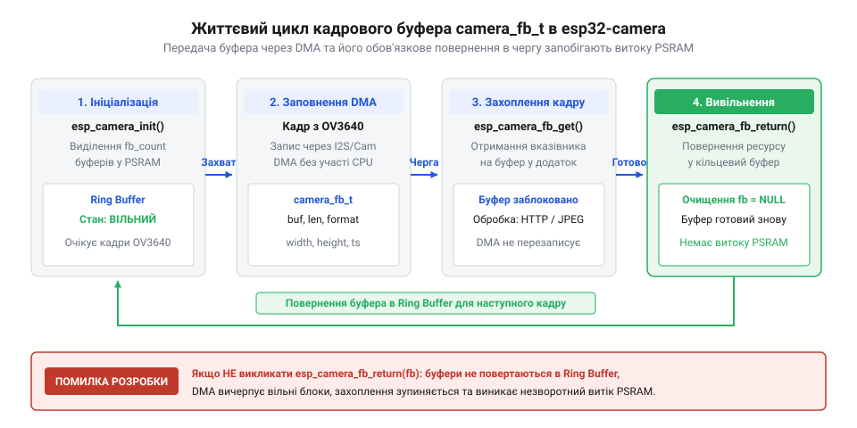
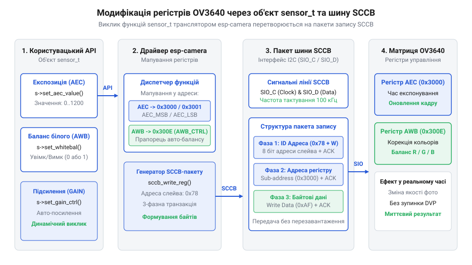

# Програмний довідник API драйвера esp32-camera для сенсора OV3640

<preknowlist>
- [ESP32-CAM (OV2640 + microSD)](root:cat-hw-boards/esp32-cam) — Апаратне розведення шини DVP та особливості живлення сенсора камери.
- [Модуль ESP32-CAM: огляд архітектури, периферії та сімейства плат](root:cat-hw-boards/esp32-cam-camera-module-family) — Загальна архітектура периферії ESP32 для роботи з камерами та використання PSRAM.
</preknowlist>

## Специфіка інтерфейсу камери та буферизації

Отримання та обробка відеопотоку високої роздільності з матриці `OV3640` у реальному часі створює колосальне навантаження на обчислювальне ядро мікроконтролера. При роздільності `UXGA` (`1600×1200` пікселів) один нестиснений кадр у форматі `RGB565` або `YUV422` займає близько `3.84 МБ` оперативної пам'яті, а передавання зображення зі швидкістю 15 кадрів на секунду генерує потік даних понад `57 МБ/с`. Намагання зчитувати такі обсяги даних програмою через звичайні програмні переривання чи опитування виводів `GPIO` призводить до негайного перевантаження процесора, втрати синхронізації та спрацьовування системного таймера захисту від зависання (від англ. @@en|watchdog reset@@).

Для оцінки ефективності передавання даних порівняємо пропускну здатність послідовної шини `@@en|SPI@@` (від англ. @@en|Serial Peripheral Interface@@ — послідовний периферійний інтерфейс; `@@en|SPI@@`) та паралельного відеопорту `@@en|DVP@@`. При зчитуванні повнорозмірного кадру `UXGA` (`1600×1200` пікселів) у форматі `RGB565` обсяг даних становить `V_frame = 3.84 МБ` (або `30.72 Мбіт`). Розрахуємо час передачі кадру `t_frame` за формулою:

t_frame = V_frame ÷ B_bus

**Обчислення затримки передачі кадру для шин SPI та DVP:**

t_SPI = 30.72 ÷ 40              [ширина шини 1 біт на частоті 40 МГц дає B_SPI = 40 Мбіт/с]
= 0.768 с                       [теоретична межа становить лише 1.3 кадру/с]

t_DVP = 3.84 ÷ 20               [8-бітний паралельний порт при PCLK = 20 МГц дає B_DVP = 20 МБ/с]
= 0.192 с                       [забезпечує передачу нестисненого кадру за 192 мс]

З порівняльного аналізу видно, що 8-бітний паралельний відеопорт `DVP` забезпечує у чотири рази вищу пропускну здатність порівняно з послідовним інтерфейсом `SPI`. При використанні апаратного стиснення `JPEG` в матриці `OV3640` обсяг кадру зменшується до 150–300 кБ, що дозволяє шині `DVP` досягати повноцінної частоти 15–25 кадрів/с без перевищення лімітів пам'яті, які має [модуль ESP32-CAM](root:cat-hw-boards/esp32-cam-camera-module-family).

Для звільнення ядра від рутинного зчитування пікселів використовують паралельний цифровий відеоінтерфейс (від англ. @@en|Digital Video Port@@ — цифровий відеопорт; @@en|DVP@@). Фізична шина `DVP` складається з 8 паралельних ліній даних `D0`–`D7` (які підключаються до старших розрядів `Y2`–`Y9` сенсора `OV3640`), опорного тактового сигналу `XCLK` (від англ. @@en|Master Clock@@; @@en|XCLK@@), піксельного тактового сигналу `PCLK` (від англ. @@en|Pixel Clock@@; @@en|PCLK@@), а також сигналів стробування рядків `HREF` (від англ. @@en|Horizontal Reference@@; @@en|HREF@@) та кадрів `VSYNC` (від англ. @@en|Vertical Sync@@; @@en|VSYNC@@). Мікроконтролер `ESP32` подає високовольтний генераторний сигнал `XCLK` із частотою `10`–`20 МГц` через внутрішній генератор ШІМ, від якого тактується внутрішнє ядро сенсора та його фазове автопідлаштування частоти.


*Схема передачі піксельних даних від матриці OV3640 через шину DVP та DMA-контролер до кадрових буферів у PSRAM.*

Усередині мікроконтролера `ESP32` прийом піксельного потоку виконує периферійний блок `I2S` або `LCD_CAM`, переведений у режим паралельного веденого приймача. Цей блок апаратно захоплює байти з шини `D0`–`D7` строго по спадаючому або наростаючому фронту `PCLK` і передає їх безпосередньо через контролер прямого доступу до пам'яті (від англ. @@en|Direct Memory Access@@ — прямий доступ до пам'яті; @@en|DMA@@). Оскільки внутрішня оперативна пам'ять `SRAM` мікроконтролера обмежена обсягом близько `320 кБ`, збереження повнорозмірних кадрів відбувається у зовнішній псевдостатичній оперативній пам'яті (від англ. @@en|Pseudo-static RAM@@ — псевдостатична оперативна пам'ять; @@en|PSRAM@@, від грец. @@el|ψευδής@@ — несправжній, уявний). Контролер `DMA` накопичує пікселі у невеликих проміжних дескрипторних буферах `DRAM`, після чого апаратно переміщує цілі блоки у `PSRAM`. Фізичне розведення шин та організація пам'яті детально розкриті в описі [модуля ESP32-CAM](root:cat-hw-boards/esp32-cam-camera-module-family).

Порівняльний розрахунок пропускної здатності шини `@@en|DVP@@` показує пряму залежність частоти кадрів від опорного тактування `XCLK` та обраного кодування пікселів. При частоті `XCLK` = 10 МГц максимальний потік шини становить `B_DVP_10` = 10 МБ/с, а при підвищенні `XCLK` до 20 МГц пропускна здатність зростає до `B_DVP_20` = 20 МБ/с. Для нестисненого кадру `UXGA` (`1600×1200` пікселів) у форматі `@@en|YUV422@@` обсягом `V_YUV` = 3.84 МБ час передачі кадру `t_YUV` визначається як:

        t_YUV_10
        = V_YUV ÷ B_DVP_10          [ділення обсягу кадру YUV422 на пропускну здатність при 10 МГц]
        = 3.84 ÷ 10                 [підстановка V_YUV = 3.84 МБ, B_DVP_10 = 10 МБ/с]
        = 0.384 с                   [максимальна частота становить 2.6 кадр/с]

        t_YUV_20
        = V_YUV ÷ B_DVP_20          [ділення обсягу кадру YUV422 на пропускну здатність при 20 МГц]
        = 3.84 ÷ 20                 [підстановка V_YUV = 3.84 МБ, B_DVP_20 = 20 МБ/с]
        = 0.192 с                   [максимальна частота становить 5.2 кадр/с]

Натомість при включенні апаратного кодека `@@en|JPEG@@` обсяг кадру `UXGA` зменшується до середнього значення `V_JPEG` = 0.256 МБ (256 кБ). Обчислимо тривалість передачі кадру `t_JPEG` для обох тактових частот:

        t_JPEG_10
        = V_JPEG ÷ B_DVP_10         [ділення обсягу кадру JPEG на пропускну здатність при 10 МГц]
        = 0.256 ÷ 10                [підстановка V_JPEG = 0.256 МБ, B_DVP_10 = 10 МБ/с]
        = 0.0256 с                  [тривалість шинного передавання 25.6 мс]

        t_JPEG_20
        = V_JPEG ÷ B_DVP_20         [ділення обсягу кадру JPEG на пропускну здатність при 20 МГц]
        = 0.256 ÷ 20                [підстановка V_JPEG = 0.256 МБ, B_DVP_20 = 20 МБ/с]
        = 0.0128 с                  [тривалість шинного передавання 12.8 мс]

Зміна тактування з 10 МГц до 20 МГц скорочує час зайнятості `DMA`-каналу при передачі `JPEG`-кадру з 25.6 мс до 12.8 мс, що звільняє шину пам'яті `@@en|PSRAM@@` для паралельного зчитування буфера обчислювальним ядром та запобігає переповненню дескрипторів шини `DVP` у [модулях ESP32-CAM](root:cat-hw-boards/esp32-cam-camera-module-family).

## Конфігурація драйвера через структуру camera_config_t

Для коректного підключення та ініціалізації матриці `OV3640` офіційний драйвер `esp32-camera` в середовищі `ESP-IDF` вимагає точного визначення апаратних параметрів у структурі `camera_config_t`. Помилка в призначенні хоча б одного виводу шини `DVP` чи нерозпізнавання сигналів підтяжки `SCCB` призводить до переривання процедури ініціалізації з поверненням коду помилки `ESP_ERR_NOT_FOUND` (`0x105`).


*Структурна схема мапування полів camera_config_t на апаратні ресурси ESP32.*

Головні поля структури `camera_config_t` розподіляються на кілька функціональних блоків:
1. **Призначення виводів GPIO**: поєднання сигналів `pin_d0`–`pin_d7`, `pin_xclk`, `pin_pclk`, `pin_vsync`, `pin_href`, а також шини керування `pin_sscb_sda` і `pin_sscb_scl`. Для виводів увімкнення `pin_pwdn` та апаратного скидання `pin_reset` можна вказати `-1`, якщо вони підтягнуті апаратно на платі.
2. **Тактування та генерація XCLK**: поле `xclk_freq_hz` визначає частоту опорного сигналу. Для сенсора `OV3640` стандартним значенням є `20000000` (20 МГц). Зниження частоти до `10000000` (10 МГц) зменшує нагрів модуля та рівень високочастотних завад на довгих провідниках, проте пропорційно знижує максимальну частоту кадрів.
3. **Формат пікселів та роздільність**: поле `pixel_format` задає кодування вихідних даних. Для 2-мегапіксельного сенсора `OV3640` застосовують режим `PIXFORMAT_JPEG`, оскільки матриця має вбудований апаратний кодер `JPEG`, що стискає кадр `UXGA` до `150–400 кБ`. Поле `frame_size` визначає розмір матриці (`FRAMESIZE_QVGA`, `FRAMESIZE_VGA`, `FRAMESIZE_HD`, `FRAMESIZE_UXGA`).
4. **Режими буферизації та розміщення у пам'яті**: поле `fb_location` задає тип пам'яті (`CAMERA_FB_IN_PSRAM` або `CAMERA_FB_IN_DRAM`). Поле `fb_count` вказує кількість виділених кадрових буферів: значення `fb_count = 1` економить пам'ять, але вимагає зупинки прийому під час обробки кадру; значення `fb_count = 2` вмикає подвійну буферизацію (англ. @@en|double buffering@@), дозволяючи `DMA` записувати наступний кадр під час зчитування поточного програмою.
5. **Режим витягування кадрів**: поле `grab_mode` конфігурує логіку черги. Встановлення `CAMERA_GRAB_LATEST` примушує драйвер скидати застарілі проміжні кадри та завжди повертати найновіший кадр з `DMA`, що є критичним для мінімізації затримки у відеопотоку.

Стандартна конфігурація структури для роботи з `OV3640` у середовищі `ESP-IDF` описується кодом:

:::code api-esp32-camera-driver-ov3640-config/c/esp-idf/snippet-1.c

Вибір кількості буферів `fb_count = 2` у поєднанні з `PIXFORMAT_JPEG` забезпечує плавну передачу відеопотоку без розриву кадрів. Загальну концепцію використання камери у пристроях розкриває [огляд сімейства плат ESP32-CAM](root:cat-hw-boards/esp32-cam-camera-module-family).

Обчислимо необхідний обсяг пам'яті `M_psram` для зберігання `N_fb` кадрових буферів при зйомці у роздільності `UXGA` (`1600×1200` пікселів). Обсяг визначається множенням кількості буферів на розмір нестисненого кадру `S_raw = 3750 КіБ` (у кодуванні `RGB565`), поділений на коефіцієнт апаратного стиснення `K_compress ≈ 10`:

M_psram = N_fb × (S_raw ÷ K_compress)

**Розрахунок витрат PSRAM для режимів fb_count = 1 та fb_count = 2:**

M_fb1 = 1 × (3750 ÷ 10)         [підстановка для конфігурації з один буфером fb_count = 1]
= 1 × 375 КіБ                   [розмір одного стисненого JPEG-буфера]
= 375 КіБ                       [загальні витрати оперативної пам'яті PSRAM]

M_fb2 = 2 × (3750 ÷ 10)         [підстановка для режимів подвійної буферизації fb_count = 2]
= 2 × 375 КіБ                   [розмір двох стиснених JPEG-буферів]
= 750 КіБ                       [загальні витрати оперативної пам'яті PSRAM]

З розрахунку видно, що використання одного буфера (`fb_count = 1`) потребує лише `375 КіБ` пам'яті `PSRAM`, але змушує апаратний `DMA`-контролер вимикати прийом нових кадрів під час виконання мережевих операцій. Конфігурація з подвійною буферизацією (`fb_count = 2`) подвоює витрати пам'яті до `750 КіБ`, проте забезпечує безперервну передачу відеопотоку без розриву кадрів на [платі ESP32-CAM](root:cat-hw-boards/esp32-cam).

Потреба виділення кадрових буферів у зовнішній псевдостатичній оперативній пам'яті @@en|PSRAM@@ (від англ. @@en|Pseudo-Static RAM@@ — псевдостатична оперативна пам'ять; @@en|PSRAM@@) обумовлена високими вимогами до обсягу пам'яті при зйомці у максимальній роздільності `UXGA` (`1600 × 1200` пікселів). Для визначення загального обсягу пам'яті `M_total`, необхідного для подвійної буферизації при значеннях `fb_count = 2` та режимі `PIXFORMAT_JPEG`, спочатку обчислюють розмір нестисненого кадру `S_raw` у двобайтовому кодуванні `RGB565`, після чого враховують коефіцієнт апаратного стиснення `K_compress` та кількість кадрових буферів `N_fb`:

```
S_raw = 1600 × 1200 × 2 B
      = 3 840 000 B                      [обчислення обсягу нестисненого кадру UXGA]
      = 3750 КіБ                         [переведення обсягу кадру у кілобайти]

S_buf = S_raw ÷ K_compress
      = 3750 КіБ ÷ 10                    [оцінка розміру стисненого кадру при якості jpeg_quality = 12]
      = 375 КіБ                          [обсяг одного стисненого кадрового буфера]

M_total = N_fb × S_buf
        = 2 × 375 КіБ                    [підстановка кількості буферів fb_count = 2]
        = 750 КіБ                        [підсумкові витрати оперативної пам'яті PSRAM]
```

Отриманий рівень витрат `M_total = 750 КіБ` перевищує весь доступний обсяг внутрішньої статичної пам'яті `SRAM` мікроконтролера `ESP32` (близько `300 КіБ`), тому режим подвійної буферизації `fb_count = 2` для високих роздільностей є працездатним виключно на платах з апаратно інтегрованою пам'яттю @@en|PSRAM@@, таких як [плата розробки ESP32-CAM](root:cat-hw-boards/esp32-cam) або сучасні рішення з [сімейства модулів ESP32-S3](root:cat-hw-boards/esp32-s3-boards-family-overview).

## Життєвий цикл захоплення кадрового буфера

Під час зйомок відеопотоку або серії знімків 2-мегапіксельний фотосенсор `@@en|OV3640@@` генерує безперервний потік піксельних даних високої щільності. Без чіткого регулювання операцій виділення та вивільнення кадрових буферів додатковий обсяг даних миттєво вичерпує оперативну пам'ять `@@en|PSRAM@@` (від англ. @@en|Pseudo Static RAM@@ — псевдостатична оперативна пам'ять; `@@en|PSRAM@@`) або призводить до апаратного блокування кільцевої черги контролера прямого доступу до пам'яті `@@en|DMA@@` (від англ. @@en|Direct Memory Access@@ — прямий доступ до пам'яті; `@@en|DMA@@`).

Ініціалізація програмного драйвера виконується викликом `esp_camera_init(&config)`, де передається структура налаштувань. Під час цього виклику драйвер конфігурує периферійний модуль камери, виділяє пам'ять під вказану кількість буферів `fb_count` та створює дескриптори `DMA`. У разі успішного завершення функція повертає код `ESP_OK`, а при нестачі пам'яті в `PSRAM` — код помилки `ESP_ERR_NO_MEM`. Після успішної ініціалізації апаратний модуль починає автоматично заповнювати вільні буфери кадрами, надсилаючи сповіщення драйверу.

Отримання готового кадру в прикладному коді здійснюється викликом `esp_camera_fb_get()`. Ця функція блокує поточну задачу до появі готового кадру в черзі й повертає вказівник на структуру `@@en|camera_fb_t@@`:
- `buf` — вказівник на масив байтів піксельних даних у `PSRAM`;
- `len` — розмір кадру в байтах;
- `width` та `height` — ширина та висота кадру в пікселях;
- `format` — піксельний формат (наприклад, `PIXFORMAT_JPEG` або `PIXFORMAT_RGB565`);
- `timestamp` — мітка часу захоплення кадру (`struct timeval`).

Механізм взаємодії функцій `esp_camera_fb_get()` та `esp_camera_fb_return()` базується на апаратній синхронізації кільцевої черги `DMA`-дескрипторів периферійного модуля камери. Під час виклику `esp_camera_fb_get()` драйвер вилучає заповнений буфер із черги готових кадрів `FreeRTOS` та тимчасово блокує пов'язані з ним дескриптори `DMA`. Доки прикладний код утримує цей вказівник, апаратний `DMA`-контролер не має права перезаписувати дану ділянку пам'яті `PSRAM`. Після виклику `esp_camera_fb_return(fb)` драйвер скидає прапорці стану буфера та повертає зв'язаний ланцюжок `DMA`-дескрипторів назад у кільцевий список доступних для прийому ресурсів, дозволяючи обробнику переривань `ISR` апаратно записувати наступні `PCLK`-пікселі від матриці `OV3640`. Якщо вивільнення не виконується, дескриптор залишається вилученим із кільця; при досягненні ліміту `fb_count` апаратний прийом зупиняється через відсутність вільних `DMA`-дескрипторів.

Критичною вимогою архітектури `esp32-camera` є обов'язкове повернення отриманого буфера назад у драйвер за допомогою виклику `esp_camera_fb_return(fb)`.


*Послідовність станів кадрового буфера camera_fb_t у процесі захоплення та вивільнення пам'яті.*

Коли додаток викликає `esp_camera_fb_get()`, відповідний кадровий буфер вилучається з кільцевої черги доступних для запису `DMA`-дескрипторів. Якщо після трансляції кадру по мережі або збереження на накопичувач не викликати `esp_camera_fb_return(fb)`, цей буфер залишається заблокованим. Коли всі `fb_count` буфери вичерпуються, наступні виклики `esp_camera_fb_get()` повертають `NULL`, а апаратний `DMA`-контролер зупиняє прийом даних через відсутність вільних дескрипторів.

Для запобігання спрацьовуванню сторожового таймера `@@en|WDT@@` (від англ. @@en|Watchdog Timer@@ — сторожовий таймер; `@@en|WDT@@`) цикл захоплення кадрів виносять у окрему задачу операційної системи `@@en|FreeRTOS@@`, передбачаючи перевірку вказівника на `NULL` та затримку `vTaskDelay()` у разі помилок:

:::tabs
== C (ESP-IDF)
:::code api-esp32-camera-driver-ov3640-config/c/esp-idf/camera-capture-task.c
== C++ (ESP-IDF)
:::code api-esp32-camera-driver-ov3640-config/cpp/esp-idf/camera-capture-task-cpp.cpp
:::

Дотримання цієї послідовності гарантує стабільне виділення ресурсів у `PSRAM`, якою оснащено [модулях ESP32-CAM](root:cat-hw-boards/esp32-cam) та [платі Waveshare ESP32-S3R2](root:cat-hw-boards/esp32-s3r2-waveshare).

## Динамічне керування матрицею та SCCB-інтерфейс

Початкова конфігурація сенсора `OV3640`, що задається у структурі `camera_config_t`, не завжди відповідає динамічним умовам роботи пристрою. Зміна зовнішнього освітлення, поява швидкорухомих об'єктів або вимога до цифрового кадрування вимагають коригування параметрів зйомки під час виконання програми. Переініціалізація всього драйвера через `esp_camera_init()` викликає перезбирання `DMA`-структур та розриває потокові з'єднання.

Для зміни налаштувань у реальному часі драйвер надає абстрактний об'єкт `@@en|sensor_t@@`. Отримати вказівник на поточну структуру керування дозволяє функція `esp_camera_sensor_get()`. Через поля-вказівники на функції об'єкта `sensor_t` виконавець може змінювати ключові параметри обробки зображення:

- `s->set_pixformat(s, pixformat)` — перемикання форматів (наприклад, з `PIXFORMAT_JPEG` на `PIXFORMAT_RGB565`);
- `s->set_framesize(s, framesize)` — динамічна зміна роздільної здатності від `FRAMESIZE_QVGA` до `FRAMESIZE_QXGA`;
- `s->set_brightness(s, level)` та `s->set_contrast(s, level)` — налаштування яскравості й контрасту в діапазоні від -2 до 2;
- `s->set_gain_ctrl(s, enable)` та `s->set_agc_gain(s, gain)` — увімкнення автоматичного підсилення `@@en|AGC@@` (від англ. @@en|Automatic Gain Control@@ — автоматичне регулювання підсилення; `@@en|AGC@@`) або вибір фіксованого коефіцієнта;
- `s->set_exposure_ctrl(s, enable)` та `s->set_aec_value(s, value)` — керування автоматичною експозицією `@@en|AEC@@` (від англ. @@en|Automatic Exposure Control@@ — автоматичне керування експозицією; `@@en|AEC@@`) чи ручною витримкою;
- `s->set_vflip(s, enable)` та `s->set_hmirror(s, enable)` — програмно-апаратне вертикальне та дзеркальне розвертання зображення.

Коли високоточне налаштування вимагає прямої маніпуляції специфічними регістрами фотосенсора `OV3640`, які не виведені в об'єкт `sensor_t`, використовується низькорівневий запис через послідовну шину керування камери `@@en|SCCB@@` (від англ. @@en|Serial Camera Control Bus@@ — послідовна шина керування камерою; `@@en|SCCB@@`). Фізичний шар та часові діаграми обміну даними розкриває [протокол шини SCCB](root:sf-devices/sccb-bus-protocol).


*Схема динамічного керування регістрами сенсора OV3640 через об'єкт sensor_t та шину SCCB.*

Об'єкт `sensor_t` надає прямі методи для читання та запису значення будь-якого внутрішнього регістра:
- `s->set_reg(s, reg, mask, val)` — запис значення `val` у регістр `reg` з накладанням бітової маски `mask`;
- `s->get_reg(s, reg, mask)` — зчитування поточного значення регістра `reg`.

Матриця `OV3640` використовує 16-бітну адресацію регістрів (на відміну від 8-бітної в OV2640). Виклик `s->set_reg` автоматично формує правильний 16-бітний кадр адреси шиною `SCCB`. Це дозволяє налаштовувати коефіцієнти матриці малювання кольорів або внутрішній цифровий сигнал `DSP` безпосередньо за адресами регістрів:

Для оцінки часових затримок порівняємо тривалість однієї транзакції запису регістра `t_trans` через шину `@@en|SCCB@@` на стандартній частоті тактування `f_SCCB = 100 кГц` (тактовий період `T_clk = 10 мкс`). Тривалість визначається добутком кількості переданих бітів `N_bits` (включаючи старт-біт, стоп-біт та підтвердження `ACK`) на період тактового сигналу:

t_trans = N_bits × T_clk

**Обчислення часу виконання транзакції запису для 8-бітної та 16-бітної шин SCCB:**

t_write_8 = 29 × 10             [3 фази по 9 біт + Start/Stop для 8-бітної адреси OV2640]
= 290 мкс                       [загальний час виконання становить 290 мкс]

t_write_16 = 38 × 10            [4 фази по 9 біт + Start/Stop для 16-бітної адреси OV3640]
= 380 мкс                       [загальний час виконання становить 380 мкс]

З розрахунку видно, що використання 16-бітної адресації в матриці `OV3640` збільшує тривалість кожної транзакції на 90 мкс (приблизно на 31%). При пакетному переналаштуванні таблиць регістрів під час адаптації до умов освітлення сумарна затримка шини `SCCB` зростає, тому виклики `s->set_reg()` слід групувати безпосередньо перед інтервалом кадрової синхронізації `VSYNC` на [мікроконтролері ESP32-S3](root:cat-hw-boards/esp32s3-microcontroller).

:::tabs
== C (ESP-IDF)
:::code api-esp32-camera-driver-ov3640-config/c/esp-idf/configure-ov3640-dynamic.c
== C++ (ESP-IDF)
:::code api-esp32-camera-driver-ov3640-config/cpp/esp-idf/configure-ov3640-dynamic-cpp.cpp
:::

Використання `sensor_t` та `SCCB` забезпечує гнучке керування зйомкою без переривання відеопотоку у додатках комп'ютерного зору на [сімействі плат ESP32-CAM](root:cat-hw-boards/esp32-cam-camera-module-family) та пристроях з [мікроконтролері ESP32-S3](root:cat-hw-boards/esp32s3-microcontroller).

## Діагностика помилок драйвера та оптимізація

При експлуатації фотосенсора `@@en|OV3640@@` на високих частотах тактування виникають апаратні та програмні збої, викликані просіданням живлення `LDO`, паразитними ємностями сигнальних трас `@@en|DVP@@` або відсутністю підтягувальних резисторів на шині `@@en|SCCB@@`. Невміння розпізнавати коди помилок призводить до хаотичного перезавантаження мікроконтролера або трансляції пошкоджених кадрових блоків.

Під час виконання функції `esp_camera_init()` драйвер повертає системний код `esp_err_t`, який дозволяє точно встановити причину апаратного збою:
- `ESP_ERR_NOT_FOUND` — сенсор не відповідає на шині `SCCB`. Викликано помилковим призначенням виводів `SIOC`/`SIOD`, відсутністю зовнішньої підтяжки 4.7 кОм або відсутністю живлення `DOVDD` (2.8 В);
- `ESP_ERR_NO_MEM` — не вдалося виділити пам'ять під кадрові буфери `fb_count`. Свідчить про вимкнену `@@en|PSRAM@@` у `sdkconfig` або її недостатній обсяг для обраної роздільної здатності;
- `ESP_ERR_INVALID_ARG` — некоректна опорна частота `xclk_freq_hz` (поза межами 10–24 МГц) або вибір недопустимої комбінації `pixformat` і `frame_size`.

Пошкодження зображення у вигляді кольорового шуму, горизонтального зсуву пікселів або втрати кадрових синхроімпульсів `VSYNC` виникають через часове фазове тремтіння `@@en|jitter@@` (від англ. @@en|jitter@@ — фазове тремтіння; `@@en|джитер@@`) фронтів `PCLK`. Для усунення горизонтального зсуву пікселів зменшують частоту `xclk_freq_hz` з 20 МГц до 10–12 МГц або встановлюють послідовні демпфуючі резистори на лінії тактування.

Оцінимо граничну довжину сигнальної траси `l_max`, за якої траса починає працювати як довга лінія з відбиттями хвилі, та номінал демпферного резистора `R_d`. Тривалість наростання фронту сигналу CMOS-буфера становить `t_r = 3 нс`, швидкість поширення сигналу у текстоліті FR-4 дорівнює `v = 150 мм/нс`, а хвильовий імпеданс траси становить `Z₀ = 50 Ом` при внутрішньому опорі виходу драйвера `R_out = 22 Ом`:

l_max = (t_r × v) ÷ 2

R_d = Z₀ - R_out

**Розрахунок критичної довжини траси та демпферного опору:**

l_max = (3 × 150) ÷ 2           [підстановка часу наростання 3 нс та швидкості 150 мм/нс]
= 450 ÷ 2                       [обчислення чисельника]
= 225 мм                        [гранична довжина без термінування ліній]

R_d = 50 - 22                   [різниця між імпедансом траси 50 Ом та опором драйвера]
= 28 Ом                         [оптимальний номінал демпферного резистора (округлено до 33 Ом)]

З розрахунку видно, що при довжині друкованої траси `PCLK` понад 100–150 мм виникають відбиття хвилі, які деформують прямокутний фронт. Встановлення послідовного резистора `R_d = 27`–`33 Ом` безпосередньо біля виводу `PCLK` узгоджує вихідний опір джерела з лінією передачі, пригнічує паразитні коливання та усуває `@@en|jitter@@` фронтів на [платах ESP32-CAM](root:cat-hw-boards/esp32-cam).

Для досягнення максимальної пропускної здатності без затримок відеопотоку у конфігурації вибирають режим захоплення `grab_mode = CAMERA_GRAB_LATEST` та встановлюють подвійну буферизацію `fb_count = 2`. Метод `CAMERA_GRAB_LATEST` автоматично скидає застарілі кадри з `DMA`-кільця, забезпечуючи мінімальну затримку `@@en|latency@@` (від англ. @@en|latency@@ — затримка; `@@en|лаг@@`) при передачі зображення.

Наступний приклад показує діагностичну ініціалізацію зі зниженням частоти `XCLK` при виникненні помилок:

:::tabs
== C (ESP-IDF)
:::code api-esp32-camera-driver-ov3640-config/c/esp-idf/init-camera-with-fallback.c
== C++ (ESP-IDF)
:::code api-esp32-camera-driver-ov3640-config/cpp/esp-idf/init-camera-with-fallback-cpp.cpp
:::

Правильна обробка кодів помилок та вибір оптимального режиму `grab_mode` гарантують надійну роботу відеосистем на [сімействі плат ESP32-CAM](root:cat-hw-boards/esp32-cam-camera-module-family) та пристроях на [мікроконтролері ESP32-S3](root:cat-hw-boards/esp32s3-microcontroller).
