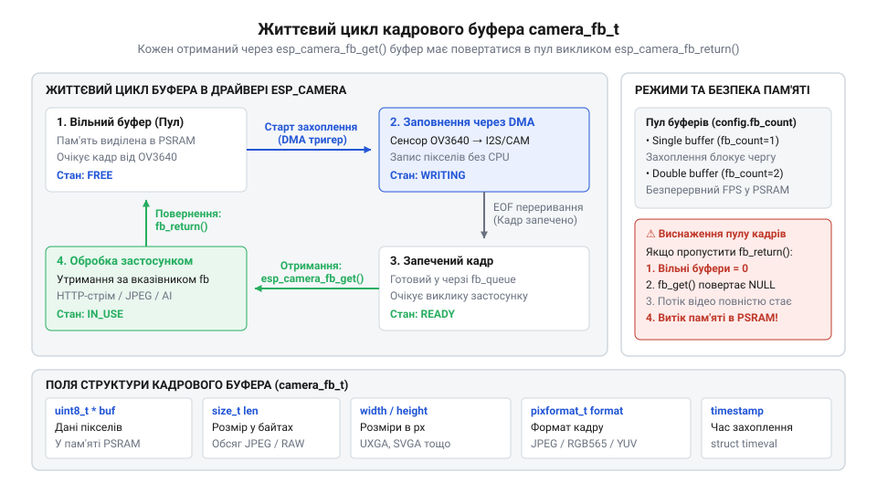

# Програмний API драйвера esp_camera та налаштування регістрів OV3640

<preknowlist>
- [Модуль ESP32-CAM: огляд архітектури, периферії та сімейства плат](root:cat-hw-boards/esp32-cam-camera-module-family) — принципи роботи паралельного інтерфейсу DVP, шини управління SCCB та роль зовнішньої пам'яті PSRAM
- [ESP32-CAM (OV2640 + microSD)](root:cat-hw-boards/esp32-cam) — схемотехнічне розведення виводів GPIO камери на базовій платі ESP32-CAM
</preknowlist>

## Призначення драйвера esp_camera та проблеми конфігурації

Пряме захоплення відеопотоку високої роздільності з оптичного сенсора зображення вимагає жорсткої синхронізації між напівпровідниковою матрицею та периферійними блоками мікроконтролера. 3-мегапіксельна CMOS-матриця OV3640 генерує неперервний пакувальний потік даних зі швидкістю у десятки мегабайтів на секунду. Якщо зчитувати пікселі покроково у звичайному програмному циклі ядра, обчислювальні ресурси центрального процесора виявляться повністю заблокованими, а найменша затримка переривання призведе до випадіння байтів та розриву кадрової синхронізації.

У середовищі ESP-IDF функцію апаратного прошарку виконує спеціалізований компонент @@en|esp_camera@@. Драйвер зв'язує фізичні лінії паралельного цифрового відеопорту @@en|DVP@@ (від англ. *@@en|Digital Video Port@@* — цифровий відеопорт) із периферійним контролером прямого доступу до пам'яті @@en|DMA@@ (від англ. *@@en|Direct Memory Access@@* — прямий доступ до пам'яті) на [мікроконтролері ESP32-S3](root:cat-hw-boards/esp32s3-microcontroller) або базовому ESP32. Передача потоку здійснюється без участі процесора: у базовому ESP32 периферійний модуль `I2S` примусово використовується у паралельному режимі для захоплення байтів, тоді як в ESP32-S3 працює спеціалізований блок `LCD CAM`. Модуль `LCD CAM` апаратно декодує строби `PCLK`, `VSYNC` та `HREF` із налаштовуваною полярністю й прямою 8-бітною упаковкою пікселів у пакети DMA, що усуває фазовий зсув та часовий джитер, характерний для емуляції через `I2S`, і вивільняє обчислювальні ядра для задач обробки кадру чи передачі даних у мережу. При цьому підсистема @@en|DMA@@ в ESP32-S3 вимагає суворого апаратного вирівнювання: адреси кадрових буферів у системній пам'яті `@@en|DRAM@@` мають бути вирівняні за 4-байтовою межею `uint32_t`, а при виділенні кадрових масивів у зовнішній пам'яті @@en|PSRAM@@ адреси буферів та прив'язаних апаратних `DMA`-дескрипторів вирівнюють за 16-, 32- або 64-байтовими межами рядків кешу `@@en|cache line@@` (від англ. *@@en|cache line@@* — рядок кеш-пам'яті), щоб запобігти апаратним виняткам шини та пошкодженню даних при скиданні кеш-буферів L1.

Головна складність налаштування камери полягає у багатьох фазових та електричних залежностях між 11 сигнальними лініями шини. Сенсор не має власного тактового генератора й вимагає зовнішньої опорної частоти @@en|XCLK@@ (від англ. *@@en|External Clock@@* — зовнішня тактова частота). Цю частоту генерує внутрішній модуль ШІМ-управління @@en|LEDC@@ (від англ. *@@en|LED Control@@* — модуль ШІМ-управління) мікроконтролера. Якщо у коді помилково вказати недопустиму частоту `XCLK` (наприклад, вище 20 МГц чи нижче 10 МГц), фазове автопідлаштування частоти (ФАПЧ) усередині сенсора OV3640 втрачає захоплення. У результаті матриця припиняє формувати строб тактування пікселів @@en|PCLK@@ (від англ. *@@en|Pixel Clock@@* — піксельна тактова частота), строкову синхронізацію @@en|HREF@@ (від англ. *@@en|Horizontal Reference@@* — строкова синхронізація) та кадрові імпульси @@en|VSYNC@@ (від англ. *@@en|Vertical Synchronization@@* — кадрова синхронізація), а шина DMA випадає у тайм-аут.

Для усунення хаотичного налаштування розробники створили єдиний конфігураційний дескриптор — структуру @@en|camera_config_t@@. Вона об'єднує в собі прив'язку фізичних виводів GPIO, конфігурацію двопровідного інтерфейсу керування регістрами @@en|SCCB@@ (від англ. *@@en|Serial Camera Control Bus@@* — послідовна шина керування камерою), частоту тактування та параметри кадрових буферів. Схемотехнічне розведення цих сигналів та електроживлення описує [модуль ESP32-CAM: огляд архітектури, периферії та сімейства плат](root:cat-hw-boards/esp32-cam-camera-module-family).

## Структура camera_config_t та прив'язка шин

Конфігураційна структура `camera_config_t` задає повну карту комутації між мікроконтролером та CMOS-сенсором. Поля структури розділені на кілька критичних сигнальних груп, кожна з яких відповідає за свою частину кадрового тракту:

1. **Паралельна шина даних DVP (`pin_d0` – `pin_d7`).** Вісім полів типу `int` задають номери виводів GPIO, до яких підключено паралельні лінії розрядності пікселів `D0–D7`. Напрямок передачі виключно вхідний для мікроконтролера.
2. **Строби синхронізації та тактування.** Поле `pin_xclk` визначає вивід виходу опорної частоти `XCLK`. Поле `pin_pclk` приймає строб `PCLK`, за активним фронтом якого защепковуються байти. Поля `pin_href` та `pin_vsync` прив'язують відповідно лінії строкової `HREF` та кадрової `VSYNC` синхронізації.
3. **Шина керування SCCB (`pin_sccb_sda`, `pin_sccb_scl`).** Визначення сигналів шини `SIOD` (дані) та `SIOC` (тактування). Якщо використовувати стандартні виводи шини `I2C`, драйвер застосовує апаратний контролер `I2C`, а при довільних GPIO — програмний емулятор.
4. **Управління живленням та скиданням (`pin_pwdn`, `pin_reset`).** Сигнали вимикання живлення Power Down та апаратного скидання Reset. Якщо ці виводи на платі жорстко підтягнуті до заземлення чи лінії живлення, у відповідних полях вказують значення `-1`.
5. **Тактування `xclk_freq_hz` та таймер `LEDC`.** Поле `xclk_freq_hz` приймає значення частоти у герцах (зазвичай `20000000` тобто 20 МГц). Поля `ledc_timer` та `ledc_channel` задають апаратний таймер і канал модуля `LEDC`.

*Принципова схема відповідності полів структури camera_config_t до сигнальних ліній DVP та SCCB шин мікроконтролера ESP32 і сенсора OV3640.*

Розрахунок частоти `xclk_freq_hz` є компромісом між кадровою частотою та стабільністю сигналу. Для сенсора OV3640 значення 20 МГц забезпечує максимальну швидкість захоплення кадрів. Генерування цієї частоти покладається на апаратний модуль ШІМ-управління @@en|LEDC@@. Призначення конкретного таймера `ledc_timer` та каналу `ledc_channel` у структурі конфігурації монополізує цей апаратний ресурс для подачі меандру на `XCLK`, що унеможливлює його повторне використання іншими периферійними модулями для генерації ШІМ-сигналів керування сервоприводами чи яскравістю підсвічування. Випадкова спроба переконфігурувати той самий таймер LEDC в іншому блоці коду збиває частотний дільник `XCLK` і призводить до відмови камери. Крім того, при виборі неокруглених частот тактування (наприклад, `16.5 MHz` чи `24 MHz`) дробовий дільник модуля LEDC змушений почергово перемикати коефіцієнти ділення системної шини APB, що створює фазовий джиттер (англ. @@en|jitter@@, від дрижати) опорного сигналу. Високочастотне тремтіння фронтів `XCLK` збиває систему фазового автопідстроювання частоти @@en|PLL@@ (англ. @@en|Phase-Locked Loop@@, від phase — фаза, lock — фіксувати, loop — петля) усередині сенсора OV3640, викликаючи розсинхронізацію внутрішніх піксельних генераторів і пропуск стробів `PCLK`. При використанні довгих гнучких шлейфів на [платі ESP32-CAM](root:cat-hw-boards/esp32-cam) паразитна індуктивність провідників додатково підсилює ці амплітудні викиди та дзвін на фронтах `PCLK`. У таких умовах зниження `xclk_freq_hz` до 10 МГц або використання строго кратних дільників усуває помилки під час защепкування даних у DMA, хоча й зменшує частоту відновлення кадрів удвічі. На платах з інтегрованою псевдостатичною пам'яттю на кшталт [Waveshare ESP32-S3R2](root:cat-hw-boards/esp32-s3r2-waveshare) стабільність `XCLK` додатково захищена короткими треками друкованої плати.

Типовий приклад заповнення структури конфігурації у коді виглядає так:

:::tabs
@tab ESP-IDF (C)
:::code api-esp32-camera-ov3640-driver-config/c/esp-idf/snippet-1.c
@tab Arduino IDE (C++)
:::code api-esp32-camera-ov3640-driver-config/cpp/arduino/snippet-2.cpp
:::

## Формати зображення та розміщення кадрових буферів

Після фізичної комутації шин необхідно правильно налаштувати обсяг пам'яті під кадрові буфери. Вибір формату пікселів та роздільної здатності кадру прямо визначає навантаження на підсистему пам'яті. Конфігураційна структура розрізняє нестиснені растрові формати та стиснений потік `@@en|JPEG@@` (від англ. *@@en|Joint Photographic Experts Group@@* — назва об'єднаної групи експертів з фотографії):

1. **Нестиснені формати (`PIXFORMAT_RGB565`, `PIXFORMAT_YUV422`, `PIXFORMAT_GRAYSCALE`).** Формат `RGB565` вимагає 2 байти на кожен піксель. Якщо обрати роздільну здатність 3-мегапіксельної матриці OV3640 у `FRAMESIZE_QXGA` (2048×1536 пікселів), обсяг одного нестисненого кадру розраховується так:

        кадр = 2048 × 1536 × 2
             = 6.291.456 байтів      [множення роздільності на 2 байти/піксель]
             ≈ 6.29 МБ               [переведення у мегабайти]

   Такий обсяг перевищує доступний простір внутрішньої оперативної пам'яті `@@en|DRAM@@` (від англ. *@@en|Dynamic RAM@@* — динамічна оперативна пам'ять) мікроконтролера, тож роботу з растровими формати високої чіткості реалізують виключно на платах із зовнішньою псевдостатичною пам'яттю `@@en|PSRAM@@` (від англ. *@@en|Pseudo-Static RAM@@* — псевдостатична оперативна пам'ять), таких як [Waveshare ESP32-S3R2](root:cat-hw-boards/esp32-s3r2-waveshare).
2. **Стиснений формат (`PIXFORMAT_JPEG`).** Сенсор OV3640 має вбудований апаратний кодек `JPEG`. Стиснення зменшує розмір кадру у 10–20 разів (до 50–300 КБ залежно від складності сцени), що дозволяє утримувати буфери у внутрішній пам'яті навіть при роздільності QXGA або UXGA (1600×1200).

Керування пам'яттю у `camera_config_t` здійснюється через чотири ключові поля:
- **`pixel_format` та `frame_size`.** Приймають константи переліків `pixformat_t` та `framesize_t`.
- **`jpeg_quality`.** Якість стиснення від 1 (найвища якість, великий розмір) до 63 (найгірша якість, малий розмір). Для фотофіксації високої чіткості зазвичай обирають значення від 10 до 12.
- **`fb_location`.** Визначає місце виділення пам'яті під кадрові буфери: `CAMERA_FB_IN_PSRAM` (зовнішня пам'ять) або `CAMERA_FB_IN_DRAM` (внутрішня пам'ять). Внутрішня пам'ять `@@en|DRAM@@` працює на частоті процесора з нульовими затримками тактування, що забезпечує найвищу швидкість DMA-передачі та швидкий доступ до байтів, але її обсяг обмежений сотнями кілобайтів. Зовнішня `@@en|PSRAM@@` підключається через послідовну шину SPI, через що затримки доступу зростають у 5–10 разів порівняно з DRAM; це дозволяє зберігати великі кадри QXGA, але вимагає компромісу з швидкістю побайтового аналізу пікселів ЦП.
- **`fb_count` та `grab_mode`.** Поле `fb_count` задає кількість буферів (1 для одиночної буферизації, 2 для подвійної `ping-pong` буферизації). Режим `grab_mode` вибирає логіку обробки черги: `CAMERA_GRAB_WHEN_EMPTY` послідовно витягує найстаріші кадри з черги DMA, що при тривалій обробці в застосунку накопичує часову затримку (лаг) відеопотоку. Натомість режим `CAMERA_GRAB_LATEST` усуває цю затримку завдяки примусовому рециклінгу: коли застосунок викликає `esp_camera_fb_get()`, драйвер перевіряє чергу готових буферів `fb_out`, автоматично скидає та повертає всі попередні проміжні дескриптори кадру назад у чергу вільних буферів `fb_in`, і видає лише останній, найновіший прийнятий з шини DVP кадр. Це гарантує мінімальну затримку знімка для задач комп'ютерного зору ціною пропуску кількох міжвихідних кадрів, проте цей механізм працює виключно за наявності щонайменше двох буферів (`fb_count ≥ 2`).

## Життєвий цикл буферів та функції ініціалізації

Програмний запуск камери починається з виклику функції `esp_camera_init()`. Функція приймає вказівник на заповнену структуру конфігурації `&config`, конфігурує таймер `LEDC`, ініціалізує контролер `DMA` та зчитує ідентифікатор сенсора OV3640 по шині `SCCB`. Якщо ініціалізація успішна, функція повертає `ESP_OK`.

Після старта застосунок отримує кадри у циклі за допомогою функції `esp_camera_fb_get()`. Вона повертає вказівник на структуру `@@en|camera_fb_t@@`, яка містить вказівник на масив байтів `buf`, довжину кадру `len`, ширину `width`, висоту `height`, формат `format` та часову мітку `timestamp`.

Критичним інваріантом роботи з драйвером є обов'язкове повернення кадрового буфера назад у систему за допомогою функції `esp_camera_fb_return()`. Драйвер працює з обмеженим кільцевим масивом буферів, фіксованим параметром `fb_count` (зазвичай 1 або 2). Під час виклику `esp_camera_fb_get()` драйвер вилучає готовий кадр із черги периферійного блоку @@en|DMA@@ й помічає його як зайнятий застосунком. Якщо код не викликає `esp_camera_fb_return()`, цей слот залишається заблокованим і DMA не може використовувати його для запису наступних кадрів з матриці. При утриманні всіх доступних буферів одночасно (наприклад, під час тривалої мережевої передачі чи покрокової обробки кадру) кільцевий масив вичерпується: периферія DMA зупиняє защепкування нових даних по шині @@en|DVP@@, кадри починають відкидатися, а наступний виклик `esp_camera_fb_get()` блокується в очікуванні вільної пам'яті й зрештою випадає у тайм-аут `ESP_ERR_TIMEOUT` (повертаючи `NULL`), що призводить до повної зупинки кадрового тракту через витік ресурсів. У багатозадачному середовищі операційної системи @@en|FreeRTOS@@ (від англ. *@@en|Free Real-Time Operating System@@* — вільна операційна система реального часу) внутрішня черга драйвера захищена семафорами, проте самі виклики `esp_camera_fb_get()` та `esp_camera_fb_return()` не є атомарними відносно потоку обробки. Паралельний виклик `esp_camera_fb_get()` із кількох конкуруючих завдань FreeRTOS без зовнішнього м'ютекса створює стан ґонки (англ. @@en|race condition@@, від @@en|race@@ — перегони та @@en|condition@@ — стан), порушує хронологічний порядок вибірки та загрожує повторним поверненням одного й того самого буфера, тому потокобезпечна архітектура вимагає обгортання секції захоплення й звільнення кадру в м'ютекс захисту або виділення окремого єдиного завдання-споживача для обробки кадрового потоку.

*Схема послідовності показує життєвий цикл кадрового буфера між застосунком, драйвером esp_camera та викликами esp_camera_fb_get і esp_camera_fb_return.*

Повний цикл ініціалізації, захоплення кадру та його обов'язкового звільнення на [платі ESP32-CAM](root:cat-hw-boards/esp32-cam) демонструє наступний приклад:

:::tabs
@tab ESP-IDF (C)
:::code api-esp32-camera-ov3640-driver-config/c/esp-idf/init-and-capture.c
@tab Arduino IDE (C++)
:::code api-esp32-camera-ov3640-driver-config/cpp/arduino/setup.cpp
:::

## Низькорівневе управління OV3640 через об'єкт sensor_t

Вбудований автопілот оптичної матриці OV3640 не завжди дає бажану якість зображення у складних умовах освітлення або при специфічних завданнях комп'ютерного зору. Коли високорівневої конфігурації замало, виникає потреба перехопити управління безпосередньо на рівні матриці.

Для цього драйвер `@@en|esp_camera@@` надає об'єкт `@@en|sensor_t@@` — структуру з таблицею функцій-вказівників для прямого керування CMOS-сенсором. Отримати покажчик на поточний об'єкт можна викликом `esp_camera_sensor_get()`.

Структура `@@en|sensor_t@@` містить методи для зміни орієнтації кадру (`set_hmirror` для горизонтального дзеркалювання, `set_vflip` для вертикального перевертання), а також прапорці перемикання режимів автоматики: `@@en|AWB@@` (від англ. *@@en|Automatic White Balance@@* — автоматичний баланс білого), `@@en|AGC@@` (від англ. *@@en|Automatic Gain Control@@* — автоматичне регулювання підсилення) та `@@en|AEC@@` (від англ. *@@en|Automatic Exposure Control@@* — автоматичне керування експозицією). Оскільки розробники пристроїв на [модулі ESP32-CAM](root:cat-hw-boards/esp32-cam-camera-module-family) нерідко встановлюють камеру під кутом або догори дном, виклики `set_hmirror` і `set_vflip` корегують орієнтацію зображення на рівні матриці без додаткового навантаження на обчислювальні ядра мікроконтролера.

Коли стандартних методів недостатньо, використовуються функції `set_reg()` та `get_reg()`. Метод `s->set_reg(s, reg, mask, val)` відправляє 8-бітне значення по шині `@@en|SCCB@@` напряму в регістр OV3640 з 16-бітною субадресацією @@en|sub-address@@ (від англ. *@@en|sub-address@@* — субадреса). Параметр `reg` приймає 16-бітну адресу, у якій старший байт обирає командний банк регістрів @@en|command bank@@ (від англ. *@@en|command bank@@* — банк командних регістрів), а молодший байт — зміщення всередині банку: діапазон `0x3000`–`0x31FF` керує системним тактуванням і живленням, `0x3300`–`0x34FF` відповідає за блоки автоматичного підсилення й експозиції, `0x3600`–`0x37FF` містить регістри колірної матриці та гама-корекції, а `0x3800`–`0x38FF` регулює розміри вікна й кадрування DVP. Використання бітової маски дозволяє виконати читання, маскування та запис, модифікуючи лише вибрані біти у цільовому банку без порушення суміжних апаратних конфігурацій CMOS-матриці. Тим не менше, під час масового перезапису конфігурації — зокрема при перемиканні банків або завантаженні нових коефіцієнтів колірної матриці — вбудований цифровий сигнальний процесор (англ. @@en|digital signal processor@@, від @@en|digital@@ — цифровий, @@en|signal@@ — сигнал та @@en|processor@@ — процесор) сенсора потребує часових затримок (англ. @@en|propagation delay@@, від @@en|propagation@@ — поширення та @@en|delay@@ — затримка) тривалістю 1–5 мс між послідовними транзакціями шини `@@en|SCCB@@`. Програмне ігнорування цих затримок призводить до збоїв у внутрішніх реєстрах синхронізації матриці, спотворення гама-кривих або виникнення артефактів кадрування через неповний процес оновлення буферних значень сенсора.

:::tabs
@tab ESP-IDF (C)
:::code api-esp32-camera-ov3640-driver-config/c/esp-idf/configure-ov3640-sensor.c
@tab Arduino (C++)
:::code api-esp32-camera-ov3640-driver-config/cpp/arduino/setupsensordirectly.cpp
:::

## Діагностика помилок драйвера та усунення відмов

Запуск камери може перерватися помилкою ще на етапі ініціалізації або призвести до відмов захоплення кадрів під час тривалої роботи пристрою. Причинами таких збоїв зазвичай є електричні завади, брак пам'яті або втрата синхронізації шини `@@en|DVP@@`.

Драйвер `@@en|esp_camera@@` сигналізує про проблеми за допомогою стандартних кодів `@@en|esp_err_t@@`:

- `ESP_ERR_NOT_FOUND`: Мікроконтролер не отримує відповіді по шині `@@en|SCCB@@` під час опитування ID сенсора OV3640. Це свідчить про обрив ліній `SIOC`/`SIOD`, відсутність тактування `@@en|XCLK@@` або збій живлення матриці.
- `ESP_ERR_NO_MEM`: Виникає у виклику `esp_camera_init()`, коли в системній пам'яті `@@en|DRAM@@` або зовнішній `@@en|PSRAM@@` немає суцільного блоку потрібного розміру під кадрові буфери.
- `ESP_ERR_TIMEOUT` (або `NULL` у `esp_camera_fb_get()`): Зависання периферійного модуля `@@en|DMA@@` у чеканні строба `@@en|VSYNC@@` чи `@@en|HREF@@`. Висока частота `@@en|XCLK@@` на довгих провідниках викликає завади на лінії `@@en|PCLK@@`, через що DMA втрачає межі рядків і кадру.

Для відновлення працездатності застосовують адаптивні алгоритми. У разі виникнення тайм-аутів знижують тактову частоту `xclk_freq_hz` (наприклад, з 20 МГц до 10 МГц), що відновлює стабільність фронтів сигналів PCLK. На платах на кшталт [Waveshare ESP32-S3R2](root:cat-hw-boards/esp32-s3r2-waveshare) при дефіциті пам'яті рекомендується зменшити параметр `fb_count` або знизити кадрову роздільність `frame_size`. При зависанні шини @@en|DVP@@ виконують процедуру перезапуску: викликом `esp_camera_deinit()` звільняють ресурси, а потім виконують апаратну послідовність скидання оптичного сенсора. Спочатку на лінію `pwdn_gpio_num` (від англ. *@@en|power down@@*, @@en|PWDN@@) подають високий логічний рівень тривалістю не менше 10 мс для вимкнення аналогових кіл матриці, після чого лінію `reset_gpio_num` (від англ. *@@en|reset@@*, @@en|RESET@@) притискають до логічного нуля на 2–5 мс для скидання конфігураційних регістрів. Наприкінці вивід @@en|RESET@@ повертають у високий стан, а лінію @@en|PWDN@@ опускають у нуль, вичікуючи 10–20 мс для стабілізації внутрішнього генератора @@en|PLL@@ сенсора перед повторним викликом `esp_camera_init()`.

:::tabs
@tab ESP-IDF (C)
:::code api-esp32-camera-ov3640-driver-config/c/esp-idf/init-camera-with-recovery.c
@tab Arduino (C++)
:::code api-esp32-camera-ov3640-driver-config/cpp/arduino/safecamerainit.cpp
:::
