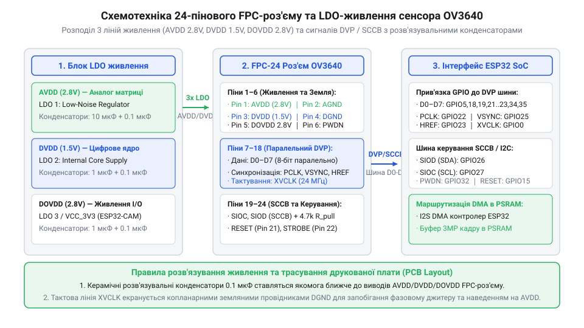

# Апаратна розпіновка, схемотехніка живлення та шина DVP сенсора OV3640

<preknowlist>
- [ESP32-CAM (OV2640 + microSD)](root:cat-hw-boards/esp32-cam) — базове периферійне цоколювання та вимоги до напруги живлення 3.3V
- [Модуль ESP32-CAM: огляд архітектури, периферії та сімейства плат](root:cat-hw-boards/esp32-cam-camera-module-family) — схему підключення камери та призначення ліній шини DVP
</preknowlist>

## Призначення та специфікація FPC-роз'єму

Підключення 3-мегапіксельного оптичного фотосенсора `@@en|OV3640@@` у складі бездротових плат розробки здійснюється за допомогою 24-контактного гнучкого планарного роз'єму `@@en|FPC@@` (від англ. @@en|Flexible Printed Circuit@@ — гнучка друкована плата; `@@en|FPC@@`) з кроком між контактами 0.5 мм. Цей фізичний інтерфейс поєднує три силові лінії живлення, заземлення, швидкісний цифровий відеопорт `@@en|DVP@@` (від англ. @@en|Digital Video Port@@ — цифровий відеопорт; `@@en|DVP@@`) та двопровідну шину керування регістрами `@@en|SCCB@@`. Правильне цоколювання виводів FPC-роз'єму гарантує узгодження високовольтних та низьковольтних логічних рівнів між матрицею камери та [модулями ESP32-CAM](root:cat-hw-boards/esp32-cam).

| Номер піна FPC | Назва сигналу | Напрямок сигналу | Функціональне призначення та вимоги |
| :--- | :--- | :--- | :--- |
| `1` | `VNC` | — | Не підключається (вільний контакт) |
| `2` | `AGND` | Живлення | Аналогова земля матриці та АЦП (з'єднується з DGND в одній точці) |
| `3` | `SIOD` | Вхід/Вихід | Лінія даних шини SCCB (вимагає зовнішньої підтяжки до 2.8 В) |
| `4` | `SIOC` | Вхід | Тактова лінія шини SCCB (вимагає зовнішньої підтяжки до 2.8 В) |
| `5` | `VSYNC` | Вихід | Кадрова синхронізація (імпульс завершення/початку кадру) |
| `6` | `HREF` | Вихід | Рядкова синхронізація (активний рівень при зчитуванні рядка) |
| `7` | `PCLK` | Вихід | Піксельне тактування (стробування кожного байта даних) |
| `8` | `XCLK` | Вхід | Опорне тактування (від LEDC/PWM мікроконтролера 10–24 МГц) |
| `9` | `D9` (`D7`) | Вихід | Старший біт даних відеопорту DVP (Bit 7) |
| `10` | `D8` (`D6`) | Вихід | Лінія даних DVP (Bit 6) |
| `11` | `D7` (`D5`) | Вихід | Лінія даних DVP (Bit 5) |
| `12` | `D6` (`D4`) | Вихід | Лінія даних DVP (Bit 4) |
| `13` | `D5` (`D3`) | Вихід | Лінія даних DVP (Bit 3) |
| `14` | `D4` (`D2`) | Вихід | Лінія даних DVP (Bit 2) |
| `15` | `D3` (`D1`) | Вихід | Лінія даних DVP (Bit 1) |
| `16` | `D2` (`D0`) | Вихід | Молодший біт даних відеопорту DVP (Bit 0) |
| `17` | `RESET` | Вхід | Апаратний скид сенсора (активний низький рівень) |
| `18` | `PWDN` | Вхід | Режим енергозбереження/відключення (активний високий рівень) |
| `19` | `DOVDD` | Живлення | Живлення інтерфейсів введення-виведення (2.8 В) |
| `20` | `DVDD` | Живлення | Цифрове живлення ядра сенсора та кодека (1.5 В) |
| `21` | `DOVDD` | Живлення | Додаткова лінія живлення буферів I/O (2.8 В) |
| `22` | `DGND` | Живлення | Цифрова земля процесора та буферів DVP |
| `23` | `AVDD` | Живлення | Прецизійне аналогове живлення матриці та АЦП (2.8 В) |
| `24` | `AGND` | Живлення | Аналогова земля світлочутливого масиву пікселів |

Комплексна будова FPC-конектора вимагає суворого розділення системного заземлення: аналогові землі `AGND` (піни 2, 24) та цифрова земля `DGND` (пін 22) підключаються до спільного земляного полігону плати в єдиній точці безпосередньо біля роз'єму. Таке зіркоподібне заземлення запобігає наведенню цифрових шумів від зсувних регістрів на прецизійну аналогову матрицю. Деталі розміщення периферійних модулів висвітлює [сімействі плат ESP32-CAM](root:cat-hw-boards/esp32-cam-camera-module-family).

Окрім розділення заземлення, слід зважати на граничні струмові навантаження контактів роз'єму `@@en|FPC@@`, розрахованих на довготривалий струм не більше 0.5 А на один контакт. Гаряче підключення шлейфа камери (англ. *hot-plugging*, від англ. *hot* — під напругою та *plug* — вставляти; @@en|hot-plugging@@) під напругою суворо заборонено: при під'єднанні силові піни `AVDD`, `DVDD` та `DOVDD` можуть замкнути коло раніше за лінії `AGND` і `DGND`. Це викликає імпульсні кидки струму заряджання розв'язувальних конденсаторів амплітудою до 2 А, що спричиняє підгоряння золоченого покриття ламелей роз'єму та може спровокувати апаратне защіпання (англ. *latch-up*, від англ. *latch* — засувка та *up* — вгору; @@en|latch-up@@) паразитного тиристора в CMOS-структурі фотосенсора `@@en|OV3640@@`, призводячи до його необоротного термічного пробою. Схемотехнічна оцінка пікового ємнісного струму заряджання `I_surge` нерозрядженої сумарної ємності розв'язувальних конденсаторів `C_total` розраховується через швидкість наростання напруги `ΔV` за час механічного замкнення ламелей `Δt`:

        I_surge
        = C_total × (ΔV ÷ Δt)       [формула ємнісного струму]
        = 10⁻⁶ × (2.8 ÷ 1.4 × 10⁻⁶) [підстановка значення C_total = 1.0 мкФ, ΔV = 2.8 В, Δt = 1.4 мкс]
        = 2.0 A                     [амплітудне значення струму]

Отриманий імпульсний кидок струму амплітудою `2.0 А` тривалістю в кілька мікросекунд багаторазово перевищує допустимий номінал контактної групи роз'єму `@@en|FPC@@`. Для захисту сигнальних і силових кіл від подібних транзиєнтних сплесків та від впливу електростатичного розряду (англ. *Electrostatic Discharge*, від грец. *ēlektron* — янтар, *statikos* — нерухомий та нім. *Entladung* — розряд; @@en|ESD@@) на кожен чутливий контакт FPC-роз'єму встановлюють супресори перехідної напруги чи TVS-діоди (англ. *TVS diode*, від *Transient Voltage Suppressor* — пригнічувач перехідних напруг та грец. *dis* — двічі, *hodos* — шлях; @@en|TVS-діод@@). При доборі TVS-діодів для шини `@@en|DVP@@` обирають низькоємнісні матриці з власною ємністю не більше `0.5–1.5 пФ` і робочою зворотною напругою `V_RWM` = 3.3 В, а для ліній живлення — пристрої з високим поглинанням імпульсної потужності `P_PK` до `100 Вт`, що гарантує фіксацію напруги пробою `V_CL` нижче допустимого межевого значення для CMOS-структури `@@en|OV3640@@`.

## Триканальна схемотехніка живлення LDO

Матриця `OV3640` належить до змішаних аналого-цифрових систем високої інтеграції, що вимагає застосування трьох незалежних регуляторів напруги з малим падінням `@@en|LDO@@` (від англ. @@en|Low-Dropout Regulator@@ — регулятор напруги з малим падінням; `@@en|LDO@@`). На відміну від одноканальних пристроїв, живлення сенсора розділене на аналогову, цифрову та інтерфейсну зони.


*Принципова електрична схема підключення FPC-роз'єму сенсора OV3640 та триканального LDO-живлення.*

1. Аналоговий канал `AVDD` (2.8 В) живить піксельний масив, вбудований апаратний підсилювач та 10-бітний АЦП. Для пригнічення імпульсних пульсацій джерела живлення використовують малошумний `LDO` з коефіцієнтом пригнічення `@@en|PSRR@@` (від англ. @@en|Power Supply Rejection Ratio@@ — коефіцієнт пригнічення пульсацій живлення; `@@en|PSRR@@`) не менше 65 дБ на частоті 1 кГц. У розрив лінії вмикається послідовна феритова намистина `@@en|Ferrite Bead@@` з імпедансом 600 Ом на частоті 100 МГц та паралельні керамічні конденсатори ємністю 0.1 мкФ (тип X7R) і 10 мкФ (тип X5R), розміщені якнайближче до піна 23 роз'єму.
2. Цифровий канал `DVDD` (1.5 В) живить внутрішнє ядро обробки сигналів `DSP` та апаратний кодек `JPEG`. При роботі на високих частотах кадру струм споживання цифрового ядра досягає 80 мА, що створює імпульсні кидки. Для стабілізації використовується LDO з високою динамічною швидкістю відгуку та розв'язувальні конденсатори ємністю 0.1 мкФ та 4.7 мкФ.
3. Інтерфейсний канал `DOVDD` (2.8 В) задає логічні рівні на шинах `DVP` та `SCCB`. Узгодження напруги I/O гарантує сумісність сигнальних рівнів із виводами `GPIO`, якими володіє [мікроконтролері ESP32-S3](root:cat-hw-boards/esp32s3-microcontroller) або класичний ESP32.

Нехтування окремим фільтруванням лінії `AVDD` викликає викривлення опорного рівня АЦП, що проявляється на підсумковому зображенні у вигляді кольорових муарів або темних горизонтальних смуг.

Окрім високочастотних пульсацій, ключовим фактором якості є температурна стабільність вихідної напруги `AVDD`. Нагрівання плати під час тривалої зйомки викликає температурний дрейф (англ. @@en|temperature drift@@) опорної напруги лінійного регулятора `LDO`, що змінює вихідний рівень аналогового живлення на кілька мілівольт. Оскільки масив світлочутливих пікселів `@@en|OV3640@@` та внутрішній АЦП використовують `AVDD` як еталонний потенціал для зчитування накопиченого заряду, просідання або дрейф цього рівня зміщує точний нуль фотокомпонента та підсилює темновий струм (англ. @@en|dark current@@). В результаті динамічний діапазон зображення звужується, а рівень внутрішнього термошуму матриці в умовах слабкого освітлення зростає, спричиняючи видимий зернистий шум і кольорові спотворення на темних ділянках кадру.

## Шина DVP та тактування XVCLK PCLK

Паралельний цифровий відеопорт `DVP` відповідає за передавання нестиснутих RGB/YUV кадрів або потоку JPEG із фотосенсора до системи прямого доступу до пам'яті `DMA`. Інтерфейс містить 8 ліній даних `D0`–`D7` (піни 9–16 FPC-роз'єму) та 4 лінії синхронізації й тактування.

- `XCLK` (`XVCLK`) — вхідний опорний тактовий сигнал, що надходить від мікроконтролера на пін 8. Частота `XCLK` задається в межах 10–24 МГц. Внутрішній помножувач `@@en|PLL@@` (від англ. @@en|Phase-Locked Loop@@ — фазове автопідлаштування частоти; `@@en|PLL@@`) матриці підвищує цю частоту для функціонування внутрішнього DSP.
- `PCLK` — вихідний тактовий сигнал пікселів (пін 7). Кожен спадний або зростаючий фронт `PCLK` стробує наявність стабільного байта на паралельній шині `D0`–`D7`.
- `VSYNC` — сигнал кадрової синхронізації (пін 5). Активний високий або низький рівень (конфігурується в регістрах) позначає інтервал між кадрами.
- `HREF` — сигнал рядкової синхронізації (пін 6). Високий рівень свідчить про передавання активних пікселів у поточному рядку кадру.

При розведенні друкованої плати лінії тактування `PCLK` та `XCLK` вимагають трасування за правилами копланарного хвилеводу:
```text
  [GND Земляний провідник]
─────────── 0.15 мм ───────────
  [ Сигнальна траса PCLK / XCLK ]
─────────── 0.15 мм ───────────
  [GND Земляний провідник]
```
Сигнальний провідник оточують суцільними земляними трасами `GND` з обох боків та розміщують над нерозривним внутрішнім шаром заземлення. Безпосередньо біля виводів джерела тактування встановлюють послідовні демпфуючі резистори опором 22–33 Ом для пригнічення зворотних відбиттів хвилі. Це усуває часове тремтіння `@@en|jitter@@` (від англ. @@en|jitter@@ — фазове тремтіння; `@@en|джитер@@`) фронтів `PCLK` та запобігає збоям зчитування при високих навантаженнях, які виникають на [плати Waveshare ESP32-S3R2](root:cat-hw-boards/esp32-s3r2-waveshare).

Якщо довжина сигнальних трас шини `DVP` перевищує 50 мм, лінія починає працювати як довготривала лінія з розподіленими параметрами, де хвильові відбиття спричиняють спотворення фронтів. Для запобігання міжсимвольній інтерференції та часовому розкосу (англ. @@en|skew@@ — фазовий розкіс) між бітами `D0`–`D7` та стробом `PCLK` геометрію копланарного провідника розраховують на хвильовий імпеданс 50 Ом. Розрахунок ширини траси `w` та зазору до земляного екрана `s` виконують із урахуванням товщини діелектрика `h` та діелектричної проникності `ε_r` підкладки `FR-4`. Дотримання розрахованого імпедансу та вирівнювання довжин трас шини `DVP` з точністю до ±1 мм запобігає порушенню часу утримання даних на вхідному каскаді мікроконтролера.

## Шина SCCB та правила підтяжки сигналів

Конфігурування внутрішніх регістрів матриці `OV3640` виконується через проприєтарний інтерфейс `SCCB` (від англ. @@en|Serial Camera Control Bus@@ — послідовна шина керування камерою; `@@en|SCCB@@`), який є функціональним аналогом шини `I2C`. Інтерфейс складається з двох сигнальних ліній:
- `SIOC` (пін 4) — тактова лінія послідовної шини (англ. @@en|Serial Clock@@);
- `SIOD` (пін 3) — двонаправлена лінія даних (англ. @@en|Serial Data@@).

Схемотехнічно лінії `SIOC` та `SIOD` виконані з відкритим стоком (англ. @@en|open-drain@@), що вимагає обов'язкового встановлення зовнішніх підтягувальних резисторів `R_pull` до шини живлення `DOVDD` (2.8 В) або 3.3 В. Номінал резисторів підтяжки розраховується на основі ємності монтажних трас `C_line` та робочої частоти шини (100 кГц або 400 кГц):

```text
R_pull = t_r ÷ (0.8473 × C_line)
= 300⁻⁹ ÷ (0.8473 × 80⁻¹²)    [підстановка часу наростання фронту 300 нс та ємності лінії 80 пФ]
= 300⁻⁹ ÷ 67.784⁻¹²           [обчислення знаменника формули RC-постійної]
≈ 4425 Ом                      [оптимальний номінал підтягувального резистора 4.7 кОм]
```

Для стабільної обробки сигналів керування виводи `RESET` (пін 17) та `PWDN` (пін 18) підтягують відповідними резисторами 10 кОм: `RESET` притягують до `DOVDD` (активний стан — низький), а `PWDN` — до землі `DGND` (активний стан — високий). Під час початкової подачі живлення мікроконтролер утримує `PWDN` у високому стані протягом 5 мс після стабілізації напруг `AVDD`/`DVDD`/`DOVDD`, після чого подає короткий низький імпульс скидання на `RESET` тривалістю не менше 2 мс. Дотримання цієї часової послідовності запобігає апаратному зависанню шини `SCCB` та гарантує успішне зчитування ідентифікаційного номера чипа (`CHIP_ID = 0x3640`) при ініціалізації драйвера, загальну будову якого описує [родина плат і модулів на ESP32-S3](root:cat-hw-boards/esp32-s3-boards-family-overview).

Коли на єдину шину `@@en|SCCB@@` паралельно підключають декілька фотосенсорів із однаковою 7-бітною адресою пристрою (`0x3C`), виникає апаратний конфлікт адресації. Оскільки лінії `@@en|SIOD@@` увімкнені за схемою з відкритим стоком (англ. @@en|open-drain@@), шина реалізує логіку «монтажного І» (англ. @@en|wired-AND@@). Якщо під час читання даних один сенсор передає логічну одиницю (високий імпеданс), а інший — логічний нуль (потягнувши лінію до землі), на шині встановлюється низький рівень. Мікроконтролер виявляє розходження між переданим і реальним станом лінії, фіксуючи втрату арбітражу (англ. @@en|arbitration loss@@, від лат. *arbitrari* — судити, вирішувати). Для апаратного розмежування спільних шин на [модулі ESP32-CAM](root:cat-hw-boards/esp32-cam) застосовують вивід `@@en|PWDN@@`: переведення неактивного сенсора у режим глибокого сну переводить його інтерфейсні буфери `@@en|SCCB@@` у високоімпедансний стан, або використовують апаратні мультиплексори (англ. @@en|multiplexer@@, від лат. *multiplex* — складений) шини для фізичного перемикання ліній.
