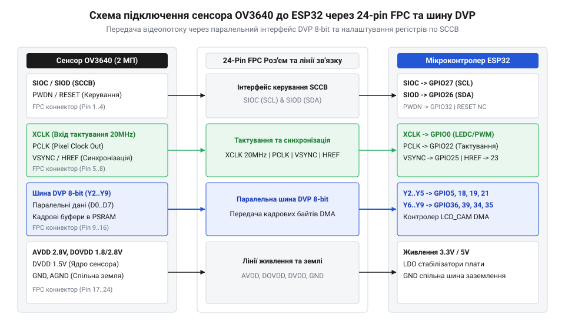
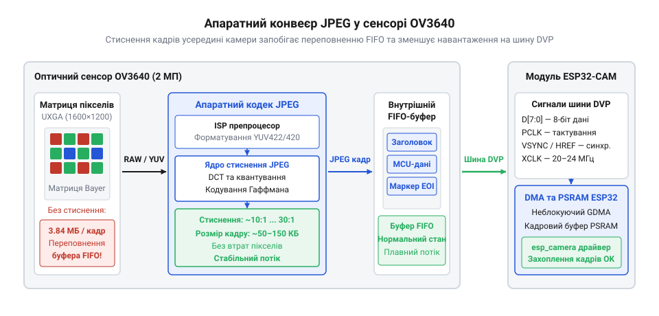
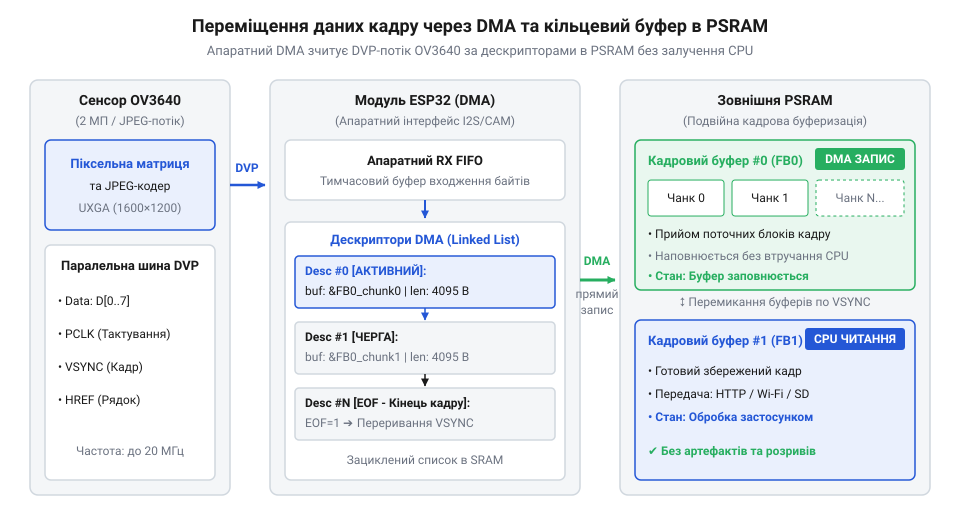
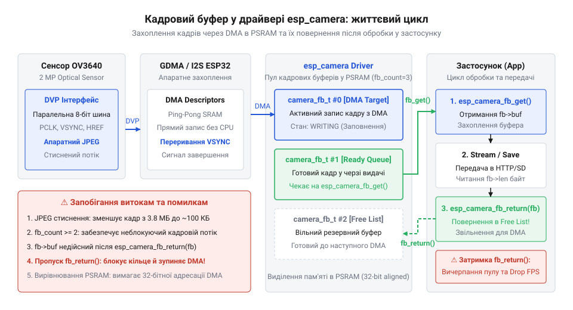

# ESP32-CAM з камерою OV3640 (2 МП)

<preknowlist>
- [ESP32-CAM (OV2640 + microSD)](root:cat-hw-boards/esp32-cam) — Базову розпіновку плати ESP32-CAM, схемотехніку живлення та загальні принципи роботи з периферією камери.
- [Модуль ESP32-CAM: огляд архітектури, периферії та сімейства плат](root:cat-hw-boards/esp32-cam-camera-module-family) — Апаратну архітектуру модуля ESP32-CAM, організації підключення PSRAM та виводів GPIO.
</preknowlist>

## Проблема передачі відеопотоку високої роздільності

Спроба зняти та передати несжиманий кадр високої роздільності @@en|UXGA@@ (`1600 × 1200` пікселів) за допомогою двомегапіксельного оптичного сенсора @@en|OV3640@@ на мікроконтролері @@en|ESP32@@ негайно впирається у фундаментальні обмеження обчислювальної архітектури. Більшість стандартних периферійних задач у мікроконтролерних системах оперують короткими дискретними пакетами даних — показниками датчиків, текстовими командами чи поодинокими телеметричними блоками розміром від кількох байтів до кількох кілобайтів. Натомість неперервний відеопотік оптичного сенсора являє собою високошвидкісний суцільний масив бінарних даних, де кожен кадр вимагає мільйонів байтів оперативного простору та жорстко детермінованої пропускної здатності системних шин.

У несжиманих колірних форматах, таких як @@en|RGB565@@ (16 бітів на піксель) або @@en|YUV422@@ (16 бітів на піксель), кожен окремий піксель зображення кодується двома байтами. Для обчислення точного фізичного обсягу одного кадру несжиманого формату в пам’яті помножимо горизонтальну роздільність кадру на вертикальну роздільність та на питому кількість байтів, необхідних для представлення колірного стану одного пікселя:

```
S_frame = W × H × BPP
= 1600 × 1200 × 2        [множення роздільності на 2 байти на піксель]
= 3840000 байтів          [обчислення загального обсягу в байтах]
= 3.66 МБ                [переведення значення у мегабайти]
```

Отриманий розрахунок показує, що розміщення в пам'яті лише одного несжиманого кадру роздільності @@en|UXGA@@ вимагає `3.84 МБ` (або `3.66 МБ`) суцільного оперативного простору. Апаратна архітектура мікроконтролера @@en|ESP32@@ містить внутрішню статичну оперативну пам’ять @@en|SRAM@@ (англ. @@en|SRAM@@, від @@en|Static Random Access Memory@@ — статична пам’ять з довільним доступом) загальним обсягом 520 КБ. Вона фізично розділена на три незалежні блоки: SRAM0 (пам'ять інструкцій), SRAM1 (пам'ять даних) та SRAM2 (пам'ять периферії та прямого доступу). Для динамічного виділення в оперативній купі (англ. @@en|heap@@) системному розподілювачу пам'яті @@en|FreeRTOS@@ доступно лише близько 300 КБ суцільних блоків DRAM. 

Через високий рівень системної фрагментації, викликаної виділенням пам'яті під стеки задач, буфери сокетів @@en|TCP/IP@@ та драйвери бездротового зв'язку, найбільший суцільний доступний блок у внутрішній пам'яті рідко перевищує `110–160 КБ`. Отже, фізичний обсяг одного несжиманого кадру камери понад 12 разів перевищує розмір усієї внутрішньої оперативної пам'яті чипа. Навіть при радикальному зниженні роздільності до SVGA (`800 × 600` пікселів) несжиманий кадр обсягом `960 000` байтів (`937.5 КБ`) миттєво призводить до вичерпання ресурсів пам'яті та аварійного завершення програми через повернення нульового вказівника (`NULL`) під час виклику системної функції виділення купи `malloc()`.

Для подолання дефіциту внутрішньої пам'яті на платах розширення застосовують зовнішню псевдостатичну оперативну пам’ять @@en|PSRAM@@ (англ. @@en|PSRAM@@, від @@en|Pseudo-Static Random Access Memory@@ — псевдостатична оперативна пам’ять) обсягом від 4 до 8 МБ. Однак підключення зовнішньої пам'яті через послідовну шину @@en|SPI@@/@@en|QSPI@@ створює вузьке місце у пропускній здатності. Оптична матриця сенсора вигружає піксельні байти у паралельний порт синхронно з кожним імпульсом піксельного тактування @@en|PCLK@@ (англ. @@en|PCLK@@, від @@en|Pixel Clock@@ — тактування пікселів), не маючи можливості призупинити зчитування кадру посередині рядка.

Обчислимо необхідну пропускну здатність шини для передачі несжиманого кадру @@en|UXGA@@ зі швидкістю 15 кадрів на секунду:

```
BW_req = S_frame × FPS
= 3.84 МБ × 15            [помноження обсягу кадру на частоту кадрів]
= 57.6 МБ/с              [обчислення необхідної пропускної здатності]
```

Тим часом реальна швидкість послідовного запису у зовнішню пам'ять @@en|PSRAM@@ через шину @@en|QSPI@@ на платформі @@en|ESP32@@ (при тактовій частоті 40 МГц чи 80 МГц) обмежена значенням близько `15–20 МБ/с` через накладні витрати на передачу команд адресації, затримки кеш-контролера та періодичні цикли регенерації заряду внутрішніх осередків DRAM. Оскільки потрібна швидкість надходження даних (`57.6 МБ/с`) майже утричі перевищує максимальну пропускну здатність шини пам'яті (`20 МБ/с`), внутрішній апаратний буфер першим зайшов — першим вийшов @@en|FIFO@@ (англ. @@en|FIFO@@, від @@en|First In, First Out@@ — першим зайшов, першим вийшов) периферійного модуля камери миттєво переповнюється.

При переповненні буфера @@en|FIFO@@ модуль прямого доступу до пам’яті @@en|DMA@@ (англ. @@en|DMA@@, від @@en|Direct Memory Access@@ — прямий доступ до пам’яті) змушений мовчки скидати вхідні байти піксельного потоку. Втрата навіть кількох байтів усередині рядка порушує часову синхронізацію стробу горизонтальної опорної лінії @@en|HREF@@. В результаті адресація наступних пікселів у буфері кадру зміщується: байти з наступного рядка починають записуватися у позиції попереднього. Це викликає апаратний ефект розриву кадрів (англ. @@en|frame tearing@@, від @@en|to tear@@ — розривати). На підсумковому зображенні виникають характерні артефакти: зміщені горизонтальні смуги, діагональне спотворення об'єктів, горизонтальне дрижання кадру або поява суцільних кольорових плям через втрату старших бітів кодування кольору.

Окрім критичних обмежень пам’яті та пропускної здатності шини, передача несжиманого відеопотоку створює високе імпульсне навантаження на підсистему живлення. Під час послідовного зчитування світлочутливих пікселів оптичною матрицею @@en|OV3640@@ внутрішні транзисторні ключі сенсора комутують значні ємності піксельного масиву. Одночасно з цим радіочастотний підсилювач потужності модуля @@en|Wi-Fi@@ мікроконтролера @@en|ESP32@@ періодично випромінює пакети даних, створюючи імпульси споживання струму амплітудою до `250–350 мА` із крутим фронтом наростання `di/dt`. 

Якщо лінія живлення 3.3 В на друкованій платі має недостатню ємність розв'язувальних конденсаторів або розведена тонкими провідниками з високим паразитичним індуктивним опором, напруга живлення в моменти пікових навантажень імпульсно просідає нижче `2.8 В`. Це викликає негайне спрацьовування внутрішнього апаратного компаратора системи контролю живлення — детектора зниження напруги @@en|Brownout Detector@@ (англ. @@en|Brownout Detector@@ — детектор зниження напруги). Спрацьовування детектора ініціює апаратне перезавантаження процесора (англ. @@en|Brownout reset@@), скидаючи поточний стан виконання програми та викликаючи втрату з'єднання з периферією.

Еволюція паралельних CMOS-сенсорів з апаратним JPEG у мікроконтролерних системах стала фундаментальним відповіддю на ці фізичні обмеження обчислювальної архітектури. У ранніх системах вбудованого комп'ютерного зору CMOS-матриці (такі як класична @@en|OV7670@@) передавали сирі несжимані дані через повільні послідовні інтерфейси або вимагали використання зовнішніх апаратних буферів @@en|FIFO@@ (наприклад, мікросхем @@en|AL422B@@) та потужних і дорогих цифрових сигнальних процесорів @@en|DSP@@ (англ. @@en|DSP@@, від @@en|Digital Signal Processor@@ — цифровий сигнальний процесор) із паралельними масивами швидкодіючої пам'яті. Перехід компанії @@en|OmniVision@@ до інтеграції апаратного кодека @@en|JPEG@@ (англ. @@en|JPEG@@, від @@en|Joint Photographic Experts Group@@) безпосередньо у кристал сенсорів серії @@en|OV2640@@ та @@en|OV3640@@ у поєднанні з паралельною цифровою відеошиною @@en|DVP@@ (англ. @@en|DVP@@, від @@en|Digital Video Port@@ — цифровий відеопорт), що тактується від мікроконтролера, докорінно змінив архітектуру побудови мультимедійних вузлів. 

Апаратне стиснення зображення безпосередньо в сенсорі за допомогою алгоритмів дискретно-косинусного перетворення (DCT), квантування та кодування Гаффмана дозволяє зменшити обсяг кадру @@en|UXGA@@ з `3.84 МБ` до `80–250 КБ` (коефіцієнт стиснення від 15:1 до 40:1 залежно від складності сцени та обраної якості). Це зменшило вимоги до пропускної здатності шини з десятки мегабайтів на секунду до доступних `2–5 МБ/с`, що уможливило використання доступного [модуля ESP32-CAM](root:cat-hw-boards/esp32-cam) для передачі відео високої роздільності без застосування коштовних зовнішніх обчислювачів.

Математичні формули розрахунку пропускної здатності та кадрових буферів для різних режимів зйомки містить [інструмент обчислення пропускної здатності](root:cat-hw-boards/esp32-cam-ov3640/math-dvp-psram-bandwidth-calculator.md). Практичну побудову бездротового відеосервера з подвійною буферизацією висвітлено у [проєкті мережевого MJPEG-стримера](root:cat-hw-boards/esp32-cam-ov3640/proj-esp32-cam-ov3640-mjpeg-streamer.md), а методи захисту системи від апаратних просідань живлення при збереженні кадрів максимальної роздільності деталізовано у [проєкті фотореєстратора високої роздільності](root:cat-hw-boards/esp32-cam-ov3640/proj-esp32-cam-ov3640-uxga-sd-logger.md).

## Апаратна архітектура шини DVP та живлення

Розуміння системних обмежень пам'яті підводять до необхідності детального вивчення апаратного інтерфейсу з’єднання між оптичним сенсором та мікроконтролером. Фізичне підключення 3-мегапіксельного оптичного сенсора @@en|OV3640@@ до мікроконтролера @@en|ESP32@@ здійснюється за допомогою 24-пінового гнучкого плаского кабелю @@en|FPC@@ (англ. @@en|FPC@@, від @@en|Flexible Printed Circuit@@ — гнучка друкована плата) з кроком контактних майданчиків 0.5 мм. Паралельна шина цифрового відеопорту @@en|DVP@@ виступає основним високошвидкісним трактом передачі даних між вихідними регістрами камери та паралельним периферійним портом мікроконтролера.

Шина @@en|DVP@@ об'єднує 8 ліній даних, лінії зовнішнього та піксельного тактування, а також строби кадрової та рядкової синхронізації. Розглянемо функціональне призначення кожного сигналу:

1. Паралельні лінії даних `D0`–`D7` (у специфікації сенсора @@en|OV3640@@ позначаються як `Y2`–`Y9` для вирівнювання за старшими бітами 10-бітного АЦП): передають байт піксельних даних у несжиманих форматах або байт стисненого потоку @@en|JPEG@@ на кожному активному такті піксельного годинника.
2. Вхідна тактова лінія @@en|XCLK@@ (англ. @@en|XCLK@@, від @@en|External Clock@@ — зовнішнє тактування): подає базову опорну частоту від генератора мікроконтролера @@en|ESP32@@ (сформовану через периферію @@en|LEDC@@ або магістраль тактування @@en|I2S@@ у діапазоні `10–24 МГц`, типово `20 МГц`) на вхід внутрішньої системи фазового автопідстроювання частоти (PLL) сенсора.
3. Вихідна піксельна тактова лінія @@en|PCLK@@ (англ. @@en|PCLK@@, від @@en|Pixel Clock@@ — тактування пікселів): генерується внутрішнім синтезатором камери @@en|OV3640@@ і слугує стробом для фіксації байта з ліній `D0`–`D7` периферійним контролером @@en|ESP32@@ на кожному зростаючому або спадному фронті імпульсу.
4. Строб вертикальної синхронізації @@en|VSYNC@@ (англ. @@en|VSYNC@@, від @@en|Vertical Synchronization@@ — вертикальна синхронізація): сигналізує про початок та завершення передачі нового зображення, формуючи кадровий інтервал гасіння.
5. Строб горизонтальної опорної лінії @@en|HREF@@ (англ. @@en|HREF@@, від @@en|Horizontal Reference Line@@ — горизонтальна опорна лінія): утримується у високому логічному рівні протягом передачі активних пікселів поточного рядка кадру.
6. Лінії послідовного шинного керування @@en|SCCB@@ (`SIOC` — тактування, `SIOD` — дані): двохпровідний сумісний із протоколом @@en|I2C@@ інтерфейс керування для конфігурування внутрішніх регістрів камери (налаштування експозиції, підсилення, балансу білого, бінування та режимів стиснення).
7. Сигнали керування живленням та станом @@en|RESET@@ (апаратне скидання) та @@en|PWDN@@ (переведення в режим глибокого сну): забезпечують програмно-апаратне керування станом матриці.


_*Схема 24-пінового FPC-інтерфейсу камери OV3640 з лініями даних D0-D7, тактування PCLK/XCLK та синхронізації VSYNC/HREF до GPIO ESP32.*_

Для точного узгодження часових параметрів передачі кадру слід враховувати повну геометричну структуру відеопотоку, яка складається з активної області пікселів та технологічних інтервалів горизонтального й вертикального гасіння. Частота піксельного тактування @@en|PCLK@@ визначається загальною кількістю піксельних позицій у кадрі з урахуванням інтервалів гасіння та обраного формату кодування:

```
f_PCLK = (W_total × H_total × FPS × BPP) ÷ 2
```

де `W_total` — повна ширина рядка з урахуванням пікселів горизонтального гасіння (`W_total = W_active + H_blank`), `H_total` — повна кількість рядків із урахуванням інтервалу кадрового гасіння (`H_total = H_active + V_blank`), `FPS` — частота кадрів на секунду, `BPP` — кількість байтів на піксель.

Обчислимо частоту піксельного тактування @@en|PCLK@@ для роздільності SVGA (`800 × 600` пікселів) при частоті 15 кадрів/с у несжиманому форматі @@en|YUV422@@ (`BPP = 2`), беручи до уваги розширення інтервалів гасіння до `W_total = 960` та `H_total = 640`:

```
f_PCLK = (960 × 640 × 15 × 2) ÷ 2
= 9216000 Гц
= 9.22 МГц               [розрахунок частоти тактування PCLK]
```

З отриманого виразу видно, що лінія тактування @@en|PCLK@@ працює на частоті `9.22 МГц`. На таких частотах критично важливим вимогою до трасування друкованої плати є суворе вирівнювання довжини трас між лінією піксельного тактування @@en|PCLK@@ та паралельними лініями даних `D0`–`D7`. Якщо паразитична ємність або різниця довжин провідників створює фазовий зсув (англ. @@en|clock skew@@ — фазовий зсув тактування) понад `3–5 нс`, периферійні тригери мікроконтролера @@en|ESP32@@ зчитують стан шини даних у момент перехідних процесів встановлення логічного рівня. Це призводить до спотворення байтових значень, випадіння маркерів початку та кінця кадру @@en|JPEG@@ (`0xFFD8` та `0xFFD9`) або виникнення кольорового шуму у вигляді пурпурово-зелених вертикальних смуг.

Особливе місце в схемотехніці підключення камери @@en|OV3640@@ посідає організація роздільного живлення її внутрішніх вузлів. Для мінімізації рівнів шуму оптична матриця вимагає подачі трьох незалежних шин живлення:

1. Аналогове живлення `AVDD` (напруга `2.8 В`): живить аналогову піксельну матрицю, підсилювачі колонок та аналогово-цифрові перетворювачі (АЦП). Ця лінія надзвичайно чутлива до високочастотних пульсацій. Для її живлення слід застосовувати окремий низькошумний лінійний регулятор @@en|LDO@@ (англ. @@en|LDO@@, від @@en|Low Dropout Regulator@@ — регулятор з низьким падінням напруги) з високим коефіцієнтом пригнічення нестабільності живлення @@en|PSRR@@ (понад 60 дБ на частоті 1 кГц), такий як @@en|RT9013-28@@ або @@en|LP5907@@.
2. Живлення цифрового ядра `DVDD` (напруга `1.5 В` або `1.8 В`): живить внутрішній процесор сигналів зображення @@en|ISP@@ (англ. @@en|ISP@@, від @@en|Image Signal Processor@@ — процесор сигналів зображення), апаратний компресор @@en|JPEG@@ та цифрові стани логічних регістрів. Будь-які імпульсні осідання на лінії `DVDD` призводять до збоїв роботи обчислювального кодека та розсинхронізації внутрішнього станового автомата камери.
3. Живлення цифрових буферів вводу-виводу `DOVDD` (напруга `2.8 В` або `3.3 В`): живить вихідні транзисторні каскади контактних майданчиків `D0`–`D7`, @@en|PCLK@@, @@en|VSYNC@@ та @@en|HREF@@. Для безпосереднього узгодження з логічними рівнями виводів @@en|GPIO@@ мікроконтролера @@en|ESP32@@ без застосування зовнішніх перетворювачів рівнів напругу `DOVDD` встановлюють рівною `3.3 В`.

Для запобігання проникненню високочастотних цифрових завад у чутливий аналоговий тракт на друкованій платі безпосередньо біля контактів роз'єму @@en|FPC@@ встановлюють розв'язувальні керамічні конденсатори ємністю 0.1 мкФ у паралель із конденсаторами ємністю 10 мкФ під кожну лінію живлення. При трасуванні плати аналогову землю (AGND) та цифрову землю (DGND) слід розділяти суцільними полігонами та з'єднувати лише в одній точці (зіркова топологія) біля вихідного контакту регулятора @@en|LDO@@, запобігаючи проходженню зворотних цифрових струмів через аналоговий шар сенсора.

Повний довідник з апаратного розпинування та принципових схем з'єднань наведено у [довіднику залізного інтерфейсу](root:cat-hw-boards/esp32-cam-ov3640/api-esp32-cam-ov3640-hardware.md). Огляд схемотехніки розведення друкованих плат містить розділ про [архітектуру модулів ESP32-CAM](root:cat-hw-boards/esp32-cam-camera-module-family), а специфіку програмування конфігураційних регістрів оптичного сенсора висвітлено у матеріалі про [протокол послідовної шини SCCB](root:com-devices/sccb-bus-protocol-camera-control). Комплексний розподіл ресурсів GPIO між периферійними модулями наведено в [огляді лінійки плат ESP32-CAM](root:cat-hw-boards/esp32-cam-camera-module-family).

## Апаратне стиснення JPEG та буферизація PSRAM

Висока інтенсивність вихідного відеопотоку 2-мегапіксельного оптичного сенсора @@en|OV3640@@ у роздільності @@en|UXGA@@ (`1600 × 1200` пікселів) створює критичне навантаження на обчислювальні ресурси мікроконтролера @@en|ESP32@@. При передачі несжиманих даних у форматах @@en|RGB565@@ або @@en|YUV422@@ кожен кадр займає `3.84 МБ` оперативного простору. При кадровій частоті 15 кадрів на секунду потрібна пропускна здатність шини сягає `57.6 МБ/с`, що майже утричі перевищує реальну швидкість запису у зовнішню псевдостатичну оперативну пам'ять @@en|PSRAM@@ (`15–20 МБ/с`). Спроба безпосередньої передачі несжиманого потоку неминуче призводить до миттєвого переповнення внутрішнього буфера @@en|FIFO@@ та апаратного скидання кадрів. Єдиним фізично можливим розв'язком цієї проблеми є перехід від передачі сирого піксельного масиву до апаратного стиснення даних безпосередньо всередині оптичного сенсора.

Для цього у кристал матриці @@en|OV3640@@ інтегровано високопродуктивний апаратний кодек @@en|JPEG@@. Після зчитування аналогових сигналів світлочутливого масиву та їх первинної обробки у процесорі сигналів зображення @@en|ISP@@, колірні дані у форматі @@en|YUV422@@ спрямовуються не на вихідні тригери шини @@en|DVP@@, а на вхідний блок цифрового сигнального процесора @@en|DSP@@ кодека. Процес апаратного стиснення здійснюється послідовно над блоками розміром `8 × 8` пікселів, які формують @@en|мінімальний кодований блок@@ (від англ. @@en|Minimum Coded Unit@@ — мінімальний кодований блок, або @@en|MCU@@).

Алгоритм апаратного кодування охоплює три послідовні етапи:

1. @@en|Дискретне косинусне перетворення@@ (від англ. @@en|Discrete Cosine Transform@@ — дискретне косинусне перетворення, або @@en|DCT@@): переводить просторові значення яскравості та колірності з піксельної області у частотний спектр. Результатом перетворення є матриця з 64 коефіцієнтів, де один коефіцієнт постійної складової (DC) відповідає за середню яскравість блоку, а 63 коефіцієнти змінних складових (AC) описують високочастотні деталі та переходи.
2. @@en|Квантування@@ (від англ. @@en|quantization@@ — квантування): коефіцієнти спектра діляться на відповідні елементи матриці квантування. Оскільки людське зорове сприйняття менш чутливе до високочастотних деталей, коефіцієнти високих частот діляться на більші дільники та округлюються до нуля. Рівень квантування задається через коефіцієнт якості (англ. @@en|quality factor@@, або @@en|Q-factor@@), який програмується через послідовний інтерфейс @@en|SCCB@@.
3. @@en|Кодування Гаффмана@@ (від англ. @@en|Huffman coding@@ — кодування Гаффмана): стискає сформовану послідовність коефіцієнтів без втрат, замінюючи часті значення коротшими бінарними кодами, а рідкісні — довшими.


_*Потік даних від піксельної матриці OV3640 проходить через блок DCT-перетворення та квантування апаратного кодека JPEG перед записом у FIFO-буфер.*_

Сформований апаратним кодеком бінарний потік @@en|JPEG@@ вигружається на паралельну шину @@en|DVP@@ у вигляді послідовності байтів, огорнутих стандартними системними маркерами. Кадр завжди починається з маркера початку зображення `0xFFD8` (англ. @@en|Start of Image@@, або @@en|SOI@@) і завершується маркером кінця зображення `0xFFD9` (англ. @@en|End of Image@@, або @@en|EOI@@). Усередині потоку містяться таблиці квантування (маркер `0xFFDB`), таблиці Гаффмана (маркер `0xFFC4`) та структуровані блоки стиснених піксельних даних. Завдяки використанню апаратного кодека розмір одного кадру зменшується у 15–40 разів залежно від складності знятої сцени.

Для наочного порівняння обчислимо необхідний обсяг оперативного простору під один кадр у несжиманому форматі @@en|YUV422@@ та у стисненому форматі @@en|JPEG@@ для максимальної роздільності камери @@en|UXGA@@:

**Розрахунок обсягу кадрового буфера для несжиманого та стисненого режимів зйомки**

```
S_raw = W × H × BPP
      = 1600 × 1200 × 2        [множення ширини, висоти та 2 байтів на піксель YUV422]
      = 3840000 байтів          [обчислення несжиманого розміру кадру UXGA в байтах]
      = 3.66 МБ                [переведення значення у мегабайти]

S_jpeg_avg = S_raw ÷ CR
           = 3840000 ÷ 25      [застосування середнього коефіцієнта стиснення 25:1]
           = 153600 байтів     [розрахунок середнього розміру кадру JPEG у байтах]
           = 150 КБ            [переведення значення у кілобайти]
```

З отриманих обчислень видно, що використання апаратного стиснення зменшує необхідний обсяг кадрового буфера з `3.66 МБ` до `150 КБ`. Це дає змогу вільно розміщувати у пам'яті кілька повноцінних кадрів високої роздільності без загрози вичерпання ресурсів.

Зовнішня псевдостатична оперативна пам'ять @@en|PSRAM@@ на платформних модулях, таких як класичні [модулі ESP32-CAM](root:cat-hw-boards/esp32-cam), підключається до мікроконтролера через чотирибітну послідовну шину @@en|QSPI@@. При тактовій частоті шини 80 МГц теоретична пропускна здатність становить `80 МБ/с`. Однак реальна швидкість безперервного запису обмежена значенням близько `15–20 МБ/с` через системні затримки кешу, передачу адресних команд та цикли авторегенерації осередків пам'яті.

Обчислимо необхідну пропускну здатність шини пам'яті при передачі стисненого відеопотоку @@en|JPEG@@ з роздільністю @@en|UXGA@@ при частоті 15 кадрів на секунду з урахуванням пікового розміру кадру `250 КБ`:

**Розрахунок необхідної пропускної здатності шини для JPEG-відеопотоку**

```
BW_jpeg = S_jpeg_max × FPS
        = 250 КБ × 15          [помноження максимального розміру кадру JPEG на частоту]
        = 3750 КБ/с            [обчислення необхідної пропускної здатності в КБ/с]
        = 3.66 МБ/с            [переведення значення у мегабайти на секунду]
```

Отримане значення `3.66 МБ/с` лежить суттєво нижче межі реальної пропускної здатності шини @@en|PSRAM@@ (`15–20 МБ/с`), що гарантує відсутність переповнення буфера @@en|FIFO@@ та повне виключення артефактів розриву кадрів.

Програмне налаштування коефіцієнта стиснення у драйвері @@en|esp_camera@@ здійснюється за допомогою параметра `jpeg_quality`, який приймає значення від 0 до 63. Важливо розуміти пряму залежність між цим параметром, розміром кадру та граничною частотою кадрів:

1. Значення `jpeg_quality` у діапазоні `5–10`: забезпечують високу деталізацію зображення з низьким коефіцієнтом стиснення (`CR ≈ 10:1`). Розмір кадру @@en|UXGA@@ зростає до `350–400 КБ`. Це збільшує час передачі через шину та знижує частоту кадрів до `6–8 FPS`.
2. Значення `jpeg_quality` у діапазоні `12–25`: є оптимальним балансом між візуальною якістю та обсягом даних (`CR ≈ 25:1`). Середній розмір кадру становить `120–160 КБ`, що дозволяє досягати стабільних `15 FPS` на роздільності @@en|UXGA@@ або `25 FPS` на роздільності @@en|SVGA@@.
3. Значення `jpeg_quality` понад `30`: сильно стискають потік (`CR > 40:1`), зменшуючи розмір кадру до `60–80 КБ`, але призводять до виникнення грубих блочних артефактів квантування та втрати дрібних деталей сцени.

Детальні формули для [розрахунку потрібних обсягів кадрових буферів](root:cat-hw-boards/esp32-cam-ov3640/math-dvp-psram-bandwidth-calculator.md) та пропускної здатності наведено у відповідному інструменті. Фізичні особливості матриці та таблиць квантування розкрито у матеріалі про [особливості апаратного стиснення JPEG](root:com-signal/cmos-sensor-hardware-jpeg-compression), а специфіку схемотехнічного узгодження шини висвітлено у [довіднику апаратного підключення](root:cat-hw-boards/esp32-cam-ov3640/api-esp32-cam-ov3640-hardware.md).

## Прямий доступ до пам'яті через DMA

Зниження обсягу кадрових даних завдяки стисненню @@en|JPEG@@ створює умови для їх ефективної передачі, однак сама по собі зменшена вага кадру не вирішує проблеми обробки вхідного потоку байтів. Під час вигрузки кадру з сенсора @@en|OV3640@@ байти надходять на паралельні лінії `D0`–`D7` шини @@en|DVP@@ синхронно з кожним імпульсом піксельного тактування @@en|PCLK@@ на частотах від 10 до 20 МГц. Якщо процесорне ядро мікроконтролера @@en|ESP32@@ буде зчитувати кожен байт програмно у перериваннях, накладні витрати на збереження контексту регістрів миттєво поглинуть 100% обчислювальної потужності. Для неблокуючого прийому високошвидкісних мультимедійних даних застосовують спеціалізовану апаратну периферію — контролер @@en|прямого доступу до пам'яті@@ (від англ. @@en|Direct Memory Access@@ — прямий доступ до пам'яті, або @@en|DMA@@/@@en|GDMA@@, від англ. @@en|General Direct Memory Access@@).

Контролер @@en|DMA@@ виступає автономним співпроцесором пересилання даних. Він перехоплює вхідні байти з паралельного порту камери та самостійно записує їх у системну оперативну пам'ять без залучення центрального процесора. Керування роботою периферії @@en|DMA@@ здійснюється за допомогою зв'язаного списку апаратних описувачів — @@en|дескрипторів DMA@@ (від англ. @@en|DMA descriptor@@ — описувач прямого доступу до пам'яті), які у системному драйвері представлені структурою `lldesc_t`.

Кожен @@en|дескриптор DMA@@ являє собою 12-байтову структуру у внутрішній пам'яті @@en|SRAM@@, яка містить наступні поля:

1. `size`: розмір бувера пам'яті, виділеного під цей дескриптор (значення обмежене 12-бітним лічильником апаратного модуля до `4095` байтів, типово вирівнюється до `4092` байтів для кратності 32-бітній словесній межі).
2. `length`: фактична кількість байтів, записана контролером @@en|DMA@@ у поточний буфер під час прийому.
3. `offset`: службові прапорці управління, включаючи прапорець власника `owner` (1 — буфер належить контролеру @@en|DMA@@, 0 — буфер звільнено для обробки процесором) та прапорець кінця кадру `eof` (англ. @@en|End of Frame@@).
4. `buf`: вказівник на фізичну адресу буфера пам'яті, куди складаються вхідні байти.
5. `next`: вказівник на наступну структуру `lldesc_t` у кільцевому ланцюжку дескрипторів.

Коли спадний фронт сигналу вертикальної синхронізації @@en|VSYNC@@ сповіщає про початок нового кадру, контролер @@en|DMA@@ починає послідовно заповнювати буфер першого дескриптора. Після досягнення межі у `4092` байти апаратний модуль автоматично переключається на наступний дескриптор у кільці без найменшої затримки у прийомі пікселів.


_*Контролер DMA здійснює передачу кадрових блоків через внутрішні дескриптори у подвійний буфер PSRAM без залучення процесорного ядра.*_

Для забезпечення неперервного захоплення відеопотоку без просідань швидкості обробки драйвер організовує @@en|кільцевий буфер@@ (від англ. @@en|ring buffer@@ — кільцевий буфер) та @@en|подвійну буферизацію@@ (від англ. @@en|double buffering@@ — подвійна буферизація). У системі виділяється два або більше повнорозмірних кадрових буфери у зовнішній пам'яті @@en|PSRAM@@ (параметр `fb_count = 2` у конфігурації):

1. **Етап запису (Буфер А)**: Поки контролер @@en|DMA@@ приймає поточний кадр через шину @@en|DVP@@ і послідовно заповнює Буфер А, процесорне ядро залишається повністю вільним.
2. **Етап обробки (Буфер Б)**: Одночасно з прийомом нового кадру процесорне ядро може зчитувати попередній повністю сформований кадр із Буфера Б, кодувати його для передачі у мережу @@en|Wi-Fi@@ через протоколи @@en|HTTP@@ чи @@en|WebSockets@@ або записувати на карту пам'яті через шину @@en|SDMMC@@.
3. **Апаратне переключення**: Після приходу маркеру кінця кадру `0xFFD9` або фіксації імпульсу @@en|VSYNC@@ контролер @@en|DMA@@ встановлює прапорець `eof`, генерує системне переривання та автоматично перенаправляє потік даних у Буфер Б, віддаючи Буфер А користувацькій задачі.

Важливою апаратною особливістю мікроконтролерів @@en|ESP32@@ першого покоління є те, що їхній модуль @@en|DMA@@ не може напряму адресувати зовнішню пам'ять @@en|PSRAM@@ через шину @@en|QSPI@@. Контролер @@en|DMA@@ здатний фізично записувати дані лише у внутрішню оперативну пам'ять @@en|SRAM@@. Для обходу цього обмеження драйвер камери застосовує внутрішній @@en|проміжний буфер@@ (від англ. @@en|bounce buffer@@ — проміжний буфер): прийом блоків даних здійснюється дескрипторами у швидкі внутрішні масиви DRAM, звідки фонова високопріоритетна задача драйвера пересилає накопичені блоки у кадровий буфер @@en|PSRAM@@. У новіших чипах, таких як [мікроконтролери ESP32-S3](root:cat-hw-boards/esp32s3-microcontroller), оновлена підсистема @@en|GDMA@@ уже підтримує пряму трансляцію даних у @@en|PSRAM@@ без використання проміжних буферів.

Для захисту оперативного простору від фрагментації під час тривалої роботи кадрової системи всі буфери виділяються одноразово під час ініціалізації драйвера функцією `heap_caps_malloc()` із прапорцями `MALLOC_CAP_SPIRAM` та `MALLOC_CAP_8BIT`. Це повністю виключає динамічні виклики виділення й звільнення пам'яті під час потокової зйомки, запобігаючи краху системи через фрагментацію купи.

Нижче наведено практичний приклад конфігурації драйвера камери та захоплення кадрів через периферію @@en|DMA@@ у середовищах @@en|ESP-IDF@@ та @@en|Arduino IDE@@:

:::tabs
:::code esp32-cam-ov3640-d/c/esp-idf/init-and-capture-dma.c
:::code esp32-cam-ov3640-d/cpp/arduino/setupcameradma.cpp
:::

Апаратні механізми передачі даних без участі ядра розкрито у матеріалі про [підсистему прямого доступу GDMA](root:hw-arch/esp32-dma-gdma-subsystem). Практичну побудову бездротового відеосервера з кільцевою буферизацією деталізовано у [проєкті потокового відеосервера MJPEG](root:cat-hw-boards/esp32-cam-ov3640/proj-esp32-cam-ov3640-mjpeg-streamer.md), а організацію автономного фіксування кадрів максимальної роздільності на карту пам'яті наведено у [проєкті автономного фотореєстратора UXGA](root:cat-hw-boards/esp32-cam-ov3640/proj-esp32-cam-ov3640-uxga-sd-logger.md). Повний перелік параметрів структури конфігурації та системних викликів містить [довідник драйвера esp_camera](root:cat-hw-boards/esp32-cam-ov3640/api-esp-camera-driver-ov3640.md).

## Конфігурація драйвера esp_camera та передача

Наявність апаратного кодека @@en|JPEG@@ та контролера @@en|DMA@@ усуває критичне навантаження на процесорне ядро, однак стабільність захоплення та передачі відеопотоку повністю залежить від коректного програмного налаштування системного драйвера @@en|esp_camera@@. Спроба ініціалізувати 2-мегапіксельний оптичний сенсор @@en|OV3640@@ із типовими параметрами за замовчуванням без урахування часових затримок мережі або шини дискового накопичувача призводить до важких апаратних збоїв. Серед них — артефакти розриву кадрів, накопичення високої затримки (запізнення відеопотоку на кілька секунд), катастрофічна фрагментація оперативної купи @@en|heap@@ та раптові апаратні перезавантаження мікроконтролера @@en|ESP32@@ через спрацьовування детектора зниження напруги @@en|Brownout Detector@@. Для створення надійного мультимедійного вузла розробник має точно сконфігурувати параметри системної структури конфігурації @@en|camera_config_t@@ (від англ. @@en|camera configuration structure@@ — структура конфігурації камери), узгодивши швидкість генерування даних сенсором із пропускною здатністю приймального тракту.

Ключовим параметром, що визначає темп формування відеопотоку, є частота зовнішнього тактування `xclk_freq_hz` у структурі @@en|camera_config_t@@. Цей сигнал генерується апаратним периферійним модулем ШІМ @@en|LEDC@@ (від англ. @@en|LED Control@@ — контролер керування світлодіодами, або @@en|LEDC@@) мікроконтролера @@en|ESP32@@ і подається на вхід `XCLK` сенсора @@en|OV3640@@. За замовчуванням драйвер встановлює частоту `20000000` Гц (20 МГц). Така частота забезпечує максимальну частоту кадрів (до 15–25 FPS) у середніх роздільностях, таких як @@en|SVGA@@ чи @@en|VGA@@. Однак при зйомці у максимальній роздільності @@en|UXGA@@ (`1600 × 1200` пікселів) висока частота `XCLK` генерує пропорційно високу частоту піксельного тактування @@en|PCLK@@. Якщо вихідний мережевий канал @@en|Wi-Fi@@ чи шина картки пам'яті @@en|SDMMC@@ не встигають вигружати важкі кадри `150–250 КБ`, кільцевий буфер переповнюється. Для запобігання втраті кадрів та артефактам при зйомці у роздільності @@en|UXGA@@ частоту `xclk_freq_hz` доцільно програмно знижувати до `10000000` Гц (10 МГц) або `16000000` Гц (16 МГц), що м'яко зменшує пікове навантаження на шину даних і дає системі необхідний запас часу для обробки.

Наступним критичним аспектом є вибір стратегії вилучення кадрів з апаратного кільцевого буфера за допомогою параметра `grab_mode` (від англ. @@en|grab mode@@ — режим захоплення). Драйвер @@en|esp_camera@@ підтримує два фундаментально різних режими роботи:

1. `CAMERA_GRAB_WHEN_EMPTY` (захоплення за наявності вільного місця): драйвер починає фіксацію нового кадру лише тоді, коли у кільцевому буфері є принаймні один повністю вільний кадровий масив. Якщо споживач (наприклад, фонова задача HTTP-сервера) затримується з обробкою поточного кадру, контролер @@en|DMA@@ пропускає вхідні кадри від сенсора. При відновленні зчитування задача отримує кадри, які тривалий час пролежали у буфері, що створює помітну часову затримку (англ. @@en|latency@@) та призводить до розсинхронізації відео у реальному часі.
2. `CAMERA_GRAB_LATEST` (захоплення найновішого кадру): контролер @@en|DMA@@ безперервно перезаписує найстаріший буфер у кільці новими даними від матриці @@en|OV3640@@. Коли програма викликає системну функцію `esp_camera_fb_get()` (від англ. @@en|get frame buffer@@ — отримати кадровий буфер), драйвер миттєво повертає вказівник на найновіший свіжосформований кадр, а застарілі буфери автоматично скидаються. Це гарантує мінімальну затримку відеопотоку, що є критичним для застосувань потокового мовлення @@en|MJPEG@@ (від англ. @@en|Motion JPEG@@ — послідовне кодування кадрів JPEG) через протоколи @@en|HTTP@@ або @@en|WebSockets@@.

Для запобігання фатальній фрагментації оперативного простору в умовах тривалого безперервного мовлення всі кадрові буфери виділяються у зовнішній псевдостатичній пам'яті @@en|PSRAM@@ під час ініціалізації драйвера функцією `esp_camera_init()`. Конфігураційний параметр `fb_location` встановлюють у значення `CAMERA_FB_IN_PSRAM` (від англ. @@en|frame buffer in PSRAM@@ — кадровий буфер у PSRAM), а кількість буферів `fb_count` задають рівною `2` для забезпечення подвійної буферизації (або `3` при високошвидкісному потоковому мовленні). Оскільки внутрішня оперативна пам'ять @@en|SRAM@@ має вільну купу розміром лише близько 300 КБ, розміщення навіть двох кадрових буферів роздільності @@en|UXGA@@ у внутрішній пам'яті фізично неможливе. Виділення пам'яті в @@en|PSRAM@@ здійснюється суцільними блоками із застосуванням системного прапорця `MALLOC_CAP_SPIRAM`, що гарантує стабільність купи та повну відсутність збоїв через фрагментацію протягом усього часу роботи пристрою.

Функціонування кадрових буферів у драйвері @@en|esp_camera@@ та їх взаємодію з обчислювальними задачами наочно показано на схемі:


_*Кільцевий буфер драйвера esp_camera передає кадрові буфери з DMA у користувацькі задачі HTTP-стримінгу або SDMMC-запису відповідно до обраного режиму захоплення.*_

Для точного проектування мультимедійних систем необхідно вміти розраховувати граничну частоту кадрів (@@en|FPS@@), яку здатен забезпечити сформований тракт передачі. Гранична частота визначається найбільшим значенням між часом захоплення кадру сенсором T_cap та часом його передачі у зовнішній канал T_tx:

**Розрахунок граничної кадрової частоти (FPS) для потокового мовлення UXGA**

```
T_cap = 1 ÷ FPS_sensor
      = 1 ÷ 15                 [час формування кадру матрицею OV3640 при 15 FPS]
      = 0.0667 с               [еквівалент 66.7 мілісекундам]

T_tx = S_jpeg ÷ BW_net
     = 200 КБ ÷ 2500 КБ/с      [ділення розміру кадру JPEG 200 КБ на швидкість Wi-Fi 2.5 МБ/с]
     = 0.0800 с               [еквівалент 80.0 мілісекундам]

T_frame = max(T_cap, T_tx)
        = max(0.0667, 0.0800)  [вибір максимальної часової затримки каналу]
        = 0.0800 с             [підсумковий час одного кадрового циклу]

FPS = 1 ÷ T_frame
    = 1 ÷ 0.0800               [обчислення підсумкової кадрової частоти]
    = 12.5 FPS                 [гранична частота кадрів відеопотоку]
```

Отриманий розрахунок показує, що хоча оптична матриця @@en|OV3640@@ формує кадр за `66.7 мс` (15 FPS), обмеження пропускної здатності мережевого каналу `2.5 МБ/с` збільшує тривалість циклу до `80 мс`, знижуючи результуючу частоту до `12.5 FPS`.

Під час практичної реалізації передачі даних через протокол @@en|HTTP@@ у форматі @@en|MJPEG@@ або збереження на карту пам'яті через шину @@en|SDMMC@@ виникають специфічні особливості обробки буферів. Задача HTTP-сервера послідовно запитує кадровий буфер структурою `camera_fb_t` за допомогою системного виклику `esp_camera_fb_get()`. Отриманий масив `fb->buf` розміром `fb->len` відправляється у мережевий сокет @@en|TCP/IP@@ з відповідними заголовками кадру `Content-Type: image/jpeg`. 

Критично важливою вимогою після завершення передачі кадру є обов'язковий виклик системної функції `esp_camera_fb_return(fb)` (від англ. @@en|return frame buffer@@ — повернути кадровий буфер). Цей виклик повертає дескриптор буфера назад у володіння контролера @@en|DMA@@. Якщо розробник припуститься помилки та не виконає повернення буфера, кільцевий ланцюжок дескрипторів вичерпається вже після захоплення двох кадрів, і система наглухо заблокує процес прийому нових зображень.

При збереженні кадрів максимальної роздільності @@en|UXGA@@ на карту пам'яті через шину @@en|SDMMC@@ критичною загрозою є апаратні просідання напруги живлення. Процес блокового запису флеш-пам'яті SD-картки супроводжується короткими сплесками споживання струму амплітудою до `200–300 мА`. Якщо при цьому одночасно працює передавач @@en|Wi-Fi@@ та матриця @@en|OV3640@@, сумарний струм може перевищити `500 мА`. При використанні слабкого лінійного регулятора живлення це викликає миттєве спрацьовування системного детектора @@en|Brownout Detector@@ та апаратний скид мікроконтролера @@en|ESP32@@. Для усунення цієї проблеми у схемотехніці платформного модуля, подібного до [платформного модуля ESP32-CAM](root:cat-hw-boards/esp32-cam), застосовують згладжувальні конденсатори ємністю `47–100 мкФ` безпосередньо біля виводів живлення `3.3 В` та розділяють задачі запису на диск і захоплення кадрів у часі за допомогою асинхронних черг системної операційної системи @@en|FreeRTOS@@.

Нижче наведено повний ідіоматичний приклад програмування конфігурації камери @@en|OV3640@@ та організації циклу захоплення з поверненням буфера для середовищ @@en|ESP-IDF@@ та @@en|Arduino IDE@@:

:::tabs
:::code esp32-cam-ov3640-d/c/esp-idf/camera-capture-task.c
:::code esp32-cam-ov3640-d/cpp/arduino/setupcameraov3640.cpp
:::

Математичну методику для [обчислення пропускної здатності шини](root:cat-hw-boards/esp32-cam-ov3640/math-dvp-psram-bandwidth-calculator.md) та розмірів кадрових буферів наведено у відповідному довідковому інструменті. Практичну побудову бездротового відеосервера з кільцевою буферизацією висвітлено у [проєкті мережевого MJPEG-стримера](root:cat-hw-boards/esp32-cam-ov3640/proj-esp32-cam-ov3640-mjpeg-streamer.md), а захист підсистеми живлення при збереженні надважких кадрів на флеш-накопичувач наведено у [проєкті автономного фотореєстратора UXGA](root:cat-hw-boards/esp32-cam-ov3640/proj-esp32-cam-ov3640-uxga-sd-logger.md). Повний перелік параметрів системного API та функцій керування сенсором містить [довідник драйвера esp_camera](root:cat-hw-boards/esp32-cam-ov3640/api-esp-camera-driver-ov3640.md), а схемотехнічні вимоги до розведення друкованої плати деталізовано у [довіднику залізного інтерфейсу](root:cat-hw-boards/esp32-cam-ov3640/api-esp32-cam-ov3640-hardware.md). Для глибшого розуміння роботи низькорівневого транспорту рекомендовано ознайомитися з матеріалом про [підсистему прямого доступу GDMA](root:hw-arch/esp32-dma-gdma-subsystem).
