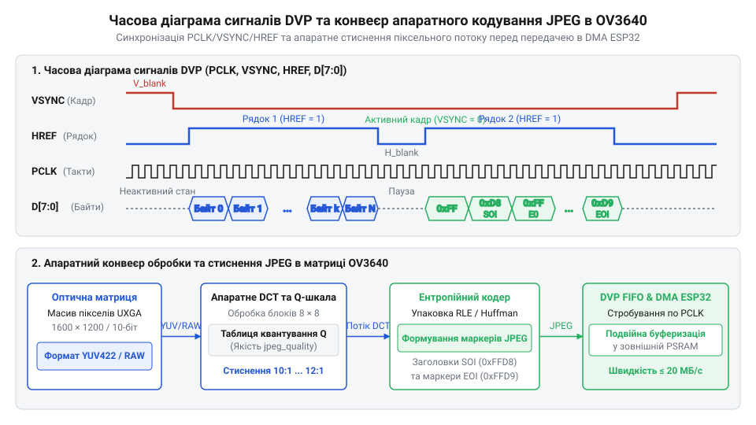
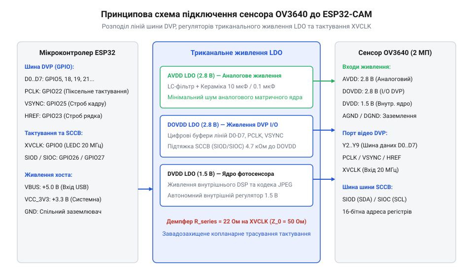
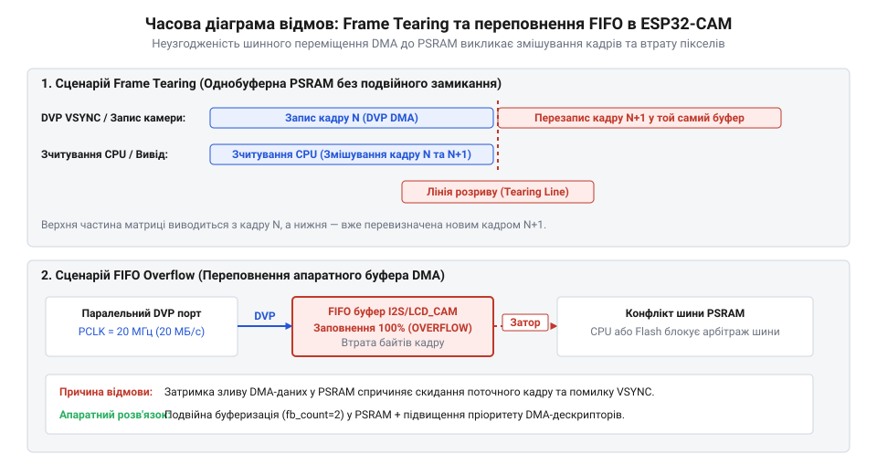
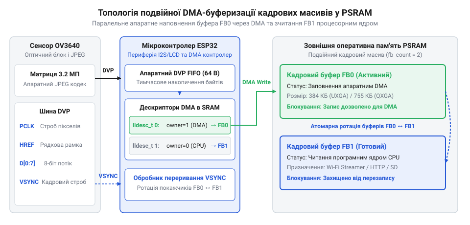

# ESP32-CAM з камерою OV3640 (2 МП)

<preknowlist>
- [ESP32-CAM (OV2640 + microSD)](root:cat-hw-boards/esp32-cam) — базова апаратна схема плат ESP32-CAM та підключення зовнішньої пам'яті PSRAM
- [Модуль ESP32-CAM: огляд архітектури, периферії та сімейства плат](root:cat-hw-boards/esp32-cam-camera-module-family) — периферійне цоколювання шини DVP та схема живлення сенсора камери
- [Мікроконтролер ESP32-S3](root:cat-hw-boards/esp32s3-microcontroller) — базові приналежності шин DMA та контролера периферії
</preknowlist>

## Апаратні обмеження відеозахоплення високої роздільності

При спробі обробити повнокадровий відеопотік роздільності `@@en|UXGA@@` (`1600 × 1200` пікселів) на компактному мікроконтролері головною перешкодою є обсяг нестисненого зображення. У форматі `@@en|RGB565@@` один кадр займає близько 3.66 МіБ, що перевищує обсяг внутрішньої оперативної пам'яті `@@en|SRAM@@` (англ. @@en|SRAM@@, від @@en|Static Random-Access Memory@@ — статична оперативна пам'ять), якою оснащена [плата ESP32-CAM](root:cat-hw-boards/esp32-cam). Передавання такого обсягу через повільні послідовні інтерфейси тривало б понад секунду, блокуючи процесорне ядро.

*Співвідношення між частотою тактування PCLK та апаратним стисненням JPEG у матриці OV3640.*

Розв’язанням є використання 2-мегапіксельного фотосенсора `@@en|OV3640@@` із накристальним апаратним кодеком `@@en|JPEG@@` (англ. @@en|JPEG@@, від @@en|Joint Photographic Experts Group@@). Апаратне стиснення зменшує розмір кадру у 25–70 разів (до 50–150 КіБ), дозволяючи транслювати потік через 8-бітну паралельну шину `@@en|DVP@@` (англ. @@en|DVP@@, від @@en|Digital Video Port@@) напряму у зовнішню псевдостатичну пам'ять `@@en|PSRAM@@` (англ. @@en|PSRAM@@, від @@en|Pseudo-Static RAM@@).

## Паралельний порт DVP та схема живлення

Паралельний цифровий відеопорт `@@en|DVP@@` використовує вісім ліній даних `D0`–`D7` та керовані сигнальні лінії: тактову частоту пікселів `PCLK` (англ. @@en|PCLK@@, від @@en|Pixel Clock@@), кадрову синхронізацію `VSYNC` та рядковий імпульс `HREF`. Опорне тактування камери задається сигналом `XVCLK` від мікроконтролера, що описано в [огляді сімейства ESP32-CAM](root:cat-hw-boards/esp32-cam-camera-module-family).

*Принципова схема підключення сигнальних ліній DVP та триканальних регуляторів LDO.*

Стабільність роботи матриці `@@en|OV3640@@` вимагає трьох незалежних ліній живлення: аналогової `AVDD` (2.8 В), цифрового ядра `DVDD` (1.5 В) та інтерфейсної `DOVDD` (2.8 В). Лінія `AVDD` є найчутливішою до шумів, тому її живлять через окремий малошумний регулятор `@@en|LDO@@` (англ. @@en|LDO@@, від @@en|Low-Dropout Regulator@@) із високим коефіцієнтом пригнічення пульсацій `@@en|PSRR@@`, підкріплений феритовим фільтром. Тактові лінії `PCLK` та `XVCLK` розводять копланарними провідниками з двостороннім земляним екрануванням для захисту від часового тремтіння `@@en|jitter@@`.

## Пропускна здатність та стиснення JPEG

При тактовій частоті `PCLK` 20 МГц паралельна шина `@@en|DVP@@` забезпечує пропускну здатність до 20 МБ/с. Обсяг кадру регулюється коефіцієнтом квантування `jpeg_quality` в апаратному кодеку камери.

*Схема часових розбіжностей зчитування кадрів, що викликають артефакти tearing та переповнення FIFO.*

Вибір малого значення `jpeg_quality` (5–12) забезпечує високу чіткість деталей, але збільшує ризик переповнення черги `@@en|FIFO@@` (англ. @@en|FIFO@@, від @@en|First In, First Out@@). Високі значення квантування (20–30) зменшують кадр, проте спричиняють блочні артефакти через відтинання високочастотних гармонік косинусного перетворення. Неузгодженість швидкості вибірки прямим доступом до пам'яті `@@en|DMA@@` (англ. @@en|DMA@@, від @@en|Direct Memory Access@@) призводить до зсуву рядків та виникнення графічного артефакту розриву кадру `@@en|tearing@@`.

## Подвійна буферизація та усунення артефактів

Для ліквідації розривів кадру в драйвері застосовують подвійну кадрову буферизацію (`fb_count = 2`) у зовнішній пам'яті `@@en|PSRAM@@`, як на [платах Waveshare ESP32-S3R2](root:cat-hw-boards/esp32-s3r2-waveshare). Контролер `@@en|DMA@@` заповнює один кадровий масив через ланцюжок дескрипторів `lldesc_t`, поки процесор зчитує другий масив для передавання по мережі.

*Схема топології подвійної DMA-буферизації кадрових масивів у зовнішній пам'яті PSRAM.*

Переключення драйвера в режим захоплення `CAMERA_GRAB_LATEST` гарантує отримання останнього цілісного кадру без затримок. При виникненні завад на довгих трасах зниження опорної частоти `xclk_freq_hz` до 10–12 МГц стабілізує тактування та забезпечує надійне захоплення відеопотоку на [мікроконтролерах ESP32-S3](root:cat-hw-boards/esp32s3-microcontroller).
