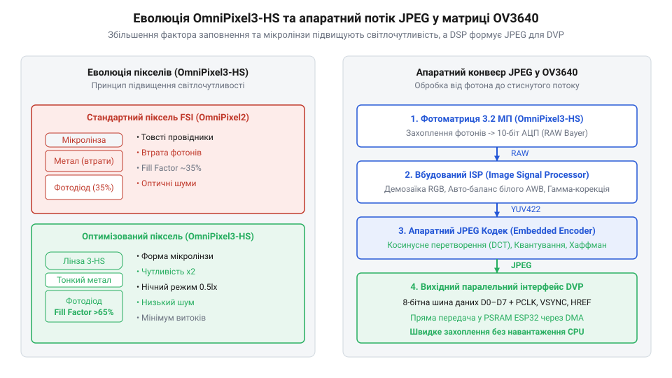
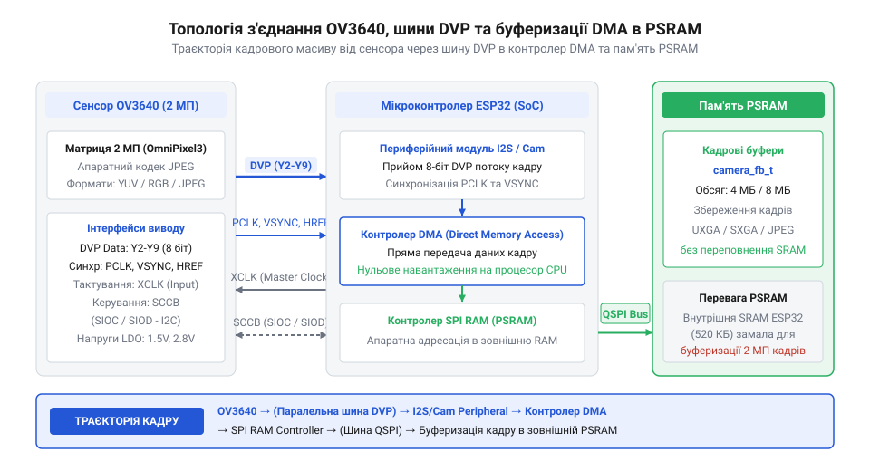

# Еволюція сенсорів OmniVision OV3640 та інтеграція з платами ESP32-CAM

<preknowlist>
- [ESP32-CAM (OV2640 + microSD)](root:cat-hw-boards/esp32-cam) — базова апаратна схема плат розробки ESP32-CAM та підключення зовнішнього кадрового буфера PSRAM
- [Модуль ESP32-CAM: огляд архітектури, периферії та сімейства плат](root:cat-hw-boards/esp32-cam-camera-module-family) — периферійне цоколювання шини DVP та схема розподілу живильних ліній LDO
</preknowlist>

## Зародження низькороздільної сенсорної обробки VGA

Розвиток портативної цифрової відеозахоплювальної техніки на початку 2000-х років зіштовхнувся з фундаментальним бар'єром технології напівпровідникових фотосенсорів `CMOS` (англ. @@en|CMOS@@, від @@en|Complementary Metal-Oxide-Semiconductor@@ — комплементарна структура метал-оксид-напівпровідник). Ранні сенсори компанії `OmniVision Technologies` (англ. @@en|OmniVision Technologies@@), такі як матриці роздільності `VGA` (англ. @@en|VGA@@, від @@en|Video Graphics Array@@ — відеографічна матриця, `640 × 480` пікселів), мали малий розмір світлочутливих пікселів та низький коефіцієнт заповнення (англ. @@en|fill factor@@). Через це значна частина площі силіцієвого кристала займалася не фотодіодами, а транзисторами зчитування й вибірки сигналів. У результаті матриці мали низьке співвідношення сигналу до шуму `SNR` (англ. @@en|SNR@@, від @@en|Signal-to-Noise Ratio@@) та низьку динамічну чутливість при слабкому освітленні.

Окрім фізичних обмежень самих піксельних осередків, застаріла топологія підсвічування з боку передньої грані `FSI` (англ. @@en|FSI@@, від @@en|Front-Side Illumination@@ — підсвічування з переднього боку) суттєво знижувала оптичну ефективність: металеві провідники та розводка шин живлення розміщувалися безпосередньо над силіцієвими фотодіодами, затіняючи світлочутливу область і відбиваючи значну частину падаючого фотонного потоку. Фізичний механізм виникнення поміх при такій малій площі фотодіода визначався квантовим дробовим шумом Шотткі (від англ. @@en|shot noise@@; @@en|дробовий шум Шотткі@@), зумовленим дискретною пуассонівською природою надходження фотонів (від англ. @@en|Poisson process@@; @@en|пуассонівський процес@@): флуктуація кількості зібраних електронів є пропорційною квадратній корінній залежності від їх загального числа, через що при мікроскопічній площі накопичення корисний сигнал швидко нівелювався квантовою невизначеністю світлового потоку. Через це ранні `VGA`-сенсори віддавали в шину нестиснений сирий масив даних у форматі `Bayer RAW` (англ. @@en|Bayer RAW@@) або `YUV422` (англ. @@en|YUV422@@) із високим рівнем зашумленості. Уся первинна обробка зображення — баланс білого, інтерполяція кольорів, гамма-корекція та усунення шумів — покладалася на зовнішній центральний процесор або виділений цифровий сигнальний процесор `DSP` (англ. @@en|DSP@@, від @@en|Digital Signal Processor@@). Для малопотужних вбудованих контролерів це створювало непідйомне обчислювальне навантаження. Постійне передавання нестиснених кадрових потоків через паралельні інтерфейси швидко виснажувало пропускну здатність системних шин і вимагало великого обсягу швидкої пам'яті `SRAM` (англ. @@en|SRAM@@, від @@en|Static Random-Access Memory@@). Поява складніших задач комп'ютерного зору зробила перехід до нової архітектури пікселів та накристальної обробки даних неминучим.

## Перехід до технології OmniPixel3-HS

Інженерним проривом у розв'язанні проблеми світлочутливості стало створення компанією `OmniVision` у 2007 році технології `OmniPixel3-HS` (англ. @@en|OmniPixel3-HS@@, де `HS` від @@en|High Sensitivity@@ — висока світлочутливість). Впровадження передової мікролінзової топології та зменшення паразитної ємності плаваючих вузлів зчитування дозволило удвічі підвищити ефективність збору фотонів на кожен піксель розміром `1.75 мкм`. Створений на цій базі 3.2-мегапіксельний сенсор `OV3640` (англ. @@en|OV3640@@) здатний формувати деталізовані кадри роздільності `UXGA` (`1600 × 1200`) та `QXGA` (`2048 × 1536`) із високою чіткістю при зниженому рівні цифрового шуму.

*_Порівняльна схема еволюції піксельних осередків OmniPixel3-HS та апаратного потоку стиснення JPEG у матриці OV3640._*

Найважливішим нововведенням матриці `OV3640` стала інтеграція апаратного кодека `JPEG` (англ. @@en|JPEG@@, від @@en|Joint Photographic Experts Group@@) безпосередньо на кристал сенсора. Математичною основою роботи кодека є двовимірне дискретно-косинусне перетворення `DCT` (англ. @@en|DCT@@, від @@en|Discrete Cosine Transform@@ — дискретно-косинусне перетворення): потік пікселів розбивається на блокові матриці 8 × 8, після чого кожен блок переводиться з просторового середовища у частотну область з виділенням постійної складової та високочастотних гармонік. Для регулювання рівня стиснення накристальний процесор обробляє отриману матрицю 8 × 8 через налаштовувану таблицю квантування (від англ. @@en|quantization table@@; @@en|таблиця квантування@@), де кожен коефіцієнт `DCT` ділиться на відповідне ділильне значення матриці квантування. Збільшення коефіцієнтів у ділянці високих просторових частот призводить до масового обнулення дрібних гармонік, що підвищує щільність подальшого ентропійного кодування Гаффмана та суттєво зменшує підсумковий обсяг кадру ціною незначної втрати високочастотних деталей сцени. Завдяки такому балансу між розміром даних і чіткістю картинки замість трансляції багатьох мегабайтів сирого масиву пікселів через паралельний цифровий відеопорт `DVP` (англ. @@en|DVP@@, від @@en|Digital Video Port@@) сенсор самостійно зменшує підсумковий обсяг кадру в десятки разів, що дало змогу підключати високоефективні сенсори до компактних мікроконтролерів, таких як [плата ESP32-CAM](root:cat-hw-boards/esp32-cam), де кадровий потік передається через прямий доступ до пам'яті `DMA` (англ. @@en|DMA@@, від @@en|Direct Memory Access@@) і буферизується у зовнішній псевдостатичній пам'яті `PSRAM` (англ. @@en|PSRAM@@, від @@en|Pseudo-Static RAM@@).

*_Топологія з'єднання сенсора OV3640 з мікроконтролером ESP32 через шину DVP та буферизації DMA в PSRAM._*

Узгодженість апаратного кодування `JPEG` із топологією периферії [сімейства плат ESP32-CAM](root:cat-hw-boards/esp32-cam-camera-module-family) та можливостями ядра чипа [ESP32-S3](root:cat-hw-boards/esp32s3-microcontroller) зробила сенсор `OV3640` бестселером для систем розпізнавання образів та вбудованого відеоспостереження.

## Інтеграція OV3640 із платами ESP32-CAM

Популярність модулів `OV2640` (2 МП) у складі стандартної [плати ESP32-CAM](root:cat-hw-boards/esp32-cam) згодом оголила обмеження чіткості для задач розпізнавання дрібних об'єктів та зчитування символів. Спільнота розробників звернула увагу на 3-мегапіксельну матрицю `OV3640` (англ. @@en|OV3640@@) як на пряму альтернативу для підвищення роздільності до `1600 × 1200` та `2048 × 1536` пікселів. Проте передавання повнокадрового відеопотоку такої роздільності вимагає екстремальної пропускної здатності паралельної 8-бітної шини `DVP` (англ. @@en|DVP@@, від @@en|Digital Video Port@@) із піковими частотами тактування `PCLK` (англ. @@en|PCLK@@, від @@en|Pixel Clock@@ — тактова частота пікселів) до `24 МГц`.

Внутрішня статична оперативна пам'ять `SRAM` мікроконтролера `ESP32` обмежена 520 КіБ, з яких під динамічний кадровий буфер доступно лише близько 300 КіБ. Нестиснений розпакований кадр `UXGA` вимагає понад 3.8 МБ пам'яті, що робить його обробку в `SRAM` неможливою. Вирішальну роль у компенсації шинних затримок та обмежень пам'яті відіграє прямий доступ до пам'яті @@en|DMA@@ (від англ. @@en|Direct Memory Access@@ — прямий доступ до пам'яті; @@en|DMA@@) у зв'язці із зовнішньою псевдостатичною оперативною пам'яттю @@en|PSRAM@@ (від англ. @@en|Pseudo-Static RAM@@ — псевдостатична оперативна пам'ять; @@en|PSRAM@@). Контролер @@en|DMA@@ без участі ядра процесора зчитує стиснені @@en|JPEG@@-пакети через шину @@en|DVP@@ і транзитом спрямовує їх у зовнішню @@en|PSRAM@@. Фізичною межею стабільності такої топології залишається швидкість послідовної шини @@en|SPI@@ (від англ. @@en|Serial Peripheral Interface@@ — послідовний периферійний інтерфейс; @@en|SPI@@) підключення @@en|PSRAM@@. Механізм виникнення фазового тремтіння або джитера (від англ. @@en|jitter@@ — фазове тремтіння тактового сигналу; @@en|джитер@@) на шині @@en|SPI@@ полягає в конкуренції за шинний арбітраж: коли каскадовані блоки @@en|DMA@@ одночасно виштовхують кадрові пакети у @@en|PSRAM@@, а процесорне ядро здійснює випадкове зчитування даних, виникають мікроскопічні затримки перемикання шини та паразитна фазова дефазировка прямокутних фронтів тактової лінії `SPI_CLK`. Це тремтіння порушує тривалість часу встановлення `setup time` та утримання `hold time` на лініях даних `SIO[0:3]`, викликаючи помилки зчитування байтів, спотворення заголовочних маркерів @@en|JPEG@@ та переповнення внутрішніх черг @@en|FIFO@@ (від англ. @@en|First In, First Out@@ — першим прийшов, першим вийшов; @@en|FIFO@@), через що при спробі перевищити частоту кадрів 15 кадр/с у роздільності `UXGA` неминуче виникає руйнування кадрової синхронізації. Додатково неузгодженість між частотою надходження кадрів від `DMA` та циклом оновлення осередків `PSRAM` викликає апаратний ефект тирінгу (від англ. @@en|tearing@@ — розрив кадру; `@@en|тирінг@@`). Коли прикладний процес обробки зчитує ділянку кадрового буфера в `PSRAM` у той самий момент, як контролер `DMA` асинхронно перезаписує нові піксельні строки без застосування подвійної буферизації, зчитувач отримує верхню частину нового кадру та нижню частину попереднього. Внаслідок цього на підсумковому зображенні утворюється чітка горизонтальна лінія зміщення. Ситуацію ускладнює те, що псевдостатична пам'ять вимагає періодичних пауз на внутрішню регенерацію заряду конденсаторів `tREF`. Під час такої паузи колізія між транзакцією `DMA` та циклом регенерації `PSRAM` призводить до тимчасового затору в шинному арбітрі, виклику переповнення `FIFO` та підсилення вираженості артефактів тирінгу на [стандартній платі ESP32-CAM](root:cat-hw-boards/esp32-cam).

## Розвінчання міфів про сумісність модулів

Зі зростанням популярності матриці `OV3640` серед інженерів поширився популярний міф про повну пінову та схемотехнічну взаємозамінність модулів `OV2640` і `OV3640` завдяки однаковому 24-контактному роз'єму `FPC` (англ. @@en|FPC@@, від @@en|Flexible Printed Circuit@@ — гнучка друкована плата). Однак пряма заміна модуля на стандартній платі `ESP32-CAM` часто призводить до фатальних збоїв ініціалізації по шині `I2C`/`SCCB` (англ. @@en|SCCB@@, від @@en|Serial Camera Control Bus@@) або повного виходу сенсора з ладу.

Причиною цього є суттєві розбіжності у схемотехніці триканального живлення та струмах споживання. Якщо сенсор `OV2640` живиться напругами `AVDD` (`2.8 В`), `DOVDD` (`2.8 В`) та `DVDD` (`1.2 В`), то матриця `OV3640` вимагає підвищеної напруги внутрішнього ядра `DVDD` на рівні `1.5 В`. Встановлені на платі лінійні регулятори `LDO` (від англ. @@en|Low Dropout Regulator@@ — регулятор напруги з малим падінням; @@en|LDO@@), розраховані на `1.2 В`, подають недостатню напругу для цифрового ядра `OV3640`, викликаючи невизначений стан внутрішнього завантажувача. Крім того, під час апаратного стиснення @@en|JPEG@@ 3-мегапіксельного кадру `OV3640` споживає пікові струми до `150–200 мА`, що перевищує навантажувальну спроможність базових регуляторів плати. При тривалому передаванні такого струму на лінійному регуляторі виникає значна потужність розсіювання через спад напруги `V_drop = V_in - V_out` (наприклад, `5 В - 1.5 В = 3.5 В`), яка сягає `P_diss = 3.5 В × 0.15 А = 0.525 Вт`. Через високий тепловий опір (англ. *thermal resistance*, від грец. *therme* — тепло та лат. *resistere* — чинити опір; @@en|тепловий опір@@) компактного корпусу `SOT-23` температура напівпровідникового кристала стрімко перевищує `150 °C`, спричиняючи фізичний процес теплового розгону та викликаючи спрацьовування апаратного захисту від перегріву (від англ. @@en|thermal shutdown@@ — теплове вимкнення; @@en|термозахист@@). Регулятор миттєво вимикає вихідну напругу `DVDD`, позбавляючи ядро камери живлення в середині кадру, що викликає апаратне зависання шини @@en|DVP@@ та циклічні перезавантаження мікроконтролера. Для утримання робочої температури напівпровідника `T_J_max` в межах безпечних `105 °C` при температурі довкілля `T_A` = `25 °C` розраховують гранично допустимий тепловий опір кристал-довкілля `θ_JA_max`:

        θ_JA_max
        = (T_J_max - T_A) ÷ P_diss   [формула граничного теплового опору]
        = (105 - 25) ÷ 0.525         [підстановка T_J_max = 105 °C, T_A = 25 °C, P_diss = 0.525 Вт]
        = 152.4 °C/Вт                [максимальний допустимий тепловий опір]

Ураховуючи власний тепловий опір кристала відносно корпусу `θ_JC` = `75.0 °C/Вт` для корпусу `SOT-23`, необхідний опір тепловідведення друкованої плати `θ_PCB` визначається як:

        θ_PCB
        = θ_JA_max - θ_JC            [віднімання опору корпус-кристал]
        = 152.4 - 75.0               [підстановка значення θ_JC = 75.0 °C/Вт]
        = 77.4 °C/Вт                 [необхідний опір мідного полігону]

Мінімальна площа суцільного мідного полігону `A_Cu` товщиною 35 мкм (1 oz), необхідна для розсіювання цієї потужності, обчислюється за співвідношенням:

        A_Cu
        = (50 ÷ θ_PCB)²              [емпірична формула теплового розсіювання міді]
        = (50 ÷ 77.4)²               [підстановка значення θ_PCB = 77.4 °C/Вт]
        = 0.42 см²                   [мінімальна площа полігону тепловідведення]

Сформований полігон площею не менше `0.42 см²` (`42 мм²`), з'єднаний із земляним виводом регулятора через теплові перехідні отвори, стабілізує тепловий режим корпусу `SOT-23`. Як розкрито в [огляді сімейства плат ESP32-CAM](root:cat-hw-boards/esp32-cam-camera-module-family), надійна інтеграція `OV3640` вимагає переконфігурування вихідних напруг `LDO`, розширення площі тепловідвідних мідних полігонів та застосування допрацьваної периферії [мікроконтролера ESP32-S3](root:cat-hw-boards/esp32s3-microcontroller).
