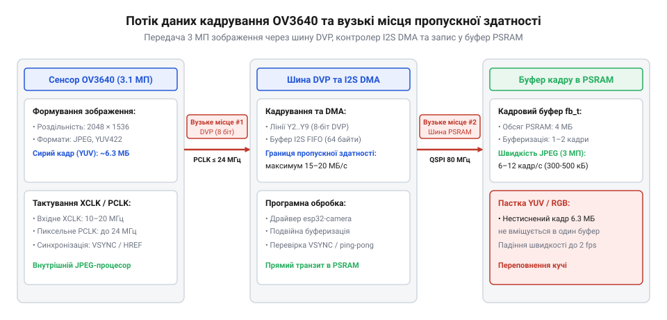
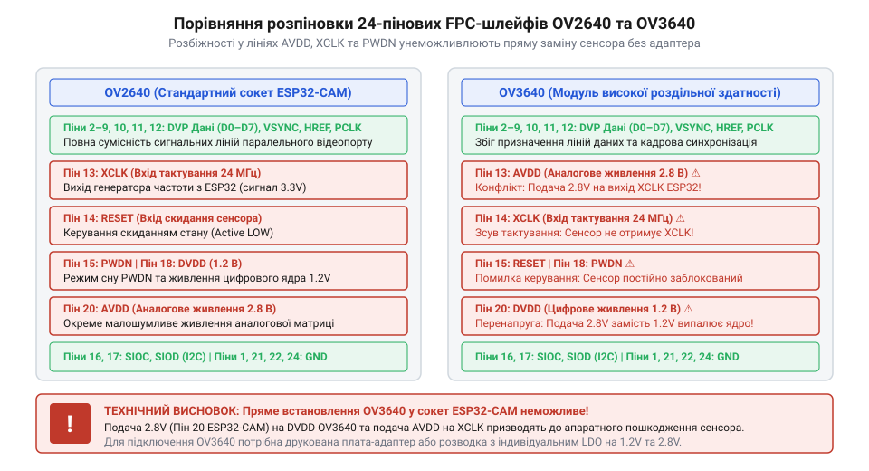

# Еволюція застосування сенсорів OV3640 у платах серії ESP32-CAM

<preknowlist>
- [ESP32-CAM (OV2640 + microSD)](root:cat-hw-boards/esp32-cam) — Конструкцію та схемотехніку базових плат ESP32-CAM на основі сенсора OV2640.
- [Модуль ESP32-CAM: огляд архітектури, периферії та сімейства плат](root:cat-hw-boards/esp32-cam-camera-module-family) — Принципи організації 8-бітної шини DVP та використання зовнішньої пам'яті PSRAM.
</preknowlist>

## Обмеження перших фотомодулів ESP32-CAM

Перші доступні платформи автономного відеозахоплення серії @@en|ESP32-CAM@@, які з'явилися на ринку близько 2018 року в розробках компанії @@en|Ai-Thinker@@, будувалися навколо застарілих оптичних матриць @@en|OV7670@@ роздільністю @@en|VGA@@ (640×480 пікселів) та 2-мегапіксельних сенсорів @@en|OV2640@@ (від англ. *@@en|OmniVision Sensor@@* — оптичний сенсор зображення компанії OmniVision). Хоча сенсор @@en|OV2640@@ дозволяв отримувати стаціонарні знімки з роздільністю 1600×1200 пікселів, застосування цих планок у реальних завданнях впиралося в низьку якість зображення. Матриця мала обмежений динамічний діапазон (англ. @@en|Dynamic Range@@ — співвідношення між найсвітлішим та найтемнішим ділянками кадру) та високий рівень власних шумів аналогово-цифрового перетворювача (англ. @@en|Analog-to-Digital Converter@@, @@en|ADC@@).

Головний недолік проявився під час спроб реалізації алгоритмів комп'ютерного зору на крайових пристроях (англ. @@en|Edge AI@@). Для завдань розпізнавання автомобільних номерних знаків, зчитування штрихкодів або детектування облич на відстані понад два метри роздільності 2-мегапіксельного кадру виявлялося недостатньо. Механізм виникнення оптичних аліасинг-артефактів на мікрокристалах сенсорів типу @@en|VGA@@ пояснюється обмеженням просторової частоти дискретизації: при фізичному розмірі фотодіода близько 3.0–3.6 мкм просторова частота Найквіста виявляється занадто низькою, і за відсутності оптичного фільтра низьких частот високі просторові частоти дрібних контурів дзеркально накладаються на низькі частоти. Через такий аліасинг (англ. @@en|aliasing@@ — спотворення спектра при дискретизації) на сітці пікселів виникали хибні муарові візерунки та драбинчасті краї, через що дрібні деталі зливалися в суцільні плями, а вузький динамічний діапазон призводив до засвічування деталей на сонці або повного затемнення в тіні. Масове поширення [класичної платформи ESP32-CAM](root:cat-hw-boards/esp32-cam) виявило гостру потребу ембеддед-інженерів у сенсорах вищого класу з підвищеною оптичною деталізацією.

## Перехід до 3 МП матриць OV3640

Відповіддю інженерів на обмеження перших планок став перехід до 3.15-мегапіксельного фотосенсора @@en|OV3640@@ оптичного формату 1/4 дюйма. Нова матриця формувала масив 2048×1536 пікселів, забезпечуючи приріст чіткості на 60% порівняно з @@en|OV2640@@. Проте підвищення деталізації висунуло суворі вимоги до апаратної пропускної здатності мікроконтролерного модуля. Для передачі відеопотоку використовувалася 8-бітна паралельна шина цифрового відеопорту @@en|DVP@@ (англ. @@en|Digital Video Port@@ — цифровий відеопорт), яка повинна була транслювати понад 3 мільйони пікселів на кожен кадр. У кодуванні RGB565 один неопрацьований кадр вимагав 6.29 мегабайта оперативної пам'яті.

*Схема потоку даних між сенсором OV3640, 8-бітною шиною DVP та буфером кадру в пам'яті PSRAM із позначенням вузьких місць пропускної здатності.*

Внутрішня статична пам'ять @@en|SRAM@@ мікроконтролера не могла вмістити такий обсяг даних, тому кадрові буфери розміщувалися у зовнішній псевдостатичній оперативній пам'яті @@en|PSRAM@@ (англ. @@en|Pseudo-Static RAM@@ — псевдостатична оперативна пам'ять). Головне апаратне вузьке місце полягало в затримках доступу через контролер управління пам'яттю (англ. @@en|Memory Management Unit@@, @@en|MMU@@): Під час транслювання кадрових блоків із шини DVP до квадро-шини @@en|SPI@@ контролер MMU транслює віртуальні адреси у фізичні сторінками по 64 кілобайти. Через послідовну 4-бітну передачу даних на частоті 40–80 МГц трансляція адрес та перезавантаження кеш-рядків MMU додають затримки у 12–20 тактів на кожну сторінкову межу, через що вхідний піксельний потік DVP переповнює внутрішні буфери DMA FIFO до того, як пам'ять встигає підтвердити запис. Зважаючи на цю обмежену швидкість передачі даних через квадро-шину @@en|SPI@@, інженерам довелося піти на компроміс: знизити пікову частоту кадрів (англ. @@en|Frame Rate@@) у повній роздільності до 6–8 кадрів на секунду або використовувати апаратний стискач @@en|JPEG@@ (англ. @@en|Joint Photographic Experts Group@@). Лише з появою 8-бітних шин пам'яті в [чипах ESP32-S3](root:cat-hw-boards/esp32s3-microcontroller) цей бар'єр було остаточно подолано. Специфіку організації кадрових буферів розкрито у довіднику з [архітектури сімейства ESP32-CAM](root:cat-hw-boards/esp32-cam-camera-module-family).

## Еволюція схемотехніки Ai-Thinker та Waveshare

Інтеграція сенсора @@en|OV3640@@ вимагала радикального перегляду схемотехніки друкованих плат. Початкові плати компанії @@en|Ai-Thinker@@ мали універсальний 24-піновий роз'єм під гнучкий плоский кабель @@en|FPC@@ (англ. @@en|Flexible Printed Circuit@@ — гнучкий печатний шлейф), де контури живлення цифрової та аналогової частин об'єднувалися. Сенсор @@en|OV3640@@ виявився надзвичайно чутливим до високочастотних завад: шум від роботи ядра мікроконтролера через спільний лінійний стабілізатор (англ. @@en|Low Dropout Regulator@@, @@en|LDO@@) напругою 2.8 В спричиняв появу регулярних горизонтальних смуг на зображенні (англ. @@en|fixed-pattern noise@@ — фіксований структурний шум).

*Схема порівняння розпіновки 24-пінових шлейфів FPC сенсорів OV2640 та OV3640 із виділенням розбіжностей у лініях живлення AVDD та тактування XCLK.*

Компанія @@en|Waveshare@@ та інші розробники удосконалили схемотехніку, виділивши для аналогового ядра сенсора `AVDD = 2.8 В` окремий малошумливий стабілізатор із високим коефіцієнтом пригнічення нестабільності живлення (англ. @@en|Power Supply Rejection Ratio@@, @@en|PSRR@@). Для цифрового ядра `DVDD = 1.5 В` та виводів введення-виведення `DOVDD = 2.8 В` застосували роздільні фільтрувальні ланцюги з керамічними конденсаторами. Ця схемотехнічна еволюція дозволила усунути спотворення сигналу й стала стандартом для наступних платформах, зокрема таких як [плата Waveshare ESP32-S3R2](root:cat-hw-boards/esp32-s3r2-waveshare) та високопродуктивних модулях на основі [чипа ESP32-S3](root:cat-hw-boards/esp32s3-microcontroller).

Ключовим критерієм успіху цієї схемотехнічної модернізації стало застосування лінійних стабілізаторів із високим коефіцієнтом пригнічення шуму живлення (@@en|PSRR@@) спеціально для аналогової лінії `AVDD`. У момент роботи бездротового передавача @@en|Wi-Fi@@ мікроконтролер ESP32 створює значні імпульсні кидки струму до 300–500 мА з частотою повторення сплесків у діапазоні від 100 кГц до кількох мегагерців. Бюджетні універсальні стабілізатори (наражаючись на обмеження внутрішнього підсилювача помилки) на частоті 100 кГц мають низький коефіцієнт @@en|PSRR@@ — не більше 20–30 дБ, через що пульсації живлення вільно проникають в аналогове ядро сенсора. Натомість спеціалізовані малошумливі регулятори забезпечують коефіцієнт @@en|PSRR@@ понад 60–75 дБ на низьких частотах та утримують високий рівень пригнічення понад 45–50 дБ на високих частотах при власному вихідному шумі нижче 30 мкВ (@@en|RMS@@, від англ. @@en|Root Mean Square@@ — середньоквадратичне значення). Ослаблення завад від мережевого радіопередавача у 100–1000 разів забезпечило стабільність аналогово-цифрового перетворення (@@en|ADC@@) сенсора @@en|OV3640@@ і стало обов'язковим стандартом, що висвітлює [огляд сімейства плат ESP32-CAM](root:cat-hw-boards/esp32-cam-camera-module-family).

## Подолання бар'єрів драйвера esp32-camera

Апаратне підключення оптичної матриці @@en|OV3640@@ зіткнулося з серйозними програмними викликами на рівні офіційного драйвера @@en|esp32-camera@@. Головним апаратним бар'єром стала стабілізація генерування опорної тактової частоти `XCLK` (від англ. *@@en|External Clock@@*, `XCLK` — опорна тактова частота сенсора). Для роботи матриці з роздільністю QXGA вимагався стабільний меандр частотою від 10 до 20 МГц, який у мікроконтролері @@en|ESP32@@ формувався широтно-імпульсним модулятором @@en|LEDC@@ (англ. @@en|LED Control@@). Найменші фазові дрижання (англ. @@en|jitter@@ — дрижання фази тактового сигналу) призводили до збоїв системного стробування кадрової синхронізації `VSYNC` та розсинхронізації рядків `HREF`.

Другою критичною проблемою став арбітраж оперативної пам'яті під час передачі даних прямого доступу @@en|DMA@@ (англ. *Direct Memory Access*, від *direct* — прямий, *memory* — пам'ять, *access* — доступ). Коли периферійний контролер зчитував пікселі з шини @@en|DVP@@ і паралельно записував їх у зовнішню пам'ять @@en|PSRAM@@ через квадро-шину @@en|SPI@@, виникав шинний конфлікт із ядрами процесора, що спричиняло пропуски системних байтів і артефакт розриву рядків (англ. @@en|line tearing@@ — зміщення фрагментів зображення по горизонталі). Інженери-розробники драйвера подолали цей бар'єр шляхом створення кругового кільцевого буфера — @@en|ring buffer@@ (від англ. @@en|ring buffer@@ — кільцевий буфер) у швидкій внутрішній оперативній пам'яті @@en|SRAM@@. Структура буфера складається з кількох зв'язаних дескрипторів, які почергово перемикаються за принципом пінг-понг: доки апаратне DMA-переривання заповнює поточний сегмент рядка з фотоматриці, сусідній готовий блок пакетно вивантажується в PSRAM без затримок шини. Алгоритм синхронізації прив'язаний до сигналів рядкової `HREF` та кадрової `VSYNC` стробації й атомарно перемикає біт володіння дескриптором, запобігаючи переповненню та гарантуючи цілісність зчитування даних. Опис взаємодії драйвера з кадровими буферами наведено в [огляді архітектури плат серії ESP32-CAM](root:cat-hw-boards/esp32-cam-camera-module-family).

## Міфи сумісності сокетів та вибір

Серед розробників вбудованих систем тривалий час існував міф про пряму взаємозамінність (англ. @@en|drop-in replacement@@ — встановлення компонентів у той самий роз'єм без зміни схеми) фотомодулів @@en|OV2640@@ та @@en|OV3640@@. Оскільки обидва модулі постачалися в схожих конструктивах із 24-піновим роз'ємом @@en|FPC@@, аматори намагалися просто переставити сенсор @@en|OV3640@@ у сокет стандартної плати. Проте така спроба призводила до виходу обладнання з ладу через принципові розбіжності розпіновки.

У шлейфах сенсорів @@en|OV2640@@ та @@en|OV3640@@ контакти аналогового живлення `AVDD`, цифрового ядра `DVDD`, а також лінії скидання `RESET` та виходу зі сплячого режиму `PWDN` розташовані на абсолютно різних ніжках роз'єму. Пряме підключення модуля @@en|OV3640@@ до неадаптованого сокета створює коротке замикання між лініями живлення та землею, що виводить з ладу лінійний стабілізатор або випалює вхідні буфери сенсора. Зокрема, на контакті, куди в сокеті @@en|OV2640@@ підведено аналогове живлення `AVDD` напругою 2.8 В, у розпіновці @@en|OV3640@@ знаходиться вхід скидання `RESET`. Подача напруги 2.8 В на цей вихід безпосередньо виходить за межі допусків цифрового ядра `DVDD` (1.5 В) та периферії `DOVDD` (1.8 В): аномальний струм через захисні діоди @@en|ESD@@ спричиняє ефект засуву (англ. @@en|latch-up@@) і тепловий пробій підзатворного оксиду CMOS-вентилів. Як наслідок, внутрішній контролер скидання матриці незворотно вигорає в момент першої ж спроби ініціалізації.

При виборі сенсора під власний embedded-проєкт варто керуватися практичними вимогами. Сенсор @@en|OV2640@@ лишається оптимальним рішенням для стримінгу відео у реальному часі (до 30 кадрів/с у роздільності VGA) та низького енергоспоживання на [базових платах серії ESP32-CAM](root:cat-hw-boards/esp32-cam). Натомість сенсор @@en|OV3640@@ є незамінним для завдань, що вимагають високої деталізації static-кадрів — розпізнавання дрібного тексту, OCR чи аналізу деталей у крайових системах комп'ютерного зору. Максимальний потенціал матриці @@en|OV3640@@ розкривається на сучасних платах типу [Waveshare ESP32-S3R2](root:cat-hw-boards/esp32-s3r2-waveshare) або пристроях на основі [чипа ESP32-S3](root:cat-hw-boards/esp32s3-microcontroller), де висока обчислювальна потужність і розширена шина пам'яті нівелюють апаратні обмеження минулих поколінь.
