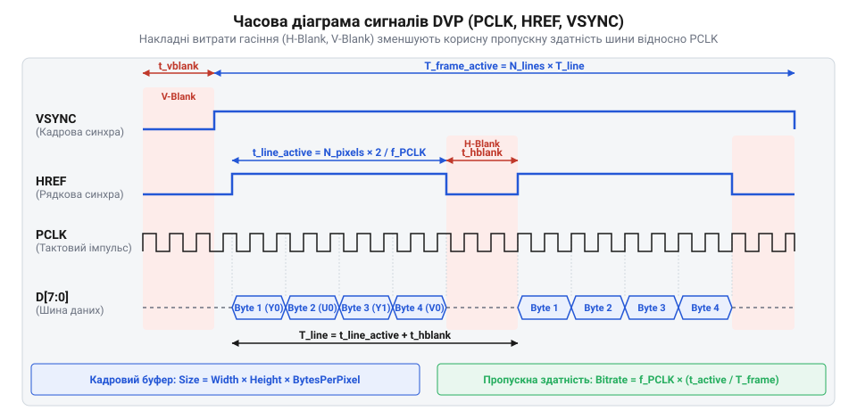

# Розрахунок пропускної здатності шини DVP, обсягів кадрових буферів та частоти кадрів (FPS)

<preknowlist>
- [ESP32-CAM (OV2640 + microSD)](root:cat-hw-boards/esp32-cam) — апаратна організація модуля ESP32-CAM, підключення сенсора камери та робота з PSRAM
- [Модуль ESP32-CAM: огляд архітектури, периферії та сімейства плат](root:cat-hw-boards/esp32-cam-camera-module-family) — архітектурні особливості контролера DVP/LCD камери та розподіл виводів GPIO
- [Мікроконтролер ESP32-S3](root:cat-hw-boards/esp32s3-microcontroller) — структура внутрішньої пам'яті SRAM, шини DMA та підключення зовнішньої PSRAM
</preknowlist>

## Вузькі місця передачі відеопотоку ESP32

Під час спроби захоплення та трансляції відеопотоку високої роздільності на [популярній платі ESP32-CAM](root:cat-hw-boards/esp32-cam) розробники часто зіштовхуються з розривами кадрів, горизонтальними зсувами рядків або повним випаданням зображення. Причина полягає у фізичній природі паралельного шинного інтерфейсу `@@en|DVP@@` (від @@en|Digital Video Port@@, англ. *digital* — цифровий, *video* — відео, *port* — порт). На відміну від послідовних пакетних протоколів, шина `@@en|DVP@@` працює безупинно та синхронно з піксельним тактуванням `@@en|PCLK@@` (від @@en|Pixel Clock@@, англ. *pixel* — піксель, *clock* — тактування). Сенсор камери не має власного обсягу пам'яті для затримки кадрів і надсилає піксельні байти у строго визначені часові інтервали.

Приймання потоку з камери в мікроконтролері здійснює спеціалізований периферійний контролер, який передає байти у внутрішній апаратний буфер `@@en|FIFO@@` (від @@en|First In First Out@@, англ. *first* — перший, *in* — вхід, *out* — вихід). Звідти контролер прямого доступу до пам'яті `@@en|DMA@@` (від @@en|Direct Memory Access@@, англ. *direct* — прямий, *memory* — пам'ять, *access* — доступ) перенаправляє потік у системну оперативну пам'яті. Тут виникає фундаментальне апаратне обмеження: внутрішня статична пам'ять `@@en|SRAM@@` (від @@en|Static RAM@@, англ. *static* — статичний) забезпечує високу швидкість запису, але її доступний обсяг у мікроконтролері ESP32 обмежений приблизно 300 КБ. Наприклад, один несжиманий кадр роздільності `@@en|UXGA@@` (від @@en|Ultra Extended Graphics Array@@) 1600×1200 у колірному форматі RGB565 потребує `1600 · 1200 · 2 = 3840000` Б (~3.66 МБ), що вдвічі перевищує увесь фізичний обсяг `@@en|SRAM@@` мікроконтролера.

Для зберігання таких обсягів даних використовують зовнішню псевдостатичну пам'ять `@@en|PSRAM@@` (грец. *pseudes* — несправжній, англ. *static* — статичний). Сучасніший [мікроконтролер серії ESP32-S3](root:cat-hw-boards/esp32s3-microcontroller) підтримує швидшу шину `@@en|Octal-SPI@@` (від @@en|Octal Serial Peripheral Interface@@, грец. *okto* — вісім), проте на більшості класичних плат `@@en|PSRAM@@` підключена через чотирьохбітну шину `@@en|Quad-SPI@@` (від @@en|Quad Serial Peripheral Interface@@, лат. *quattuor* — чотири). Фізична пропускна здатність такої шини на частоті 80 МГц становить 40 МБ/с, однак реальна швидкість безперервного запису для `@@en|DMA@@` не перевищує 15–20 МБ/с через арбітраж шини, накладні витрати команд `@@en|SPI@@`, арбітраж із ядрами процесора та циклічне регенераційне оновлення комірок `@@en|PSRAM@@`.

Якщо вхідний потік даних із шини `@@en|DVP@@` на високій частоті `@@en|PCLK@@` перевищує реальну швидкість запису в `@@en|PSRAM@@`, апаратний буфер `@@en|FIFO@@` контролера `@@en|DMA@@` переповнюється за лічені мікросекунди. Це призводить до втрати байтів, викривлення `@@en|JPEG@@`-заголовків та руйнування цілісності відеопотоку. Детальніше апаратну структуру та [архітектурні особливості ESP32-CAM](root:cat-hw-boards/esp32-cam-camera-module-family) висвітлено в оглядових матеріалах. Щоб відвернути втрату даних і встановити межі стабільної роботи системи, необхідно побудувати сувору математичну модель пропускної здатності шини та буферизації.

## Математична модель пропускної здатності DVP

Передача відеокадру через паралельну шину `@@en|DVP@@` описується строгими часовими співвідношеннями між активними пікселями та інтервалами гасіння. Будь-який кадр має геометричну роздільність: ширину `W` (кількість пікселів у рядку) та висоту `H` (кількість рядків у кадрі). Кожен піксель кодується `B_{pixel}` байтами: для несжиманих форматів RGB565 та YUV422 значення `B_{pixel} = 2` Б/піксель.

Синхронізація обміну здійснюється трьома основними сигналами:
- `@@en|PCLK@@`: тактовий сигнал, де кожен імпульс передає 1 byte даних по 8-бітній паралельній шині. Для передачі одного пікселя у форматі RGB565 потрібно 2 тактові імпульси `@@en|PCLK@@`.
- `@@en|HREF@@` (від @@en|Horizontal Reference@@, англ. *horizontal* — горизонтальний, *reference* — орієнтир): сигнал активного стану рядка. Під час паузи між рядками (`@@en|HREF@@` у низькому рівні) відбувається горизонтальне гасіння тривалістю `H_{blank}` еквівалентних байтових тактів.
- `@@en|VSYNC@@` (від @@en|Vertical Synchronization@@, англ. *vertical* — вертикальний, *synchronization* — синхронізація): сигнал кадрової синхронізації. Пауза між кадрами утворює вертикальне гасіння тривалістю `V_{blank}` рядків.


*Часова діаграма сигналів PCLK, HREF та VSYNC шини DVP з демонстрацією передачі піксельних байтів та інтервалів гасіння.*

Визначимо загальну кількість байтових тактів `N_{bytes\_line}`, необхідних для передачі одного повного рядка з урахуванням гасіння:
`N_{bytes\_line} = W · B_{pixel} + H_{blank}`

Загальна кількість рядків у циклі передачі кадру `L_{frame}` з урахуванням кадрового гасіння становить:
`L_{frame} = H + V_{blank}`

Тоді повний обсяг байтових тактів `N_{bytes\_frame}`, що витрачаються на один кадр, описується виразом:
`N_{bytes\_frame} = (W · B_{pixel} + H_{blank}) · (H + V_{blank})`

При заданій частоті піксельного тактування `PCLK` (Гц) загальний час передачі одного кадру `T_{frame}` (секунд) дорівнює:
`T_{frame} = N_{bytes\_frame} / PCLK`

Під час активного стану `@@en|HREF@@` шина передає дані з піковою швидкістю `R_{peak} = PCLK` Б/с. Проте реальне навантаження на систему визначається середньою пропускною здатністю `R_{avg}` (Б/с).

Обчислимо середню пропускну здатність шини `R_{avg}` як відношення корисного обсягу байтів кадру до повного часу його передачі:
```
R_{avg} = V_{active} / T_{frame}
= (W · H · B_{pixel}) / (N_{bytes\_frame} / PCLK)      [заміна T_{frame} через загальну кількість байтів]
= PCLK · (W · H · B_{pixel}) / ((W · B_{pixel} + H_{blank}) · (H + V_{blank}))      [перегрупування множників]
= PCLK · η_{timing}      [визначення коефіцієнта ефективності шини]
```
Вираз показує, що середня швидкість потоку даних прямо пропорційна частоті тактування `PCLK` та коефіцієнту ефективності часової діаграми `η_{timing}`, який враховує накладні витрати на інтервали гасіння.

**Розрахунок потоку даних для роздільності VGA у форматі RGB565**
Приймемо активну роздільність `W = 640` пікселів, `H = 480` рядків, формат RGB565 (`B_{pixel} = 2` Б/піксель).
Частота піксельного тактування `PCLK = 20 МГц` (20 000 000 Гц).
Накладні витрати гасіння: `H_{blank} = 160` Б на рядок, `V_{blank} = 20` рядків на кадр.

```
V_{active} = 640 · 480 · 2
= 614400 Б      [обчислення обсягу корисних даних кадру]

N_{bytes\_line} = 640 · 2 + 160
= 1440 Б      [обчислення повної тривалості рядка в байтах]

L_{frame} = 480 + 20
= 500 рядків      [обчислення повної кількості рядків у кадрі]

N_{bytes\_frame} = 1440 · 500
= 720000 Б      [обчислення загального обсягу циклу кадру]

T_{frame} = 720000 / 20000000
= 0.036 с      [обчислення тривалості одного кадру]

R_{avg} = 614400 / 0.036
= 17066667 Б/с ≈ 17.07 МБ/с      [обчислення середньої пропускної здатності]
```
Висновок: при піковій швидкості шини 20 МБ/с середня пропускна здатність становить 17.07 МБ/с завдяки коефіцієнту ефективності часової діаграми `η_{timing} = 614400 / 720000 = 0.8533` (85.33%).

Для стисненого потоку `@@en|JPEG@@`, який формується безпосередньо в сенсорі (наприклад, [сенсорі зображення OV2640](root:cat-hw-sensors/ov2640-image-sensor)), середня швидкість `R_{jpeg\_avg}` зменшується пропорційно коефіцієнту стиснення `K_{comp}`:
`R_{jpeg\_avg} = R_{raw\_avg} / K_{comp}`.

## Розрахунок кадрових буферів та PSRAM

Після обчислення бітрейту шини `@@en|DVP@@` наступним кроком є розрахунок обсягу оперативної пам'яті, необхідного для розміщення кадрових буферів. Обсяг пам'яті для одного несжиманого кадру `V_{frame}` обчислюється як прямий добуток графічних вимірів на глибину кодування:
`V_{frame} = W · H · B_{pixel}`

Зі збільшенням роздільної здатності обсяг кадрового буфера зростає квадратично:
- `@@en|VGA@@` (640×480, RGB565): `640 · 480 · 2 = 614400` Б (600 КБ).
- SVGA (800×600, RGB565): `800 · 600 · 2 = 960000` Б (937.5 КБ).
- HD (1280×720, RGB565): `1280 · 720 · 2 = 1843200` Б (1.758 МБ).
- `@@en|UXGA@@` (1600×1200, RGB565): `1600 · 1200 · 2 = 3840000` Б (3.662 МБ).

Оскільки внутрішня пам'ять `@@en|SRAM@@` спроможна вмістити лише невеликі кадри (наприклад, QVGA 320×240 обсягом 153.6 КБ у режимі подвійної буферизації), усі несжимані кадри від SVGA і вище мусять повністю розміщуватися у зовнішній `@@en|PSRAM@@`.

У разі передачі стисненого потоку `@@en|JPEG@@` реальний розмір кадру `V_{jpeg}` не є постійним — він динамічно змінюється залежно від деталізації сцени та параметрів таблиць квантування:
`V_{jpeg} = V_{raw} / K_{comp}`

Оскільки система зобов'язана виділити статичний буфер пам'яті `S_{buf}` у `@@en|PSRAM@@` до початку прийому кадру, виникає ризик переповнення: якщо деталізація кадру виявиться занадто високою, коефіцієнт стиснення `K_{comp}` впаде, і розмір `V_{jpeg}` перевищить `S_{buf}`.

Виведемо мінімально припустимий коефіцієнт стиснення `K_{comp\_min}`, за якого стиснений кадр гарантовано вміститься у виділений буфер пам'яті `S_{buf}`:
```
V_{jpeg} ≤ S_{buf}
V_{raw} / K_{comp} ≤ S_{buf}      [заміна V_{jpeg} виразом через коефіцієнт стиснення]
K_{comp} ≥ V_{raw} / S_{buf}      [множення на K_{comp} та ділення на S_{buf}]
K_{comp\_min} = (W · H · B_{raw}) / S_{buf}      [визначення граничного значення]
```
Формула встановлює критичний поріг стиснення: якщо реальний коефіцієнт стиснення `K_{comp}` виявиться меншим за `K_{comp\_min}`, розмір стисненого кадру перевищить виділений обсяг буфера.

**Розрахунок мінімального стиснення JPEG для кадру UXGA при виділеному буфері 256 КБ**
Вхідні дані: роздільність `@@en|UXGA@@` (`W = 1600`, `H = 1200`), вхідний формат YUV422 (`B_{raw} = 2` Б/піксель).
Обсяг виділеного буфера у `@@en|PSRAM@@`: `S_{buf} = 256 КБ = 262144 Б`.

```
V_{raw} = 1600 · 1200 · 2
= 3840000 Б      [обчислення розміру несжиманого кадру]

K_{comp\_min} = 3840000 / 262144
= 14.6484 ≈ 14.65      [обчислення мінімального коефіцієнта стиснення]
```
Висновок: щоб кадр `@@en|UXGA@@` гарантовано вмістився у буфер 256 КБ, апаратний кодер камери повинен забезпечити коефіцієнт стиснення не менше 14.65. Якщо через високу деталізацію сцени коефіцієнт знизиться до 10, розмір кадру становитиме `3840000 / 10 = 384000 Б` (375 КБ), що призведе до переповнення виділеного буфера та втрати частини кадру.

## Обмеження DMA та обчислення FPS

Навіть якщо обсяг кадрового буфера розраховано правильно, кінцева частота кадрів `@@en|FPS@@` (від @@en|Frames Per Second@@, англ. *frames* — кадри, *per* — за, *second* — секунда) обмежується механізмом дескрипторів `@@en|DMA@@` та швидкістю запису у [інтерфейсі QSPI PSRAM](root:com-devices/qspi-psram-interface).

Контролер `@@en|DMA@@` в ESP32 приймає потік байтів і записує їх у пам'ять за допомогою зв'язаного списку дескрипторів (`@@en|descriptor@@`, англ. *describe* — описувати). Кожен дескриптор вказує на суцільний блок пам'яті фіксованого розміру `S_{dma\_node}`. Через апаратні обмеження DMA-контролера ESP32 максимальна місткість одного вузла становить 4095 байтів (на практиці вирівнюється до 4064 або 4000 байтів).

Визначимо кількість `@@en|DMA@@`-дескрипторів `N_{desc}`, необхідних для буферизації одного кадру:
```
N_{desc} = ⌈ V_{frame\_max} / S_{dma\_node} ⌉      [округлення до більшого цілого]
```
Кожен дескриптор містить вказівник на наступний вузол списку, прапори переривань та адресу буфера в пам'яті.

При використанні подвійної буферизації (режим Ping-Pong) контролер `@@en|DMA@@` заповнює один кадр, поки процесор або мережевий стек обробляє інший. Проте швидкість запису обмежується фізичною шиною `@@en|PSRAM@@`.

Апаратний час видачі кадру сенсором `T_{sensor}` становить:
`T_{sensor} = N_{bytes\_frame} / PCLK`
Відповідно, максимальна теоретична частота кадрів сенсора дорівнює `FPS_{sensor} = 1 / T_{sensor}`.

Час, необхідний контролеру для запису кадру у `@@en|PSRAM@@` зі швидкістю `R_{psram\_write}`, становить:
`T_{psram} = V_{frame} / R_{psram\_write}`

Обчислимо підсумковий період кадру `T_{total}` з урахуванням апаратних затримок сенсора та шини пам'яті:
```
T_{total} = max(T_{sensor}, T_{psram}) + T_{overhead}      [визначення лімітуючої ланки]
FPS_{real} = 1 / T_{total}      [обчислення реальної частоти кадрів]
```
Якщо `T_{psram} > T_{sensor}`, система виявляється обмеженою швидкістю запису в `@@en|PSRAM@@`, і перевищення `PCLK` лише спричиняє переповнення `@@en|DMA@@`-буферів, а не підвищує `@@en|FPS@@`.

**Обчислення граничного FPS для кадру SVGA RGB565 на платі ESP32 з Quad-SPI PSRAM**
Вхідні дані: Роздільність SVGA (`W = 800`, `H = 600`), RGB565 (`B_{pixel} = 2` Б/піксель).
Розмір кадру: `V_{frame} = 800 · 600 · 2 = 960000 Б` (937.5 КБ).
Гасіння: `H_{blank} = 200` Б, `V_{blank} = 25` рядків.
Сумарний обсяг циклу: `N_{bytes\_frame} = (800 · 2 + 200) · (600 + 25) = 1800 · 625 = 1125000 Б`.
Частота тактування: `PCLK = 20 МГц` (20 000 000 Гц).
Дійсна швидкість запису в Quad-SPI `@@en|PSRAM@@`: `R_{psram\_write} = 16 МБ/с = 16000000 Б/с`.
Накладні витрати `@@en|DMA@@` та переключення буферів: `T_{overhead} = 0.002 с` (2 мс).

```
T_{sensor} = 1125000 / 20000000
= 0.05625 с      [обчислення часу видачі кадру сенсором]

FPS_{sensor} = 1 / 0.05625
= 17.78 кадр/с      [обчислення частоти кадрів сенсора]

T_{psram} = 960000 / 16000000
= 0.06000 с      [обчислення часу запису кадру в PSRAM]

T_{total} = max(0.05625, 0.06000) + 0.002
= 0.06000 + 0.002
= 0.06200 с      [обчислення підсумкового періоду кадру]

FPS_{real} = 1 / 0.06200
= 16.13 кадр/с      [обчислення реальної частоти кадрів]
```
Висновок: Швидкість запису в `@@en|PSRAM@@` (`T_{psram} = 60 мс`) є вузьким місцем порівняно зі швидкістю сенсора (`T_{sensor} = 56.25 мс`). Реальний кадрейт становить 16.13 `@@en|FPS@@`. Для стабільної роботи без втрат даних слід знизити `PCLK` до 16 МГц або використовувати стиснення `@@en|JPEG@@`. Для досягнення вищої частоти кадрів у роздільності `@@en|UXGA@@` або недопущення втрат рекомендується використовувати чипи з підтримкою вищих швидкостей шини, як-от [мікроконтролер ESP32-P4](root:cat-hw-boards/esp32-p4-microcontroller) із вбудованими інтерфейсами MIPI CSI та високою пропускною здатністю пам'яті.
