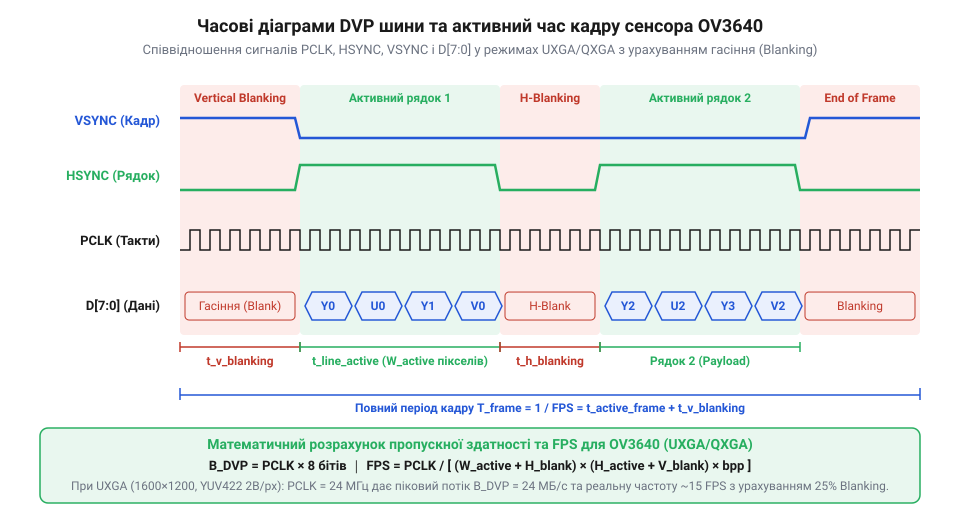
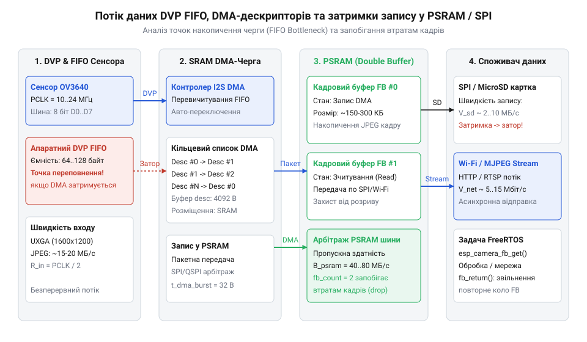

# Розрахунок пропускної здатності шини DVP та затримок DMA-буферизації для OV3640

<preknowlist>
- [ESP32-CAM (OV2640 + microSD)](root:cat-hw-boards/esp32-cam) — Розуміння апаратного влаштування модуля ESP32-CAM, підключення камери та використання зовнішньої PSRAM.
- [Модуль ESP32-CAM: огляд архітектури, периферії та сімейства плат](root:cat-hw-boards/esp32-cam-camera-module-family) — Знання архітектурних особливостей DVP-інтерфейсу, роботи шини даних та організації DMA-контролера ESP32.
</preknowlist>

## Пропускна здатність DVP та частота PCLK

При захопленні потокового відео високої роздільності від 3-мегапіксельного оптичного сенсора @@en|OV3640@@ за допомогою плати [модуля ESP32-CAM](root:cat-hw-boards/esp32-cam) виникає фізичне обмеження швидкості передавання даних через 8-бітну паралельну шину @@en|DVP@@ (від англ. @@en|Digital Video Port@@ — цифровий відеопорт; @@en|DVP@@). Кожен байт зображення синхронізується стробуючим імпульсом піксельного тактування `PCLK` (від англ. @@en|Pixel Clock@@ — піксельний тактовий сигнал; `PCLK`). У нестиснутих форматах @@en|RGB565@@ або @@en|YUV422@@ один піксель формується двома послідовними байтами, що вимагає двох тактів `PCLK` на піксель, тоді як у режимі апаратного стиснення @@en|JPEG@@ сенсор передає вже упакований потік байтів, де кожен такт `PCLK` відповідає одному байту стиснутого потоку.

*Схема часових діаграм PCLK, HSYNC, VSYNC та паралельних даних DVP з урахуванням інтервалів гасіння кадру.*

Окрім активних пікселів кадру роздільності `W × H`, часовий цикл передавання включає інтервали горизонтального гасіння `H_blank` (строб @@en|HSYNC@@) та вертикального гасіння `V_blank` (строб @@en|VSYNC@@), необхідні для внутрішньої синхронізації матриці сенсора. Загальна кількість тактів `T_frame`, необхідна для формування одного кадру, визначається добутком повних розмірів матриці з урахуванням гасіння на кількість байтів на піксель `N_bytes`. Перед обчисленням частоти кадрів визначаємо загальну кількість тактів за формулою:

    T_frame
    = (W + H_blank) × (H + V_blank) × N_bytes      [загальна кількість тактів PCLK на кадр]
    = (1600 + 200) × (1200 + 40) × 1              [підстановка параметрів UXGA JPEG]
    = 1800 × 1240 × 1                             [обчислення еквівалентної сітки кадру]
    = 2 232 000                                   [загальна кількість тактів PCLK на кадр]

Гранична частота кадрів `FPS` при заданій тактовій частоті `f_PCLK` обчислюється як відношення частоти тактування до загальної кількості тактів кадру:

    FPS
    = f_PCLK / T_frame                             [визначення граничної частоти кадрів]
    = 20 000 000 / 2 232 000                       [підстановка f_PCLK = 20 МГц]
    ≈ 8.96                                         [теоретична частота кадрів UXGA у кадр/с]

При збільшенні роздільності до @@en|QXGA@@ (`2048 × 1536`) із тими самими відносними інтервалами гасіння загальний обсяг тактів зростає до `T_frame = (2048 + 250) × (1536 + 50) × 1 = 3 644 544` тактів, що при `f_PCLK = 20 МГц` знижує максимальну частоту кадрів до `5.49 кадр/с`. Пропускна здатність паралельної шини при цьому сягає пікового значення `B_peak = f_PCLK × W_bus / 8 = 20 МГц × 8 біт / 8 = 20 МБ/с`, що вимагає безперервного апаратного захоплення периферійним блоком мікроконтролера без пропуску тактових імпульсів.

Для забезпечення стабільної передачі без апаратних збоїв периферії ESP32 часто виникає потреба у зниженні частоти тактування (від англ. @@en|downclocking@@; @@en|зниження частоти тактування@@) піксельного сигналу `PCLK` та зміні коефіцієнта пропорційності кадру (від англ. @@en|aspect ratio@@; @@en|коефіцієнт пропорційності кадру@@) з 4:3 на 16:9 для зменшення загального обсягу тактів. Розглянемо приклад обчислення для роздільності `1280 × 720` (`@@en|HD@@`) з інтервалами гасіння `H_blank = 160` та `V_blank = 30` тактів у режимі `@@en|JPEG@@` (`N_bytes = 1`):

    T_frame
    = (W + H_blank) × (H + V_blank) × N_bytes      [загальна кількість тактів PCLK на кадр]
    = (1280 + 160) × (720 + 30) × 1                [підстановка параметрів 16:9 HD JPEG]
    = 1440 × 750 × 1                               [обчислення сітки кадру 16:9]
    = 1 080 000                                    [загальна кількість тактів PCLK на кадр]

Для забезпечення цільової частоти `FPS = 10 кадр/с` розраховуємо необхідне стабільне значення частоти `f_PCLK`:

    f_PCLK
    = FPS × T_frame                                [формула тактової частоти PCLK]
    = 10 × 1 080 000                               [підстановка FPS = 10 кадр/с]
    = 10 800 000                                   [необхідна тактова частота у Гц]
    = 10.8 МГц                                     [стабільне значення частоти PCLK]

Зниження частоти `f_PCLK` до 10.8 МГц зменшує пікову пропускну здатність шини DVP до `10.8 МБ/с`, що пропорційно знижує навантаження на внутрішню шину шинної периферії [архітектури ESP32-CAM](root:cat-hw-boards/esp32-cam-camera-module-family) і повністю усуває переповнення шинного буфера DMA.

## Оцінка коефіцієнта стиснення та розміру JPEG

Незжиманий кадр роздільності @@en|UXGA@@ (`1600 × 1200`) у форматі @@en|RGB565@@ вимагає `S_raw = 1600 × 1200 × 2 = 3 840 000 байтів` (3.66 МБ), що значно перевищує доступний обсяг внутрішньої статичної оперативної пам'яті @@en|SRAM@@ (від англ. @@en|Static RAM@@ — статична оперативна пам'ять; @@en|SRAM@@) мікроконтролера `ESP32` (близько 520 КБ). Застосування вбудованого в сенсор `OV3640` кодера @@en|JPEG@@ зменшує обсяг даних у `K_comp` разів, де коефіцієнт стиснення залежить від обраного фактора якості квантування `Q` та ентропійної складності оптичної сцени.

Для надійного виділення пам'яті та запобігання виходу за межі буфера необхідно обчислювати найгірший випадок розміру стиснутого кадру `S_jpeg_max`. За умов високої деталізації сцени та мінімального стиснення (`Q = 80..90`) мінімальний коефіцієнт стиснення становить `K_comp_min ≈ 10..12`. Оцінка максимального обсягу кадру обчислюється через відношення розміру сирого кадру до коефіцієнта стиснення:

    S_jpeg_max
    = S_raw / K_comp_min                          [формула оцінки стиснутого кадру]
    = 3 840 000 / 10                              [підстановка нестиснутого обсягу UXGA та K_comp_min]
    = 384 000                                     [максимальний оціночний розмір кадру в байтах]

При роботі з роздільністю @@en|QXGA@@ (`2048 × 1536`) сирий обсяг сягає `S_raw = 2048 × 1536 × 2 = 6 291 456 байтів` (6.00 МБ). При аналогічному коефіцієнті стиснення `K_comp_min = 10` максимальний розмір стиснутого кадру становить:

    S_jpeg_max
    = 6 291 456 / 10                              [підстановка сирого обсягу QXGA]
    = 629 145                                     [найгірший випадок розміру кадру QXGA в байтах]

З урахуванням можливих бурстових сплесків ентропії та накладних заголовочних блоків `EXIF`/`JFIF` розмір виділеного кадрового буфера у зовнішній псевдостатичній пам'яті @@en|PSRAM@@ (від англ. @@en|Pseudo Static RAM@@ — псевдостатична оперативна пам'ять; @@en|PSRAM@@) повинен мати резервний запас не менше 20%. Отже, мінімальний обсяг PSRAM-буфера для зберігання одного кадру `QXGA` становить `S_buff = 629 145 × 1.20 ≈ 755 КБ`, що підтверджує критичну необхідність використання зовнішньої пам'яті, як описано в [огляді архітектури ESP32-CAM](root:cat-hw-boards/esp32-cam-camera-module-family).

Крім того, критичне динамічне розбухання буфера (від англ. @@en|buffer expansion@@; @@en|розбухання буфера@@) відбувається за умов слабкого освітлення через суттєве зростання шуму матриці (від англ. @@en|sensor noise@@; @@en|шум матриці@@). При автоматичному підвищенні підсилення аналогового тракту сенсора високочастотні випадкові хаотичні піксельні поміхи руйнують нульові серії при дискретному косинусному перетворенні (від англ. @@en|Discrete Cosine Transform@@ — дискретне косинусне перетворення; @@en|DCT@@) та ентропійному кодуванні (від англ. @@en|entropy coding@@; @@en|ентропійне кодування@@), через що ефективний коефіцієнт стиснення падає до `K_comp_noise ≈ 4..5`. Порівняємо обсяг кадру `QXGA` при звичайній сцені та в умовах підвищеного шуму:

    S_jpeg_noise
    = S_raw / K_comp_noise                        [оцінка обсягу кадру при високому рівні шуму]
    = 6 291 456 / 5                                [підстановка нестиснутого обсягу QXGA та K_comp_noise = 5]
    = 1 258 291                                    [розбухлий розмір стиснутого кадру в байтах]

Таке динамічне збільшення обсягу стиснутого кадру до `1.25 МБ` (майже вдвічі більше за типовий розрахунковий розмір `629 КБ`) демонструє, що при розробці систем нічного спостереження на базі пристрою [ESP32-CAM](root:cat-hw-boards/esp32-cam) розмір кадрового буфера необхідно виділяти із дворазовим запасом відносно середнього статичного значення.

## Розрахунок DMA-буферів у SRAM та PSRAM

Прямий доступ до пам'яті @@en|DMA@@ (від англ. @@en|Direct Memory Access@@ — прямий доступ до пам'яті; @@en|DMA@@) в мікроконтролері `ESP32` здійснюється через периферійний модуль `I2S`/`LCD`, який зчитує байтовий потік `DVP` за допомогою зв'язаного списку апаратних дескрипторів. Кожен DMA-дескриптор містить 12-бітне поле довжини `length[11:0]`, що обмежує максимальний розмір одного безперервного внутрішнього буфера величиною `S_desc_max = 4092 байти` (практично обирають вирівняне значення `4096` або `2048 байтів`).

Оскільки DMA-контролер `ESP32` вимагає розміщення самих дескрипторів виключно у швидкій внутрішній пам'яті `SRAM`, передавання кадру безпосередньо у зовнішню пам'ять `PSRAM` відбувається через кільцевий зациклений список внутрішніх буферів. Кількість необхідних DMA-дескрипторів `N_desc` для пересилання кадру обсягом `S_frame` обчислюється як:

    N_desc
    = ceil(S_frame / S_desc)                      [розрахунок кількості дескрипторів]
    = ceil(384 000 / 4096)                        [підстановка розміру UXGA JPEG кадру]
    = ceil(93.75)                                 [заокруглення до старшого цілого]
    = 94                                          [необхідна кількість DMA-дескрипторів]

*Структурна схема потоку даних від DVP FIFO через DMA-дескриптори SRAM до PSRAM та SPI.*

Службові накладні витрати пам'яті `SRAM` на зберігання зв'язаного списку дескрипторів обчислюються виходячи з розміру структури одного дескриптора (12 байтів: 4 байти конфігурації, 4 байти вказівника на буфер та 4 байти вказівника на наступний дескриптор):

    S_desc_mem
    = N_desc × 12                                 [обсяг пам'яті під дескриптори DMA]
    = 94 × 12                                     [підстановка N_desc = 94]
    = 1128                                        [накладні витрати у внутрішній SRAM в байтах]

Для забезпечення безперервного захоплення без втрати даних під час перемикання транзакцій шини контролер використовує схему подвійного подібного буферизування @@en|Ping-Pong@@ у `SRAM` загальним обсягом `S_ring = 2 × N_desc × S_desc = 2 × 94 × 4096 = 770 048 байтів`. При обмеженій об'ємній ємності `SRAM` застосовують проміжне виштовхування: DMA заповнює малі внутрішні буфери (наприклад, 2 буфери по `4096 байтів`), після чого переривання `DMA_IN_SUC_EOF` ініціює фоновий перенос блоків у `PSRAM` через шину @@en|SPI@@ (від англ. @@en|Serial Peripheral Interface@@ — послідовний периферійний інтерфейс; @@en|SPI@@), звільняючи внутрішню `SRAM` для наступних тактів `PCLK`. Детальніше про організацію шин та пам'яті розповідає огляд [мікроконтролера ESP32-S3](root:cat-hw-boards/esp32s3-microcontroller).

## Часові затримки подвійної буферизації та SPI

Період захоплення одного кадру `t_capture` визначається оберненою величиною частоти кадрів `FPS`. Для режиму @@en|UXGA@@ @@en|JPEG@@ при тактовій частоті `PCLK` `f_PCLK = 20 МГц` час формування кадру матрицею становить `t_capture = 1 / FPS = 1 / 8.96 ≈ 0.1116 с` (111.6 мс). При використанні схеми подвійної буферизації @@en|Ping-Pong@@ у той час, коли перший буфер заповнюється апаратним модулем @@en|DMA@@, вміст другого буфера обсягом `S_jpeg` виштовхується в зовнішній канал зв'язку — через інтерфейс @@en|SPI@@ або бездротовий модуль `Wi-Fi`.

Час передавання стиснутого кадру `t_offload` через шину @@en|SPI@@ з тактовою частотою `f_SPI` (наприклад, 40 МГц) обчислюється через загальний обсяг переданих бітів:

    t_offload
    = (S_jpeg × 8) / f_SPI                         [формула часу передачі по SPI]
    = (384 000 × 8) / 40 000 000                   [підстановка обсягу кадру та частоти SPI]
    = 3 072 000 / 40 000 000                      [обчислення загальної кількості бітів]
    = 0.0768                                      [час виштовхування кадру в секундах]
    = 76.8 мс                                     [час передавання в мілісекундах]

Умова відсутності пропуску кадрів та стабільності потокового відео вимагає дотримання часового балансу `t_offload ≤ t_capture`. Оскільки `76.8 мс ≤ 111.6 мс`, шина @@en|SPI@@ на частоті 40 МГц забезпечує своєчасне звільнення буфера до завершення захоплення наступного кадру. Якщо ж вихідний канал зв'язку має меншу пропускну здатність (наприклад, реальна швидкість передавання `Wi-Fi` падає нижче `R_out_min = S_jpeg / t_capture = 384 000 / 0.1116 ≈ 3.44 МБ/с` або 27.5 Мбіт/с), виникає вузьке місце системи, яке вимагає програмного скидання кадрів або збільшення ступеня стиснення, як зазначено в описі [модуля ESP32-CAM](root:cat-hw-boards/esp32-cam).

## Критична ємність DMA-черг та захист FIFO

Апаратний периферійний модуль @@en|DVP@@ мікроконтролера `ESP32` містить внутрішній буфер `FIFO` (від англ. @@en|First In, First Out@@ — першим прийшов, першим вийшов; @@en|FIFO@@) невеликого обсягу `S_FIFO_hw` (від 64 до 128 байтів). Вхідний потік байтів від сенсора `OV3640` надходить із постійною швидкістю `R_in = f_PCLK` (при `f_PCLK = 20 МГц` швидкість становить `R_in = 20 МБ/с`). Під час заповнення дескрипторів @@en|DMA@@ можуть виникати тимчасові затримки арбітражу системної шини або паузи регенерації зовнішньої пам'яті @@en|PSRAM@@ тривалістю `Δt_stall`, під час яких швидкість зчитування даних з `FIFO` знижується до величини `R_drain`.

Умова запобігання переповненню апаратного `FIFO` вимагає, щоб обсяг накопичених за час затримки даних не перевищував сумарну ємність апаратного буфера та кільцевої черги дескрипторів `S_queue`. Мінімально необхідна глибина кільцевої черги обчислюється через різницю швидкостей накопичення та виштовхування:

    S_queue_min
    = (f_PCLK - R_drain_min) × Δt_stall_max        [нерівність накопичення даних у черзі]
    = (20 000 000 - 4 000 000) × 0.000005        [підстановка затримки PSRAM 5 мкс та R_drain = 4 МБ/с]
    = 16 000 000 × 0.000005                      [обчислення швидкості накопичення лишку]
    = 80                                         [мінімально необхідна ємність черги у байтах]

Для гарантування відсутності втрат пікселів гранична частота тактування `f_PCLK_max` обчислюється на основі ємності апаратного `FIFO` та максимального часу блокування шини:

    f_PCLK_max
    = (S_FIFO_hw / Δt_stall_max) + R_drain_min     [формула граничної частоти PCLK]
    = (64 / 0.000005) + 4 000 000                  [підстановка S_FIFO_hw = 64 байти та Δt = 5 мкс]
    = 12 800 000 + 4 000 000                       [обчислення допустимої швидкості надходження]
    = 16 800 000                                   [максимальна безпечна частота PCLK в Гц]
    = 16.8 МГц                                     [граничне значення PCLK у МГц]

Отже, при максимальній затримці шини `PSRAM` у 5 мікросекунд тактову частоту `PCLK` необхідно обмежувати значенням 16.8 МГц або збільшувати кількість DMA-дескрипторів у внутрішній `SRAM`. Такий математичний підбір параметрів дозволяє адаптувати режим відеопотоку під будь-яку конфігурацію, включно з платами з [родини плат на ESP32-S3](root:cat-hw-boards/esp32-s3-boards-family-overview) або специфічними модулями на зразок [Waveshare ESP32-S3R2](root:cat-hw-boards/esp32-s3r2-waveshare).

Крім системних затримок шини, імовірність апаратного переповнення буфера `FIFO` суттєво зростає під впливом фізичних деструктивних чинників — фазового джитера (від англ. @@en|phase jitter@@; @@en|фазовий джитер@@) тактової лінії `XVCLK` та амплітуди пульсацій живлення (від англ. @@en|supply ripple@@; @@en|пульсації живлення@@) аналогових шин сенсора. Високочастотне тремтіння фронтів `XVCLK` викликає миттєві стиснення періоду `PCLK`, підвищуючи локальну швидкість надходження байтів, тоді як просідання напруги створюють часовий перекіс сигналів (від англ. @@en|timing skew@@; @@en|часовий перекіс сигналів@@) між шиною даних `D[7:0]` та стробом `PCLK`. Оцінка ефективної граничної частоти `f_PCLK_eff_max` з урахуванням відносного джитера `δ_jitter = 0.08` (8%) та коефіцієнта пульсацій живлення `k_ripple = 0.05` (5%) виконується шляхом введення коригувальних множників:

    f_PCLK_eff_max
    = f_PCLK_max × (1 - δ_jitter) × (1 - k_ripple) [формула коригування граничної частоти]
    = 16.8 × (1 - 0.08) × (1 - 0.05)               [підстановка теоретичної межі 16.8 МГц]
    = 16.8 × 0.92 × 0.95                            [обчислення зваженого граничного значення]
    ≈ 14.68                                        [знижена безпечна частота PCLK у МГц]

Таким чином, для виключення спорадичних переповнень `FIFO` реальну граничну частоту `PCLK` на платах типу [ESP32-CAM](root:cat-hw-boards/esp32-cam) необхідно закладати не вище `14.68 МГц`, компенсуючи деградацію сигнатурних фронтів та нестабільність аналогового живлення.
