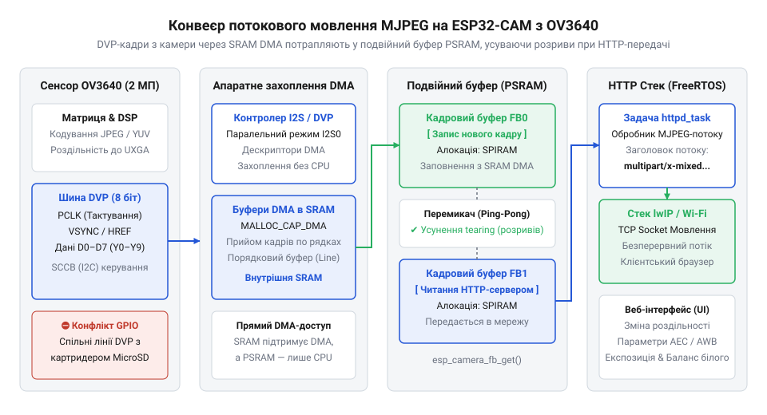
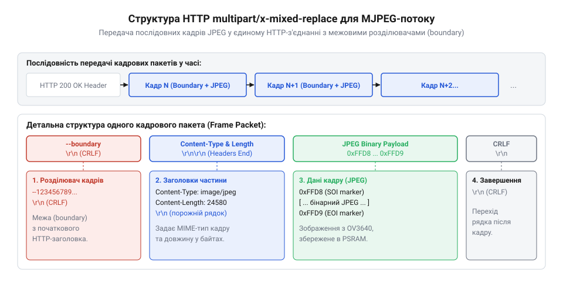

# Організація потокового мовлення MJPEG з камери OV3640 через Wi-Fi з подвійною буферизацією в PSRAM

<preknowlist>
- [ESP32-CAM (OV2640 + microSD)](root:cat-hw-boards/esp32-cam) — розташування виводів GPIO, підключення PSRAM та конфліктність ніжок картридера MicroSD
- [Модуль ESP32-CAM: огляд архітектури, периферії та сімейства плат](root:cat-hw-boards/esp32-cam-camera-module-family) — апаратна будова модуля ESP32-CAM, схема живлення камери та специфіка використання зовнішньої пам'яті PSRAM
</preknowlist>

## Проблема передачі відеопотоку на мікроконтролері

Спроба організувати трансляцію відеосигналу з оптичного сенсора через бездротову мережу на базі компактного мікроконтролера часто закінчується раптовими перезавантаженнями системи або аварійним зупиненням виконання коду. Базова [архітектура модуля ESP32-CAM](root:cat-hw-boards/esp32-cam-camera-module-family) розрахована на роботу з цифровими камерами, проте пряма передача кадрових даних від матриці у мережевий сокет наражається на жорсткі фізичні обмеження обсягу оперативної пам'яті та пропускної здатності.

Оптичний сенсор @@en|OV3640@@ здатен формувати зображення з роздільністю до 3.15 Мегапікселів (2048 × 1536 точок). Якщо передавати знімок у первинному нестисненому форматі @@en|RGB565@@ або @@en|YUV422@@, де кожен піксель кодується двома байтами (`B = 2`), обсяг кадрового буфера `S` для максимальної роздільності `W = 2048` та `H = 1536` розраховується так:

```text
S = W × H × B
  = 2048 × 1536 × 2    [обчислення обсягу нестисненого кадрового буфера QXGA]
  = 6291456            [обсяг кадру у байтах (приблизно 6 МБ)]
```

Навіть після зниження роздільності до стандарту @@en|VGA@@ (`W_vga = 640`, `H_vga = 480`) необхідний обсяг пам'яті виглядає наступним чином:

```text
S_vga = W_vga × H_vga × B
      = 640 × 480 × 2    [обчислення обсягу нестисненого кадрового буфера VGA]
      = 614400           [обсяг кадру у байтах (приблизно 600 КБ)]
```

Отримане значення 600 КБ суттєво перевищує фізичні можливості кристала: статична оперативна пам'ять @@en|SRAM@@ (від англ. @@en|Static Random-Access Memory@@ — статична оперативна пам'ять) мікроконтролера @@en|ESP32@@ має загальний обсяг 520 КБ, з яких для динамічного виділення системної купи доступно не більше 300 КБ. Отже, зберегти навіть один первинний кадр @@en|VGA@@ у внутрішній пам'яті неможливо.

Для вирішення цієї проблеми сенсор @@en|OV3640@@ оснащено апаратним кодером @@en|JPEG@@ (від англ. @@en|Joint Photographic Experts Group@@ — Об'єднана група експертів з фотографії), який зменшує розмір кадру у 10–20 разів. Кадр @@en|VGA@@ у стисненому вигляді займає від 25 до 50 КБ, що вже вміщується у внутрішню пам'ять. Проте тут виникає друга перешкода — нестабільність мережевої передачі. Дізнатися більше про регістри конфігурації роздільності та роботу апаратного стиснення допоможе [огляд матриці та регістрів сенсора OV3640](root:cat-hw-sensors/ov3640-sensor-architecture).

Передача даних по @@en|Wi-Fi@@ через стек @@en|HTTP@@ та @@en|TCP/IP@@ відбувається нерівномірно через затримки повторного надсилання пакетів та коливання радіосигналу. Якщо мікроконтролер має лише один кадровий буфер у внутрішній @@en|SRAM@@, під час очікування звільнення мережевого сокета апаратний приймач камери продовжує отримувати наступний кадр. Без додаткового проміжного сховища нові дані переписують попередні прямо під час читання, що призводить до спотворення маркера кадру (`0xFF 0xD8` та `0xFF 0xD9`) і вихідного розриву зображення. Спроба ж виділити кілька буферів у внутрішній пам'яті вичерпує резерв @@en|DRAM@@, викликаючи критичну помилку `@@en|out of memory@@` та перезавантаження операційної системи @@en|FreeRTOS@@.

## Архітектура шини DVP та пам'ять PSRAM

Передача кадрових даних від матриці @@en|OV3640@@ до обчислювального ядра мікроконтролера здійснюється через паралельний цифровий відеопорт @@en|DVP@@ (від англ. @@en|Digital Video Port@@ — цифровий відеопорт). Ця шина складається з 8 паралельних ліній даних (`D0`..`D7`), які відповідають за одночасне перенесення байта пікселя, та чотирьох тактових і синхронізаційних сигналів. Зрозуміти фізичний рівень передачі відеосигналів та часові діаграми ліній даних допоможе [паралельний інтерфейс DVP у мікроконтролерах](root:com-devices/dvp-parallel-video-interface).

Тактовий сигнал пікселів `PCLK` (від англ. @@en|Pixel Clock@@) формує імпульс на кожне зчитування байта, строб строкової синхронізації `HREF` (від англ. @@en|Horizontal Reference@@) вказує на наявність активних пікселів у поточному рядку, а сигнал кадрової синхронізації `VSYNC` (від англ. @@en|Vertical Sync@@) сповіщає про початок і завершення нового кадру. Для роботи внутрішнього генератора тактової частоти сенсора мікроконтролер генерує опорний сигнал `XCLK` (від англ. @@en|External Clock@@) із частотою 10–20 МГц за допомогою периферійного таймера @@en|LEDC@@. Налаштування роздільності, експозиції та параметрів кодера @@en|JPEG@@ виконуються через двопровідну шину керування @@en|SCCB@@ (від англ. @@en|Serial Camera Control Bus@@ — послідовна шина керування камерою). Детальніше про особливості програмного керування регістрами камери та часові діаграми шини розповідає [протокол SCCB у мікроконтролерах ESP32](root:com-devices/sccb-bus-protocol-camera-control).

Особливість апаратної реалізації [особливостей плат ESP32-CAM](root:cat-hw-boards/esp32-cam) полягає в гострому дефіциті вільних виводів @@en|GPIO@@ (від англ. @@en|General-Purpose Input/Output@@ — введення/виведення загального призначення). Для підключення шини @@en|DVP@@ задіяно 12 ніжок: лінії даних `D0`..`D7` розведені на виводи GPIO5, 18, 19, 21, 36, 39, 34, 35, а сигнальні лінії `VSYNC`, `HREF`, `PCLK`, `SIOD` та `SIOC` підключені до GPIO25, 23, 22, 26 та 27 відповідно.

При цьому на платі встановлено картридер @@en|MicroSD@@, який за замовчуванням використовує інтерфейс @@en|SDMMC@@. Тут виникає апаратний конфлікт: вивід GPIO4 одночасно підключений до лінії даних `D1` карти пам'яті та до потужного світлодіода спалаху. Крім того, вивід GPIO0 генерує тактовий сигнал `XCLK`, але під час подачі живлення він виконує роль підтяжки режиму завантаження. Використання карти @@en|MicroSD@@ у повному 4-бітному режимі викликає конфлікти на шині та небажане засвічування спалаху. Переведення картридера в 1-бітний режим @@en|SDMMC@@ звільняє виводи GPIO4, 12 та 13, що усуває електричні накладки під час паралельної роботи камери.

Для подолання обмежень внутрішньої пам'яті на платі розміщено псевдостатичну пам'ять @@en|PSRAM@@ (від англ. @@en|Pseudo-Static RAM@@ — псевдостатична оперативна пам'ять) обсягом 4 МБ. Вона підключена через послідовну шину @@en|SPI@@/@@en|QSPI@@ і віртуально адресується в загальний 32-бітний простір пам'яті CPU (діапазон адрес `0x3F800000`–`0x3FFFFFFF`) за допомогою апаратного блоку керування пам'яттю @@en|MMU@@ (від англ. @@en|Memory Management Unit@@). Завдяки цьому системний виклик `heap_caps_malloc(size, MALLOC_CAP_SPIRAM)` дозволяє виділяти кадрові буфери розміром у сотні кілобайт безпосередньо у зовнішньому чіпі пам'яті.

Проте швидкість доступу до @@en|PSRAM@@ через шину @@en|SPI@@ є нижчою за швидкість внутрішньої @@en|SRAM@@. Щоб уникнути втрати байтів під час швидкісного зчитування з камери, прямий доступ до пам'яті @@en|DMA@@ (від англ. @@en|Direct Memory Access@@ — прямий доступ до пам'яті) спочатку приймає пакети шини @@en|DVP@@ у малі проміжні дескрипторні буфери в @@en|SRAM@@, після чого контролер послідовно перезаписує накопичені блоки у великі кадрові масиви в @@en|PSRAM@@.

## Організація подвійного кадрового буфера в PSRAM

Використання єдиного кадрового буфера у зовнішній пам'яті @@en|PSRAM@@ створює стан конфлікту між процесом захоплення зображення та мережевою задачею. Коли мережевий стек розбирає байтовий масив кадру для відправки в сокет, периферійний модуль @@en|DMA@@ отримує сигнал `VSYNC` про новий кадр і починає стирати вміст того ж самого масиву. У результаті клієнт отримує гібридний кадр зі зміщеними лініями, а в потоці @@en|JPEG@@ виникають помилки декодування.

Усунення розривів зображення досягається організацією подвійної буферизації за схемою @@en|Ping-Pong@@. У пам'яті @@en|PSRAM@@ виділяються два незалежні кадрові буфери — `Buffer A` та `Buffer B`. Система працює за принципом розчепленого конвеєра: контролер @@en|DMA@@ записує поточний кадр `N` від шини @@en|DVP@@ у буфер `Buffer A`, тоді як мережева задача зчитує повністю сформований попередній кадр `N - 1` із буфера `Buffer B`. Після фіксації сигналу `VSYNC` буфери міняються ролями.


*Схема потоку даних між сенсором OV3640, шиною DVP, подвійним кадровим буфером у PSRAM та мережевим стеком HTTP у FreeRTOS.*

На відміну від сімейства [потужнішого мікроконтролера ESP32-S3](root:cat-hw-boards/esp32s3-microcontroller), який має виділені апаратні прискорювачі, базовий @@en|ESP32@@ вимагає чіткої синхронізації задач у середовищі @@en|FreeRTOS@@ через черги вказівників. Задача захоплення камери чекає переривання від контролера @@en|DMA@@, одержує вказівник на готовий буфер `camera_fb_t*` через системний виклик `esp_camera_fb_get()` і вміщує його у чергу `xQueueFrameReady`. Мережева задача очікує повідомлення з цієї черги, відправляє бінарний блок @@en|JPEG@@ у сокет, після чого повертає буфер у вільний пул за допомогою функції `esp_camera_fb_return()`. Режим захоплення `CAMERA_GRAB_LATEST` гарантує, що при падінні швидкості мережі застарілі кадри скидаються, а клієнт завжди отримує найновіший кадр без блокування периферії.

:::tabs
:::code proj-esp32-cam-ov3640-mjpeg-streamer/c/esp-idf/camera-capture-task.c
:::code proj-esp32-cam-ov3640-mjpeg-streamer/cpp/esp-idf/camerastreamer.cpp
:::

## Потокове мовлення multipart в мережевому стеку

Передача відеопотоку через протокол @@en|HTTP@@ (англ. @@en|Hypertext Transfer Protocol@@) зіштовхується з базовим обмеженням стандартної мережевої моделі: класичний запит розрахований на отримання одного статичного ресурсу із подальшим закриттям або повторним використанням TCP-з'єднання. Для оновлення відеокадрів у реальному часі без застосування важких протоколів мовлення використовують специфічний механізм @@en|multipart/x-mixed-replace@@ (від лат. @@en|multus@@ — численний, та англ. @@en|part@@ — частина). Сервер відкриває одне безперервне з'єднання, у якому кожен новий кадр @@en|MJPEG@@ надсилається як окремий @@en|MIME@@-блок, замінюючи попередній вміст у вікні перегляду клієнта.

Ключовим елементом протокольного заголовка виступає межовий розділювач @@en|boundary@@ (від англ. @@en|boundary@@ — межа, кордон). Під час ініціалізації клієнтського запиту сервер повертає статус `200 OK` та заголовок `Content-Type: multipart/x-mixed-replace; boundary=123456789000000000000987654321`. Далі перед кожним упакованим кадром @@en|JPEG@@, отриманим із зовнішньої пам'яті @@en|PSRAM@@, сервер записує в мережевий сокет унікальний рядок межі, вказує заголовок `Content-Type: image/jpeg` та точну довжину даних `Content-Length`.


*Структура кадрового пакета HTTP multipart/x-mixed-replace із розділювачами boundary, заголовками Content-Type та бінарними даними JPEG.*

Безперервна відправка кадрових даних через @@en|socket@@ (від англ. @@en|socket@@ — гніздо, роз'єм) вимагає суворого контролю стану операційної системи під управлінням @@en|FreeRTOS@@. Якщо клієнт розриває зв'язок або мережеве вікно @@en|TCP Window@@ (від англ. @@en|window@@ — вікно) переповнюється через низьку пропускну здатність, функція відправки даних блокується. Без налаштування тайм-ауту сокета через параметр `SO_SNDTIMEO` задача потокового мовлення зациклюється в очікуванні, утримуючи виділений кадровий буфер у @@en|PSRAM@@. Це призводить до виснадження доступних сокетів та зупинки кільцевого буфера камери. При виникненні помилки відправки сервер зобов'язаний негайно повернути кадровий буфер у драйвер, перервати цикл трансляції та закрити сокет.

:::tabs
@tab ESP-IDF (C)
:::code proj-esp32-cam-ov3640-mjpeg-streamer/c/esp-idf/timeval.c
@tab Arduino (C++)
:::code proj-esp32-cam-ov3640-mjpeg-streamer/cpp/arduino/timeval.cpp
:::

## Інтерактивне керування параметрами сенсора та роздільністю

Практична експлуатація відеосервера вимагає зміни параметрів експозиції, балансу білого та роздільності зображення сенсора @@en|OV3640@@ без переривання активного мережевого потоку. Для реалізації такого керування будують асинхронну архітектуру @@en|REST API@@ (англ. @@en|Representational State Transfer Application Programming Interface@@), яка обробляє клієнтські @@en|AJAX@@-запити (англ. @@en|Asynchronous JavaScript and XML@@) в окремому потоці мережевого HTTP-сервера.

Коригування базових параметрів зображення — рівня яскравості, контрасту, автоматичного підсилення чи експозиції — виконується шляхом запису значень у внутрішні регістри матриці через послідовний інтерфейс @@en|SCCB@@ (англ. @@en|Serial Camera Control Bus@@). Структура покажчиків драйвера камери дозволяє вносити ці зміни прямо під час зчитування кадрів: зміни набувають чинності з першим рядком наступного кадрового імпульсу VSYNC без зупинки потоку.

Принципово складнішим є процес динамічної зміни роздільності кадру, наприклад перемикання з роздільності @@en|QVGA@@ (320x240) на @@en|UXGA@@ (1600x1200). Зміна розміру матриці змінює підсумковий обсяг бінарних даних @@en|JPEG@@, які записуються в буфери @@en|PSRAM@@. Якщо контролер прямим доступом до пам'яті @@en|DMA@@ (англ. @@en|Direct Memory Access@@) почне передавати кадр більшого розміру у кадровий буфер, розміченість якого розрахована на меншу роздільність, відбудеться фатальна помилка переповнення пам'яті.

Щоб забезпечити безпечний перезапуск каналів @@en|DMA@@, система застосовує алгоритм синхронізації:
1. Запит на зміну роздільності призупиняє задачу захоплення нових кадрів.
2. Система очікує завершення поточного циклу передачі кадру через паралельний інтерфейс @@en|DVP@@.
3. Контролер @@en|DMA@@ зупиняє приймання даних, після чого драйвер перезаписує конфігураційні регістри сенсора @@en|OV3640@@.
4. Вбудовані буфери кадру в @@en|PSRAM@@ перерозподіляються під новий розмір матриці, дескриптори @@en|DMA@@ ініціалізуються заново, і задача захоплення відновлює роботу.

:::tabs
@tab ESP-IDF (C)
:::code proj-esp32-cam-ov3640-mjpeg-streamer/c/esp-idf/cmd-handler.c
@tab Arduino (C++)
:::code proj-esp32-cam-ov3640-mjpeg-streamer/cpp/arduino/handle-control.cpp
:::

## Розгортання MJPEG-сервера та налагодження продуктивності

Після завершення розробки мережевого стека проєкт відеосервера компілюється та прошивається в плату. При роботі з популярними [модулями серії ESP32-CAM](root:cat-hw-boards/esp32-cam-camera-module-family) із сенсором @@en|OV3640@@ перевірка функціональності здійснюється шляхом відкриття IP-адреси пристрою у веб-браузері. Інтерфейс підключається до потоку @@en|MJPEG@@ та надає елементи керування параметрами зображення.

Визначення та локалізація вузьких місць продуктивності вимагає комплексного аналізу трьох основних факторів:
1. **Співвідношення швидкості бездротової мережі та якості стиснення @@en|JPEG@@**: Рівень компресії визначається індексом якості від 1 (найвища якість, великий розмір) до 63 (найнижче навантаження). Встановлення значення якості в діапазоні 10–12 забезпечує оптимальний обсяг кадру (близько 30–40 КБ для роздільності @@en|SVGA@@), що дозволяє досягти стабільних 20–25 кадрів на секунду (@@en|FPS@@) без переповнення бездротового буфера @@en|Wi-Fi@@.
2. **Оптимізація частоти шин @@en|XCLK@@ та @@en|SCCB@@**: Тактова частота генерації @@en|XCLK@@ для @@en|OV3640@@ задається на рівні 20 МГц. Підвищення частоти вище 24 МГц прискорює зчитування пікселів через інтерфейс @@en|DVP@@, однак на довгих друкованих провідниках плати створює шуми та спотворення даних. Тактову частоту шини @@en|SCCB@@ доцільно підвищувати з 100 кГц до 400 кГц для прискорення обробки @@en|REST API@@ без затримок відеопотоку.
3. **Контроль оперативної пам'яті Heap** (від англ. @@en|heap@@ — купа): Використання внутрішньої @@en|SRAM@@ та зовнішньої @@en|PSRAM@@ контролюється функціями `esp_get_free_heap_size()` та `esp_get_free_internal_heap_size()`. Необхідно відстежувати, щоб динамічно створені сокети та текстові буфери @@en|HTTP@@-заголовків звільнялися відразу після закриття з'єднання клієнтом.

На відміну від систем на більш потужному [мікроконтролері ESP32-S3](root:cat-hw-boards/esp32s3-microcontroller), класична [плата ESP32-CAM](root:cat-hw-boards/esp32-cam) вимагає суворого дотримання балансу розподілу шини @@en|PSRAM@@ між прямим доступом @@en|DMA@@ від камери та відправкою пакетів в мережевий стек @@en|Wi-Fi@@. Грамотне налаштування розміру @@en|TCP Window@@ у поєднанні з подвійною буферизацією дозволяє досягти максимально можливої швидкості трансляції без розривів кадру та падіння системи.
