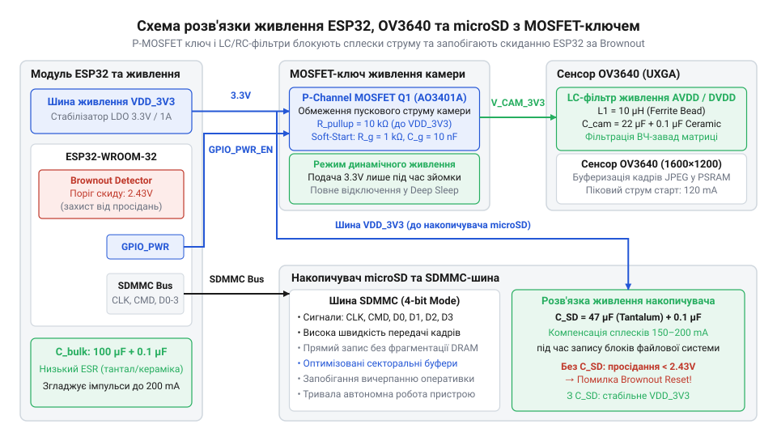
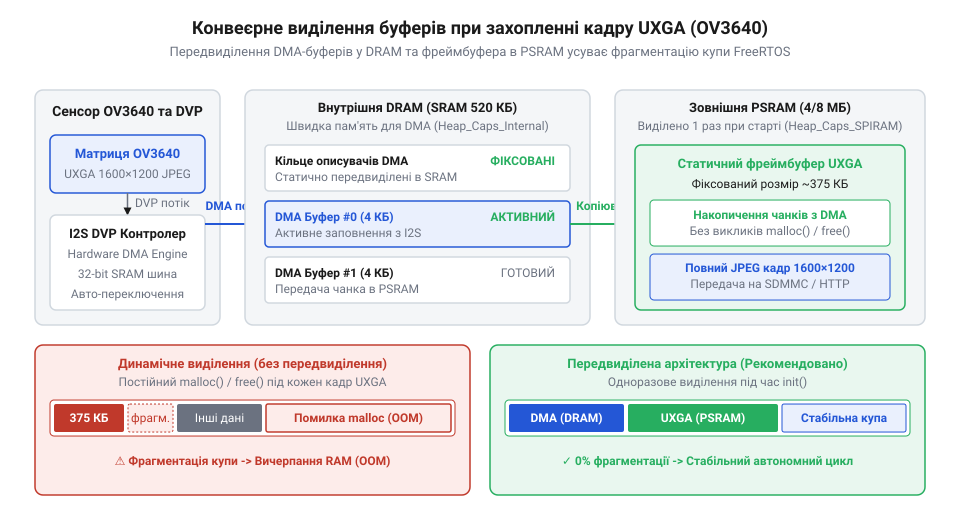

# Фотореєстратор надвисокої роздільності UXGA з збереженням на SD-карту та захистом від просідань живлення

<preknowlist>
- [ESP32-CAM (OV2640 + microSD)](root:cat-hw-boards/esp32-cam) — Конструктивне виконання плати, розвідку GPIO для камери й SD-карти та базові обмеження живлення.
- [Модуль ESP32-CAM: огляд архітектури, периферії та сімейства плат](root:cat-hw-boards/esp32-cam-camera-module-family) — Апаратну архітектуру модуля ESP32-CAM, принципи підключення сенсорів через DVP-інтерфейс та вибіркове керування PSRAM.
</preknowlist>

## Перевантаження живлення та циклічний Brownout Reset

Автономний фотореєстратор під час збереження кадру з роздільністю `@@en|UXGA@@` (від англ. *Ultra eXtended Graphics Array* — графічний стандарт 1600×1200 пікселів) створює критичні імпульсні навантаження на лінію живлення. У мить пробудження мікроконтролера `@@en|ESP32@@` (від англ. *Expressif Systems Processor*) система одночасно подає напругу на оптичний сенсор `@@en|OV3640@@` та карту пам'яті `@@en|microSD@@` (від англ. *micro Secure Digital*). Апаратні вузли камери вимагають швидкого заряджання внутрішніх ємностей аналогового блоку та запуску генератора тактової частоти. Одночасно з цим контролер шини `@@en|SDMMC@@` (від англ. *Secure Digital MultiMediaCard*) подає серію високочастотних імпульсів для ініціалізації карти пам'яті, що викликає короткочасне зростання струму споживання до значення понад пів ампера.

При розробці автономних пристроїв на базі [модуля ESP32-CAM](root:cat-hw-boards/esp32-cam) джерелом живлення найчастіше виступає літієвий акумулятор або лінійний стабілізатор `@@en|LDO@@` (від англ. *low dropout* — стабілізатор з малою різницею напруги вхід-вихід). Кожна фізична лінія живлення та з'єднувальний провідник володіють власністю паразитних опорів. Окрім опору мідних доріжок друкованої плати, суттєвий внесок у загальний опір робить паразитний `@@en|ESR@@` (від англ. *equivalent series resistance* — еквівалентний послідовний опір) фільтрувальних конденсаторів. Коли внутрішні блоки сенсора й накопичувача одночасно запитують великий струм, на сумарному опорі кола живлення виникає миттєве падіння напруги.

Для розрахунку амплітуди просідання напруги необхідно підсумувати пікові струми всіх активних компонентів та помножити їх на повний опір лінії живлення.

**Розрахунок амплітуди просідання напруги при імпульсному навантаженні:**
```
I_peak = I_esp + I_cam + I_sd
       = 0.240 + 0.140 + 0.180           [додавання пікових струмів ESP32, OV3640 та microSD]
       = 0.560 A                         [сумарний струм навантаження]

R_total = R_trace + R_esr
        = 0.450 + 0.250                  [сумування опору доріжок та ESR конденсаторів]
        = 0.700 Ohm                      [повний опір кола живлення]

V_drop = I_peak × R_total
       = 0.560 × 0.700                   [закон Ома для кола живлення]
       = 0.392 V                         [падіння напруги під час сплеску]

V_min = V_nom - V_drop
      = 3.300 - 0.392                    [розрахунок залишкової робочої напруги]
      = 2.908 V                          [мінімальна напруга на виводах ESP32]
```

З виведених формул видно, що при початковій напрузі 3.300 V імпульсний сплеск знижує потенціал на виводах мікроконтролера до 2.908 V. Якщо ж акумулятор частково розряджений або опір з'єднувальних проводів вищий, потенціал шини падає нижче критичної позначки 2.430 V.

У структуру мікроконтролера вбудовано спеціальний апаратний компаратор `@@en|Brownout Detector@@` (від англ. *brownout* — часткове згасання світла через просідання напруги, від англ. *brown* — тьмяний, та *detector* — той, що виявляє, від лат. *detego* — відкриваю). Цей вузол безперервно порівнює напругу живлення ядра з внутрішнім опорним рівнем. Зафіксувавши зниження потенціалу нижче безпечної межі, компаратор негайно генерує апаратний сигнал скидання `BROWN_OUT_RESET`. Такий запобіжний механізм відключає процесорні ядра для усунення ризику викривлення даних у пам'яті.

При виникненні апаратного скидання мікроконтролер припиняє виконання коду й перезапускається. Під час завантаження консольний порт `@@en|UART@@` (від англ. *Universal Asynchronous Receiver-Transmitter* — універсальний асинхронний трансивер) виводить повідомлення `rst:0x1 (POWERON_RESET)` або вказівку на спрацьовування детектора. Після перезапуску програма знову починає ініціалізацію периферичних вузлів. Повторна подача живлення на камеру `@@en|OV3640@@` та карту `@@en|microSD@@` знову викликає аналогічний сплеск струму. В результаті пристрій потрапляє у нескінченне циклічне перезавантаження.

Вивчаючи [архітектуру ESP32-CAM](root:cat-hw-boards/esp32-cam-camera-module-family), стає зрозуміло, що штатна схема живлення плати не розрахована на одночасні пікові навантаження важких сенсорів високої роздільності та швидкісних карт пам'яті. Для стабільної роботи автономного реєстратора потрібен схемотехнічний захист, який розділяє лінії живлення й компенсує імпульси струму.

## Схемотехнічний захист динамічного живлення периферії

Нейтралізація імпульсних просідань напруги вимагає розділення схем живлення мікроконтролера та периферійних модулів. Щоб позбутися циклічних перезапусків, застосовують комбінацію накопичувальних конденсаторів та силового ключа на базі `@@en|MOSFET@@` (від англ. *metal-oxide-semiconductor field-effect transistor* — польовий транзистор зі структурою метал-оксид-напівпровідник). P-канальний транзистор встановлюють у розрив плюсової лінії живлення сенсора `@@en|OV3640@@` та карти `@@en|microSD@@`. Це дозволяє керувати подачею напруги на периферію за допомогою одного виводу `@@en|GPIO@@` (від англ. *General Purpose Input/Output* — вивід загального призначення) мікроконтролера `@@en|ESP32@@`.

Коли P-канальний транзистор відкривається, розряджені ємності периферійних модулів починають миттєво заряджатися, що створює кидок пускового струму. Для обмеження цього струму в коло затвора транзистора додають `@@en|RC-ланцюг@@` (від англ. *resistor-capacitor circuit* — резистивно-ємнісна схема). Резистор підтяжки забезпечує надійне закриття ключа в режимі `@@en|Deep Sleep@@` (від англ. *deep sleep* — глибокий сон), а послідовний конденсатор уповільнює швидкість наростання напруги на затворі, забезпечуючи плавне включення периферії.


*Схема розв'язки живлення периферії з MOSFET-ключем забезпечує плавну подачу напруги на OV3640 та microSD, запобігаючи просіданню лінії 3.3V нижче порогу Brownout Detector.*

Живлення оптичного сенсора `@@en|OV3640@@` вимагає додаткової фільтрації, оскільки цифрові завади від шини `@@en|SDMMC@@` погіршують якість зображення. Сенсор має три окремі шини живлення: аналогову `@@en|AVDD@@` (від англ. *analog supply voltage* — 2.8 V), цифрову `@@en|DVDD@@` (від англ. *digital supply voltage* — 1.5 V) та шину інтерфейсу `@@en|DOVDD@@` (від англ. *digital I/O supply voltage* — 3.3 V). Для ізоляції аналогової лінії застосовують `@@en|LC-фільтр@@` (від англ. *inductor-capacitor filter* — індуктивно-ємнісний фільтр) на основі феритової намистини та керамічного конденсатора.

Для компенсації тривалих сплесків споживання під час запису секторів на карту `@@en|microSD@@` паралельно виводам живлення тримача картки встановлюють танталовий конденсатор з малим рівнем `@@en|Low-ESR@@` (від англ. *low equivalent series resistance* — низький еквівалентний послідовний опір). Ємність цього конденсатора розраховують виходячи з максимально допустимого падіння напруги за час тривалості імпульсу запису.

**Розрахунок необхідної ємності накопичувального конденсатора:**
```
C_min = (I_peak × Δt) ÷ ΔV_max
      = (0.320 × 0.0005) ÷ 0.200         [підстановка струму 320mA, часу 0.5ms та просідання 200mV]
      = 0.000160 ÷ 0.200                 [обчислення заряду, який передає конденсатор]
      = 0.000800 F                       [мінімально необхідна розрахункова ємність]
      = 800 µF                           [необхідна ємність згладжувального бака]
```

Отримане значення 800 µF показує загальну ємність, яку необхідно розмістити на платі. На практиці її набирають з одного великого електролітичного або танталового конденсатора ємністю 470 µF на вході платформи та кількох керамічних конденсаторів по 100 µF та 10 µF безпосередньо біля роз'ємів периферії.

Порівнюючи розведення з компактними [платами ESP32-S3 SuperMini](root:cat-hw-boards/esp32-s3-supermini), де площі для великих конденсаторів немає, у даному проєкті критично важливо дотримуватися коротких і широких трас живлення. Правильне розташування `@@en|Low-ESR@@` танталових конденсаторів у поєднанні з керуючим `@@en|MOSFET@@` ключем повністю придушує високочастотні імпульси струму. Це створює надійну апаратну основу для подальшого програмного керування системою.

## Фільтрація Brownout Detector та Deep Sleep

Апаратна розв'язка живлення нейтралізує фізичні сплески струму, проте під час виходу з режиму `@@en|Deep Sleep@@` (від англ. *deep sleep* — режим глибокого сну) виникають короткочасні перехідні процеси. При відновленні подачі живлення на мікроконтролер `@@en|ESP32@@` та заряджанні фільтрувальних ємностей напруга лінії 3.3V може на кілька мікросекунд просісти нижче дефолтного порогу компаратора. Офіційний фреймворк `@@en|ESP-IDF@@` (від англ. *Espressif IoT Development Framework* — середовище розробки Espressif) дозволяє програмно коригувати порогові рівні спрацьовування детектора та реалізовувати алгоритм безпечного запуску периферії.

Вбудований компаратор `@@en|Brownout Detector@@` підтримує кілька програмованих рівнів спрацьовування у діапазоні від 2.43 V до 2.80 V. У пристроях з автономним живленням від акумуляторів пороговий рівень налаштовують на значення 2.43 V через конфігуратор `menuconfig` (`CONFIG_ESP32_BROWNOUT_DET_LVL_SEL_2_43V`). Якщо напруга тимчасово знижується під час включення ключа, програмна затримка запобігає хибному рестарту ядра `@@en|RTC@@` (від англ. *Real-Time Clock* — годинник реального часу).

Безпечний запуск системи після пробудження з режиму `@@en|Deep Sleep@@` реалізують за допомогою алгоритму поетапного включення периферійних блоків:

1. Мікроконтролер прокидається за сигналом таймера `@@en|RTC@@` і виконує первинне налаштування порту `@@en|GPIO@@`, до якого підключено затвор P-канального `@@en|MOSFET@@` транзистора.
2. Програма встановлює низький логічний рівень на виводі керування ключем, відкриваючи подачу напруги на сенсор `@@en|OV3640@@` та карту `@@en|microSD@@`.
3. Запускається програмна затримка тривалістю від 30 до 50 мілісекунд за допомогою системної функції операційної системи `@@en|FreeRTOS@@` (від англ. *Free Real-Time Operating System* — операційна система реального часу). Ця пауза необхідна для переходу LDO-стабілізатора в стаціонарний режим та завершення заряджання конденсаторів.
4. Програма виконує ініціалізацію шини камери `@@en|DVP@@` (від англ. *Digital Video Port* — паралельний відеоінтерфейс) та налаштовує оптичний сенсор на зйомку кадру `@@en|UXGA@@`.
5. Після успішного захоплення фото кадру активується контролер `@@en|SDMMC@@`, маунтується файлова система та виконується запис файла на накопичувач.
6. Після завершення опису даних периферія знеструмлюється вимиканням `@@en|MOSFET@@` ключа, виводи переводяться в стан високого опору, і мікроконтролер знову переходить у режим `@@en|Deep Sleep@@`.

Нижче наведено практичну реалізацію алгоритму поетапного керування живленням периферії на мовах C та C++.

:::tabs
:::code proj-esp32-cam-ov3640-uxga-sd-logger/c/esp-idf/app-main.c
:::code proj-esp32-cam-ov3640-uxga-sd-logger/cpp/esp-idf/powermanager.cpp
:::

Використовуючи потужніший [мікроконтролер ESP32-S3](root:cat-hw-boards/esp32s3-microcontroller) у сучасніших модифікаціях платформ, розробники отримують гнучкіші засоби керування доменами живлення. Проте описана методика програмної фільтрації `@@en|Brownout Detector@@` та затримок запуску лишається універсальним стандартом для всіх чипів родини Espressif. Завдяки поєднанню схемотехнічних фільтрів та чіткої послідовності виходу з режиму `@@en|Deep Sleep@@` фотореєстратор здатний роками функціонувати в автономному режимі без ризику зависань.

## Оптимізація пам'яті під кадри UXGA

При зйомці у роздільності @@en|UXGA@@ (1600×1200) один стиснений кадр у форматі @@en|JPEG@@ займає від 150 до 300 КБ залежно від складності сцени та обраної якості. В умовах циклічної автономної роботи пристрою регулярне динамічне виділення й звільнення пам'яті під кожен новий знімок неодмінно призводить до системного збою. Внутрішній простір @@en|DRAM@@ мікроконтролера @@en|ESP32@@ обсягом близько 320 КБ швидко розбивається на дрібні фрагменти системними завданнями операційної системи. Коли в пам'яті функціонує динамічна купа (англ. @@en|heap@@, від давн.-англ. @@ang|hēap@@ — купа, натовп), чергова спроба захопити один великий суцільний @@en|блок пам'яті@@ викликає помилку вичерпання ресурсів, навіть якщо сумарний обсяг вільної пам'яті є достатнім. Утворюється @@en|фрагментація@@ (англ. @@en|fragmentation@@, від лат. @@la|fragmentum@@ — уломок, частка), яка унеможливлює подальше захоплення зображень під час тривалого фотореєстрування.

Надійним розв'язком цієї проблеми є передвиділення (англ. @@en|pre-allocation@@, від лат. @@la|prae@@ — наперед та @@la|allocare@@ — розміщувати) пам'яті під час стартів системи. Апаратному блоку прямого доступу до пам'яті (англ. @@en|Direct Memory Access@@, @@en|DMA@@) потрібен суворий доступ до фізично зв'язаних адрес внутрішньої @@en|DRAM@@ для розміщення дескрипторів камери та проміжних ліній кадру. Водночас основний @@en|кадровий буфер@@ великого розміру розміщують у зовнішньому масиві, коли в системі присутня [зовнішня пам'ять PSRAM](root:cat-hw-boards/esp32-s3r2-waveshare). Виділивши ці області один раз при завантаженні за допомогою спеціалізованих функцій @@en|ESP-IDF@@ з відповідними прапорами атрибутів, програма повністю виключає операції виділення пам'яті з робочого циклу зйомки.


*Конвеєрне виділення передвиділених буферів у DRAM та PSRAM для обробки кадру UXGA без дефрагментації купи.*

Схема конвеєрної обробки відображає розподіл пам'яті за її фізичними атрибутами, що характерно для розробки на [архітектурі плат серії ESP32-CAM](root:cat-hw-boards/esp32-cam-camera-module-family). Буфер дескрипторів @@en|DMA@@ резервується у внутрішній @@en|DRAM@@ із прапорами `MALLOC_CAP_DMA | MALLOC_CAP_INTERNAL`. Основний масив для збереження зібраного зображення розміщується в @@en|PSRAM@@ із прапором `MALLOC_CAP_SPIRAM`. У результаті операційна система @@en|FreeRTOS@@ зберігає стабільний стан купи, виключаючи появу витоків або дефрагментаційних пауз при багатократних циклах зйомки.

:::tabs
:::code proj-esp32-cam-ov3640-uxga-sd-logger/c/esp-idf/init-frame-buffers.c
:::code proj-esp32-cam-ov3640-uxga-sd-logger/cpp/esp-idf/framebuffermanager.cpp
:::

## Запис UXGA-кадрів через шину SDMMC

Після отримання зображення та його утримання в буфері постає завдання зберегти бінарні дані на карту @@en|microSD@@. Використання повільних послідовних шин спричиняє тривалий запис файлу обсягом 300 КБ. Це тримає пристрій у стані максимального струмоспоживання, що створює критичні умови для живлення та підвищує ризик спрацьовування апаратного блоку @@en|Brownout Detector@@. Для того щоб скоротити час активного стану та знизити навантаження на джерело живлення, застосовують апаратну шину @@en|SDMMC@@ (англ. @@en|Secure Digital Multimedia Card@@).

Інтерфейс @@en|SDMMC@@ здійснює паралельний обмін даними за чотирма лініями на частотах 20–40 МГц, завдяки чому швидкість запису зростає в кілька разів порівняно з режимом @@en|SPI@@. Процес збереження кадру триває лише кілька мілісекунд, що зводить до мінімуму імпульсне навантаження на систему. Доступ до накопичувача організовано через [драйвер файлової системи FATFS](root:sys-fw/fatfs-sdmmc-esp-idf) (англ. @@en|File Allocation Table File System@@, @@en|FATFS@@), який інтегрується у віртуальну файлову систему середовища @@en|ESP-IDF@@.

Алгоритм запису кадрів вимагає чіткої послідовності операцій для збереження цілісності файлової структури. Спочатку виконується мотування накопичувача, відкривається новий файл у бінарному режимі, після чого сформований @@en|кадровий буфер@@ скидається на карту. Перед завершенням сеансу необхідно примусово очистити буфери та використати функцію демонтування. Якщо відключити живлення периферії або увійти в режим @@en|Deep Sleep@@ до демонтажу накопичувача, таблиця розміщення файлів буде пошкоджена. Для вчасної виявлення помилок I/O слід перевіряти статус виконання кожної операції, як це реалізовано в [стандартній платі ESP32-CAM](root:cat-hw-boards/esp32-cam).

:::tabs
:::code proj-esp32-cam-ov3640-uxga-sd-logger/c/esp-idf/save-frame-to-sd.c
:::code proj-esp32-cam-ov3640-uxga-sd-logger/cpp/esp-idf/sdstorage.cpp
:::
