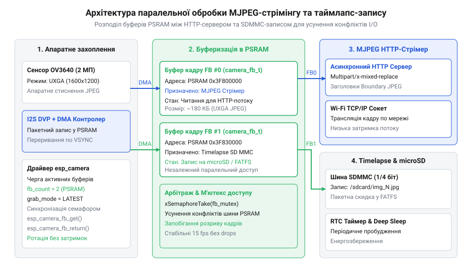

# Побудова відеострімера та системи таймлапс-зйомки на ESP32-CAM з сенсором OV3640

<preknowlist>
- [ESP32-CAM (OV2640 + microSD)](root:cat-hw-boards/esp32-cam) — базове цоколювання та підключення зовнішньої пам'яті PSRAM
- [Модуль ESP32-CAM: огляд архітектури, периферії та сімейства плат](root:cat-hw-boards/esp32-cam-camera-module-family) — апаратну будову шини DVP та схему живлення камери
</preknowlist>

## Постановка задачі та вибір компонентів

Побудова систем автономного відеоспостереження та покадрової зйомки на базі мікроконтролерів вимагає одночасного вирішення двох апаратно містких задач: трансляції потокового відео через бездротову мережу та надійного збереження кадрів високої роздільності на накопичувач. Під час використання популярного модуля [ESP32-CAM](root:cat-hw-boards/esp32-cam) з 3-мегапіксельним фотосенсором @@en|OV3640@@ розробник стикається з жорсткими обмеженнями обсягу внутрішньої оперативної пам’яті (англ. @@en|Static Random-Access Memory@@, @@en|SRAM@@; @@en|оперативна пам’ять SRAM@@) обсягом 520 КБ. Один сирий кадр роздільності `UXGA` (`1600 × 1200` пікселів) у форматі `RGB565` займає понад 3.8 МБ, що фізично перевищує всю доступну пам’ять кристала. Навіть при апаратному стисненні в формат @@en|JPEG@@ (від англ. *Joint Photographic Experts Group* — об'єднана група експертів у галузі фотографії; @@en|формат стиснення JPEG@@) розмір одного кадру становить від 100 до 300 КБ, тому спроба виділити кілька масивів у внутрішній пам'яті швидко призводить до її вичерпання й падіння системи.

Для подолання пам’яткового бар'єра схемотехніка плат сімейства ESP32-CAM оснащується зовнішньою мікросхемою псевдостатичної оперативної пам'яті (англ. @@en|Pseudo Static Random-Access Memory@@, від *pseudo* — несправжній, *static* — статичний та *random-access memory* — пам’ять довільного доступу; @@en|псевдостатична пам’ять PSRAM@@) обсягом 4 або 8 МБ. Зовнішня пам’ять підключається через високошвидкісну послідовну шину, а контролер прямого доступу до пам'яті (англ. @@en|Direct Memory Access@@, від *direct* — прямий, *memory* — пам’ять та *access* — доступ; @@en|прямий доступ до пам’яті DMA@@) транспортує байти кадру безпосередньо з паралельного цифрового відеопорту (англ. @@en|Digital Video Port@@, від *digital* — цифровий, *video* — відео та *port* — порт; @@en|інтерфейс DVP@@) камери в буфери PSRAM. Окремо слід враховувати апаратні конфлікти периферії: шина карток пам’яті @@en|SDMMC@@ у 4-бітовому режимі використовує виводи `GPIO4` (лінія даних `DATA1`), `GPIO12` (`DATA2`), `GPIO13` (`DATA3`), `GPIO2` (`DATA0`), `GPIO14` (`CLK`) та `GPIO15` (`CMD`). При цьому вивід `GPIO4` жорстко підключений до транзисторного ключа потужного спалах-світлодіода плати, через що будь-яка файлова операція у 4-бітовому режимі спричиняє хаотичне спалахування світлодіода та імпульсні завади по лініях живлення. Переведення накопичувача у 1-бітовий режим роботи звільняє виводи `GPIO4`, `GPIO12` та `GPIO13`, залишаючи для передачі даних тільки `GPIO2`, що усуває електричний конфлікт зі спалахом і забезпечує стабільну паралельну роботу камери та накопичувача. Ціною цього компромісу є скорочення пропускної здатності шини в чотири рази: реальна швидкість послідовного запису на картку пам'яті падає з `2.5–4.0 МБ/с` у 4-бітовому режимі до `0.8–1.2 МБ/с` у 1-бітовому, що збільшує тривалість збереження одного `UXGA`-кадру обсягом `200 кБ` із `60 мс` до `200–250 мс`, проте лишається цілком достатнім для покадрової таймлапс-зйомки та компенсується повною відсутністю збоїв живлення. Архітектурні деталі узгодження сигнальних ліній висвітлює [огляд сімейства плат ESP32-CAM](root:cat-hw-boards/esp32-cam-camera-module-family).

## Конфігурування драйвера та подвійна буферизація

Ініціалізація та налаштування паралельного фотосенсора @@en|OV3640@@ у системному драйвері `esp32-camera` здійснюються шляхом заповнення конфігураційної структури `camera_config_t`. При роботі з сенсором високої роздільності ключовими параметрами є вибір робочої частоти тактування `xclk_freq_hz = 20000000` (20 МГц), призначення вхідно-вихідних виводів шини DVP та визначення режиму вибірки кадрових буферів. Сигнал тактування XCLK від мікроконтролера надходить на вхід внутрішньої системи фазового автопідлаштування частоти (англ. @@en|Phase-Locked Loop@@; @@en|фазове автопідлаштування частоти PLL@@) сенсора OV3640. Внутрішня PLL помножує вхідну частоту для генерації пиксельного тактового сигналу PCLK, який визначає швидкість вичитування даних по шині DVP та прямо відповідає за підсумкову частоту кадрів (англ. @@en|Frames Per Second@@; @@en|частота кадрів FPS@@). Зниження частоти XCLK до 10 МГц пропорційно зменшує FPS та спричиняє затримки відеопотоку, тоді як перевищення 20–24 МГц на платах ESP32-CAM призводить до високочастотних завад і пошкодження бінарних блоків кадру. За наявності мікросхеми PSRAM програма встановлює роздільність `FRAMESIZE_UXGA` та коефіцієнт квантування `jpeg_quality = 10`–`12`, що забезпечує високу чіткість зображення при помірному розмірі стиснутого файла. Низькорівневі деталі роботи регістрів DVP та механізмів DMA описує [архітектура та конфігурація драйвера esp32-camera](root:sf-devices/esp32-camera-driver-architecture).

Критичним інженерним рішенням для забезпечення плавності відеопотоку є вибір параметра кількості кадрових буферів `fb_count = 2` (англ. @@en|double buffering@@; @@en|подвійна буферизація double buffering@@) та режиму захоплення `CAMERA_GRAB_LATEST`. При однобуферній схемі (`fb_count = 1`) виникає небезпечний ефект розриву кадру (англ. @@en|tearing@@, від *tear* — рвати; @@en|розрив кадру tearing@@) та втрата кадрів: поки один процес зчитує кадр для відправки у мережу Wi-Fi або запису на microSD, контролер DMA змушений пропускати нові кадри або перезаписувати той самий буфер під час зчитування. Подвійна буферизація виділяє два незалежні масиви у зовнішній пам'яті PSRAM. Це дозволяє контролеру DMA без зупинки записувати новий кадр у перший буфер, поки асинхронний мережевий сервер або файловий модуль зчитує готовий кадр із другого буфера. Алгоритмічна відмінність між режимами вибірки полягає у поведінці драйвера під час сплесків затримок у PSRAM: режим `CAMERA_GRAB_WHEN_EMPTY` зберігає всі захоплені кадри підряд і видає застаріле зображення, накоплюючи затримку відеопотоку у мережі, тоді як `CAMERA_GRAB_LATEST` автоматично відкидає старі буфери в кольцевому черговому пулі й повертає лише найновіший зображувальний кадр із камери, що усуває накопичувальне розсинхронування відео у реальному часі.

*Схема розподілу подвійної буферизації кадру в пам'яті PSRAM між асинхронним MJPEG-стрімером та таймлапс-записом на microSD.*

Нижче наведено програмний код конфігурування камери та ініціалізації драйвера в середовищі ESP-IDF та Arduino IDE:

:::tabs
@tab C (ESP-IDF)
:::code proj-esp32-cam-ov3640-video-streamer-and-time-lapse/c/main/app_camera.h
:::code proj-esp32-cam-ov3640-video-streamer-and-time-lapse/c/main/app_camera.c 6-42
@tab C++ (Arduino)
:::code proj-esp32-cam-ov3640-video-streamer-and-time-lapse/cpp/CameraPinsOV3640.hpp 29-66
:::

## Реалізація асинхронного MJPEG відеострімера

Для трансляції відео у реальному часі без затримок та блокування фонових задач використовується асинхронний HTTP-веб-сервер на основі компонента `esp_http_server`. Передача відеопотоку у форматі Motion JPEG (англ. @@en|MJPEG@@, від *motion* — рух та *JPEG* — формат зображення; @@en|відеопотік MJPEG@@) реалізується через заголовок відповіді `multipart/x-mixed-replace` із фіксованим текстовим роздільником кадрів (англ. @@en|boundary@@; @@en|межа кадрів boundary@@). Клієнтський браузер або медіаплеєр підтримує відкрите з'єднання й послідовно замінює відображуване зображення при надходженні кожного нового блоку кадру.

Усередині обробника запиту `/stream` запускається нескінченний цикл отримання кадрових буферів командою `esp_camera_fb_get()`. Для кожного кадру формується службовий заголовок з вказівкою MIME-типу `image/jpeg` та точного розміру в байтах `Content-Length`. Передача блоків у мережевий сокет виконується командою `httpd_resp_send_chunk()`. При підключенні кількох клієнтів компонент `esp_http_server` обробляє кожен мережевий сокет у контексті підключених TCP-сесій (англ. @@en|Transmission Control Protocol@@; @@en|протокол TCP@@). Щоб затримки передачі в повільних або зашумлених бездротових мережах не блокували потік, сервісний стек задіює таймаут сокета (англ. @@en|Socket Send Timeout@@ — таймаут відправки сокета; @@en|таймаут SO_SNDTIMEO@@). Цей часовий ліміт встановлюється на мережевий сокет через системні налаштування `httpd_config_t` або параметр `setsockopt()` з опцією `SO_SNDTIMEO`. Якщо під час виклику `httpd_resp_send_chunk()` клієнт уповільнює зчитування, розриває з'єднання або не підтверджує прийом пакетів довше заданого часового ліміту `SO_SNDTIMEO`, внутрішній мережевий сокет перериває спробу передачі, а функція миттєво повертає помилку `ESP_FAIL`. У цьому разі цикл зобов'язаний негайно перерватися командою `break`, звільнити отриманий буфер `esp_camera_fb_return(fb)` та завершити обробник. Це запобігає переповненню черги відкритих сокетів HTTP-сервера, усуває завісання фонових задач та гарантує, що повільні клієнти не блокують доставку кадрів активним підключенням. Звільнення буфера є критичним інваріантом: якщо забути повернути `camera_fb_t`, черга PSRAM вичерпається за два кроки, і відеосервер назавжди зупинить трансляцію.

Нижче наведено практичну реалізацію MJPEG-сервера та запуск фонового транслятора:

:::tabs
@tab C (ESP-IDF)
:::code proj-esp32-cam-ov3640-video-streamer-and-time-lapse/c/main/app_httpd.c 8-61
@tab C++ (Arduino)
:::code proj-esp32-cam-ov3640-video-streamer-and-time-lapse/cpp/VideoStreamer.hpp 8-23
:::code proj-esp32-cam-ov3640-video-streamer-and-time-lapse/cpp/VideoStreamer.cpp 40-75
:::

## Організація таймлапс-зйомки та запис на microSD

Для довготривалої покадрової інтервальної зйомки (англ. @@en|time-lapse@@, від *time* — час та *lapse* — проміжок, інтервал; @@en|таймлапс-зйомка time-lapse@@) високої роздільності `UXGA` необхідно забезпечити надійне збереження кадрових масивів на накопичувач. На [модулях серії ESP32-CAM](root:cat-hw-boards/esp32-cam) підключення карток пам'яті здійснюється через апаратний контролер шини @@en|SDMMC@@. Через електричний конфлікт виводів спалах-світлодіода та шини даних DVP шину контролера конфігурують у 1-бітовому режимі `width = 1`, монтуючи віртуальну файлову систему (англ. @@en|File Allocation Table File System@@; @@en|файлова система FATFS@@) за допомогою виклику `esp_vfs_fat_sdmmc_mount()` у середовищі ESP-IDF або `SD_MMC.begin("/sdcard", true)` у середовищі Arduino IDE.

Збереження кадрів відбувається шляхом створення файлів із циклічно зростаючим порядковим номером (наприклад, `/sdcard/IMG_0001.jpg`). Для запобігання пошкодженню файлової структури запис виконується в бінарному режимі `"wb"`, після чого програма обов'язково перевіряє кількість дійсно записаних байтів `fwrite()` на відповідність точній довжині кадрового буфера `fb->len`. Оскільки виклики `fwrite()` спочатку акумулюють дані в проміжному оперативному буфері файлової системи FATFS у пам'яті SRAM, для гарантованого фізичного переносу кадру на накопичувач застосовують функцію `fflush()` (від @@en|flush@@ — скидати; @@en|скидання буфера fflush@@), яка примусово виштовхує накопичений вміст VFS у контролер картки до закриття файлу `fclose()`. Затримки запису на флеш-картку можуть досягати 100–300 мс, тому при паралельній роботі з мережевим відеострімером файлові операції виносять в окрему задачу FreeRTOS або виконують між інтервалами трансляції. При частих інтервалах зйомки виникає ризик прискореного зношування осередків флеш-пам'яті (англ. @@en|wear leveling@@; @@en|зношування флеш-пам'яті flash wear@@) через обмежений ресурс циклів програмування та стирання P/E. Для запобігання деградації NAND-комірок та частих перезаписів таблиці FAT під час постійного відкриття й закриття файлів обсяг кластера при монтуванні вирівнюють за розміром фізичних блоків стирання накопичувача (`allocation_unit_size` до 16–32 КБ), а виклики `fflush()` поєднують із групуванням оновлень метаданих, що зменшує амплітуду паразитних записів і полегшує роботу вбудованого алгоритму вирівнювання зносу контролера SD-картки. Окрім прямого запису даних, критичною складовою є обробка помилок монтування та запису картки microSD: у разі повернення помилки `ESP_FAIL` або виявлення неповного розміру файла обробник закриває файловий дескриптор, ініціює повторне розмонтування та монтування файлової системи, а невідправлений кадр відкидається для запобігання втрати цілісності файлів. Для відновлення порядкового індексу знімків після аварійного відключення живлення чи перезавантаження за таймером використовують змінну з атрибутом `RTC_DATA_ATTR`, що зберігає значення в енергонезалежному сегменті RTC Fast Memory, або виконують сканування директорії при старті для знаходження максимального номеру `IMG_XXXX.jpg`. Завдяки цьому [плата ESP32-CAM](root:cat-hw-boards/esp32-cam) автоматично продовжує наскрізну нумерацію файлів таймлапсу без ризику перезапису вже створених серій кадрів.

Нижче наведено код монтування картки пам'яті та функції збереження кадрових файлів:

:::tabs
@tab C (ESP-IDF)
:::code proj-esp32-cam-ov3640-video-streamer-and-time-lapse/c/main/app_sdcard.c 9-50
@tab C++ (Arduino)
:::code proj-esp32-cam-ov3640-video-streamer-and-time-lapse/cpp/TimelapseStorage.hpp 16-67
:::

## Енергозбереження та автономна робота

При використанні камери в автономних умовах із живленням від акумулятора постійна робота процесорних ядер та модуля Wi-Fi швидко виснажує джерело енергії. Для досягнення тривалого часу автономної роботи пристрій переводять у режим глибокого сну (англ. @@en|Deep Sleep@@, від *deep* — глибокий та *sleep* — сон; @@en|режим глибокого сну Deep Sleep@@). У цьому режимі більшість внутрішніх блоків SoC та живлення камери знеструмлюються, а споживання струму знижується до декількох десятків мікроампер.

Для збереження лічильника зроблених знімків між перезавантаженнями використовується спеціальна атрибутна змінна `RTC_DATA_ATTR`, яка розміщується у незалежній пам'яті годинника реального часу (англ. @@en|Real-Time Clock Fast Memory@@, від *real-time clock* — годинник реального часу; @@en|пам'ять RTC Fast Memory@@). При пробудженні за таймером `esp_sleep_enable_timer_wakeup()` мікроконтролер виконує швидкий старт та ініціалізує сенсор OV3640. Оскільки після подачі живлення внутрішнім контурам автоматичної експозиції (англ. @@en|Automatic Exposure Control@@; @@en|автоекспозиція AEC@@) та регулювання посилення (англ. @@en|Automatic Gain Control@@; @@en|автоматичне регулювання посилення AGC@@) потрібен час на адаптацію до зовнішнього освітлення, програма обов'язково витримує затримку стабілізації у 200–300 мс або пропускає перші 2–3 холодні кадри. Лише після вирівнювання яскравості пристрій робить якісний знімок `UXGA`, записує його на картку microSD, ініціює наступний інтервал сну `esp_deep_sleep_start()` та повертається у режим мінімального споживання. Технічні нюанси керування живленням висвітлює [опис периферії камери](root:cat-hw-boards/esp32-cam-camera-module-family).

Нижче наведено приклад головного циклу управління таймлапс-зйомкою та переходу в Deep Sleep:

:::tabs
@tab C (ESP-IDF)
:::code proj-esp32-cam-ov3640-video-streamer-and-time-lapse/c/main/main.c 19-55
@tab C++ (Arduino)
:::code proj-esp32-cam-ov3640-video-streamer-and-time-lapse/cpp/main.cpp 15-62
:::
