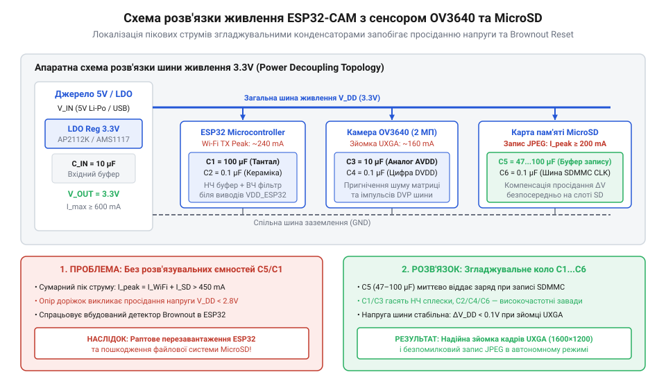
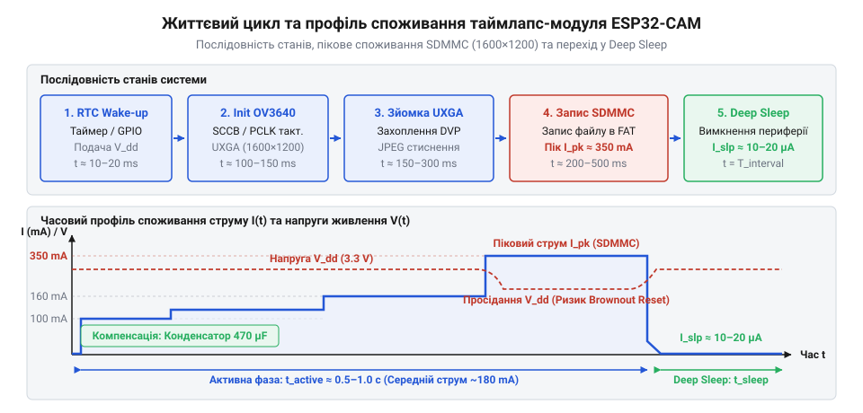

# Автономна фотокамера високої роздільності UXGA з збереженням кадрів на MicroSD

<preknowlist>
- [Модуль ESP32-CAM: огляд архітектури, периферії та сімейства плат](root:cat-hw-boards/esp32-cam-camera-module-family) — Базове розведення контактів DVP-інтерфейсу, призначення зовнішньої PSRAM та специфіка суміщених ліній GPIO.
- [ESP32-CAM (OV2640 + microSD)](root:cat-hw-boards/esp32-cam) — Архітектурні обмеження штатного схемотехнічного рішення живлення та принцип роботи слота MicroSD.
</preknowlist>

## Проблема автономної зйомки високої роздільності

Створення автономної фотокамери на базі мікроконтролера вимагає захоплення та обробки значних обсягів графічних даних при суворо обмеженому енергетичному бюджеті. Під час роботи з роздільністю (від англ. *Ultra Extended Graphics Array*, @@en|UXGA@@, 1600×1200 пікселів) один нестиснений кадр у форматі RGB565 охоплює близько 3.84 мегабайта пам'яті. Оскільки внутрішня оперативна пам'ять мікроконтролера ESP32 становить лише 520 кілобайт, прямокутна матриця пікселів не здатна розміститися у внутрішній SRAM. Для проміжного збереження знімків використовується зовнішня псевдостатична пам'ять (від англ. *Pseudo Static RAM*, @@en|PSRAM@@) або апаратний кодер сенсора OV3640, який стискає зображення у формат JPEG обсягом від 100 до 300 кілобайт безпосередньо під час зчитування.

Спроба організувати автономну зйомку таких кадрів на базі стандартних модулів, таких як класичний [ESP32-CAM](root:cat-hw-boards/esp32-cam), виявляє критичні апаратні обмеження. У момент, коли сенсор активується для експозиції та стискання кадру, а накопичувач MicroSD починає інтенсивний запис блоків даних у файлову систему, споживання струму пристроєм різко зростає. Внутрішній контролер карти пам'яті під час стирання та програмування осередків флеш-пам'яті генерує короткочасні імпульси струму амплітудою від 100 до 200 міліампер з імпульсним фронтом у кілька наносекунд. У поєднанні із піковим споживанням процесорних ядер ESP32 та периферії сенсора загальний струм лінії живлення короткочасно перевищує 400–500 міліампер.

Якщо система живлення побудована без урахування цих динамічних сплесків, внутрішній опір акумулятора та падіння напруги на провідниках спричиняють просідання шини 3.3 вольта нижче критичної межі. Апаратний детектор просідання напруги (від англ. *brownout* — часткове зниження напруги, @@en|Brownout Detector@@) ESP32 фіксує падіння напруги нижче 2.43 вольта і миттєво ініціює перезавантаження процесора (@@en|brownout reset@@). У результаті мікроконтролер скидається безпосередньо під час запису файлу, що призводить до пошкодження таблиці FAT на карті пам'яті та втрати знімків.

Другим викликом є виснаження джерела живлення. У постійно активному режимі ESP32 разом із сенсором та карткою пам'яті споживає від 80 до 160 міліампер, що повністю розряджає стандартний акумулятор ємністю 2500 міліампер-годин менш ніж за добу. Для забезпечення тижнів або місяців автономної роботи пристрій мусить більшість часу перебувати в режимі глибокого сну (від англ. *deep sleep* — глибокий сон, @@en|deep sleep@@), де струм споживання падає до 10–20 мікроампер. Проте щоразове пробудження за таймером змушує наново ініціалізувати увесь апаратний стек — від подачі живлення на OV3640 до перемонтажу картки MicroSD. Детальніше про [сімейства плат ESP32-CAM](root:cat-hw-boards/esp32-cam-camera-module-family) можна дізнатися у відповідних матеріалах каталогу. Описані пікові навантаження повторюються у кожному циклі зйомки, що робить розробку спеціалізованого вузла живлення неминучою умовою стабільності.

## Схема живлення та компенсація струмів

Забезпечення безперебійної роботи автономної фотокамери під час сплесків споживання вимагає відмови від типових лінійних стабілізаторів із високим падінням напруги. Популярні регулятори серії AMS1117 вимагають різниці між вхідною та вихідною напругою (від англ. *dropout voltage*, @@en|dropout voltage@@) на рівні 1.1–1.3 вольта, а власний струм споживання (від латинського *quiescere* — спочивати, @@en|quiescent current@@) становить 5–10 міліампер. При живленні від одного літій-іонного або літій-залізо-фосфатного акумулятора з напругою 3.2–4.2 вольта такий регулятор втрачає стабілізацію задовго до повного розрядження батареї та марно витрачає енергію в режимі сну.

Замість цього розраховують вузол живлення на базі регулятора з малим падінням напруги (від англ. *low dropout*, @@en|LDO-регулятор@@). Сучасні @@en|LDO-регулятори@@ (наприклад, AP2112K або ME6211) забезпечують вихідний струм до 600 міліампер при падінні напруги менше 250 мілівольт і мають мале споживання в режимі спокою (до 55 мікроампер). Проте сам по собі стабілізатор не здатен миттєво відреагувати на мікросекундні стрибки струму, оскільки його внутрішня петля зворотного зв'язку має обмежену смугу пропускання.


*Схема живлення із розв'язкою пікових струмів: буферна ємність компенсує просідання під час запису на MicroSD, а локальні MLCC-конденсатори фільтрують високочастотні перехідні процеси.*

Для компенсації пікових навантажень застосовують двоступеневу схему ємнісної розв'язки. На виході @@en|LDO-регулятора@@ встановлюють буферний електролітичний або танталовий конденсатор ємністю 220–470 мікрофарад. Він виконує роль локального резервуару енергії, який віддає накопичений заряд під час відносно тривалих (мілісекундних) сплесків споживання при записі блоків на MicroSD.

Оскільки великі ємності мають помітний еквівалентний послідовний опір (від англ. *Equivalent Series Resistance*, @@en|ESR@@), вони не здатні пригнічувати високочастотні перехідні процеси. Тому безпосередньо біля виводів живлення кожного компонента розміщують багатошарові керамічні конденсатори (від англ. *Multi-Layer Ceramic Capacitor*, @@en|MLCC@@):
- Біля контакту VDD мікроконтролера, такого як [мікроконтролер ESP32-S3](root:cat-hw-boards/esp32s3-microcontroller), ставлять комбінацію з 10 мікрофарад та 100 нанофарад для згладжування шумів процесорного ядра та радіочастотних сплесків.
- Біля ліній аналогового (VDD_A, 2.8 вольта) та цифрового (VDD_D, 1.8 вольта) живлення OV3640 монтують керамічні конденсатори 100 нанофарад із найкоротшими доріжками до заземлення.
- Біля слота MicroSD розміщують конденсатор 10 мікрофарад у паралель із 100 нанофарад для локалізації високовольтних імпульсів контролера картки.

Таке розділення ємностей гарантує, що амплітуда пульсацій на шині 3.3 вольта не перевищить 50 мілівольт навіть при масивних операціях введення-виведення, запобігаючи довільним спрацьовуванням @@en|Brownout Detector@@.

## Інтерфейси OV3640 та шини SDMMC

Після стабілізації шини живлення ключовим завданням стає розведення сигнальних ліній між мікроконтролером, сенсором зображення та накопичувачем. Сенсор OV3640 передає дані через паралельний цифровий відеопорт (від англ. *Digital Video Port*, @@en|DVP@@). Інтерфейс @@en|DVP@@ складається з 8-бітної паралельної шини даних (D0–D7), тактового сигналу пікселів (від англ. *pixel clock*, @@en|PCLK@@), опорного сигналу строки (від англ. *horizontal reference*, @@en|HREF@@), сигналу кадрової синхронізації (від англ. *vertical sync*, @@en|VSYNC@@) та вхідного тактового сигналу (від англ. *master clock*, @@en|XCLK@@). Налаштування внутрішніх регістрів OV3640 здійснюється через шину SCCB (від англ. *Serial Camera Control Bus*, @@en|SCCB@@), яка є сумісною з протоколом I2C і працює по лініях SIOC та SIOD.

Для збереження знімків високої роздільності на карту пам'яті використовується апаратний контролер шини SDMMC (від англ. *Secure Digital MultiMediaCard*, @@en|SDMMC@@). На відміну від повільного режиму SPI, який обмежує швидкість запису рівнем 1–2 мегабайти на секунду і змушує процесор тривалий час перебувати у високочастотному стані, шина @@en|SDMMC@@ у 4-бітному режимі забезпечує обмін даними на швидкостях до 10–20 мегабайт на секунду. Зменшення часу активного запису кадру у 5–8 разів пропорційно скорочує загальне енергоспоживання пристрою за один цикл зйомки.

Проте призначення контактів ESP32 вимагає суворого уникнення конфліктів периферії. Апаратний контролер @@en|SDMMC@@ у 4-бітному режимі жорстко прив'язаний до визначених конфігураційних виводів:
- Тактовий сигнал CLK — GPIO 14.
- Командна лінія CMD — GPIO 15.
- Лінії даних D0, D1, D2, D3 — відповідно GPIO 2, GPIO 4, GPIO 12 та GPIO 13.

Головна небезпека полягає у використанні конфігураційних виводів вибору режиму завантаження (від англ. *strap* — підтягувати, @@en|strapping pins@@). Виводи GPIO 0, GPIO 2, GPIO 5, GPIO 12 та GPIO 15 опитуються апаратним забезпеченням ESP32 безпосередньо в момент подачі живлення або пробудження з режиму @@en|deep sleep@@. Наприклад, якщо лінія GPIO 12 (яка відповідає шині SDMMC D2) під час скидання виявиться підтягнутою до високого рівня напруги, внутрішній регулятор живлення флеш-пам'яті встановить робочу напругу 1.8 вольта замість 3.3 вольта, що призведе до циклічного падіння прошивки (@@en|bootloop@@).

Тому лінії шини @@en|DVP@@ сенсора OV3640 розподіляють виключно по вільних виводах, не задіяних під @@en|SDMMC@@ та @@en|strapping pins@@. Лінії даних камери D0–D7 призначають на суміжні GPIO, а тактовий сигнал @@en|XCLK@@ генериться внутрішнім генератором LEDC на частоті 10–24 мегагерци. Усі сигнальні лінії шини @@en|SDMMC@@ додатково оснащують зовнішніми резисторами підтяжки до шини 3.3 вольта номіналом 10 кілоом. Це утримує шину у високому стані під час паузи обміну та запобігає наведенню наводячих шумів на лінії камери. Для ознайомлення з розведенням аналогічних вузлів зверніть увагу на [родину плат ESP32-S3](root:cat-hw-boards/esp32-s3-boards-family-overview).

## Ініціалізація OV3640 та конфігурація UXGA

Після відновлення живлення мікроконтролера з режиму глибокого сну сенсор зображення @@en|OV3640@@ перебуває у скинутому стані. Всі його внутрішні @@en|регістри@@ (лат. *registrum* — внесений список) повертаються до початкових заводських значень, тому спроба одразу зняти кадр призведе до отримання порожніх даних або збою інтерфейсу. Для отримання знімка у високій роздільності @@en|UXGA@@ (1600×1200) необхідно щоразу заново подати стабільну тактову частоту @@en|XCLK@@, встановити зв'язок по шині @@en|SCCB@@ (англ. *Serial Camera Control Bus* — серійна шина управління камерою) та записати таблицю конфігурації матриці й вбудованого кодера.

Формування нестисненого кадру з матриці в роздільності @@en|UXGA@@ створює у первинному форматі @@en|YUV422@@ масив обсягом близько 3.84 МБ. Оскільки внутрішній оперативній пам'яті мікроконтролера бракує ємності для утримання такого обсягу, ключовою умовою стає виділення @@en|кадрового буфера@@ (англ. *framebuffer*, від *frame* — кадр та *buffer* — буфер) у зовнішній псевдостатичній пам'яті @@en|PSRAM@@ (англ. *Pseudo Static Random-Access Memory* — псевдостатична оперативна пам'ять). Вбудований апаратний кодер сенсора @@en|OV3640@@ стискає сирий потік даних у формат @@en|JPEG@@ безпосередньо під час зчитування. Це зменшує підсумковий розмір кадру до 150–300 КБ, що дозволяє легко розмістити його в @@en|PSRAM@@ та зберегти цілісність шини даних.

Послідовність ініціалізації вимагає чіткого часового узгодження. Спершу тактовий генератор подає сигнал @@en|XCLK@@ частотою 20 МГц. Далі лінія скидання сенсора переводиться в активний стан, після чого мікроконтролер надсилає через @@en|SCCB@@ команди для вибору роздільності @@en|UXGA@@, виставивши відповідні множники внутрішнього @@en|PLL@@ та параметри якості стиснення @@en|JPEG@@. Якщо буфер шини @@en|DMA@@ (англ. *Direct Memory Access* — прямий доступ до пам'яті) спробувати виділити в зовнішній пам'яті @@en|PSRAM@@ замість @@en|SRAM@@, виклик ініціалізації завершиться помилкою через брак суцільного блоку пам'яті. На відміну від стандартного [модуля ESP32-CAM](root:cat-hw-boards/esp32-cam), де використовується сенсор OV2640, конфігураційні матриці регістрів @@en|OV3640@@ вимагають додаткових пауз між записом блоків для завершення внутрішнього самоналаштування кодера.

Нижче наведено практичну реалізацію ініціалізації сенсора @@en|OV3640@@ із конфігурацією буфера в @@en|PSRAM@@ та захопленням одного @@en|UXGA@@ кадру.

:::tabs
:::code proj-esp32-ov3640-sd-timelapse/c/esp-idf/init-ov3640-uxga.c
:::code proj-esp32-ov3640-sd-timelapse/cpp/arduino/setupcamerauxga.cpp
:::

Отриманий після виклику `esp_camera_fb_get()` вкажчик на структуру буфера містить адресу знімка у пам'яті @@en|PSRAM@@ та його точний розмір у байтах. Тепер кадр повністю готовий для запису на зовнішній накопичувач.

## Швидкісний запис кадрів на MicroSD

Утримувати мікроконтролер в активному стані під час повільного запису даних на карту пам'яті некорисне для автономного пристрою, адже споживання струму процесором та флеш-накопичувачем досягає 150–200 мА. Якщо застосувати стандартний інтерфейс @@en|SPI@@, пересилка кадру розміром 300 КБ по одній лінії даних триватиме до 400–500 мс. Використання 4-бітного шинного інтерфейсу @@en|SDMMC@@ дозволяє передавати по 4 біти за один такт шини з частотою 40 МГц, що скорочує час фізичної трансляції того самого файлу до 20–30 мс.

Однак висока швидкість шини @@en|SDMMC@@ не гарантує швидкого запису, якщо файлова система організована неналежним чином. Під час запису у файлову систему @@en|FAT32@@ (англ. *File Allocation Table* — таблиця розміщення файлів) контролер картки змушений оновлювати таблицю розміщення файлів після кожного виділеного @@en|кластера@@ (англ. *cluster*, з давньоанглійської *cluster* — гроно, група). За стандартного розміру кластера в 4 КБ збереження одного @@en|UXGA@@ кадру потребує 75 послідовних операцій модифікації метаданих @@en|FAT32@@, кожна з яких викликає паузу на внутрішнє стирання й запис сторінок @@en|NAND@@-флеш пам'яті картки.

Для усунення цього вузького місця карту @@en|MicroSD@@ форматують із розміром кластера 32 КБ або 64 КБ, а запис виконують одним суцільним викликом функцій стандартного введення-виведення @@en|POSIX@@. Завдяки цьому контролер @@en|SDMMC@@ запускає прямопотоковий режим @@en|DMA@@, передаючи весь @@en|кадровий буфер@@ із @@en|PSRAM@@ безпосередньо в флеш-пам'ять без проміжних зупинок на перерозподіл дрібних секторів.

Розрахуємо тривалість активної фази процесора при збереженні кадру залежно від режиму шини та налаштувань кластера:

```
T_write_spi   = 300 KB / 0.6 MB/s  = 500 ms   [запис через SPI з кластером 4 KB]
T_write_sdmmc = 300 KB / 12.0 MB/s = 25 ms    [запис через SDMMC 4-bit з кластером 32 KB]
```

Скорочення часу активності процесора в 20 разів зменшує енергоспоживання під час фази зберігання на порядок. У [специфіках плат сімейства ESP32-CAM](root:cat-hw-boards/esp32-cam-camera-module-family) лінії шини @@en|SDMMC@@ суміщені з деякими @@en|strapping pins@@, тому перед монтуванням файлової системи важно переконатися в наявності зовнішніх підтягувальних резисторів на лініях @@en|DAT0-DAT3@@ та @@en|CMD@@.

Нижче наведено код монтування @@en|SDMMC@@ у 4-бітному режимі та швидкісного запису буфера кадру у файл @@en|FAT32@@.

:::tabs
:::code proj-esp32-ov3640-sd-timelapse/c/esp-idf/save-frame-sdmmc.c
:::code proj-esp32-ov3640-sd-timelapse/cpp/arduino/saveframetosdmmc.cpp
:::

Після демонстрації монтування й завершення запису файлу карта пам'яті повертається в стан очікування, а мікроконтролер може переходити до процедури безпечного вимкнення периферії.

## Цикл deep sleep та таймлапс

Після завершення зйомки та збереження кадру тримати мікроконтролер та сенсор у робочому стані недоцільно. Для побудови автономного таймлапс-модуля пристрій перевозиться у режим глибокого сну @@en|deep sleep@@, під час якого вимикаються ядра процесора, шини даних та основна периферія. Технологія @@en|power gating@@ (англ. *power gating*, від *power* — живлення та *gate* — затвор/ключ) знеструмлює сенсор @@en|OV3640@@, знижуючи загальне споживання струму всією платою з 180 мА до 15–20 мкА.

У режимі @@en|deep sleep@@ оперативна пам'ять @@en|SRAM@@ та @@en|PSRAM@@ знеструмлюються, а їхній вміст втрачається. Щоб вести відлік знімків та зберігати порядкові номери файлів без зношування флеш-пам'яті, використовується енергонезалежна пам'ять таймера @@en|RTC memory@@ (англ. *Real-Time Clock memory* — пам'ять годинника реального часу). Змінні, позначені макросом `RTC_DATA_ATTR`, зберігають свої значення між циклами пробудження, поки до виводів живлення @@en|RTC@@ підключено акумулятор.

Перед переходом у сон необхідно суворо дотримуватися послідовності вимкнення: спершу зупиняється генерація сигналу @@en|XCLK@@ та деініціалізується драйвер камери, потім демонтується файлова система картки @@en|MicroSD@@, вимикаються внутрішні підтягувальні резистори й налаштовується таймер пробудження @@en|RTC timer@@.

Перебіг повного життєвого циклу автономного фотомодуля представлено на діаграмі нижче.


*Діаграма життєвого циклу таймлапс-модуля з покроковим переходом між станами активності та глибокого сну.*

Повний алгоритм автономної таймлапс-камери об'єднує ініціалізацію, зйомку, збереження кадрів на @@en|MicroSD@@ та перевід у режим @@en|deep sleep@@:

:::tabs
:::code proj-esp32-ov3640-sd-timelapse/c/esp-idf/app-main.c
:::code proj-esp32-ov3640-sd-timelapse/cpp/arduino/setup.cpp
:::

Організована таким чином автономна система витрачає на зйомку та запис кадру всього біля 250 мс. Решту 59.75 секунд проміжку пристрій перебуває у режимі @@en|deep sleep@@, що дає змогу таймлапс-модулю працювати від одного заряду акумулятора ємністю 2000 мА·год протягом кількох тижнів.
