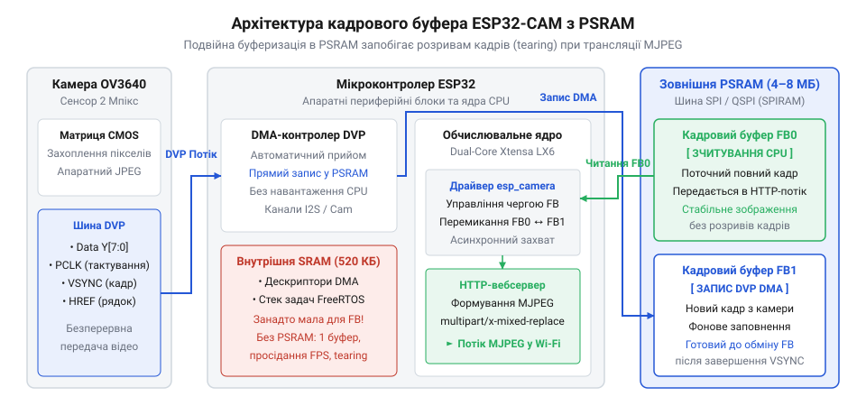
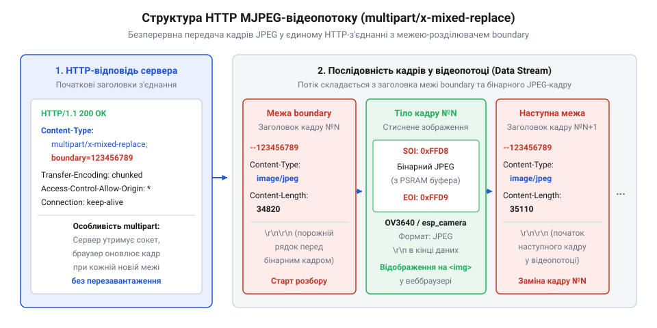

# Організація потокового HTTP/MJPEG відеосервера на ESP32-CAM з кадровим буфером у PSRAM

<preknowlist>
- [ESP32-CAM (OV2640 + microSD)](root:cat-hw-boards/esp32-cam) — Схема розпінування платформи ESP32-CAM, особливості живлення та підключення модуля камери.
- [Модуль ESP32-CAM: огляд архітектури, периферії та сімейства плат](root:cat-hw-boards/esp32-cam-camera-module-family) — Загальна архітектура модуля ESP32-CAM, підключення зовнішньої PSRAM та інтерфейси зв'язку із сенсором.
</preknowlist>

## Проблема відеопотоку без кадрового буфера

Спроба організувати безперервну відеотрансляцію з високою роздільною здатністю безпосередньо з фотосенсора на мережевий сокет швидко впирається в апаратні обмеження обсягу оперативної пам'яті. Коли розробник намагається захопити кадр із матриці OV3640, потік піксельних даних спрямовується у внутрішню оперативну пам'ять мікроконтролера. При розробці пристроїв відеонагляду часто застосовують [популярний модуль ESP32-CAM](root:cat-hw-boards/esp32-cam), який поєднує обчислювальне ядро, Wi-Fi трансивер та роз'єм камери. Однак внутрішня статична оперативна пам'ять (від англ. @@en|Static Random-Access Memory@@, від грец. @@el|στάσις@@ — нерухомий, стаціонарний; @@en|SRAM@@) кристала ESP32 має загальний обсяг лише 520 КБ, з яких для динамічного розподілу доступно значно менше через потреби стека мережевих протоколів та операційної системи.

Сенсор OV3640 здатний формувати зображення з роздільною здатністю до 3 мегапікселів. Навіть після апаратного стиснення зображення у формат JPEG розмір одного кадру високої якості може становити від 100 до 300 КБ, а неспрямований сирий кадр у форматі RGB або YUV вимагає кількох мегабайтів. Коли сенсор надсилає дані через цифровий відеопорт (від англ. @@en|Digital Video Port@@, від лат. @@la|portus@@ — гавань, вхід; @@en|DVP@@), периферійний контролер використовує прямий доступ до пам'яті (від англ. @@en|Direct Memory Access@@, від лат. @@la|directus@@ — прямий; @@en|DMA@@) для запису байтів у кадровий буфер (від англ. @@en|framebuffer@@, від англ. @@en|frame@@ — кадр та старофранцузького @@fro|bouffe@@ — удар, пом'якшувач; @@en|кадровий буфер@@). Спроба виділити суцільний масив пам'яті такого розміру у внутрішній @@en|SRAM@@ призводить до миттєвого вичерпання вільної купи (від англ. @@en|heap@@; @@en|купа@@) та краху системи через помилку нестачі пам'яті.

Якщо ж знизити роздільну здатність і виділити лише один мінімальний @@en|кадровий буфер@@ у внутрішній пам'яті, виникає інша критична проблема — розрив кадру (від англ. @@en|screen tearing@@, від давньоангл. @@ang|teran@@ — рвати, розривати; @@en|тіринг кадру@@). При використанні єдиного буфера периферійний модуль @@en|DMA@@ продовжує перезаписувати пам'яті новими рядками пікселів від сенсора OV3640 саме в той момент, коли мережеве завдання HTTP-сервера зчитує ці ж байти для відправки в мережевий сокет. У результаті клієнт отримує гібридне зображення, де верхня частина належить новому кадру, а нижня — попередньому, що супроводжується горизонтальними смугами та викривленнями.

Розуміння того, як влаштована ця апаратна колізія, робить неминучим використання додаткової оперативної пам'яті. Для забезпечення стабільної трансляції без втрати кадрів та артефактів зображення мікроконтролер повинен мати можливість зберігати кілька повнорозмірних кадрів одночасно. Саме для цього на платі модуля розпаюють зовнішню псевдостатичну оперативну пам'ять (від англ. @@en|Pseudo-Static Random-Access Memory@@, від грец. @@el|ψευδής@@ — хибний, удаваний; @@en|PSRAM@@). Для глибокого аналізу апаратного зв'язку камери та пам'яті корисно вивчити [огляд архітектури сімейства плат](root:cat-hw-boards/esp32-cam-camera-module-family), де детально показано шину підключення та живлення периферії.

## Конфігурування PSRAM та драйвера esp_camera

Зовнішня чип-пам'ять @@en|PSRAM@@ обсягом 4 МБ або 8 МБ підключається до мікроконтролера ESP32 через високошвидкісну послідовну шину. Оскільки внутрішній контролер шини прозоро відображає адреси @@en|PSRAM@@ у загальний адресний простір ядра, драйвер камери дістає можливість виділяти великі черги буферів без ризику вичерпати внутрішню @@en|SRAM@@.

Наявність великого обсягу зовнішньої пам'яті дозволяє реалізувати механізм подвійної буферизації (від англ. @@en|double buffering@@; @@en|подвійна буферизація@@). У цьому режимі драйвер виділяє два незалежні кадрові буфери в @@en|PSRAM@@. Поки модуль @@en|DMA@@ приймає новий кадр із шини @@en|DVP@@ і записує його в перший буфер, мережеве завдання HTTP-сервера безпечно зчитує готовий попередній кадр із другого буфера. Після завершення прийому буфери міняються ролями. Це повністю усуває артефакти @@en|тірингу кадру@@ та дозволяє досягти максимальної частоти кадрів, оскільки захоплення відео та його мережева передача відбуваються паралельно. Для висунутих завдань обробки відеопотоку також застосовують [потужніший мікроконтролер ESP32-S3](root:cat-hw-boards/esp32s3-microcontroller) або орієнтовані на нього компактні рішення.

*Архітектура взаємодії сенсора OV3640 через шину DVP з мікроконтролером ESP32, розподіл кадрових буферів у зовнішній пам'яті PSRAM та їх передача до обчислювального ядра.*

Налаштування драйвера `esp_camera` виконується через заповнення конфігураційної структури `camera_config_t`. У цій структурі вказуються фізичні піни шини @@en|DVP@@ (сигнали `D0`–`D7`, `VSYNC`, `HREF`, `PCLK`, `XCLK`), частота тактування `xclk_freq_hz` (зазвичай 20 МГц для OV3640), формат пікселів `pixel_format = PIXFORMAT_JPEG` та бажана роздільна здатність `frame_size`. Для увімкнення @@en|подвійної буферизації@@ критично встановити параметр `fb_count = 2` та вказати розташування буферів `fb_location = CAMERA_FB_IN_PSRAM`. Також важливим є режим захоплення `grab_mode = CAMERA_GRAB_LATEST`, який гарантує, що сервіс отримуватиме найсвіжіший кадр із черги.

:::tabs
:::code proj-esp32-ov3640-web-streamer/c/esp-idf/init-camera-ov3640.c
:::code proj-esp32-ov3640-web-streamer/cpp/arduino/setupcameraov3640.cpp
:::

У проектах, де потрібні підвищені вимоги до обсягу пам'яті та швидкодії, високу ефективність показує [компактна плата ESP32-S3R2](root:cat-hw-boards/esp32-s3r2-waveshare), яка містить вбудовану високошвидкісну оперативну пам'ять та розширені інструкції обробки сигналів.

## Формування HTTP-потоку у форматі MJPEG

Після того як подвійний @@en|кадровий буфер@@ у @@en|PSRAM@@ налаштовано, постає завдання передачі зображення клієнту. Стандартне потокове відео вимагає складних кодеків, обчислення яких перевищує можливості мікроконтролера. Замість цього застосовують формат послідовних JPEG-кадрів (від англ. @@en|Motion JPEG@@, від лат. @@la|motio@@ — рух; @@en|MJPEG@@). Принцип @@en|MJPEG@@ полягає в надсиланні клієнту безперервної послідовності незалежних стиснених кадрів через один відкритий HTTP-сокет. кадровий буфер@@ у @@en | PSRAM@@ | Для інтеграції відеопотоку з мережевими NVR-відеореєстраторами застосовується [організація RTSP-відеосервера на ESP32](root:com-protocol/rtsp-video-streaming-esp32).

Для того щоб веббраузер зрозумів, що отримане з'єднання не є поодинокою вебсторінкою, а нескінченним потоком оновлюваних зображень, сервер відправляє спеціальний HTTP-заголовок `Content-Type`. У ньому вказується багаточастинний потік із заміною (від англ. @@en|multipart/x-mixed-replace@@, від лат. @@la|multus@@ — численний та @@la|pars@@ — частина; @@en|multipart/x-mixed-replace@@) та задається унікальний текстовий маркер — межа кадру (від англ. @@en|boundary@@, від давньофранцузького @@fro|bone@@ — межа, кордон; @@en|boundary@@).

*Структура HTTP-відповіді з специфічним типом вмісту multipart/x-mixed-replace та розділенням окремих JPEG-знімків межею boundary.*

Алгоритм роботи серверного обробника потоку будується у нескінченному циклі. Спочатку сервер надсилає в сокет службовий розділювач кадру `--123456789000000000000987654321` та міні-заголовки `Content-Type: image/jpeg` і `Content-Length`. Після цього викликається функція `esp_camera_fb_get()`, яка захоплює готовий @@en|кадровий буфер@@ із @@en|PSRAM@@. Вміст буфера записується у мережевий сокет.

Після завершення відправки викликається функція `esp_camera_fb_return()`, яка обов'язково повертає буфер у розпорядження драйвера камери для прийому наступних кадрів через @@en|DMA@@. Якщо розробник забудькувато пропустить цей крок, черга буферів у @@en|PSRAM@@ швидко вичерпається, і відеотрансляція наглухо зависне. Завершує порцію кадру символ переведення рядка.

Отримавши таку структуру, клієнтський браузер автоматично замінює попередньо відображене зображення новим кадром відразу після досягнення межі @@en|boundary@@, створюючи для користувача ефект плавної відеотрансляції в режимі реального часу. Подібні алгоритми організації мережевих потоків є універсальними і широко використовуються, коли розгортається [сучасна родина плат ESP32-S3](root:cat-hw-boards/esp32-s3-boards-family-overview) у промислових або аматорських проектах відеоспостереження.

## Реалізація асинхронного вебсервера відеоспостереження

Передача відеопотоку у браузер вимагає підтримки постійно відкритого сокетного з'єднання, через яке сервер беззупинно надсилає кадр за кадром. Якщо реалізовувати цю задачу на класичному синхронному вебсервері, потік блокує єдиний потік виконання, унеможливлюючи паралельну обробку інших HTTP-запитів чи системних завдань. Для вирішення цієї проблеми застосовується асинхронний вебсервер (від грец. @@el|ἀ-@@ — без та @@el|σύγχρονος@@ — одночасний; @@en|asynchronous web server@@), який працює як окрема фонова задача у середовищі операційної системи реального часу та обробляє мережеві події без затримки основного ядра.

При побудові пристроїв спостереження як базовий апаратний вузол часто обирають [модуль ESP32-CAM](root:cat-hw-boards/esp32-cam) або більш сучасну [плату ESP32-S3 SuperMini](root:cat-hw-boards/esp32-s3-supermini), обчислювальних ресурсів яких цілком достатньо для підтримки асинхронного демона `esp_http_server`. Архітектура серверного коду базується на реєстрації спеціального обробника маршруту (від англ. @@en|route handler@@; @@en|обробник маршруту@@) для URL-адреси трансляції (наприклад, `/stream`). Коли клієнтський браузер надсилає HTTP-запит `GET /stream`, демон запускає відповідну функцію зворотного виклику.

Головний цикл обробника потоку виконує три послідовні дії: захоплення буфера, формування розділювача та надсилання даних у сокет. На початку кожного колу цикл викликає функцію `esp_camera_fb_get()`, яка запитує в драйвера готовий @@en|кадровий буфер@@ із зовнішньої пам'яті @@en|PSRAM@@. Якщо захоплення пройшло успішно, сервер формує текстовий заголовок порції, який містить маркер @@en|boundary@@ та точний розмір JPEG-файлу в байтах. Цей заголовок разом із самими бінарними даними кадру надсилається клієнту через чанковий механізм відправки (від англ. @@en|chunked transfer encoding@@; @@en|чанкове кодування передачі@@).

Після надсилання кадру критично важливим є негайний виклик функції `esp_camera_fb_return(fb)`. Вона повертає вказаний @@en|кадровий буфер@@ назад у чергу драйвера. Якщо розробник припуститься помилки й не вивільнить пам'ять у циклі, подвійний буфер у @@en|PSRAM@@ вичерпається вже на другому кадрі, що спричинить повне зависання відеотрансляції.

Важливою складовою архітектури є обробка від'єднання клієнта. Коли користувач закриває вкладку браузера, мережевий сокет розривається. Під час наступної спроби функції `httpd_resp_send_chunk()` відправити черговий чанк, драйвер мережевого стека повертає помилку `ESP_FAIL`. Обробник негайно перехоплює цей статус, перериває нескінченний цикл через оператор `break` та завершує виконання функції, звільняючи ресурси сервера для нових з'єднань.

:::tabs
:::code proj-esp32-ov3640-web-streamer/c/esp-idf/stream-handler.c
:::code proj-esp32-ov3640-web-streamer/cpp/arduino/videostreamserver.cpp
:::

Для побудови компактних пристроїв спостереження розробники також часто обирають [мініатюрну плату ESP32-S3-Zero](root:cat-hw-boards/esp32-s3-zero), яка дозволяє розгортати асинхронні вебсервери відеопотоку у вкрай обмеженому фізичному об'ємі.

## Оптимізація кадрів і стабілізація трансляції

Навіть за наявності працюючого асинхронного вебсервера трансляція відео у реальному часі може супроводжуватися розривами зображення, високою затримкою (від лат. @@la|latens@@ — прихований; @@en|затримка трансляції@@) та суттєвим падінням частоти кадрів (від англ. @@en|Frame Rate@@, @@en|FPS@@; @@en|частота кадрів@@). Головна причина цих деградацій полягає в дисбалансі між обсягом згенерованих даних та пропускною здатністю (від англ. @@en|bandwidth@@; @@en|пропускна здатність@@) радіоканалу Wi-Fi.

Сенсор OV3640 володіє високою роздільною здатністю, однак формування та передача кадрів формату UXGA (1600x1200) або QXGA (2048x1536) створює надмірне навантаження. Розмір одного стисненого JPEG-файлу при максимальній роздільній здатності сягає 300–400 КБ. При спробі передати 10 кадрів на секунду необхідна швидкість мережевого з'єднання становить понад 25 Мбіт/с, що перевищує реальні можливості радіоінтерфейсу ESP32 в умовах перешкод. В результаті буфери мережевого сокета переповнюються, викликаючи затримки в кілька секунд та вимушене скидання пакетів.

Стабілізація відеопотоку вимагає свідомого пошуку компромісу між трьома основними параметрами: роздільною здатністю `frame_size`, якістю стиснення `jpeg_quality` та пропускною здатністю Wi-Fi.

Ключовим важелем оптимізації є параметр `jpeg_quality` в конфігурації камери. У драйвері `esp_camera` цей параметр визначає коефіціент квантування JPEG і приймає значення від 0 до 63. Важливо враховувати інверсивну логіку цієї шкали: менше значення відповідає вищій якості зображення та слабшому стисненню, тоді як більше значення збільшує стиснення, суттєво зменшуючи розмір файлу. Зміна `jpeg_quality` з 10 до 15 знижує розмір кадру у 3–4 рази (із 200 КБ до 50 КБ) за майже непомітної втрати чіткості для людського ока. Це миттєво розвантажує мережу та збільшує @@en|FPS@@ у кілька разів.

Другим чинником є вибір роздільної здатності `frame_size`. Для потокового відеоспостереження оптимальними є формати SVGA (800x600) або VGA (640x480). Вони забезпечують достатнє розрізнення деталей об'єктів у кадрі, дозволяючи отримувати плавну трансляцію зі швидкістю 20–25 кадрів на секунду через стандартний Wi-Fi зв'язок.

Додатково на стабільність впливає режим захоплення `grab_mode`. Налаштування `CAMERA_GRAB_LATEST` гарантує, що при отриманні нового запиту драйвер завжди віддасть найновіший кадр із @@en|PSRAM@@, скидаючи застарілі кадри, які накопичилися в черзі під час тимчасових мережевих затримок. При побудові високопродуктивних вузлів із високою щільністю даних ефективно зарекомендувала себе [плата Waveshare ESP32-S3R2](root:cat-hw-boards/esp32-s3r2-waveshare), яка забезпечує підвищену пропускну здатність шини пам'яті та прискорене стиснення кадрів.

Для розширення функціонала або побудови багатокамерних систем також доцільно використовувати [мікроконтролер ESP32-S3](root:cat-hw-boards/esp32s3-microcontroller), чия периферія дозволяє гнучко керувати потоками та підтримувати стабільне з'єднання у складних завадових умовах.
