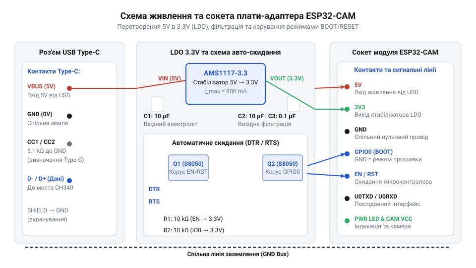
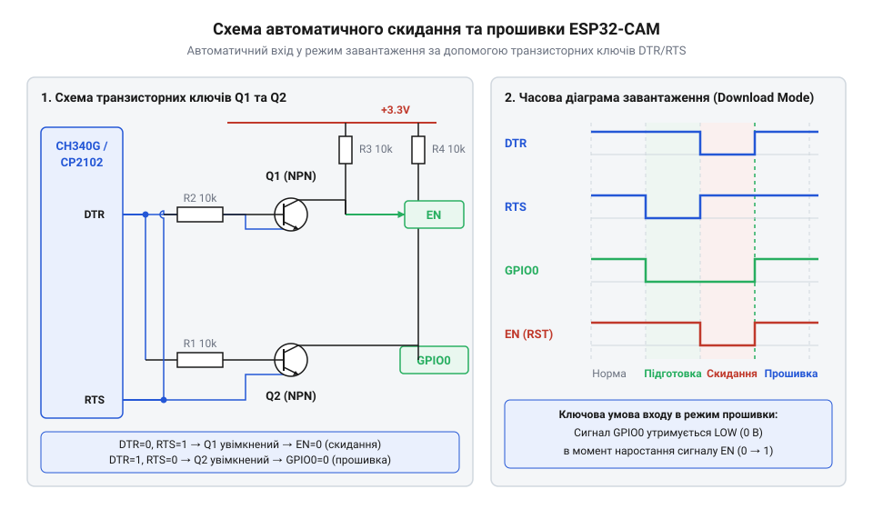

# Апаратний інтерфейс, розпіновка та схема плати-адаптера ESP32-CAM

<preknowlist>
- [USB-UART адаптер CP2102 (Micro-USB)](root:cat-hw-boards/cp2102-usb-uart) — Принципи перетворення послідовного інтерфейсу USB в UART, функціонування керуючих ліній DTR і RTS та вимоги спільного заземлення.
- [Адаптер живлення й підключення ESP-01](root:cat-hw-boards/esp-01-adapter) — Принципи роботи вбудованих LDO-стабілізаторів живлення, організація підтягуючих резисторів та комутація режимів завантаження.
</preknowlist>

## Спроба програмування ESP32-CAM без адаптера

Спроба прошити плату @@en|ESP32-CAM@@ (від англ. @@en|Camera Module@@ — модуль камери) без спеціалізованої периферії швидко перетворюється на виснажливе мануальне маніпулювання проводами. Модуль випущено у компактному конфігурованому форматі без вбудованого моста @@en|USB-UART@@ (від англ. @@en|Universal Serial Bus - Universal Asynchronous Receiver-Transmitter@@ — універсальна послідовна шина та асинхронний приймач-передавач) і без звичних апаратних кнопок скидання чи вибору режиму. Для подачі коду розробнику доводиться підключати [зовнішній конвертер сигналів](root:cat-hw-boards/cp2102-usb-uart), подавати окреме живлення, хрестоподібно комутувати лінії `RXD` і `TXD`, а також вручну замикати контакт @@en|GPIO0@@ (від англ. @@en|General Purpose Input/Output@@ — вхід/вихід загального призначення) на заземлення @@en|GND@@ (від англ. @@en|Ground@@ — земля) перед подачею імпульсу скидання на вивід @@en|EN@@ (від англ. @@en|Enable@@ — увімкнення).

Найменша розсинхронізація в цій послідовності ручних дій викликає помилку завантажувача @@en|Bootloader@@ (від англ. @@en|Boot Loader@@ — початковий завантажувач). Якщо лінію @@en|GPIO0@@ відпустити замить до того, як мікроконтролер @@en|ESP32@@ зчитає стан логічного рівня під час старт-ап ініціалізації, чип запуститься у звичайному режимі виконання програми з внутрішньої пам'яті @@en|Flash@@. Окрім того, ненадійні з'єднання на безпаяльній макетній платі створюють сплески опору, а випадкове подання напруги `5 В` на логічні виводи з рівнем `3.3 В` загрожує незворотним виходом з ладу входів мікроконтролера. Використання спеціалізованої плати-адаптера з вбудованим сокетом усуває потребу в тимчасових джамперах, автоматично комутує режими завантаження та гарантує стабільне електричне з'єднання.

## Схемотехніка сокета та роз'єму Type-C

Для позбавлення від ручної комутації плата-адаптер містить дворядний сокет @@en|DIP-16@@ (від англ. @@en|Dual In-line Package@@ — дворядне корпусне розміщення) та сучасний інтерфейсний роз'єм @@en|USB Type-C@@. Через вхідний роз'єм від зовнішнього джерела чи порту комп'ютера надходить базова напруга `5 В` по лінії @@en|VBUS@@ (від англ. @@en|Voltage Bus@@ — шина живлення USB), а також сигнальні лінії `D+` та `D-`, які підключаються до внутрішнього перетворювача інтерфейсів. Оскільки модуль @@en|ESP32-CAM@@ під час пікового навантаження при роботі бездротового модуля @@en|Wi-Fi@@ та камери споживає струм до `500 мА`, подача стабільного живлення є критичною для запобігання апаратним збоям.

Сучасні джерела живлення та комп'ютерні порти з інтерфейсом @@en|USB Type-C@@ не подають напругу на шину @@en|VBUS@@ за замовчуванням, доки не виявлять узгоджене навантаження на конфігураційних лініях @@en|CC1@@ та @@en|CC2@@ (від англ. @@en|Configuration Channel@@ — канал конфігурації). Для розпізнавання джерелом схемотехніка роз'єму адаптера містить два окремі резистори підтяжки `5.1 кОм` (від англ. @@en|pull-down resistors@@ — резистори підтяжки до потенціалу землі), які з'єднують лінії `CC1` та `CC2` із заземленням `GND`. Джерело фіксує цей опір, ідентифікує адаптер як пристрій-споживач @@en|Sink@@ (від англ. @@en|Sink@@ — приймач живлення) і замикає ключ подачі напруги; без цих резисторів або в разі їхнього помилкового об'єднання в один вузол кабель @@en|Type-C@@-@@en|Type-C@@ не активує живлення взагалі. Вхідні `5 В` розводяться на контакти сокета для внутрішніх потреб плати модуля, а також подаються на вхід інтегрованого регулятора напруги @@en|LDO@@ (від англ. @@en|Low Dropout Regulator@@ — стабілізатор із малим спадом напруги). Цей стабілізатор перетворює нестабільну шинну напругу на чистий рівень `3.3 В` із низьким рівнем пульсацій, що живить мікроконтролер та сигнальні кола.


*Принципова схема живлення плати-адаптера ESP32-CAM з перетворення 5 В у 3.3 В через LDO-стабілізатор.*

Для визначення теплового розсіювання LDO-стабілізатора при найвищому струмовому навантаженні обчислимо потужність `P_loss` через спад напруги `ΔV` та максимальний струм `I_peak`.

```
ΔV = V_in - V_out
= 5.0 - 3.3              [віднімання вихідної напруги від вхідної]
= 1.7 В                  [різниця напруг на стабілізаторі]

P_loss = ΔV × I_peak
= 1.7 × 0.5              [множення різниці напруг на піковий струм 0.5 А]
= 0.85 Вт                [теплова потужність розсіювання]
```

Отримане значення `0.85 Вт` показує, що без достатньої площі мідного полігону для відведення тепла стабілізатор може перегріватися, що викликає просідання напруги `V_out` нижче критичного порогу `2.8 В` і призводить до перезавантаження модуля. Згладжуючі керамічні та електролітичні конденсатори (від англ. @@en|decoupling capacitors@@ — розв'язувальні конденсатори), встановлені паралельно лініям живлення на адаптері, фільтрують високочастотні перехідні перешкоди та компенсують короткочасні просідання струму.

## Автоматичне скидання та узгодження ліній

Автоматизація процедури прошивання реалізується за допомогою транзисторної автозавантажувальної схеми, яка керується послідовними сигналами @@en|DTR@@ (від англ. @@en|Data Terminal Ready@@ — готовність термінала) та @@en|RTS@@ (від англ. @@en|Request to Send@@ — запит на передачу) від чипа @@en|USB-UART@@. Двотранзисторний каскад на NPN-транзисторах (від англ. @@en|Negative-Positive-Negative@@ — структура транзистора зі зворотним провідниковим типом) створює взаємне блокування, що унеможливлює одночасне притискання обох керуючих виводів до землі.

При комбінації сигналів `DTR = 0` та `RTS = 0` на обох керуючих лініях встановлюється низький рівень напруги, тому різниця потенціалів між базою та емітером кожного з двох NPN-транзисторів дорівнює нулю. Через відсутність відмикаючої напруги обидва транзистори залишаються повністю закритими й не з'єднують керовані кола із землею `GND`. У цьому стані зовнішні підтягуючі резистори утримують виводи @@en|GPIO0@@ та @@en|EN@@ у високому рівні `3.3 В`, захищаючи мікроконтролер від хибного перезапуску чи самовільного входу в режим завантажувача. Коли програмне забезпечення утиліти прошивання встановлює рівень `DTR` в логічний `0` (низький стан), а `RTS` в логічну `1` (високий стан), перший транзистор відкривається і притягує лінію @@en|GPIO0@@ до землі `GND`, тоді як вивід @@en|EN@@ залишається у високому стані під дією підтяжки. Наступна зміна станів, коли `DTR` стає `1`, а `RTS` переходить у `0`, відкриває другий транзистор, який притягує вивід @@en|EN@@ до землі та формує негативний імпульс скидання. У момент повернення лінії @@en|EN@@ до високого рівня мікроконтролер фіксує низький рівень на @@en|GPIO0@@ та входить у режим завантаження прошивки.


*Транзисторна схема автоматичного завантаження та скидання для модуля ESP32-CAM.*

Після завершення прошивки обидва сигнали `DTR` і `RTS` повертаються у стан `0` або `1`, що повністю закриває обидва транзистори. У цьому стані зовнішні резистори підтяжки (від англ. @@en|pull-up resistors@@ — підтягуючі резистори) номіналом `10 кОм` підтримують на виводах @@en|EN@@ та @@en|GPIO0@@ високий рівень `3.3 В`, дозволяючи чипу перейти до виконання основного коду. Лінії передачі даних `U0RXD` та `U0TXD` також обладнано підтягуючими резисторами, що гарантує захист від наводок і сумісність сигналів, за принципом, аналогічним до того, як влаштований [модуль узгодження рівнів](root:cat-hw-boards/esp-01-adapter) для інших бездротових плат.

## Підключення зовнішньої периферії та підтяжки

Практичне застосування адаптера вимагає врахування апаратної специфіки модуля @@en|ESP32-CAM@@, більшість контактів якого є мультиплексованими (від англ. @@en|multiplexing@@ — ущільнення/мультиплексування каналів). Через обмежену кількість доступних виводів виводи сокета одночасно обслуговують шину камери @@en|OV2640@@, інтерфейс зчитувача карт пам'яті та вбудоване підсвічування. Наприклад, вивід @@en|GPIO4@@ підключено до потужного світлодіода спалаху (від англ. @@en|Flash LED@@ — світлодіод спалаху), а лінії @@en|GPIO12@@, @@en|GPIO13@@, @@en|GPIO14@@ та @@en|GPIO15@@ комутуються зі шиною [картридера microSD-карт](root:cat-hw-boards/microsd-card) у режимі @@en|SDMMC@@ чи @@en|SPI@@.

Під час комутації зовнішніх датчиків слід суворо дотримуватися правил електричної сумісності сигналів. Вивід @@en|GPIO12@@ є критичним контактом конфігурації завантаження @@en|Strapping Pin@@ (від англ. @@en|strapping pin@@ — вивід конфігурації запуску), який визначає напругу живлення внутрішньої флеш-пам'яті `VDD_SDIO` (`3.3 В` чи `1.8 В`). Якщо зовнішній датчик підтягне @@en|GPIO12@@ до низького рівня при старті, внутрішній регулятор встановить напругу `1.8 В`, що призведе до неможливості зчитати флеш-пам'ять і циклічного завантаження.

Коли до вільного порту додається [модуль реального часу](root:cat-hw-boards/ds1302-rtc) або цифровий сенсор, їхні сигнальні лінії необхідно підключати через обмежувальні або підтягуючі резистори номіналом від `4.7 кОм` до `10 кОм`. Це усуває паразитні струми через захисні діоди мікроконтролера та запобігає апаратним конфліктам під час автоматичного скидання адаптера.

## Пошук та усунення апаратних збоїв

Діагностика несправностей при роботі з платою-адаптером базується на послідовному аналізі електричних параметрів живлення та сигналів послідовного порту. Найтиповішою проблемою під час завантаження коду є помилка синхронізації `Failed to connect to ESP32: Timed out waiting for packet header`. Вона виникає через відсутність імпульсу скидання на ліній @@en|EN@@ або ненадійне притискання @@en|GPIO0@@ до землі. Для усунення слід перевірити осцилографом чи мультиметром цілісність NPN-транзисторів автоскидання та відсутність зовнішнього стороннього підтягування ліній до `3.3 В`.

Другою поширеною проблемою є спонтанне скидання мікроконтролера з повідомленням про спрацювання детектора зниження напруги @@en|Brownout Detector@@ (від англ. @@en|brownout detector@@ — детектор просідання живлення). Причиною цього є падіння шинної напруги нижче `4.5 В` на вході `5 В` роз'єму @@en|Type-C@@ через використання тонких чи занадто довгих кабелів @@en|USB@@, або недостатню потужність порту ПК. Заміна кабелю на провід із більшим перерізом провідників та встановлення додаткового згладжувального електролітичного конденсатора ємністю `100 мкФ` безпосередньо на виводи живлення сокета повністю ліквідує просідання.

Неможливість зчитати текстові повідомлення в терміналі найчастіше зумовлена неузгодженістю швидкості передачі @@en|Baud Rate@@ (від англ. @@en|baud rate@@ — швидкість передачі в бодах). Первинний завантажувач @@en|ESP32@@ передає відлагоджувальну інформацію на нетиповій швидкості `115200 бод`, тоді як основна програма зазвичай використовує `115200 бод`. Налаштування відповідної швидкості у моніторі послідовного порту дозволяє розрізнити апаратний збій живлення від помилки у програмному коді.
