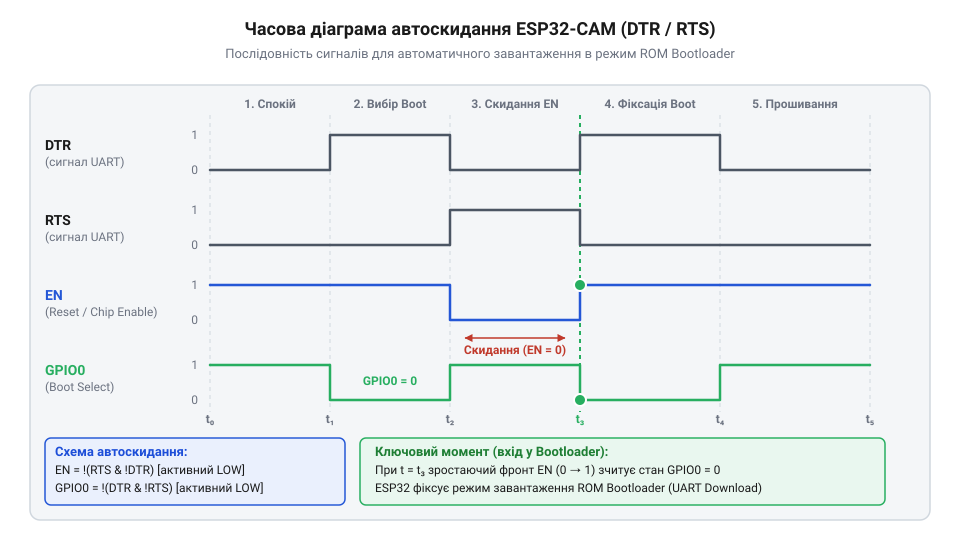
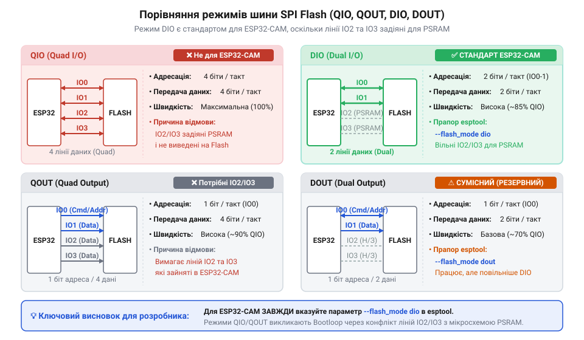

# Програмний інтерфейс утиліти esptool та параметри послідовного прошивання

<preknowlist>
- [USB-UART адаптер CP2102 (Micro-USB)](root:cat-hw-boards/cp2102-usb-uart) — призначення ліній TX, RX, DTR, RTS та принципи передачі даних через послідовний інтерфейс UART.
</preknowlist>

H2: Помилки з'єднання та потреба конфігурації

Перша спроба записати прошивку в модуль @@en|ESP32-CAM@@ часто завершується аварійною зупинкою консолі з повідомленням `Timed out waiting for packet header`. Користувач запускає утиліту запису, бачить декілька рядків спроб підключення із крапками, після чого сесія переривається. Така помилка виникає через те, що мікроконтролер після подачі живлення або перезапуску за замовчуванням виконує програму з внутрішньої флеш-пам'яті, замість того щоб очікувати нові дані через послідовний порт.

Апаратне ядро ESP32 містить зашитий на заводі @@en|ROM-завантажувач@@ (від англ. @@en|ROM@@ — @@en|Read-Only Memory@@, @@en|bootloader@@: @@en|boot@@ — завантаження, @@en|loader@@ — завантажувач). Щоб активувати цей режим, внутрішній контролер під час скидання аналізує логічний рівень на лінії @@en|GPIO0@@. Якщо в момент зняття сигналу скидання лінія @@en|GPIO0@@ перебуває в стані логічного нуля (0 В), мікроконтролер зупиняє виконання основної програми й переходить у режим завантаження через @@en|UART@@. Якщо ж лінія затягнута до високого рівня (3.3 В), починається звичайне виконання коду. Пряма відправка бінарного образу без попереднього узгодження станів ліній зв'язку та скидання викликає @@en|таймаут@@ (від англ. @@en|time@@ — час, @@en|out@@ — вихід), оскільки @@en|ROM-завантажувач@@ просто не слухає шину.

Для автоматизації процедури прошивання компанія @@en|Espressif@@ створила спеціалізовану Python-утиліту @@en|esptool@@. Оскільки інструмент розповсюджується як пакет мови @@en|Python@@, його інсталюють у системне або віртуальне оточення за допомогою штатного менеджера пакетів @@en|pip@@ (від англ. @@en|pip@@ — @@en|Package Installer for Python@@) командою `pip install esptool`. Для перевірки наявності утиліти в системній змінній оточення @@en|PATH@@ (від англ. @@en|path@@ — шлях) та коректності її розгортання виконують команду `esptool.py version`, яка відображає поточну версію програми й підтверджує працездатність залежностей. Утиліта реалізує програмний протокол зв'язку, який першим кроком виконує процедуру первинного @@en|рукостискання@@ (від англ. @@en|handshake@@: @@en|hand@@ — рука, @@en|shake@@ — потиск), синхронізуючи частоту передачі та перевіряючи готовність мікроконтролера. Через під'єднаний [USB-UART адаптер CP2102](root:cat-hw-boards/cp2102-usb-uart) утиліта керує логічними рівнями й надсилає спеціальну послідовність байтів. Без чіткого визначення параметрів порту, швидкості та правил скидання утиліта не зможе встановити стабільне з'єднання.

H2: Параметри порту та узгодження швидкості

Для встановлення фізичного каналу зв'язку @@en|esptool@@ вимагає вказати ідентифікатор послідовного порту через аргумент `--port` (або `-p`). У системі Linux це зазвичай шлях `/dev/ttyUSB0`, а в Windows — системний порт `COM3` чи `COM4`. Якщо параметр не вказано, утиліта намагається виконати автоматичний пошук підключених системних адаптерів, однак явне визначення порту запобігає конфліктам із сусідніми пристроями.

Другим критичним параметром є швидкість обміну даними, що задається прапором `--baud` (або `-b`). Зв'язок завжди починається зі стандартної швидкості 115200 @@en|baud rate@@ (від англ. @@en|baud@@ — одиниця швидкості маніпуляції, @@en|rate@@ — швидкість). Саме на цій частоті @@en|ROM-завантажувач@@ ESP32 слухає шину після перезапуску. Після успішного первинного @@en|рукостискання@@ на цій базовій швидкості утиліта @@en|esptool@@ надсилає команду перемикання на підвищену швидкість обміну.

Залежно від якості апаратури можна обрати підвищену швидкість: 230400, 460800 або 921600 @@en|baud rate@@. Вибір швидкості 921600 @@en|baud rate@@ дозволяє зменшити час запису прошивки обсягом у кілька мегабайтів до кількох секунд. Проте гранична швидкість обмежується параметрами фізичного середовища: довгими або неекранованими провідниками, паразитною ємністю монтажу та стабільністю самого конвертера. Якщо під час прошивання виникають помилки зчитування або збої контрольних сум, слід зменшити швидкість до 460800 або 115200 @@en|baud rate@@ для забезпечення завадостійкості.

H2: Автоматичне та ручне скидання пристрою

Для керування станом мікроконтролера до й після сесії прошивання в @@en|esptool@@ застосовуються прапори `--before` та `--after`. За замовчуванням аргумент `--before default_reset` виконує автоматичне скидання пристрою за допомогою допоміжних ліній послідовного порту @@en|DTR@@ (від англ. @@en|Data Terminal Ready@@) та @@en|RTS@@ (від англ. @@en|Request to Send@@).


*Послідовність зміни рівнів на лініях DTR та RTS для введення мікроконтролера в режим завантажувача та наступного перезапуску.*

Схема автоматичного скидання використовує два транзистори, підключені до виводів @@en|EN@@ (скидання) та @@en|GPIO0@@. На початку процедури @@en|esptool@@ притискає лінію @@en|RTS@@ до низького рівня, що притягує вивід @@en|EN@@ до землі та скидає мікроконтролер. Одночасно лінія @@en|DTR@@ переводить вивід @@en|GPIO0@@ у низький стан. Далі утиліта відпускає лінію @@en|EN@@, забезпечуючи наростаючий фронт живлення ядра, поки @@en|GPIO0@@ все ще утримується в нулі. @@en|ROM-завантажувач@@ фіксує низький рівень на @@en|GPIO0@@ і переходить у режим завантаження. Після завершення прошивання прапор `--after hard_reset` короткочасно притискає вивід @@en|EN@@ при високому рівні на @@en|GPIO0@@, запускаючи записану програму.

Плата @@en|ESP32-CAM@@ найчастіше не має вбудованої схеми з двох транзисторів для автоскидання. У такому разі використовується алгоритм ручного введення: перед запуском @@en|esptool@@ лінію @@en|GPIO0@@ фізично з'єднують перемичкою з землею (GND), після чого натискають кнопку скидання (RESET) або короткочасно вимикають живлення. Після того як утиліта завершить запис бінарного файлу, перемичку з виводу @@en|GPIO0@@ обов'язково знімають і повторно перезапускають пристрій для переходу в робочий режим. ESP32-CAM@@ найчастіше не має вбудованої схеми з двох транзисторів для автоскидання | Детальний аналіз апаратної топології, виводів та схемотехнічних особливостей модуля наведено в статті про [плату ESP32-CAM](root:cat-hw-boards/esp32-cam).

H2: Конфігурація режиму флеш-пам'яті

Фізичний запис коду у внутрішню флеш-пам'ять вимагає точного узгодження шини @@en|SPI@@ (від англ. @@en|Serial Peripheral Interface@@). Для цього в командному рядку @@en|esptool@@ використовуються прапори `--flash_mode` (або `-fm`), `--flash_freq` (або `-ff`) та `--flash_size` (або `-fs`). Вони визначають розрядність шини даних, частоту обміну та обсяг адресуємої пам'яті.


*Порівняння розведення шини SPI флеш-пам'яті між двобітовими та чотирибітовими режимами передавання.*

Режими роботи флеш-пам'яті розрізняються кількістю використовуваних ліній даних. Чотирибітові режими @@en|QIO@@ (від англ. @@en|Quad I/O@@) та @@en|QOUT@@ (від англ. @@en|Quad Output@@) передають по 4 біти за такт, але задействують лінії `IO2` та `IO3`. Двобітові режими @@en|DIO@@ (від англ. @@en|Dual I/O@@) та @@en|DOUT@@ (від англ. @@en|Dual Output@@) використовують лише лінії `D0` та `D1`.

Критична особливість @@en|ESP32-CAM@@ полягає в тому, що лінії `IO2` та `IO4` розведені на зовнішню мікросхему псевдостатичної пам'яті @@en|PSRAM@@ (від англ. @@en|Pseudo Static RAM@@) або об'єктив камери. Якщо в @@en|esptool@@ вказати режим @@en|QIO@@, після перезапуску контролер спробує зчитати заголовки через 4 лінії шини, що призведе до конфлікту сигналів на платі й вічного циклу перезавантажень (`bootloop`). Для @@en|ESP32-CAM@@ обов'язково слід обирати режим `--flash_mode dio`. Частоту флеш-пам'яті зазвичай встановлюють на рівні `--flash_freq 40m` (або `80m`), а розмір — `--flash_size 4MB` (або скористатися значенням `detect` для автоматичного визначення).

H2: Підкоманди запису та діагностика помилок

Основні операції @@en|esptool@@ виконуються через спеціалізовані підкоманди. Підкоманда `write_flash` призначена для зчитування бінарних файлів з диска та їх запису за конкретними байтовими зміщеннями у флеш-пам'яті. Стандартна структура прошивки ESP32 складається з кількох блоків: завантажувача другої стадії (зміщення `0x1000`), таблиці розділів (`0x8000`) та основного образу програми (`0x10000`).

Повний виклик запису прошивки для @@en|ESP32-CAM@@ у консолі має такий вигляд:

```bash
esptool.py --chip esp32 --port /dev/ttyUSB0 --baud 460800 --before default_reset --after hard_reset write_flash -z --flash_mode dio --flash_freq 40m --flash_size 4MB 0x1000 bootloader.bin 0x8000 partitions.bin 0x10000 firmware.bin
```

Прапор `-z` вмикає стиснення даних під час передачі, що істотно прискорює процес. Для первинної діагностики плати та перевірки цілісності фізичного з'єднання використовуються службові підкоманди `chip_id` та `flash_id`. Вони зчитують унікальний MAC-адрес мікроконтролера, тип встановленого чіпа та ідентифікатор виробника флеш-пам'яті без ризику пошкодити записані дані.

Якщо таблицю розділів пошкоджено або виникають помилки зчитування конфігурації, застосовують підкоманду `erase_flash`, яка повністю очищає весь масив пам'яті. У разі виникнення повторюваних помилок @@en|таймауту@@ слід перевірити рівень живлення 5 В (модуль @@en|ESP32-CAM@@ споживає імпульсні струми до 500 мА під час роботи радіомодуля й прошивання), переконатися в надійності заземлення між конвертером і платою та зменшити швидкість `--baud`.

Для підтвердження успішного збереження даних утиліта @@en|esptool@@ під час виконання `write_flash` автоматично розраховує @@en|хеш@@ (від англ. @@en|hash@@ — мішанина, дрібно порізана їжа) за алгоритмом @@en|MD5@@ для кожного записаного блоку. Якщо через перешкоди в кабелі або короткочасне зниження напруги хоча б один байт спотвориться, утиліта повідомить про помилку невідповідності контрольної суми. Для додаткової перевірки цілісності вже записаної прошивки без повторного виклику стирання чи перезапису застосовують підкоманду `verify_flash`, яка порівнює вміст флеш-пам'яті з оригінальним бінарним файлом на диску. У разі складних збоїв під час встановлення зв'язку прапор `--trace` вмикає детальне виведення всіх переданих пакетів протоколу, а аргумент `--no-stub` вимикає завантаження проміжного програмного коду в оперативну пам'ять мікроконтролера, змушуючи @@en|esptool@@ працювати напряму через базовий @@en|ROM-завантажувач@@.
