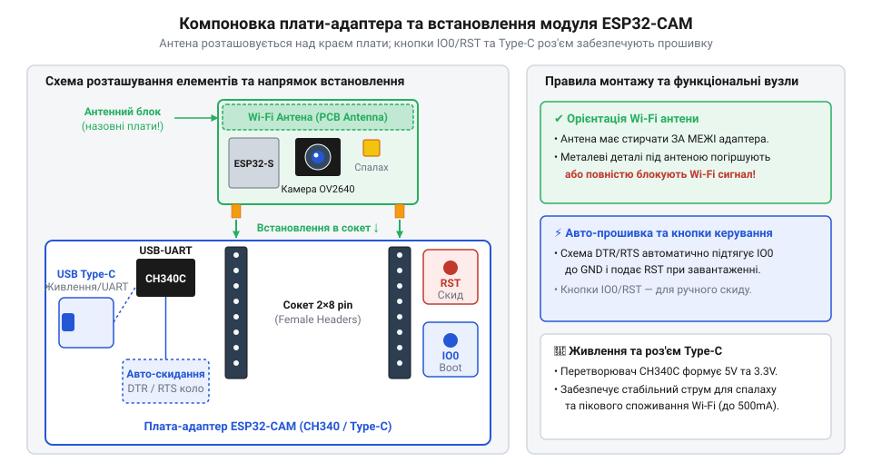
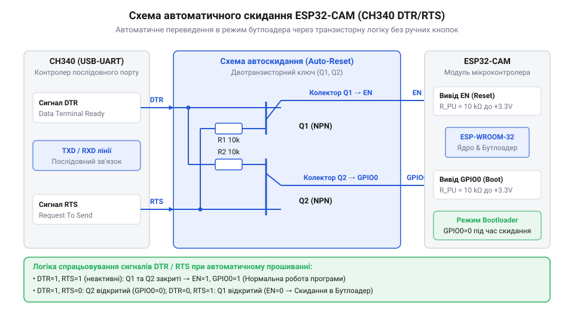
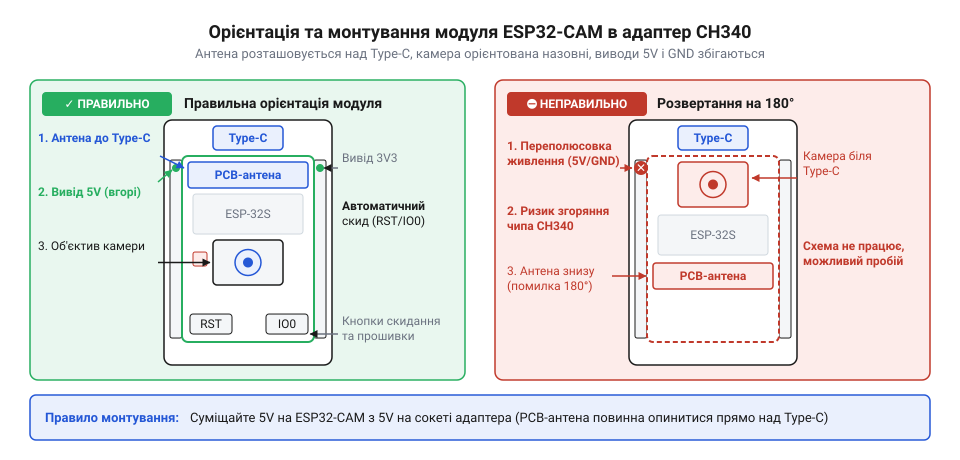

# Плата-адаптер для ESP32-CAM (CH340, Type-C)

<preknowlist>
- [USB-UART адаптер CP2102 (Micro-USB)](root:cat-hw-boards/cp2102-usb-uart) — Принципи роботи послідовного інтерфейсу USB-UART, призначення ліній RX/TX та роль драйверів послідовного порту в ОС.
- [Адаптер живлення й підключення ESP-01](root:cat-hw-boards/esp-01-adapter) — Концепція виносних плат-адаптерів для модулів без вбудованого USB та способи керування режимом завантаження.
</preknowlist>

## Складність ручного прошивання модуля ESP32-CAM

Компактний модуль [плати з відеокамерою ESP32-CAM](root:cat-hw-boards/esp32-cam-camera-module-family) розроблявся для автономних систем відеоспостереження та інтернет-речей, де вирішальними факторами є габарити та мінімальна собівартість. Щоб зменшити розміри плати, інженери вилучили з неї вбудований інтерфейсний перетворювач та роз'єм @@en|USB@@ (англ. *Universal Serial Bus* — універсальна послідовна шина). Через це пряме підключення модуля до комп'ютера є неможливим, а для завантаження керуючої програми розробник змушений використовувати [зовнішній USB-UART перетворювач](root:cat-hw-boards/cp2102-usb-uart).

Підключення через окремий перехідник @@en|UART@@ (англ. *Universal Asynchronous Receiver-Transmitter* — універсальний асинхронний приймач-передавач) вимагає не лише з'єднання ліній передачі даних @@en|Rx@@ та @@en|Tx@@, але й ручного керування режимом завантаження @@en|bootloader@@ (англ. *boot* — запуск, *load* — завантажувати). При цьому сигнальні лінії з'єднуються перехресно: вивід передавача @@en|Tx@@ перехідника підключають до приймача @@en|Rx@@ модуля, а вивід @@en|Rx@@ перехідника — до @@en|Tx@@ модуля, оскільки пряме з'єднання однойменних контактів призводить до конфлікту вихідних каскадів і блокує передачу даних. Крім того, така схемотехніка вимагає узгодження логічних рівнів @@en|logic level@@ (англ. *logic* — логіка, *level* — рівень) на 3.3 В: подача 5 В сигналів @@en|TTL@@ (англ. *Transistor-Transistor Logic* — транзисторно-транзисторна логіка) із застарілих конвертерів без резистивного дільника напруги @@en|voltage divider@@ (англ. *voltage* — напруга, *divide* — ділити) створює ризик пробою діелектрика затворів і електричного пошкодження вхідного виводу @@en|Rx@@ мікроконтролера. Для зниження амплітуди сигналу дільник будують на лінії @@en|Rx@@ з двох послідовно з'єднаних резисторів: верхнього `R₁` (1 кОм) між виводом @@en|Tx@@ конвертера і середньою точкою та нижнього `R₂` (2 кОм) між середньою точкою і землею @@en|GND@@, звідки знімають безпечний сигнал для мікроконтролера. За законом Ома напруга в середній точці обчислюється як `V_out = V_in · R₂ ÷ (R₁ + R₂)` і при вхідних 5 В становить `5 × 2 ÷ (1 + 2) ≈ 3.33 В`, що повністю відповідає робочому діапазону плати. Якщо ж обрати опір резисторів занадто малим, зросте струмове навантаження на передавач, а якщо занадто великим (понад 100 кОм) — опір разом із паразитною ємністю контактів утворить @@en|RC-filter@@ (англ. *resistor-capacitor* — резистор-конденсатор), який завалить фронти імпульсів на високих швидкостях прошивання і спричинить помилки передачі даних. При цьому зворотна лінія @@en|Tx@@ мікроконтролера дільника не потребує, оскільки рівень 3.3 В сприймається вхідним каскадом 5 В конвертера як логічна одиниця. Для переведення мікроконтролера в стан приймання прошивки вивід @@en|GPIO0@@ (англ. *General Purpose Input/Output* — вивід загального призначення) необхідно фізично з'єднати з землею @@en|GND@@ перед подачею живлення або короткочасним натисканням кнопки скидання @@en|RESET@@. Після завершення передачі коду перемичку з @@en|GPIO0@@ потрібно вручну відключити й знову перезапустити живлення, щоб мікроконтролер перейшов до виконання завантаженої програми. Подібно до того як [адаптер живлення ESP-01](root:cat-hw-boards/esp-01-adapter) спрощує роботу з компактними бездротовими модулями, спеціалізована плата для камери позбавляє розробника від маніпуляцій з макетними провідниками.

Постійна робота з гнучкими макетними дротами створює ризик помилкового підключення шини живлення 5 В до 3.3 В виводів мікроконтролера, що призводить до негайного виходу з ладу плати. Крім того, під час ініціалізації модуля камери та увімкнення @@en|Wi-Fi@@ передавача виникають короткочасні пікові споживання струму до 500 мА. Тонкі макетні провідники та неякісні контактні макетні плати створюють помітний опір, який викликає просідання напруги та постійні циклічні перезапуски пристрою.

Історія виникнення спеціалізованих адаптерів для плати @@en|ESP32-CAM@@ обумовлена початковою відсутністю на оригінальному модулі вбудованого @@en|USB-UART@@ перетворювача та кола автоматичного скидання. На перших етапах розробники були змушені використовувати зовнішні @@en|USB-UART@@ конвертери, вручну замикати @@en|GPIO0@@ на землю для входу в режим завантажувача та натискати кнопку скидання. Поява адаптера @@en|ESP32-CAM MB@@ з роз'ємом @@en|Micro-USB@@, а згодом модернізація до @@en|Type-C@@ на базі @@en|CH340@@ з транзисторною схемою скидання усунула потребу в ручних маніпуляціях. Розуміння цієї еволюції допомагає читачеві осягнути схемні рішення адаптера та принципи надійного налагодження пристрою.

Спеціалізований адаптер розв'язує апаратну проблему шляхом інтеграції підпружиненого сокета, у який модуль встановлюється безпосередньо без жодного макетного провідника. Повний перелік контактів сокета та діаграму розподілу живлення наведено в [апаратному довіднику адаптера](root:cat-hw-boards/esp32-cam-programmer/api-esp32-cam-adapter-hardware.md).

*Фізичне розміщення сокета та фіксація модуля ESP32-CAM на платі-адаптері.*

## Апаратна структура та автоматичне скидання

Головним вузлом плати-адаптера є [інтерфейсна мікросхема CH340](root:hw-components/ch340-usb-uart-bridge-family), яка перетворює сигнали шини @@en|USB@@ від сучасного симетричного роз'єму @@en|Type-C@@ у послідовні рівні @@en|UART@@. Крім базових ліній передачі @@en|Tx@@ та приймання @@en|Rx@@, цей міст формує однонаправлені службові лінії керування @@en|DTR@@ (англ. *Data Terminal Ready* — готовність термінала даних) та @@en|RTS@@ (англ. *Request To Send* — запит на передачу). Саме ці два сигнали використовуються для автоматизації входу в режим програмування без фізичного замикання @@en|GPIO0@@ користувачем.

Пряме підключення ліній @@en|DTR@@ та @@en|RTS@@ до виводів скидання @@en|EN@@ та вибору режиму @@en|GPIO0@@ неможливе, оскільки зміна стану послідовного порту під час відкриття термінала викликала б неконтрольоване скидання мікроконтролера. Для вирішення цієї проблеми застосовують [транзисторне коло автоскидання](root:hw-arch/esp32-auto-reset-circuit-design) на двох NPN-транзисторах. Коли утиліта програмування, така як [програмний інтерфейс esptool](root:cat-hw-boards/esp32-cam-programmer/api-esptool-flashing-interface.md), починає сесію запису, вона встановлює @@en|DTR@@ у низький логічний рівень, а @@en|RTS@@ у високий. У цьому стані перший транзистор відкривається і притягує вивід @@en|GPIO0@@ до землі. Далі утиліта перемикає @@en|DTR@@ у високий рівень, а @@en|RTS@@ у низький, що відкриває другий транзистор і формує коротке замикання лінії @@en|EN@@ на землю для перезапуску процесора. Під час відновлення високого рівня на @@en|EN@@ мікроконтролер @@en|ESP32@@ зчитує нульовий стан на @@en|GPIO0@@ і автоматично переходить у режим завантажувача.

*Схема автоматичного скидання та переведення в режим прошивки за допомогою транзисторного ключа.*

Для забезпечення стабільної роботи модуля під час пікових навантажень адаптер оснащено потужним лінійним регулятором напруги @@en|LDO@@ (англ. *Low Dropout* — мале падіння напруги) з керамічними фільтруючими конденсаторами. Регулятор перетворює вхідную напругу 5 В з інтерфейсу @@en|Type-C@@ на 3.3 В із вихідним струмом до 1 А, запобігаючи виникненню помилок @@en|Brownout Reset@@ (англ. *brownout* — просідання напруги, *reset* — скидання). На платі також розміщено фізичні кнопки @@en|RST@@ та @@en|IO0@@, які дозволяють за потреби виконати ручне скидання або вибір режиму завантаження. Покроковий процес першого запуску та прошивання розглянуто у матеріалі про [проєкт налаштування середовища](root:cat-hw-boards/esp32-cam-programmer/proj-esp32-cam-flashing-setup.md).

Критичною особливістю перехресного увімкнення двох @@en|NPN@@-транзисторів є захист від хаотичних перезавантажень під час звичайної роботи з терміналом. Коли операційна система відкриває послідовний порт або ініціалізує драйвер мосту, вона одночасно встановлює лінії @@en|DTR@@ та @@en|RTS@@ в однаковий логічний стан — обох у нуль або обох у одиницю. За однакових сигналів на входах база жодного з транзисторів не отримує відмикальної напруги, оскільки різниця потенціалів відносно емітера залишається нижчою за поріг провідності. Унаслідок цього виводи @@en|EN@@ та @@en|GPIO0@@ утримуються під високим логічним рівнем через зовнішні підтягувальні резистори, що виключає хибні перезапуски мікроконтролера під час підключення.

Окрім правильної послідовності сигналів, вирішальну роль відіграє часове узгодження перемикань. Коли прошивач формує спадний імпульс на лінії @@en|EN@@, напруга на виводі скидання не зменшується миттєво через наявність фільтруючих ємностей у колі живлення. Якщо тривалість перехідного стану @@en|DTR@@ та @@en|RTS@@ становитиме одиниці мікросекунд, вивід @@en|EN@@ не встигне опуститися нижче порогу логічного нуля, і мікроконтролер взагалі не перезапуститься. Ще суворіші вимоги висуває завантажувач у @@en|ROM@@ (англ. *Read-Only Memory* — постійна пам'ять) мікроконтролера @@en|ESP32@@. Під час зняття сигналу скидання первинне програмне забезпечення опитує логічний рівень на @@en|GPIO0@@ не в момент підйому напруги на @@en|EN@@, а після короткої затримки на ініціалізацію внутрішньої периферії. Якщо імпульс @@en|DTR@@ завершиться занадто рано, зовнішній підтягувальний резистор підніме рівень на @@en|GPIO0@@ до логічної одиниці раніше, ніж завантажувач завершить зчитування, і чип почне звичайне виконання коду. З цієї причини утиліти прошивання утримують лінії @@en|DTR@@ та @@en|RTS@@ у потрібному стані протягом 50–100 мілісекунд, що забезпечує [автоматичне скидання мікроконтролера](root:hw-arch/esp32-auto-reset-circuit-design) та надійний перехід у режим програмування.

## Встановлення модуля та керування платою

Спроба підключити модуль без вбудованого інтерфейсу напряму до комп'ютера часто призводить до плутанини з макетними дротами та помилок монтажу. Спеціалізована плата-адаптер усуває це хаотичне павутиння, пропонуючи жорстко зафіксований сокет (від англ. @@en|socket@@ — «гніздо, заглиблення») для установки мікроконтролера та готовий роз'єм @@en|USB Type-C@@. Однак недбале встановлення плати у гніздо загрожує миттєвим виходом з ладу як самого об'єктива, так і обчислювального ядра через переполюсовку живлення.

Модуль @@en|ESP32-CAM@@ має дворядний штирьовий роз'єм із шістнадцятьма контактами. На платі-адаптері розташована відповідна дворядна розеточна колодка. При посадці модуля сенсор камери має бути спрямований у бік, протилежний від роз'єму @@en|Type-C@@, а друкована антена повинна виходити за зовнішній край плати адаптера. Помилкова орієнтація на сто вісімдесят градусів призводить до того, що лінія живлення п'ять вольтів потрапляє на чутливі виводи послідовного порту або загальний провід @@en|GND@@, спричиняючи коротке замикання. Повні електричні параметри та [призначення контактів сокета](root:cat-hw-boards/esp32-cam-programmer/api-esp32-cam-adapter-hardware.md) зібрані в апаратному довіднику пристрою.

*Правильне монтування модуля ESP32-CAM у дворядний сокет адаптера CH340 Type-C із дотриманням сумісності контактних груп.*

Підключення адаптера до комп'ютера здійснюється через кабель @@en|USB Type-C@@, проте не кожен кабель підходить для роботи. Звичайні зарядні кабелі містять лише два провідники живлення й не мають ліній даних @@en|D+@@ та @@en|D-@@. Без ліній даних @@en|USB@@ (@@en|D+@@ та @@en|D-@@) мікросхема @@en|CH340@@ не ініціалізується в операційній системі як віртуальний послідовний порт. Крім того, при використанні джерел живлення з підтримкою технології @@en|Power Delivery@@ (від англ. @@en|Power Delivery@@ — «доставка живлення») дешевші ревізії адаптерів без резисторів підтяжки до землі на лініях @@en|CC1/CC2@@ можуть не отримувати вхідну напругу. Для надійного з'єднання слід використовувати повноцінний кабель передачі даних та стандартний порт @@en|USB-A@@ або правильно розводжений порт @@en|Type-C@@.

На корпусі адаптера розміщено дві фізичні кнопки: @@en|RST@@ (від англ. @@en|reset@@ — «скидання») та @@en|IO0@@ (від англ. @@en|Input/Output 0@@ — «вхід-вихід 0»). Хоча транзисторна схема автоматично керована сигналами @@en|DTR@@ і @@en|RTS@@ переводить мікроконтролер у режим завантажувача (від англ. @@en|bootloader@@ — «початковий завантажувач»), фізичні кнопки залишаються необхідним інструментом ручного оверрайду. Натискання кнопки @@en|RST@@ короткочасно підтягує вивід @@en|EN@@ до землі, виконуючи апаратне перезавантаження. Якщо утиліта прошивання не може встановити зв'язок через специфічні таймінги ОС, затискання кнопки @@en|IO0@@ під час примусового скидання кнопкою @@en|RST@@ надійно примушує плату увійти в режим прошивки. Специфіка виносних [плата-адаптерів для модулів](root:cat-hw-boards/esp-01-adapter) демонструє подібну логіку керування виводом вибору режиму завантаження.

Практичне [налаштування середовища розробки](root:cat-hw-boards/esp32-cam-programmer/proj-esp32-cam-flashing-setup.md) автоматизує цей процес під час щоденного збирання проєкту. Водночас слід пам'ятати, що частина сигнальних ліній сокета розведена паралельно із [вбудованим картридером microSD](root:cat-hw-boards/microsd-card). Картридер використовує виводи @@en|GPIO14@@ (тактовий сигнал @@en|CLK@@), @@en|GPIO15@@ (команда @@en|CMD@@ або вибір чипа @@en|CS@@), @@en|GPIO2@@ (лінія даних @@en|DATA0@@ чи @@en|MISO@@), @@en|GPIO13@@ (лінія @@en|DATA3@@ чи @@en|MOSI@@), а також @@en|GPIO12@@ (лінія @@en|DATA2@@) та @@en|GPIO4@@ (лінія @@en|DATA1@@). Виводи @@en|GPIO2@@, @@en|GPIO12@@ та @@en|GPIO15@@ додатково слугують лініями конфігурації завантаження (від англ. @@en|strapping pins@@ — «фіксувальні виводи»). Установлена картка пам'яті через внутрішні кола та резистори підтяжки змінює логічні рівні цих ліній під час скидання живлення. У результаті мікроконтролер не може увійти в режим завантажувача або виникають апаратні конфлікти шини @@en|SPI@@, тому під час прошивання картку пам'яті краще виймати.

## Відмінності ревізій та апаратні пастки

Зовні однакові адаптери для модуля розробки нерідко поводяться по-різному під час реальної експлуатації, викликаючи раптові перезавантаження або відмову у з'єднанні. Причина полягає у відмінностях схемотехнічних рішень та компонентної бази різних китайських ревізій адаптера. Найважчою пасткою для розробника є неякісна стабілізація живлення та неузгодженість ліній скидання.

Центральним елементом живлення плати є лінійний стабілізатор напруги з малим падінням (від англ. @@en|Low Dropout@@, @@en|LDO@@). У якісних ревізіях застосовують мікросхеми на зразок @@en|AMS1117-3.3@@ або @@en|ME6211@@, які здатні віддавати струм до 500–800 міліампер. Найдешевші ж клони містять малопотужні стабілізатори в корпусах @@en|SOT-23@@, обмежені струмом 150–200 міліампер. Під час ініціалізації матриці камери або під час сплесків випромінювання радіомодуля @@en|Wi-Fi@@ споживання плати короткочасно стрибає до 400 міліампер. Слабий стабілізатор просідає за напругою нижче трьох вольтів, через що спрацьовує вбудована схема захисту @@en|Brownout Reset@@ (від англ. @@en|brownout@@ — «зниження напруги, затемнення»). Контролер входить у нескінченне циклічне перезавантаження.

*Форма сигналу напруги 3.3 В при ініціалізації камери й передачі Wi-Fi та вплив згладжувального конденсатора.*

Розв'язати проблему просідання живлення допомагає запаювання електролітичного або керамічного конденсатора ємністю від 100 до 470 мікрофарад безпосередньо між виводами @@en|3V3@@ та @@en|GND@@ на сокеті адаптера. Крім того, на стабільність впливає обрана мікросхема мосту. Особливості різних [версій мікросхем CH340](root:hw-components/ch340-usb-uart-bridge-family) визначають потребу в зовнішньому кварцовому резонаторі на 12 мегагерц та точність сигнальних таймінгів. Модифікації @@en|CH340C@@ та @@en|CH340K@@ мають вбудований генератор, проте деякі партії мають затримку формування фронтів сигналів @@en|DTR@@ і @@en|RTS@@. Через це схема автоскидання може розсинхронізуватися з командами комп'ютера. Докладний [аналіз схемотехніки скидання](root:hw-arch/esp32-auto-reset-circuit-design) розкриває роботу транзисторної пари, що керує виводами @@en|EN@@ та @@en|GPIO0@@.

Інша поширена апаратна пастка — це помилки шовкографії (від англ. @@en|silkscreen@@ — «шовкотрафаретний друк») та навантаження сигнальних ліній. Деякі ревізії мають інвертовані написи контактів @@en|TX@@ та @@en|RX@@ на зовнішніх штирях для налагодження, що збиває пантелику під час підключення логічного аналізатора. Також слід враховувати, що вивід @@en|GPIO4@@ на модулі з'єднаний із затвором транзистора, який керує надяскравим світлодіодом підсвічування спалаху. Якщо під час завантаження цей вивід випадково підтягнутий до високого рівня, відкритий транзистор створює потужне струмове навантаження і заважає коректному зчитуванню стану суміжних контактів. Щоб зняти навантаження програмно, у коді ініціалізації вивід @@en|GPIO4@@ негайно переводять у режим виходу й фіксують у низькому рівні @@en|LOW@@, а під час роботи з [карткою пам'яті microSD](root:cat-hw-boards/microsd-card) обирають однобітовий режим обміну, аби сигнальна лінія даних не вмикала спалах. Для схемного усунення проблеми демонтують обмежувальний резистор світлодіода або встановлюють зовнішній резистор підтяжки до землі (від англ. @@en|pull-down@@ — «підтяжка до землі») номіналом 10 кілоом між @@en|GPIO4@@ та @@en|GND@@, що утримує нульовий потенціал на затворі до запуску прошивки. Загальні [архітектурні особливості модуля](root:cat-hw-boards/esp32-cam-camera-module-family) визначають, які саме виводи є безпечними для підключення зовнішніх датчиків.

Під час виникнення помилок зв'язку утиліти прошивання із повідомленням про перевищення часу очікування заголовка пакета насамперед слід знизити швидкість передачі даних. Тонке [налаштування параметрів прошивання](root:cat-hw-boards/esp32-cam-programmer/api-esptool-flashing-interface.md) дозволяє змінити стандартні 921600 бод на надійніші 115200 бод, що компенсує паразитну ємність довгих кабелів. Для безпечної експлуатації плати категорично забороняється вставляти або виймати модуль із сокета під напругою, оскільки кидки струму під час гарячого підключення можуть пошкодити чутливі входи інтерфейсу камери.
