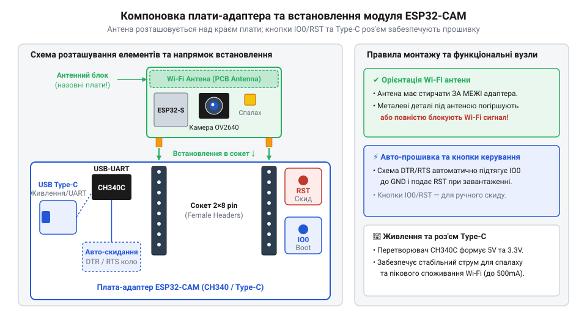
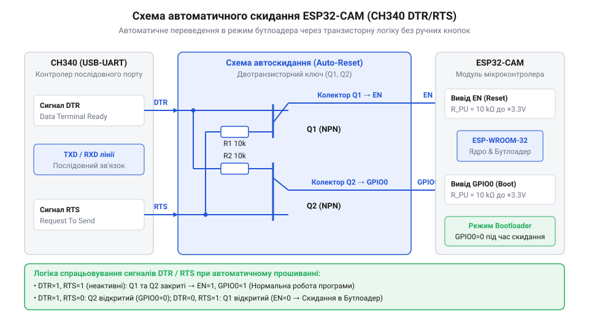
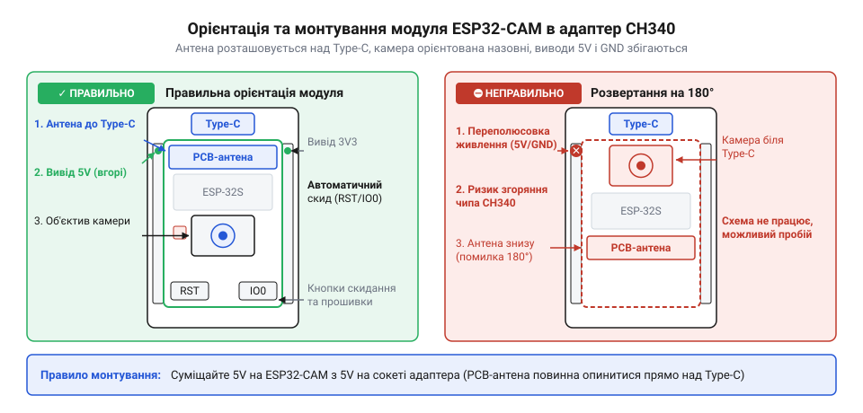

# Плата-адаптер для ESP32-CAM (CH340, Type-C)

<preknowlist>
- [USB-UART адаптер CP2102 (Micro-USB)](root:cat-hw-boards/cp2102-usb-uart) — Принципи роботи послідовного інтерфейсу USB-UART, призначення ліній RX/TX та роль драйверів послідовного порту в ОС.
- [Адаптер живлення й підключення ESP-01](root:cat-hw-boards/esp-01-adapter) — Концепція виносних плат-адаптерів для модулів без вбудованого USB та способи керування режимом завантаження.
</preknowlist>

## Складність ручного прошивання модуля ESP32-CAM

Модуль @@en|ESP32-CAM@@ не має вбудованого інтерфейсу програмування. Підключення через [зовнішній USB-UART перетворювач](root:cat-hw-boards/cp2102-usb-uart) вимагає ручного з'єднання ліній живлення та даних через дворядні штирьові роз'єми. Послідовний порт @@en|UART@@ (від англ. @@en|Universal Asynchronous Receiver-Transmitter@@ — універсальний асинхронний приймач-передавач) вимагає суворого перехресного підключення: лінія передачі `TX` адаптера з'єднується з приймачем `RX` мікроконтролера, а `RX` — із `TX`. Помилка в комутації позбавляє зв'язку з комп'ютером.

Окремим бар'єром є переведення мікросхеми в режим завантажувача (англ. @@en|bootloader@@). Для цього вивід `GPIO0` слід вручну заземлити на `GND` до подачі живлення або натискання кнопки скидання. Ненадійні макетні провідники спричиняють дребезг контактів, нестабільне узгодження логічних рівнів 3.3 В та просідання напруги, що завершується помилками синхронізації утиліти завантаження.

*Монтажний сокет адаптера забезпечує надійне фізичне з'єднання виводів модуля та виключає використання ненадійних макетних провідників.*

## Апаратна структура та автоматичне скидання

Спеціалізована плата-адаптер усуває ручні маніпуляції завдяки інтегрованій схемотехніці. Основою плати є міст @@en|CH340@@, який перетворює дифпару шини @@en|USB Type-C@@ у послідовні сигнальні лінії. Для керування станом мікроконтролера застосовано двотранзисторний вузол автоскидання на біполярних @@en|NPN@@-транзисторах. Він обробляє службові лінії @@en|DTR@@ (від англ. @@en|Data Terminal Ready@@ — готовність термінала даних, від лат. *terminus* — межа) та @@en|RTS@@ (від англ. @@en|Request to Send@@ — запит на передачу, від лат. *requirere* — вимагати). Коли програма завантаження формує низький рівень на @@en|DTR@@ і високий на @@en|RTS@@, схема притягує вивід `GPIO0` до землі; при зміні стану сигналів подається імпульс скидання на лінію `EN`. Це автоматично переводить @@en|ESP32-CAM@@ у @@en|bootloader@@ без маніпуляцій із джамперами.

Пікові струми модуля під час активності @@en|Wi-Fi@@ та камери досягають 300–500 мА, що не перевищує можливості стандартних @@en|USB@@-портів без додаткової стабілізації. Адаптер містить потужний лінійний регулятор @@en|LDO@@ (від англ. @@en|Low Dropout Regulator@@ — стабілізатор із малим спадом напруги), який знижує вхідну напругу 5 В до стабільних 3.3 В і витримує високі імпульсні навантаження.

*Двотранзисторний вузол автоскидання узгоджує керуючі лінії DTR та RTS для автоматичного переведення мікроконтролера в режим прошивання.*

## Встановлення модуля та керування платою

Правильний монтаж модуля @@en|ESP32-CAM@@ у сокет адаптера вимагає суворого дотримання орієнтації виводів. Невірно встановлена плата призводить до дзеркальної переполюсовки шин `5V` та `GND`, що спричиняє миттєвий термічний пробій мікроконтролера. Подібно до того, як розроблені [спеціалізовані адаптери підключення](root:cat-hw-boards/esp-01-adapter) для компактних Wi-Fi модулів, ця плата оснащена дворядним сокетом із чітким маркуванням ключів позиціонування антенного блоку.

Підключення до ПК здійснюється через роз'єм @@en|USB Type-C@@. Для успішної ініціалізації віртуального ком-порту необхідно використовувати кабель із проведеними лініями даних `D+` та `D-`, оскільки зарядні кабелі без силових ліній даних не розпізнаються мостом @@en|CH340@@. Для ручного керування плата адаптера має кнопкові елементи: `RST` перезапускає процесор, а кнопка `IO0` дозволяє примусово підтягнути `GPIO0` до землі у разі збоїв автоматики. При цьому слід враховувати вплив @@en|strapping@@-виводів (від англ. @@en|strapping pins@@ — виводи початкового конфігурування, від англ. *strap* — ремінь або прив'язка), які визначають режим завантаження під час подачі живлення.

*Дотримання маркування ключів та напрямку виводів у сокеті запобігає дзеркальному встановленню модуля та пошкодженню кіл живлення.*

## Відмінності ревізій та апаратні пастки

Малопотужні стабілізатори @@en|LDO@@ у дешевих ревізіях адаптерів не витримують кидків струму під час ініціалізації радіотракту, що викликає апаратне скидання @@en|Brownout Reset@@. Проблему усуває електролітичний конденсатор ємністю `470 µF` між виводами `3.3 V` та `GND`.

Вивід `GPIO4` одночасно керує спалахом і шиною даних [картки пам'яті](root:cat-hw-boards/microsd-card) @@en|microSD@@. Спалах під час зчитування викликає збої завантаження. Для надійності світлодіод вимикають програмно перед зверненням до накопичувача, а швидкість прошивання знижують з 921600 бод до стабільних 115200 бод.

*Компенсаційний конденсатор на лінії 3.3 В запобігає скиданням Brownout Reset.*
